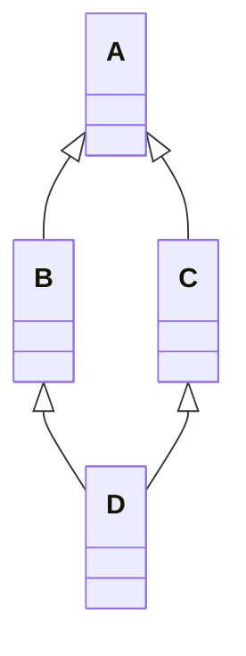

# Inheritance, MRO and super

Inheritance lets a new class (the **subclass**, child or derived class) reuse and specialise an existing one (the **superclass**, parent or base class). Python supports single and multiple inheritance, and resolves "which method runs?" with a precise algorithm called C3 linearisation, exposed as the **method resolution order** (MRO). This lesson explains overriding, `super()`, the MRO, mixins, and when to prefer composition instead.

## Single inheritance

Goodrich (§2.4.1) extends the `CreditCard` class with a `PredatoryCreditCard` that charges a fee on rejected charges and applies monthly interest. The subclass inherits everything, **overrides** `charge`, and **extends** with a new method:

```python-run
class CreditCard:
    def __init__(self, customer, limit):
        self._customer = customer
        self._limit = limit
        self._balance = 0
    def get_balance(self):
        return self._balance
    def charge(self, price):
        if price + self._balance > self._limit:
            return False
        self._balance += price
        return True

class PredatoryCreditCard(CreditCard):
    OVERLIMIT_FEE = 5

    def __init__(self, customer, limit, apr):
        super().__init__(customer, limit)     # let the parent initialise its part
        self._apr = apr

    def charge(self, price):                  # override
        success = super().charge(price)       # reuse the parent's logic
        if not success:
            self._balance += self.OVERLIMIT_FEE
        return success

    def process_month(self):                  # extension
        if self._balance > 0:
            self._balance *= (1 + self._apr) ** (1 / 12)

c = PredatoryCreditCard("Brook", 100, 0.0825)
print(c.charge(90), c.charge(50), round(c.get_balance(), 2))
c.process_month()
print(round(c.get_balance(), 2))
print(isinstance(c, CreditCard), issubclass(PredatoryCreditCard, CreditCard))
```

Key ideas:

- **Overriding**: define a method with the same name; lookup finds the subclass's version first.
- **Extending**: call `super().method(...)` to run the parent's version as part of yours.
- **`isinstance(obj, Base)`** is true for subclass instances — the "is-a" relationship. Prefer `isinstance` over `type(obj) == Base`, which breaks for subclasses.
- Every class ultimately inherits from `object`, which supplies defaults for `__repr__`, `__eq__`, `__hash__`, `__init__` and more.

### Dynamic dispatch

When a parent method calls `self.something()`, the lookup starts at the *actual* type of `self`. So a base class can define a template algorithm and let subclasses fill in steps — the **template method pattern**. Goodrich's numeric progressions (§2.4.2) are a textbook example:

```python-run
class Progression:
    def __init__(self, start=0):
        self._current = start
    def _advance(self):                 # hook for subclasses
        self._current += 1
    def __iter__(self):
        return self
    def __next__(self):
        if self._current is None:
            raise StopIteration
        answer = self._current
        self._advance()                 # dispatches to the subclass's version
        return answer
    def first(self, n):
        return [next(self) for _ in range(n)]

class ArithmeticProgression(Progression):
    def __init__(self, increment=1, start=0):
        super().__init__(start)
        self._increment = increment
    def _advance(self):
        self._current += self._increment

class GeometricProgression(Progression):
    def __init__(self, base=2, start=1):
        super().__init__(start)
        self._base = base
    def _advance(self):
        self._current *= self._base

class FibonacciProgression(Progression):
    def __init__(self, first=0, second=1):
        super().__init__(first)
        self._prev = second - first
    def _advance(self):
        self._prev, self._current = self._current, self._prev + self._current

print(Progression().first(5))
print(ArithmeticProgression(5).first(5))
print(GeometricProgression(3).first(5))
print(FibonacciProgression(4, 6).first(6))
```

`first` and `__next__` are written once in the base; each subclass only describes how to advance.

## Multiple inheritance and the MRO

A class can list several bases: `class C(A, B):`. Python then needs a rule for which base to search first. The rule is the **C3 linearisation**, and its result is the class's `__mro__`: a list in which

1. a class always appears before its bases,
2. the order of bases in each class statement is preserved (left before right),
3. every class appears exactly once.

Attribute lookup walks the MRO left to right.

```python-run
class A:
    def hello(self): return "A"
class B(A):
    def hello(self): return "B"
class C(A):
    def hello(self): return "C"
class D(B, C):
    pass

print([k.__name__ for k in D.__mro__])
print(D().hello())
```

This is the **diamond**: `D` inherits from `B` and `C`, which both inherit from `A`. The MRO is `D, B, C, A, object` — note that `A` comes *after* both `B` and `C`, so `A` isn't consulted until all its children have been.



If no consistent order exists, Python refuses to create the class:

```python-run
class X: pass
class Y(X): pass
try:
    class Z(X, Y): pass          # X before Y, but Y is a subclass of X: impossible
except TypeError as e:
    print("TypeError:", e)
```

## What `super()` really does

`super()` does **not** mean "my parent class". It means "the **next class in the MRO of the instance's type**, after the current class". In single inheritance that's the parent; in multiple inheritance it may be a sibling.

```python-run
class Base:
    def __init__(self):
        print("Base.__init__")

class Left(Base):
    def __init__(self):
        print("Left.__init__ -> super()")
        super().__init__()

class Right(Base):
    def __init__(self):
        print("Right.__init__ -> super()")
        super().__init__()

class Child(Left, Right):
    def __init__(self):
        print("Child.__init__ -> super()")
        super().__init__()

Child()
print([k.__name__ for k in Child.__mro__])
```

`Left.__init__` calls `super().__init__()`, which goes to `Right` — not `Base` — because the instance is a `Child` whose MRO is `Child, Left, Right, Base, object`. Each `__init__` runs exactly once. This **cooperative** behaviour works only if every class in the chain calls `super()`. If `Left` called `Base.__init__(self)` directly, `Right.__init__` would be skipped.

### Cooperative signatures

When classes in a hierarchy need different constructor arguments, the convention is to accept `**kwargs`, consume what you need, and pass the rest along:

```python-run
class Named:
    def __init__(self, *, name, **kwargs):
        super().__init__(**kwargs)
        self.name = name

class Aged:
    def __init__(self, *, age, **kwargs):
        super().__init__(**kwargs)
        self.age = age

class Pirate(Named, Aged):
    def __init__(self, *, bounty, **kwargs):
        super().__init__(**kwargs)
        self.bounty = bounty

p = Pirate(name="Brook", age=90, bounty=383_000_000)
print(vars(p))
```

## Mixins

A **mixin** is a small class providing one extra capability, designed to be combined with others through multiple inheritance. It typically has no `__init__` state and relies on methods/attributes of the host class.

```python-run
import json

class ReprMixin:
    def __repr__(self):
        fields = ", ".join(f"{k}={v!r}" for k, v in vars(self).items())
        return f"{type(self).__name__}({fields})"

class JsonMixin:
    def to_json(self):
        return json.dumps(vars(self))

class Song(ReprMixin, JsonMixin):
    def __init__(self, title, bpm):
        self.title, self.bpm = title, bpm

s = Song("Binks' Sake", 96)
print(s, s.to_json())
```

Mixins conventionally go to the **left** of the main base class so their methods take priority.

## Composition over inheritance

Inheritance models "is-a". Many relationships are actually "has-a": a `Car` *has* an `Engine`; it isn't one. **Composition** — holding another object as an attribute and delegating to it — is usually more flexible: you can swap the component at runtime, avoid fragile deep hierarchies, and expose only what you choose.

```python-run
class Engine:
    def start(self): return "vroom"

class ElectricEngine:
    def start(self): return "hum"

class Car:
    def __init__(self, engine):
        self.engine = engine            # has-a
    def start(self):
        return f"car goes {self.engine.start()}"   # delegation

print(Car(Engine()).start(), Car(ElectricEngine()).start())
```

Rule of thumb: inherit when the subclass truly is a specialised kind of the base and should be usable anywhere the base is (the **Liskov substitution principle**); otherwise compose. Subclassing built-ins like `dict` or `list` is a common trap — their C implementations often don't call your overridden methods (e.g., `dict.update` ignores your `__setitem__`). Subclass `collections.UserDict`/`UserList` or the ABCs in `collections.abc` instead.

```python-run
class LoudDict(dict):
    def __setitem__(self, k, v):
        super().__setitem__(k, str(v).upper())

d = LoudDict()
d["a"] = "x"
d.update(b="y")              # bypasses __setitem__!
print(d)

from collections import UserDict
class LoudUserDict(UserDict):
    def __setitem__(self, k, v):
        super().__setitem__(k, str(v).upper())
u = LoudUserDict()
u["a"] = "x"; u.update(b="y")
print(u)
```

## Polymorphism and duck typing

Polymorphism means one interface, many implementations. In Python you don't need a shared base class for it — any object with the right methods works (duck typing). Inheritance is just one way to *share code*; it isn't required to *share an interface*. Abstract base classes and `typing.Protocol` (later lessons) let you make those interfaces explicit.

> [!INTERVIEW]
> "Explain the MRO / diamond problem in Python." — Python computes a C3 linearisation (`Cls.__mro__`) so each class appears once, children before parents, and base order is preserved. `super()` delegates to the next class in the *instance's* MRO, which enables cooperative multiple inheritance where every `__init__` runs exactly once. Follow-up: "composition vs inheritance?" — prefer composition for has-a relationships and to avoid brittle hierarchies.

## Pitfalls recap

- Forgetting to call `super().__init__()` in a subclass initialiser — parent attributes never get set.
- Calling `Parent.__init__(self)` directly in a multiple-inheritance hierarchy — breaks cooperation.
- Using `type(x) == Base` instead of `isinstance`.
- Deep inheritance chains that are hard to follow; prefer composition.
- Subclassing `dict`/`list` and expecting all methods to route through your overrides.

## Summary

Subclasses inherit attributes and methods, override them, and extend them, using `super()` to reuse parent behaviour. Python resolves lookups along the C3 MRO, which handles diamonds and enables cooperative multiple inheritance. Mixins add focused capabilities; composition is often the better tool for has-a relationships.

```quiz
[
  {"q": "For `class D(B, C)` where B and C both inherit from A, what is D's MRO?", "options": ["D, B, A, C, object", "D, B, C, A, object", "D, A, B, C, object", "D, C, B, A, object"], "answer": 1,
   "explain": "C3 keeps children before parents and preserves the base order, so A comes after both B and C."},
  {"q": "What does super() return a proxy for?", "options": ["Always the direct parent class", "The next class after the current one in the MRO of type(self)", "object", "The first base class listed"], "answer": 1,
   "explain": "That's why super() can reach a sibling class in multiple inheritance."},
  {"q": "Why should every class in a cooperative hierarchy call super().__init__()?", "options": ["Style only", "So the chain continues along the MRO and every initialiser runs exactly once", "To make instances hashable", "It's required syntax"], "answer": 1,
   "explain": "If one class breaks the chain, the classes after it in the MRO are skipped."},
  {"q": "Best check that `obj` is a Shape or any subclass?", "options": ["type(obj) == Shape", "isinstance(obj, Shape)", "obj.__class__ is Shape", "Shape in dir(obj)"], "answer": 1,
   "explain": "isinstance respects inheritance; type equality does not."},
  {"q": "Why might `dict.update` bypass your overridden `__setitem__` in a dict subclass?", "options": ["It's a bug", "Built-in C methods call internal routines directly, not your Python override", "update is static", "Because of __slots__"], "answer": 1,
   "explain": "Use collections.UserDict when you need all paths to go through your methods."},
  {"q": "A Car that holds an Engine object and calls engine.start() is an example of:", "options": ["Multiple inheritance", "Composition and delegation", "A mixin", "Monkey patching"], "answer": 1,
   "explain": "Has-a relationships are modelled by storing a component and delegating to it."},
  {"q": "In the template method pattern, a base-class method calls self._step(). Which _step runs?", "options": ["Always the base version", "The version found first in the MRO of the instance's actual class", "A random one", "None; it raises"], "answer": 1,
   "explain": "Dynamic dispatch looks up methods starting from type(self)."}
]
```

> **Source:** Goodrich, Tamassia & Goldwasser, *Data Structures and Algorithms in Python*, §2.4 (Inheritance: extending CreditCard, numeric progressions) and §2.5.2 (Name Resolution and Dynamic Dispatch); Python docs, *Tutorial* §9.5 "Inheritance", *Library Reference* `super()`, and "The Python 2.3 Method Resolution Order".
