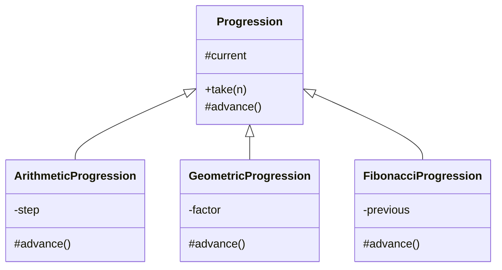
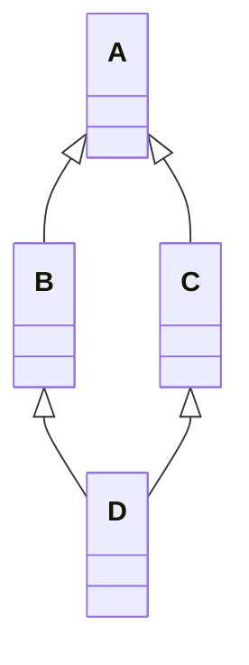

# Inheritance, MRO and super

> **Before this lesson:** read [Classes and instances](#/lesson/python/py-classes) first. You should know what a class, an instance, `self`, `__init__` and an attribute lookup (instance first, then class) are. `**kwargs` and keyword-only parameters come from [Functions and arguments](#/lesson/python/py-functions-args).

## In plain words

**Inheritance** lets you define a new class by saying "it is like that existing class, except for these differences". The new class automatically has everything the existing one has, and you write only what is new or different.

Think of job descriptions. A company has a description for "employee": has a badge, gets paid monthly, may book holidays. The description for "manager" does not repeat all that. It says "a manager is an employee who also approves holidays, and whose pay is worked out differently". Anyone handling a manager can treat them as an employee, because a manager *is an* employee.

Some vocabulary, used throughout: the existing class is the **base class** (also called parent or superclass); the new one is the **subclass** (child, derived class). Replacing one of the parent's methods with your own version is **overriding** it. The built-in function `super()` lets the subclass call the parent's version from inside its own.

Python also allows a class to have *several* base classes at once (**multiple inheritance**). That raises a question: if two parents both have a method with the same name, which one runs? Python answers with a fixed search order for each class, called the **MRO** (method resolution order).

Why this matters for a job: every framework you will use (Django, pytest, the standard library's own error types) asks you to subclass its classes. Interviewers ask about the MRO, the "diamond problem" and what `super()` really does. And knowing when *not* to inherit, and to build an object out of other objects instead (**composition**), is one of the clearest signs of design experience.

## Single inheritance

Start with one base class. The example reuses the idea of a water tank from the previous lesson. `MeteredTank` is a tank whose owner pays for the water delivered: it inherits everything from `WaterTank`, **overrides** `fill` to add the billing, and **extends** the class with a new method.

```python-run
class WaterTank:
    def __init__(self, owner, capacity):
        self._owner = owner
        self._capacity = capacity
        self._level = 0
    def level(self):
        return self._level
    def fill(self, litres):
        if self._level + litres > self._capacity:
            return False
        self._level += litres
        return True

class MeteredTank(WaterTank):
    CALLOUT_FEE = 5                           # charged when a delivery is refused

    def __init__(self, owner, capacity, price_per_litre):
        super().__init__(owner, capacity)     # let the parent initialise its part
        self._price = price_per_litre
        self._owed = 0.0

    def fill(self, litres):                   # override
        accepted = super().fill(litres)       # reuse the parent's logic
        self._owed += litres * self._price if accepted else self.CALLOUT_FEE
        return accepted

    def bill(self):                           # extension
        return round(self._owed, 2)

t = MeteredTank("Brook", 100, 0.25)
print(t.fill(90), t.fill(50), t.level(), t.bill())
print(isinstance(t, WaterTank), issubclass(MeteredTank, WaterTank))
```

**Reading this code line by line**

- `class MeteredTank(WaterTank):` names the base class in parentheses. `MeteredTank` now has `level` and `fill` without writing them.
- Its `__init__` takes one more argument than the parent's. The first thing it does is `super().__init__(owner, capacity)`, which runs the parent's initialiser so that `_owner`, `_capacity` and `_level` get set. Then it adds its own two attributes.
- `fill` has the same name as a parent method, so it overrides it: for a `MeteredTank`, this version is found first. Inside, `super().fill(litres)` calls the parent's version to do the real work and reports whether the water fitted. The override then adds the cost of the water, or a fixed fee if the delivery was refused.
- `bill` is a new method that the parent does not have.
- `CALLOUT_FEE` is a class attribute, read through `self`.

The output is `True False 90 27.5`: 90 litres accepted (22.50 owed), 50 litres refused (5.00 fee), level still 90. The second line prints `True True`: the object counts as a `WaterTank`, and the class is a subclass of it.

The ideas in that example, stated generally:

- **Overriding**: define a method with the same name as one in the parent. Attribute lookup reaches the subclass before the parent, so the subclass's version is found first.
- **Extending**: inside the override, call `super().method(...)` to run the parent's version as one step of yours.
- **`isinstance(obj, Base)`** is true for instances of subclasses as well. This is the "is-a" relationship. Prefer `isinstance` to `type(obj) == Base`, which is false for subclass instances.
- Every class inherits, directly or indirectly, from the built-in class `object`, which supplies default versions of `__repr__`, `__eq__`, `__hash__`, `__init__` and others.

### Dynamic dispatch

When a method written in the parent calls `self.something()`, the search for `something` starts at the *actual* class of the object, not at the class where the calling method is written. Choosing the method at run time according to the object's real class is called **dynamic dispatch**.

This makes a useful design possible. The base class writes the overall procedure once and calls small helper methods for the steps; each subclass replaces only the helpers. The small replaceable methods are called **hooks**, and the design is known as the **template method pattern**. Here a base class knows how to export rows of data as text, and subclasses decide what a header and a line look like:

```python-run
class Exporter:
    """export() is written once; subclasses supply the pieces."""
    def export(self, rows):
        lines = [self._header(rows[0])]
        for row in rows:
            lines.append(self._line(row))     # dispatches to the subclass's version
        return "\n".join(lines)
    def _header(self, first_row):             # hook with a default
        return " ".join(first_row)
    def _line(self, row):                     # hook with a default
        return " ".join(str(v) for v in row.values())

class CsvExporter(Exporter):
    def _header(self, first_row):
        return ",".join(first_row)
    def _line(self, row):
        return ",".join(str(v) for v in row.values())

class MarkdownExporter(Exporter):
    def _header(self, first_row):
        return "| " + " | ".join(first_row) + " |\n|" + "---|" * len(first_row)
    def _line(self, row):
        return "| " + " | ".join(str(v) for v in row.values()) + " |"

class ShoutingCsvExporter(CsvExporter):
    def _line(self, row):
        return super()._line(row).upper()

rows = [{"name": "ana", "age": 31}, {"name": "ben", "age": 25}]
for cls in (Exporter, CsvExporter, MarkdownExporter, ShoutingCsvExporter):
    print(cls.__name__)
    print(cls().export(rows))
```

`export` exists only in `Exporter`. When it runs on a `CsvExporter`, the calls `self._header(...)` and `self._line(...)` find the `CsvExporter` versions, because the search starts at the object's own class; the output is comma-separated. On a `MarkdownExporter` the same `export` produces a table with `|` separators. `ShoutingCsvExporter` inherits from `CsvExporter`, overrides one hook, and inside it calls `super()._line(row)` to get the normal line before converting it to capitals. Four output formats, one copy of the procedure.

## Case study: a family of number series

Water tanks showed the mechanics. Here is a complete small hierarchy, built the way you would plan one: put what every member shares in a base class, and let each subclass change only what makes it different.

**The problem.** We want several kinds of number series: counting 0, 1, 2, 3...; stepping by a fixed amount; multiplying by a fixed factor; and the Fibonacci series, where each value is the sum of the previous two. All of them must work in a `for` loop and let us ask for "the next 8 values".

**Finding the common part.** Every series has a *current value*, hands it out, and then moves on. Only "move on" differs. So the base class does everything except the moving, and leaves that to a **hook**, a small method meant to be overridden. The base class's loop-facing methods (`__iter__` and `__next__`, the iterator protocol from the iterators lesson) never change; they call `self._advance()`, and **dynamic dispatch** picks the right version for whichever subclass the object belongs to. This arrangement is the template method pattern again, and its payoff is that adding a new series means writing one short method.

The hierarchy, drawn with the diagram notation from the classes lesson (the hollow triangle `<|--` means "is a kind of"):



(`#` marks a member meant for subclasses to use, which Python writes with a single leading underscore.)

```python-run
class Progression:
    """Base class: a number series that remembers where it is. Steps through 0, 1, 2, ... by default."""

    def __init__(self, start=0):
        self._current = start

    def _advance(self):
        """Hook: compute the next value from self._current. Subclasses override this."""
        self._current += 1

    def __iter__(self):
        return self

    def __next__(self):
        value = self._current
        self._advance()
        return value

    def take(self, n):
        """Return the next n values as a list."""
        return [next(self) for _ in range(n)]


class ArithmeticProgression(Progression):
    """Adds a fixed step each time."""

    def __init__(self, step=1, start=0):
        super().__init__(start)
        self._step = step

    def _advance(self):
        self._current += self._step


class GeometricProgression(Progression):
    """Multiplies by a fixed factor each time."""

    def __init__(self, factor=2, start=1):
        super().__init__(start)
        self._factor = factor

    def _advance(self):
        self._current *= self._factor


class FibonacciProgression(Progression):
    """Each value is the sum of the two before it."""

    def __init__(self, first=0, second=1):
        super().__init__(first)
        self._previous = second - first          # so that the first advance yields 'second'

    def _advance(self):
        self._previous, self._current = self._current, self._previous + self._current


for series in (Progression(), ArithmeticProgression(5, start=2),
               GeometricProgression(3), FibonacciProgression(), FibonacciProgression(4, 6)):
    print(f"{type(series).__name__:<22}", series.take(8))

print(isinstance(FibonacciProgression(), Progression))
print([c.__name__ for c in FibonacciProgression.__mro__])
```

**Reading the code**

- `Progression` stores the current value, `__next__` returns it and then calls `_advance`, and `take(n)` collects `n` values. The default `_advance` adds 1, so the base class on its own is a plain counter.
- `ArithmeticProgression` and `GeometricProgression` each add one attribute (`_step`, `_factor`), call `super().__init__(start)` so the base class sets up `_current`, and override only `_advance`. Their default starting values (0 and 1) are chosen to be natural for each kind.
- `FibonacciProgression` needs two values of memory, so it adds `_previous`. Its constructor stores `second - first` there, so that the first move produces `second`; the advance step then shifts the pair along. With the default arguments the series is 0, 1, 1, 2, 3, 5, 8, 13, and with `(4, 6)` it is 4, 6, 10, 16...
- The loop at the bottom treats all five objects identically, calling `take(8)` without knowing their classes. That is **polymorphism**: one interface, several behaviours.
- The last two lines show the is-a relationship (`isinstance` is true for the base class) and the **MRO**: the chain Python searches, from the object's own class up through `Progression` to `object`.

**What the design buys.** The three subclasses together contain about a dozen lines of arithmetic, and none of them repeats the iteration code. A fourth series, say squares, is another subclass overriding `_advance`. And because every subclass honours the base class's promise (it can be used in a `for` loop and with `take`), any code written for `Progression` works with all of them. That promise is the Liskov substitution principle from the glossary.

> [!NOTE]
> The base class chose to expose a protected hook (`_advance`) instead of making subclasses override `__next__`. Hooks keep the part that must stay the same (return the value, then move on) in one place, so a subclass cannot forget half of it.

## Multiple inheritance and the MRO

A class may name several base classes: `class C(A, B):`. Python then needs a rule for which base to search first when a name is looked up. The rule is an algorithm called **C3 linearisation** ("linearisation" because it arranges the whole family of classes in one line). Its result is stored on the class as `__mro__`, the method resolution order: a list in which

1. a class always appears before its bases,
2. the order of bases in each class statement is preserved (left before right),
3. every class appears exactly once.

Looking up an attribute means walking through this list from left to right and taking the first class that has it.

```python-run
class A:
    def hello(self): return "A"
class B(A):
    def hello(self): return "B"
class C(A):
    def hello(self): return "C"
class D(B, C):
    pass

print([k.__name__ for k in D.__mro__])
print(D().hello())
```

`B` and `C` both inherit from `A`, and `D` inherits from both of them. Drawn as a picture (below), the four classes form a **diamond**, which is why the question "which `hello` does `D` get?" is called the diamond problem. Python's answer is the printed MRO: `D, B, C, A, object`. `D` has no `hello` of its own, so the first class in the list that has one, `B`, wins and the program prints `B`. Note that `A` comes *after* both `B` and `C`: a parent is not consulted until all of its children in the family have been.



If the three rules cannot all be satisfied, Python refuses to create the class:

```python-run
class X: pass
class Y(X): pass
try:
    class Z(X, Y): pass          # X before Y, but Y is a subclass of X: impossible
except TypeError as e:
    print("TypeError:", e)
```

`class Z(X, Y)` asks for `X` to be searched before `Y` (the order written). But `Y` is a subclass of `X`, and a class must come before its bases, so `Y` must come before `X`. Both cannot hold, and Python reports `Cannot create a consistent method resolution order`.

## What `super()` really does

`super()` does **not** mean "my parent class". It means "the **next class after the current one in the MRO of the object's own class**". With a single base class that is the parent. With multiple inheritance it may be a *sibling*, a class the current one knows nothing about.

```python-run
class Base:
    def __init__(self):
        print("Base.__init__")

class Left(Base):
    def __init__(self):
        print("Left.__init__ -> super()")
        super().__init__()

class Right(Base):
    def __init__(self):
        print("Right.__init__ -> super()")
        super().__init__()

class Child(Left, Right):
    def __init__(self):
        print("Child.__init__ -> super()")
        super().__init__()

Child()
print([k.__name__ for k in Child.__mro__])
```

The printed order is `Child`, `Left`, `Right`, `Base`. Look at the step from `Left` to `Right`. `Left` was written as a subclass of `Base`, yet its `super().__init__()` went to `Right`. The reason: the object is a `Child`, whose MRO is `Child, Left, Right, Base, object`, and "the next class after `Left`" in that list is `Right`.

The result is that each `__init__` runs exactly once, although `Base` is reachable by two routes. This arrangement is called **cooperative** inheritance, and it works only if every class in the chain calls `super()`. Had `Left` called `Base.__init__(self)` directly, `Right.__init__` would have been skipped.

### Cooperative signatures

A practical problem follows: the classes in such a chain usually need different arguments, and none of them knows which class comes next. The convention is that each `__init__` accepts keyword arguments, takes out the ones it needs, and passes all the rest along with `**kwargs`:

```python-run
class Named:
    def __init__(self, *, name, **kwargs):
        super().__init__(**kwargs)
        self.name = name

class Aged:
    def __init__(self, *, age, **kwargs):
        super().__init__(**kwargs)
        self.age = age

class Pirate(Named, Aged):
    def __init__(self, *, bounty, **kwargs):
        super().__init__(**kwargs)
        self.bounty = bounty

p = Pirate(name="Brook", age=90, bounty=383_000_000)
print(vars(p))
```

`Pirate(...)` receives three keyword arguments. `Pirate.__init__` takes `bounty` and passes the rest on; `Named.__init__` (next in the MRO) takes `name`; `Aged.__init__` takes `age`; by the time the chain reaches `object`, nothing is left over. The final dictionary shows all three attributes. The bare `*` in each header makes the parameters keyword-only, which is what keeps this scheme safe.

## Mixins

A **mixin** is a small class that provides one extra ability and is meant to be combined with other classes through multiple inheritance. It normally has no data of its own and no `__init__`; it relies on the attributes of whatever class it is mixed into.

```python-run
import json

class ReprMixin:
    def __repr__(self):
        fields = ", ".join(f"{k}={v!r}" for k, v in vars(self).items())
        return f"{type(self).__name__}({fields})"

class JsonMixin:
    def to_json(self):
        return json.dumps(vars(self))

class Song(ReprMixin, JsonMixin):
    def __init__(self, title, bpm):
        self.title, self.bpm = title, bpm

s = Song("Binks' Sake", 96)
print(s, s.to_json())
```

`ReprMixin` supplies a `__repr__` that works for any class, by reading the instance's attributes with `vars(self)`. `JsonMixin` supplies a method that turns those attributes into JSON text (a common data format). `Song` gains both abilities by listing the two mixins as bases. By convention mixins are written to the **left** of the main base class, so that their methods come earlier in the MRO and take priority.

## Composition over inheritance

Inheritance expresses "is-a". Many relationships are really "has-a": a `Car` *has* an `Engine`; it is not one. **Composition** means keeping another object as an attribute and passing work on to it (passing work on is called **delegation**). It is usually the more flexible design: the component can be exchanged while the program runs, there is no deep family tree to keep in your head, and you expose only the operations you choose.

```python-run
class Engine:
    def start(self): return "vroom"

class ElectricEngine:
    def start(self): return "hum"

class Car:
    def __init__(self, engine):
        self.engine = engine            # has-a
    def start(self):
        return f"car goes {self.engine.start()}"   # delegation

print(Car(Engine()).start(), Car(ElectricEngine()).start())
```

The `Car` class does not care what kind of engine it holds, as long as the engine has a `start` method. The same `Car` code prints `car goes vroom` and `car goes hum`.

Rule of thumb: inherit when the subclass really is a special kind of the base and can be used anywhere the base is expected without surprises (this requirement is the **Liskov substitution principle**); otherwise compose.

Subclassing built-in types such as `dict` or `list` is a common trap. Their methods are written in C and often call each other internally without going through your overrides; `dict.update`, for example, ignores an overridden `__setitem__` (the special method behind `d[k] = v`). Subclass `collections.UserDict` / `UserList`, which are written in Python for this purpose, or the base classes in `collections.abc`.

```python-run
class LoudDict(dict):
    def __setitem__(self, k, v):
        super().__setitem__(k, str(v).upper())

d = LoudDict()
d["a"] = "x"
d.update(b="y")              # bypasses __setitem__!
print(d)

from collections import UserDict
class LoudUserDict(UserDict):
    def __setitem__(self, k, v):
        super().__setitem__(k, str(v).upper())
u = LoudUserDict()
u["a"] = "x"; u.update(b="y")
print(u)
```

`LoudDict` is supposed to store every value in capitals. Direct assignment works, but `update` slips past the override: the output is `{'a': 'X', 'b': 'y'}`. The `UserDict` version routes every way of writing through `__setitem__` and prints `{'a': 'X', 'b': 'Y'}`.

## Polymorphism and duck typing

**Polymorphism** means that code written against one interface works with many different implementations: `export`, `start` and `hello` above each did different things depending on the object. In Python, polymorphism does not require a shared base class. Any object with the right methods will do (duck typing). Inheritance is one way to *share code*; it is not needed in order to *share an interface*. Abstract base classes and `typing.Protocol`, covered in later lessons, let you write such interfaces down.

> [!INTERVIEW]
> "Explain the MRO and the diamond problem in Python." Python computes a C3 linearisation (`Cls.__mro__`) in which each class appears once, children come before parents, and the written order of bases is kept. `super()` passes the call to the next class in the MRO of the *object's* class, which makes cooperative multiple inheritance possible: every `__init__` runs exactly once. Follow-up: "composition or inheritance?" Prefer composition for has-a relationships and to avoid brittle family trees.

## Computing the MRO by hand

You can compute an MRO on paper. The C3 rule reads: *the linearisation of a class is the class itself, followed by a merge of the linearisations of its bases and the list of those bases*. The merge works on several lists at once. Call the first item of a list its **head** and the rest its **tail**. Repeatedly take the first head that does not appear in the tail of any list, append it to the result, and remove it from every list. If at some point no head qualifies, the family of classes is inconsistent.

Worked example for `class D(B, C)` with `B(A)` and `C(A)` (writing `o` for `object`):

```
L[A] = A o
L[B] = B A o
L[C] = C A o
L[D] = D + merge(B A o,  C A o,  B C)
     take B   (not in any tail)         -> merge(A o,  C A o,  C)
     A?       A is in the tail of "C A o": skip.  take C  -> merge(A o,  A o)
     take A, then o
L[D] = D B C A o
```

The step where `A` is rejected is the heart of the algorithm: `A` may not be placed until every class that inherits from it (here `C`) has been placed. Here is the algorithm as a runnable function, checked against Python's own answer:

```python-run
def c3(cls):
    def merge(seqs):
        result, seqs = [], [list(s) for s in seqs if s]
        while seqs:
            for seq in seqs:
                head = seq[0]
                if not any(head in other[1:] for other in seqs):
                    break
            else:
                raise TypeError("inconsistent hierarchy")
            result.append(head)
            seqs = [[c for c in s if c is not head] for s in seqs]
            seqs = [s for s in seqs if s]
        return result
    return [cls] + merge([c3(base) for base in cls.__bases__] + [list(cls.__bases__)])

class A: pass
class B(A): pass
class C(A): pass
class D(B, C): pass
class E(C, B): pass
class F(D): pass

for k in (D, E, F):
    mine = c3(k)
    print(k.__name__, [c.__name__ for c in mine], mine == list(k.__mro__))
```

Each printed line ends in `True`: the hand-written function agrees with `__mro__`. `E(C, B)` gives `E C B A object`; swapping the order of the bases swaps their priority. A class `G(D, E)` could not exist, because `D` requires B before C and `E` requires C before B.

## `super()` with and without arguments

Inside a method, `super()` with no arguments is shorthand for `super(CurrentClass, self)`: "search the MRO of `type(self)`, starting *after* `CurrentClass`". Python makes the short form work by quietly giving every method that mentions `super` a hidden closure variable named `__class__`. Knowing the long form lets you see, and occasionally choose, where the search begins:

```python-run
class Base:
    def who(self): return "Base"
class Mid(Base):
    def who(self): return "Mid > " + super().who()
class Leaf(Mid):
    def who(self): return "Leaf > " + super().who()

x = Leaf()
print(x.who())
print(super(Leaf, x).who())          # start after Leaf  -> Mid's version
print(super(Mid, x).who())           # start after Mid   -> skips Mid entirely
print(Leaf.who.__closure__ is not None, "__class__" in Leaf.who.__code__.co_freevars)
```

The normal call prints `Leaf > Mid > Base`. `super(Leaf, x).who()` starts after `Leaf` and so runs `Mid`'s version: `Mid > Base`. `super(Mid, x).who()` starts after `Mid` and reaches `Base` directly. The last line confirms the hidden `__class__` variable.

`super()` is not only for `__init__`. It works in any method, in class methods and in properties. A subclass's `__eq__`, `__repr__` or `save()` that builds on the parent's behaviour should call `super()` in the same way.

## Debugging inheritance

- **"Which version of the method really runs?"** Print `type(obj).__mro__`, then find the first class in it that defines the method: `next(c for c in type(obj).__mro__ if "name" in vars(c))`. `inspect.getsource(obj.method)` shows the winning code.
- **`AttributeError` for an attribute the parent sets**: the subclass defined `__init__` and never called `super().__init__(...)`.
- **`TypeError: object.__init__() takes exactly one argument`**: in a cooperative chain, some class passed leftover keyword arguments all the way up to `object`. Each class must take out its own arguments before forwarding `**kwargs`.
- **A parent method "ignores" the subclass's data**: name-mangled attributes (`__x`) belong to the class that defined them; use a single underscore for attributes that subclasses should see.
- **An overriding method is never called**: its name does not match the parent's. A typo creates a *new* method and overrides nothing. Type checkers support the marker `@typing.override` (Python 3.12+) to catch this.

```python-run
class Animal:
    def speak(self): return "..."
class Dog(Animal):
    def speek(self): return "woof"        # typo: does not override
d = Dog()
print(d.speak())
print([c.__name__ for c in type(d).__mro__ if "speak" in vars(c)], sorted(n for n in vars(Dog) if not n.startswith("_")))
```

`Dog` meant to override `speak` but spelled it `speek`, so `d.speak()` still prints the parent's `...`. The second line shows how to find out: only `Animal` defines `speak`, and `Dog`'s own names are `['speek']`.

## Inheritance, mixins, composition, protocols: choosing

| Mechanism | Relationship | Coupling | Use when |
|---|---|---|---|
| Single inheritance | is-a | tight: subclass depends on parent internals | a true specialisation that must be substitutable for the parent |
| Mixin | can-do | medium | adding one orthogonal capability to several unrelated classes |
| Composition | has-a | loose: only the component's public interface | reusing behaviour, swapping implementations, limiting the exposed API |
| Protocol / duck typing | behaves-like | none | callers only need certain methods; no shared code required |

A useful test before subclassing: *would every method of the parent make sense on the child, now and in the future?* A `Stack` that inherits from `list` fails at once, since `insert(0, x)` breaks the rule that a stack is changed only at the top. If the answer is no, compose.

## Pitfalls recap

- Forgetting to call `super().__init__()` in a subclass initialiser, so the parent's attributes are never set.
- Calling `Parent.__init__(self)` directly where multiple inheritance is involved, which breaks the cooperative chain.
- Using `type(x) == Base` where `isinstance` is meant.
- Deep chains of inheritance that are hard to follow; prefer composition.
- Subclassing `dict` or `list` and expecting every method to go through your overrides.

## Summary

A subclass inherits attributes and methods, may override them, and may extend them, using `super()` to reuse the parent's behaviour. Python resolves every lookup along the C3 MRO, which settles the diamond case and makes cooperative multiple inheritance work. Mixins add one focused ability each; composition is often the better tool when the relationship is has-a.

## Glossary

- **Inheritance** - defining a class as a variation of an existing class, whose attributes and methods it receives.
- **Base class (parent, superclass)** - the class being inherited from.
- **Subclass (child, derived class)** - the class that inherits.
- **Override** - to define in a subclass a method with the same name as one in the parent.
- **`super()`** - an object that passes a method call to the next class in the MRO.
- **`object`** - the built-in class at the root of every class's family tree.
- **Dynamic dispatch** - choosing which method runs from the object's actual class, at run time.
- **Hook** - a small method intended to be overridden by subclasses.
- **Template method pattern** - a base-class method that fixes a procedure and calls hooks for its steps.
- **Multiple inheritance** - a class having more than one base class.
- **MRO (method resolution order)** - the ordered list of classes searched for an attribute; `Cls.__mro__`.
- **C3 linearisation** - the algorithm that computes the MRO.
- **Diamond** - a family in which a class inherits from two classes that share a common base.
- **Cooperative inheritance** - every class calling `super()` so that each method in the chain runs once.
- **Mixin** - a small class adding one ability, meant to be combined with others.
- **Composition / delegation** - holding another object as an attribute / passing work on to it.
- **Polymorphism** - one interface, many implementations.
- **Liskov substitution principle** - a subclass instance must be usable wherever the base class is expected.
- **Class hierarchy** - a family tree of classes, with a general base class at the top and more specific subclasses below.
- **Protected (by convention)** - a member with one leading underscore, meant for the class and its subclasses but not for outside code.

```quiz
[
  {"q": "For `class D(B, C)` where B and C both inherit from A, what is D's MRO?", "options": ["D, B, A, C, object", "D, B, C, A, object", "D, A, B, C, object", "D, C, B, A, object"], "answer": 1,
   "explain": "C3 keeps children before parents and preserves the base order, so A comes after both B and C."},
  {"q": "What does super() return a proxy for?", "options": ["Always the direct parent class", "The next class after the current one in the MRO of type(self)", "object", "The first base class listed"], "answer": 1,
   "explain": "That's why super() can reach a sibling class in multiple inheritance."},
  {"q": "Why should every class in a cooperative hierarchy call super().__init__()?", "options": ["Style only", "So the chain continues along the MRO and every initialiser runs exactly once", "To make instances hashable", "It's required syntax"], "answer": 1,
   "explain": "If one class breaks the chain, the classes after it in the MRO are skipped."},
  {"q": "Best check that `obj` is a Shape or any subclass?", "options": ["type(obj) == Shape", "isinstance(obj, Shape)", "obj.__class__ is Shape", "Shape in dir(obj)"], "answer": 1,
   "explain": "isinstance respects inheritance; type equality does not."},
  {"q": "Why might `dict.update` bypass your overridden `__setitem__` in a dict subclass?", "options": ["It's a bug", "Built-in C methods call internal routines directly, not your Python override", "update is static", "Because of __slots__"], "answer": 1,
   "explain": "Use collections.UserDict when you need all paths to go through your methods."},
  {"q": "A Car that holds an Engine object and calls engine.start() is an example of:", "options": ["Multiple inheritance", "Composition and delegation", "A mixin", "Monkey patching"], "answer": 1,
   "explain": "Has-a relationships are modelled by storing a component and delegating to it."},
  {"q": "In the template method pattern, a base-class method calls self._step(). Which _step runs?", "options": ["Always the base version", "The version found first in the MRO of the instance's actual class", "A random one", "None; it raises"], "answer": 1,
   "explain": "Dynamic dispatch looks up methods starting from type(self)."},
  {"q": "In the number-series hierarchy, why do the subclasses override only _advance and not __next__?", "options": ["Python forbids overriding __next__", "The hook keeps the part that must not change (return the current value, then move on) in the base class, so subclasses supply only what differs", "__next__ is slower", "Subclasses cannot call super()"], "answer": 1, "explain": "This is the template method idea: the base class fixes the procedure and calls a hook for the varying step."},
  {"q": "A new SquaresProgression should yield 1, 4, 9, 16. Which change to the hierarchy is the smallest?", "options": ["Rewrite Progression", "Add a subclass that stores a counter and overrides _advance", "Copy the whole base class into a new file", "Override __iter__ in every class"], "answer": 1, "explain": "Everything else, including iteration and take(n), is inherited. Only the advance step is new."}
]
```

> **Source:** Goodrich, Tamassia & Goldwasser, *Data Structures and Algorithms in Python*, §2.4 (Inheritance) and §2.5.2 (Name Resolution and Dynamic Dispatch), restated in original wording with new examples; Python docs, *Tutorial* §9.5 "Inheritance", *Library Reference* `super()`, and "The Python 2.3 Method Resolution Order".
