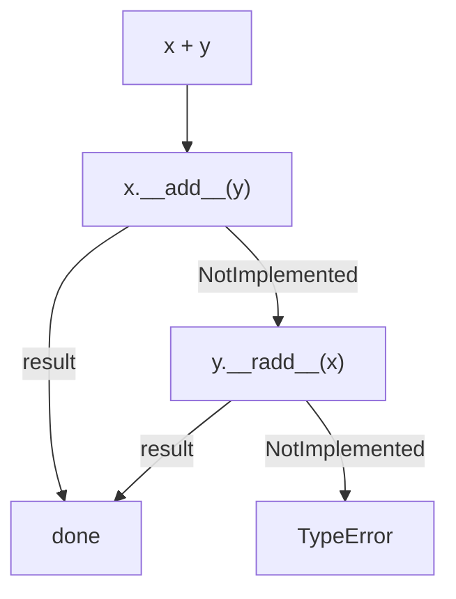

# The data model: dunder methods

> **Before this lesson:** you need classes, `self`, `__init__`, `__repr__` and `__eq__` / `__hash__` from [Classes and instances](#/lesson/python/py-classes), `super()` from [Inheritance, MRO and super](#/lesson/python/py-inheritance), and the iterator protocol (`__iter__`, `__next__`) from [The iterator protocol](#/lesson/python/py-iterator-protocol).

## In plain words

When you write `len(x)`, `a + b`, `x[0]` or `for item in x`, Python does not contain a separate piece of knowledge for every type about how to measure, add, index or loop. It asks the object. More exactly, it calls a method with a reserved name on the object's class: `len(x)` calls `__len__`, `a + b` calls `__add__`, `x[0]` calls `__getitem__`.

These reserved names start and end with two underscores and are called **special methods**, or "dunder" methods (from "double underscore"). The complete list of which piece of syntax calls which method is what the Python documentation names the **data model**.

An everyday picture: wall sockets. An appliance maker does not need permission from the power company; any device whose plug has the right shape works in every socket. The special methods are plug shapes. Give your class a `__len__` and it works with `len()`. Give it `__add__` and it works with `+`. Give it `__iter__` and it works with `for`, `sum`, `sorted`, `list` and everything else that loops.

Why this matters for a job: this is how good Python libraries feel natural to use. A table library lets you write `table["price"] * 2`, a path library lets you write `folder / "file.txt"`. In interviews you are asked to explain what dunder methods are and to implement a small class (a vector, a matrix, a money type) that supports operators correctly. There are a handful of rules to get right, and this lesson walks through them.

## The idea: syntax calls methods

| You write | Python calls (roughly) |
|---|---|
| `len(x)` | `type(x).__len__(x)` |
| `x + y` | `x.__add__(y)`, else `y.__radd__(x)` |
| `x == y` | `x.__eq__(y)`, else `y.__eq__(x)`, else identity |
| `x < y` | `x.__lt__(y)`, else `y.__gt__(x)` |
| `x[k]`, `x[k] = v`, `del x[k]` | `__getitem__`, `__setitem__`, `__delitem__` |
| `k in x` | `__contains__`, else iterate |
| `for i in x` | `__iter__`, else `__getitem__` from 0 |
| `bool(x)`, `if x:` | `__bool__`, else `__len__ != 0`, else True |
| `str(x)`, `repr(x)`, `format(x, s)` | `__str__`, `__repr__`, `__format__` |
| `hash(x)` | `__hash__` |
| `x(...)` | `__call__` |
| `with x:` | `__enter__` / `__exit__` |
| `x.attr` (missing) | `__getattr__` |
| `abs(x)`, `-x`, `~x` | `__abs__`, `__neg__`, `__invert__` |

Read the table as a dictionary from syntax to method names. Two things about it are worth noting now. Several rows say "else": Python has fallbacks, described later in this lesson. And Python looks special methods up on the **class**, not on the individual object: assigning `obj.__len__ = ...` to one instance has no effect on `len(obj)`. Giving an operator such as `+` a meaning for your own class is called **operator overloading**.

## A complete example: a Vector class

A **vector**, for this lesson, is a fixed-length list of numbers, such as a position `(3, 4)` or a colour `(255, 128, 0)`, with the arithmetic of school mathematics: vectors are added item by item, and can be multiplied by a single number (called a **scalar**). The class below is long because it shows many special methods at once; the comments divide it into four groups, and the explanation after it goes through them.

```python-run
import math

class Vector:
    def __init__(self, *coords):
        self._c = list(coords)

    @classmethod
    def zeros(cls, d):
        return cls(*([0] * d))

    # --- container protocol ---
    def __len__(self):
        return len(self._c)
    def __getitem__(self, i):
        return self._c[i]
    def __setitem__(self, i, v):
        self._c[i] = v
    def __iter__(self):
        return iter(self._c)

    # --- representation ---
    def __repr__(self):
        return f"Vector({', '.join(map(repr, self._c))})"

    # --- arithmetic ---
    def __add__(self, other):
        if not isinstance(other, Vector):
            return NotImplemented
        if len(self) != len(other):
            raise ValueError("dimensions must agree")
        return Vector(*(a + b for a, b in zip(self, other)))
    def __sub__(self, other):
        return self + (-other)
    def __neg__(self):
        return Vector(*(-a for a in self))
    def __mul__(self, k):                  # vector * scalar
        if isinstance(k, (int, float)):
            return Vector(*(a * k for a in self))
        if isinstance(k, Vector):          # dot product
            return sum(a * b for a, b in zip(self, k))
        return NotImplemented
    __rmul__ = __mul__                     # scalar * vector
    def __abs__(self):
        return math.hypot(*self)
    def __bool__(self):
        return any(self._c)

    # --- comparison & hashing ---
    def __eq__(self, other):
        return isinstance(other, Vector) and self._c == other._c
    __hash__ = None                        # mutable -> deliberately unhashable

v, w = Vector(1, 2, 3), Vector(4, 5, 6)
print(v + w, v - w, 2 * v, v * 3, v * w)
print(abs(Vector(3, 4)), len(v), v[1], list(v), bool(Vector.zeros(3)))
print(v == Vector(1, 2, 3), 2 in v)
try:
    v + 1
except TypeError as e:
    print("TypeError:", e)
```

**Reading the class group by group**

- `__init__(self, *coords)` gathers any number of coordinates and stores them in a list. `zeros` is an alternative constructor that builds a vector of `d` zeros.
- **Container methods.** `__len__` answers `len(v)`. `__getitem__` answers `v[i]`, `__setitem__` handles `v[i] = x`, and `__iter__` hands out the coordinates for a `for` loop. All four pass the work to the inner list.
- **Representation.** `__repr__` produces text like `Vector(1, 2, 3)`.
- **Arithmetic.** `__add__` answers `v + w`: it refuses anything that is not a `Vector` by returning `NotImplemented`, checks that the lengths match, and returns a *new* vector of pairwise sums. `__neg__` answers `-v`, and `__sub__` is written in terms of those two. `__mul__` answers `v * k`: a number scales every coordinate, and another vector gives the **dot product** (the sum of the pairwise products, a single number). `__rmul__ = __mul__` makes `2 * v` work as well as `v * 2`; the next section explains why that needs a second name. `__abs__` answers `abs(v)` with the vector's length, and `__bool__` says a vector is truthy unless all its coordinates are zero.
- **Comparison and hashing.** `__eq__` compares coordinates. `__hash__ = None` deliberately makes vectors unhashable, because they are mutable (see the dictionaries lesson).

The first print shows `Vector(5, 7, 9) Vector(-3, -3, -3) Vector(2, 4, 6) Vector(3, 6, 9) 32`. The second shows `5.0 3 2 [1, 2, 3] False`. The third shows `True True`; `2 in v` works without a `__contains__` method because Python falls back to looping. The last statement, `v + 1`, ends in `TypeError: unsupported operand type(s) for +: 'Vector' and 'int'`.

### `NotImplemented` and reflected operators

Follow what happens for `v + 1`. Python calls `v.__add__(1)`. Our method returns the special object `NotImplemented`, which means "I do not know how to do this with that kind of value". Python does not give up yet: it asks the *right-hand* operand, by calling the **reflected** method `(1).__radd__(v)` (the `r` is for "right"). The integer does not know vectors either and also returns `NotImplemented`. Only then does Python raise `TypeError`, with a clear standard message.

The same procedure is why `2 * v` works. Python first tries `(2).__mul__(v)`; the integer gives up; Python then calls `v.__rmul__(2)`, which our class defines.



One refinement: if the class of `y` is a subclass of the class of `x`, Python tries `y.__radd__` *first*, so that a subclass can take over the operation.

### In-place operators

`x += y` first tries `x.__iadd__(y)` ("in-place add"). If the class has no such method, Python falls back to `x = x + y`. Mutable types define `__iadd__` to change the object itself, and the method must **return `self`**, because the name `x` is re-tied to whatever it returns. Immutable types do not define it.

## Comparisons and ordering

The comparison operators map to six methods: `__eq__` (`==`), `__ne__` (`!=`), `__lt__` (`<`), `__le__` (`<=`), `__gt__` (`>`) and `__ge__` (`>=`). Writing all six is tedious, so the class decorator `functools.total_ordering` writes the missing ones from `__eq__` plus one ordering method. The easiest correct way to compare objects is usually to compare tuples of their fields:

```python-run
from functools import total_ordering

@total_ordering
class Version:
    def __init__(self, text):
        self.parts = tuple(int(p) for p in text.split("."))
    def __eq__(self, other):
        return isinstance(other, Version) and self.parts == other.parts
    def __lt__(self, other):
        if not isinstance(other, Version):
            return NotImplemented
        return self.parts < other.parts
    def __hash__(self):
        return hash(self.parts)
    def __repr__(self):
        return f"Version('{'.'.join(map(str, self.parts))}')"

vs = [Version("1.10"), Version("1.2"), Version("1.9.1")]
print(sorted(vs), max(vs), Version("2.0") >= Version("2.0"))
```

A version such as `"1.10"` is stored as the tuple `(1, 10)`, so versions compare number by number: `1.2 < 1.9.1 < 1.10`, which a comparison of the raw strings would get wrong. The output is `[Version('1.2'), Version('1.9.1'), Version('1.10')] Version('1.10') True`; the `>=` was supplied by `total_ordering`.

`sorted`, `min`, `max`, `heapq` and `bisect` need only `__lt__`.

## Container emulation

Two methods are enough to make a class behave like a sequence. With `__len__` and `__getitem__` you get looping, `in`, `reversed`, and slicing too if `__getitem__` accepts slice objects. Here is a shelf of books; note what works afterwards although nobody wrote code for it:

```python-run
import random

class Shelf:
    """A shelf of book titles, kept in the order they were placed."""
    def __init__(self, *titles):
        self._titles = list(titles)
    def __len__(self):
        return len(self._titles)
    def __getitem__(self, pos):
        return self._titles[pos]         # ints AND slices delegated to the list

shelf = Shelf("Dune", "Emma", "Ulysses", "Beloved", "Hamlet")
random.seed(7)
print(len(shelf), shelf[0], shelf[-1], shelf[:2])
print(random.choice(shelf), "Emma" in shelf, "Ivanhoe" in shelf)
print(list(reversed(shelf))[:2], sorted(shelf)[:2])
```

`shelf[:2]` works because Python passes a `slice` object as `pos` and the inner list knows what to do with it. `random.choice` needs only `len` and indexing, so it can pick a book. `in`, `reversed` and `sorted` all work through the fallbacks.

If your class stores its items in some other way and must handle slices itself, test `isinstance(key, slice)` and call `key.indices(len(self))`, which converts the slice into concrete start, stop and step numbers.

## `__call__`: callable objects

If a class defines `__call__`, its instances can be called with parentheses like functions. This is a natural way to make a function-like object that carries data:

```python-run
class Polynomial:
    def __init__(self, *coeffs):            # coeffs[i] multiplies x**i
        self.coeffs = coeffs
    def __call__(self, x):
        result = 0
        for c in reversed(self.coeffs):     # Horner's method
            result = result * x + c
        return result

p = Polynomial(1, 0, 2)                     # 1 + 2x^2
print([p(x) for x in range(4)], callable(p))
```

A polynomial is an expression such as 1 + 2x². The object stores the coefficients, and calling it with a number works out the value at that number: `p(3)` is 1 + 2·9 = 19. The loop is Horner's method, which evaluates a polynomial with one multiplication per coefficient. The output is `[1, 3, 9, 19] True`.

## Attribute access hooks

Three special methods let a class take part in attribute access itself. Such interception points are called **hooks**.

- `__getattr__(self, name)` is called only when the normal lookup **fails**. It is well suited to **proxies**: objects that stand in front of another object and pass requests through to it.
- `__getattribute__` is called for **every** attribute access. It is rarely needed and easy to get wrong, because any attribute it reads on `self` calls it again.
- `__setattr__` and `__delattr__` intercept assignment and deletion.

```python-run
class Logged:
    def __init__(self, target):
        self._target = target
    def __getattr__(self, name):            # only for attributes Logged doesn't have
        attr = getattr(self._target, name)
        print(f"proxy -> {name}")
        return attr

lst = Logged([3, 1, 2])
lst.sort()
print(lst._target, lst.count(1))
```

`Logged` wraps a list. It has no `sort` or `count` of its own, so those lookups fail and reach `__getattr__`, which fetches the attribute from the wrapped list and prints a note. `lst._target` is found normally and does not go through the hook.

## Object lifecycle: `__new__`, `__init__`, `__del__`

Creating an object takes two steps. `Cls(args)` first calls `Cls.__new__(Cls, args)`, which *creates* the object, and then `__init__`, which *initialises* it. You override `__new__` in only two situations: when subclassing an immutable type such as `int`, `float` or `tuple`, whose value must be fixed at the moment of creation, and for special patterns such as allowing only one instance. At the other end of an object's life, `__del__` runs when the object is about to be destroyed. Its timing cannot be relied on; use a context manager (covered in the next module) for cleanup.

```python-run
class Celsius(float):
    def __new__(cls, value):
        if value < -273.15:
            raise ValueError("below absolute zero")
        return super().__new__(cls, value)   # immutable: must set the value in __new__
    def __repr__(self):
        return f"{float(self)}°C"

print(Celsius(21.5), Celsius(21.5) + 1)
```

`Celsius` is a `float` that refuses values below absolute zero. The check sits in `__new__` because by the time `__init__` runs, a float already has its value. The output also shows a limitation: `Celsius(21.5) + 1` prints `22.5`, a plain float, because the inherited `__add__` returns a `float`.

## `__format__`, `__bool__`, and friends

```python-run
class Temperature:
    def __init__(self, k): self.k = k
    def __format__(self, spec):
        if spec.endswith("C"):
            return format(self.k - 273.15, spec[:-1] + "f") + "°C"
        return format(self.k, spec) + "K"
    def __bool__(self):
        return self.k > 0

t = Temperature(300)
print(f"{t:.1C} | {t:.0f} | {bool(Temperature(0))}")
```

`__format__` receives whatever follows the colon in an f-string or in `format()`. This class invents its own format code: a specification ending in `C` shows the temperature in degrees Celsius; anything else formats the kelvin value. `__bool__` makes a temperature of 0 K falsy. The line printed is `26.9°C | 300K | False`.

## Worked example: a sparse vector

A **sparse** vector is one in which nearly all entries are zero. Storing a billion zeros would be wasteful, so this class stores only the non-zero entries in a dictionary, while looking from the outside like an ordinary vector of a billion items:

```python-run
class SparseVector:
    def __init__(self, n, data=None):
        self.n = n
        self.data = {i: v for i, v in (data or {}).items() if v}
    def __len__(self):
        return self.n
    def __getitem__(self, i):
        if not -self.n <= i < self.n:
            raise IndexError(i)
        return self.data.get(i % self.n, 0)
    def __setitem__(self, i, v):
        i %= self.n
        if v:
            self.data[i] = v
        else:
            self.data.pop(i, None)
    def __matmul__(self, other):             # dot product with @
        small, big = sorted((self.data, other.data), key=len)
        return sum(v * big.get(i, 0) for i, v in small.items())
    def __eq__(self, other):
        return isinstance(other, SparseVector) and (self.n, self.data) == (other.n, other.data)
    def __repr__(self):
        return f"SparseVector({self.n}, {self.data})"

a = SparseVector(10**9, {3: 2, 999_999: 5})
b = SparseVector(10**9, {3: 4, 7: 1})
a[7] = 1
print(a @ b, a[7], a[-1], a)
```

- `__init__` keeps only the entries whose value is non-zero.
- `__getitem__` returns the stored value, or 0 for any position that is not stored; `i % self.n` turns a negative position into the matching positive one.
- `__setitem__` stores a non-zero value and *removes* the entry when a zero is assigned, so the dictionary never holds zeros.
- `__matmul__` gives the `@` operator a meaning, here the dot product. It loops over the smaller of the two dictionaries and looks each position up in the larger one.

The output is `9 1 0` followed by the vector: positions 3 and 7 are the only ones both vectors have, and 2·4 + 1·1 = 9.

The dot product costs time in proportion to the number of non-zero entries of the smaller vector, not to the billion positions. That is the real value of the data model: you offer a convenient, familiar interface and remain free to choose an efficient way of storing the data behind it.

> [!INTERVIEW]
> "What are dunder methods?" Special methods that Python calls to carry out syntax and built-in functions (`__len__` for `len`, `__add__` for `+`, `__iter__` for `for`, `__enter__` / `__exit__` for `with`). Mention that they are looked up on the type, that binary operators return `NotImplemented` so that the reflected `__radd__` gets a turn, that `__eq__` without `__hash__` makes objects unhashable, and the difference between `__repr__` and `__str__`.

## Under the hood: why special methods live on the type

When a special method is invoked *implicitly*, through syntax or a built-in function, Python skips the instance and looks the method up on the class. This is partly for speed and partly for correctness: a class is itself an object, and without this rule `len(SomeClass)` could not be told apart from `len(instance)`.

```python-run
class Box:
    def __len__(self):
        return 3

b = Box()
b.__len__ = lambda: 99              # an instance attribute named __len__ ...
print(len(b), b.__len__())          # ... is ignored by len(), but found by an explicit call

Box.__len__ = lambda self: 7        # patching the CLASS does change behaviour
print(len(b))
```

The first line prints `3 99`: `len(b)` ignores the attribute placed on the instance, although calling `b.__len__()` by name finds it. Changing the method on the *class* does change `len(b)`, which then prints 7.

This has a consequence for proxies. Forwarding through `__getattr__` does **not** make a wrapper work with `len()`, `+`, `in` or `for`, because those never go through an attribute lookup on the instance. A proxy must define every special method it wants to pass on.

```python-run
class Proxy:
    def __init__(self, target): self._t = target
    def __getattr__(self, name): return getattr(self._t, name)

p = Proxy([1, 2, 3])
print(p.count(2))                   # ordinary method: forwarded
try:
    len(p)
except TypeError as e:
    print("TypeError:", e)

class ListProxy(Proxy):
    def __len__(self): return len(self._t)
    def __iter__(self): return iter(self._t)
    def __getitem__(self, i): return self._t[i]
print(len(ListProxy([1, 2, 3])), 2 in ListProxy([1, 2, 3]), ListProxy("abc")[::-1])
```

`p.count(2)` is forwarded and prints 1. `len(p)` fails with `object of type 'Proxy' has no len()`. `ListProxy` adds three special methods explicitly, and then `len`, `in` and slicing work.

## The fallback chains

Many operations try several methods one after another. Knowing these chains tells you the *least* you must write to get a behaviour:

| Operation | Tries, in order |
|---|---|
| `bool(x)` | `__bool__` → `__len__() != 0` → `True` |
| `x in c` | `__contains__` → iterate with `__iter__` → index with `__getitem__` |
| `iter(x)` | `__iter__` → `__getitem__(0), (1), ...` |
| `reversed(x)` | `__reversed__` → `__len__` + `__getitem__` |
| `str(x)`, `print(x)`, `f"{x}"` | `__str__` → `__repr__` |
| `x != y` | `__ne__` → `not __eq__` |
| `x += y` | `__iadd__` → `__add__` → `y.__radd__` |
| `x < y` | `x.__lt__(y)` → `y.__gt__(x)` |
| `hash(x)` | `__hash__`; set to `None` automatically if you define `__eq__` only |
| `sorted`, `min`, `max`, `heapq`, `bisect` | need only `__lt__` |

```python-run
class Playlist:
    def __init__(self, *songs): self.songs = list(songs)
    def __len__(self): return len(self.songs)
    def __getitem__(self, i): return self.songs[i]

empty, pl = Playlist(), Playlist("Binks", "Bink's Sake", "New World")
print(bool(empty), bool(pl), "Binks" in pl, list(reversed(pl))[0], [s.upper() for s in pl][:1])
```

`Playlist` defines only `__len__` and `__getitem__`. The print shows `False True True New World ['BINKS']`: an empty playlist is falsy, a non-empty one truthy, `in` works, `reversed` works, and a comprehension can loop over it. Two methods bought truthiness, membership, looping, reversal and slicing.

## Equality, hashing and ordering: getting the contracts right

A **contract** is a set of promises that a method must keep so that the rest of Python can rely on it. Three rules prevent the subtle bugs:

1. **Equal objects must have equal hashes.** Build both from the same tuple of fields: `__eq__` compares `(self.a, self.b)`, and `__hash__` returns `hash((self.a, self.b))`.
2. **Hash only data that never changes.** If instances are mutable, set `__hash__ = None` and accept that they cannot be dictionary keys.
3. **Return `NotImplemented` for types you do not know**, so that mixed comparisons end sensibly (`==` gives `False`, `<` gives `TypeError`) and do not fail with an `AttributeError` from somewhere inside your method.

```python-run
class Money:
    def __init__(self, amount, cur): self.amount, self.cur = amount, cur
    def _key(self): return (self.cur, self.amount)
    def __eq__(self, o): return self._key() == o._key() if isinstance(o, Money) else NotImplemented
    def __hash__(self): return hash(self._key())
    def __lt__(self, o):
        if not isinstance(o, Money) or o.cur != self.cur:
            return NotImplemented
        return self.amount < o.amount
    def __repr__(self): return f"Money({self.amount}, {self.cur!r})"

a, b = Money(5, "EUR"), Money(5, "EUR")
print(a == b, hash(a) == hash(b), len({a, b}), a == 5, a != b, sorted([Money(9, "EUR"), a]))
for attempt in (lambda: a < 3, lambda: a < Money(1, "USD")):
    try:
        attempt()
    except TypeError as e:
        print("TypeError:", e)
```

The first line prints `True True 1 False False` and a sorted list: equal amounts are equal, hash equally and count once in a set; comparing money with the number 5 is quietly `False`. The two attempts at `<` (with a number, and with a different currency) both end in `TypeError: '<' not supported between instances of ...`. Our method did not write that message. It returned `NotImplemented`, and Python produced the standard, informative error itself.

## Debugging dunder methods

- **`TypeError: unsupported operand type(s) for +: 'A' and 'B'`**: neither `A.__add__` nor `B.__radd__` handled the pair. Either both are missing or both returned `NotImplemented`.
- **`TypeError: unhashable type`**: the class defines `__eq__` without `__hash__`.
- **`RecursionError` in `__repr__`, `__eq__`, `__getattr__` or `__setattr__`**: the method causes itself to be called again. Typical cases are a `__repr__` that prints a structure containing the object, an `__init__` that assigns attributes while `__setattr__` reads them, or a `__getattr__` that reads a missing attribute of `self`. Inside these hooks use `object.__setattr__(self, ...)` or `self.__dict__` directly.
- **`print(x)` shows something different from the interactive prompt**: that is `__str__` versus `__repr__`; containers always show their items with `repr`.
- **Your `__eq__` is not called**: in `a == b` where the class of `b` is a subclass of the class of `a`, the *subclass's* method runs first.

## Pitfalls recap

- Raising `TypeError` or returning `False` from a binary operator or comparison when `NotImplemented` should be returned.
- Mutable objects whose `__hash__` depends on their contents; they get "lost" in sets after a change.
- An `__iadd__` that forgets `return self` (the name ends up tied to `None`).
- A `__getattribute__` that reads `self.x` inside itself, causing endless recursion (use `object.__getattribute__`).
- Relying on `__del__` for cleanup.

## Summary

The data model maps syntax and built-in functions to special methods. By writing them (container methods, arithmetic with `NotImplemented` and the reflected variants, comparisons, `__call__`, attribute hooks, creation and destruction hooks) you make your classes work with the language and its libraries as if they were built in.

## Glossary

- **Special (dunder) method** - a method with a reserved double-underscore name that Python calls to carry out syntax or a built-in function.
- **Data model** - the documented mapping from Python syntax to special methods.
- **Operator overloading** - giving an operator such as `+` a meaning for your own class.
- **`NotImplemented`** - the value a binary special method returns to say "I cannot handle this operand".
- **Reflected method** - the right-hand variant such as `__radd__`, tried when the left operand gives up.
- **In-place operator** - `+=` and its relatives, handled by `__iadd__` and friends.
- **Rich comparison methods** - `__eq__`, `__ne__`, `__lt__`, `__le__`, `__gt__`, `__ge__`.
- **`total_ordering`** - a decorator that fills in the missing comparison methods.
- **Sequence protocol** - `__len__` plus `__getitem__`, enough for looping, `in`, `reversed` and slicing.
- **Callable object** - an instance whose class defines `__call__`.
- **Hook** - a method Python calls at a particular moment, letting a class customise that moment.
- **Proxy** - an object that stands in for another and forwards requests to it.
- **`__new__`** - the method that creates an instance, before `__init__` initialises it.
- **Scalar** - a single number, as opposed to a vector.
- **Dot product** - the sum of the pairwise products of two vectors.
- **Sparse** - mostly zeros, and stored by keeping only the non-zero entries.
- **Contract** - the promises a method must keep, for example "equal objects have equal hashes".

```quiz
[
  {"q": "`len(obj)` calls:", "options": ["obj.len()", "type(obj).__len__(obj)", "obj.__size__()", "object.__len__"], "answer": 1,
   "explain": "Built-ins look special methods up on the type, not the instance."},
  {"q": "What should `__add__` return for an unsupported operand type?", "options": ["None", "False", "NotImplemented", "raise ValueError"], "answer": 2,
   "explain": "NotImplemented lets Python try the reflected method (__radd__) on the other operand before raising TypeError."},
  {"q": "Why does `2 * v` work if Vector defines `__rmul__`?", "options": ["int knows about Vector", "int.__mul__ returns NotImplemented, so Python calls v.__rmul__(2)", "Python swaps operands always", "It doesn't"], "answer": 1,
   "explain": "The reflected method of the right operand is tried after the left operand gives up."},
  {"q": "A class defines __len__ and __getitem__ (handling ints). Which works without more code?", "options": ["for loops and `in`", "hash()", "with", "+"], "answer": 0,
   "explain": "The sequence protocol fallback supports iteration and membership via __getitem__."},
  {"q": "When is __getattr__ called?", "options": ["On every attribute access", "Only when normal attribute lookup fails", "Only on assignment", "Only for dunder names"], "answer": 1,
   "explain": "__getattribute__ handles every access; __getattr__ is the fallback for missing attributes."},
  {"q": "Which method must you override to subclass an immutable type like float with validation?", "options": ["__init__", "__new__", "__call__", "__set__"], "answer": 1,
   "explain": "The value of an immutable object is fixed at creation, which happens in __new__."},
  {"q": "What must `__iadd__` return for mutable types?", "options": ["None", "self", "a new object", "True"], "answer": 1,
   "explain": "x += y rebinds x to whatever __iadd__ returns; returning self keeps the same object."}
]
```

> **Source:** Goodrich, Tamassia & Goldwasser, *Data Structures and Algorithms in Python*, §2.3.2 (Operator Overloading and Python's Special Methods) and §2.3.3, restated in original wording with new examples; Python docs, *Language Reference* ch. 3 "Data model" (§3.3 Special method names).
