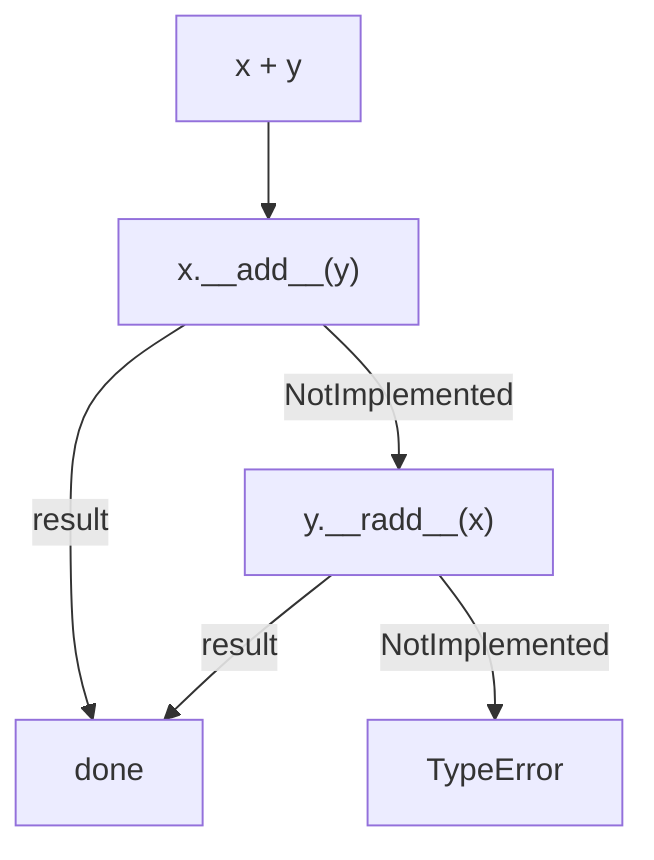

# The data model: dunder methods

Why does `len(x)` work on lists, strings and your own `Deck` class? Why does `a + b` add numbers but concatenate lists? Because Python's syntax and built-ins are thin layers over **special methods** — the "dunder" (double-underscore) methods like `__len__` and `__add__`. The Python reference calls this the **data model**. Implement the right dunders and your objects behave like built-ins: they can be added, compared, indexed, iterated, hashed, called and used in `with` statements.

## The idea: syntax calls methods

| You write | Python calls (roughly) |
|---|---|
| `len(x)` | `type(x).__len__(x)` |
| `x + y` | `x.__add__(y)`, else `y.__radd__(x)` |
| `x == y` | `x.__eq__(y)`, else `y.__eq__(x)`, else identity |
| `x < y` | `x.__lt__(y)`, else `y.__gt__(x)` |
| `x[k]`, `x[k] = v`, `del x[k]` | `__getitem__`, `__setitem__`, `__delitem__` |
| `k in x` | `__contains__`, else iterate |
| `for i in x` | `__iter__`, else `__getitem__` from 0 |
| `bool(x)`, `if x:` | `__bool__`, else `__len__ != 0`, else True |
| `str(x)`, `repr(x)`, `format(x, s)` | `__str__`, `__repr__`, `__format__` |
| `hash(x)` | `__hash__` |
| `x(...)` | `__call__` |
| `with x:` | `__enter__` / `__exit__` |
| `x.attr` (missing) | `__getattr__` |
| `abs(x)`, `-x`, `~x` | `__abs__`, `__neg__`, `__invert__` |

Note that Python looks special methods up on the **type**, not the instance — assigning `obj.__len__ = ...` on an instance has no effect on `len(obj)`. Goodrich (§2.3.2, Table 2.1) lists the full correspondence between operators and methods.

## A complete example: a Vector class

Following Goodrich's multidimensional `Vector` (§2.3.3), but modernised:

```python-run
import math

class Vector:
    def __init__(self, *coords):
        self._c = list(coords)

    @classmethod
    def zeros(cls, d):
        return cls(*([0] * d))

    # --- container protocol ---
    def __len__(self):
        return len(self._c)
    def __getitem__(self, i):
        return self._c[i]
    def __setitem__(self, i, v):
        self._c[i] = v
    def __iter__(self):
        return iter(self._c)

    # --- representation ---
    def __repr__(self):
        return f"Vector({', '.join(map(repr, self._c))})"

    # --- arithmetic ---
    def __add__(self, other):
        if not isinstance(other, Vector):
            return NotImplemented
        if len(self) != len(other):
            raise ValueError("dimensions must agree")
        return Vector(*(a + b for a, b in zip(self, other)))
    def __sub__(self, other):
        return self + (-other)
    def __neg__(self):
        return Vector(*(-a for a in self))
    def __mul__(self, k):                  # vector * scalar
        if isinstance(k, (int, float)):
            return Vector(*(a * k for a in self))
        if isinstance(k, Vector):          # dot product
            return sum(a * b for a, b in zip(self, k))
        return NotImplemented
    __rmul__ = __mul__                     # scalar * vector
    def __abs__(self):
        return math.hypot(*self)
    def __bool__(self):
        return any(self._c)

    # --- comparison & hashing ---
    def __eq__(self, other):
        return isinstance(other, Vector) and self._c == other._c
    __hash__ = None                        # mutable -> deliberately unhashable

v, w = Vector(1, 2, 3), Vector(4, 5, 6)
print(v + w, v - w, 2 * v, v * 3, v * w)
print(abs(Vector(3, 4)), len(v), v[1], list(v), bool(Vector.zeros(3)))
print(v == Vector(1, 2, 3), 2 in v)
try:
    v + 1
except TypeError as e:
    print("TypeError:", e)
```

### `NotImplemented` and reflected operators

When `v + 1` runs, Python calls `v.__add__(1)`. Our method returns the special singleton `NotImplemented`, meaning "I don't know how". Python then tries the **reflected** method on the right operand, `(1).__radd__(v)`, which also returns `NotImplemented`, so a `TypeError` is raised. That's why `2 * v` works: `int.__mul__(2, v)` gives up, and `Vector.__rmul__(v, 2)` takes over.



(If `y`'s type is a subclass of `x`'s type, Python tries `y.__radd__` *first*, so subclasses can override behaviour.)

### In-place operators

`x += y` tries `x.__iadd__(y)` first; if it's missing, falls back to `x = x + y`. Mutable types implement `__iadd__` to modify in place and **return self**; immutable types don't implement it.

## Comparisons and ordering

Define `__eq__` and `__lt__` (and friends) to make objects sortable. `functools.total_ordering` fills in the rest from `__eq__` plus one ordering method. Usually, comparing tuples of fields is the simplest correct implementation:

```python-run
from functools import total_ordering

@total_ordering
class Version:
    def __init__(self, text):
        self.parts = tuple(int(p) for p in text.split("."))
    def __eq__(self, other):
        return isinstance(other, Version) and self.parts == other.parts
    def __lt__(self, other):
        if not isinstance(other, Version):
            return NotImplemented
        return self.parts < other.parts
    def __hash__(self):
        return hash(self.parts)
    def __repr__(self):
        return f"Version('{'.'.join(map(str, self.parts))}')"

vs = [Version("1.10"), Version("1.2"), Version("1.9.1")]
print(sorted(vs), max(vs), Version("2.0") >= Version("2.0"))
```

`sorted`, `min`, `max`, `heapq` and `bisect` only need `__lt__`.

## Container emulation

Implement `__len__` and `__getitem__` and you get iteration, `in`, `reversed` (with `__len__`), and slicing (if `__getitem__` handles `slice` objects). Here's a playing-card deck, which then works with `random.choice`, slicing, and `sorted` for free:

```python-run
import random
from collections import namedtuple

Card = namedtuple("Card", "rank suit")

class Deck:
    ranks = [str(n) for n in range(2, 11)] + list("JQKA")
    suits = "spades diamonds clubs hearts".split()
    def __init__(self):
        self._cards = [Card(r, s) for s in self.suits for r in self.ranks]
    def __len__(self):
        return len(self._cards)
    def __getitem__(self, pos):
        return self._cards[pos]          # ints AND slices delegated to the list

deck = Deck()
random.seed(7)
print(len(deck), deck[0], deck[-1], deck[:3])
print(random.choice(deck), Card("Q", "hearts") in deck)
print(list(reversed(deck))[:2])
```

To support slicing yourself, check `isinstance(key, slice)` and use `key.indices(len(self))`.

## `__call__`: callable objects

An instance with `__call__` can be called like a function. It's a natural way to build function-like objects with state:

```python-run
class Polynomial:
    def __init__(self, *coeffs):            # coeffs[i] multiplies x**i
        self.coeffs = coeffs
    def __call__(self, x):
        result = 0
        for c in reversed(self.coeffs):     # Horner's method
            result = result * x + c
        return result

p = Polynomial(1, 0, 2)                     # 1 + 2x^2
print([p(x) for x in range(4)], callable(p))
```

## Attribute access hooks

- `__getattr__(self, name)` is called only when normal lookup **fails** — great for delegation and proxies.
- `__getattribute__` is called for **every** access — rarely needed, easy to make infinitely recursive.
- `__setattr__` / `__delattr__` intercept assignment and deletion.

```python-run
class Logged:
    def __init__(self, target):
        self._target = target
    def __getattr__(self, name):            # only for attributes Logged doesn't have
        attr = getattr(self._target, name)
        print(f"proxy -> {name}")
        return attr

lst = Logged([3, 1, 2])
lst.sort()
print(lst._target, lst.count(1))
```

## Object lifecycle: `__new__`, `__init__`, `__del__`

`Cls(args)` calls `Cls.__new__(Cls, args)` to *create* the object, then `__init__` to *initialise* it. You override `__new__` only for immutable subclasses (e.g., subclassing `int`/`tuple`) or for patterns like singletons and caching. `__del__` runs when the object is about to be destroyed — it's unreliable timing-wise; use context managers for cleanup.

```python-run
class Celsius(float):
    def __new__(cls, value):
        if value < -273.15:
            raise ValueError("below absolute zero")
        return super().__new__(cls, value)   # immutable: must set the value in __new__
    def __repr__(self):
        return f"{float(self)}°C"

print(Celsius(21.5), Celsius(21.5) + 1)
```

## `__format__`, `__bool__`, and friends

```python-run
class Temperature:
    def __init__(self, k): self.k = k
    def __format__(self, spec):
        if spec.endswith("C"):
            return format(self.k - 273.15, spec[:-1] + "f") + "°C"
        return format(self.k, spec) + "K"
    def __bool__(self):
        return self.k > 0

t = Temperature(300)
print(f"{t:.1C} | {t:.0f} | {bool(Temperature(0))}")
```

## Worked example: a sparse vector

A dict-backed sparse vector shows how the dunders fit together into an efficient, natural API:

```python-run
class SparseVector:
    def __init__(self, n, data=None):
        self.n = n
        self.data = {i: v for i, v in (data or {}).items() if v}
    def __len__(self):
        return self.n
    def __getitem__(self, i):
        if not -self.n <= i < self.n:
            raise IndexError(i)
        return self.data.get(i % self.n, 0)
    def __setitem__(self, i, v):
        i %= self.n
        if v:
            self.data[i] = v
        else:
            self.data.pop(i, None)
    def __matmul__(self, other):             # dot product with @
        small, big = sorted((self.data, other.data), key=len)
        return sum(v * big.get(i, 0) for i, v in small.items())
    def __eq__(self, other):
        return isinstance(other, SparseVector) and (self.n, self.data) == (other.n, other.data)
    def __repr__(self):
        return f"SparseVector({self.n}, {self.data})"

a = SparseVector(10**9, {3: 2, 999_999: 5})
b = SparseVector(10**9, {3: 4, 7: 1})
a[7] = 1
print(a @ b, a[7], a[-1], a)
```

The dot product is O(min(nnz)) rather than O(n): the data model lets you present a convenient interface while choosing an efficient representation.

> [!INTERVIEW]
> "What are dunder methods?" — special methods Python calls to implement syntax and built-ins (`__len__` for `len`, `__add__` for `+`, `__iter__` for `for`, `__enter__/__exit__` for `with`). Mention that they're looked up on the type, that binary operators return `NotImplemented` to trigger the reflected `__radd__`, that `__eq__` without `__hash__` makes objects unhashable, and the `__repr__` vs `__str__` distinction.

## Pitfalls recap

- Raising `TypeError` or returning `False` instead of returning `NotImplemented` from binary operators/comparisons.
- Mutable objects with value-based `__hash__` — they get "lost" in sets after mutation.
- `__iadd__` that forgets to `return self` (the name gets rebound to `None`).
- `__getattribute__` that accesses `self.x` internally → infinite recursion (use `object.__getattribute__`).
- Relying on `__del__` for cleanup.

## Summary

The data model maps syntax and built-ins to special methods. Implementing them — container methods, arithmetic with `NotImplemented` and reflected variants, rich comparisons, `__call__`, attribute hooks, lifecycle hooks — lets your classes integrate seamlessly with the language and its libraries.

```quiz
[
  {"q": "`len(obj)` calls:", "options": ["obj.len()", "type(obj).__len__(obj)", "obj.__size__()", "object.__len__"], "answer": 1,
   "explain": "Built-ins look special methods up on the type, not the instance."},
  {"q": "What should `__add__` return for an unsupported operand type?", "options": ["None", "False", "NotImplemented", "raise ValueError"], "answer": 2,
   "explain": "NotImplemented lets Python try the reflected method (__radd__) on the other operand before raising TypeError."},
  {"q": "Why does `2 * v` work if Vector defines `__rmul__`?", "options": ["int knows about Vector", "int.__mul__ returns NotImplemented, so Python calls v.__rmul__(2)", "Python swaps operands always", "It doesn't"], "answer": 1,
   "explain": "The reflected method of the right operand is tried after the left operand gives up."},
  {"q": "A class defines __len__ and __getitem__ (handling ints). Which works without more code?", "options": ["for loops and `in`", "hash()", "with", "+"], "answer": 0,
   "explain": "The sequence protocol fallback supports iteration and membership via __getitem__."},
  {"q": "When is __getattr__ called?", "options": ["On every attribute access", "Only when normal attribute lookup fails", "Only on assignment", "Only for dunder names"], "answer": 1,
   "explain": "__getattribute__ handles every access; __getattr__ is the fallback for missing attributes."},
  {"q": "Which method must you override to subclass an immutable type like float with validation?", "options": ["__init__", "__new__", "__call__", "__set__"], "answer": 1,
   "explain": "The value of an immutable object is fixed at creation, which happens in __new__."},
  {"q": "What must `__iadd__` return for mutable types?", "options": ["None", "self", "a new object", "True"], "answer": 1,
   "explain": "x += y rebinds x to whatever __iadd__ returns; returning self keeps the same object."}
]
```

> **Source:** Goodrich, Tamassia & Goldwasser, *Data Structures and Algorithms in Python*, §2.3.2 (Operator Overloading and Python's Special Methods) and §2.3.3 (Multidimensional Vector Class); Python docs, *Language Reference* ch. 3 "Data model" (§3.3 Special method names).
