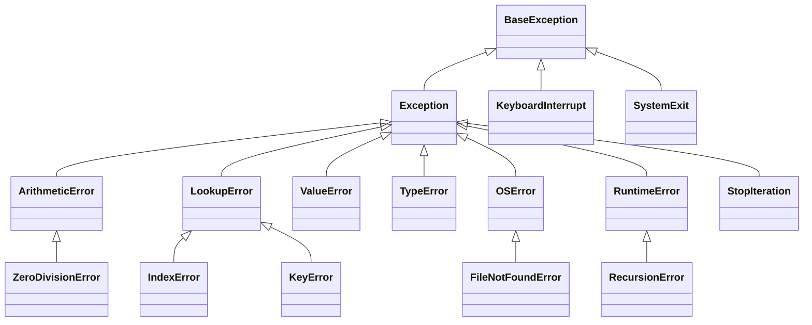
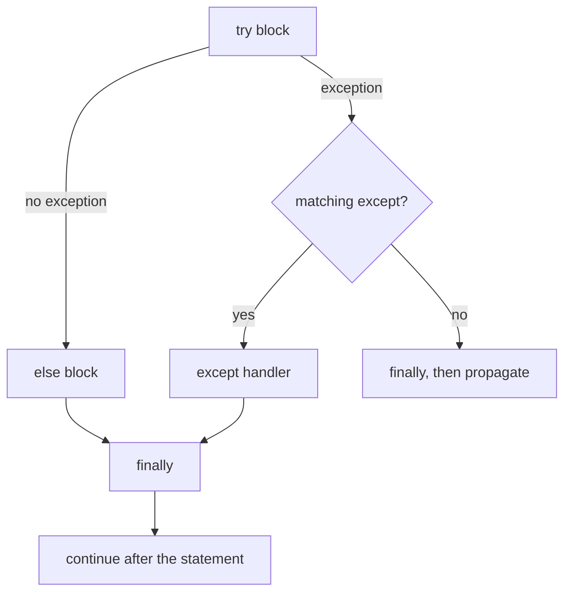

# Exceptions

Things go wrong at runtime: a file is missing, a string isn't a number, a key isn't in the dict, the network times out. Python reports all of these the same way — by **raising an exception**, an object that travels up the call stack until some code **handles** it. If nobody does, the program stops with a traceback. Writing robust Python means knowing which exceptions to expect, catching exactly those, cleaning up reliably, and designing your own exception types for your callers.

## Raising and the traceback

```python-run
def parse_age(text):
    age = int(text)                     # may raise ValueError
    if age < 0:
        raise ValueError(f"age must be non-negative, got {age}")
    return age

for raw in ["42", "-3", "forty"]:
    try:
        print(parse_age(raw))
    except ValueError as e:
        print("rejected:", e)
```

`raise SomeError("message")` creates an exception instance and starts unwinding the stack: the current function stops, then its caller, and so on, until a matching `except` clause is found. An unhandled exception prints a **traceback** — read it bottom-up: the last line is the exception type and message, and the frames above show the path that led there.

## The built-in hierarchy

Exceptions are classes, organised by inheritance. Catching a class also catches its subclasses.



| Exception | Typical cause (after Goodrich, Table 1.6) |
|---|---|
| `TypeError` | wrong type of argument: `len(5)`, `"a" + 1` |
| `ValueError` | right type, unacceptable value: `int("x")`, `math.sqrt(-1)` |
| `IndexError` / `KeyError` | sequence index out of range / missing dict key |
| `AttributeError` | object has no such attribute: `None.strip()` |
| `NameError` | unknown identifier (often a typo) |
| `ZeroDivisionError` | division or modulo by zero |
| `FileNotFoundError`, `PermissionError` (`OSError`) | operating-system failures |
| `StopIteration` | `next()` on an exhausted iterator |
| `AssertionError` | failed `assert` |
| `NotImplementedError` | abstract method not overridden |
| `KeyboardInterrupt`, `SystemExit` | Ctrl-C, `sys.exit()` — derive from `BaseException`, *not* `Exception` |

That last row is why you should never write a bare `except:` or `except BaseException:` in normal code — it swallows Ctrl-C and exit requests.

## try / except / else / finally

```python-run
def safe_divide(a, b):
    try:
        result = a / b                      # only the risky operation
    except ZeroDivisionError:
        print("  cannot divide by zero")
        return None
    except TypeError as e:
        print("  bad operand:", e)
        raise                               # re-raise the same exception
    else:
        print("  no exception: else runs")  # only when try succeeded
        return result
    finally:
        print("  finally always runs")      # even with return or raise

print(safe_divide(6, 3))
print(safe_divide(1, 0))
try:
    safe_divide("a", 1)
except TypeError:
    print("caller saw the TypeError")
```

- **`try`**: the code that might fail. Keep it small, so you don't accidentally catch errors from unrelated lines.
- **`except E as e`**: handlers are tested top to bottom; the first match wins, so list specific classes before general ones. A tuple catches several: `except (KeyError, IndexError):`.
- **`else`**: runs if no exception occurred. Putting follow-up code here (rather than in `try`) means its exceptions aren't caught by these handlers.
- **`finally`**: runs no matter what — success, handled error, unhandled error, `return`, `break`. Use it for cleanup (though `with` is usually nicer).



> [!WARNING]
> A `return` inside `finally` overrides any exception or return value in flight — it silently swallows errors. Don't put `return`, `break` or `continue` in `finally`.

## LBYL versus EAFP

Two styles of handling the unexpected:

- **LBYL** — "look before you leap": check preconditions first (`if key in d:`).
- **EAFP** — "easier to ask forgiveness than permission": just try, and handle the exception.

```python-run
config = {"port": "8080"}

# LBYL
if "port" in config and config["port"].isdigit():
    port = int(config["port"])
else:
    port = 80

# EAFP
try:
    port = int(config["port"])
except (KeyError, ValueError):
    port = 80
print(port)
```

Python culture leans EAFP: it avoids race conditions (a file can vanish between the check and the open), handles all failure causes in one place, and is fast when failures are rare (a `try` that doesn't raise costs almost nothing; raising is comparatively expensive). Use LBYL when the check is cheap and failure is common, or when a failed attempt would have side effects.

## Raising well

Pick the most specific built-in that fits: `TypeError` for wrong types, `ValueError` for bad values, `KeyError`/`IndexError` for lookups, `NotImplementedError` for unimplemented hooks. Validate at boundaries (public functions), as in Goodrich's `sqrt` and `sum` examples:

```python-run
def mean(values):
    if not isinstance(values, (list, tuple)):
        raise TypeError("values must be a list or tuple")
    if not values:
        raise ValueError("mean() of an empty sequence")
    return sum(values) / len(values)

for arg in ([1, 2, 3], [], "123"):
    try:
        print(mean(arg))
    except (TypeError, ValueError) as e:
        print(type(e).__name__, "-", e)
```

Don't over-check, though: duck typing means many type errors surface naturally with a clear message.

## Custom exceptions

Define your own classes so callers can catch *your* errors specifically. Convention: one base class per library/application, inheriting from `Exception`, with subclasses for distinct failure modes, names ending in `Error`.

```python-run
class BankError(Exception):
    """Base class for all errors raised by the bank module."""

class InsufficientFunds(BankError):
    def __init__(self, balance, amount):
        super().__init__(f"need {amount}, only {balance} available")
        self.balance = balance
        self.amount = amount

class AccountFrozen(BankError):
    pass

def withdraw(balance, amount, frozen=False):
    if frozen:
        raise AccountFrozen("account is frozen")
    if amount > balance:
        raise InsufficientFunds(balance, amount)
    return balance - amount

for args in [(100, 30), (100, 500), (100, 1, True)]:
    try:
        print(withdraw(*args))
    except InsufficientFunds as e:
        print("short by", e.amount - e.balance)
    except BankError as e:                 # any other bank problem
        print("bank error:", e)
```

Extra attributes (`balance`, `amount`) let handlers react programmatically instead of parsing messages.

## Exception chaining

When you catch a low-level exception and raise a higher-level one, link them with `raise ... from ...` so the traceback shows both ("The above exception was the direct cause of..."). `from None` hides the original when it's just noise.

```python-run
class ConfigError(Exception):
    pass

def load_port(settings):
    try:
        return int(settings["port"])
    except KeyError as e:
        raise ConfigError("missing 'port' setting") from e
    except ValueError as e:
        raise ConfigError(f"port must be an integer: {settings['port']!r}") from e

try:
    load_port({"port": "eighty"})
except ConfigError as e:
    print(e, "| caused by:", repr(e.__cause__))
```

If you raise inside an `except` block *without* `from`, Python still records the original in `__context__` ("During handling of the above exception, another exception occurred").

## Other tools

**`assert condition, message`** raises `AssertionError` if the condition is false. Use it for internal invariants and tests — never for validating user input, because assertions are stripped when Python runs with `-O`.

**Exception groups** (3.11+): `ExceptionGroup` bundles several unrelated exceptions (e.g., from concurrent tasks), handled with `except*`. You'll meet them with `asyncio.TaskGroup`.

**Notes** (3.11+): `e.add_note("while processing row 17")` attaches context without wrapping.

**`contextlib.suppress(E)`** is a tidy replacement for `try: ... except E: pass`.

**`warnings.warn`** signals non-fatal issues such as deprecations.

```python-run
import contextlib, os
with contextlib.suppress(FileNotFoundError):
    os.remove("definitely-not-here.tmp")
print("still running")

try:
    raise ValueError("bad row")
except ValueError as e:
    if hasattr(e, "add_note"):
        e.add_note("while importing customers.csv, line 17")
    print(e, getattr(e, "__notes__", []))
```

## Anti-patterns

```python
try:
    do_everything()
except Exception:        # 1. swallow everything silently
    pass
```

1. **Swallowing exceptions** hides bugs. At minimum log them (`logging.exception("...")` records the traceback).
2. **Catching too broadly** (`except Exception`) when you expect one specific error. A typo'd variable name (`NameError`) gets "handled" as if it were a network failure.
3. **Using exceptions for normal control flow** in hot loops when a simple check is clearer.
4. **Returning error codes** (`return -1`, `return None`) forces every caller to check; exceptions can't be ignored by accident.
5. **Losing the traceback** with `raise NewError(str(e))` — use `from e`.

## Worked example: retry with clean-up

```python-run
import random

class TransientError(Exception): pass

def flaky_fetch(rng):
    if rng.random() < 0.6:
        raise TransientError("timeout")
    return {"status": "ok"}

def fetch_with_retry(attempts=5, seed=3):
    rng = random.Random(seed)
    last_error = None
    for attempt in range(1, attempts + 1):
        try:
            data = flaky_fetch(rng)
        except TransientError as e:
            last_error = e
            print(f"attempt {attempt}: {e}; retrying")
        else:
            print(f"attempt {attempt}: success")
            return data
        finally:
            pass    # e.g. release a connection back to the pool
    raise RuntimeError(f"gave up after {attempts} attempts") from last_error

print(fetch_with_retry())
```

Notice the loop only retries the specific *transient* error; anything else would propagate immediately.

> [!INTERVIEW]
> Typical questions: "What do `else` and `finally` do in a try statement?" (else: only on success; finally: always). "Why is a bare `except:` bad?" (catches `KeyboardInterrupt`/`SystemExit` and hides bugs). "EAFP vs LBYL?" "How do you create a custom exception?" (subclass `Exception`, ideally under a package base class). "What does `raise X from e` do?" (sets `__cause__`, preserving the original traceback).

## Under the hood: unwinding, tracebacks and cost

When `raise` executes, Python creates the exception instance and attaches a **traceback object** to it (`exc.__traceback__`): a linked list with one entry per frame the exception passes through. The interpreter then looks for a handler in the current frame; finding none, it discards that frame (running any `finally` blocks and `with` exits on the way) and repeats in the caller. This is **stack unwinding**.

```python-run
import traceback

def level3(): return {}["missing"]
def level2(): return level3()
def level1(): return level2()

try:
    level1()
except KeyError as exc:
    tb, chain = exc.__traceback__, []
    while tb:
        chain.append(f"{tb.tb_frame.f_code.co_name}:{tb.tb_lineno}")
        tb = tb.tb_next
    print(" -> ".join(chain))
    print(type(exc).__mro__[:4])
    print(traceback.format_exception_only(exc)[0].strip(), "| args:", exc.args)
```

Two practical consequences:

- **The exception object keeps every frame on its path alive** — including all their local variables — for as long as you hold on to it. That is why Python deletes the `as` name at the end of an `except` block, and why you should not stash exception objects in long-lived lists; store `str(e)` or `traceback.format_exc()` instead.
- **`try` is nearly free; raising is not.** Since Python 3.11 entering a `try` block costs nothing at all ("zero-cost exceptions": handlers are found via a lookup table only when something is raised). Creating the exception, building the traceback and unwinding cost on the order of a microsecond.

```python-run
import timeit
d = {"k": 1}
hit = timeit.timeit(lambda: d["k"], number=200_000)
def eafp_miss():
    try:
        return d["absent"]
    except KeyError:
        return None
miss_eafp = timeit.timeit(eafp_miss, number=200_000)
miss_lbyl = timeit.timeit(lambda: d.get("absent"), number=200_000)
print(f"plain hit {hit:.3f}s | miss via exception {miss_eafp:.3f}s | miss via get() {miss_lbyl:.3f}s")
```

So EAFP is the right default when failures are *rare*; when "missing" is the common case inside a hot loop, `dict.get`, `in`, or `str.isdigit()` checks are faster.

## Where should an exception be caught?

Catch an exception at the level that has enough context to **do something useful** about it — retry, substitute a default, report to the user, roll back — and nowhere else. A good structure for most programs:

| Layer | Typical behaviour |
|---|---|
| Low-level helpers | raise specific exceptions; don't catch what they can't handle |
| Domain/service layer | translate low-level errors into domain errors (`raise OrderError(...) from e`) |
| Boundary (CLI `main`, request handler, worker loop) | one broad `except Exception`: log with traceback, convert to an exit code / HTTP 500, keep the process alive |

Web frameworks implement the bottom row for you: in FastAPI, raising `HTTPException(status_code=404)` anywhere beneath a route — or registering an exception handler for your own error class — becomes the HTTP response, so route code stays free of error plumbing.

```python-run
import logging, sys
logging.basicConfig(stream=sys.stdout, format="%(levelname)s %(message)s", force=True)

class OrderError(Exception): pass

def load_price(catalog, sku):                      # low level: let KeyError happen
    return catalog[sku]

def order_total(catalog, items):                   # domain: translate, keep the cause
    try:
        return sum(load_price(catalog, sku) * qty for sku, qty in items)
    except KeyError as e:
        raise OrderError(f"unknown product {e}") from e

def handle_request(catalog, items):                # boundary: decide what the user sees
    try:
        return {"status": 200, "total": order_total(catalog, items)}
    except OrderError as e:
        return {"status": 400, "error": str(e)}
    except Exception:
        logging.exception("unexpected failure")
        return {"status": 500, "error": "internal error"}

catalog = {"cola": 1.5}
print(handle_request(catalog, [("cola", 2)]))
print(handle_request(catalog, [("sake", 1)]))
print(handle_request(catalog, [("cola", "two")])["status"])
```

The third request triggers a genuine bug-like failure (`TypeError`), which is logged with its traceback and reported generically, without leaking internals.

## Debugging exception-handling code

- **An error "disappears"**: search for `except Exception: pass`, a bare `except:`, or a `return` inside `finally`.
- **The traceback points at your `raise NewError(...)` instead of the real cause**: you forgot `from e`; look for "During handling of the above exception" and read the *first* traceback.
- **`except ValueError, TypeError:`** is a syntax error in Python 3 — a tuple is required: `except (ValueError, TypeError):`.
- **A handler never runs**: an earlier, more general `except` clause already matched; order clauses from specific to general.
- **You need the traceback as text** (for a log or an API response): `traceback.format_exc()` inside the handler.

## Summary

Exceptions are objects in a class hierarchy; `raise` unwinds the stack to the nearest matching `except`. Use `try/except/else/finally` precisely: narrow try blocks, specific exception classes, cleanup in `finally` or `with`. Prefer EAFP, raise informative built-in or custom exceptions, chain with `from`, and never silently swallow errors.

```quiz
[
  {"q": "When does the `else` clause of a try statement run?", "options": ["Always", "Only if the try block raised", "Only if the try block completed without raising", "Only if finally is absent"], "answer": 2,
   "explain": "else is the success path; exceptions raised inside it are not caught by the preceding except clauses."},
  {"q": "Why avoid a bare `except:`?", "options": ["It is a syntax error", "It also catches KeyboardInterrupt and SystemExit and hides bugs", "It is slower", "It only catches ValueError"], "answer": 1,
   "explain": "Bare except catches BaseException. Catch specific exceptions, or `Exception` at most."},
  {"q": "`int('abc')` raises:", "options": ["TypeError", "ValueError", "SyntaxError", "NameError"], "answer": 1,
   "explain": "The argument type (str) is fine; its value is not a valid integer literal."},
  {"q": "Given `except LookupError:` — which exceptions does it catch?", "options": ["Only LookupError itself", "KeyError and IndexError too, as subclasses", "All exceptions", "ValueError"], "answer": 1,
   "explain": "An except clause matches the named class and all its subclasses."},
  {"q": "What does `raise AppError('x') from e` do?", "options": ["Discards e", "Sets the new exception's __cause__ to e so both appear in the traceback", "Re-raises e", "Converts e to a warning"], "answer": 1,
   "explain": "Explicit chaining preserves the original error as the direct cause."},
  {"q": "A function whose try block does `return 1` and whose finally block does `return 2` returns:", "options": ["1", "2", "None", "It raises"], "answer": 1,
   "explain": "finally runs after the try's return is prepared, and its own return overrides it. Avoid returning from finally."},
  {"q": "Which describes EAFP?", "options": ["Check every precondition first", "Try the operation and handle the exception if it fails", "Never raise exceptions", "Use error codes"], "answer": 1,
   "explain": "Easier to Ask Forgiveness than Permission: attempt, then handle failure; avoids check-then-act races."},
  {"q": "Why shouldn't `assert` be used to validate user input?", "options": ["It is slow", "Assertions are removed when Python runs with -O", "It raises the wrong type always", "It can't take a message"], "answer": 1,
   "explain": "Optimised mode strips assert statements, so the validation would disappear."}
]
```

> **Source:** Goodrich, Tamassia & Goldwasser, *Data Structures and Algorithms in Python*, §1.7 (Exception Handling: raising, catching, common exception types); Python docs, *Tutorial* ch. 8 "Errors and Exceptions" and *Library Reference* "Built-in Exceptions".
