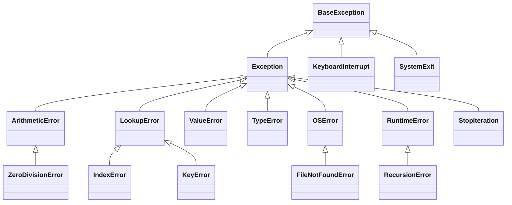
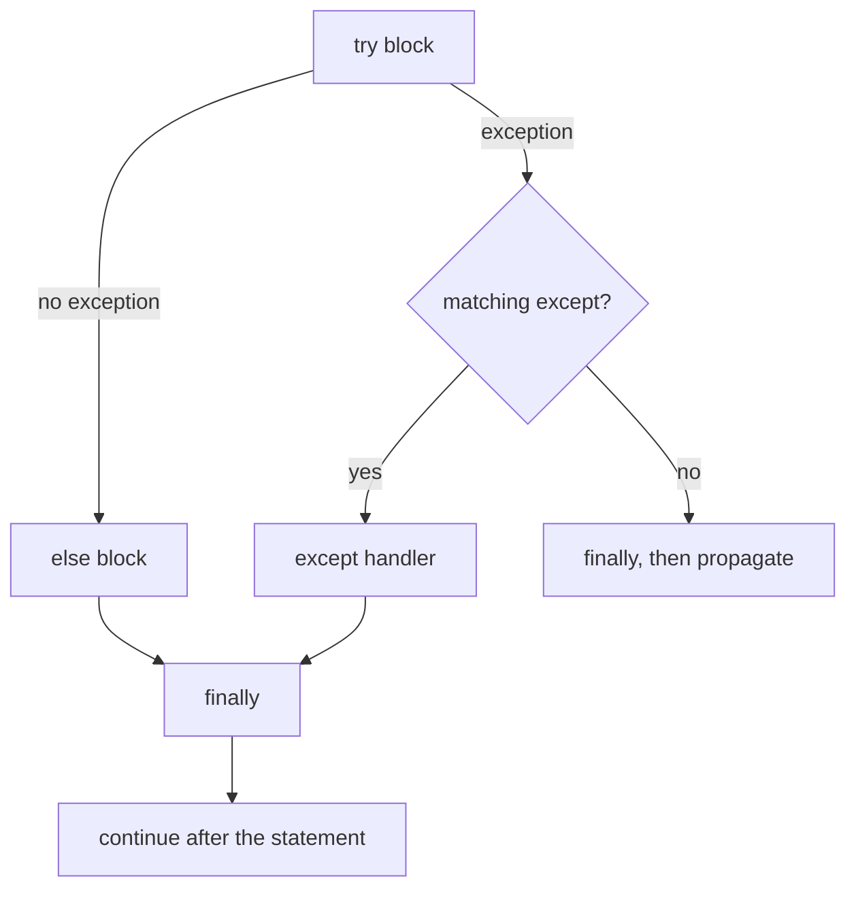

# Exceptions

> **Before this lesson:** you should have seen a first `try` / `except` and read a first error message, as in [Files, errors and tests: programs you can rely on](#/lesson/python/py-start-files-tests). You need functions calling functions from [Functions and arguments](#/lesson/python/py-functions-args) and classes with inheritance from [Inheritance, MRO and super](#/lesson/python/py-inheritance), because exceptions are organised as a family of classes.

## In plain words

Things go wrong while a program runs: a file is missing, the text a user typed is not a number, a key is not in the dictionary, the network does not answer. Python reports every such problem in the same way. It creates an object describing the problem, called an **exception**, and **raises** it: normal execution stops at that line, and the exception travels back up through the functions that were in the middle of running, looking for code that has declared itself willing to deal with it. Dealing with it is called **handling** (or catching) the exception. If nobody handles it, the program stops and prints a report called a **traceback**.

Think of a fire alarm in an office building. Whoever notices smoke does not carry on working, and does not need to know who is responsible for fires. They pull the alarm. The signal passes up the chain: the team lead, the floor warden, the building manager. The first person on that chain who is equipped to act takes over. If nobody is, the whole building is evacuated.

The chain of functions that are currently in the middle of running is called the **call stack**: `main` called `load`, which called `parse`, which called `int`. An exception climbs that stack from the innermost function outwards.

Why this matters for a job: real programs spend a large part of their code on things going wrong, and badly handled errors cause the worst kind of bug, the one that is silently swallowed. Interviewers ask what `else` and `finally` do, why a bare `except:` is harmful, and how to design your own exception types. Reading a traceback quickly is one of the most useful daily skills a programmer has.

## Raising and the traceback

```python-run
def parse_age(text):
    age = int(text)                     # may raise ValueError
    if age < 0:
        raise ValueError(f"age must be non-negative, got {age}")
    return age

for raw in ["42", "-3", "forty"]:
    try:
        print(parse_age(raw))
    except ValueError as e:
        print("rejected:", e)
```

**Reading this code line by line**

- `int(text)` converts text to a whole number. If the text is not a number, `int` itself raises a `ValueError`.
- `raise ValueError(...)` is how your own code reports a problem: it creates an exception object carrying a message and raises it. The function stops at once; the `return` below is not reached.
- The loop tries three inputs. Each call sits inside a `try` block. If the call raises a `ValueError`, execution jumps to the `except ValueError as e:` block, where `e` is the exception object; printing it shows its message.

The output is `42`, then `rejected: age must be non-negative, got -3` (our own `raise`), then `rejected: invalid literal for int() with base 10: 'forty'` (raised inside `int`). The same handler dealt with both, because both are `ValueError`s.

In general, `raise SomeError("message")` creates an exception object and starts **unwinding the stack**: the current function is abandoned, then the function that called it, and so on, until an `except` clause that matches is found. If none is found, Python prints the traceback. Read a traceback from the bottom up: the last line gives the type of the exception and its message, and the lines above it list the chain of calls that led there, the innermost call last.

## The built-in hierarchy

Every kind of exception is a class, and the classes are arranged by inheritance into a family tree, a **hierarchy**. The practical consequence: an `except` clause that names a class also catches all of its subclasses. The diagram shows the part of the tree you will meet most.



| Exception | Typical cause |
|---|---|
| `TypeError` | wrong type of argument: `len(5)`, `"a" + 1` |
| `ValueError` | right type, unacceptable value: `int("x")`, `math.sqrt(-1)` |
| `IndexError` / `KeyError` | sequence index out of range / missing dict key |
| `AttributeError` | object has no such attribute: `None.strip()` |
| `NameError` | unknown identifier (often a typo) |
| `ZeroDivisionError` | division or modulo by zero |
| `FileNotFoundError`, `PermissionError` (`OSError`) | operating-system failures |
| `StopIteration` | `next()` on an exhausted iterator |
| `AssertionError` | failed `assert` |
| `NotImplementedError` | abstract method not overridden |
| `KeyboardInterrupt`, `SystemExit` | Ctrl-C, `sys.exit()` — derive from `BaseException`, *not* `Exception` |

Look at the last row and at the top of the diagram. `KeyboardInterrupt` (the user pressed Ctrl-C) and `SystemExit` (the program asked to stop) are not errors in your logic, and they deliberately do *not* descend from `Exception`. That is why you should never write a bare `except:` or `except BaseException:` in ordinary code: it would catch even those, and the program could no longer be stopped. Catch `Exception` at the very most, and preferably something much more specific.

## try / except / else / finally

The full statement has four parts. The demo exercises each of them; the explanation follows.

```python-run
def safe_divide(a, b):
    try:
        result = a / b                      # only the risky operation
    except ZeroDivisionError:
        print("  cannot divide by zero")
        return None
    except TypeError as e:
        print("  bad operand:", e)
        raise                               # re-raise the same exception
    else:
        print("  no exception: else runs")  # only when try succeeded
        return result
    finally:
        print("  finally always runs")      # even with return or raise

print(safe_divide(6, 3))
print(safe_divide(1, 0))
try:
    safe_divide("a", 1)
except TypeError:
    print("caller saw the TypeError")
```

- **`try`** holds the code that might fail. Keep it small, so that you do not accidentally catch an error from an unrelated line.
- **`except E as e`** is a **handler**. Handlers are tested from top to bottom and the first one that matches wins, so list specific classes before general ones. A tuple catches several types: `except (KeyError, IndexError):`. A bare `raise` inside a handler raises the same exception again, for the caller to deal with.
- **`else`** runs only if the `try` block finished without an exception. Code placed here, and not in the `try`, is not covered by the handlers above it.
- **`finally`** runs whatever happens: after success, after a handled error, on the way out with an unhandled error, even when the function is leaving through `return` or `break`. Use it for cleanup, although the `with` statement of the next lesson is usually neater.

Trace the three calls in the output. `safe_divide(6, 3)` succeeds: the `else` message, then the `finally` message, then `2.0`. `safe_divide(1, 0)` raises `ZeroDivisionError`: the handler prints and returns `None`, and `finally` still runs before the function really returns. `safe_divide("a", 1)` raises `TypeError`: the handler prints and re-raises, `finally` runs, and the exception continues to the caller, whose own `except` catches it.



> [!WARNING]
> A `return` inside `finally` replaces whatever was on its way out, whether a return value or an exception. An error disappears without a trace. Do not put `return`, `break` or `continue` in a `finally` block.

## LBYL versus EAFP

There are two styles of dealing with something that may not work:

- **LBYL**, "look before you leap": check the conditions first (`if key in d:`), and act only when the check passes.
- **EAFP**, "easier to ask forgiveness than permission": attempt the operation, and handle the exception if it fails.

```python-run
config = {"port": "8080"}

# LBYL
if "port" in config and config["port"].isdigit():
    port = int(config["port"])
else:
    port = 80

# EAFP
try:
    port = int(config["port"])
except (KeyError, ValueError):
    port = 80
print(port)
```

Both halves of the demo set `port` to 8080; with a missing or non-numeric setting both would fall back to 80. Python programmers lean towards EAFP, for three reasons. It avoids a **race condition**, a bug in which something changes between your check and your action (a file can be deleted after you checked that it exists and before you open it). It handles every cause of failure in one place. And it is fast when failures are rare: a `try` block that does not raise costs almost nothing, while raising is comparatively expensive. Use LBYL when the check is cheap and failure is common, or when a failed attempt would leave something half-done.

## Raising well

When your own function detects a problem, choose the most specific built-in exception that fits: `TypeError` for a value of the wrong type, `ValueError` for the right type with an unacceptable value, `KeyError` / `IndexError` for failed lookups, `NotImplementedError` for a method a subclass was supposed to supply. Check arguments at the edges of your code, in the functions other people call:

```python-run
def mean(values):
    if not isinstance(values, (list, tuple)):
        raise TypeError("values must be a list or tuple")
    if not values:
        raise ValueError("mean() of an empty sequence")
    return sum(values) / len(values)

for arg in ([1, 2, 3], [], "123"):
    try:
        print(mean(arg))
    except (TypeError, ValueError) as e:
        print(type(e).__name__, "-", e)
```

The three calls print `2.0`, then `ValueError - mean() of an empty sequence`, then `TypeError - values must be a list or tuple`. Do not overdo such checks, though. Thanks to duck typing, many type mistakes produce a clear error of their own accord at the line where the value is used.

## Custom exceptions

You can define exception classes of your own, so that callers can catch *your* errors specifically and tell them apart from everything else. The convention: one base class per library or application, inheriting from `Exception`; subclasses for the distinct ways of failing; names ending in `Error`.

```python-run
class BankError(Exception):
    """Base class for all errors raised by the bank module."""

class InsufficientFunds(BankError):
    def __init__(self, balance, amount):
        super().__init__(f"need {amount}, only {balance} available")
        self.balance = balance
        self.amount = amount

class AccountFrozen(BankError):
    pass

def withdraw(balance, amount, frozen=False):
    if frozen:
        raise AccountFrozen("account is frozen")
    if amount > balance:
        raise InsufficientFunds(balance, amount)
    return balance - amount

for args in [(100, 30), (100, 500), (100, 1, True)]:
    try:
        print(withdraw(*args))
    except InsufficientFunds as e:
        print("short by", e.amount - e.balance)
    except BankError as e:                 # any other bank problem
        print("bank error:", e)
```

`BankError` is the common base. `InsufficientFunds` has its own `__init__`, which builds the message, passes it to `Exception` with `super().__init__(...)`, and stores the two numbers as attributes. The loop shows why the family tree is useful: the first handler catches the one specific problem and uses the attributes to compute `short by 400`; the second catches every *other* bank problem through the base class. Storing data on the exception lets a handler act on numbers without picking a message apart.

## Exception chaining

Often you catch a low-level exception (a `KeyError` from a dictionary) and raise one that means more to your caller (a `ConfigError`). Link the two with `raise ... from ...`. The original is stored on the new exception as `__cause__`, and the traceback shows both, joined by the sentence "The above exception was the direct cause of the following exception". This is **exception chaining**. Writing `from None` hides the original when it would only be noise.

```python-run
class ConfigError(Exception):
    pass

def load_port(settings):
    try:
        return int(settings["port"])
    except KeyError as e:
        raise ConfigError("missing 'port' setting") from e
    except ValueError as e:
        raise ConfigError(f"port must be an integer: {settings['port']!r}") from e

try:
    load_port({"port": "eighty"})
except ConfigError as e:
    print(e, "| caused by:", repr(e.__cause__))
```

The demo prints the `ConfigError` message and its cause, the original `ValueError` from `int`. If you raise inside an `except` block *without* `from`, Python still remembers the original in an attribute called `__context__`, and the traceback says "During handling of the above exception, another exception occurred".

## Other tools

**`assert condition, message`** raises `AssertionError` when the condition is false. Use it in tests and for an **invariant**, something that must be true if your own code is correct. Never use it to check user input: Python removes every `assert` when it is started with the `-O` (optimise) option.

**Exception groups** (Python 3.11+): an `ExceptionGroup` bundles several unrelated exceptions, for example from tasks that ran at the same time, and is handled with `except*`. You will meet it with `asyncio.TaskGroup`.

**Notes** (3.11+): `e.add_note("while processing row 17")` attaches extra information to an exception without wrapping it in another one.

**`contextlib.suppress(E)`** is a tidy way to write "try this, and ignore error `E`".

**`warnings.warn`** reports something that is not fatal, such as the use of a feature that is going to be removed.

```python-run
import contextlib, os
with contextlib.suppress(FileNotFoundError):
    os.remove("definitely-not-here.tmp")
print("still running")

try:
    raise ValueError("bad row")
except ValueError as e:
    if hasattr(e, "add_note"):
        e.add_note("while importing customers.csv, line 17")
    print(e, getattr(e, "__notes__", []))
```

The first part tries to delete a file that does not exist; `suppress(FileNotFoundError)` swallows exactly that error, and the program carries on. The second part adds a note to an exception and prints it. The `hasattr` check lets the demo run on Python versions before 3.11 as well.

## Anti-patterns

An **anti-pattern** is a common way of doing something that looks reasonable and causes trouble. This is the worst one:

```python
try:
    do_everything()
except Exception:        # 1. swallow everything silently
    pass
```

1. **Swallowing exceptions** hides bugs. At the very least record them: `logging.exception("...")` writes the message together with the traceback.
2. **Catching too broadly** (`except Exception`) when you expect one specific error. A misspelled variable name (`NameError`) is then "handled" as if it were a network failure.
3. **Using exceptions for ordinary decisions** inside a loop that runs very many times, where a plain check would be clearer.
4. **Returning error codes** (`return -1`, `return None`) forces every caller to remember to check. An exception cannot be ignored by accident.
5. **Losing the original error** with `raise NewError(str(e))`. Use `from e`.

## Worked example: retry with clean-up

```python-run
import random

class TransientError(Exception): pass

def flaky_fetch(rng):
    if rng.random() < 0.6:
        raise TransientError("timeout")
    return {"status": "ok"}

def fetch_with_retry(attempts=5, seed=3):
    rng = random.Random(seed)
    last_error = None
    for attempt in range(1, attempts + 1):
        try:
            data = flaky_fetch(rng)
        except TransientError as e:
            last_error = e
            print(f"attempt {attempt}: {e}; retrying")
        else:
            print(f"attempt {attempt}: success")
            return data
        finally:
            pass    # e.g. release a connection back to the pool
    raise RuntimeError(f"gave up after {attempts} attempts") from last_error

print(fetch_with_retry())
```

A **transient** error is one that may well go away if you try again, such as a timeout. `flaky_fetch` fails at random (with a fixed seed, so the run is repeatable). The loop tries up to five times: a `TransientError` is remembered and reported and the loop goes round again; a success goes to the `else` branch and returns. If every attempt fails, a `RuntimeError` is raised, chained to the last failure. Notice that only the specific transient error is retried; any other exception would leave the function immediately.

> [!INTERVIEW]
> Typical questions: "What do `else` and `finally` do in a `try` statement?" (`else`: only on success; `finally`: always). "Why is a bare `except:` bad?" (it catches `KeyboardInterrupt` and `SystemExit` and hides bugs). "EAFP or LBYL?" "How do you create a custom exception?" (subclass `Exception`, ideally under one base class for the package). "What does `raise X from e` do?" (it sets `__cause__`, keeping the original traceback).

## Under the hood: unwinding, tracebacks and cost

When `raise` runs, Python creates the exception object and attaches a **traceback object** to it, reachable as `exc.__traceback__`: a chain with one entry for every function call (frame) the exception passes through. The interpreter looks for a handler in the current frame. If there is none, it abandons that frame, running any `finally` blocks and `with` cleanups on the way out, and repeats the search in the caller. That is stack unwinding.

```python-run
import traceback

def level3(): return {}["missing"]
def level2(): return level3()
def level1(): return level2()

try:
    level1()
except KeyError as exc:
    tb, chain = exc.__traceback__, []
    while tb:
        chain.append(f"{tb.tb_frame.f_code.co_name}:{tb.tb_lineno}")
        tb = tb.tb_next
    print(" -> ".join(chain))
    print(type(exc).__mro__[:4])
    print(traceback.format_exception_only(exc)[0].strip(), "| args:", exc.args)
```

Three functions call each other and the innermost fails. The handler walks the traceback chain by hand and prints the path, something like `<module>:8 -> level1:5 -> level2:4 -> level3:3`, which is the same information a printed traceback shows. The next line shows the family tree of the exception's class (`KeyError`, `LookupError`, `Exception`, `BaseException`), and the last shows its one-line description and its `args`, the values it was created with.

Two practical consequences:

- **An exception object keeps every frame on its path alive**, with all their local variables, for as long as you keep the exception. That is why Python deletes the `as` name when an `except` block ends, and why you should not collect exception objects in a long-lived list. Store `str(e)` or `traceback.format_exc()`.
- **`try` is nearly free; raising is not.** Since Python 3.11, entering a `try` block costs nothing at all (the handlers are found through a lookup table only when something is raised). Creating the exception, building the traceback and unwinding take around a millionth of a second.

```python-run
import timeit
d = {"k": 1}
hit = timeit.timeit(lambda: d["k"], number=200_000)
def eafp_miss():
    try:
        return d["absent"]
    except KeyError:
        return None
miss_eafp = timeit.timeit(eafp_miss, number=200_000)
miss_lbyl = timeit.timeit(lambda: d.get("absent"), number=200_000)
print(f"plain hit {hit:.3f}s | miss via exception {miss_eafp:.3f}s | miss via get() {miss_lbyl:.3f}s")
```

`timeit` runs a small function many times and reports the total seconds. The three measurements are: a successful lookup; a failed lookup handled with `try` / `except`; and a failed lookup handled with `d.get`. The middle one is clearly the slowest. So EAFP is the right default when failures are *rare*. When "missing" is the usual case inside a loop that runs very often, `dict.get`, `in` or a check such as `str.isdigit()` is faster.

## Where should an exception be caught?

Catch an exception at the level that knows enough to **do something useful** about it (retry, use a default, tell the user, undo a change) and nowhere else. A structure that suits most programs:

| Layer | Typical behaviour |
|---|---|
| Low-level helpers | raise specific exceptions; don't catch what they can't handle |
| Domain/service layer | translate low-level errors into domain errors (`raise OrderError(...) from e`) |
| Boundary (CLI `main`, request handler, worker loop) | one broad `except Exception`: log with traceback, convert to an exit code / HTTP 500, keep the process alive |

Web frameworks provide the bottom row for you. In FastAPI, raising `HTTPException(status_code=404)` anywhere below a request handler, or registering a handler for your own error class, becomes the reply sent to the browser, so the request-handling code itself stays free of error plumbing.

```python-run
import logging, sys
logging.basicConfig(stream=sys.stdout, format="%(levelname)s %(message)s", force=True)

class OrderError(Exception): pass

def load_price(catalog, sku):                      # low level: let KeyError happen
    return catalog[sku]

def order_total(catalog, items):                   # domain: translate, keep the cause
    try:
        return sum(load_price(catalog, sku) * qty for sku, qty in items)
    except KeyError as e:
        raise OrderError(f"unknown product {e}") from e

def handle_request(catalog, items):                # boundary: decide what the user sees
    try:
        return {"status": 200, "total": order_total(catalog, items)}
    except OrderError as e:
        return {"status": 400, "error": str(e)}
    except Exception:
        logging.exception("unexpected failure")
        return {"status": 500, "error": "internal error"}

catalog = {"cola": 1.5}
print(handle_request(catalog, [("cola", 2)]))
print(handle_request(catalog, [("sake", 1)]))
print(handle_request(catalog, [("cola", "two")])["status"])
```

The three layers are three functions. `load_price` lets a `KeyError` happen. `order_total` translates it into an `OrderError` with a readable message, keeping the cause. `handle_request` decides what the outside world sees: a known `OrderError` becomes a 400 reply ("your request was wrong"); anything else is logged with its full traceback and reported as a 500 ("our fault"), without revealing internals. The first request succeeds, the second names an unknown product, and the third passes the text `"two"` as a quantity, which causes a `TypeError` deep inside: a real bug, logged and answered with 500.

## Debugging exception-handling code

- **An error "disappears"**: search for `except Exception: pass`, a bare `except:`, or a `return` inside `finally`.
- **The traceback points at your `raise NewError(...)` and not at the real cause**: `from e` is missing. Look for "During handling of the above exception" and read the *first* traceback.
- **`except ValueError, TypeError:`** is a syntax error in Python 3. A tuple is required: `except (ValueError, TypeError):`.
- **A handler never runs**: an earlier, more general `except` clause already matched. Order the clauses from specific to general.
- **You need the traceback as text**, for a log or a reply: call `traceback.format_exc()` inside the handler.

## Summary

Exceptions are objects whose classes form a hierarchy; `raise` unwinds the stack to the nearest matching `except`. Use `try` / `except` / `else` / `finally` with precision: small `try` blocks, specific exception classes, cleanup in `finally` or `with`. Prefer EAFP, raise informative built-in or custom exceptions, chain with `from`, and never swallow an error in silence.

## Glossary

- **Exception** - an object describing a problem that interrupted normal execution.
- **Raise** - to signal an exception with the `raise` statement (or from inside Python itself).
- **Handle (catch)** - to stop an exception's travel with a matching `except` clause.
- **Handler** - an `except` block.
- **Call stack** - the chain of function calls currently in progress.
- **Traceback** - the report of the calls an exception passed through, ending with its type and message.
- **Stack unwinding** - abandoning frames one by one while searching for a handler.
- **Propagate** - to continue travelling up the call stack because nothing has handled the exception yet.
- **Exception hierarchy** - the family tree of exception classes; catching a class catches its subclasses.
- **`else` / `finally`** - the block that runs only on success / the block that always runs.
- **LBYL / EAFP** - check first, then act / act first, handle failure.
- **Race condition** - a bug caused by something changing between a check and the action that relied on it.
- **Custom exception** - an exception class you define, usually under one base class per package.
- **Exception chaining** - linking a new exception to the one that caused it with `raise ... from ...`.
- **Assertion / invariant** - a check with `assert` / a condition that must hold if the code is correct.
- **Anti-pattern** - a common practice that looks sensible and causes harm.
- **Transient error** - a failure that may succeed when retried.
- **Boundary** - the outermost layer of a program, where it meets users or other systems.

```quiz
[
  {"q": "When does the `else` clause of a try statement run?", "options": ["Always", "Only if the try block raised", "Only if the try block completed without raising", "Only if finally is absent"], "answer": 2,
   "explain": "else is the success path; exceptions raised inside it are not caught by the preceding except clauses."},
  {"q": "Why avoid a bare `except:`?", "options": ["It is a syntax error", "It also catches KeyboardInterrupt and SystemExit and hides bugs", "It is slower", "It only catches ValueError"], "answer": 1,
   "explain": "Bare except catches BaseException. Catch specific exceptions, or `Exception` at most."},
  {"q": "`int('abc')` raises:", "options": ["TypeError", "ValueError", "SyntaxError", "NameError"], "answer": 1,
   "explain": "The argument type (str) is fine; its value is not a valid integer literal."},
  {"q": "Given `except LookupError:` — which exceptions does it catch?", "options": ["Only LookupError itself", "KeyError and IndexError too, as subclasses", "All exceptions", "ValueError"], "answer": 1,
   "explain": "An except clause matches the named class and all its subclasses."},
  {"q": "What does `raise AppError('x') from e` do?", "options": ["Discards e", "Sets the new exception's __cause__ to e so both appear in the traceback", "Re-raises e", "Converts e to a warning"], "answer": 1,
   "explain": "Explicit chaining preserves the original error as the direct cause."},
  {"q": "A function whose try block does `return 1` and whose finally block does `return 2` returns:", "options": ["1", "2", "None", "It raises"], "answer": 1,
   "explain": "finally runs after the try's return is prepared, and its own return overrides it. Avoid returning from finally."},
  {"q": "Which describes EAFP?", "options": ["Check every precondition first", "Try the operation and handle the exception if it fails", "Never raise exceptions", "Use error codes"], "answer": 1,
   "explain": "Easier to Ask Forgiveness than Permission: attempt, then handle failure; avoids check-then-act races."},
  {"q": "Why shouldn't `assert` be used to validate user input?", "options": ["It is slow", "Assertions are removed when Python runs with -O", "It raises the wrong type always", "It can't take a message"], "answer": 1,
   "explain": "Optimised mode strips assert statements, so the validation would disappear."}
]
```

> **Source:** Goodrich, Tamassia & Goldwasser, *Data Structures and Algorithms in Python*, §1.7 (Exception Handling: raising, catching, common exception types), restated in original wording with new examples; Python docs, *Tutorial* ch. 8 "Errors and Exceptions" and *Library Reference* "Built-in Exceptions".
