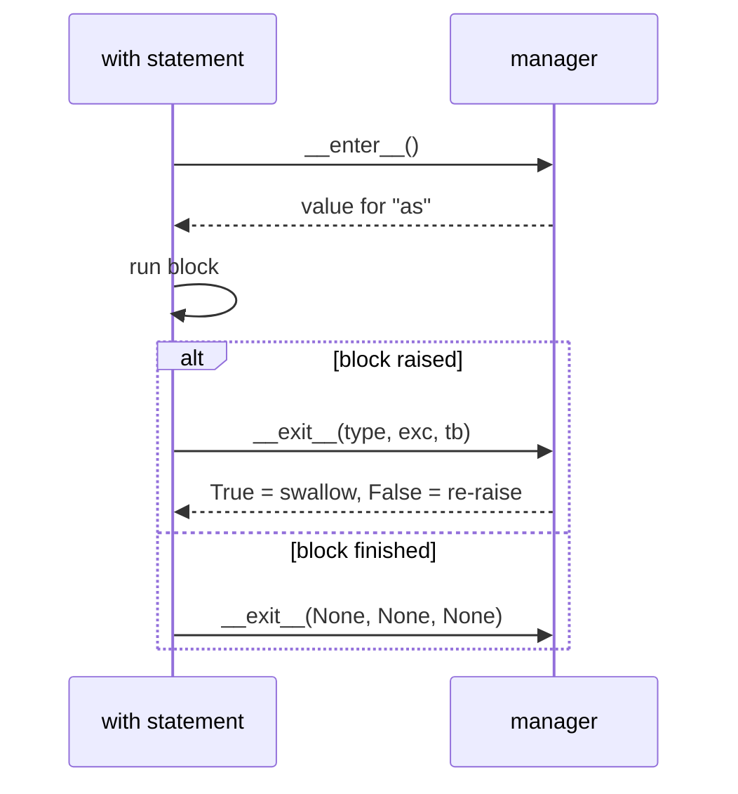

# Context managers and contextlib

> **Before this lesson:** you need `try` / `except` / `finally` from [Exceptions](#/lesson/python/py-exceptions), special methods from [The data model: dunder methods](#/lesson/python/py-data-model), generators with `yield` from [Generators and yield from](#/lesson/python/py-generators), and decorators from [Decorators and functools](#/lesson/python/py-decorators). You should have opened a file with `with open(...)` once, as in [Files, errors and tests](#/lesson/python/py-start-files-tests).

## In plain words

Many things in a program come in pairs: open a file and close it, take a lock and give it back, start a timer and stop it, change a setting and restore it. Anything that must be given back after use is called a **resource**; taking it is *acquiring* it and giving it back is *releasing* it.

The bug is always the same one. The second half of the pair is skipped, because an error or an early `return` jumped over it. Files stay open, locks are never released, settings stay changed.

Think of a hotel key card. Checking in gives you the card; checking out returns it. If guests had to remember to hand the card back, some would forget, especially those who leave in a hurry because something went wrong. A better system: the door of the hotel takes the card off you automatically, whichever exit you use and whatever state you leave in.

Python's `with` statement is that door. You write the setup and the cleanup once, in an object called a **context manager**, and `with` guarantees that the cleanup runs when the indented block is left, no matter how it is left: by finishing normally, by `return`, or by an exception.

Why this matters for a job: every program that touches files, databases, network connections or locks depends on this. "How does the `with` statement work?" and "write a context manager that times a block of code" are routine interview questions, and context managers appear throughout testing tools and web frameworks.

## The problem and the `with` solution

Here is the unsafe way of reading a file:

```python
f = open("data.txt")
data = f.read()        # if this raises, close() never runs
f.close()
```

If `read()` fails, the function is abandoned on that line and `close()` never happens. The fix by hand uses `try` / `finally`, whose `finally` block runs on every way out:

```python
f = open("data.txt")
try:
    data = f.read()
finally:
    f.close()
```

That works, but it is three extra lines that must be written correctly every time. `with` packages the pattern:

```python
with open("data.txt") as f:
    data = f.read()
# f is closed here, even if read() raised
```

```python-run
import os, tempfile
path = os.path.join(tempfile.gettempdir(), "cm_demo.txt")

with open(path, "w", encoding="utf-8") as f:
    f.write("yohoho\n")
print(f.closed)                  # True: closed on leaving the block

try:
    with open(path, encoding="utf-8") as f:
        raise RuntimeError("something broke mid-read")
except RuntimeError:
    print("still closed after an exception:", f.closed)
os.remove(path)
```

The demo writes a small file in the system's temporary folder. After the first `with` block, `f.closed` is `True`: leaving the block closed the file. The second `with` raises an error in the middle of the block on purpose; the `except` then confirms that the file was still closed. The last line deletes the file.

## The protocol: `__enter__` and `__exit__`

`with` is not special knowledge about files. It works with any object that has two special methods. `with EXPR as VAR: BLOCK` does roughly this:

```python
manager = EXPR
value = manager.__enter__()          # VAR = value (only if 'as' is used)
try:
    BLOCK
except BaseException as exc:
    if not manager.__exit__(type(exc), exc, exc.__traceback__):
        raise                        # re-raise unless __exit__ returned truthy
else:
    manager.__exit__(None, None, None)
```

In words: evaluate the expression to get the manager; call its `__enter__`; run the block; then call `__exit__`, telling it whether an exception ended the block. So a **context manager** is any object with these two methods:

- `__enter__(self)` does the setup. Whatever it returns is what `as` ties the name to. Often that is the manager itself (`self`), but it need not be: for `open()` it is the file object.
- `__exit__(self, exc_type, exc_value, traceback)` does the cleanup. Its three arguments describe the exception that ended the block: its class, the exception object and its traceback. If the block ended normally, all three are `None`. The return value matters: **a truthy return tells Python to suppress (swallow) the exception**; a falsy return, or no return at all, lets it continue to travel.



### A class-based example

```python-run
import time

class Timer:
    def __init__(self, label):
        self.label = label
    def __enter__(self):
        self.start = time.perf_counter()
        return self
    def __exit__(self, exc_type, exc, tb):
        self.elapsed = time.perf_counter() - self.start
        status = "failed" if exc_type else "ok"
        print(f"[{self.label}] {self.elapsed * 1000:.2f} ms ({status})")
        return False                      # don't suppress

with Timer("sum") as t:
    total = sum(range(500_000))
print(total, t.elapsed > 0)

try:
    with Timer("boom"):
        1 / 0
except ZeroDivisionError:
    print("exception propagated after cleanup")
```

**Reading this code line by line**

- `__enter__` notes the starting time and returns `self`, so that `as t` gives access to the timer afterwards.
- `__exit__` computes the elapsed time and prints it. `exc_type` is `None` when the block succeeded, so the status reads `ok` or `failed`. It returns `False`: any exception continues on its way.
- The first `with` times a sum; afterwards `t.elapsed` is still available.
- The second `with` divides by zero. The output shows the timer line *first*, marked `failed`, and then the message from the `except`: the cleanup ran, and after it the exception carried on to the caller.

### Suppressing exceptions

```python-run
class Ignore:
    def __init__(self, *types):
        self.types = types
    def __enter__(self):
        return self
    def __exit__(self, exc_type, exc, tb):
        return exc_type is not None and issubclass(exc_type, self.types)

with Ignore(KeyError):
    {}["missing"]
    print("never printed: the block stops at the exception")
print("but execution continues after the with")
```

`Ignore.__exit__` returns `True` when the block ended with one of the listed exception types. The `KeyError` from the missing dictionary key is therefore swallowed. Read the output carefully: the `print` inside the block never runs.

Suppressing an exception does not resume the block at the next line. The block is over; execution continues *after* the `with` statement.

## `contextlib.contextmanager`: generators as context managers

A class with two methods is a lot of writing for a simple case. The standard `contextlib` module offers a shortcut. The decorator `@contextmanager` turns a generator function into a context manager: the code before `yield` is the setup, the value yielded is what `as` receives, and the code after `yield` is the cleanup.

```python-run
from contextlib import contextmanager
import os, tempfile

@contextmanager
def working_directory(path):
    old = os.getcwd()
    os.chdir(path)
    try:
        yield path                 # the block runs here
    finally:
        os.chdir(old)              # always restore

before = os.getcwd()
with working_directory(tempfile.gettempdir()) as p:
    inside = os.getcwd()
print(before != inside, os.getcwd() == before)
```

Every running program has a *current working directory*, the folder that relative file names are looked up in. `working_directory` remembers the old one, switches to the new one, pauses at `yield` while the `with` block runs, and then, in `finally`, switches back. The print shows `True True`: inside the block the directory was different (unless the program happened to start in the temporary folder already), and afterwards it is the original again.

The `try` / `finally` around `yield` is essential. If the `with` block raises, the exception is delivered *into* the generator at the paused `yield` (with the `throw` method from the generators lesson). Without `finally`, the lines after `yield` would be skipped. You may also catch the exception at that point, to suppress it or to replace it with another:

```python-run
from contextlib import contextmanager

@contextmanager
def translate(src, dst):
    try:
        yield
    except src as e:
        raise dst(f"translated: {e}") from e

try:
    with translate(KeyError, LookupError):
        {}["k"]
except LookupError as e:
    print(type(e).__name__, e)
```

`translate(KeyError, LookupError)` turns any `KeyError` raised in its block into a `LookupError`, chained to the original with `from e`. The rule for these generators: they must `yield` **exactly once**.

## The contextlib toolbox

| Tool | Purpose |
|---|---|
| `contextmanager` | generator → context manager |
| `suppress(*excs)` | ignore specific exceptions |
| `closing(obj)` | call `obj.close()` on exit for objects that aren't context managers |
| `redirect_stdout(f)` / `redirect_stderr(f)` | temporarily send prints elsewhere |
| `ExitStack` | manage a dynamic number of context managers / cleanup callbacks |
| `nullcontext(value)` | a do-nothing manager, for optional contexts |
| `ContextDecorator` | make a manager usable as a decorator too |
| `asynccontextmanager`, `AsyncExitStack` | async versions (`async with`) |

```python-run
import io
from contextlib import redirect_stdout, suppress, ExitStack, nullcontext, closing

buf = io.StringIO()
with redirect_stdout(buf):
    print("captured!")
print("got:", buf.getvalue().strip())

with suppress(ZeroDivisionError):
    1 / 0

with ExitStack() as stack:
    files = [stack.enter_context(closing(io.StringIO(f"file {i}"))) for i in range(3)]
    stack.callback(lambda: print("extra cleanup callback runs first (LIFO)"))
    print([f.read() for f in files])
print(all(f.closed for f in files))

def process(lock=None):
    with (lock or nullcontext()):
        return "done"
print(process())
```

Four tools in one demo:

- `redirect_stdout(buf)` sends everything printed inside the block into an in-memory text buffer; nothing appears on screen until the program prints `got: captured!` itself.
- `suppress(ZeroDivisionError)` swallows that one error.
- `ExitStack` is a manager of managers. `stack.enter_context(m)` enters a manager and remembers it; `stack.callback(f)` registers a plain function to call at the end. When the `with ExitStack()` block ends, everything is cleaned up in reverse order, last in, first out (LIFO). Here three in-memory "files" are opened in a loop, and afterwards all three are closed.
- `nullcontext()` is a manager that does nothing, useful when a resource is optional: the function works with a real lock or with none.

`ExitStack` is the answer to "how do I open N files when N is only known while the program runs?", and it cleans up in reverse order, exactly as nested `with` blocks would.

## Multiple managers

One `with` statement can enter several managers, separated by commas:

```python
with open("in.txt") as src, open("out.txt", "w") as dst:
    dst.write(src.read())
```

The managers are entered from left to right and exited from right to left. Since Python 3.10 they can be wrapped in parentheses and spread over several lines:

```python
with (
    open("in.txt") as src,
    open("out.txt", "w") as dst,
):
    ...
```

## Context managers you already use

Many objects in the standard library and in popular tools are context managers. The table lists what happens on entering and on leaving each:

| Manager | Enter / exit |
|---|---|
| `open(...)` | — / close the file |
| `threading.Lock()` | acquire / release |
| `decimal.localcontext()` | save precision / restore |
| `tempfile.TemporaryDirectory()` | create dir / delete it |
| `unittest.mock.patch(...)` | patch / restore |
| `pytest.raises(E)` | — / assert that E was raised |
| `sqlite3.connect(...)` (as transaction) | begin / commit or rollback |
| `concurrent.futures.ThreadPoolExecutor()` | — / shutdown and wait |
| `asyncio.TaskGroup()` (`async with`) | — / wait for tasks, cancel on error |

```python-run
import threading, tempfile, os, decimal

lock = threading.Lock()
with lock:
    print("locked:", lock.locked())
print("locked:", lock.locked())

with tempfile.TemporaryDirectory() as d:
    p = os.path.join(d, "note.txt")
    open(p, "w").close()
    print(os.path.exists(p))
print(os.path.exists(p))

with decimal.localcontext() as ctx:
    ctx.prec = 5
    print(decimal.Decimal(1) / decimal.Decimal(7))
print(decimal.Decimal(1) / decimal.Decimal(7))
```

- A **lock** is an object that only one part of a program can hold at a time (the concurrency lessons explain why that is needed). Inside the `with` it is held (`True`); afterwards it has been released (`False`).
- `TemporaryDirectory` creates a folder and deletes it, with everything in it, on exit: the file exists inside the block and is gone after it.
- `decimal.localcontext()` allows a temporary change of the precision of `Decimal` arithmetic. Inside the block 1/7 is printed with 5 significant digits; outside, with the default 28.

## Worked example: a transaction

A **transaction** is a group of changes that must happen completely or not at all: money leaves one account *and* arrives in another, or neither. Making the changes permanent is called **committing**; undoing them is **rolling back**. A context manager is the natural shape for "commit on success, roll back on failure":

```python-run
from contextlib import contextmanager

class Account:
    def __init__(self, balance):
        self.balance = balance

@contextmanager
def transaction(*accounts):
    snapshot = [a.balance for a in accounts]
    try:
        yield
    except Exception:
        for a, old in zip(accounts, snapshot):
            a.balance = old                 # roll back
        print("rolled back")
        raise
    else:
        print("committed")

a, b = Account(100), Account(50)
with transaction(a, b):
    a.balance -= 30; b.balance += 30
print(a.balance, b.balance)

try:
    with transaction(a, b):
        a.balance -= 500
        if a.balance < 0:
            raise ValueError("overdraft")
        b.balance += 500
except ValueError as e:
    print("failed:", e, "|", a.balance, b.balance)
```

`transaction` notes the balances on entry. If the block raises, the `except` branch restores them, prints `rolled back` and re-raises the exception for the caller. If the block succeeds, the `else` branch prints `committed`. The first transfer of 30 goes through: `70 80`. The second takes 500 out of the first account and then discovers the overdraft; the exception triggers the rollback, and the final print shows both balances unchanged at `70 80`.

> [!INTERVIEW]
> "How does `with` work?" It calls `__enter__`, ties the result to the `as` name, runs the block, and then always calls `__exit__(exc_type, exc, tb)`; a truthy return suppresses the exception. "How would you write one?" A class with those two methods, or `@contextlib.contextmanager` on a generator with `try` / `finally` around a single `yield`. Bonus: mention `ExitStack` for a number of resources not known in advance, and `async with` (`__aenter__` / `__aexit__`).

## How `@contextmanager` works inside

The decorator is a small class that operates your generator through the two-method protocol, a neat use of `next()`, `throw()` and `StopIteration` from the generators lesson. Here is a simplified version written from scratch:

```python-run
import functools

class GeneratorContextManager:
    def __init__(self, gen):
        self.gen = gen
    def __enter__(self):
        return next(self.gen)                      # run up to the yield; its value goes to 'as'
    def __exit__(self, exc_type, exc, tb):
        if exc_type is None:
            try:
                next(self.gen)                     # resume after the yield: run the teardown
            except StopIteration:
                return False
            raise RuntimeError("generator didn't stop")
        try:
            self.gen.throw(exc)                    # re-raise the block's exception AT the yield
        except StopIteration:
            return True                            # generator swallowed it -> suppress
        except BaseException as raised:
            if raised is exc:
                return False                       # same exception came back out -> propagate
            raise
        raise RuntimeError("generator didn't stop after throw()")

def my_contextmanager(func):
    @functools.wraps(func)
    def helper(*args, **kwargs):
        return GeneratorContextManager(func(*args, **kwargs))
    return helper

@my_contextmanager
def tag(name):
    print(f"<{name}>")
    try:
        yield name.upper()
    finally:
        print(f"</{name}>")

with tag("b") as t:
    print("  inside, got", t)
try:
    with tag("i"):
        raise KeyError("oops")
except KeyError:
    print("exception passed through the generator's finally and out again")
```

- `__enter__` calls `next` on the generator, which runs your setup code up to the `yield`, and returns the yielded value.
- `__exit__` with no exception calls `next` again, which runs your cleanup code. The generator should now finish, so `StopIteration` is the expected outcome. If it yields a second time, that is an error.
- `__exit__` with an exception calls `self.gen.throw(exc)`, which raises the block's exception inside the generator at the `yield`. If the generator finishes quietly, it swallowed the exception and `__exit__` returns `True`. If the same exception comes back out, `__exit__` returns `False` and the `with` statement lets it travel on.
- `my_contextmanager` is the decorator: it wraps the generator function so that calling it returns one of these objects.

The output shows `<b>`, the inside line, `</b>`, and then for the failing block `<i>`, `</i>` and the final message.

This explains two rules. The cleanup runs because `throw()` raises the exception *at the `yield`*; without `try` / `finally` there, the code after `yield` is skipped. And each call creates a new generator, which can be run through only once, so a generator-based manager is **single-use**:

```python-run
from contextlib import contextmanager

@contextmanager
def session():
    print("open")
    yield
    print("close")

cm = session()
with cm:
    pass
try:
    with cm:                       # the generator is already exhausted
        pass
except (RuntimeError, AttributeError) as e:    # the exact error type varies between versions
    print(f"cannot re-enter: {type(e).__name__}: {e}")
```

The second `with cm:` fails, because the generator behind `cm` is finished. Call `session()` again to get a new manager. A class-based manager can be designed for any of three levels: **single-use** (files), **reusable** (it can be entered again after it has exited, like the `Timer` above), or **reentrant** (it can be entered again while it is already active, like `threading.RLock` and `contextlib.suppress`).

## Async context managers

Asynchronous code (the asyncio lesson) has operations that must be waited for with `await`, such as opening a network connection. When the setup or cleanup of a manager needs to `await`, the protocol has a twin: the methods `__aenter__` and `__aexit__`, used with `async with`, or a generator decorated with `@asynccontextmanager`. FastAPI's start-up and shut-down handler and its `yield`-based dependencies are exactly this.

```python-run
import asyncio
from contextlib import asynccontextmanager

@asynccontextmanager
async def db_connection(name):
    print(f"  connecting to {name}")
    await asyncio.sleep(0.01)                 # pretend handshake
    conn = {"name": name, "open": True}
    try:
        yield conn
    finally:
        await asyncio.sleep(0.01)             # pretend graceful close
        conn["open"] = False
        print(f"  closed {name}")

async def main():
    async with db_connection("orders") as conn:
        print("  using", conn["name"], conn["open"])
    print("  open afterwards?", conn["open"])

asyncio.run(main())
```

The shape is identical to the ordinary version, with `async` and `await` added. The output shows the connection being made, used while open, closed, and then reported as no longer open.

## One class, three usages

A class that inherits from `contextlib.ContextDecorator` (as the objects made by `@contextmanager` already do) can be used both ways: around a block with `with`, or around a whole function as a decorator.

```python-run
import time
from contextlib import ContextDecorator

class timed(ContextDecorator):
    def __init__(self, label): self.label = label
    def __enter__(self):
        self.start = time.perf_counter(); return self
    def __exit__(self, *exc):
        print(f"{self.label}: {(time.perf_counter() - self.start) * 1000:.2f} ms")
        return False

with timed("block"):
    sum(range(100_000))

@timed("function")
def work():
    return sum(range(100_000))
work()
```

The same `timed` class prints one timing line for the `with` block and one for the call of the decorated function `work`.

## try/finally, context manager or decorator?

| Situation | Best tool |
|---|---|
| one-off cleanup in a single place | `try/finally` |
| the same acquire/release pair used in several places | context manager |
| cleanup for an object that only has `close()` | `contextlib.closing(obj)` |
| a variable number of resources, or conditional resources | `ExitStack` |
| behaviour around *every call* of a function | decorator (or `ContextDecorator`) |
| temporary change of global state in tests | `monkeypatch` / `unittest.mock.patch` (themselves context managers) |

## Debugging context managers

- **`AttributeError: __enter__`** (from Python 3.11: `TypeError: ... does not support the context manager protocol`): the object after `with` is not a context manager. Typical causes: the function that creates it was not *called* (`with session:` where `with session():` was meant), or it returns `None`.
- **`as` gives `None`**: `__enter__` forgot `return self`.
- **Errors silently vanish inside a `with`**: some `__exit__` returns a truthy value. Look for an accidental `return True`, or for the result of a call being returned.
- **`RuntimeError: generator didn't yield` / `didn't stop`**: the generator reaches no `yield`, or more than one, on the path taken (for example a `yield` inside a loop or under an `if`).
- **Cleanup did not run**: the `yield` is not wrapped in `try` / `finally`.
- **`ValueError: I/O operation on closed file`**: the file object left its `with` block. Do the reading inside the block, or return the data and not the file.

## Pitfalls recap

- Forgetting `try` / `finally` around the `yield` of a `@contextmanager` generator, so that cleanup is skipped on error.
- Returning a truthy value from `__exit__` by accident and swallowing exceptions.
- Expecting `as` to give the manager: it gives whatever `__enter__` returns.
- Reusing a single-use manager (generator-based ones cannot be entered twice; create a new one each time).
- Returning an open file from inside its `with` block; it is closed by the time the caller receives it.

## Summary

A context manager pairs setup with cleanup that is guaranteed to run. The protocol is `__enter__` / `__exit__`; `contextlib.contextmanager` builds a manager from a generator; `suppress`, `closing`, `redirect_stdout`, `ExitStack` and `nullcontext` cover common needs. Use `with` whenever you acquire something that must be released, or change something that must be restored.

## Glossary

- **Resource** - something that must be given back after use: a file, a lock, a connection.
- **Acquire / release** - to take a resource / to give it back.
- **Context manager** - an object with `__enter__` and `__exit__`, used in a `with` statement.
- **`with` statement** - runs a block between a manager's setup and its guaranteed cleanup.
- **`__enter__` / `__exit__`** - the setup method, whose result goes to `as` / the cleanup method, told about any exception.
- **Suppress** - to swallow an exception so that it travels no further; `__exit__` does it by returning a truthy value.
- **`contextlib`** - the standard module of helpers for context managers.
- **`@contextmanager`** - a decorator that builds a context manager from a generator with one `yield`.
- **`ExitStack`** - a manager that collects other managers and callbacks and cleans them up in reverse order.
- **LIFO** - last in, first out: the order in which nested managers are exited.
- **Lock** - an object that only one part of a program can hold at a time.
- **Transaction / commit / roll back** - an all-or-nothing group of changes / make them permanent / undo them.
- **Single-use / reusable / reentrant** - can be entered once / again after exiting / again while already active.
- **Async context manager** - a manager with `__aenter__` / `__aexit__`, used with `async with`.
- **Current working directory** - the folder against which relative file names are resolved.

```quiz
[
  {"q": "What does `as f` bind in `with open(p) as f:`?", "options": ["The context manager object always", "The return value of __enter__", "The return value of __exit__", "None"], "answer": 1,
   "explain": "`as` receives whatever __enter__ returns; for files that happens to be the file object itself."},
  {"q": "How does __exit__ suppress an exception raised in the block?", "options": ["By calling sys.exit", "By returning a truthy value", "By raising StopIteration", "It can't"], "answer": 1,
   "explain": "A truthy return tells the with statement the exception was handled."},
  {"q": "In a @contextmanager generator, where does the with-block's exception appear?", "options": ["Nowhere", "It is raised at the yield expression inside the generator", "After the generator ends", "In __enter__"], "answer": 1,
   "explain": "The exception is thrown into the generator at the yield, which is why cleanup needs try/finally."},
  {"q": "Which tool manages a number of context managers known only at runtime?", "options": ["contextlib.suppress", "contextlib.ExitStack", "contextlib.closing", "functools.partial"], "answer": 1,
   "explain": "ExitStack.enter_context registers managers dynamically and unwinds them in reverse order."},
  {"q": "In `with A() as a, B() as b:` the exit order is:", "options": ["A then B", "B then A", "Simultaneous", "Undefined"], "answer": 1,
   "explain": "Managers are exited in reverse (LIFO) order, like nested with statements."},
  {"q": "After an exception is suppressed by __exit__, execution continues:", "options": ["At the line after the failing one inside the block", "After the with statement", "At the top of the block", "Nowhere; program ends"], "answer": 1,
   "explain": "The block is abandoned; control resumes after the with statement."},
  {"q": "How many times must a @contextmanager generator yield?", "options": ["Zero", "Exactly once", "At least twice", "Any number"], "answer": 1,
   "explain": "Before the yield is setup, after it teardown. Yielding more or fewer times raises RuntimeError."}
]
```

> **Source:** Python docs, *Language Reference* §8.5 "The with statement" and §3.3.9 "With Statement Context Managers", *Library Reference* `contextlib`; PEP 343. Goodrich, Tamassia & Goldwasser, *Data Structures and Algorithms in Python*, §1.6.2 (files) and §1.7.
