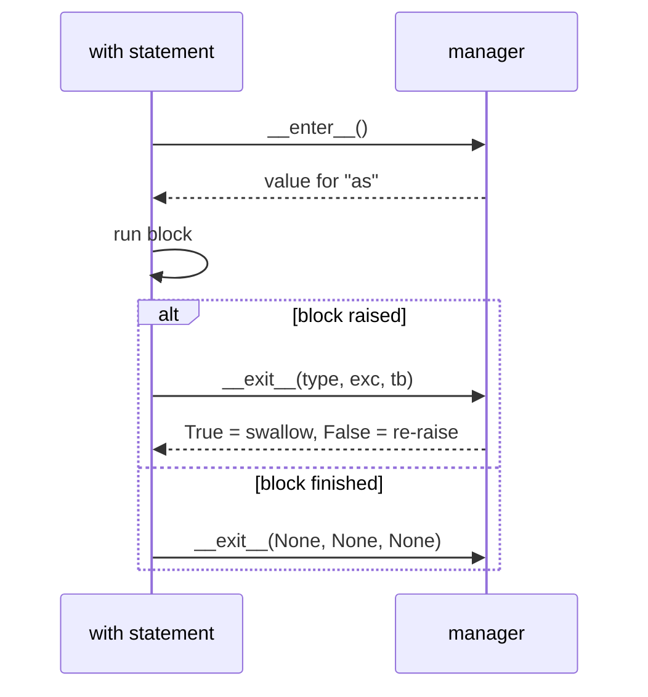

# Context managers and contextlib

Resources come in acquire/release pairs: open/close a file, acquire/release a lock, begin/commit a transaction, start/stop a timer, change/restore a setting. The bug is always the same — the release is skipped because an exception or early `return` jumped past it. The `with` statement solves this once and for all: a **context manager** guarantees the release code runs when the block is left, however it is left.

## The problem and the `with` solution

```python
f = open("data.txt")
data = f.read()        # if this raises, close() never runs
f.close()
```

The manual fix is `try/finally`:

```python
f = open("data.txt")
try:
    data = f.read()
finally:
    f.close()
```

`with` packages that pattern:

```python
with open("data.txt") as f:
    data = f.read()
# f is closed here, even if read() raised
```

```python-run
import os, tempfile
path = os.path.join(tempfile.gettempdir(), "cm_demo.txt")

with open(path, "w", encoding="utf-8") as f:
    f.write("yohoho\n")
print(f.closed)                  # True: closed on leaving the block

try:
    with open(path, encoding="utf-8") as f:
        raise RuntimeError("something broke mid-read")
except RuntimeError:
    print("still closed after an exception:", f.closed)
os.remove(path)
```

## The protocol: `__enter__` and `__exit__`

`with EXPR as VAR: BLOCK` does roughly this:

```python
manager = EXPR
value = manager.__enter__()          # VAR = value (only if 'as' is used)
try:
    BLOCK
except BaseException as exc:
    if not manager.__exit__(type(exc), exc, exc.__traceback__):
        raise                        # re-raise unless __exit__ returned truthy
else:
    manager.__exit__(None, None, None)
```

So a context manager is any object with:

- `__enter__(self)` — set up; its return value is bound by `as` (often `self`, but not necessarily: `open()` returns the file, a lock returns a bool).
- `__exit__(self, exc_type, exc_value, traceback)` — tear down. The three arguments describe the exception that ended the block, or are all `None`. **Return truthy to suppress the exception**; return falsy (or nothing) to let it propagate.



### A class-based example

```python-run
import time

class Timer:
    def __init__(self, label):
        self.label = label
    def __enter__(self):
        self.start = time.perf_counter()
        return self
    def __exit__(self, exc_type, exc, tb):
        self.elapsed = time.perf_counter() - self.start
        status = "failed" if exc_type else "ok"
        print(f"[{self.label}] {self.elapsed * 1000:.2f} ms ({status})")
        return False                      # don't suppress

with Timer("sum") as t:
    total = sum(range(500_000))
print(total, t.elapsed > 0)

try:
    with Timer("boom"):
        1 / 0
except ZeroDivisionError:
    print("exception propagated after cleanup")
```

### Suppressing exceptions

```python-run
class Ignore:
    def __init__(self, *types):
        self.types = types
    def __enter__(self):
        return self
    def __exit__(self, exc_type, exc, tb):
        return exc_type is not None and issubclass(exc_type, self.types)

with Ignore(KeyError):
    {}["missing"]
    print("never printed: the block stops at the exception")
print("but execution continues after the with")
```

Note: suppression doesn't resume the block; execution continues *after* the `with` statement.

## `contextlib.contextmanager`: generators as context managers

Writing a class is verbose for simple cases. The `@contextmanager` decorator turns a generator function into a context manager: code before `yield` is `__enter__`, the yielded value is bound by `as`, and code after `yield` is `__exit__`.

```python-run
from contextlib import contextmanager
import os, tempfile

@contextmanager
def working_directory(path):
    old = os.getcwd()
    os.chdir(path)
    try:
        yield path                 # the block runs here
    finally:
        os.chdir(old)              # always restore

before = os.getcwd()
with working_directory(tempfile.gettempdir()) as p:
    inside = os.getcwd()
print(before != inside, os.getcwd() == before)
```

The `try/finally` around `yield` is essential: if the block raises, the exception is thrown *into* the generator at the `yield`. Without `finally`, your cleanup is skipped. You can also catch it there to suppress or translate it:

```python-run
from contextlib import contextmanager

@contextmanager
def translate(src, dst):
    try:
        yield
    except src as e:
        raise dst(f"translated: {e}") from e

try:
    with translate(KeyError, LookupError):
        {}["k"]
except LookupError as e:
    print(type(e).__name__, e)
```

Rule: a `@contextmanager` generator must `yield` **exactly once**.

## The contextlib toolbox

| Tool | Purpose |
|---|---|
| `contextmanager` | generator → context manager |
| `suppress(*excs)` | ignore specific exceptions |
| `closing(obj)` | call `obj.close()` on exit for objects that aren't context managers |
| `redirect_stdout(f)` / `redirect_stderr(f)` | temporarily send prints elsewhere |
| `ExitStack` | manage a dynamic number of context managers / cleanup callbacks |
| `nullcontext(value)` | a do-nothing manager, for optional contexts |
| `ContextDecorator` | make a manager usable as a decorator too |
| `asynccontextmanager`, `AsyncExitStack` | async versions (`async with`) |

```python-run
import io
from contextlib import redirect_stdout, suppress, ExitStack, nullcontext, closing

buf = io.StringIO()
with redirect_stdout(buf):
    print("captured!")
print("got:", buf.getvalue().strip())

with suppress(ZeroDivisionError):
    1 / 0

with ExitStack() as stack:
    files = [stack.enter_context(closing(io.StringIO(f"file {i}"))) for i in range(3)]
    stack.callback(lambda: print("extra cleanup callback runs first (LIFO)"))
    print([f.read() for f in files])
print(all(f.closed for f in files))

def process(lock=None):
    with (lock or nullcontext()):
        return "done"
print(process())
```

`ExitStack` is the answer to "how do I open N files where N is only known at runtime?" — and it unwinds in reverse order, like nested `with` blocks.

## Multiple managers

```python
with open("in.txt") as src, open("out.txt", "w") as dst:
    dst.write(src.read())
```

Managers are entered left to right and exited right to left. Since Python 3.10 you can wrap them in parentheses to split across lines:

```python
with (
    open("in.txt") as src,
    open("out.txt", "w") as dst,
):
    ...
```

## Context managers you already use

| Manager | Enter / exit |
|---|---|
| `open(...)` | — / close the file |
| `threading.Lock()` | acquire / release |
| `decimal.localcontext()` | save precision / restore |
| `tempfile.TemporaryDirectory()` | create dir / delete it |
| `unittest.mock.patch(...)` | patch / restore |
| `pytest.raises(E)` | — / assert that E was raised |
| `sqlite3.connect(...)` (as transaction) | begin / commit or rollback |
| `concurrent.futures.ThreadPoolExecutor()` | — / shutdown and wait |
| `asyncio.TaskGroup()` (`async with`) | — / wait for tasks, cancel on error |

```python-run
import threading, tempfile, os, decimal

lock = threading.Lock()
with lock:
    print("locked:", lock.locked())
print("locked:", lock.locked())

with tempfile.TemporaryDirectory() as d:
    p = os.path.join(d, "note.txt")
    open(p, "w").close()
    print(os.path.exists(p))
print(os.path.exists(p))

with decimal.localcontext() as ctx:
    ctx.prec = 5
    print(decimal.Decimal(1) / decimal.Decimal(7))
print(decimal.Decimal(1) / decimal.Decimal(7))
```

## Worked example: a transaction

A context manager is the natural shape for "commit on success, roll back on failure":

```python-run
from contextlib import contextmanager

class Account:
    def __init__(self, balance):
        self.balance = balance

@contextmanager
def transaction(*accounts):
    snapshot = [a.balance for a in accounts]
    try:
        yield
    except Exception:
        for a, old in zip(accounts, snapshot):
            a.balance = old                 # roll back
        print("rolled back")
        raise
    else:
        print("committed")

a, b = Account(100), Account(50)
with transaction(a, b):
    a.balance -= 30; b.balance += 30
print(a.balance, b.balance)

try:
    with transaction(a, b):
        a.balance -= 500
        if a.balance < 0:
            raise ValueError("overdraft")
        b.balance += 500
except ValueError as e:
    print("failed:", e, "|", a.balance, b.balance)
```

> [!INTERVIEW]
> "How does `with` work?" — it calls `__enter__`, binds its result, runs the block, then always calls `__exit__(exc_type, exc, tb)`; a truthy return suppresses the exception. "How would you write one?" — a class with those two methods, or `@contextlib.contextmanager` on a generator with `try/finally` around a single `yield`. Bonus: mention `ExitStack` for a dynamic number of resources, and `async with` (`__aenter__`/`__aexit__`).

## Pitfalls recap

- Forgetting `try/finally` around `yield` in a `@contextmanager` generator — cleanup is skipped on error.
- Accidentally returning a truthy value from `__exit__` and swallowing exceptions.
- Expecting `as` to bind the manager: it binds whatever `__enter__` returns.
- Reusing a single-use manager (generator-based ones can't be re-entered; create a new one each time).
- Returning an open file from inside its `with` block — it's closed by the time the caller gets it.

## Summary

Context managers pair setup with guaranteed teardown. The protocol is `__enter__`/`__exit__`; `contextlib.contextmanager` builds one from a generator; `suppress`, `closing`, `redirect_stdout`, `ExitStack` and `nullcontext` cover common needs. Reach for `with` whenever you acquire something that must be released or change something that must be restored.

```quiz
[
  {"q": "What does `as f` bind in `with open(p) as f:`?", "options": ["The context manager object always", "The return value of __enter__", "The return value of __exit__", "None"], "answer": 1,
   "explain": "`as` receives whatever __enter__ returns; for files that happens to be the file object itself."},
  {"q": "How does __exit__ suppress an exception raised in the block?", "options": ["By calling sys.exit", "By returning a truthy value", "By raising StopIteration", "It can't"], "answer": 1,
   "explain": "A truthy return tells the with statement the exception was handled."},
  {"q": "In a @contextmanager generator, where does the with-block's exception appear?", "options": ["Nowhere", "It is raised at the yield expression inside the generator", "After the generator ends", "In __enter__"], "answer": 1,
   "explain": "The exception is thrown into the generator at the yield, which is why cleanup needs try/finally."},
  {"q": "Which tool manages a number of context managers known only at runtime?", "options": ["contextlib.suppress", "contextlib.ExitStack", "contextlib.closing", "functools.partial"], "answer": 1,
   "explain": "ExitStack.enter_context registers managers dynamically and unwinds them in reverse order."},
  {"q": "In `with A() as a, B() as b:` the exit order is:", "options": ["A then B", "B then A", "Simultaneous", "Undefined"], "answer": 1,
   "explain": "Managers are exited in reverse (LIFO) order, like nested with statements."},
  {"q": "After an exception is suppressed by __exit__, execution continues:", "options": ["At the line after the failing one inside the block", "After the with statement", "At the top of the block", "Nowhere; program ends"], "answer": 1,
   "explain": "The block is abandoned; control resumes after the with statement."},
  {"q": "How many times must a @contextmanager generator yield?", "options": ["Zero", "Exactly once", "At least twice", "Any number"], "answer": 1,
   "explain": "Before the yield is setup, after it teardown. Yielding more or fewer times raises RuntimeError."}
]
```

> **Source:** Python docs, *Language Reference* §8.5 "The with statement" and §3.3.9 "With Statement Context Managers", *Library Reference* `contextlib`; PEP 343. Goodrich, Tamassia & Goldwasser, *Data Structures and Algorithms in Python*, §1.6.2 (files) and §1.7.
