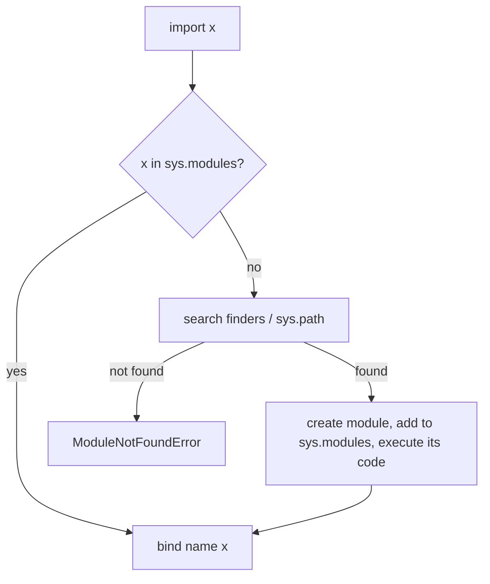

# Modules, packages and imports

> **Before this lesson:** you should have run a Python file from a terminal and used a first `import`, as in [First steps](#/lesson/python/py-start-first-steps). You need namespaces and scope from [Scope, closures and lambdas](#/lesson/python/py-scope-closures) and functions and classes from the earlier modules of this track.

## In plain words

A small program fits in one file. A real one would be thousands of lines long, so it is split into many files, and it also uses code written by other people. The statement that connects all these pieces is `import`.

Three words describe the pieces. A **module** is one file of Python code. A **package** is a folder of modules. A **library** is an informal word for a package (or a set of them) that somebody published for others to use.

Think of a workshop. You do not forge every tool yourself. Tools hang on the wall, each in its place, and when you need the drill you walk over and take it. `import math` is "fetch the `math` toolbox so that I can use what is in it". This lesson explains what happens in that moment: where Python goes looking for the toolbox, what it does the first time it finds it, and why it does not fetch it a second time.

Why this matters for a job: two of the most common beginner errors, `ModuleNotFoundError` and "circular import", come from not knowing these rules, and hours are lost to them. Laying out a project with several files and folders, the first task in any real job, is impossible without understanding imports. Interviewers ask "what happens when you import a module?" and "what is `if __name__ == '__main__':` for?".

## Modules

A **module** is a `.py` file. Its name is the file name without the `.py`. Everything defined at the top level of the file (functions, classes, variables) becomes an **attribute** of the module, reached with a dot.

```python
# geometry.py
"""Tiny geometry helpers."""
import math

PI2 = 2 * math.pi

def circle_area(r):
    return math.pi * r * r

def _helper():          # leading underscore: internal by convention
    ...
```

```python
# main.py
import geometry
print(geometry.circle_area(2), geometry.PI2)
```

In the second file, `import geometry` makes the name `geometry` refer to a **module object**, and `geometry.circle_area` reaches into it. This page runs code in your browser, where creating several files is awkward, so the next demo builds a module by hand, in the way the import system does internally:

```python-run
import sys, types

source = '''
print("  (module body runs once, at first import)")
GREETING = "yohoho"
def shout():
    return GREETING.upper() + "!"
'''
mod = types.ModuleType("brook")
exec(source, mod.__dict__)
sys.modules["brook"] = mod          # what the import system does after loading

import brook                        # found in the cache: body does NOT run again
import brook as b2
print(brook.shout(), b2 is brook, brook.__name__)
```

- `source` is the text of a pretend file called `brook.py`.
- `types.ModuleType("brook")` creates an empty module object, and `exec(source, mod.__dict__)` runs the text with the module's namespace as the place where its names are stored. The message in the parentheses is printed now, once.
- `sys.modules["brook"] = mod` records the module in `sys.modules`, a dictionary of every module loaded so far.
- `import brook` now finds the name in that dictionary and uses the existing module. Nothing is printed: the body does not run a second time. `import brook as b2` gives the same object under another name.

The last line prints `YOHOHO! True brook`.

### What `import x` does

1. Look in the **cache**, the dictionary `sys.modules`. (A cache is a store of results kept so that work need not be repeated.) If `x` is there, reuse it and skip to step 4.
2. Otherwise **find** it. Python asks a list of *finders*; for ordinary files this means searching, in order, the folders listed in **`sys.path`**.
3. **Load** it: create a module object, put it into `sys.modules`, and then **run the file from top to bottom** inside the module's namespace.
4. **Bind** the name `x`, in the code that wrote the `import`, to the module object.



Three consequences follow from these steps:

- A module's code runs **once per process** (one running program), however many files import it. A module is in effect a single shared object, and a variable at the top level of a module is shared by everything that imports it.
- An import is an ordinary statement that assigns a name while the program runs. You may write one inside a function, to delay its cost or to avoid a cycle.
- A module is recorded in `sys.modules` *before* its body has finished running. That detail is what makes circular imports half-work, as shown below.

### `sys.path`: where Python looks

```python-run
import sys
for p in sys.path[:5]:
    print(repr(p))
print(sys.builtin_module_names[:5], "... are compiled into the interpreter")
```

The loop prints the first few folders Python searches. The last line names a few modules that are not files at all: they are compiled into the Python program itself.

`sys.path` is put together when Python starts, from these sources in this order: the folder of the script you ran (or the current folder for `python -m` and the interactive prompt); the folders named in the environment variable `PYTHONPATH`, if set; the folders of the standard library; and the `site-packages` folder of the active environment, which is where the installer `pip` puts third-party packages (the next lesson covers environments).

> [!WARNING]
> **Name shadowing**: the script's own folder comes first, so a file of yours named `random.py`, `json.py`, `email.py` or `test.py` hides the standard-library module with the same name. The symptom is a baffling `AttributeError: module 'random' has no attribute 'randint'`. Print `random.__file__` to see which file was really loaded.

### Import forms

| Statement | Binds | Notes |
|---|---|---|
| `import pkg.mod` | `pkg` | use as `pkg.mod.f()` |
| `import pkg.mod as m` | `m` | conventional aliases: `np`, `pd`, `plt` |
| `from pkg.mod import f, g` | `f`, `g` | copies the *reference* at import time |
| `from pkg.mod import f as h` | `h` | |
| `from pkg.mod import *` | all public names | avoid; pollutes the namespace and hides origins |

The star form `from m import *` imports the names listed in a variable `m.__all__` if the module defines one, and otherwise every name that does not start with an underscore. Defining `__all__` is how a module states which names are meant for outsiders, its public **API** (application programming interface: the set of names other code is expected to use).

One subtle point. `from config import DEBUG` ties a name *of your own* to the object that `config.DEBUG` refers to at that moment. If `config.DEBUG` is later re-tied to a different object, your name does not follow. When a value may change, reach it through the module, as `config.DEBUG`.

```python-run
import math, json as j
from collections import Counter as C, deque
from os.path import join, splitext
print(math.tau, j.dumps([1]), C("aab"), splitext("a/b.tar.gz"), join("a", "b"))
```

The demo uses each form: a plain import, an import under a shorter name (`json as j`), and names taken out of modules (`Counter as C`, `deque`, `join`, `splitext`).

## `__name__` and the main guard

Every module has a variable `__name__`, set by Python. When a file is run directly (`python tool.py`), its `__name__` is the special string `"__main__"`. When the same file is imported, `__name__` is the module's name, `"tool"`. That difference gives the standard idiom, often called the **main guard**:

```python
def main():
    ...

if __name__ == "__main__":
    main()
```

The `if` is true only when the file is the program being run. So one file can serve two purposes: other files can import its functions without anything else happening, and running it directly starts the program. It also keeps side effects, such as starting a server, from happening merely because somebody imported the file. The guard is **required** with the `multiprocessing` module on Windows and macOS, where each helper process imports the main file again.

```python-run
print(__name__)
import json
print(json.__name__, json.__file__.endswith(".py"))
```

On this page each runnable box is the program being run, so the first line prints `__main__`. The imported module reports its own name, `json`.

## Packages

A **package** is a folder of modules, normally containing a file called `__init__.py`:

```
shop/
    __init__.py          # runs when 'shop' is first imported
    models.py
    pricing/
        __init__.py
        discounts.py
        tax.py
```

- `import shop.pricing.tax` imports `shop`, then `shop.pricing`, then `shop.pricing.tax`, running each `__init__.py` once on the way.
- `__init__.py` may be empty. It may also gather the most useful names in one convenient place, for example `from .models import Product`, so that users can write `from shop import Product`.
- A folder without `__init__.py` can still be imported, as a so-called **namespace package**, a feature designed for splitting one package over several locations. For ordinary projects always add `__init__.py`; some tools behave unexpectedly without it.

### Absolute and relative imports

Inside `shop/pricing/tax.py`:

An **absolute import** spells out the full path from the top-level package. A **relative import** starts with dots and is read from the current file's position: one dot means "the package this file is in", two dots "the package above".

```python
from shop.models import Product        # absolute: from the top-level package
from . import discounts                # relative: sibling module
from .discounts import apply           # relative: name from sibling
from ..models import Product           # relative: up one package
```

Relative imports work only inside a package, because Python has to know which package the file belongs to. That is why running a file that sits *inside* a package directly fails:

```
$ python shop/pricing/tax.py
ImportError: attempted relative import with no known parent package
```

Run it as a module from the project's top folder: `python -m shop.pricing.tax`. The style guide PEP 8 recommends absolute imports for clarity and accepts explicit relative imports within a package.

### `python -m`

`python -m name` finds the module `name` on `sys.path` and runs it as the main program, with the current folder on the search path. It is the way to run a module that lives inside a package, and the way to run a tool with one particular Python: `python -m pip install ...`, `python -m venv .venv`, `python -m pytest`, `python -m http.server`. A package can itself be run with `-m` if it contains a file named `__main__.py`.

## Circular imports

A **circular import** is when `a.py` imports `b` and `b.py` imports `a`. With plain `import a` and `import b` this often works, because each module is already in `sys.modules`, half-finished, by the time the other one asks for it. It breaks when one side writes `from a import something` at a moment when `a` has not yet reached the line that defines `something`:

```
ImportError: cannot import name 'something' from partially initialized module 'a'
(most likely due to a circular import)
```

Fixes, in order of preference:

1. **Restructure**: move the shared pieces into a third module that both import. A cycle usually means two files have tangled responsibilities.
2. Import the module, not the name: write `import a` and use `a.something` later, when the function is called.
3. Put the import inside the function that needs it (a *deferred* import).
4. If the import is needed only for type hints: `from typing import TYPE_CHECKING` and place the import under `if TYPE_CHECKING:`.

## Reloading, caching and bytecode

- Python translates each module into **bytecode**, its compact internal form, and stores the result in a folder named `__pycache__` (for example `__pycache__/name.cpython-312.pyc`), translating again when the source file changes. This shortens *loading*; it does not make the code run faster. Do not put `__pycache__` under version control.
- Because of `sys.modules`, editing a file and typing `import` again at a live interactive prompt does nothing. Use `importlib.reload(module)` (with care: objects created earlier keep their old classes) or restart Python.
- `importlib.import_module("pkg.mod")` imports a module whose name is given as a string. Plugin systems are built on it.

```python-run
import importlib, importlib.util, sys
m = importlib.import_module("collections.abc")
print(m.__name__, "collections.abc" in sys.modules, len(sys.modules) > 50)
print(importlib.util.find_spec("json").origin.endswith("__init__.py"))
```

The first line imports by name and confirms that the module is now in the cache, among many others that Python loaded for its own use. The second asks where `json` *would* be loaded from without importing it: its origin is an `__init__.py`, which tells you `json` is a package.

## The standard library at a glance

Python's motto is "batteries included": a great deal comes with it. Before installing something, check whether the standard library already has it. A map of the modules this track uses:

| Area | Modules |
|---|---|
| Data structures | `collections`, `heapq`, `bisect`, `array`, `dataclasses`, `enum` |
| Functional & iteration | `itertools`, `functools`, `operator` |
| Text | `re`, `string`, `textwrap`, `difflib` |
| Numbers | `math`, `statistics`, `random`, `decimal`, `fractions` |
| Files & data | `pathlib`, `os`, `shutil`, `tempfile`, `json`, `csv`, `sqlite3`, `pickle` |
| Dates | `datetime`, `zoneinfo`, `time` |
| Concurrency | `threading`, `multiprocessing`, `concurrent.futures`, `asyncio`, `queue` |
| Dev tools | `typing`, `logging`, `unittest`, `pdb`, `timeit`, `cProfile`, `argparse` |

One of these deserves a note here. The `random` module produces **pseudo-random** numbers: numbers that look random but are computed by a fixed procedure (an algorithm called the Mersenne Twister) from a starting value, the **seed**. Calling `random.seed(n)` with the same `n` gives the same sequence every time, which is exactly what you want for a repeatable simulation or test. It is **not** suitable for passwords or security tokens; for those use the `secrets` module.

```python-run
import random, secrets
random.seed(42)
print(random.randint(1, 6), random.choice("abc"), random.sample(range(10), 3), round(random.random(), 3))
deck = list(range(5)); random.shuffle(deck); print(deck)
print(len(secrets.token_hex(16)))
```

With the seed fixed at 42, this demo prints the same "random" die roll, letter, sample and shuffled list every time you run it. `secrets.token_hex(16)` produces 32 unpredictable hexadecimal characters.

> [!INTERVIEW]
> "What happens when you import a module?" Check `sys.modules`; if it is not there, find it through `sys.path`, create the module, cache it, run its code once, and bind the name. "What is `if __name__ == '__main__'` for?" To run code only when the file is executed as a script, not when it is imported. "How do you fix a circular import?" Restructure, import the module and not its names, or defer the import. "Module versus package?" A file versus a folder of modules (with `__init__.py`).

## Seeing the import system at work

A module object is little more than a dictionary of names plus some descriptive data. Its **spec** (`__spec__`) records how it was found. These are the first things to print when an import behaves strangely:

```python-run
import json, sys, collections.abc

for name in ("json", "collections.abc", "sys"):
    m = sys.modules[name]
    spec = m.__spec__
    print(f"{name:<16} package={m.__package__!r:<14} origin={str(spec.origin)[-28:]!r:<32} "
          f"is_package={spec.submodule_search_locations is not None}")

print(json.__name__, sorted(k for k in vars(json) if not k.startswith("_"))[:6])
print(json.loads is sys.modules["json"].loads, "json.decoder" in sys.modules)
```

The table printed shows that `json` is a *package* (its origin is an `__init__.py`), that `collections.abc` is a module inside a package, and that `sys` is built into Python and has no file. The last line shows that importing `json` also imported `json.decoder`, because the package's `__init__.py` asked for it.

The earlier warning about `from ... import` copying a reference can be shown directly:

```python-run
import sys, types

config = types.ModuleType("config")
config.DEBUG = False
sys.modules["config"] = config

import config as cfg
from config import DEBUG            # copies the current reference into OUR namespace

cfg.DEBUG = True                    # rebinding the attribute on the module...
print(cfg.DEBUG, DEBUG)             # ...does not affect the name we imported earlier
```

A hand-made module `config` has `DEBUG = False`. The program imports the module as `cfg` and also takes the name `DEBUG` out of it. Changing `cfg.DEBUG` to `True` afterwards prints `True False`: the module's attribute changed, and the separately imported name still refers to the old value.

The half-finished module behind circular imports can be simulated with two modules built in memory:

```python-run
import sys, types

def load(name, source):
    mod = types.ModuleType(name)
    sys.modules[name] = mod          # registered BEFORE its body runs, like the real import system
    exec(source, mod.__dict__)
    return mod

b_src = "import mod_a\nprint('  while b loads, mod_a has VALUE:', hasattr(mod_a, 'VALUE'))\n"

# mod_a starts loading: it is registered, then its first line is 'import mod_b' ...
mod_a = types.ModuleType("mod_a"); sys.modules["mod_a"] = mod_a
load("mod_b", b_src)                 # ... so b's body runs while a is still empty
mod_a.VALUE = "a is ready"           # ... and only then does a's next line execute
print("  afterwards:", sys.modules["mod_b"].mod_a.VALUE)
```

The output is `while b loads, mod_a has VALUE: False`, then `afterwards: a is ready`. `import mod_a` inside `b` succeeded, because the module object already existed, but the attribute was not there yet. Had `b` written `from mod_a import VALUE`, that same moment would have raised the "partially initialized module" `ImportError`. Postponing the *use* of the attribute until a function is called is what lets `import module` cycles survive.

## Debugging imports: a checklist

1. **Which Python is running?** `python -c "import sys; print(sys.executable)"`. A surprising number of `ModuleNotFoundError`s are caused by the wrong virtual environment.
2. **Which file was really imported?** `print(module.__file__)`. If it points into your project when you expected `site-packages` or the standard library, a file of yours is shadowing it.
3. **Where is Python looking?** `print(sys.path)`. Remember that the first entry depends on *how* you started the program: the script's folder for `python path/to/script.py`, the current folder for `python -m package.module`.
4. **Can the package be imported from the project's top folder?** Run with `-m` from there, or install the project in editable mode (`pip install -e .` or `uv sync`) so that it is on `sys.path` everywhere. Do not patch `sys.path` by hand in application code.
5. **Trace it:** `python -v script.py` logs every import; `python -X importtime script.py` shows how long each one takes, which is how you find the import that makes a command-line tool slow to start.
6. **`ImportError: cannot import name X`**: the module was found but contains no such name. The cause is a typo, a different version of a third-party library than you expected, or a circular import.

## Designing a package's public surface

- Decide what is public, import it into `__init__.py` (`from .models import Product`), list it in `__all__`, and give everything else a leading underscore. Users then depend on `shop.Product`, and you stay free to reorganise the modules inside.
- Keep `__init__.py` light. Every `import shop.anything` runs it, so heavy imports there slow the whole package down and invite cycles.
- Let dependencies point one way, for example `routers → services → models`, and never back. Layers that only import "downwards" cannot form a cycle.
- Do no work at import time beyond definitions. Opening connections, reading files or parsing arguments at the top level of a module makes it slow to import and hard to test. Put such work in a function called from `main()`.

## Pitfalls recap

- Naming your file after a standard-library or third-party module (`random.py`, `requests.py`).
- Running a file inside a package directly; use `python -m package.module`.
- Heavy work or side effects at import time (slow start, surprises in tests).
- `from module import *`.
- Expecting `from config import X` to follow a later reassignment of `config.X`.
- Mutable data at module level, shared by everything that imports the module.

## Summary

A module is a file that is run once and cached in `sys.modules`; a package is a folder of modules, initialised by its `__init__.py`. Python finds both through `sys.path`. Prefer absolute imports, guard script code with `if __name__ == "__main__":`, run modules inside packages with `python -m`, and break cycles by restructuring.

## Glossary

- **Module** - one `.py` file; also the object that `import` creates from it.
- **Package** - a folder of modules, normally with an `__init__.py`.
- **Library** - published code meant to be imported by other programs.
- **Standard library** - the modules that come with Python.
- **Third-party package** - a package written by others and installed separately, usually with pip.
- **`sys.modules`** - the cache: a dictionary of all modules already loaded.
- **`sys.path`** - the list of folders Python searches for modules.
- **`site-packages`** - the folder where installed third-party packages live.
- **Shadowing** - a file of yours hiding a library module of the same name.
- **`__name__` / main guard** - a module's name, `"__main__"` when run directly / the test `if __name__ == "__main__":`.
- **`__init__.py`** - the file run when a package is first imported.
- **Absolute / relative import** - written from the top-level package / written with leading dots from the current package.
- **`python -m`** - run a module by its import name.
- **Circular import** - two modules that import each other.
- **Bytecode / `__pycache__`** - Python's compiled internal form of a module / the folder where it is stored.
- **API** - the names a module or package offers for others to use.
- **Pseudo-random / seed** - produced by a deterministic procedure that looks random / its starting value.

```quiz
[
  {"q": "How many times is a module's top-level code executed if five files import it in one process?", "options": ["Five", "Once", "Zero", "Depends on import form"], "answer": 1,
   "explain": "After the first import the module object is cached in sys.modules and reused."},
  {"q": "What is `__name__` inside a file run as `python tool.py`?", "options": ["'tool'", "'__main__'", "'tool.py'", "None"], "answer": 1,
   "explain": "The entry-point script's module name is '__main__'; that's what the main guard tests."},
  {"q": "Your script directory contains `json.py`. `import json` in your script loads:", "options": ["The standard library json", "Your json.py, because the script directory is first on sys.path", "Both merged", "An error"], "answer": 1,
   "explain": "sys.path is searched in order and the script's directory comes first, shadowing the stdlib module."},
  {"q": "Why does `python pkg/sub/mod.py` fail with 'attempted relative import with no known parent package'?", "options": ["Relative imports are deprecated", "Run directly, the file is __main__ with no package context; use python -m pkg.sub.mod", "Missing __all__", "pip isn't installed"], "answer": 1,
   "explain": "Relative imports need __package__ to be set, which happens when the module is imported or run with -m."},
  {"q": "What controls which names `from m import *` imports?", "options": ["__init__", "__all__ (or, if absent, all names not starting with underscore)", "__slots__", "sys.path"], "answer": 1,
   "explain": "__all__ is the explicit public API list for star-imports."},
  {"q": "Best first fix for a circular import between a.py and b.py?", "options": ["Delete __pycache__", "Move the shared code into a third module that both import", "Use import *", "Rename the files"], "answer": 1,
   "explain": "Cycles usually indicate tangled responsibilities; extracting the shared part removes the cycle."},
  {"q": "Where does pip install third-party packages?", "options": ["Next to your script", "In the active environment's site-packages directory", "In sys.modules", "In __pycache__"], "answer": 1,
   "explain": "site-packages of the interpreter/venv that ran pip is on sys.path."}
]
```

> **Source:** Goodrich, Tamassia & Goldwasser, *Data Structures and Algorithms in Python*, §1.11 (Modules and the Import Statement, existing modules, pseudo-random numbers), restated in original wording with new examples; Python docs, *Tutorial* ch. 6 "Modules" and *Language Reference* ch. 5 "The import system".
