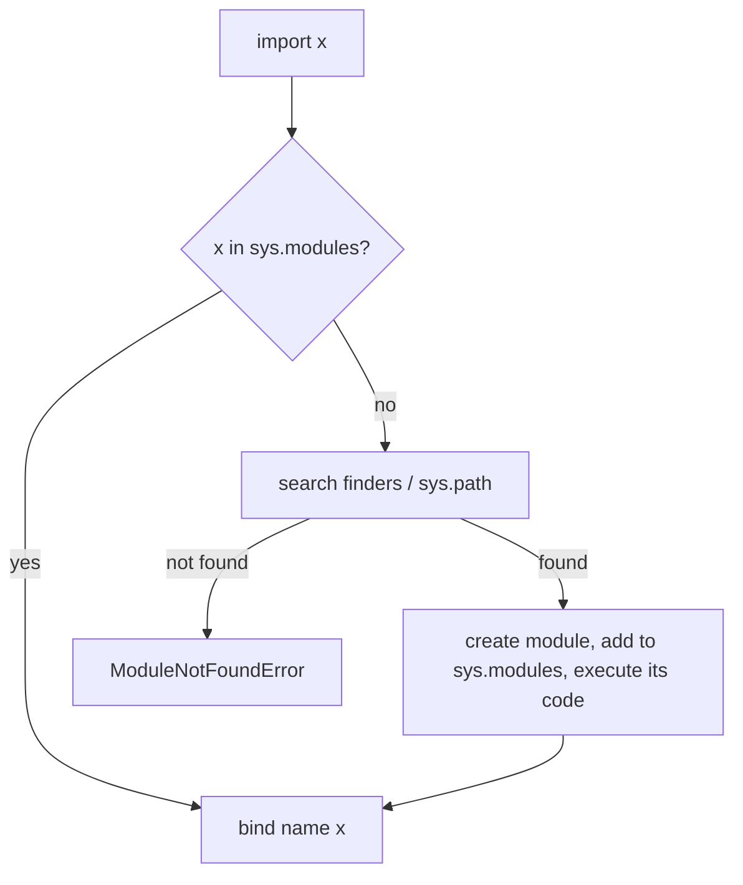

# Modules, packages and imports

A single file gets you surprisingly far, but real programs are split into **modules** (files) grouped into **packages** (directories), and they lean on thousands of third-party packages. Understanding exactly what `import` does — where Python looks, when code runs, what gets cached — saves hours of "ModuleNotFoundError" and "circular import" debugging, and is a prerequisite for structuring a FastAPI service or any other project.

## Modules

A **module** is a `.py` file. Its name is the filename without the extension; its top-level names (functions, classes, variables) become attributes of the module object.

```python
# geometry.py
"""Tiny geometry helpers."""
import math

PI2 = 2 * math.pi

def circle_area(r):
    return math.pi * r * r

def _helper():          # leading underscore: internal by convention
    ...
```

```python
# main.py
import geometry
print(geometry.circle_area(2), geometry.PI2)
```

We can't create files in this in-browser sandbox as easily as on your machine, but we can simulate one to see the mechanics:

```python-run
import sys, types

source = '''
print("  (module body runs once, at first import)")
GREETING = "yohoho"
def shout():
    return GREETING.upper() + "!"
'''
mod = types.ModuleType("brook")
exec(source, mod.__dict__)
sys.modules["brook"] = mod          # what the import system does after loading

import brook                        # found in the cache: body does NOT run again
import brook as b2
print(brook.shout(), b2 is brook, brook.__name__)
```

### What `import x` does

1. Look in the cache **`sys.modules`**. If `x` is there, reuse it.
2. Otherwise **find** it by asking each finder on `sys.meta_path`; for ordinary files that means searching the directories in **`sys.path`** in order.
3. **Load** it: create a module object, put it in `sys.modules`, then **execute the file top to bottom** in the module's namespace.
4. **Bind** the name `x` in the importing scope.



Consequences:

- Module code runs **once per process**, no matter how many files import it. Modules are effectively singletons — a module-level variable is shared global state.
- Imports are just assignments at runtime; you can import inside functions (delaying cost or avoiding cycles).
- A module is registered in `sys.modules` *before* its body finishes — that's what makes circular imports half-work (see below).

### `sys.path`: where Python looks

```python-run
import sys
for p in sys.path[:5]:
    print(repr(p))
print(sys.builtin_module_names[:5], "... are compiled into the interpreter")
```

`sys.path` is built from: the script's directory (or the current directory for `python -m` / the REPL), the `PYTHONPATH` environment variable, the standard library directories, and the active environment's `site-packages` (where pip installs things).

> [!WARNING]
> **Name shadowing**: because the script's directory comes first, a file named `random.py`, `json.py`, `email.py` or `test.py` next to your script hides the standard-library module of the same name. The symptom is a baffling `AttributeError: module 'random' has no attribute 'randint'`. Check `random.__file__`.

### Import forms

| Statement | Binds | Notes |
|---|---|---|
| `import pkg.mod` | `pkg` | use as `pkg.mod.f()` |
| `import pkg.mod as m` | `m` | conventional aliases: `np`, `pd`, `plt` |
| `from pkg.mod import f, g` | `f`, `g` | copies the *reference* at import time |
| `from pkg.mod import f as h` | `h` | |
| `from pkg.mod import *` | all public names | avoid; pollutes the namespace and hides origins |

`from m import *` imports the names listed in `m.__all__` if defined, otherwise every name not starting with an underscore. Define `__all__` to declare a module's public API.

A subtle point: `from config import DEBUG` binds your own name to the current object. If `config.DEBUG` is later *reassigned*, your copy doesn't follow. Access `config.DEBUG` through the module when the value can change.

```python-run
import math, json as j
from collections import Counter as C, deque
from os.path import join, splitext
print(math.tau, j.dumps([1]), C("aab"), splitext("a/b.tar.gz"), join("a", "b"))
```

## `__name__` and the main guard

Every module has a `__name__`. When a file is run directly (`python tool.py`), its `__name__` is `"__main__"`; when imported, it's the module's name. Hence the idiom:

```python
def main():
    ...

if __name__ == "__main__":
    main()
```

This lets one file be both an importable library and a runnable script, and prevents side effects (running the program, starting servers) at import time. It is **mandatory** with `multiprocessing` on Windows and macOS, where child processes re-import the main module.

```python-run
print(__name__)
import json
print(json.__name__, json.__file__.endswith(".py"))
```

## Packages

A **package** is a directory of modules, normally containing an `__init__.py`:

```
shop/
    __init__.py          # runs when 'shop' is first imported
    models.py
    pricing/
        __init__.py
        discounts.py
        tax.py
```

- `import shop.pricing.tax` imports `shop`, then `shop.pricing`, then `shop.pricing.tax`, running each `__init__.py` once.
- `__init__.py` can be empty, or re-export a convenient API: `from .models import Product`, so users write `from shop import Product`.
- A directory without `__init__.py` can still be imported as a **namespace package** (PEP 420) — a feature meant for splitting one package across locations; for ordinary projects always add `__init__.py` to avoid surprises with tools.

### Absolute and relative imports

Inside `shop/pricing/tax.py`:

```python
from shop.models import Product        # absolute: from the top-level package
from . import discounts                # relative: sibling module
from .discounts import apply           # relative: name from sibling
from ..models import Product           # relative: up one package
```

Relative imports work only inside packages, and they depend on the module's `__package__`. That's why running a file *inside* a package directly fails:

```
$ python shop/pricing/tax.py
ImportError: attempted relative import with no known parent package
```

Run it as a module from the project root instead: `python -m shop.pricing.tax`. PEP 8 recommends absolute imports for clarity, with explicit relative imports acceptable inside a package.

### `python -m`

`python -m name` locates `name` on `sys.path` and runs it as `__main__` with the current directory on the path. It's how you run package modules and tools tied to a specific interpreter: `python -m pip install ...`, `python -m venv .venv`, `python -m pytest`, `python -m http.server`. A package becomes runnable with `-m` if it contains `__main__.py`.

## Circular imports

`a.py` imports `b`, and `b.py` imports `a`. With plain `import a` / `import b` this often works, because each module is in `sys.modules` (partially initialised) by the time the other asks for it. It breaks when one side does `from a import something` before `a` has defined `something`:

```
ImportError: cannot import name 'something' from partially initialized module 'a'
(most likely due to a circular import)
```

Fixes, in order of preference:

1. **Restructure**: move the shared pieces into a third module both import (cycles usually signal tangled responsibilities).
2. Import the module, not the name (`import a` and use `a.something` at call time).
3. Import inside the function that needs it (deferred import).
4. For type hints only: `from typing import TYPE_CHECKING` and import under `if TYPE_CHECKING:` with string/deferred annotations.

## Reloading, caching and bytecode

- Python compiles each module to bytecode and caches it in `__pycache__/name.cpython-312.pyc`, recompiling when the source changes. It speeds up *loading*, not execution. Don't commit `__pycache__`.
- Because of `sys.modules`, editing a file and re-running `import` in a live REPL does nothing. Use `importlib.reload(module)` (with caveats: existing objects keep old classes) or restart.
- `importlib.import_module("pkg.mod")` imports by string name — the basis of plugin systems.

```python-run
import importlib, importlib.util, sys
m = importlib.import_module("collections.abc")
print(m.__name__, "collections.abc" in sys.modules, len(sys.modules) > 50)
print(importlib.util.find_spec("json").origin.endswith("__init__.py"))
```

## The standard library at a glance

"Batteries included": before reaching for pip, check the stdlib. A map of the modules this track uses:

| Area | Modules |
|---|---|
| Data structures | `collections`, `heapq`, `bisect`, `array`, `dataclasses`, `enum` |
| Functional & iteration | `itertools`, `functools`, `operator` |
| Text | `re`, `string`, `textwrap`, `difflib` |
| Numbers | `math`, `statistics`, `random`, `decimal`, `fractions` |
| Files & data | `pathlib`, `os`, `shutil`, `tempfile`, `json`, `csv`, `sqlite3`, `pickle` |
| Dates | `datetime`, `zoneinfo`, `time` |
| Concurrency | `threading`, `multiprocessing`, `concurrent.futures`, `asyncio`, `queue` |
| Dev tools | `typing`, `logging`, `unittest`, `pdb`, `timeit`, `cProfile`, `argparse` |

Goodrich (§1.11) highlights `math`, `random`, `collections`, `copy`, `heapq`, `os`, `re`, `sys`, `time` and `array` as the ones used throughout the book, and discusses pseudo-random number generation: `random` uses the Mersenne Twister, a deterministic generator you can make reproducible with `random.seed(n)` — fine for simulations, **not** for security (use `secrets`).

```python-run
import random, secrets
random.seed(42)
print(random.randint(1, 6), random.choice("abc"), random.sample(range(10), 3), round(random.random(), 3))
deck = list(range(5)); random.shuffle(deck); print(deck)
print(len(secrets.token_hex(16)))
```

> [!INTERVIEW]
> "What happens when you import a module?" — check `sys.modules`; else find via `sys.path`, create the module, cache it, execute its code once, bind the name. "What is `if __name__ == '__main__'` for?" — run code only when the file is executed as a script, not when imported. "How do you fix a circular import?" — restructure, import the module instead of names, or defer the import. "Difference between a module and a package?" — file vs directory of modules (with `__init__.py`).

## Pitfalls recap

- Naming your file after a stdlib or third-party module (`random.py`, `requests.py`).
- Running a file inside a package directly instead of `python -m package.module`.
- Heavy work or side effects at import time (slow startup, surprising behaviour in tests).
- `from module import *`.
- Expecting `from config import X` to track later reassignment of `config.X`.
- Mutable module-level state shared across everything that imports it.

## Summary

Modules are files executed once and cached in `sys.modules`; packages are directories of modules initialised by `__init__.py`. Python finds them via `sys.path`. Prefer absolute imports, guard script code with `if __name__ == "__main__":`, run package modules with `python -m`, and break cycles by restructuring.

```quiz
[
  {"q": "How many times is a module's top-level code executed if five files import it in one process?", "options": ["Five", "Once", "Zero", "Depends on import form"], "answer": 1,
   "explain": "After the first import the module object is cached in sys.modules and reused."},
  {"q": "What is `__name__` inside a file run as `python tool.py`?", "options": ["'tool'", "'__main__'", "'tool.py'", "None"], "answer": 1,
   "explain": "The entry-point script's module name is '__main__'; that's what the main guard tests."},
  {"q": "Your script directory contains `json.py`. `import json` in your script loads:", "options": ["The standard library json", "Your json.py, because the script directory is first on sys.path", "Both merged", "An error"], "answer": 1,
   "explain": "sys.path is searched in order and the script's directory comes first, shadowing the stdlib module."},
  {"q": "Why does `python pkg/sub/mod.py` fail with 'attempted relative import with no known parent package'?", "options": ["Relative imports are deprecated", "Run directly, the file is __main__ with no package context; use python -m pkg.sub.mod", "Missing __all__", "pip isn't installed"], "answer": 1,
   "explain": "Relative imports need __package__ to be set, which happens when the module is imported or run with -m."},
  {"q": "What controls which names `from m import *` imports?", "options": ["__init__", "__all__ (or, if absent, all names not starting with underscore)", "__slots__", "sys.path"], "answer": 1,
   "explain": "__all__ is the explicit public API list for star-imports."},
  {"q": "Best first fix for a circular import between a.py and b.py?", "options": ["Delete __pycache__", "Move the shared code into a third module that both import", "Use import *", "Rename the files"], "answer": 1,
   "explain": "Cycles usually indicate tangled responsibilities; extracting the shared part removes the cycle."},
  {"q": "Where does pip install third-party packages?", "options": ["Next to your script", "In the active environment's site-packages directory", "In sys.modules", "In __pycache__"], "answer": 1,
   "explain": "site-packages of the interpreter/venv that ran pip is on sys.path."}
]
```

> **Source:** Goodrich, Tamassia & Goldwasser, *Data Structures and Algorithms in Python*, §1.11 (Modules and the Import Statement, existing modules, pseudo-random numbers); Python docs, *Tutorial* ch. 6 "Modules" and *Language Reference* ch. 5 "The import system".
