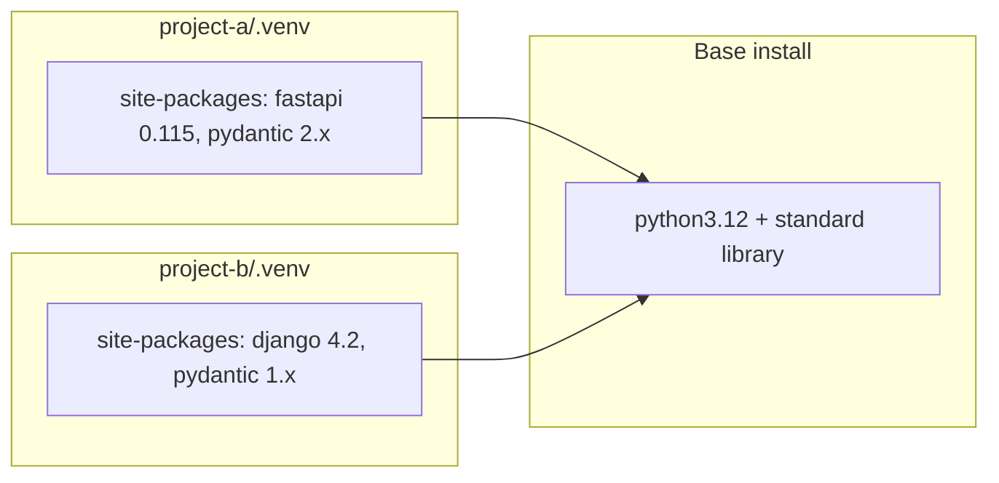

# Virtual environments, pip, uv and project layout

"It works on my machine" is usually a dependency problem: a different Python version, a different version of some library, or a package installed globally that another project silently relies on. This lesson covers the tooling that makes Python projects reproducible — virtual environments, `pip`, `pyproject.toml`, lock files and the modern all-in-one tool `uv` — and a project layout you can use for everything from a script to a FastAPI service.

Nothing here runs in the browser (it's about your terminal), so the examples are shell commands. Type them yourself in a scratch directory; ten minutes of practice beats an hour of reading.

## The problem: one interpreter, many projects

When you `pip install requests`, the package lands in a `site-packages` directory belonging to *one specific Python interpreter*. If every project shares that one directory:

- Project A needs `pydantic 1.x`, project B needs `pydantic 2.x` — they cannot both be satisfied.
- Upgrading a library for one project breaks another.
- You can't tell which of the 200 installed packages a given project actually needs.
- On Linux/macOS you risk breaking tools the operating system itself runs on the system Python (modern distros now refuse with an "externally-managed-environment" error, PEP 668).

## Virtual environments

A **virtual environment** (venv) is a directory containing its own `site-packages` and a small config pointing to a base interpreter. Activating it puts its `bin/` (or `Scripts\`) first on your `PATH`, so `python` and `pip` refer to the environment. Each project gets its own.

```bash
# create (convention: a .venv folder in the project root)
python -m venv .venv

# activate
source .venv/bin/activate          # macOS / Linux
.venv\Scripts\Activate.ps1         # Windows PowerShell
.venv\Scripts\activate.bat         # Windows cmd

# now these refer to the environment
python -c "import sys; print(sys.prefix)"
python -m pip install requests

deactivate                         # leave it
```

What's inside:

```
.venv/
  pyvenv.cfg              # home = path of the base interpreter, version
  bin/ or Scripts/        # python, pip, activate, console scripts of installed packages
  lib/python3.12/site-packages/    # this environment's packages
```

Key facts:

- A venv is **not** a copy of Python; it's a thin layer on top of a base interpreter. Delete the folder and it's gone — it's disposable and should be re-creatable from your dependency files.
- **Never commit `.venv/`** — add it to `.gitignore`. Commit the files that describe it instead.
- Activation is a convenience. You can always call the environment's interpreter directly: `.venv/bin/python script.py`.
- How Python knows it's in a venv: `sys.prefix != sys.base_prefix`.



## pip

`pip` installs packages from the **Python Package Index** (PyPI) or other sources. Prefer `python -m pip ...` so you're certain which interpreter's pip you're using.

```bash
python -m pip install requests                 # latest
python -m pip install "requests==2.32.3"       # exact pin
python -m pip install "fastapi>=0.110,<1.0"    # range
python -m pip install "uvicorn[standard]"      # with optional 'extras'
python -m pip install -r requirements.txt      # from a file
python -m pip install -e .                     # current project, editable mode
python -m pip install --upgrade pip
python -m pip uninstall requests
python -m pip list                             # what's installed
python -m pip show requests                    # metadata + dependencies
python -m pip freeze > requirements.txt        # exact versions of everything
```

### Version specifiers (PEP 440)

| Specifier | Meaning |
|---|---|
| `==2.1.3` | exactly this version |
| `>=2.0,<3.0` | a range |
| `~=2.1` | "compatible release": `>=2.1, <3.0` |
| `~=2.1.3` | `>=2.1.3, <2.2.0` |
| `!=2.1.4` | exclude a broken release |

Most packages follow **semantic versioning**: `MAJOR.MINOR.PATCH` — breaking change, new feature, bug fix. It's a promise, not a guarantee.

### Wheels and sdists

Packages are distributed as **wheels** (`.whl` — pre-built, fast, may contain compiled code for your platform) or **sdists** (source archives that must be built on install). When a wheel exists for your platform and Python version, pip uses it; otherwise it builds from source, which may require a compiler.

## Declaring dependencies

### requirements.txt

The classic approach: a text file of requirements, one per line.

```
fastapi>=0.110
uvicorn[standard]>=0.29
pydantic>=2.6
```

It mixes two different things, though:

- **Abstract dependencies** — what your code needs directly, with loose ranges ("fastapi 0.110 or newer").
- **Concrete, locked dependencies** — the exact version of *every* package, including transitive ones, that was tested together (`pip freeze` output).

You want both: loose ranges to express intent, and a **lock file** for reproducible installs.

### pyproject.toml

`pyproject.toml` is the modern, standard place for project metadata and tool configuration (PEP 518/621):

```toml
[project]
name = "grandline-api"
version = "0.1.0"
description = "Example service"
requires-python = ">=3.11"
dependencies = [
    "fastapi>=0.110",
    "uvicorn[standard]>=0.29",
    "pydantic>=2.6",
]

[project.optional-dependencies]
dev = ["pytest>=8", "ruff", "mypy"]

[project.scripts]
grandline = "grandline_api.cli:main"     # installs a 'grandline' command

[build-system]
requires = ["hatchling"]
build-backend = "hatchling.build"

[tool.pytest.ini_options]
testpaths = ["tests"]

[tool.ruff]
line-length = 100
```

`pip install -e ".[dev]"` installs your project in **editable** mode (code changes take effect without reinstalling) along with the `dev` extras. Tools like pytest, ruff, mypy and black all read their settings from `[tool.*]` tables here, replacing a zoo of config files.

## uv: the fast all-in-one tool

`uv` (from Astral, the makers of ruff) is a single fast binary that replaces `pip`, `venv`, `pip-tools`, `pipx` and `pyenv` for most workflows. It has become the default choice for new projects.

```bash
uv init myproject            # scaffold: pyproject.toml, README, .python-version, main.py
cd myproject
uv add fastapi "uvicorn[standard]"    # add deps: updates pyproject.toml AND uv.lock, creates .venv
uv add --dev pytest ruff     # development-only dependencies
uv remove requests
uv run main.py               # run inside the project environment (auto-creates/syncs it)
uv run pytest
uv sync                      # make .venv match uv.lock exactly (e.g. after git pull, in CI)
uv lock --upgrade            # refresh the lock file to newer allowed versions
uv python install 3.12       # download and manage Python versions
uv tree                      # dependency tree
uvx ruff check .             # run a tool in a throwaway environment (like pipx)
uv pip install -r requirements.txt   # pip-compatible interface, just much faster
```

The important ideas:

- **`uv.lock`** records the exact resolved version and hash of every package for every platform. Commit it. Anyone running `uv sync` gets the identical environment.
- **`uv run`** means you rarely activate anything: it ensures the environment matches the lock file, then runs the command in it.
- It's fast because of a global cache, parallel downloads and a resolver written in Rust.

Other tools you'll meet in existing codebases: **Poetry** and **PDM** (similar project managers with their own lock files), **pip-tools** (`pip-compile` turns `requirements.in` into a pinned `requirements.txt`), **conda/mamba** (also manages non-Python libraries; common in data science), **pipx** (installs CLI apps in isolated environments), **pyenv** (manages Python versions).

## A sane project layout

```
grandline-api/
├── pyproject.toml          # metadata, dependencies, tool config
├── uv.lock                 # exact locked versions (commit!)
├── README.md
├── .gitignore              # .venv/, __pycache__/, .pytest_cache/, *.egg-info, .env
├── .python-version         # e.g. 3.12
├── src/
│   └── grandline_api/      # the importable package
│       ├── __init__.py
│       ├── main.py         # app entry point (e.g. FastAPI app)
│       ├── config.py       # settings from environment variables
│       ├── models.py
│       ├── services/
│       │   ├── __init__.py
│       │   └── pricing.py
│       └── routers/
│           ├── __init__.py
│           └── items.py
└── tests/
    ├── conftest.py         # shared pytest fixtures
    ├── test_pricing.py
    └── test_items.py
```

Why the **`src/` layout**? With the package under `src/`, the project root isn't accidentally importable, so tests run against the *installed* package (editable install), catching packaging mistakes like forgotten files. The simpler **flat layout** (package directory at the root) is fine for small projects.

Guidelines:

- One top-level package named after the project (underscores, lowercase).
- Tests mirror the package structure in a separate `tests/` directory.
- Configuration comes from **environment variables** (optionally loaded from a git-ignored `.env` file), never hard-coded secrets.
- Keep `main.py`/`cli.py` thin: parse input, call functions that live in importable, testable modules.
- A single-file script can declare its dependencies inline (PEP 723) and be run with `uv run script.py`:

```python
# /// script
# requires-python = ">=3.11"
# dependencies = ["httpx"]
# ///
import httpx
print(httpx.get("https://example.com").status_code)
```

## Reproducibility checklist

1. Pin the Python version (`requires-python`, `.python-version`).
2. Declare direct dependencies with sensible ranges in `pyproject.toml`.
3. Commit a lock file (`uv.lock`, `poetry.lock`, or a compiled `requirements.txt`).
4. In CI and Docker, install **from the lock file** (`uv sync --frozen`, or `pip install -r requirements.txt` with hashes).
5. Never install into the system Python; one environment per project.
6. Separate dev tools (pytest, linters) from runtime dependencies.

## Troubleshooting

| Symptom | Likely cause |
|---|---|
| `ModuleNotFoundError` right after installing | pip installed into a different interpreter than the one running your code. Check `python -m pip --version` and `which python` / `where python`. |
| Works in terminal, fails in the IDE | IDE is using a different interpreter; select `.venv`. |
| `error: externally-managed-environment` | You tried to pip-install into the OS Python. Create a venv. |
| Build errors mentioning a C compiler | No wheel for your platform/Python version; try a supported Python version. |
| Dependency conflict (`ResolutionImpossible`) | Two packages require incompatible versions of a third; loosen your constraints or upgrade one. |
| PowerShell refuses to run `Activate.ps1` | Execution policy; run `Set-ExecutionPolicy -Scope CurrentUser RemoteSigned`, or skip activation and use `uv run` / `.venv\Scripts\python`. |

> [!INTERVIEW]
> "What is a virtual environment and why use one?" — an isolated `site-packages` tied to a base interpreter, so each project has its own dependency versions without touching the system Python. "requirements.txt vs pyproject.toml vs lock file?" — pyproject declares metadata and abstract dependencies; a lock file pins the full resolved set for reproducibility; requirements.txt can play either role. "How do you make builds reproducible?" — pinned Python version + committed lock file + install from the lock in CI/Docker.

## Summary

Use one virtual environment per project (`python -m venv` or let `uv` create it). Declare dependencies in `pyproject.toml`, lock them, commit the lock file, and never commit the environment itself. `pip` installs packages; `uv` does that plus environments, locking, Python versions and running tools, much faster. Put your code in a package (ideally under `src/`), tests in `tests/`, configuration in the environment.

```quiz
[
  {"q": "What does a virtual environment isolate?", "options": ["The operating system", "The set of installed third-party packages (its own site-packages) for one base interpreter", "CPU and memory", "Environment variables only"], "answer": 1,
   "explain": "A venv is a lightweight directory with its own site-packages and scripts, layered on a base Python."},
  {"q": "Why prefer `python -m pip install x` over plain `pip install x`?", "options": ["It is faster", "It guarantees you use the pip belonging to that exact interpreter", "It installs globally", "It skips dependencies"], "answer": 1,
   "explain": "A bare pip on PATH may belong to a different Python than the one you run your code with."},
  {"q": "What is the purpose of a lock file such as uv.lock?", "options": ["Prevent concurrent edits", "Record exact versions (and hashes) of all direct and transitive dependencies for reproducible installs", "Encrypt dependencies", "List only direct dependencies"], "answer": 1,
   "explain": "Ranges in pyproject.toml express intent; the lock file pins the tested, resolved set."},
  {"q": "Which should NOT be committed to git?", "options": ["pyproject.toml", "uv.lock", ".venv/", "tests/"], "answer": 2,
   "explain": "The environment is machine-specific and re-creatable from pyproject.toml plus the lock file."},
  {"q": "What does `~=2.1` allow?", "options": ["Only 2.1.0", ">=2.1 and <3.0", ">=2.1 and <2.2", "Any version"], "answer": 1,
   "explain": "The compatible-release operator lets the last given component float: ~=2.1 means >=2.1,<3.0; ~=2.1.3 means >=2.1.3,<2.2.0."},
  {"q": "What does `pip install -e .` do?", "options": ["Installs everything in editable text mode", "Installs the current project so that source edits take effect without reinstalling", "Exports dependencies", "Erases the environment"], "answer": 1,
   "explain": "Editable installs link the environment to your source tree; ideal during development."},
  {"q": "Main benefit of the src/ layout?", "options": ["Faster imports", "Tests run against the installed package rather than accidentally importing from the project root", "Required by pip", "Smaller wheels"], "answer": 1,
   "explain": "It prevents the working directory from masking packaging mistakes."},
  {"q": "`uv run pytest` does what?", "options": ["Installs pytest globally", "Ensures the project environment matches the lock file, then runs pytest inside it", "Runs pytest with the system Python", "Only works after manual activation"], "answer": 1,
   "explain": "uv run syncs and executes in the project's .venv, so activation is unnecessary."}
]
```

> **Source:** Python docs, *Tutorial* ch. 12 "Virtual Environments and Packages", *Library Reference* `venv`, and "Installing Python Modules"; Python Packaging User Guide (pyproject.toml specification, PEP 440, PEP 621, PEP 668, PEP 723); Astral `uv` documentation.
