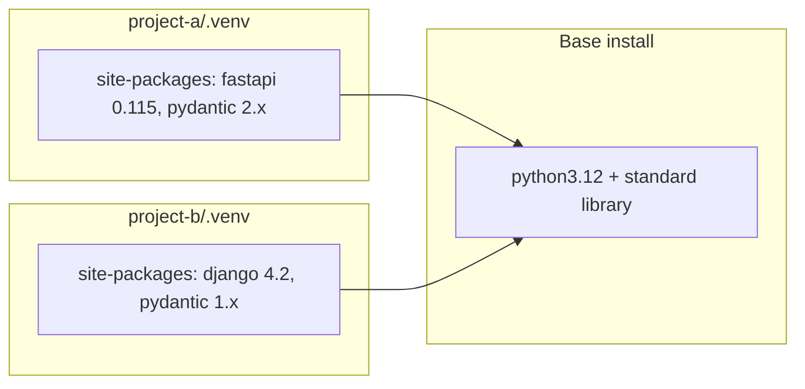

# Virtual environments, pip, uv and project layout

> **Before this lesson:** read [Modules, packages and imports](#/lesson/python/py-imports) first: you need `import`, `sys.path` and the `site-packages` folder. You should be able to open a terminal, change folder and run `python some_file.py`, as described in [First steps](#/lesson/python/py-start-first-steps). No experience with installing packages is assumed.

## In plain words

Almost every real Python program uses code written by other people: a library for talking to web sites, one for databases, one for testing. A piece of outside code that your program needs in order to run is called a **dependency**. Dependencies are published in numbered **versions**, and a program written for version 2 of a library may break with version 1 or version 3.

That creates an everyday problem. Your computer has several projects on it, and they need different versions of the same libraries. Your colleague's computer, and the server that will finally run the program, must end up with exactly the versions you tested with. "It works on my machine" is almost always this problem.

Think of cooking in a shared kitchen with one spice rack. If one cook swaps the mild paprika for the hot one, every other cook's recipe changes without warning. The remedy is for each recipe to have its own labelled box of ingredients, and a shopping list precise enough that anybody can assemble an identical box.

In Python the private box is called a **virtual environment**: a folder that holds the libraries of one project only. The tool that fetches libraries is **pip**. The shopping list is a file called `pyproject.toml`, and the exact, tested list of every item is a **lock file**. A newer tool, **uv**, does all of these jobs in one program.

Why this matters for a job: you cannot contribute to any professional Python project without doing this on your first day. Interviewers ask "what is a virtual environment and why use one?" and "how do you make a build reproducible?". And a large share of the "my import does not work" problems that beginners meet are environment problems, not code problems.

Nothing in this lesson runs in the browser, because it is about your own terminal (the text window where you type commands). The examples are therefore commands, shown in grey boxes; a line beginning with `#` is a comment. Type them yourself in a scratch folder: ten minutes of practice is worth more than an hour of reading.

## The problem: one interpreter, many projects

The program called `python` that runs your code is the **interpreter**. When you type `pip install requests`, the downloaded package is placed in a folder named `site-packages` that belongs to *one particular interpreter*. If every project on the machine shares that one folder:

- Project A needs version 1 of the library `pydantic` and project B needs version 2. Only one version can be installed in a folder, so they cannot both be satisfied.
- Upgrading a library for one project breaks another.
- Nobody can tell which of the 200 installed packages a given project really needs.
- On Linux and macOS, the operating system runs some of its own tools on the system's Python, and installing into it can break them. Recent systems refuse outright with an "externally-managed-environment" error.

## Virtual environments

A **virtual environment** (often shortened to venv) is a folder containing its own `site-packages` and a small settings file that points to an installed Python, the *base interpreter*. Each project gets one.

**Activating** an environment changes one thing in your terminal session. Your terminal finds programs by searching a list of folders called **`PATH`**; activation puts the environment's folder of programs (`bin/` on macOS and Linux, `Scripts\` on Windows) at the front of that list. From then on, typing `python` or `pip` runs the environment's own copies.

```bash
# create (convention: a .venv folder in the project root)
python -m venv .venv

# activate
source .venv/bin/activate          # macOS / Linux
.venv\Scripts\Activate.ps1         # Windows PowerShell
.venv\Scripts\activate.bat         # Windows cmd

# now these refer to the environment
python -c "import sys; print(sys.prefix)"
python -m pip install requests

deactivate                         # leave it
```

What the commands do, in order: `python -m venv .venv` runs the standard `venv` module and creates the environment in a folder named `.venv` (a common convention; the leading dot hides it in file listings). One of the three `activate` lines, depending on your system, switches the terminal over. `python -c "..."` runs one line of Python; it prints `sys.prefix`, which now points into `.venv`. `python -m pip install requests` installs a library into the environment only. `deactivate` switches back.

What the folder contains:

```
.venv/
  pyvenv.cfg              # home = path of the base interpreter, version
  bin/ or Scripts/        # python, pip, activate, console scripts of installed packages
  lib/python3.12/site-packages/    # this environment's packages
```

Facts worth remembering:

- A venv is **not** a copy of Python. It is a thin layer on top of a base interpreter. Delete the folder and it is gone; it is disposable, and you should always be able to recreate it from the files that list your dependencies.
- **Never put `.venv/` under version control.** (Version control, usually the tool Git, records the history of a project's files and shares them with a team.) List `.venv/` in the file `.gitignore`, and commit the files that describe the environment.
- Activation is a convenience. You can always run the environment's interpreter by its path: `.venv/bin/python script.py`.
- Python itself can tell that it is running in a venv: `sys.prefix != sys.base_prefix`.



## pip

`pip` is Python's package installer. By default it downloads from the **Python Package Index** (PyPI, at pypi.org), the public collection of several hundred thousand published packages. Prefer the spelling `python -m pip ...` to plain `pip ...`: it guarantees that the pip you are running belongs to the `python` you are running.

```bash
python -m pip install requests                 # latest
python -m pip install "requests==2.32.3"       # exact pin
python -m pip install "fastapi>=0.110,<1.0"    # range
python -m pip install "uvicorn[standard]"      # with optional 'extras'
python -m pip install -r requirements.txt      # from a file
python -m pip install -e .                     # current project, editable mode
python -m pip install --upgrade pip
python -m pip uninstall requests
python -m pip list                             # what's installed
python -m pip show requests                    # metadata + dependencies
python -m pip freeze > requirements.txt        # exact versions of everything
```

Reading down the list: install the newest version; install one exact version; install any version within a range; install a package together with optional extra features (the name in square brackets); install everything listed in a file; install the project in the current folder in *editable* mode (explained below); upgrade pip itself; remove a package; list what is installed; show details of one package; and write the exact version of everything installed into a file.

### Version specifiers (PEP 440)

| Specifier | Meaning |
|---|---|
| `==2.1.3` | exactly this version |
| `>=2.0,<3.0` | a range |
| `~=2.1` | "compatible release": `>=2.1, <3.0` |
| `~=2.1.3` | `>=2.1.3, <2.2.0` |
| `!=2.1.4` | exclude a broken release |

Most packages follow **semantic versioning**: a version has three numbers, `MAJOR.MINOR.PATCH`. The first changes when existing code may break, the second when features are added compatibly, the third for bug fixes. It is a promise made by the authors, not a guarantee.

### Wheels and sdists

A package is published in one or both of two forms. A **wheel** (a file ending `.whl`) is ready to install: it is fast, and any parts written in C are already compiled for your kind of machine. An **sdist** ("source distribution") is the source code, which must be built on your machine during installation. When a wheel exists for your system and Python version, pip uses it; otherwise it builds from the sdist, which may require a C compiler to be installed.

## Declaring dependencies

### requirements.txt

The classic approach: a text file of requirements, one per line.

```
fastapi>=0.110
uvicorn[standard]>=0.29
pydantic>=2.6
```

One file like this ends up doing two different jobs, though:

- **Abstract dependencies**: what your own code needs directly, with loose ranges ("fastapi 0.110 or newer").
- **Concrete, locked dependencies**: the exact version of *every* package that was tested together. That includes **transitive** dependencies, the packages your dependencies depend on. This is what `pip freeze` prints.

You want both: loose ranges to state what you intend, and a **lock file** so that an installation can be repeated exactly.

### pyproject.toml

`pyproject.toml` is the modern, standard place for a project's description and for the settings of its tools. TOML is a simple file format of `[sections]` and `key = value` lines.

```toml
[project]
name = "grandline-api"
version = "0.1.0"
description = "Example service"
requires-python = ">=3.11"
dependencies = [
    "fastapi>=0.110",
    "uvicorn[standard]>=0.29",
    "pydantic>=2.6",
]

[project.optional-dependencies]
dev = ["pytest>=8", "ruff", "mypy"]

[project.scripts]
grandline = "grandline_api.cli:main"     # installs a 'grandline' command

[build-system]
requires = ["hatchling"]
build-backend = "hatchling.build"

[tool.pytest.ini_options]
testpaths = ["tests"]

[tool.ruff]
line-length = 100
```

Reading the file from the top: `[project]` gives the name, version and the oldest Python that is supported, and `dependencies` lists the abstract dependencies. `[project.optional-dependencies]` defines a named group, `dev`, of tools needed only while developing. `[project.scripts]` asks for a command named `grandline` to be created that runs the function `main` in `grandline_api/cli.py`. `[build-system]` names the tool that packages the project. The `[tool.*]` sections hold settings for individual tools.

`pip install -e ".[dev]"` installs your project in **editable** mode together with the `dev` group. Editable means the environment points at your source folder, so changes to the code take effect without reinstalling. Tools such as pytest (testing), ruff (style checking), mypy (type checking) and black (formatting) all read their settings from this one file, where each used to need a configuration file of its own.

## uv: the fast all-in-one tool

`uv` (made by Astral, the company behind ruff) is one fast program that does the work of `pip`, `venv` and several other tools: `pip-tools` (locking), `pipx` (installing command-line tools) and `pyenv` (installing Python versions). It has become the usual choice for new projects.

```bash
uv init myproject            # scaffold: pyproject.toml, README, .python-version, main.py
cd myproject
uv add fastapi "uvicorn[standard]"    # add deps: updates pyproject.toml AND uv.lock, creates .venv
uv add --dev pytest ruff     # development-only dependencies
uv remove requests
uv run main.py               # run inside the project environment (auto-creates/syncs it)
uv run pytest
uv sync                      # make .venv match uv.lock exactly (e.g. after git pull, in CI)
uv lock --upgrade            # refresh the lock file to newer allowed versions
uv python install 3.12       # download and manage Python versions
uv tree                      # dependency tree
uvx ruff check .             # run a tool in a throwaway environment (like pipx)
uv pip install -r requirements.txt   # pip-compatible interface, just much faster
```

Each line's comment says what it does. The ideas that matter:

- **`uv.lock`** is the lock file. It records the exact version of every package, direct and transitive, together with a **hash** of each file (a fingerprint that proves the download is the same file as before). Commit it. Anyone who runs `uv sync` gets an identical environment.
- **`uv run`** means you rarely activate anything. It first makes sure the environment matches the lock file and then runs your command inside it.
- Working out a set of versions that satisfies every requirement at once is called **resolving**. uv does it quickly, helped by a shared download cache, parallel downloads and a resolver written in the Rust language.

Other tools you will meet in existing projects: **Poetry** and **PDM** (similar project managers with their own lock files); **pip-tools** (its `pip-compile` command turns a loose `requirements.in` into a pinned `requirements.txt`); **conda** and **mamba** (which also manage non-Python libraries and are common in data science); **pipx** (installs command-line programs, each in its own environment); **pyenv** (installs and switches Python versions).

## A sane project layout

A layout that works for anything from a small tool to a web service:

```
grandline-api/
├── pyproject.toml          # metadata, dependencies, tool config
├── uv.lock                 # exact locked versions (commit!)
├── README.md
├── .gitignore              # .venv/, __pycache__/, .pytest_cache/, *.egg-info, .env
├── .python-version         # e.g. 3.12
├── src/
│   └── grandline_api/      # the importable package
│       ├── __init__.py
│       ├── main.py         # app entry point (e.g. FastAPI app)
│       ├── config.py       # settings from environment variables
│       ├── models.py
│       ├── services/
│       │   ├── __init__.py
│       │   └── pricing.py
│       └── routers/
│           ├── __init__.py
│           └── items.py
└── tests/
    ├── conftest.py         # shared pytest fixtures
    ├── test_pricing.py
    └── test_items.py
```

Why put the package inside a `src/` folder? If the package sat in the project's top folder, Python would find it there whenever you ran something from that folder, whether or not the project was properly installed. With the **`src/` layout**, tests can only import the *installed* package (installed in editable mode), which exposes packaging mistakes such as a file left out. The simpler **flat layout**, with the package folder at the top level, is fine for small projects.

Guidelines:

- One top-level package named after the project, in lowercase with underscores.
- Tests in a separate `tests/` folder that mirrors the package's structure.
- Settings come from **environment variables**: named values that the operating system passes to a program when it starts. They may be loaded from a file called `.env` that is kept out of version control. Never write passwords or keys into the code.
- Keep `main.py` or `cli.py` thin: read the input, then call functions that live in importable, testable modules.
- A single-file script can declare its own dependencies in a special comment at the top, and `uv run script.py` will install them into a temporary environment:

```python
# /// script
# requires-python = ">=3.11"
# dependencies = ["httpx"]
# ///
import httpx
print(httpx.get("https://example.com").status_code)
```

## Reproducibility checklist

**Reproducible** means that anyone, on any machine, at any later date, gets the same result. The steps:

1. Fix the Python version (`requires-python`, and a `.python-version` file).
2. Declare direct dependencies with sensible ranges in `pyproject.toml`.
3. Commit a lock file (`uv.lock`, `poetry.lock`, or a compiled `requirements.txt`).
4. On automated build servers (continuous integration, CI) and in Docker container images, install **from the lock file**: `uv sync --frozen`, or `pip install -r requirements.txt` with hashes.
5. Never install into the system's Python; one environment per project.
6. Keep development tools (pytest, style checkers) separate from the dependencies needed to run the program.

## Troubleshooting

| Symptom | Likely cause |
|---|---|
| `ModuleNotFoundError` right after installing | pip installed into a different interpreter than the one running your code. Check `python -m pip --version` and `which python` / `where python`. |
| Works in terminal, fails in the IDE | IDE is using a different interpreter; select `.venv`. |
| `error: externally-managed-environment` | You tried to pip-install into the OS Python. Create a venv. |
| Build errors mentioning a C compiler | No wheel for your platform/Python version; try a supported Python version. |
| Dependency conflict (`ResolutionImpossible`) | Two packages require incompatible versions of a third; loosen your constraints or upgrade one. |
| PowerShell refuses to run `Activate.ps1` | Execution policy; run `Set-ExecutionPolicy -Scope CurrentUser RemoteSigned`, or skip activation and use `uv run` / `.venv\Scripts\python`. |

> [!INTERVIEW]
> "What is a virtual environment and why use one?" A private `site-packages` folder tied to a base interpreter, so that each project has its own versions of its dependencies and nothing touches the system's Python. "requirements.txt, pyproject.toml, lock file?" `pyproject.toml` declares the project and its abstract dependencies; a lock file pins the complete resolved set so that installs can be repeated; `requirements.txt` can play either part. "How do you make builds reproducible?" A fixed Python version, a committed lock file, and installing from the lock in CI and Docker.

## Summary

Use one virtual environment per project (`python -m venv`, or let `uv` create it). Declare dependencies in `pyproject.toml`, lock them, commit the lock file, and never commit the environment itself. `pip` installs packages; `uv` does that and also manages environments, locking, Python versions and running tools, much faster. Put your code in a package (ideally under `src/`), tests in `tests/`, and settings in environment variables.

## Glossary

- **Dependency** - outside code that a project needs in order to run.
- **Transitive dependency** - a dependency of one of your dependencies.
- **Interpreter** - the `python` program that runs Python code.
- **`site-packages`** - the folder where an interpreter's installed packages live.
- **Virtual environment (venv)** - a folder with its own `site-packages`, layered on a base interpreter.
- **Activate** - to put an environment's programs first on `PATH` for the current terminal session.
- **`PATH`** - the list of folders the terminal searches for programs.
- **pip** - Python's package installer.
- **PyPI** - the Python Package Index, the public repository of packages.
- **Version specifier** - a rule such as `>=2.0,<3.0` saying which versions are acceptable.
- **Semantic versioning** - the `MAJOR.MINOR.PATCH` numbering convention.
- **Wheel / sdist** - a ready-to-install package file / a source archive that must be built.
- **`pyproject.toml`** - the standard file describing a project, its dependencies and its tool settings.
- **Lock file** - a file listing the exact version (and hash) of every package in a tested environment.
- **Hash** - a fingerprint computed from a file, used to check it has not changed.
- **Editable install** - an install that points at your source folder, so edits take effect at once.
- **uv** - a fast tool that combines installing, environments, locking and running.
- **Environment variable** - a named value the operating system passes to a program.
- **Reproducible** - giving the same result on any machine at any time.
- **CI (continuous integration)** - servers that automatically build and test each change.

```quiz
[
  {"q": "What does a virtual environment isolate?", "options": ["The operating system", "The set of installed third-party packages (its own site-packages) for one base interpreter", "CPU and memory", "Environment variables only"], "answer": 1,
   "explain": "A venv is a lightweight directory with its own site-packages and scripts, layered on a base Python."},
  {"q": "Why prefer `python -m pip install x` over plain `pip install x`?", "options": ["It is faster", "It guarantees you use the pip belonging to that exact interpreter", "It installs globally", "It skips dependencies"], "answer": 1,
   "explain": "A bare pip on PATH may belong to a different Python than the one you run your code with."},
  {"q": "What is the purpose of a lock file such as uv.lock?", "options": ["Prevent concurrent edits", "Record exact versions (and hashes) of all direct and transitive dependencies for reproducible installs", "Encrypt dependencies", "List only direct dependencies"], "answer": 1,
   "explain": "Ranges in pyproject.toml express intent; the lock file pins the tested, resolved set."},
  {"q": "Which should NOT be committed to git?", "options": ["pyproject.toml", "uv.lock", ".venv/", "tests/"], "answer": 2,
   "explain": "The environment is machine-specific and re-creatable from pyproject.toml plus the lock file."},
  {"q": "What does `~=2.1` allow?", "options": ["Only 2.1.0", ">=2.1 and <3.0", ">=2.1 and <2.2", "Any version"], "answer": 1,
   "explain": "The compatible-release operator lets the last given component float: ~=2.1 means >=2.1,<3.0; ~=2.1.3 means >=2.1.3,<2.2.0."},
  {"q": "What does `pip install -e .` do?", "options": ["Installs everything in editable text mode", "Installs the current project so that source edits take effect without reinstalling", "Exports dependencies", "Erases the environment"], "answer": 1,
   "explain": "Editable installs link the environment to your source tree; ideal during development."},
  {"q": "Main benefit of the src/ layout?", "options": ["Faster imports", "Tests run against the installed package rather than accidentally importing from the project root", "Required by pip", "Smaller wheels"], "answer": 1,
   "explain": "It prevents the working directory from masking packaging mistakes."},
  {"q": "`uv run pytest` does what?", "options": ["Installs pytest globally", "Ensures the project environment matches the lock file, then runs pytest inside it", "Runs pytest with the system Python", "Only works after manual activation"], "answer": 1,
   "explain": "uv run syncs and executes in the project's .venv, so activation is unnecessary."}
]
```

> **Source:** Python docs, *Tutorial* ch. 12 "Virtual Environments and Packages", *Library Reference* `venv`, and "Installing Python Modules"; Python Packaging User Guide (pyproject.toml specification, PEP 440, PEP 621, PEP 668, PEP 723); Astral `uv` documentation.
