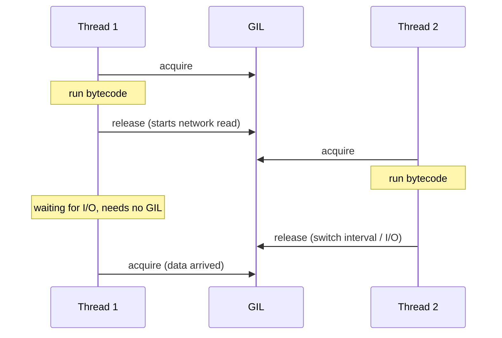
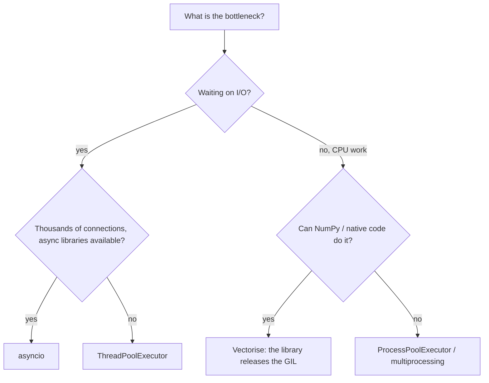

# The GIL, threading and multiprocessing

"Why doesn't my multithreaded Python program use all my cores?" is one of the most common Python interview questions, and answering it well requires three ideas: the difference between **concurrency** and **parallelism**, the difference between **I/O-bound** and **CPU-bound** work, and the **Global Interpreter Lock**. This lesson builds those, then shows the practical tools: `threading`, `multiprocessing` and the unifying `concurrent.futures`. The next lesson covers the third model, `asyncio`.

> [!NOTE]
> Browsers can't start OS threads or processes for Pyodide, so most examples in this lesson are shown as plain code with their real output. Run them locally with a normal Python — they're short.

## Concurrency versus parallelism

- **Concurrency** is about *structure*: dealing with several tasks whose lifetimes overlap, by switching between them. One cook juggling three pans.
- **Parallelism** is about *execution*: literally doing several things at the same instant on multiple CPU cores. Three cooks, three pans.

Concurrency helps whenever tasks spend time **waiting**; parallelism helps when tasks need **computation**.

| Workload | Spends its time... | Examples | What helps |
|---|---|---|---|
| **I/O-bound** | waiting for the network, disk, database, user | web requests, DB queries, file downloads | threads or asyncio |
| **CPU-bound** | executing Python bytecode | parsing, image processing, number crunching, pure-Python loops | multiple processes (or native code) |

## Processes and threads

A **process** is a running program with its own memory space. A **thread** is a path of execution inside a process; threads of one process **share memory** (the same objects, the same globals). Threads are cheap to create and communicate trivially (shared objects), but shared mutable state invites race conditions. Processes are isolated — safer, but heavier to start, and data must be copied (pickled) between them.

## The Global Interpreter Lock

CPython (the standard interpreter) protects its internals — most importantly every object's **reference count** — with one big mutex: the **GIL**. A thread must hold the GIL to execute Python bytecode. Therefore:

> In standard CPython, only **one thread runs Python bytecode at a time**, no matter how many cores you have.

What keeps threads useful anyway:

- A thread **releases the GIL while it waits** for I/O (socket reads, file reads, `time.sleep`) and inside many C extensions doing heavy work (NumPy, hashing, compression). So I/O-bound threads overlap their waiting — real speed-ups.
- The interpreter forces the running thread to offer the GIL to others every few milliseconds (the *switch interval*, 5 ms by default), so threads take turns even in CPU-bound code — which makes them *interleave*, not run in parallel.



Consequences to state in an interview:

1. **CPU-bound** pure-Python code gets **no speed-up from threads** (often a slight slowdown from lock contention).
2. **I/O-bound** code scales well with threads, because waiting happens outside the GIL.
3. For CPU-bound parallelism use **multiple processes** (each has its own interpreter and its own GIL), or push the hot loop into native code (NumPy, Cython, Rust) that releases the GIL.
4. The GIL makes individual bytecode operations atomic-ish but **does not make your code thread-safe** — compound operations like `counter += 1` can still interleave.

### Free-threaded Python

PEP 703 introduced an optional **free-threaded** build of CPython without the GIL (experimental in 3.13 as `python3.13t`, officially supported from 3.14). In that build, threads can run Python code in parallel on multiple cores, at some single-thread cost, and thread-safety of your own data structures matters even more. The default build still has the GIL, and it's what most deployments run today — but "the GIL is being made optional" is the up-to-date answer.

## threading

```python
import threading, time

def download(name, seconds):
    print(f"start {name}")
    time.sleep(seconds)              # stands in for a network call; releases the GIL
    print(f"done  {name}")

start = time.perf_counter()
threads = [threading.Thread(target=download, args=(f"file{i}", 1)) for i in range(5)]
for t in threads:
    t.start()
for t in threads:
    t.join()                         # wait for each to finish
print(f"elapsed: {time.perf_counter() - start:.2f}s")
# five 1-second waits overlap -> elapsed: ~1.0s (not 5s)
```

`start()` begins execution; `join()` blocks until the thread ends. A `daemon=True` thread is killed abruptly when the main program exits.

### Race conditions and locks

Threads share objects, and the scheduler can switch threads between any two bytecode instructions. `counter += 1` is really *load, add, store* — three steps:

```python
import threading

counter = 0
def work(n):
    global counter
    for _ in range(n):
        counter += 1                 # read-modify-write: NOT atomic

threads = [threading.Thread(target=work, args=(1_000_000,)) for _ in range(4)]
for t in threads: t.start()
for t in threads: t.join()
print(counter)                       # may be less than 4000000: lost updates
```

Two threads read the same old value, both add one, both store — one update is lost. (Whether you observe it depends on the Python version and timing, which is exactly what makes races nasty.) The fix is a **lock** around the critical section:

```python
lock = threading.Lock()
def work(n):
    global counter
    for _ in range(n):
        with lock:                   # only one thread at a time in here
            counter += 1
```

We can demonstrate the lost-update interleaving deterministically, without threads, by spelling out the three steps:

```python-run
counter = 0
a = counter          # thread A loads 0
b = counter          # thread B loads 0 (context switch happened here)
counter = a + 1      # A stores 1
counter = b + 1      # B stores 1  -> one increment lost
print(counter)       # 1, not 2
```

Other synchronisation tools in `threading`:

| Primitive | Use |
|---|---|
| `Lock` | mutual exclusion |
| `RLock` | re-entrant lock: the same thread may acquire it repeatedly |
| `Semaphore(n)` | at most `n` holders — limit concurrency |
| `Event` | one thread signals, others wait (`set()` / `wait()`) |
| `Condition` | wait until some state becomes true |
| `Barrier` | wait until N threads have arrived |
| `threading.local()` | per-thread storage |

**Deadlock** happens when thread 1 holds lock A and waits for B while thread 2 holds B and waits for A. Prevent it by always acquiring locks in the same global order, keeping critical sections tiny, or avoiding shared state altogether.

### Prefer queues to shared state

`queue.Queue` is a thread-safe FIFO that does the locking for you. The producer/consumer pattern avoids most explicit locks:

```python
import queue, threading

q = queue.Queue()
results = []

def worker():
    while True:
        item = q.get()
        if item is None:             # sentinel: time to stop
            break
        results.append(item * item)  # list.append is atomic in CPython
        q.task_done()

workers = [threading.Thread(target=worker) for _ in range(3)]
for w in workers: w.start()
for n in range(10): q.put(n)
q.join()                             # block until every item is processed
for _ in workers: q.put(None)
for w in workers: w.join()
print(sorted(results))
```

## multiprocessing

For CPU-bound work, use processes: each has its own interpreter, memory and GIL, so they truly run in parallel.

```python
from multiprocessing import Pool
import math

def count_primes(limit):
    return sum(1 for n in range(2, limit) if all(n % d for d in range(2, math.isqrt(n) + 1)))

if __name__ == "__main__":           # REQUIRED: child processes re-import this module
    with Pool(processes=4) as pool:
        print(pool.map(count_primes, [200_000] * 4))
    # ~4x faster than a plain loop on a 4-core machine
```

What's different from threads:

- **Start-up cost**: creating a process is far heavier than a thread. On Windows and macOS the *spawn* start method launches a fresh interpreter and re-imports your main module — hence the mandatory `if __name__ == "__main__":` guard.
- **No shared memory by default**: arguments and results are **pickled** and sent through pipes. Functions must be importable (top-level, no lambdas), and data must be picklable. Sending huge objects back and forth can cost more than the computation saves.
- Sharing state requires explicit tools: `multiprocessing.Queue`, `Value`/`Array`, `Manager`, or `shared_memory`.

Rule of thumb: parallelise **coarse-grained** chunks of work (each task ≥ tens of milliseconds), not millions of tiny ones.

## concurrent.futures: one interface for both

`concurrent.futures` offers the same high-level API for threads and processes. You submit callables to an **executor** and get **futures** — placeholders for results.

```python
from concurrent.futures import ThreadPoolExecutor, ProcessPoolExecutor, as_completed
import time

def fetch(url):
    time.sleep(0.5)                               # pretend network I/O
    return f"{url}: 200"

urls = [f"https://example.com/{i}" for i in range(8)]

with ThreadPoolExecutor(max_workers=8) as pool:
    for line in pool.map(fetch, urls):            # results in input order
        print(line)

with ThreadPoolExecutor(max_workers=8) as pool:
    futures = {pool.submit(fetch, u): u for u in urls}
    for fut in as_completed(futures):             # results as they finish
        try:
            print(fut.result())                   # re-raises the task's exception here
        except Exception as e:
            print(futures[fut], "failed:", e)

# CPU-bound? swap the class, keep the code:
# with ProcessPoolExecutor() as pool: results = list(pool.map(cpu_heavy, inputs))
```

- `executor.map(fn, iterable)` — like built-in `map`, concurrently, results in order.
- `executor.submit(fn, *args)` → `Future`; `future.result(timeout)` blocks and returns or **re-raises** the exception from the worker.
- `as_completed(futures)` yields futures as they finish.
- The `with` block waits for all tasks and shuts the pool down.

## Choosing a model



| | Threads | Processes | asyncio |
|---|---|---|---|
| Parallel CPU work | no (GIL) | **yes** | no |
| Good for I/O | yes | wasteful | **yes, at scale** |
| Memory | shared | separate (pickling) | shared, one thread |
| Switching | pre-emptive (any time) | pre-emptive | cooperative (only at `await`) |
| Typical risk | races, deadlocks | pickling/startup overhead | accidentally blocking the loop |
| Scale | hundreds | ~number of cores | tens of thousands of tasks |

## Thread safety in practice

- Single operations on built-ins (`list.append`, `dict[key] = v`, `deque.append/popleft`) are atomic in CPython *with* the GIL, but compound ones (`x += 1`, check-then-act such as `if k not in d: d[k] = ...`) are not. Don't rely on GIL atomicity — especially now that free-threaded builds exist. Lock or use a `Queue`.
- Immutable data is always safe to share.
- `threading.local()` keeps per-thread state (e.g., a DB connection per thread).
- Web servers (uvicorn/gunicorn) commonly run **several worker processes**, each handling many concurrent requests via threads or an event loop: processes for cores, threads/async for I/O.

> [!INTERVIEW]
> A model answer: "The GIL is a mutex in CPython that lets only one thread execute Python bytecode at a time; it exists mainly to keep reference counting safe and C extensions simple. It's released during blocking I/O and in many C extensions, so threads speed up I/O-bound work but not CPU-bound Python code. For CPU-bound parallelism I'd use `multiprocessing`/`ProcessPoolExecutor` or native libraries; for massive I/O concurrency, asyncio. Since 3.13 there's an optional free-threaded build without the GIL." Then be ready to explain a race condition on `counter += 1` and fix it with a `Lock`.

## Pitfalls recap

- Expecting threads to speed up CPU-bound Python.
- Forgetting `if __name__ == "__main__":` with multiprocessing (infinite process spawning on Windows/macOS).
- Passing lambdas or unpicklable objects to a process pool.
- Unprotected shared mutable state; lock-ordering deadlocks.
- Exceptions in worker threads silently lost because nobody called `future.result()`.
- Spawning a thread per task without a pool (resource exhaustion).

## Summary

Concurrency is overlapping tasks; parallelism is simultaneous execution. CPython's GIL allows one thread at a time to run bytecode, so threads help I/O-bound work and processes help CPU-bound work. Use locks or queues to protect shared state, and `concurrent.futures` executors as the default high-level interface.

```quiz
[
  {"q": "What does the GIL guarantee in standard CPython?", "options": ["Only one process runs at a time", "Only one thread executes Python bytecode at a time", "Your code is thread-safe", "Threads never switch"], "answer": 1,
   "explain": "The GIL serialises bytecode execution; it does not make compound operations in your code atomic."},
  {"q": "Which workload benefits from threads in CPython?", "options": ["A pure-Python prime sieve", "Downloading 100 web pages", "Matrix multiplication in pure Python loops", "None"], "answer": 1,
   "explain": "Network waits release the GIL, so I/O-bound tasks overlap their waiting."},
  {"q": "Best tool to speed up CPU-bound pure-Python work across cores?", "options": ["threading.Thread", "ProcessPoolExecutor / multiprocessing", "asyncio", "A bigger switch interval"], "answer": 1,
   "explain": "Separate processes each have their own interpreter and GIL, so they run in parallel."},
  {"q": "Why can `counter += 1` lose updates with threads?", "options": ["Integers are mutable", "It is a read-modify-write sequence and a thread switch can occur between the steps", "The GIL is disabled for integers", "It can't"], "answer": 1,
   "explain": "Two threads can load the same value and both store value+1; a Lock makes the sequence atomic."},
  {"q": "Why is `if __name__ == '__main__':` required with multiprocessing on Windows/macOS?", "options": ["Style", "Child processes re-import the main module; without the guard they would recursively spawn", "To enable the GIL", "To allow lambdas"], "answer": 1,
   "explain": "The spawn start method imports the main module in each child."},
  {"q": "What does `future.result()` do if the task raised an exception?", "options": ["Returns None", "Re-raises that exception in the caller", "Hangs forever", "Returns the traceback string"], "answer": 1,
   "explain": "Exceptions are captured in the future and re-raised on result()."},
  {"q": "What must be true of data sent to a worker process?", "options": ["It must be immutable", "It must be picklable", "It must be a string", "It must be global"], "answer": 1,
   "explain": "Arguments and return values are serialised with pickle to cross the process boundary."},
  {"q": "What is the status of the GIL in recent Python versions?", "options": ["Removed entirely in 3.9", "Still default, but an optional free-threaded build exists since 3.13 (PEP 703)", "Replaced by asyncio", "Only on Windows"], "answer": 1,
   "explain": "The free-threaded build is opt-in; the default interpreter retains the GIL."}
]
```

> **Source:** Python docs, *Library Reference* `threading`, `multiprocessing`, `concurrent.futures`, `queue`, the *Glossary* entry "global interpreter lock", and "Python support for free threading" HOWTO; PEP 703.
