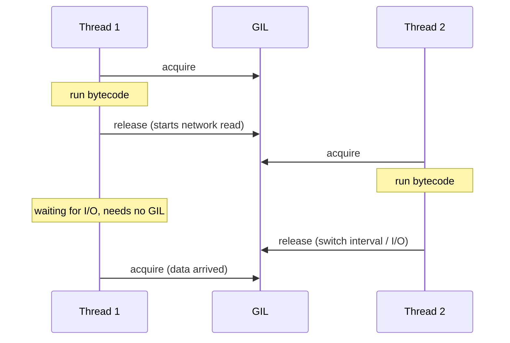
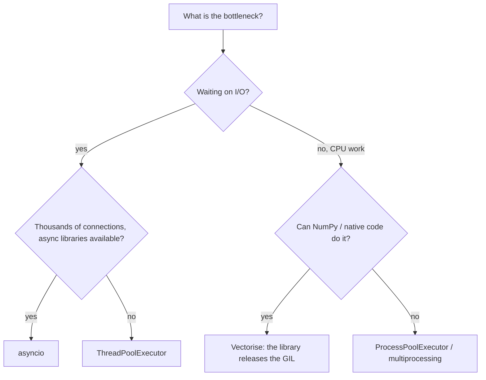

# The GIL, threading and multiprocessing

> **Before this lesson:** you need functions passed as values ([Functions and arguments](#/lesson/python/py-functions-args)), generators for the simulations ([Generators and yield from](#/lesson/python/py-generators)), the `with` statement and locks as context managers ([Context managers and contextlib](#/lesson/python/py-context-managers)), the main guard `if __name__ == "__main__":` ([Modules, packages and imports](#/lesson/python/py-imports)), and reference counting, mentioned in [Objects, names, types and mutability](#/lesson/python/py-objects-names).

## In plain words

Up to now every program in this track did one thing at a time, from the first line to the last. Real programs often have several things in progress at once: a web server answers many visitors, a downloader fetches many files, a data job crunches many chunks of numbers. Arranging for that is called **concurrency**.

Picture a restaurant kitchen. One cook can look after three pans by moving between them while each one simmers; nothing is really happening "at the same instant" as far as the cook's hands are concerned, but all three dishes progress. That is *concurrency*. Three cooks working on three pans truly at the same moment is **parallelism**. The first helps when the work is mostly *waiting* (for the pan to heat, for a web server to reply). The second helps when the work is mostly *doing* (chopping, calculating).

Now the Python-specific twist. Imagine a kitchen with several cooks and a rule that only the cook holding the single kitchen knife may work; the others stand by until it is handed over. Standard Python has exactly such a rule for its threads. The knife is called the **Global Interpreter Lock**, or **GIL**, and it explains the famous complaint "my multithreaded Python program does not use all my processor cores".

Why this matters for a job: "what is the GIL?" is among the most frequently asked Python interview questions, and choosing correctly between threads, processes and asyncio is a routine design decision in backend work. This lesson builds the ideas in order and then shows the practical tools: `threading`, `multiprocessing` and the common front end `concurrent.futures`. The next lesson covers the third model, `asyncio`.

> [!NOTE]
> Code on this page runs inside your browser, which cannot start real threads or processes for Python. The examples that need them are therefore shown as static code with the output they produce on a normal Python installation; they are short, so do run them on your own machine. The boxes with a Run button are *simulations* that reproduce the behaviour step by step.

## Concurrency versus parallelism

- **Concurrency** is about *structure*: several tasks are in progress during the same period, and the program switches between them. One cook, three pans.
- **Parallelism** is about *execution*: several things really happen at the same instant, on separate processor **cores** (a core is one of the independent calculating units inside a modern processor; a laptop typically has 4 to 16). Three cooks, three pans.

Concurrency pays off whenever tasks spend their time **waiting**; parallelism pays off when tasks need **computation**. Programmers classify work accordingly. **I/O** stands for input/output: any exchange with the world outside the program's own memory, such as the network, the disk, a database or the user.

| Workload | Spends its time... | Examples | What helps |
|---|---|---|---|
| **I/O-bound** | waiting for the network, disk, database, user | web requests, DB queries, file downloads | threads or asyncio |
| **CPU-bound** | executing Python bytecode | parsing, image processing, number crunching, pure-Python loops | multiple processes (or native code) |

## Processes and threads

A **process** is a running program with its own private region of memory. A **thread** is one line of execution inside a process. A process always has at least one thread and may start more; all the threads of a process **share its memory**: the same objects, the same global variables.

That difference decides everything else. Threads are cheap to create and can communicate by using the same objects, but several threads changing the same data can corrupt it (the *race condition* shown below). Processes are isolated from each other, which is safer, but they are heavier to start, and data has to be copied from one to another.

## The Global Interpreter Lock

CPython, the standard Python, keeps a **reference count** on every object: how many references point to it. Those counts change constantly, and if two threads updated the same count at the same instant, it could be corrupted and memory would be freed too early or never. CPython's solution is one big lock around the whole interpreter. A lock that only one thread can hold at a time is also called a **mutex** (from "mutual exclusion"), and this particular one is the **Global Interpreter Lock**. A thread must hold the GIL in order to execute Python code (more exactly: Python bytecode, the internal instructions that source code is translated into). Therefore:

> In standard CPython, only **one thread runs Python bytecode at a time**, no matter how many cores you have.

Two things keep threads useful all the same:

- A thread **gives up the GIL while it waits** for I/O (reading from the network or a file, `time.sleep`), and so do many libraries written in C while they do heavy work (NumPy, hashing, compression). Threads doing I/O therefore wait at the same time, and that brings real speed-ups.
- Python forces the running thread to offer the GIL to the others every few milliseconds (the *switch interval*, 5 ms by default). Threads doing calculations therefore take turns. Their work is *interleaved*; it does not run in parallel.



The diagram shows two threads passing the GIL back and forth. The consequences, as you would state them in an interview:

1. **CPU-bound** code written in pure Python gets **no speed-up from threads** (often it becomes slightly slower, because the threads compete for the lock).
2. **I/O-bound** code scales well with threads, because the waiting happens without the GIL.
3. For CPU-bound work in parallel, use **several processes** (each has its own Python and its own GIL), or move the heavy loop into code that is not Python and releases the GIL (NumPy, or extensions written in Cython or Rust).
4. The GIL protects Python's *own* internals. It **does not make your code thread-safe**: an operation made of several steps, such as `counter += 1`, can still be interrupted half-way.

The following simplified model (a calculation, not a measurement) puts numbers on points 1 to 3. Each task is described by how many seconds it computes and how many it waits:

```python-run
def wall_time(tasks, model, cores=4):
    """tasks: list of (cpu_seconds, wait_seconds). A simplified model, not a measurement."""
    cpu = sum(c for c, w in tasks)
    wait = sum(w for c, w in tasks)
    longest = max(c + w for c, w in tasks)
    if model == "sequential":                 # one after another
        return cpu + wait
    if model == "threads":                    # waits overlap; computing takes turns (GIL)
        return max(cpu, longest)
    if model == "processes":                  # computing is spread over the cores; waits overlap
        return max(cpu / min(cores, len(tasks)), longest)

io_bound = [(0.01, 1.0)] * 8                  # eight downloads: almost all waiting
cpu_bound = [(1.0, 0.0)] * 8                  # eight calculations: all computing
for name, tasks in (("I/O-bound", io_bound), ("CPU-bound", cpu_bound)):
    print(name, {m: round(wall_time(tasks, m), 2) for m in ("sequential", "threads", "processes")})
```

For the eight downloads, running them one after another takes about 8 seconds, while threads bring it down to about 1 second, because all eight wait at once; processes do no better and cost more to start. For the eight calculations, threads take the same 8 seconds as doing them in sequence, because only one thread computes at a time; four processes on four cores finish in about 2.

### Free-threaded Python

The GIL is not a law of nature. The proposal PEP 703 introduced an optional **free-threaded** build of CPython that has no GIL (experimental in Python 3.13 under the name `python3.13t`, officially supported from 3.14). In that build, threads can run Python code in parallel on several cores, at some cost in single-thread speed, and the safety of your own shared data matters even more. The default build still has the GIL and is what most installations run today, but the up-to-date answer to "does Python have a GIL?" is "by default yes, and it is being made optional".

## threading

The `threading` module creates and manages threads. This example starts five threads that each pretend to download a file:

```python
import threading, time

def download(name, seconds):
    print(f"start {name}")
    time.sleep(seconds)              # stands in for a network call; releases the GIL
    print(f"done  {name}")

start = time.perf_counter()
threads = [threading.Thread(target=download, args=(f"file{i}", 1)) for i in range(5)]
for t in threads:
    t.start()
for t in threads:
    t.join()                         # wait for each to finish
print(f"elapsed: {time.perf_counter() - start:.2f}s")
# five 1-second waits overlap -> elapsed: ~1.0s (not 5s)
```

**Reading this code line by line**

- `threading.Thread(target=download, args=(f"file{i}", 1))` creates a thread object and says which function it should run and with which arguments. Nothing runs yet.
- `t.start()` starts the thread. The function now runs alongside the main program.
- `t.join()` makes the main program wait until that thread has finished. Waiting in this way is called **blocking**.
- `time.sleep(1)` stands in for a network request: the thread waits and gives up the GIL meanwhile.

Five waits of one second each happen together, so the whole program takes about one second, not five. One more option: a thread created with `daemon=True` is stopped abruptly when the main program ends, without being waited for.

### Race conditions and locks

Threads share objects, and the part of the system that decides which thread runs next (the **scheduler**) may switch from one thread to another between any two small steps. The statement `counter += 1` looks like one action but is really three: *load* the current value, *add* one, *store* the result.

```python
import threading

counter = 0
def work(n):
    global counter
    for _ in range(n):
        counter += 1                 # read-modify-write: NOT atomic

threads = [threading.Thread(target=work, args=(1_000_000,)) for _ in range(4)]
for t in threads: t.start()
for t in threads: t.join()
print(counter)                       # may be less than 4000000: lost updates
```

Four threads each add one a million times, so the result should be 4,000,000. It may come out lower. Two threads load the same old value, each adds one, and each stores: two additions, and the counter went up by one. An update has been lost. A bug whose outcome depends on the exact timing of threads is a **race condition**. Whether you see it on a given run depends on the Python version and on chance, which is exactly what makes such bugs so unpleasant.

The cure is a **lock** around the steps that must not be interrupted (the **critical section**). Only one thread can be inside a `with lock:` block at a time; the others wait at the door.

```python
lock = threading.Lock()
def work(n):
    global counter
    for _ in range(n):
        with lock:                   # only one thread at a time in here
            counter += 1
```

The unlucky order of events can be reproduced without threads by writing the three steps out by hand:

```python-run
counter = 0
a = counter          # thread A loads 0
b = counter          # thread B loads 0 (context switch happened here)
counter = a + 1      # A stores 1
counter = b + 1      # B stores 1  -> one increment lost
print(counter)       # 1, not 2
```

Both "threads" loaded 0 before either stored, so the final value is 1 although two increments were performed.

The next simulation goes further. Each simulated thread is a generator, and every `yield` marks a point where the scheduler may switch to another thread. A small loop plays the scheduler and gives each thread one step in turn. The same program is run without a lock and with one:

```python-run
def worker(shared, n, use_lock):
    for _ in range(n):
        if use_lock:
            while shared["locked"]:
                yield                      # the lock is taken: wait for our next turn
            shared["locked"] = True
        value = shared["counter"]          # step 1: load
        yield                              # the scheduler may switch threads here
        shared["counter"] = value + 1      # steps 2 and 3: add and store
        if use_lock:
            shared["locked"] = False
        yield

def run(use_lock, threads=3, n=4):
    shared = {"counter": 0, "locked": False}
    tasks = [worker(shared, n, use_lock) for _ in range(threads)]
    while tasks:                           # a round-robin scheduler: one step each, in turn
        for t in list(tasks):
            try:
                next(t)
            except StopIteration:
                tasks.remove(t)
    return shared["counter"]

print("without lock:", run(False), "(expected 12)")
print("with lock   :", run(True), "(expected 12)")
```

Three threads add one four times each, so 12 is expected. Without the lock the result is 4: in every round all three threads load the same value before any of them stores, and two of the three additions are lost. With the lock, a thread that finds it taken does nothing on its turn and tries again later, so the load and the store of one thread are never separated by another thread's, and the result is 12.

Coordinating threads so that they do not get in each other's way is called **synchronisation**. Besides `Lock`, the `threading` module offers:

| Primitive | Use |
|---|---|
| `Lock` | mutual exclusion |
| `RLock` | re-entrant lock: the same thread may acquire it repeatedly |
| `Semaphore(n)` | at most `n` holders — limit concurrency |
| `Event` | one thread signals, others wait (`set()` / `wait()`) |
| `Condition` | wait until some state becomes true |
| `Barrier` | wait until N threads have arrived |
| `threading.local()` | per-thread storage |

A **deadlock** is two threads each waiting for something the other holds: thread 1 has lock A and wants B, thread 2 has lock B and wants A, and neither can ever proceed. Prevent it by always taking locks in the same fixed order, by keeping critical sections tiny, or by not sharing data in the first place.

### Prefer queues to shared state

The most reliable way to avoid lock trouble is not to share data at all, and to pass messages. `queue.Queue` is a first-in, first-out queue that is **thread-safe**: it does its own locking, so any number of threads can put items in and take items out. One side produces work, the other consumes it, a design known as the **producer/consumer pattern**:

```python
import queue, threading

q = queue.Queue()
results = []

def worker():
    while True:
        item = q.get()
        if item is None:             # sentinel: time to stop
            break
        results.append(item * item)  # list.append is atomic in CPython
        q.task_done()

workers = [threading.Thread(target=worker) for _ in range(3)]
for w in workers: w.start()
for n in range(10): q.put(n)
q.join()                             # block until every item is processed
for _ in workers: q.put(None)
for w in workers: w.join()
print(sorted(results))
```

Three worker threads each loop for ever: take an item with `q.get()` (which waits if the queue is empty), process it, and report with `q.task_done()`. The main program puts ten numbers in, and `q.join()` waits until every one has been reported done. It then puts in one `None` per worker as a signal to stop (a sentinel) and waits for the threads to end. The sorted results are the squares of 0 to 9.

## multiprocessing

For CPU-bound work, use processes. Each has its own Python, its own memory and its own GIL, so they really do run in parallel on separate cores. A **pool** is a fixed set of worker processes that are given tasks.

```python
from multiprocessing import Pool
import math

def count_primes(limit):
    return sum(1 for n in range(2, limit) if all(n % d for d in range(2, math.isqrt(n) + 1)))

if __name__ == "__main__":           # REQUIRED: child processes re-import this module
    with Pool(processes=4) as pool:
        print(pool.map(count_primes, [200_000] * 4))
    # ~4x faster than a plain loop on a 4-core machine
```

`count_primes` is deliberately heavy pure-Python computation. `Pool(processes=4)` starts four worker processes, and `pool.map` hands each of them one item of the list and collects the four results in order. On a machine with four cores this runs roughly four times faster than a plain loop.

What is different from threads:

- **Cost of starting**: creating a process is far heavier than creating a thread. On Windows and macOS each worker is a brand-new Python that *imports your main file again*. Without the guard `if __name__ == "__main__":`, each worker would run the pool-creating code too and start workers of its own, without end. The guard is therefore mandatory.
- **No shared memory by default**: arguments and results are converted to bytes, sent across, and rebuilt on the other side. That conversion is called **pickling**, after the standard `pickle` module. The function to run must be defined at the top level of a module (no lambdas), and the data must be picklable. Sending very large objects back and forth can cost more time than the parallel computing saves.
- Sharing data needs explicit tools: `multiprocessing.Queue`, `Value` / `Array`, `Manager` or `shared_memory`.

Rule of thumb: hand out work in **large pieces**, each taking at least some tens of milliseconds, not in millions of tiny ones.

## concurrent.futures: one interface for both

`concurrent.futures` offers one simple interface for both threads and processes. You hand functions to an **executor**, an object that owns a pool of workers, and receive **futures**. A future is a ticket for a result that is not ready yet; you ask it for the result later.

```python
from concurrent.futures import ThreadPoolExecutor, ProcessPoolExecutor, as_completed
import time

def fetch(url):
    time.sleep(0.5)                               # pretend network I/O
    return f"{url}: 200"

urls = [f"https://example.com/{i}" for i in range(8)]

with ThreadPoolExecutor(max_workers=8) as pool:
    for line in pool.map(fetch, urls):            # results in input order
        print(line)

with ThreadPoolExecutor(max_workers=8) as pool:
    futures = {pool.submit(fetch, u): u for u in urls}
    for fut in as_completed(futures):             # results as they finish
        try:
            print(fut.result())                   # re-raises the task's exception here
        except Exception as e:
            print(futures[fut], "failed:", e)

# CPU-bound? swap the class, keep the code:
# with ProcessPoolExecutor() as pool: results = list(pool.map(cpu_heavy, inputs))
```

- `executor.map(fn, iterable)` works like the built-in `map`, except that the calls run concurrently. The results come back in the order of the inputs.
- `executor.submit(fn, *args)` schedules one call and returns its `Future`. `future.result(timeout)` waits for the call to finish and returns its value, or **raises again, in the caller, the exception** that the call raised in the worker.
- `as_completed(futures)` hands back the futures in the order in which they finish.
- Leaving the `with` block waits for all tasks and closes the pool.

In the example, eight pretend requests of half a second each finish in about half a second in total. The last comment shows the main attraction of this module: for CPU-bound work, change `ThreadPoolExecutor` to `ProcessPoolExecutor` and leave everything else as it is.

## Choosing a model



| | Threads | Processes | asyncio |
|---|---|---|---|
| Parallel CPU work | no (GIL) | **yes** | no |
| Good for I/O | yes | wasteful | **yes, at scale** |
| Memory | shared | separate (pickling) | shared, one thread |
| Switching | pre-emptive (any time) | pre-emptive | cooperative (only at `await`) |
| Typical risk | races, deadlocks | pickling/startup overhead | accidentally blocking the loop |
| Scale | hundreds | ~number of cores | tens of thousands of tasks |

## Thread safety in practice

A piece of code is **thread-safe** if it works correctly however the threads using it happen to be interleaved. Some practical points:

- Single operations on built-in containers (`list.append`, `dict[key] = v`, `deque.append` / `popleft`) cannot be interrupted half-way in CPython *with* the GIL; such an operation is called **atomic**. Operations made of several steps are not atomic: `x += 1`, or check-then-act such as `if k not in d: d[k] = ...`. Do not build on GIL atomicity, especially now that builds without the GIL exist. Use a lock or a `Queue`.
- Immutable data is always safe to share.
- `threading.local()` gives each thread its own private storage (for example one database connection per thread).
- Web servers such as uvicorn and gunicorn commonly run **several worker processes**, each handling many requests at once with threads or an event loop: processes to use the cores, threads or async for the waiting.

> [!INTERVIEW]
> A model answer: "The GIL is a mutex in CPython that lets only one thread execute Python bytecode at a time. It exists mainly to keep reference counting safe and extensions written in C simple. It is released during blocking I/O and inside many C extensions, so threads speed up I/O-bound work but not CPU-bound Python code. For CPU-bound parallelism I would use `multiprocessing` or `ProcessPoolExecutor`, or native libraries; for very many simultaneous connections, asyncio. Since 3.13 there is an optional free-threaded build without the GIL." Then be ready to explain the race on `counter += 1` and to fix it with a `Lock`.

## Pitfalls recap

- Expecting threads to speed up CPU-bound Python code.
- Forgetting `if __name__ == "__main__":` with multiprocessing (endless creation of processes on Windows and macOS).
- Passing lambdas or objects that cannot be pickled to a process pool.
- Shared mutable data without protection; deadlocks from taking locks in different orders.
- Exceptions in worker threads that vanish because nobody called `future.result()`.
- Starting a new thread for every task without a pool, until the machine runs out of resources.

## Summary

Concurrency means tasks whose lifetimes overlap; parallelism means execution at the same instant. CPython's GIL lets one thread at a time run Python bytecode, so threads help I/O-bound work and processes help CPU-bound work. Protect shared data with locks or avoid sharing by using queues, and use the executors of `concurrent.futures` as the default high-level interface.

## Glossary

- **Concurrency** - several tasks in progress over the same period, with switching between them.
- **Parallelism** - several computations running at the same instant on different cores.
- **Core** - one independent calculating unit of a processor.
- **I/O (input/output)** - exchange with the outside of the program: network, disk, database, user.
- **I/O-bound / CPU-bound** - limited by waiting / limited by computation.
- **Process** - a running program with its own memory.
- **Thread** - one line of execution inside a process; threads share the process's memory.
- **Scheduler** - the mechanism that decides which thread runs next.
- **GIL (Global Interpreter Lock)** - the lock in CPython that lets only one thread run Python bytecode at a time.
- **Mutex / lock** - an object only one thread can hold at a time.
- **Race condition** - a bug whose result depends on the timing of threads.
- **Critical section** - a stretch of code that must not be run by two threads at once.
- **Atomic** - not interruptible half-way.
- **Deadlock** - threads waiting for each other for ever.
- **Thread-safe** - correct however threads are interleaved.
- **Blocking** - waiting, and doing nothing else, until something finishes.
- **Pool** - a fixed set of worker threads or processes that are handed tasks.
- **Pickling** - converting Python objects to bytes so they can be sent to another process.
- **Executor / future** - an object that runs submitted calls on a pool / a ticket for a result not yet available.
- **Free-threaded build** - a build of CPython without the GIL.

```quiz
[
  {"q": "What does the GIL guarantee in standard CPython?", "options": ["Only one process runs at a time", "Only one thread executes Python bytecode at a time", "Your code is thread-safe", "Threads never switch"], "answer": 1,
   "explain": "The GIL serialises bytecode execution; it does not make compound operations in your code atomic."},
  {"q": "Which workload benefits from threads in CPython?", "options": ["A pure-Python prime sieve", "Downloading 100 web pages", "Matrix multiplication in pure Python loops", "None"], "answer": 1,
   "explain": "Network waits release the GIL, so I/O-bound tasks overlap their waiting."},
  {"q": "Best tool to speed up CPU-bound pure-Python work across cores?", "options": ["threading.Thread", "ProcessPoolExecutor / multiprocessing", "asyncio", "A bigger switch interval"], "answer": 1,
   "explain": "Separate processes each have their own interpreter and GIL, so they run in parallel."},
  {"q": "Why can `counter += 1` lose updates with threads?", "options": ["Integers are mutable", "It is a read-modify-write sequence and a thread switch can occur between the steps", "The GIL is disabled for integers", "It can't"], "answer": 1,
   "explain": "Two threads can load the same value and both store value+1; a Lock makes the sequence atomic."},
  {"q": "Why is `if __name__ == '__main__':` required with multiprocessing on Windows/macOS?", "options": ["Style", "Child processes re-import the main module; without the guard they would recursively spawn", "To enable the GIL", "To allow lambdas"], "answer": 1,
   "explain": "The spawn start method imports the main module in each child."},
  {"q": "What does `future.result()` do if the task raised an exception?", "options": ["Returns None", "Re-raises that exception in the caller", "Hangs forever", "Returns the traceback string"], "answer": 1,
   "explain": "Exceptions are captured in the future and re-raised on result()."},
  {"q": "What must be true of data sent to a worker process?", "options": ["It must be immutable", "It must be picklable", "It must be a string", "It must be global"], "answer": 1,
   "explain": "Arguments and return values are serialised with pickle to cross the process boundary."},
  {"q": "What is the status of the GIL in recent Python versions?", "options": ["Removed entirely in 3.9", "Still default, but an optional free-threaded build exists since 3.13 (PEP 703)", "Replaced by asyncio", "Only on Windows"], "answer": 1,
   "explain": "The free-threaded build is opt-in; the default interpreter retains the GIL."}
]
```

> **Source:** Python docs, *Library Reference* `threading`, `multiprocessing`, `concurrent.futures`, `queue`, the *Glossary* entry "global interpreter lock", and "Python support for free threading" HOWTO; PEP 703.
