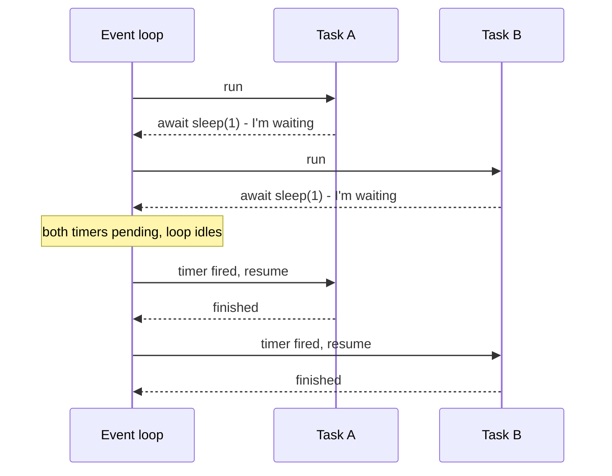

# asyncio: async/await, tasks and gather

A web server handling 10,000 slow clients can't afford 10,000 threads. **asyncio** offers a different model: a single thread runs an **event loop** that juggles many tasks, switching between them only at explicit `await` points where a task is waiting for I/O. It's the model behind FastAPI, httpx, modern database drivers and most new Python networking code — you need it for the FastAPI track.

## The mental model

- A **coroutine function** is defined with `async def`. Calling it does **not** run it; it returns a **coroutine object**.
- **`await x`** means: "pause me here until `x` is finished; meanwhile, let the event loop run other tasks".
- The **event loop** keeps a set of ready tasks and I/O it's waiting on. It runs one task until that task hits an `await` on something not ready, then picks another.

Only one task runs at any instant (one thread). Concurrency comes from interleaving at `await` points — **cooperative** multitasking, unlike threads' pre-emptive switching.



## First coroutines

```python-run
import asyncio, time

async def brew(drink, seconds):
    print(f"start {drink}")
    await asyncio.sleep(seconds)          # non-blocking pause: yields to the event loop
    print(f"done  {drink}")
    return f"{drink} ready"

async def main():
    start = time.perf_counter()
    a = await brew("tea", 0.2)            # sequential: wait for tea...
    b = await brew("coffee", 0.2)         # ...then coffee
    print(a, b, f"| {time.perf_counter() - start:.2f}s")

asyncio.run(main())                       # create a loop, run main() to completion, close the loop
```

`asyncio.run(coro)` is the entry point: call it once at the top of your program. Notice that awaiting one coroutine after another is still **sequential** (≈0.4 s). `await` alone doesn't create concurrency — it just makes waiting non-blocking.

A coroutine that's never awaited never runs (Python warns: "coroutine ... was never awaited"):

```python-run
import asyncio

async def answer():
    return 42

async def main():
    c = answer()
    print(type(c).__name__)       # coroutine: nothing has run yet
    print(await c)                # now it runs

asyncio.run(main())
```

## Running things concurrently

### `asyncio.gather`

`gather(*awaitables)` runs them concurrently and returns their results **in the order given**:

```python-run
import asyncio, time

async def fetch(name, delay):
    await asyncio.sleep(delay)
    return f"{name} ({delay}s)"

async def main():
    start = time.perf_counter()
    results = await asyncio.gather(fetch("users", 0.3), fetch("orders", 0.1), fetch("stock", 0.2))
    print(results)                                   # input order, not completion order
    print(f"elapsed {time.perf_counter() - start:.2f}s")   # ~0.3s = the longest, not the sum

asyncio.run(main())
```

Three waits overlap, so the total is the *maximum* delay. That's the whole value proposition for I/O-bound code.

Error handling: by default, the first exception propagates out of `gather` (the other awaitables keep running in the background). With `return_exceptions=True`, exceptions are returned in the results list instead:

```python-run
import asyncio

async def job(i):
    await asyncio.sleep(0.01)
    if i == 2:
        raise ValueError(f"job {i} broke")
    return i * 10

async def main():
    results = await asyncio.gather(*(job(i) for i in range(4)), return_exceptions=True)
    for r in results:
        print("error:" if isinstance(r, Exception) else "ok:", r)

asyncio.run(main())
```

### Tasks

`asyncio.create_task(coro)` wraps a coroutine in a **Task** and schedules it to run *now, in the background*. You can await it later, check `task.done()`, or `task.cancel()` it.

```python-run
import asyncio

async def ticker(name, n, delay):
    for i in range(n):
        await asyncio.sleep(delay)
        print(f"  {name} tick {i}")
    return name

async def main():
    t1 = asyncio.create_task(ticker("fast", 3, 0.01))    # starts running at the next await
    t2 = asyncio.create_task(ticker("slow", 2, 0.025))
    print("tasks created; main continues")
    print(await t1, await t2)

asyncio.run(main())
```

Keep a reference to every task you create — the loop only holds weak references, so an unreferenced task may be garbage-collected mid-flight.

### TaskGroup (3.11+): structured concurrency

`async with asyncio.TaskGroup() as tg:` is the modern, safer alternative to bare `create_task` + `gather`: the block waits for all tasks; if one fails, the rest are **cancelled** and the errors are raised together as an `ExceptionGroup`.

```python-run
import asyncio, sys

async def square(x):
    await asyncio.sleep(0.01)
    return x * x

async def main():
    if sys.version_info >= (3, 11):
        async with asyncio.TaskGroup() as tg:
            tasks = [tg.create_task(square(i)) for i in range(5)]
        print([t.result() for t in tasks])        # all finished when the block exits
    else:
        print(await asyncio.gather(*(square(i) for i in range(5))))

asyncio.run(main())
```

## Timeouts and cancellation

```python-run
import asyncio

async def slow():
    try:
        await asyncio.sleep(10)
    except asyncio.CancelledError:
        print("  slow() was cancelled; cleaning up")
        raise                                    # always re-raise CancelledError

async def main():
    try:
        await asyncio.wait_for(slow(), timeout=0.05)
    except asyncio.TimeoutError:
        print("timed out")

    task = asyncio.create_task(slow())
    await asyncio.sleep(0.01)
    task.cancel()
    try:
        await task
    except asyncio.CancelledError:
        print("task cancelled")

asyncio.run(main())
```

Cancellation is delivered as a `CancelledError` raised at the task's current `await`. Clean up in `try/finally` (or `async with`), and re-raise. In 3.11+, `async with asyncio.timeout(2):` is the preferred way to put a deadline on a block.

## Limiting concurrency

Launching 10,000 requests at once will get you rate-limited or exhaust sockets. A **semaphore** caps how many coroutines are inside a section simultaneously:

```python-run
import asyncio

async def fetch(i, sem, state):
    async with sem:                               # at most 3 in here at once
        state["active"] += 1
        state["peak"] = max(state["peak"], state["active"])
        await asyncio.sleep(0.01)
        state["active"] -= 1
        return i

async def main():
    sem = asyncio.Semaphore(3)
    state = {"active": 0, "peak": 0}
    results = await asyncio.gather(*(fetch(i, sem, state) for i in range(10)))
    print(results, "peak concurrency:", state["peak"])

asyncio.run(main())
```

Other primitives mirror `threading`: `asyncio.Lock`, `Event`, `Condition`, and `asyncio.Queue` for producer/consumer pipelines:

```python-run
import asyncio

async def producer(q):
    for i in range(5):
        await q.put(i)
    await q.put(None)                             # sentinel

async def consumer(q, out):
    while (item := await q.get()) is not None:
        out.append(item * item)

async def main():
    q, out = asyncio.Queue(maxsize=2), []         # bounded queue = back-pressure
    await asyncio.gather(producer(q), consumer(q, out))
    print(out)

asyncio.run(main())
```

## The cardinal sin: blocking the event loop

Because everything shares one thread, a coroutine that does something **blocking** — `time.sleep(1)`, `requests.get(...)`, a heavy computation, a synchronous DB driver — freezes *every* task until it returns. Nothing else can run because the loop never gets control back.

```python-run
import asyncio, time

async def heartbeat(log):
    for _ in range(4):
        await asyncio.sleep(0.02)
        log.append(round(time.perf_counter() - log[0], 2))

async def bad():
    time.sleep(0.1)                # BLOCKS the whole loop: no awaits, no switching

async def good():
    await asyncio.sleep(0.1)       # yields to the loop

async def run(worker):
    log = [time.perf_counter()]
    await asyncio.gather(heartbeat(log), worker())
    return log[1:]

print("with blocking sleep:", asyncio.run(run(bad)))     # first beat delayed to ~0.12
print("with async sleep:   ", asyncio.run(run(good)))    # beats every ~0.02
```

Rules:

1. Inside `async def`, use **async libraries**: `asyncio.sleep`, `httpx.AsyncClient`, `asyncpg`, `aiofiles`...
2. If you must call blocking code, push it to a thread: `await asyncio.to_thread(blocking_fn, *args)` (3.9+) or `loop.run_in_executor(...)`.
3. For CPU-heavy work, use a `ProcessPoolExecutor` via `run_in_executor`.

```python
import asyncio, time

def blocking_io():                 # legacy synchronous function
    time.sleep(1)
    return "done"

async def main():
    results = await asyncio.gather(*(asyncio.to_thread(blocking_io) for _ in range(5)))
    print(results)                 # ~1s total: the five calls run in worker threads

asyncio.run(main())
```

(That one needs real threads, so run it locally rather than in the browser.)

## Awaitables: coroutines, tasks, futures

You can `await` three kinds of things:

- **coroutines** — run inline when awaited;
- **Tasks** — coroutines already scheduled on the loop;
- **Futures** — low-level placeholders for a result that will arrive later (Tasks are a subclass). You'll rarely create them directly.

Also in the async family:

```python-run
import asyncio

class Countdown:                                  # async iterator: __aiter__ / __anext__
    def __init__(self, n): self.n = n
    def __aiter__(self): return self
    async def __anext__(self):
        if self.n == 0:
            raise StopAsyncIteration
        await asyncio.sleep(0)
        self.n -= 1
        return self.n + 1

async def ticks(n):                               # async generator: async def + yield
    for i in range(n):
        await asyncio.sleep(0)
        yield i

class Resource:                                   # async context manager
    async def __aenter__(self):
        print("  open"); return self
    async def __aexit__(self, *exc):
        print("  close")

async def main():
    print([x async for x in Countdown(3)])
    async for t in ticks(2):
        print("  tick", t)
    async with Resource():
        print("  using resource")

asyncio.run(main())
```

`async for` and `async with` exist because fetching the next item or entering/exiting a context may itself need to wait (reading the next row from a database cursor, closing a network connection).

## How this maps to FastAPI

```python
import asyncio
from fastapi import FastAPI
import httpx

app = FastAPI()

@app.get("/dashboard")
async def dashboard():
    async with httpx.AsyncClient() as client:
        users, orders = await asyncio.gather(
            client.get("https://api.example.com/users"),
            client.get("https://api.example.com/orders"),
        )
    return {"users": users.json(), "orders": orders.json()}
```

The server (uvicorn) runs the event loop. Each request is handled by a coroutine; while one request awaits a database or HTTP call, the loop serves others. Declaring a route with plain `def` makes FastAPI run it in a thread pool instead — the right choice when the route calls blocking libraries. A blocking call inside an `async def` route stalls the entire server: the most common FastAPI performance bug.

## async versus threads

| | asyncio | threads |
|---|---|---|
| Switch points | only at `await` — explicit and visible | anywhere — pre-emptive |
| Data races | rare: no switch between two lines without an `await` | common: locks needed |
| Scale | tens of thousands of tasks (each a small object) | hundreds to low thousands (each has an OS stack) |
| Library support | need async-aware libraries ("function colouring") | works with any blocking library |
| CPU-bound work | no help (still one thread, GIL) | no help (GIL) |

Note that races still exist in async code *across* awaits: `if key not in cache: cache[key] = await load(key)` can run `load` twice when two tasks interleave at the `await`.

> [!INTERVIEW]
> "Explain async/await." — `async def` defines a coroutine; `await` suspends it until the awaited operation completes, returning control to the event loop, which runs other ready tasks on the same thread. It's cooperative, single-threaded concurrency, ideal for I/O-bound work with many connections. "`await` vs `create_task`/`gather`?" — awaiting sequentially is serial; tasks and `gather` run concurrently. "What happens if you call `time.sleep` in a coroutine?" — the whole loop blocks; use `asyncio.sleep` or `asyncio.to_thread`.

## Pitfalls recap

- Calling a coroutine function without `await` — nothing happens.
- Awaiting in a loop when you meant `gather` (accidentally sequential).
- Blocking calls inside coroutines.
- Calling `asyncio.run()` from inside a running loop (e.g., in Jupyter, or nested) — `RuntimeError`; just `await` there.
- Swallowing `CancelledError`.
- Fire-and-forget tasks with no reference and no error handling.
- Unbounded concurrency; use a semaphore.

## Summary

Coroutines (`async def`) pause at `await`, letting a single-threaded event loop interleave many I/O-bound tasks. `asyncio.run` starts the loop; `gather`, `create_task` and `TaskGroup` provide concurrency; `wait_for`/`timeout` add deadlines; `Semaphore` and `Queue` control flow. Never block the loop — use async libraries or `asyncio.to_thread`.

```quiz
[
  {"q": "What does calling an `async def` function return?", "options": ["Its result", "A coroutine object that has not started running", "A thread", "None"], "answer": 1,
   "explain": "The body runs only when the coroutine is awaited or wrapped in a task."},
  {"q": "`await a(); await b()` where each sleeps 1 s (asyncio.sleep) takes about:", "options": ["1 s", "2 s", "0 s", "Depends on cores"], "answer": 1,
   "explain": "Sequential awaits run one after the other. Use gather or tasks to overlap the waits."},
  {"q": "In what order does `asyncio.gather(a(), b(), c())` return results?", "options": ["Completion order", "The order the awaitables were passed", "Random", "Sorted"], "answer": 1,
   "explain": "gather preserves argument order regardless of which finishes first."},
  {"q": "What happens if a coroutine calls `time.sleep(5)`?", "options": ["Only that coroutine pauses", "The entire event loop (all tasks) is blocked for 5 seconds", "It raises an error", "It is converted to asyncio.sleep"], "answer": 1,
   "explain": "Blocking calls never yield to the loop. Use asyncio.sleep, or asyncio.to_thread for blocking functions."},
  {"q": "How many OS threads does the asyncio event loop use to run coroutines?", "options": ["One per task", "One", "One per core", "Zero"], "answer": 1,
   "explain": "All coroutines run on the loop's single thread, switching only at await points."},
  {"q": "Which tool limits the number of coroutines doing something at once?", "options": ["asyncio.sleep", "asyncio.Semaphore", "asyncio.run", "asyncio.Future"], "answer": 1,
   "explain": "`async with sem:` admits at most N coroutines into the guarded section."},
  {"q": "How is task cancellation delivered?", "options": ["The task is killed instantly", "CancelledError is raised inside the task at its current await", "A return value of None", "Via a signal"], "answer": 1,
   "explain": "The task can clean up in finally blocks and should re-raise CancelledError."},
  {"q": "Is asyncio a good fit for CPU-bound number crunching?", "options": ["Yes, it uses all cores", "No; it is single-threaded — use processes or native code", "Yes, with gather", "Only on Linux"], "answer": 1,
   "explain": "A long computation never awaits, so it blocks the loop; offload it to a process pool."}
]
```

> **Source:** Python docs, *Library Reference* `asyncio` — "Coroutines and Tasks", "Synchronization Primitives", "Queues", and "Developing with asyncio"; PEP 492 (async/await), PEP 654 (exception groups).
