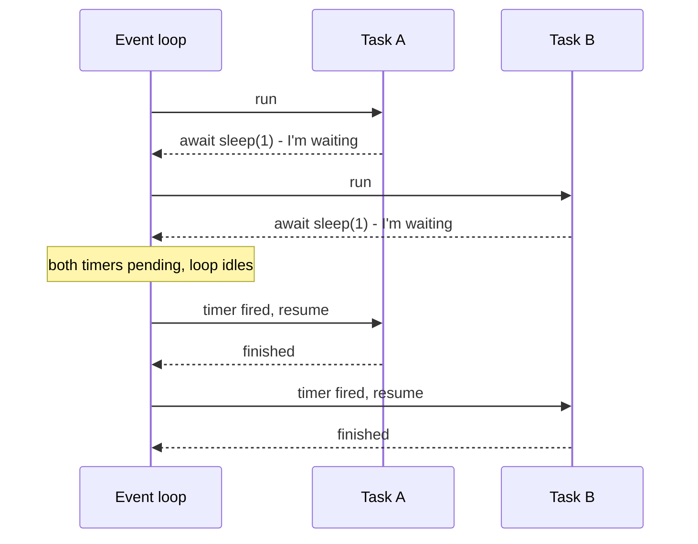

# asyncio: async/await, tasks and gather

> **Before this lesson:** read [The GIL, threading and multiprocessing](#/lesson/python/py-threads-processes) first: you need concurrency versus parallelism, I/O-bound versus CPU-bound work, and what "blocking" means. Generators that pause and resume ([Generators and yield from](#/lesson/python/py-generators)) are the mechanism underneath, and context managers ([Context managers and contextlib](#/lesson/python/py-context-managers)) and exceptions ([Exceptions](#/lesson/python/py-exceptions)) appear throughout.

## In plain words

Much of what a program does is waiting: for a web server to answer, for a database to return rows, for a file to be read. During that wait the processor has nothing to do. `asyncio` is Python's standard way of using those gaps: while one task waits, the program gets on with another.

Think of a single waiter serving a whole restaurant. The waiter takes the order at table 1 and hands it to the kitchen. They do not stand at the kitchen door until the food is ready; they go and take the order at table 2, bring drinks to table 3, and come back to table 1 when the kitchen calls. One person, many tables, nobody neglected, provided the waiter never gets stuck at one table.

In asyncio the waiter is called the **event loop**. Each table is a **task**. The moments when the waiter may walk away from a table are marked in your code with the keyword **`await`**: "I am waiting for something here; serve somebody else in the meantime". Functions that can be paused in this way are written with **`async def`**.

The contrast with the previous lesson's threads: a web server looking after 10,000 slow connections cannot afford 10,000 threads, but 10,000 tasks on one event loop are no trouble, because a waiting task is only a small object in memory.

Why this matters for a job: asyncio is the model behind FastAPI, the HTTP library httpx, modern database drivers and most new network code in Python. Interviewers ask you to explain `async` / `await`, to say why two `await`s in a row are not concurrent, and what happens when someone calls `time.sleep` inside a coroutine. All three answers are below.

## The mental model

Three definitions carry the whole topic:

- A **coroutine function** is a function defined with `async def`. Calling it does **not** run it. The call returns a **coroutine object**: the work, packaged and paused before its first line, waiting to be run.
- **`await x`** means: "pause me here until `x` has finished, and meanwhile let the event loop run other tasks". When `x` is done, its result becomes the value of the `await` expression.
- The **event loop** is the scheduler. It keeps a list of tasks that are ready to continue and a list of things being waited for (timers, network replies). It runs one task until that task reaches an `await` on something that is not ready yet, and then picks another.

Only one task is running at any instant, because everything happens on a single thread. The concurrency comes from interleaving at the `await` points. This is **cooperative** multitasking: a task keeps control until it voluntarily gives it up. Threads, by contrast, are **pre-emptive**: the system can interrupt them anywhere.



## First coroutines

```python-run
import asyncio, time

async def brew(drink, seconds):
    print(f"start {drink}")
    await asyncio.sleep(seconds)          # non-blocking pause: yields to the event loop
    print(f"done  {drink}")
    return f"{drink} ready"

async def main():
    start = time.perf_counter()
    a = await brew("tea", 0.2)            # sequential: wait for tea...
    b = await brew("coffee", 0.2)         # ...then coffee
    print(a, b, f"| {time.perf_counter() - start:.2f}s")

asyncio.run(main())                       # create a loop, run main() to completion, close the loop
```

**Reading this code line by line**

- `async def brew(...)` defines a coroutine function.
- `await asyncio.sleep(seconds)` pauses this coroutine for the given time *without blocking*: control goes back to the event loop, which is free to run other tasks.
- `main` is a coroutine too. `await brew("tea", 0.2)` runs `brew` to completion and stores what it returned.
- `asyncio.run(main())` is the way in from ordinary code: it creates an event loop, runs `main()` until it finishes, and closes the loop.

The output shows tea starting and finishing, then coffee starting and finishing, in about 0.4 seconds altogether.

Call `asyncio.run(...)` once, at the top of your program. And take note of the timing: awaiting one coroutine and then another is still **sequential**. `await` on its own does not create concurrency. It only makes the waiting polite, so that *other* tasks could run, and in this program there are no other tasks.

A coroutine object that is never awaited never runs at all. (Python prints a warning when it notices: "coroutine ... was never awaited".)

```python-run
import asyncio

async def answer():
    return 42

async def main():
    c = answer()
    print(type(c).__name__)       # coroutine: nothing has run yet
    print(await c)                # now it runs

asyncio.run(main())
```

`answer()` gives back an object of type `coroutine`, and at that point no line of the function has run. Only `await c` runs it and produces 42. Forgetting the `await` is the most common beginner mistake in async code: the call looks as if it happened and did nothing.

## Running things concurrently

### `asyncio.gather`

To make things overlap, the event loop has to be given several pieces of work at once. `asyncio.gather(...)` takes several coroutines, runs them concurrently, waits until all have finished, and returns their results as a list **in the order in which they were passed**:

```python-run
import asyncio, time

async def fetch(name, delay):
    await asyncio.sleep(delay)
    return f"{name} ({delay}s)"

async def main():
    start = time.perf_counter()
    results = await asyncio.gather(fetch("users", 0.3), fetch("orders", 0.1), fetch("stock", 0.2))
    print(results)                                   # input order, not completion order
    print(f"elapsed {time.perf_counter() - start:.2f}s")   # ~0.3s = the longest, not the sum

asyncio.run(main())
```

The three pretend requests take 0.3, 0.1 and 0.2 seconds. They wait at the same time, so the total is the *longest* of them, about 0.3 seconds, not the sum of 0.6. The results come back in the order `users, orders, stock`, although `orders` finished first. Overlapping the waiting is the entire benefit of asyncio for I/O-bound code.

What if one of them fails? By default the first exception raised travels out of the `gather` call (while the other pieces of work carry on in the background). With `return_exceptions=True`, an exception is not raised; it is placed in the results list at the position of the piece of work that failed:

```python-run
import asyncio

async def job(i):
    await asyncio.sleep(0.01)
    if i == 2:
        raise ValueError(f"job {i} broke")
    return i * 10

async def main():
    results = await asyncio.gather(*(job(i) for i in range(4)), return_exceptions=True)
    for r in results:
        print("error:" if isinstance(r, Exception) else "ok:", r)

asyncio.run(main())
```

Job 2 raises a `ValueError`. With `return_exceptions=True` the list contains `0`, `10`, the exception object, and `30`, and the loop prints three `ok:` lines and one `error:` line.

### Tasks

`asyncio.create_task(coro)` wraps a coroutine in a **Task** and schedules it on the event loop. A task runs in the background, without anyone having to await it first, whenever the current code next gives up control. Later you can `await` the task to get its result, ask `task.done()`, or stop it with `task.cancel()`.

```python-run
import asyncio

async def ticker(name, n, delay):
    for i in range(n):
        await asyncio.sleep(delay)
        print(f"  {name} tick {i}")
    return name

async def main():
    t1 = asyncio.create_task(ticker("fast", 3, 0.01))    # starts running at the next await
    t2 = asyncio.create_task(ticker("slow", 2, 0.025))
    print("tasks created; main continues")
    print(await t1, await t2)

asyncio.run(main())
```

`main` creates two tasks and prints `tasks created; main continues` *before* any tick appears: creating a task does not pause the creator. At `await t1` control goes to the loop, and the ticks of the two tasks appear interleaved according to their delays. Finally both names are printed.

Keep a reference to every task you create, in a variable or a collection. The loop itself holds only a weak reference, so a task that nothing else refers to may be destroyed by Python's memory management while it is still running.

### TaskGroup (3.11+): structured concurrency

`async with asyncio.TaskGroup() as tg:` is the modern and safer alternative to bare `create_task` plus `gather`. Tasks are created through the group; the end of the `async with` block waits for all of them; and if one fails, the others are **cancelled** and the errors are raised together as an `ExceptionGroup`. Tying the lifetime of tasks to a block of code in this way is called **structured concurrency**: no task can be forgotten and left running.

```python-run
import asyncio, sys

async def square(x):
    await asyncio.sleep(0.01)
    return x * x

async def main():
    if sys.version_info >= (3, 11):
        async with asyncio.TaskGroup() as tg:
            tasks = [tg.create_task(square(i)) for i in range(5)]
        print([t.result() for t in tasks])        # all finished when the block exits
    else:
        print(await asyncio.gather(*(square(i) for i in range(5))))

asyncio.run(main())
```

When the block ends, all five tasks have finished and `t.result()` gives each result: `[0, 1, 4, 9, 16]`. The version check lets the demo fall back to `gather` on Python older than 3.11.

## Timeouts and cancellation

Network operations can hang for ever, so real code needs deadlines and a way to stop work that is no longer wanted. A **timeout** is a time limit after which a wait is abandoned; **cancelling** a task asks it to stop.

```python-run
import asyncio

async def slow():
    try:
        await asyncio.sleep(10)
    except asyncio.CancelledError:
        print("  slow() was cancelled; cleaning up")
        raise                                    # always re-raise CancelledError

async def main():
    try:
        await asyncio.wait_for(slow(), timeout=0.05)
    except asyncio.TimeoutError:
        print("timed out")

    task = asyncio.create_task(slow())
    await asyncio.sleep(0.01)
    task.cancel()
    try:
        await task
    except asyncio.CancelledError:
        print("task cancelled")

asyncio.run(main())
```

The first half wraps `slow()` in `asyncio.wait_for(..., timeout=0.05)`: after 0.05 seconds the wait is given up, `slow` is cancelled, and `TimeoutError` is raised to the caller. The second half creates a task, lets it start, and cancels it by hand.

How does cancellation reach the task? As an exception. A `CancelledError` is raised inside the task at the `await` where it is currently paused. That gives the task the chance to clean up, in an `except` or `finally` block or an `async with`, and afterwards it must let the exception continue (the bare `raise`). Swallowing `CancelledError` produces tasks that cannot be stopped. From Python 3.11, `async with asyncio.timeout(2):` is the preferred way to put a deadline on a block of code.

## Limiting concurrency

Starting 10,000 requests at the same moment will get you blocked by the server or exhaust your own machine's network connections. A **semaphore** is a counter that admits only a fixed number of holders at once; the rest queue up.

```python-run
import asyncio

async def fetch(i, sem, state):
    async with sem:                               # at most 3 in here at once
        state["active"] += 1
        state["peak"] = max(state["peak"], state["active"])
        await asyncio.sleep(0.01)
        state["active"] -= 1
        return i

async def main():
    sem = asyncio.Semaphore(3)
    state = {"active": 0, "peak": 0}
    results = await asyncio.gather(*(fetch(i, sem, state) for i in range(10)))
    print(results, "peak concurrency:", state["peak"])

asyncio.run(main())
```

Ten coroutines are started together, but `async with sem:` lets only three be inside the guarded section at once. The `state` dictionary records how many were inside at the same time, and the printed peak is 3.

asyncio has its own versions of the coordination tools from the threading lesson: `asyncio.Lock`, `Event`, `Condition`, and `asyncio.Queue` for producer/consumer designs:

```python-run
import asyncio

async def producer(q):
    for i in range(5):
        await q.put(i)
    await q.put(None)                             # sentinel

async def consumer(q, out):
    while (item := await q.get()) is not None:
        out.append(item * item)

async def main():
    q, out = asyncio.Queue(maxsize=2), []         # bounded queue = back-pressure
    await asyncio.gather(producer(q), consumer(q, out))
    print(out)

asyncio.run(main())
```

The producer puts five numbers into the queue and then `None` as a stop signal; the consumer takes items until it sees `None`. The queue was created with `maxsize=2`, so `await q.put(i)` *pauses the producer* whenever two items are waiting. A fast producer slowed down by a slow consumer in this way is called **back-pressure**, and it prevents memory from filling up.

## The cardinal sin: blocking the event loop

Everything shares one thread. So if a coroutine does something **blocking**, that is, something that waits without `await` (`time.sleep(1)`, the `requests` library, a long calculation, a database driver that is not async), then *every* task is frozen until it returns. The event loop never gets control back, so it cannot serve anybody else. The waiter is stuck at one table.

```python-run
import asyncio, time

async def heartbeat(log):
    for _ in range(4):
        await asyncio.sleep(0.02)
        log.append(round(time.perf_counter() - log[0], 2))

async def bad():
    time.sleep(0.1)                # BLOCKS the whole loop: no awaits, no switching

async def good():
    await asyncio.sleep(0.1)       # yields to the loop

async def run(worker):
    log = [time.perf_counter()]
    await asyncio.gather(heartbeat(log), worker())
    return log[1:]

print("with blocking sleep:", asyncio.run(run(bad)))     # first beat delayed to ~0.12
print("with async sleep:   ", asyncio.run(run(good)))    # beats every ~0.02
```

`heartbeat` records the time every 0.02 seconds. Running beside the well-behaved `good`, the beats arrive on schedule: about 0.02, 0.04, 0.06, 0.08. Running beside `bad`, whose `time.sleep(0.1)` blocks, the first beat is late by a tenth of a second and the others follow it. In a web server, one blocking call like this stalls every request being handled.

Rules:

1. Inside `async def`, use **async libraries**: `asyncio.sleep`, `httpx.AsyncClient`, `asyncpg`, `aiofiles` and so on.
2. If you have to call blocking code, hand it to a thread: `await asyncio.to_thread(blocking_fn, *args)` (Python 3.9+) or `loop.run_in_executor(...)`.
3. For heavy computation, use a `ProcessPoolExecutor` through `run_in_executor`.

```python
import asyncio, time

def blocking_io():                 # legacy synchronous function
    time.sleep(1)
    return "done"

async def main():
    results = await asyncio.gather(*(asyncio.to_thread(blocking_io) for _ in range(5)))
    print(results)                 # ~1s total: the five calls run in worker threads

asyncio.run(main())
```

`asyncio.to_thread` runs the old blocking function in a worker thread and gives you something you can await, so the event loop stays free. Five one-second calls finish in about one second. (This example needs real threads, so it is shown as static code; run it on your own machine.)

## Awaitables: coroutines, tasks, futures

Anything that can follow the word `await` is called an **awaitable**. There are three kinds:

- **coroutines**, which run then and there when awaited;
- **Tasks**, which are coroutines already scheduled on the loop;
- **Futures**, low-level tickets for a result that will arrive later (a Task is a kind of Future). You will rarely create one yourself.

The iterator and context-manager protocols from earlier lessons have async twins:

```python-run
import asyncio

class Countdown:                                  # async iterator: __aiter__ / __anext__
    def __init__(self, n): self.n = n
    def __aiter__(self): return self
    async def __anext__(self):
        if self.n == 0:
            raise StopAsyncIteration
        await asyncio.sleep(0)
        self.n -= 1
        return self.n + 1

async def ticks(n):                               # async generator: async def + yield
    for i in range(n):
        await asyncio.sleep(0)
        yield i

class Resource:                                   # async context manager
    async def __aenter__(self):
        print("  open"); return self
    async def __aexit__(self, *exc):
        print("  close")

async def main():
    print([x async for x in Countdown(3)])
    async for t in ticks(2):
        print("  tick", t)
    async with Resource():
        print("  using resource")

asyncio.run(main())
```

- `Countdown` is an **async iterator**: it has `__aiter__` and an `async` method `__anext__`, and signals the end with `StopAsyncIteration`. It is consumed with `async for`.
- `ticks` is an **async generator**: an `async def` function that contains `yield`.
- `Resource` is an **async context manager** with `__aenter__` and `__aexit__`, used with `async with`.

`async for` and `async with` exist because fetching the next item, or entering and leaving a context, may itself involve waiting: reading the next row from a database, closing a network connection.

## How this maps to FastAPI

```python
import asyncio
from fastapi import FastAPI
import httpx

app = FastAPI()

@app.get("/dashboard")
async def dashboard():
    async with httpx.AsyncClient() as client:
        users, orders = await asyncio.gather(
            client.get("https://api.example.com/users"),
            client.get("https://api.example.com/orders"),
        )
    return {"users": users.json(), "orders": orders.json()}
```

FastAPI is a web framework: you write a function for each web address, and the framework calls it when a request arrives. In this example the function for `/dashboard` needs data from two other services and fetches both at the same time with `gather`.

The server program (uvicorn) runs the event loop. Each incoming request is handled by a coroutine, and while one request is waiting for a database or another service, the loop serves other requests. If you declare the function with plain `def`, FastAPI runs it in a pool of threads, which is the right choice when it calls blocking libraries. A blocking call inside an `async def` handler stalls the whole server, and that is the most common performance bug in FastAPI applications.

## async versus threads

| | asyncio | threads |
|---|---|---|
| Switch points | only at `await` — explicit and visible | anywhere — pre-emptive |
| Data races | rare: no switch between two lines without an `await` | common: locks needed |
| Scale | tens of thousands of tasks (each a small object) | hundreds to low thousands (each has an OS stack) |
| Library support | needs libraries written for async; an `async` function can only be awaited from another `async` function | works with any blocking library |
| CPU-bound work | no help (still one thread, GIL) | no help (GIL) |

Race conditions have not disappeared entirely: they can still occur *across* an `await`. In `if key not in cache: cache[key] = await load(key)`, two tasks can both find the key missing and both call `load`, because the first task pauses at the `await` before it has stored anything.

> [!INTERVIEW]
> "Explain async/await." `async def` defines a coroutine; `await` pauses it until the awaited operation completes and hands control back to the event loop, which runs other ready tasks on the same thread. It is cooperative, single-threaded concurrency, well suited to I/O-bound work with many connections. "`await` versus `create_task` / `gather`?" Awaiting one thing after another is sequential; tasks and `gather` run things concurrently. "What happens if you call `time.sleep` in a coroutine?" The whole loop is blocked; use `asyncio.sleep`, or `asyncio.to_thread` for a blocking function.

## Pitfalls recap

- Calling a coroutine function without `await`: nothing happens.
- Awaiting inside a loop when `gather` was meant, which makes the work sequential by accident.
- Blocking calls inside coroutines.
- Calling `asyncio.run()` where a loop is already running (for example in a Jupyter notebook); that raises `RuntimeError`. Write `await` there.
- Swallowing `CancelledError`.
- Tasks started and forgotten: no reference kept and no error handling.
- Unlimited concurrency; use a semaphore.

## Summary

Coroutines (`async def`) pause at `await`, which lets a single-threaded event loop interleave many I/O-bound tasks. `asyncio.run` starts the loop; `gather`, `create_task` and `TaskGroup` provide concurrency; `wait_for` and `timeout` add deadlines; `Semaphore` and `Queue` control the flow. Never block the loop: use async libraries or `asyncio.to_thread`.

## Glossary

- **asyncio** - Python's standard library for single-threaded concurrency built on `async` / `await`.
- **Coroutine function** - a function defined with `async def`.
- **Coroutine object** - what calling a coroutine function returns: paused work that has not started.
- **`await`** - pause this coroutine until the awaited thing finishes, letting the event loop run others.
- **Event loop** - the scheduler that runs tasks and resumes them when what they wait for is ready.
- **Task** - a coroutine scheduled on the event loop, running in the background.
- **Awaitable** - anything that can be awaited: a coroutine, a Task or a Future.
- **Cooperative multitasking** - tasks give up control voluntarily, at `await` points.
- **Pre-emptive multitasking** - the system may interrupt a thread at any point.
- **`gather`** - run several awaitables concurrently and collect their results in order.
- **`TaskGroup` / structured concurrency** - tasks whose lifetime is tied to an `async with` block.
- **Timeout** - a time limit on a wait.
- **Cancellation** - asking a task to stop; delivered as `CancelledError` at its current `await`.
- **Semaphore** - a counter that limits how many tasks may be in a section at once.
- **Back-pressure** - slowing a producer down when the consumer cannot keep up.
- **Blocking call** - a call that waits without `await`, freezing the whole event loop.
- **`asyncio.to_thread`** - run a blocking function in a worker thread and await its result.
- **Async iterator / async generator / async context manager** - the `async for` and `async with` versions of the familiar protocols.

```quiz
[
  {"q": "What does calling an `async def` function return?", "options": ["Its result", "A coroutine object that has not started running", "A thread", "None"], "answer": 1,
   "explain": "The body runs only when the coroutine is awaited or wrapped in a task."},
  {"q": "`await a(); await b()` where each sleeps 1 s (asyncio.sleep) takes about:", "options": ["1 s", "2 s", "0 s", "Depends on cores"], "answer": 1,
   "explain": "Sequential awaits run one after the other. Use gather or tasks to overlap the waits."},
  {"q": "In what order does `asyncio.gather(a(), b(), c())` return results?", "options": ["Completion order", "The order the awaitables were passed", "Random", "Sorted"], "answer": 1,
   "explain": "gather preserves argument order regardless of which finishes first."},
  {"q": "What happens if a coroutine calls `time.sleep(5)`?", "options": ["Only that coroutine pauses", "The entire event loop (all tasks) is blocked for 5 seconds", "It raises an error", "It is converted to asyncio.sleep"], "answer": 1,
   "explain": "Blocking calls never yield to the loop. Use asyncio.sleep, or asyncio.to_thread for blocking functions."},
  {"q": "How many OS threads does the asyncio event loop use to run coroutines?", "options": ["One per task", "One", "One per core", "Zero"], "answer": 1,
   "explain": "All coroutines run on the loop's single thread, switching only at await points."},
  {"q": "Which tool limits the number of coroutines doing something at once?", "options": ["asyncio.sleep", "asyncio.Semaphore", "asyncio.run", "asyncio.Future"], "answer": 1,
   "explain": "`async with sem:` admits at most N coroutines into the guarded section."},
  {"q": "How is task cancellation delivered?", "options": ["The task is killed instantly", "CancelledError is raised inside the task at its current await", "A return value of None", "Via a signal"], "answer": 1,
   "explain": "The task can clean up in finally blocks and should re-raise CancelledError."},
  {"q": "Is asyncio a good fit for CPU-bound number crunching?", "options": ["Yes, it uses all cores", "No; it is single-threaded — use processes or native code", "Yes, with gather", "Only on Linux"], "answer": 1,
   "explain": "A long computation never awaits, so it blocks the loop; offload it to a process pool."}
]
```

> **Source:** Python docs, *Library Reference* `asyncio` — "Coroutines and Tasks", "Synchronization Primitives", "Queues", and "Developing with asyncio"; PEP 492 (async/await), PEP 654 (exception groups).
