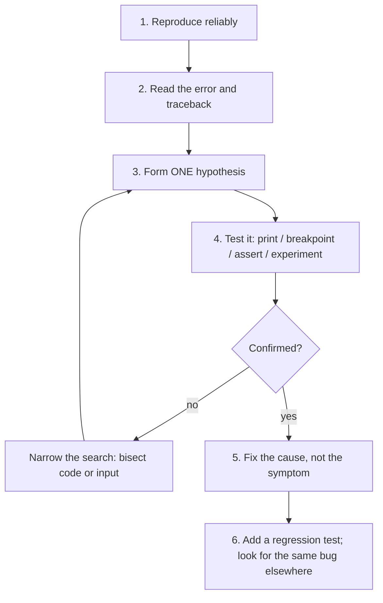

# Debugging and logging

> **Before this lesson:** you need exceptions and tracebacks from [Exceptions](#/lesson/python/py-exceptions) and tests from [Testing with pytest](#/lesson/python/py-pytest). The list of classic bugs near the end refers back to most earlier lessons of this track, in particular [Objects, names, types and mutability](#/lesson/python/py-objects-names) and [Functions and arguments](#/lesson/python/py-functions-args).

## In plain words

A **bug** is a mistake in a program that makes it behave differently from what was intended. **Debugging** is the work of finding out *why* it behaves that way and putting it right. A failing test tells you *that* something is wrong; debugging tells you what.

Think of a doctor. A poor doctor glances at the patient and prescribes whatever cured the previous one. A good doctor asks about the symptoms, examines the evidence, forms an idea of the cause, orders a test that would confirm or rule out that idea, and only then treats. And the treatment is aimed at the illness, not at the symptom.

Beginners debug the first way: stare at the code, change something, run it, change something else. Experienced programmers debug the second way: make the problem happen reliably, read the evidence, form one definite guess (a **hypothesis**), check it with an experiment, and narrow the search until the cause is cornered.

This lesson covers the evidence Python hands you (the traceback), the instruments (`print`, the debugger, assertions, and **logging**, which means recording what a program does while it runs), and a method that works even when you have no idea what is going on.

Why this matters for a job: professional programmers spend more time reading and debugging code than writing it, most of it code written by others. Interviewers ask "how would you debug this?", and in live coding they watch what you do when your first attempt fails. A calm, systematic method is worth more than raw speed.

## Reading a traceback

The **traceback** is the report Python prints when an exception is not handled. It is the single most useful piece of evidence, and many people do not read it. Read it from the **bottom up**:

1. The **last line** names the type of the exception and its message: *what* went wrong.
2. The entry directly above it shows the line that raised it: *where*.
3. The entries further up show *how the program got there*: which function called which. The entry to look at first is usually the lowest one that is in **your** code, not in a library.

```python-run
import traceback

def average(values):
    return sum(values) / len(values)

def report(groups):
    return {name: average(vals) for name, vals in groups.items()}

try:
    report({"a": [1, 2], "b": []})
except ZeroDivisionError:
    traceback.print_exc(limit=5, file=__import__("sys").stdout)
```

Run it and read the output from the bottom. `ZeroDivisionError: division by zero` is the *what*. The entry above shows the *where*: the line `return sum(values) / len(values)` in `average`. Further up is the *how*: `average` was called from the comprehension in `report`. From this a first guess follows directly: one of the groups has an empty list, so `len(values)` was 0. Since Python 3.11 the traceback even marks the exact part of the line that failed, with `~~~^^^` underneath.

### Common exceptions decoded

| You see | It usually means |
|---|---|
| `AttributeError: 'NoneType' object has no attribute 'x'` | something returned `None` (a function without `return`, `list.sort()`, `dict.get`, a failed `re.match`) |
| `TypeError: 'X' object is not subscriptable / callable / iterable` | you're treating a value as the wrong kind of thing — check what the variable really holds |
| `TypeError: f() takes 1 positional argument but 2 were given` | forgot `self` in a method definition |
| `TypeError: unhashable type: 'list'` | used a list as a dict key or set member — use a tuple |
| `KeyError: 'name'` | key missing — typo, different case, or data not what you assumed |
| `IndexError: list index out of range` | off-by-one, or an empty list |
| `UnboundLocalError` | assigned to a variable later in the function, making it local |
| `RecursionError` | missing/incorrect base case |
| `ModuleNotFoundError` | wrong environment/interpreter, or a file shadowing a module |
| `IndentationError` / `TabError` | mixed tabs and spaces |
| `RuntimeError: dictionary changed size during iteration` | mutating while looping |

Sometimes two tracebacks are printed, joined by "During handling of the above exception, another exception occurred" or "The above exception was the direct cause of the following exception". The **original** error is the first one; start there.

## A method for debugging



1. **Reproduce** it: find a way to make the bug happen every time, with the smallest input you can. A bug you cannot reproduce is a bug you cannot confirm as fixed. Capture the reproduction as a failing test.
2. **Read** the message. Really read it.
3. **Hypothesise**: state one definite guess, such as "I think `vals` is empty for group b", and say what you would expect to see if it were true.
4. **Experiment** to confirm or refute the guess, changing one thing at a time.
5. **Bisect** when you are lost: cut the problem in half. Disable half of the processing steps, feed in half of the input, look at the value in the middle. Whichever half still shows the bug, halve that again. The tool `git bisect` does the same across the saved versions of a project, to find the change that introduced a bug.
6. **Fix the cause**, not the symptom; add the test; and ask "where else did we make the same assumption?"

Two more habits. Check your assumptions: is the code you are editing really the code that is running? Is the right virtual environment active? Is the file saved? And explain the problem aloud, step by step, to a colleague or to an object on your desk (programmers call this *rubber-duck debugging*). Putting it into words very often reveals the gap.

## Print debugging, done properly

`print` is a perfectly good instrument when used with a purpose: to check a specific guess at a specific place.

```python-run
def merge_intervals(intervals):
    intervals.sort()
    merged = []
    for start, end in intervals:
        print(f"{start=} {end=} {merged=}")          # f-string '=' shows name and repr
        if merged and start <= merged[-1][1]:
            merged[-1][1] = max(merged[-1][1], end)
        else:
            merged.append([start, end])
    return merged

print(merge_intervals([[1, 3], [8, 10], [2, 6], [9, 12]]))
```

The function merges overlapping ranges such as `[1, 3]` and `[2, 6]`. The `print` at the top of the loop shows, on every pass, the range being processed and the result so far. `f"{start=}"` prints both the name and the value (`start=1`), which saves typing labels. Reading the four printed lines, you can follow the algorithm step by step and check each step against what you expected.

Tips: label values with `f"{expr=}"` (Python 3.8+). Print `repr()` of a value to make hidden spaces and the type visible (`'42'` is not `42`). Print `type(x)` and `len(x)`. Send debugging output to the error stream with `print(..., file=sys.stderr)` to keep it apart from the program's real output. And take the prints out afterwards, or use logging, which can stay in the code.

```python-run
value = "42 "
other = 42
print(value, other)                 # look identical-ish
print(repr(value), repr(other), type(value).__name__, type(other).__name__)
print(f"{value.strip() == str(other)=}")
```

Printed plainly, the two values look almost alike. `repr` shows the truth: one is the string `'42 '` with a trailing space, the other the integer `42`. This is the classic reason why an equality test or a dictionary lookup fails "although the values are the same".

## The debugger: `breakpoint()` and pdb

A **debugger** is a tool that pauses a running program at a line you choose and lets you look at *every* variable at that moment, run the program on one line at a time, and try out expressions. That is far more powerful than guessing in advance which prints you will need. The place where the program pauses is a **breakpoint**. Python's built-in debugger is called **pdb**, and the built-in function `breakpoint()` starts it:

```python
def checkout(cart, coupon):
    subtotal = sum(item.price * item.qty for item in cart)
    breakpoint()                      # execution pauses here; you get a (Pdb) prompt
    discount = coupon.apply(subtotal)
    return subtotal - discount
```

When the program reaches that line it stops and shows a `(Pdb)` prompt in the terminal, where you type short commands. (This needs a keyboard and a terminal, so it cannot be demonstrated on this page.) The essential commands:

| Command | Action |
|---|---|
| `l` / `ll` | list source around the current line / the whole function |
| `n` | **n**ext line (step over calls) |
| `s` | **s**tep into the call on this line |
| `r` | run until the current function **r**eturns |
| `c` | **c**ontinue to the next breakpoint |
| `p expr` / `pp expr` | print / pretty-print an expression |
| `w` | **w**here: show the call stack |
| `u` / `d` | move **u**p / **d**own the stack to inspect callers |
| `b file:line` / `b func` | set a breakpoint; `b 42, x > 10` for a conditional one |
| `a` | print the current function's arguments |
| `display expr` | show an expression every time it changes |
| `!stmt` | execute a Python statement |
| `q` | quit |

The list of functions currently in the middle of being called is the **call stack**; `w`, `u` and `d` let you look at it and move through it. Other ways of getting into the debugger:

- `python -m pdb script.py` runs a script under the debugger from the start. If an exception goes unhandled, the debugger opens at the point of the crash with all variables intact; inspecting a program after it has failed is called **post-mortem** debugging.
- `pytest --pdb` opens pdb at a failing assertion; `pytest --trace` starts each test in the debugger.
- `python -i script.py` runs the script and then leaves you at an interactive prompt with all its variables available.
- The environment variable `PYTHONBREAKPOINT=0` switches off every `breakpoint()` call; `PYTHONBREAKPOINT=ipdb.set_trace` substitutes a more comfortable debugger.
- Editors such as VS Code and PyCharm offer the same operations with the mouse: click beside a line to set a breakpoint, hover over a variable to see its value, watch expressions, and set conditional breakpoints. Learn the four actions: continue, step over, step into, step out.

Never leave a forgotten `breakpoint()` in code that is shared with others: a server that reaches it stops and waits for keyboard input that will never come. Code-checking tools catch it (in ruff, rule `T100`).

## Assertions as executable assumptions

An `assert` states something that must be true at one point in the code and fails loudly when it is not. That turns a mysterious wrong answer three functions later into an immediate error at the place where the assumption was broken.

```python-run
def binary_search(a, target):
    assert all(a[i] <= a[i + 1] for i in range(len(a) - 1)), "input must be sorted"
    lo, hi = 0, len(a)
    while lo < hi:
        mid = (lo + hi) // 2
        assert lo <= mid < hi                      # loop invariant
        if a[mid] < target:
            lo = mid + 1
        else:
            hi = mid
    return lo if lo < len(a) and a[lo] == target else -1

print(binary_search([1, 3, 5, 7], 5))
try:
    binary_search([3, 1, 2], 2)
except AssertionError as e:
    print("AssertionError:", e)
```

The first `assert` checks the condition the whole algorithm relies on, that the input is sorted. The second checks an **invariant**, something that must hold on every pass of the loop. With a sorted list the search returns position 2. With an unsorted list, a wrong answer would have come back quietly; with the assertion it fails at once with the message `input must be sorted`.

Use assertions for mistakes by the programmer and for invariants. Use exceptions for situations that can legitimately arise, such as bad user input or a missing file. Remember that Python removes all assertions when it is started with the `-O` option.

## logging

For anything that lives longer than a throwaway script, replace prints with the standard `logging` module. A log message has a **level** that says how important it is, and can carry the time and the place it came from. Messages can be sent to the screen, to a file or to a monitoring service. And the amount of detail can be turned up or down with one setting, without touching the code that produces the messages.

| Level | Use for |
|---|---|
| `DEBUG` | detailed diagnostic information |
| `INFO` | normal milestones ("server started", "processed 120 rows") |
| `WARNING` | something unexpected but handled (default threshold) |
| `ERROR` | an operation failed |
| `CRITICAL` | the program may not be able to continue |

```python-run
import logging, sys

logging.basicConfig(
    level=logging.DEBUG,
    format="%(levelname)-8s %(name)s:%(lineno)d  %(message)s",
    stream=sys.stdout,
    force=True,
)
log = logging.getLogger("shop.orders")          # in real modules: logging.getLogger(__name__)

def process(order):
    log.debug("processing %s", order)           # lazy %-formatting: only built if emitted
    if order["qty"] <= 0:
        log.warning("order %s has non-positive qty %d", order["id"], order["qty"])
        return None
    try:
        return order["qty"] * order["price"]
    except KeyError:
        log.exception("order %s is malformed", order["id"])     # ERROR + full traceback
        return None

for o in [{"id": 1, "qty": 2, "price": 5}, {"id": 2, "qty": 0, "price": 5}, {"id": 3, "qty": 1}]:
    process(o)

logging.getLogger("shop").setLevel(logging.WARNING)             # quieten the whole 'shop' subtree
process({"id": 4, "qty": 1, "price": 1})
log.warning("only warnings and above are shown now")
```

**Reading this code**

- `logging.basicConfig(...)` configures logging once: show messages from `DEBUG` upwards, in a format with the level, the logger's name, the line number and the message, on the standard output.
- `logging.getLogger("shop.orders")` returns a **logger**, the object through which a module writes messages. In a real module the name is `__name__`.
- `log.debug("processing %s", order)` gives a message template and the values separately. The text is put together only if the message is really going to be shown.
- `log.warning(...)` reports something unexpected that the code has handled; `log.exception(...)`, used inside an `except` block, records the message at `ERROR` level *together with the full traceback*.

The three orders produce a `DEBUG` line each, a `WARNING` for the zero quantity, and an `ERROR` with a traceback for the order that has no price. The last three lines raise the threshold for all loggers whose names start with `shop` to `WARNING`: the fourth order is now processed in silence, and only the warning appears.

Good practice with logging:

- One logger per module: `logger = logging.getLogger(__name__)`. The names form a tree (`shop.orders` is a child of `shop`), so levels and destinations can be set for a whole branch at once.
- A **library** only creates loggers and writes to them. The **application** decides, once, at start-up, where messages go and how they look (`basicConfig` or `logging.config.dictConfig`). The objects that deliver messages to a destination are called **handlers**.
- Pass the values as arguments (`log.info("user %s", uid)`) and do not build the text yourself with an f-string. The formatting is then skipped when the level is switched off, and log-collecting tools can group messages with the same template.
- `log.exception(...)` in an `except` block records the traceback. Never swallow an exception in silence.
- Do not log passwords, keys or personal data. In services, prefer structured logs (one JSON object per message) that include an identifier for the request.

## More instruments

| Tool | Use |
|---|---|
| `python -X dev` / `-W error` | dev mode with extra checks; turn warnings into errors to find their source |
| `traceback.print_stack()` | "how did I get here?" without raising |
| `faulthandler.enable()` | dump Python tracebacks on hard crashes/hangs |
| `sys.settrace`, `trace` module | trace every executed line |
| `inspect.signature(f)`, `inspect.getsource(f)` | introspect objects |
| `dir(x)`, `vars(x)`, `type(x)`, `help(x)`, `id(x)` | interactive exploration |
| `python -X importtime` | find slow imports |
| `icecream`, `rich.traceback`, `ipdb`, `pdb++` | third-party niceties |

```python-run
import inspect

def area(w: float, h: float = 1.0) -> float:
    "Rectangle area."
    return w * h

print(inspect.signature(area), "|", inspect.getdoc(area))
print([n for n in dir("text") if n.startswith("is")][:6])
print(vars(type("Point", (), {"x": 1, "y": 2})()), type(area).__name__)
```

Three quick ways of asking Python about an object: `inspect.signature` and `inspect.getdoc` show a function's parameters and docstring; `dir(x)` lists the names available on an object (here, the string methods beginning with `is`); `vars(x)` shows an object's own attributes as a dictionary.

## Classic Python bugs to suspect first

When a program's behaviour seems impossible, go through this list first. Every item was covered earlier in this track:

1. A **mutable default argument** that keeps data from one call to the next.
2. **Aliasing**: two names for one list or dictionary; `[[0] * n] * m`; a shallow copy that shares inner lists.
3. **Late-binding closures** created in a loop (`lambda: i`).
4. **Exhausted iterators**: the second pass over a generator, `map` or `zip` produces nothing.
5. **`is` where `==` was meant**, or a truthiness test that treats `0` or `""` as missing.
6. **In-place methods returning `None`** (`x = x.sort()`).
7. **Division**: `/` versus `//`, and comparing floats for equality.
8. **Shadowed names**: a variable called `list`, `id` or `sum`, or a file called `random.py`.
9. **Changing a collection while looping** over it.
10. **Stale state**: the wrong Python, an unsaved file, an old process still running, a module imported once in an interactive session and edited since.

## Worked example: hunting a bug

A function should return the running balance after each transaction, and it gives strange results the second time it is used:

```python-run
def running_balance(transactions, history=[]):
    total = history[-1] if history else 0
    for t in transactions:
        total += t
        history.append(total)
    return history

print(running_balance([10, -3]))
print(running_balance([5]))            # expected [5] — got [10, 7, 12] !?
```

Apply the method. *Reproduce*: two calls in a row are enough. *Evidence*: the second result contains the numbers of the first call. *Hypothesis*: the list `history` survives from one call to the next, which is what a mutable default does. *Experiment*: look at the stored default after a call.

```python-run
def running_balance(transactions, history=[]):
    for t in transactions:
        history.append(t)
    return history

running_balance([1])
print(running_balance.__defaults__)    # the default list has grown: hypothesis confirmed

def running_balance_fixed(transactions, history=None):
    history = [] if history is None else list(history)     # also avoid mutating the caller's list
    total = history[-1] if history else 0
    for t in transactions:
        total += t
        history.append(total)
    return history

assert running_balance_fixed([10, -3]) == [10, 7]
assert running_balance_fixed([5]) == [5]                   # regression test
assert running_balance_fixed([5], [10, 7]) == [10, 7, 12]
print("fixed and covered by tests")
```

The experiment is the first print: after one call, `running_balance.__defaults__` contains `[1]`. The default list has grown, which confirms the guess. The fixed version uses `None` as the default, creates a new list on each call, and also copies a list passed in by the caller so as not to change it. The three assertions at the end are the regression tests: the original example, the case that used to fail, and the case with an existing history.

> [!INTERVIEW]
> "How do you debug a problem in production, or in code you did not write?" Describe the method: reproduce it (ideally as a failing test), read the traceback and the logs, form a hypothesis, narrow down by bisection, inspect the state with a debugger or targeted logging, fix the cause, add a regression test. In a live-coding interview, *say this process aloud* when your code fails a case. Walking through a small input by hand is exactly the skill being assessed.

## Summary

Read tracebacks from the bottom up. Debug systematically: reproduce, hypothesise, experiment, bisect, fix the cause, add a test. Use `print(f"{x=}")` and `repr` for quick looks, `breakpoint()` and pdb for deep inspection, assertions for invariants, and `logging` (levels, one logger per module, `log.exception`) for everything that should outlive the debugging session.

## Glossary

- **Bug** - a mistake that makes a program behave differently from what was intended.
- **Debugging** - finding and removing the cause of a bug.
- **Traceback** - the report of an unhandled exception: its type, message and the chain of calls leading to it.
- **Reproduce** - to make a bug happen reliably, on demand.
- **Hypothesis** - one definite, testable guess about the cause.
- **Bisect** - to halve the search space repeatedly until the cause is isolated.
- **Root cause** - the underlying mistake, as opposed to its visible symptom.
- **Regression test** - a test added for a fixed bug so that it cannot come back unnoticed.
- **Debugger** - a tool that pauses a program and lets you inspect and step through it.
- **Breakpoint** - a place where the debugger pauses the program.
- **pdb** - Python's built-in command-line debugger.
- **Step over / step into** - run the next line as a whole / go inside the function it calls.
- **Call stack** - the chain of function calls in progress.
- **Post-mortem debugging** - inspecting a program at the point where it crashed.
- **Assertion** - an `assert` statement checking that an assumption holds.
- **Invariant** - a condition that must always be true at a given point.
- **Logging** - recording messages about what a program is doing as it runs.
- **Log level** - the importance of a message: DEBUG, INFO, WARNING, ERROR, CRITICAL.
- **Logger / handler** - the object a module writes messages to / the object that delivers them to a destination.
- **Rubber-duck debugging** - explaining a problem aloud in order to spot the flaw.

```quiz
[
  {"q": "Where is the exception type and message in a Python traceback?", "options": ["First line", "Last line", "In the middle", "Not shown"], "answer": 1,
   "explain": "Read tracebacks bottom-up: the last line says what went wrong; frames above show where and how."},
  {"q": "`AttributeError: 'NoneType' object has no attribute 'append'` most likely means:", "options": ["append is misspelled", "A variable you thought was a list is None, e.g. the result of an in-place method or a function without return", "Lists have no append", "A syntax error"], "answer": 1,
   "explain": "Something evaluated to None; classic causes are `x = lst.sort()` or a missing return."},
  {"q": "What does `breakpoint()` do by default?", "options": ["Exits the program", "Pauses execution and opens the pdb debugger at that line", "Prints a traceback", "Sets a watch on all variables"], "answer": 1,
   "explain": "It calls sys.breakpointhook, which defaults to pdb.set_trace(); configurable via PYTHONBREAKPOINT."},
  {"q": "In pdb, which command steps INTO a function call on the current line?", "options": ["n", "s", "c", "r"], "answer": 1,
   "explain": "s = step into; n = next line (step over); c = continue; r = run until return."},
  {"q": "Which logging call records an error message together with the current traceback?", "options": ["log.debug()", "log.exception()", "log.info()", "print()"], "answer": 1,
   "explain": "log.exception logs at ERROR level and appends the traceback; use it inside except blocks."},
  {"q": "Why write `log.info('user %s', uid)` rather than `log.info(f'user {uid}')`?", "options": ["f-strings are not allowed", "Formatting is deferred and skipped if the level is disabled; templates stay groupable", "It is shorter", "It prints faster to the console"], "answer": 1,
   "explain": "The logging module formats lazily, only when a handler will actually emit the record."},
  {"q": "What does `print(f'{total=}')` output if total is 7?", "options": ["7", "total=7", "{total=}", "total"], "answer": 1,
   "explain": "The = specifier (3.8+) prints the expression text followed by its repr."},
  {"q": "Best first step when a bug report arrives?", "options": ["Rewrite the module", "Reproduce it reliably, ideally as a failing test", "Add try/except around everything", "Upgrade Python"], "answer": 1,
   "explain": "Without a reproduction you cannot test hypotheses or confirm a fix."}
]
```

> **Source:** Goodrich, Tamassia & Goldwasser, *Data Structures and Algorithms in Python*, §2.2.4 (Testing and Debugging), restated in original wording with new examples; Python docs, *Library Reference* `pdb`, `logging` (and the *Logging HOWTO*), `traceback`, `inspect`, and built-in `breakpoint()`.
