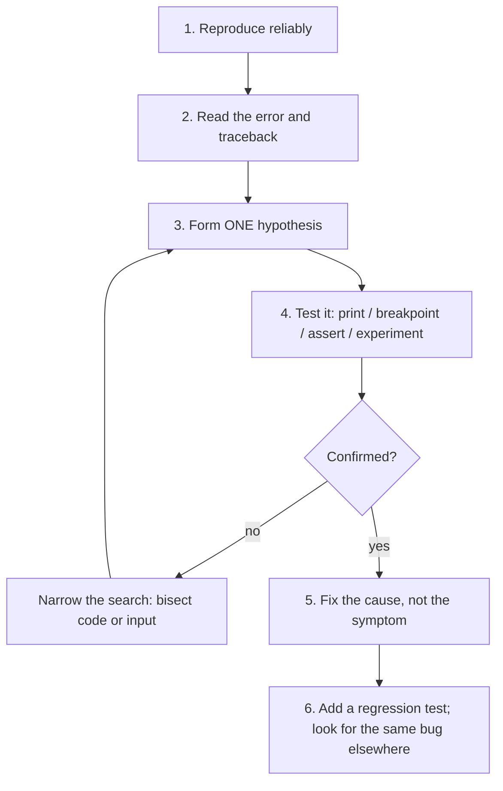

# Debugging and logging

A test tells you *that* something is wrong; debugging finds out *why*. Beginners debug by staring and guessing. Experienced engineers debug like scientists: reproduce, read the evidence, form a hypothesis, test it, narrow down. This lesson covers the evidence Python gives you (tracebacks), the instruments (print, `breakpoint()`/pdb, `logging`, assertions), and a method that works when you have no idea what's going on.

## Reading a traceback

A traceback is the most useful piece of debugging information, and many people don't read it. Read **bottom-up**:

1. The **last line** names the exception type and message — *what* went wrong.
2. The frame just above it is *where* it was raised.
3. Earlier frames show *how execution got there* (who called whom). The interesting frame is often the deepest one that is **your** code, not the library's.

```python-run
import traceback

def average(values):
    return sum(values) / len(values)

def report(groups):
    return {name: average(vals) for name, vals in groups.items()}

try:
    report({"a": [1, 2], "b": []})
except ZeroDivisionError:
    traceback.print_exc(limit=5, file=__import__("sys").stdout)
```

Reading it: `ZeroDivisionError: division by zero` (what) in `average` at `sum(values) / len(values)` (where), called from the comprehension in `report` (how). Hypothesis: some group has an empty list. Since Python 3.11, tracebacks even underline the exact sub-expression with `~~~^^^`.

### Common exceptions decoded

| You see | It usually means |
|---|---|
| `AttributeError: 'NoneType' object has no attribute 'x'` | something returned `None` (a function without `return`, `list.sort()`, `dict.get`, a failed `re.match`) |
| `TypeError: 'X' object is not subscriptable / callable / iterable` | you're treating a value as the wrong kind of thing — check what the variable really holds |
| `TypeError: f() takes 1 positional argument but 2 were given` | forgot `self` in a method definition |
| `TypeError: unhashable type: 'list'` | used a list as a dict key or set member — use a tuple |
| `KeyError: 'name'` | key missing — typo, different case, or data not what you assumed |
| `IndexError: list index out of range` | off-by-one, or an empty list |
| `UnboundLocalError` | assigned to a variable later in the function, making it local |
| `RecursionError` | missing/incorrect base case |
| `ModuleNotFoundError` | wrong environment/interpreter, or a file shadowing a module |
| `IndentationError` / `TabError` | mixed tabs and spaces |
| `RuntimeError: dictionary changed size during iteration` | mutating while looping |

Chained tracebacks ("During handling of the above exception, another exception occurred" / "The above exception was the direct cause...") list the **original** error first — start there.

## A method for debugging



1. **Reproduce** it deterministically, with the smallest input you can. A bug you can't reproduce you can't confirm fixed. Capture it as a failing test.
2. **Read** the message. Really.
3. **Hypothesise**: "I think `vals` is empty for group b." State what you'd expect to observe if it's true.
4. **Experiment** to confirm or kill the hypothesis — one change at a time.
5. **Bisect** when lost: cut the problem in half. Comment out half the pipeline, feed half the input, check the midpoint value. `git bisect` does the same across commits to find which change introduced a bug.
6. **Fix the root cause**, add the test, and ask "where else did we make this assumption?"

Also: check your assumptions (is the code you're editing the code that's running? is the right virtualenv active? is the file saved?), and explain the problem aloud to a rubber duck — articulating it often reveals the gap.

## Print debugging, done properly

`print` is a perfectly good tool when used deliberately:

```python-run
def merge_intervals(intervals):
    intervals.sort()
    merged = []
    for start, end in intervals:
        print(f"{start=} {end=} {merged=}")          # f-string '=' shows name and repr
        if merged and start <= merged[-1][1]:
            merged[-1][1] = max(merged[-1][1], end)
        else:
            merged.append([start, end])
    return merged

print(merge_intervals([[1, 3], [8, 10], [2, 6], [9, 12]]))
```

Tips: use `f"{expr=}"` (3.8+) to label values; print `repr()` to reveal hidden whitespace and types (`'42'` vs `42`); print `type(x)` and `len(x)`; write to stderr (`print(..., file=sys.stderr)`) to keep it separate from program output; and remove the prints afterwards — or use logging, which you can leave in.

```python-run
value = "42 "
other = 42
print(value, other)                 # look identical-ish
print(repr(value), repr(other), type(value).__name__, type(other).__name__)
print(f"{value.strip() == str(other)=}")
```

## The debugger: `breakpoint()` and pdb

A debugger pauses the program and lets you inspect **everything** at that moment, step line by line, and try expressions — far more powerful than guessing which prints you'll need. Put `breakpoint()` where you want to stop (it calls `pdb.set_trace()` by default):

```python
def checkout(cart, coupon):
    subtotal = sum(item.price * item.qty for item in cart)
    breakpoint()                      # execution pauses here; you get a (Pdb) prompt
    discount = coupon.apply(subtotal)
    return subtotal - discount
```

Essential pdb commands:

| Command | Action |
|---|---|
| `l` / `ll` | list source around the current line / the whole function |
| `n` | **n**ext line (step over calls) |
| `s` | **s**tep into the call on this line |
| `r` | run until the current function **r**eturns |
| `c` | **c**ontinue to the next breakpoint |
| `p expr` / `pp expr` | print / pretty-print an expression |
| `w` | **w**here: show the call stack |
| `u` / `d` | move **u**p / **d**own the stack to inspect callers |
| `b file:line` / `b func` | set a breakpoint; `b 42, x > 10` for a conditional one |
| `a` | print the current function's arguments |
| `display expr` | show an expression every time it changes |
| `!stmt` | execute a Python statement |
| `q` | quit |

Other ways in:

- `python -m pdb script.py` — start under the debugger; on an uncaught exception it enters **post-mortem** mode at the crash site.
- `pytest --pdb` — drop into pdb at the failing assertion; `pytest --trace` to start each test in the debugger.
- `python -i script.py` — run, then land in a REPL with all globals available.
- `PYTHONBREAKPOINT=0` disables all `breakpoint()` calls; `PYTHONBREAKPOINT=ipdb.set_trace` swaps in a nicer debugger.
- IDE debuggers (VS Code, PyCharm) offer the same operations with a GUI: click in the gutter to set breakpoints, hover for values, watch expressions, conditional breakpoints. Learn the four keys: continue, step over, step into, step out.

Never commit a stray `breakpoint()` — it will hang a server waiting for input. Linters (ruff rule `T100`) catch it.

## Assertions as executable assumptions

`assert` documents what must be true at a point in the code and fails loudly when it isn't — turning a mysterious wrong answer three functions later into an immediate, local error.

```python-run
def binary_search(a, target):
    assert all(a[i] <= a[i + 1] for i in range(len(a) - 1)), "input must be sorted"
    lo, hi = 0, len(a)
    while lo < hi:
        mid = (lo + hi) // 2
        assert lo <= mid < hi                      # loop invariant
        if a[mid] < target:
            lo = mid + 1
        else:
            hi = mid
    return lo if lo < len(a) and a[lo] == target else -1

print(binary_search([1, 3, 5, 7], 5))
try:
    binary_search([3, 1, 2], 2)
except AssertionError as e:
    print("AssertionError:", e)
```

Use assertions for programmer errors and invariants; use exceptions for conditions that can legitimately happen (bad user input, missing files). Assertions vanish under `python -O`.

## logging

For anything longer-lived than a one-off script, replace prints with the `logging` module: messages have **levels**, timestamps and origins; you can route them to files or services; and you can turn detail up or down without touching code.

| Level | Use for |
|---|---|
| `DEBUG` | detailed diagnostic information |
| `INFO` | normal milestones ("server started", "processed 120 rows") |
| `WARNING` | something unexpected but handled (default threshold) |
| `ERROR` | an operation failed |
| `CRITICAL` | the program may not be able to continue |

```python-run
import logging, sys

logging.basicConfig(
    level=logging.DEBUG,
    format="%(levelname)-8s %(name)s:%(lineno)d  %(message)s",
    stream=sys.stdout,
    force=True,
)
log = logging.getLogger("shop.orders")          # in real modules: logging.getLogger(__name__)

def process(order):
    log.debug("processing %s", order)           # lazy %-formatting: only built if emitted
    if order["qty"] <= 0:
        log.warning("order %s has non-positive qty %d", order["id"], order["qty"])
        return None
    try:
        return order["qty"] * order["price"]
    except KeyError:
        log.exception("order %s is malformed", order["id"])     # ERROR + full traceback
        return None

for o in [{"id": 1, "qty": 2, "price": 5}, {"id": 2, "qty": 0, "price": 5}, {"id": 3, "qty": 1}]:
    process(o)

logging.getLogger("shop").setLevel(logging.WARNING)             # quieten the whole 'shop' subtree
process({"id": 4, "qty": 1, "price": 1})
log.warning("only warnings and above are shown now")
```

Good practice:

- One logger per module: `logger = logging.getLogger(__name__)`. Logger names form a hierarchy (`shop.orders` is a child of `shop`), so levels and handlers can be set per subtree.
- **Libraries** only create loggers and log; the **application** configures handlers/format once at startup (`basicConfig` or `logging.config.dictConfig`).
- Pass arguments (`log.info("user %s", uid)`) rather than pre-formatting with f-strings — formatting is skipped if the level is disabled, and aggregators group identical templates.
- `log.exception(...)` inside an `except` block records the traceback. Never swallow exceptions silently.
- Don't log secrets or personal data. In services, prefer structured (JSON) logs with request IDs.

## More instruments

| Tool | Use |
|---|---|
| `python -X dev` / `-W error` | dev mode with extra checks; turn warnings into errors to find their source |
| `traceback.print_stack()` | "how did I get here?" without raising |
| `faulthandler.enable()` | dump Python tracebacks on hard crashes/hangs |
| `sys.settrace`, `trace` module | trace every executed line |
| `inspect.signature(f)`, `inspect.getsource(f)` | introspect objects |
| `dir(x)`, `vars(x)`, `type(x)`, `help(x)`, `id(x)` | interactive exploration |
| `python -X importtime` | find slow imports |
| `icecream`, `rich.traceback`, `ipdb`, `pdb++` | third-party niceties |

```python-run
import inspect

def area(w: float, h: float = 1.0) -> float:
    "Rectangle area."
    return w * h

print(inspect.signature(area), "|", inspect.getdoc(area))
print([n for n in dir("text") if n.startswith("is")][:6])
print(vars(type("Point", (), {"x": 1, "y": 2})()), type(area).__name__)
```

## Classic Python bugs to suspect first

When behaviour is "impossible", check this list — every item appeared earlier in this track:

1. **Mutable default argument** accumulating state across calls.
2. **Aliasing**: two names for one list/dict; `[[0] * n] * m`; a shallow copy sharing inner lists.
3. **Late-binding closures** in loops (`lambda: i`).
4. **Exhausted iterators**: second pass over a generator/`map`/`zip` yields nothing.
5. **`is` vs `==`**, or truthiness treating `0`/`""` as missing.
6. **In-place methods returning `None`** (`x = x.sort()`).
7. **Integer vs float division**, floating-point equality.
8. **Shadowed names**: a variable called `list`, `id`, `sum`, or a file called `random.py`.
9. **Modifying a collection while iterating** over it.
10. **Stale state**: wrong interpreter, unsaved file, cached `.pyc`, an old process still running, code imported once in a REPL.

## Worked example: hunting a bug

A function should return the running balance after each transaction but gives odd results on its second use:

```python-run
def running_balance(transactions, history=[]):
    total = history[-1] if history else 0
    for t in transactions:
        total += t
        history.append(total)
    return history

print(running_balance([10, -3]))
print(running_balance([5]))            # expected [5] — got [10, 7, 12] !?
```

*Reproduce*: two calls in a row. *Evidence*: the second result contains the first call's numbers. *Hypothesis*: `history` persists between calls — a mutable default. *Test*:

```python-run
def running_balance(transactions, history=[]):
    for t in transactions:
        history.append(t)
    return history

running_balance([1])
print(running_balance.__defaults__)    # the default list has grown: hypothesis confirmed

def running_balance_fixed(transactions, history=None):
    history = [] if history is None else list(history)     # also avoid mutating the caller's list
    total = history[-1] if history else 0
    for t in transactions:
        total += t
        history.append(total)
    return history

assert running_balance_fixed([10, -3]) == [10, 7]
assert running_balance_fixed([5]) == [5]                   # regression test
assert running_balance_fixed([5], [10, 7]) == [10, 7, 12]
print("fixed and covered by tests")
```

> [!INTERVIEW]
> "How do you debug a problem in production / code you didn't write?" Describe the method: reproduce (ideally as a failing test), read the traceback and logs, form a hypothesis, narrow down by bisection, inspect state with a debugger or targeted logging, fix the root cause, add a regression test. In a live-coding interview, *narrate* this process when your code fails a case — walking through a small input by hand is exactly the dry-run skill interviewers assess.

## Summary

Read tracebacks bottom-up. Debug systematically: reproduce, hypothesise, experiment, bisect, fix the cause, add a test. Use `print(f"{x=}")` and `repr` for quick looks, `breakpoint()`/pdb for deep inspection, assertions for invariants, and `logging` (levels, per-module loggers, `log.exception`) for anything that outlives the debugging session.

```quiz
[
  {"q": "Where is the exception type and message in a Python traceback?", "options": ["First line", "Last line", "In the middle", "Not shown"], "answer": 1,
   "explain": "Read tracebacks bottom-up: the last line says what went wrong; frames above show where and how."},
  {"q": "`AttributeError: 'NoneType' object has no attribute 'append'` most likely means:", "options": ["append is misspelled", "A variable you thought was a list is None, e.g. the result of an in-place method or a function without return", "Lists have no append", "A syntax error"], "answer": 1,
   "explain": "Something evaluated to None; classic causes are `x = lst.sort()` or a missing return."},
  {"q": "What does `breakpoint()` do by default?", "options": ["Exits the program", "Pauses execution and opens the pdb debugger at that line", "Prints a traceback", "Sets a watch on all variables"], "answer": 1,
   "explain": "It calls sys.breakpointhook, which defaults to pdb.set_trace(); configurable via PYTHONBREAKPOINT."},
  {"q": "In pdb, which command steps INTO a function call on the current line?", "options": ["n", "s", "c", "r"], "answer": 1,
   "explain": "s = step into; n = next line (step over); c = continue; r = run until return."},
  {"q": "Which logging call records an error message together with the current traceback?", "options": ["log.debug()", "log.exception()", "log.info()", "print()"], "answer": 1,
   "explain": "log.exception logs at ERROR level and appends the traceback; use it inside except blocks."},
  {"q": "Why write `log.info('user %s', uid)` rather than `log.info(f'user {uid}')`?", "options": ["f-strings are not allowed", "Formatting is deferred and skipped if the level is disabled; templates stay groupable", "It is shorter", "It prints faster to the console"], "answer": 1,
   "explain": "The logging module formats lazily, only when a handler will actually emit the record."},
  {"q": "What does `print(f'{total=}')` output if total is 7?", "options": ["7", "total=7", "{total=}", "total"], "answer": 1,
   "explain": "The = specifier (3.8+) prints the expression text followed by its repr."},
  {"q": "Best first step when a bug report arrives?", "options": ["Rewrite the module", "Reproduce it reliably, ideally as a failing test", "Add try/except around everything", "Upgrade Python"], "answer": 1,
   "explain": "Without a reproduction you cannot test hypotheses or confirm a fix."}
]
```

> **Source:** Goodrich, Tamassia & Goldwasser, *Data Structures and Algorithms in Python*, §2.2.4 (Testing and Debugging); Python docs, *Library Reference* `pdb`, `logging` (and the *Logging HOWTO*), `traceback`, `inspect`, and built-in `breakpoint()`.
