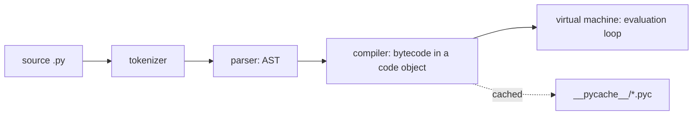

# CPython internals: bytecode, refcounting and GC

You can write Python for years without knowing how the interpreter works — but a rough model of what happens under the hood explains a great deal: why function calls and attribute lookups cost what they do, why `del` doesn't always free memory, why cycles need a garbage collector, why the GIL exists, and why `a is b` sometimes surprises you. This lesson is a guided tour of **CPython**, the reference implementation that almost everyone runs. It's also a favourite territory for senior-level interview questions.

## Python the language vs CPython the implementation

"Python" is a language specification. Implementations include:

| Implementation | Written in | Notable for |
|---|---|---|
| **CPython** | C | the reference; what `python.org` ships |
| PyPy | RPython | tracing JIT compiler; often several times faster on long-running pure-Python code |
| MicroPython / CircuitPython | C | microcontrollers |
| Jython, IronPython, GraalPy | Java, C#, Java | run on the JVM / .NET |
| Pyodide | CPython compiled to WebAssembly | runs in your browser — including this page |

Reference counting, the GIL, `id()` being a memory address, and small-integer caching are **CPython implementation details**, not language guarantees.

## From source to execution



1. **Tokenise & parse** the source text into an **abstract syntax tree** (AST).
2. **Compile** the AST to **bytecode** — instructions for a simple stack-based virtual machine — stored in a **code object**. For imported modules the result is cached in `__pycache__/*.pyc` so it needn't be recompiled next time.
3. **Interpret**: the **evaluation loop** (in C) fetches each instruction and executes it.

So Python *is* compiled — to bytecode, not machine code — and the bytecode is then interpreted. You can inspect each stage:

```python-run
import ast, dis

src = "total = price * qty + 1"
print(ast.dump(ast.parse(src).body[0], indent=1)[:330], "...")

code = compile(src, "<demo>", "exec")
print(type(code).__name__, code.co_names, code.co_consts)
dis.dis(code)
```

### Reading bytecode

The VM is a **stack machine**: instructions push operands onto a value stack, operate on the top items, and store results.

```python-run
import dis

def area(w, h):
    result = w * h
    return result

dis.dis(area)
c = area.__code__
print(c.co_varnames, c.co_argcount, c.co_stacksize, len(c.co_code), "bytes of bytecode")
```

You'll see roughly: load `w`, load `h`, multiply, store `result`, load `result`, return. (Exact opcode names vary by version — e.g. `BINARY_MULTIPLY` became `BINARY_OP` in 3.11, and newer versions fuse common pairs into "superinstructions".) A **code object** is immutable and holds the bytecode plus constants, names, and line-number tables; a **function object** wraps a code object with its globals, defaults and closure cells.

Bytecode explains several performance facts from the last lesson:

```python-run
import dis
x = 10
def use_global():
    return x + 1          # LOAD_GLOBAL: dictionary lookup(s)
def use_local(x=10):
    return x + 1          # LOAD_FAST: direct index into the frame's array of locals

names = lambda f: [i.opname for i in dis.get_instructions(f) if "LOAD" in i.opname]
print(names(use_global))
print(names(use_local))
print(dis.code_info(use_local).splitlines()[0])
```

- **Local variables** are stored in a fixed-size array in the frame and accessed by index (`LOAD_FAST`) — which is why the compiler must decide at compile time whether a name is local (and why you get `UnboundLocalError`).
- **Globals and built-ins** need dictionary lookups (`LOAD_GLOBAL`), and attribute access (`obj.attr`) more still.
- Constant expressions like `60 * 60 * 24` are folded at compile time by the **peephole/AST optimiser**.

### Frames and the call stack

Each function call creates a **frame**: it holds the code object, the local variables, the value stack, and a link to the caller's frame. Tracebacks are simply this chain of frames printed out; the recursion limit caps its depth; generators and coroutines are functions whose frame is kept alive and *resumed* instead of discarded.

```python-run
import sys, inspect

def inner():
    frame = sys._getframe()
    chain = []
    while frame and len(chain) < 3:
        chain.append(f"{frame.f_code.co_name}@line{frame.f_lineno}")
        frame = frame.f_back
    return chain

def outer():
    local_value = 42
    return inner()

print(outer())
print(sys.getrecursionlimit())
```

### The specialising adaptive interpreter

Since Python 3.11 ("Faster CPython", PEP 659), the interpreter watches which instructions run hot and **specialises** them in place for the types it observes — e.g. replacing a generic add with one for two ints, or caching where an attribute lives. If the assumption breaks, it de-optimises. Python 3.13 added an experimental copy-and-patch **JIT** on top. The takeaway: type-stable code in hot loops runs faster, and upgrading Python is a cheap optimisation.

## Everything is a `PyObject`

At the C level every value is a heap-allocated structure beginning with two fields:

- `ob_refcnt` — the **reference count**;
- `ob_type` — a pointer to the object's type.

followed by the value's own data. That header is why an `int` takes 28 bytes rather than 4, and why a list holds *pointers* to objects rather than the objects themselves. `id(obj)` returns the object's address in CPython; `is` compares those addresses.

## Reference counting

CPython's primary memory-management strategy: every object counts how many references point to it. Creating a reference (binding a name, storing in a container, passing as an argument) increments the count; removing one (`del`, rebinding, leaving a scope, removing from a container) decrements it. **When the count reaches zero, the object is destroyed immediately** and its memory reclaimed; destroying it decrements the counts of everything it referenced, possibly cascading.

```python-run
import sys

a = []
print(sys.getrefcount(a))        # 2: 'a' plus the temporary reference held by the call's argument
b = a
box = [a, a]
print(sys.getrefcount(a))        # 5
del b
box.clear()
print(sys.getrefcount(a))        # back to 2

class Noisy:
    def __init__(self, name): self.name = name
    def __del__(self): print(f"  {self.name} destroyed")

def scope():
    n = Noisy("local object")
    print("  leaving function")

scope()                          # destroyed the moment the function's frame goes away
x = Noisy("rebound object")
x = None                         # refcount hits zero right here
print("done")
```

Advantages: simple, **deterministic** (objects die as soon as they're unreachable, so files and sockets get closed promptly in CPython), no long pauses. Costs: every reference operation touches the count (memory writes even for "read-only" use), the counts must be protected in multithreaded code — the historical reason for the **GIL** — and it **cannot reclaim reference cycles**.

`del name` removes a *name* (decrementing the count); it frees the object only if that was the last reference. And don't rely on `__del__`/refcount timing for cleanup — other implementations (PyPy) don't use reference counting. Use `with`.

## The cyclic garbage collector

If objects refer to each other in a loop, their counts never reach zero even when nothing else refers to them:

```python-run
import gc, weakref

class Node:
    def __init__(self, name):
        self.name = name
        self.partner = None

gc.collect()                     # start from a clean slate
a, b = Node("a"), Node("b")
a.partner, b.partner = b, a      # cycle: a -> b -> a
probe = weakref.ref(a)           # lets us observe a's lifetime without keeping it alive

del a, b                         # no names left, but each still has refcount 1 from the other
print("alive after del:", probe() is not None)
found = gc.collect()             # run the cycle detector
print("collected objects:", found, "| alive after gc:", probe() is not None)
```

CPython therefore has a supplementary **generational cyclic garbage collector** (the `gc` module):

- It tracks only **container** objects — those that can hold references (lists, dicts, sets, class instances, ...). Ints and strings can't form cycles and aren't tracked.
- **Detection idea**: for a group of tracked objects, subtract the references that come from *inside* the group. Any object whose count drops to zero is referenced only from within the group; what remains reachable from outside is kept, the rest is garbage.
- **Generations**: new objects start in the youngest generation (0); survivors of a collection are promoted to older generations, which are scanned much less often. This exploits the *generational hypothesis*: most objects die young. A collection of generation 0 is triggered when allocations minus deallocations exceed a threshold (700 by default in classic CPython; the exact scheme was reworked in recent versions).

```python-run
import gc
print(gc.isenabled(), gc.get_threshold(), gc.get_count())
print(gc.is_tracked(42), gc.is_tracked("text"), gc.is_tracked([]), gc.is_tracked({"k": []}))
```

In practice: you rarely call `gc.collect()` yourself. To avoid creating cycles in the first place (parent ↔ child links, caches, observer lists), make one direction a **weak reference**:

```python-run
import weakref, gc

class Tree:
    def __init__(self, name, parent=None):
        self.name = name
        self.children = []
        self._parent = weakref.ref(parent) if parent else None   # weak: doesn't keep parent alive
        if parent:
            parent.children.append(self)
    @property
    def parent(self):
        return self._parent() if self._parent else None

root = Tree("root")
leaf = Tree("leaf", root)
print(leaf.parent.name)
del root                         # only the weak reference remains -> freed immediately by refcounting
print(leaf.parent)

cache = weakref.WeakValueDictionary()
class Big: pass
obj = Big(); cache["k"] = obj
print(len(cache)); del obj; print(len(cache))     # entry vanishes with its value
```

## Memory allocation

Asking the operating system for memory on every small allocation would be slow, so CPython layers its own allocator, **pymalloc**, on top: memory is obtained in large *arenas*, split into *pools* of one size class each, handing out *blocks* for objects up to 512 bytes. Freed blocks return to their pool for reuse. A consequence: after freeing many objects, the process's memory may not shrink visibly — arenas are released only when completely empty — which sometimes looks like a leak but isn't. (Recent versions use the *mimalloc* allocator in free-threaded builds.)

Some types also keep **free lists** of recently released objects (floats, tuples, frames) to recycle them quickly.

## Caching and interning

To save time and memory, CPython reuses some immutable objects:

- **Small integers** from −5 to 256 are pre-created singletons.
- **Identifier-like string literals** are **interned** (one shared copy), speeding up dictionary lookups of attribute and variable names. `sys.intern(s)` interns explicitly.
- Constants inside one code object are deduplicated; `None`, `True`, `False`, `()` and `""` are singletons.

```python-run
import sys

a, b = 256, 256
c, d = int("257"), int("257")            # computed at runtime to dodge constant sharing
print(a is b, c is d, c == d)

s1 = "hello_world"
s2 = "".join(["hello", "_world"])        # built at runtime: equal but a different object
print(s1 == s2, s1 is s2, sys.intern(s2) is sys.intern(s1))
```

This is exactly why `is` must never be used to compare numbers or strings: whether two equal values share an object depends on caching decisions that vary between versions and contexts.

## How the pieces explain everyday behaviour

| Observation | Explanation |
|---|---|
| Function calls are relatively expensive | each creates a frame and binds arguments |
| `obj.attr` in a tight loop is slower than a local | dictionary/type lookups vs indexed `LOAD_FAST` |
| Built-ins beat hand-written loops | their loops run in C, not through the bytecode loop |
| Threads don't speed up CPU-bound code | the GIL protects refcounts and interpreter state |
| A file closes when its variable goes out of scope (CPython) | refcount hits zero → deallocation → close |
| Memory doesn't drop after `del big_list` | pymalloc arenas, or other references still alive |
| Cyclic structures linger until a GC run | refcounts never reach zero on their own |
| `x is y` true for 100, false for 1000 | small-int cache |
| `UnboundLocalError` | locals decided at compile time (`LOAD_FAST`) |
| `.pyc` files appear | cached bytecode for faster imports |
| Generators resume where they left off | their frame is preserved between `next()` calls |

## The GIL, revisited

With the internals in view, the GIL's purpose is clear: reference counts are modified constantly, from everywhere. Without protection, two threads updating the same count would corrupt it (lost updates → premature frees or leaks). One global lock made the interpreter simple and single-threaded code fast, and let C extensions assume they're never interrupted.

Removing it (PEP 703's free-threaded build) required replacing plain counts with **biased reference counting** (a fast path for the owning thread), **immortal objects** (PEP 683: `None`, small ints, etc. whose counts are never modified), per-object locks for containers, and a thread-safe allocator. Related work: **subinterpreters** with a per-interpreter GIL (PEP 684) allow parallelism inside one process with isolated object spaces.

## Exploring further

```python-run
import sys, platform, dis

print(platform.python_implementation(), platform.python_version())
print(sys.implementation.name, sys.getswitchinterval(), sys.int_info.bits_per_digit)

def f(xs):
    return [x * 2 for x in xs if x]

print(len(list(dis.get_instructions(f))), "instructions; flags:", dis.code_info(f).split("Flags:")[1].split("\n")[0].strip())
print(f.__code__.co_consts)
```

Useful tools: `dis` (bytecode), `ast` (syntax trees), `sys.getrefcount`, `gc` (inspect and tune collection, `gc.get_referrers(obj)` to find who keeps something alive), `tracemalloc`, `inspect`, `sys._getframe`, and `python -X importtime` / `-X dev`.

> [!INTERVIEW]
> "How does Python manage memory?" — Objects live on a private heap. CPython uses **reference counting** for immediate reclamation plus a **generational cyclic garbage collector** to free reference cycles; small objects come from the pymalloc allocator. "Is Python compiled or interpreted?" — Source is compiled to **bytecode**, which the CPython **virtual machine** interprets (with adaptive specialisation since 3.11 and an experimental JIT since 3.13). "What's a `.pyc` file?" — cached bytecode. "Why the GIL?" — to make refcounting and interpreter internals thread-safe cheaply. "Why can `a is b` be True for small ints?" — CPython caches −5..256.

## Pitfalls recap

- Treating CPython details (refcounting timing, `id` = address, int caching) as language guarantees.
- Relying on `__del__` for resource cleanup.
- Assuming `del x` frees memory — it removes one reference.
- Unnecessary `gc.collect()` calls or disabling the GC without measuring.
- Creating parent↔child cycles in large long-lived structures when a weak reference would do.
- Comparing with `is` because "it worked in the REPL".

## Summary

CPython compiles source to bytecode stored in code objects and executes it on a stack-based virtual machine, one frame per call. Every object carries a reference count and a type pointer; memory is reclaimed immediately when the count hits zero, with a generational collector cleaning up cycles and pymalloc serving small allocations. Small ints and some strings are cached. These mechanisms explain Python's performance profile, the GIL, and many "surprising" behaviours you've met throughout this track.

```quiz
[
  {"q": "What does CPython compile your source code into?", "options": ["Machine code", "Bytecode for a stack-based virtual machine", "C source", "Nothing; it interprets text directly"], "answer": 1, "explain": "The compiler emits bytecode in code objects, which the evaluation loop interprets; .pyc files cache it."},
  {"q": "What is CPython's primary memory-reclamation mechanism?", "options": ["Mark-and-sweep only", "Reference counting, supplemented by a cyclic garbage collector", "Manual free()", "Region-based allocation"], "answer": 1, "explain": "Objects are freed when their reference count reaches zero; the gc module handles cycles that refcounting can't."},
  {"q": "Why can't reference counting alone free two objects that refer to each other?", "options": ["They are immutable", "Each keeps the other's count at 1 or more even when unreachable from the program", "Counts overflow", "They are interned"], "answer": 1, "explain": "A cycle sustains itself; the cyclic GC detects groups referenced only from within."},
  {"q": "What does `del x` do?", "options": ["Frees the object's memory immediately, always", "Removes the name x, decrementing the object's reference count", "Calls gc.collect()", "Sets x to None"], "answer": 1, "explain": "The object is destroyed only if that was the last reference."},
  {"q": "Why is accessing a local variable faster than a global?", "options": ["Locals are stored in registers", "Locals use indexed LOAD_FAST into the frame; globals need dictionary lookups", "Globals are on disk", "It isn't"], "answer": 1, "explain": "The compiler resolves locals to array slots at compile time."},
  {"q": "The generational GC assumes that:", "options": ["All objects live forever", "Most objects die young, so young generations are collected more often", "Old objects are garbage", "Cycles are impossible"], "answer": 1, "explain": "Survivors are promoted to older generations that are scanned less frequently."},
  {"q": "`a = 100; b = 100; a is b` is True in CPython because:", "options": ["All ints are singletons", "Integers from -5 to 256 are cached and reused", "is compares values", "The compiler deletes b"], "answer": 1, "explain": "It's an implementation detail; never rely on `is` for numeric comparison."},
  {"q": "What does a weak reference do?", "options": ["Prevents garbage collection", "Refers to an object without increasing its reference count, so it doesn't keep it alive", "Copies the object", "Makes it immutable"], "answer": 1, "explain": "weakref.ref and WeakValueDictionary are used for caches and back-pointers to avoid cycles."}
]
```

> **Source:** Python docs, *Library Reference* `dis`, `gc`, `sys`, `weakref`, `ast`; *Python/C API Reference* "Reference Counting" and "Memory Management"; CPython Developer's Guide ("Garbage collector design", "The bytecode interpreter"); PEPs 659, 683, 703; Goodrich, Tamassia & Goldwasser, *Data Structures and Algorithms in Python*, §15.1 (Memory Management: reference counts, cycle detection).
