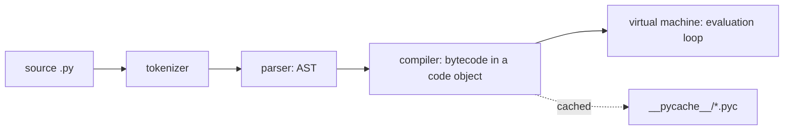

# CPython internals: bytecode, refcounting and GC

> **Before this lesson:** you need names and references, `is` versus `==`, and mutability from [Objects, names, types and mutability](#/lesson/python/py-objects-names); local and global scope from [Scope, closures and lambdas](#/lesson/python/py-scope-closures); generators from [Generators and yield from](#/lesson/python/py-generators); and basic classes from [Classes and instances](#/lesson/python/py-classes). The previous lesson, [Performance, profiling and memory](#/lesson/python/py-profiling), introduced bytecode, the interpreter and reference counts; this one opens them up. The GIL section builds on [The GIL, threading and multiprocessing](#/lesson/python/py-threads-processes).

## In plain words

You can write Python for years without knowing how the interpreter works inside. A rough picture of the machinery still explains a great deal: why calling a function or reading an attribute costs what it does, why `del` does not always free memory, why Python needs a "garbage collector", why the GIL exists, and why `a is b` sometimes gives a surprising answer.

Here is the picture in one analogy. Imagine every object in your program is a balloon, and every name or container that refers to it is a string tied to the balloon and held by someone. Python keeps a tally of strings on each balloon. When the last string is cut, the balloon floats away at once, and its memory is reused. That tally is **reference counting**. Now imagine two balloons tied only to each other: no person holds either of them, yet each still has one string attached, so the tallies never reach zero. Python needs a second helper that walks around from time to time and asks "which balloons are not anchored to anyone?" That helper is the **cyclic garbage collector**.

This lesson is a guided tour of **CPython**, the standard Python that almost everyone runs. It covers how your source becomes instructions, how those instructions run, how memory is tracked and freed, and how all of that explains behaviour you have met throughout the track.

Why this matters for a job: senior interviews like this territory. "How does Python manage memory?", "Is Python compiled or interpreted?", "What is a `.pyc` file?" and "Why does the GIL exist?" are common questions, and good answers come from this lesson. At work, the same knowledge helps you diagnose memory that will not go away and code that is slower than expected.

## Python the language vs CPython the implementation

"Python" is, strictly, a **language specification**: a document describing what valid Python code means. An **implementation** is a program that actually runs that code. Several exist:

| Implementation | Written in | Notable for |
|---|---|---|
| **CPython** | C | the reference; what `python.org` ships |
| PyPy | RPython | tracing JIT compiler; often several times faster on long-running pure-Python code |
| MicroPython / CircuitPython | C | microcontrollers |
| Jython, IronPython, GraalPy | Java, C#, Java | run on the JVM / .NET |
| Pyodide | CPython compiled to WebAssembly | runs in your browser — including this page |

A few terms from the table: a **JIT** (just-in-time) **compiler** turns frequently run code into machine code while the program is running. A **microcontroller** is a tiny computer on a single chip, such as those in appliances. The **JVM** (Java Virtual Machine) and **.NET** are runtime platforms for Java and C# programs. **WebAssembly** is a compact code format that web browsers can run at close to native speed; it is how the demos on this page run real CPython inside your browser.

The difference matters because several things in this lesson are **CPython implementation details**, not promises of the language: reference counting, the GIL, `id()` returning a memory address, and the caching of small integers. Code that depends on them may behave differently on PyPy or a future CPython.

## From source to execution



The diagram reads left to right. Each step has a name worth knowing:

1. **Tokenise and parse.** The **tokenizer** chops the source text into tokens, the smallest meaningful pieces (names, numbers, operators, brackets). The **parser** checks that the tokens follow Python's grammar and builds an **abstract syntax tree** (AST): a tree that records the structure of the code, such as "an assignment whose value is an addition whose left side is a multiplication".
2. **Compile.** The **compiler** turns the AST into **bytecode**: a list of simple instructions for a **virtual machine**, an imaginary computer implemented in software. The bytecode is stored, together with the constants and names it uses, in a **code object**. For imported modules, the result is cached in a `__pycache__` folder as a `.pyc` file, so the next import can skip compiling.
3. **Interpret.** The **evaluation loop**, written in C, fetches each bytecode instruction in turn and carries it out.

So Python *is* compiled, but to bytecode rather than to machine code, and the bytecode is then interpreted. You can look at each stage yourself:

```python-run
import ast, dis

src = "total = price * qty + 1"
print(ast.dump(ast.parse(src).body[0], indent=1)[:330], "...")

code = compile(src, "<demo>", "exec")
print(type(code).__name__, code.co_names, code.co_consts)
dis.dis(code)
```

**Reading this code line by line**

- `ast.parse(src)` parses the one-line program into a tree; `.body[0]` is its first statement. `ast.dump(..., indent=1)` prints the tree with indentation. You see an `Assign` whose target is the name `total` and whose value is a `BinOp` (binary operation, an operator with two sides): `Add` of a multiplication and the constant 1. The `[:330]` only shortens the printout.
- `compile(src, "<demo>", "exec")` runs the parser and compiler and returns a code object. `"<demo>"` is the file name shown in error messages, and `"exec"` means "a sequence of statements".
- `code.co_names` lists the names the code uses, `('price', 'qty', 'total')`, and `code.co_consts` lists its constants, `(1, None)`. The `None` is there because module-level code implicitly ends by returning `None`.
- `dis.dis(code)` **disassembles** the bytecode, printing it in readable form. Each line shows a source line number, an offset, an instruction name and its argument: `LOAD_NAME price`, `LOAD_NAME qty`, `BINARY_OP *`, `LOAD_CONST 1`, `BINARY_OP +`, `STORE_NAME total`. The first instruction, `RESUME`, is housekeeping that newer versions insert at the start of every code object. Instruction names vary a little between Python versions.

### Reading bytecode

CPython's virtual machine is a **stack machine**. A **stack** is a pile where you can only add to the top (**push**) or take from the top (**pop**), like a stack of plates. Instructions push values onto a value stack, work on the top items, and store results. Here is a two-line function and its bytecode:

```python-run
import dis

def area(w, h):
    result = w * h
    return result

dis.dis(area)
c = area.__code__
print(c.co_varnames, c.co_argcount, c.co_stacksize, len(c.co_code), "bytes of bytecode")
```

Follow the stack through the instructions:

| Instruction | What it does | Stack afterwards |
|---|---|---|
| `LOAD_FAST w` | push the value of local `w` | `w` |
| `LOAD_FAST h` | push the value of local `h` | `w, h` |
| `BINARY_OP *` | pop two values, push their product | `w*h` |
| `STORE_FAST result` | pop the top value into local `result` | (empty) |
| `LOAD_FAST result` | push `result` | `result` |
| `RETURN_VALUE` | pop the top value and return it | (done) |

The last line of the demo inspects the code object: `co_varnames` lists the local variable names `('w', 'h', 'result')`, `co_argcount` is 2 (two parameters), `co_stacksize` is 2 (the stack never holds more than two values) and the bytecode itself is only a few bytes long.

Exact instruction names change between versions: for example, `BINARY_MULTIPLY` became the general `BINARY_OP` in Python 3.11, and newer versions fuse common pairs of instructions into single "superinstructions". The idea of pushing and popping stays the same.

Two objects are involved in every function. A **code object** is immutable and holds the bytecode plus constants, names and a table mapping instructions back to source lines. A **function object** wraps a code object together with the things that can differ between functions sharing the same code: the global namespace it runs in, its default argument values, and any closure cells. You reach the code object through `func.__code__`.

### What bytecode explains about speed

Bytecode explains several performance facts from the last lesson:

```python-run
import dis
x = 10
def use_global():
    return x + 1          # LOAD_GLOBAL: dictionary lookup(s)
def use_local(x=10):
    return x + 1          # LOAD_FAST: direct index into the frame's array of locals

names = lambda f: [i.opname for i in dis.get_instructions(f) if "LOAD" in i.opname]
print(names(use_global))
print(names(use_local))
print(dis.code_info(use_local).splitlines()[0])
```

`dis.get_instructions(f)` returns the instructions one by one, and the helper `names` keeps only the names of the load instructions. The output shows `['LOAD_GLOBAL', 'LOAD_CONST']` for the first function and `['LOAD_FAST', 'LOAD_CONST']` for the second. The last line prints the first line of a summary of the code object, `Name: use_local`.

- **Local variables** live in a fixed-size array inside the running function's frame and are read by position (`LOAD_FAST`), which is very quick. For this to work, the compiler must decide, *before the function runs*, which names are local. Its rule: a name assigned anywhere in the function is local everywhere in the function. That is the source of `UnboundLocalError`.
- **Globals and built-ins** need dictionary lookups (`LOAD_GLOBAL` searches the module's globals and then the built-ins), and attribute access such as `obj.attr` needs more lookups still.
- Constant expressions such as `60 * 60 * 24` are calculated once, at compile time, by an optimisation step called **constant folding**.

Both effects are visible in a short demo:

```python-run
count = 0
def bump():
    try:
        count += 1        # assignment makes 'count' local to bump
    except UnboundLocalError as e:
        print("UnboundLocalError:", e)
bump()

def seconds_per_day():
    return 60 * 60 * 24
print(seconds_per_day.__code__.co_consts)
```

Because `bump` assigns to `count`, the compiler made `count` a local name of `bump`. The statement `count += 1` must first *read* the local `count`, which has no value yet, so Python raises `UnboundLocalError` instead of reading the global. (Writing `global count` at the top of `bump` would change the compiler's decision.) The second function's constants contain the finished number `86400`: the multiplication was done once, during compilation, not on every call.

### Frames and the call stack

Each function call creates a **frame**, a record of one running call. It holds the code object being run, the local variables, the value stack, the position of the next instruction, and a link to the frame of the caller. The chain of frames, from the current call back to the start of the program, is the **call stack**. A **traceback**, the error report Python prints, is that chain written out. The **recursion limit** caps how deep the chain may grow. Generators and coroutines are functions whose frame is kept and *resumed* instead of thrown away, which is how they continue where they left off.

```python-run
import sys, inspect

def inner():
    frame = sys._getframe()
    chain = []
    while frame and len(chain) < 3:
        chain.append(f"{frame.f_code.co_name}@line{frame.f_lineno}")
        frame = frame.f_back
    return chain

def outer():
    local_value = 42
    return inner()

print(outer())
print(sys.getrecursionlimit())
```

**Reading this code line by line**

- `sys._getframe()` returns the frame of the function currently running, here `inner`. (The leading underscore marks it as a CPython-specific tool for debugging, not for everyday code.)
- The loop records each frame's function name (`f_code.co_name`) and current line (`f_lineno`), then moves to the caller's frame with `f_back`.
- The output lists `inner`, then `outer`, then `<module>` (the top-level code of the script), each with the line it was executing: the call stack, newest first. The second line shows the recursion limit, 1000 by default.

### The specialising adaptive interpreter

Since Python 3.11 (the "Faster CPython" project, PEP 659), the interpreter watches which instructions run often and **specialises** them in place for the types it observes. For example, a general "add" that has only ever seen two integers is swapped for a faster "add two integers" instruction, and an attribute lookup can remember where the attribute was found last time. If the assumption breaks (a string turns up), the instruction **de-optimises** back to the general version. Python 3.13 added an experimental JIT compiler on top, switched off in standard builds. The practical lessons: code whose types stay the same in hot loops runs faster, and upgrading Python is a cheap optimisation.

## Everything is a `PyObject`

At the C level, every Python value is a structure (a block of memory with named fields) allocated on the **heap**, the region of memory used for data whose lifetime is not tied to one function call. Every such structure begins with the same two fields:

- `ob_refcnt`: the **reference count**, the number of references currently pointing at this object;
- `ob_type`: a **pointer** (a memory address) to the object's type.

The value's own data follows. That shared header is why, on a 64-bit machine, an `int` takes 28 bytes rather than 4, and why a list holds *pointers* to objects rather than the objects themselves. In CPython, `id(obj)` returns the object's memory address, and `a is b` compares those addresses: "are these the same object?"

## Reference counting

Reference counting is CPython's main way of managing memory. Every object counts how many references point to it.

- Creating a reference increases the count: binding a name, storing the object in a container, passing it as an argument.
- Removing a reference decreases it: `del name`, rebinding the name to something else, a function's local variables disappearing when it returns, removing the object from a container.
- **When the count reaches zero, the object is destroyed immediately** and its memory reclaimed. Destroying it removes its own references to other objects, which may bring their counts to zero in turn, a cascade.

```python-run
import sys

a = []
print(sys.getrefcount(a))        # 2: 'a' plus the temporary reference held by the call's argument
b = a
box = [a, a]
print(sys.getrefcount(a))        # 5
del b
box.clear()
print(sys.getrefcount(a))        # back to 2

class Noisy:
    def __init__(self, name): self.name = name
    def __del__(self): print(f"  {self.name} destroyed")

def scope():
    n = Noisy("local object")
    print("  leaving function")

scope()                          # destroyed the moment the function's frame goes away
x = Noisy("rebound object")
x = None                         # refcount hits zero right here
print("done")
```

**Reading this code line by line**

- `sys.getrefcount(a)` reports the count for the list. It prints 2, not 1, because passing `a` into `getrefcount` creates one more, temporary reference for the duration of the call.
- `b = a` adds a reference and `box = [a, a]` adds two more (the list holds two references to the same object), so the count becomes 5.
- `del b` removes the name `b`, and `box.clear()` empties the box, so the count returns to 2.
- `__del__` is a **finaliser**, a special method Python calls immediately before destroying an object. Here it prints a message so we can see the moment of destruction.
- Inside `scope()`, the only reference to the first `Noisy` object is the local name `n`. The output shows `leaving function` and then `local object destroyed`: the object dies as soon as the function returns and its frame, with the local name, goes away.
- `x = None` rebinds `x`, removing the only reference to the second object, so `rebound object destroyed` is printed on that line, before `done`.

**Advantages of reference counting.** It is simple and **deterministic**: objects are destroyed at a predictable moment, as soon as they become unreachable, so in CPython files and network connections are closed promptly, and there are no long pauses.

**Costs.** Every reference operation touches a count, so even "read-only" code writes to memory. The counts must be protected when several threads run, which is the historical reason for the GIL. And reference counting **cannot reclaim reference cycles**, the two-balloon problem.

Two consequences for everyday code. `del name` removes a *name*, decreasing the count by one; it frees the object only if that was the last reference. And do not rely on `__del__` or reference-count timing to release resources: other implementations such as PyPy do not use reference counting, so destruction may come much later. Use `with` for anything that must be closed.

## The cyclic garbage collector

If objects refer to each other in a loop, their counts never reach zero, even when nothing else refers to them. Such a loop is a **reference cycle**.

```python-run
import gc, weakref

class Node:
    def __init__(self, name):
        self.name = name
        self.partner = None

gc.collect()                     # start from a clean slate
a, b = Node("a"), Node("b")
a.partner, b.partner = b, a      # cycle: a -> b -> a
probe = weakref.ref(a)           # lets us observe a's lifetime without keeping it alive
del a, b                         # no names left, but each still has refcount 1 from the other
print("alive after del:", probe() is not None)
found = gc.collect()             # run the cycle detector
print("collected objects:", found, "| alive after gc:", probe() is not None)
```

**Reading this code line by line**

- Two `Node` objects point at each other through their `partner` attributes: a cycle.
- `weakref.ref(a)` creates a **weak reference**: a reference that lets you reach an object without adding to its count, so it does not keep the object alive. Calling `probe()` returns the object if it still exists and `None` once it has been destroyed. It is the perfect tool for watching an object's lifetime.
- `del a, b` removes both names. Nothing in the program can reach the nodes any more, but each still has a count of 1 from its partner, so the first print says `alive after del: True`.
- `gc.collect()` runs the cycle detector by hand. It finds the two unreachable objects, reports how many it collected, and now `probe()` returns `None`: `alive after gc: False`.

CPython therefore has a supplementary **generational cyclic garbage collector**, controlled through the `gc` module:

- It tracks only **container** objects, those that can hold references to other objects: lists, dicts, sets, instances of your classes, and so on. Integers and strings cannot form cycles and are not tracked.
- **How it detects garbage.** For a group of tracked objects, it subtracts every reference that comes from *inside* the group. An object whose count is still above zero is referenced from outside, so it, and everything it reaches, is kept. The rest is referenced only from within the group: unreachable garbage, which is freed.
- **Generations.** New objects start in the youngest generation, number 0. Objects that survive a collection are promoted to an older generation, and older generations are scanned much less often. This exploits the **generational hypothesis**: most objects die young. A collection of generation 0 is triggered when allocations minus deallocations exceed a threshold (700 by default in classic CPython; the scheme has been reworked in recent versions).

```python-run
import gc
print(gc.isenabled(), gc.get_threshold(), gc.get_count())
print(gc.is_tracked(42), gc.is_tracked("text"), gc.is_tracked([]), gc.is_tracked({"k": []}))
```

The first line shows that the collector is on, its thresholds for the three generations (typically `(700, 10, 10)`: collect generation 0 after 700 net allocations, generation 1 after 10 generation-0 collections, and so on) and the current counters. The second line shows `False False True True`: the integer and string are not tracked, the list and the dictionary are. (CPython even leaves a dictionary untracked while it holds only numbers and strings, as an optimisation, which is why the demo puts a list inside it.)

In practice you rarely call `gc.collect()` yourself. Better still, avoid creating cycles in the first place. Parent-and-child links, caches and lists of "observers" to notify are the usual sources; make one direction of the link a weak reference:

```python-run
import weakref, gc

class Tree:
    def __init__(self, name, parent=None):
        self.name = name
        self.children = []
        self._parent = weakref.ref(parent) if parent else None   # weak: doesn't keep parent alive
        if parent:
            parent.children.append(self)
    @property
    def parent(self):
        return self._parent() if self._parent else None

root = Tree("root")
leaf = Tree("leaf", root)
print(leaf.parent.name)
del root                         # only the weak reference remains -> freed immediately by refcounting
print(leaf.parent)

cache = weakref.WeakValueDictionary()
class Big: pass
obj = Big(); cache["k"] = obj
print(len(cache)); del obj; print(len(cache))     # entry vanishes with its value
```

**Reading this code line by line**

- Each `Tree` node keeps a normal (strong) list of its children but only a weak reference to its parent. The parent-to-child direction keeps nodes alive; the child-to-parent direction does not, so there is no cycle.
- The `parent` property calls the weak reference to get the real parent, or returns `None`.
- `leaf.parent.name` prints `root`. After `del root`, nothing strongly refers to the root, so reference counting destroys it at once, without waiting for the garbage collector, and `leaf.parent` becomes `None`.
- `weakref.WeakValueDictionary` is a dictionary whose values are held weakly. When the last strong reference to `obj` disappears, its entry vanishes too, so the length goes from 1 to 0. This makes a cache that never keeps objects alive on its own.

## Memory allocation

Asking the **operating system** (the software, such as Windows or Linux, that manages the computer's hardware) for memory on every small allocation would be slow. CPython adds its own allocator, **pymalloc**, on top, much as a shop buys stock in bulk and sells it in small portions. Memory is obtained in large **arenas**, which are split into **pools**, each pool serving one size of object and handing out **blocks** for objects of up to 512 bytes. A freed block returns to its pool for reuse.

A consequence: after a program frees many objects, its memory use as seen by the operating system may not shrink, because an arena is handed back only when it is completely empty. That can look like a leak but is not one: the memory is ready for reuse by Python. (The free-threaded builds of recent versions use a different allocator, *mimalloc*.)

Some types also keep **free lists** of recently released objects (floats, tuples, frames) to recycle them quickly without going back to the allocator.

## Caching and interning

To save time and memory, CPython reuses some immutable objects instead of creating new ones:

- **Small integers** from −5 to 256 are created once when the interpreter starts and shared by everyone. An object of which only one copy exists is called a **singleton**.
- String literals that look like identifiers (letters, digits and underscores) are **interned**: one shared copy is kept and reused. That speeds up the dictionary lookups behind variable and attribute names. `sys.intern(s)` interns a string explicitly.
- Equal constants inside one code object are stored once; `None`, `True`, `False`, `()` and `""` are singletons.

```python-run
import sys

a, b = 256, 256
c, d = int("257"), int("257")            # computed at runtime to dodge constant sharing
print(a is b, c is d, c == d)

s1 = "hello_world"
s2 = "".join(["hello", "_world"])        # built at runtime: equal but a different object
print(s1 == s2, s1 is s2, sys.intern(s2) is sys.intern(s1))
```

**Reading the output**

- `a is b` is `True` because 256 is in the small-integer cache. `c` and `d` are both 257, built separately while the program runs, so they are two different objects: `c is d` is `False` while `c == d` is `True`. (The demo uses `int("257")` because two identical literals in the same code object would share one constant, hiding the effect.)
- `s1` is an interned literal; `s2` is built at run time from pieces, so it is an equal but separate object: `True False`. Interning both returns the same shared copy, so the last test is `True`.

This is exactly why `is` must never be used to compare numbers or strings. Whether two equal values share an object depends on caching decisions that vary between versions and contexts. Use `==` for values and keep `is` for `None` and other singletons.

## How the pieces explain everyday behaviour

| Observation | Explanation |
|---|---|
| Function calls are relatively expensive | each creates a frame and binds arguments |
| `obj.attr` in a tight loop is slower than a local | dictionary/type lookups vs indexed `LOAD_FAST` |
| Built-ins beat hand-written loops | their loops run in C, not through the bytecode loop |
| Threads don't speed up CPU-bound code | the GIL protects refcounts and interpreter state |
| A file closes when its variable goes out of scope (CPython) | refcount hits zero → deallocation → close |
| Memory doesn't drop after `del big_list` | pymalloc arenas, or other references still alive |
| Cyclic structures linger until a GC run | refcounts never reach zero on their own |
| `x is y` true for 100, false for 1000 | small-int cache |
| `UnboundLocalError` | locals decided at compile time (`LOAD_FAST`) |
| `.pyc` files appear | cached bytecode for faster imports |
| Generators resume where they left off | their frame is preserved between `next()` calls |

## The GIL, revisited

A **thread** is an independent sequence of instructions running inside one program; several threads share the same objects. A **lock** is a flag that only one thread can hold at a time. The **GIL** (Global Interpreter Lock) is one lock for the whole interpreter: a thread must hold it to run Python bytecode.

With the internals in view, the GIL's purpose is clear. Reference counts change constantly, from everywhere. Adding one to a count is really three steps: read the number, add one, write it back. If two threads did that to the same count at the same moment, both could read the same old value and one update would be lost. A lost increment leads to an object being freed while still in use (a crash); a lost decrement leads to an object that is never freed (a leak). One global lock made the interpreter simple and single-threaded code fast, and it let C extensions assume they would not be interrupted at awkward moments.

Removing it (PEP 703, offered as a separate "free-threaded" build starting with Python 3.13) required several replacements:

- **Biased reference counting**: the thread that created an object updates its count on a fast path; other threads use slower, safe operations.
- **Immortal objects** (PEP 683): objects such as `None` and the small integers whose counts are never changed at all, so no thread needs to touch them.
- Per-object locks for containers such as lists and dicts, and a thread-safe memory allocator.

Related work: **subinterpreters** with a per-interpreter GIL (PEP 684) allow parallelism inside one process, with each interpreter having its own isolated set of objects.

## Exploring further

```python-run
import sys, platform, dis

print(platform.python_implementation(), platform.python_version())
print(sys.implementation.name, sys.getswitchinterval(), sys.int_info.bits_per_digit)

def f(xs):
    return [x * 2 for x in xs if x]

print(len(list(dis.get_instructions(f))), "instructions; flags:", dis.code_info(f).split("Flags:")[1].split("\n")[0].strip())
print(f.__code__.co_consts)
```

**Reading the output**

- The first line names the implementation and version. In the browser it says `CPython`, because Pyodide is CPython compiled to WebAssembly.
- `sys.getswitchinterval()` is how often, in seconds, a thread holding the GIL is asked to let others run: 0.005, five milliseconds. `bits_per_digit` reveals that Python stores big integers as a list of "digits" of 30 bits each on most platforms (15 on some).
- The third line counts the bytecode instructions of a one-line list comprehension and prints the code object's flags; `OPTIMIZED` and `NEWLOCALS` mark an ordinary function whose locals use the fast array. The last line prints its constants; since Python 3.12, comprehensions are compiled inline into the enclosing function, so no separate code object for the comprehension appears there.

Useful tools for exploring further: `dis` (bytecode), `ast` (syntax trees), `sys.getrefcount`, `gc` (inspect and tune collection; `gc.get_referrers(obj)` shows who keeps an object alive), `tracemalloc`, `inspect`, `sys._getframe`, `python -X importtime` (reports how long each import takes) and `python -X dev` (development mode, with extra runtime checks and warnings).

> [!INTERVIEW]
> "How does Python manage memory?" — Objects live on a private heap. CPython uses **reference counting** for immediate reclamation plus a **generational cyclic garbage collector** to free reference cycles; small objects come from the pymalloc allocator. "Is Python compiled or interpreted?" — Source is compiled to **bytecode**, which the CPython **virtual machine** interprets (with adaptive specialisation since 3.11 and an experimental JIT since 3.13). "What's a `.pyc` file?" — cached bytecode. "Why the GIL?" — to make refcounting and interpreter internals thread-safe cheaply. "Why can `a is b` be True for small ints?" — CPython caches −5..256.

## Pitfalls recap

- Treating CPython details (refcounting timing, `id` as an address, integer caching) as language guarantees.
- Relying on `__del__` for resource cleanup instead of `with`.
- Assuming `del x` frees memory; it removes one reference.
- Calling `gc.collect()` all over the place, or disabling the collector, without measuring.
- Creating parent-and-child cycles in large, long-lived structures when a weak reference would do.
- Comparing with `is` because "it worked when I tried it".

## Summary

CPython compiles source to bytecode stored in code objects and runs it on a stack-based virtual machine, one frame per call. Every object carries a reference count and a type pointer; memory is reclaimed as soon as the count reaches zero, a generational collector cleans up cycles, and pymalloc serves small allocations. Small integers and some strings are cached. These mechanisms explain Python's performance profile, the GIL, and many "surprising" behaviours met throughout this track.

## Glossary

- **Language specification / implementation** - the document defining what Python code means / a program that runs Python code.
- **CPython** - the standard implementation of Python, written in C.
- **JIT compiler** - a compiler that turns hot code into machine code while the program runs.
- **Tokenizer / parser** - the steps that split source text into tokens and check them against the grammar.
- **AST (abstract syntax tree)** - a tree representing the structure of source code.
- **Bytecode** - the simple instructions Python compiles source code into.
- **Code object** - an immutable object holding bytecode, constants, names and line-number tables.
- **Virtual machine / evaluation loop** - the software "computer" that runs bytecode / its main loop, written in C.
- **Disassemble** - display bytecode in human-readable form, as `dis.dis` does.
- **Stack machine** - a machine whose instructions push values onto and pop them off a stack.
- **Constant folding** - computing constant expressions at compile time.
- **Frame** - the record of one running function call: code, locals, value stack, caller.
- **Call stack** - the chain of frames from the current call back to the start of the program.
- **Specialisation** - replacing a general instruction with a faster one for the types actually seen.
- **Heap** - the memory region for objects whose lifetime is not tied to one call.
- **Pointer** - a memory address that refers to an object.
- **Reference count** - the number of references currently pointing at an object.
- **Finaliser (`__del__`)** - a method called immediately before an object is destroyed.
- **Deterministic** - happening at a predictable moment, every time.
- **Reference cycle** - objects that refer to each other in a loop.
- **Weak reference** - a reference that does not increase the count and so does not keep its target alive.
- **Generational garbage collector** - a collector that groups objects by age and scans young ones most often.
- **pymalloc** - CPython's allocator for small objects, built from arenas, pools and blocks.
- **Singleton** - an object of which only one copy exists, such as `None`.
- **Interning** - keeping one shared copy of equal immutable values, such as identifier strings.
- **GIL (Global Interpreter Lock)** - one lock a thread must hold to run Python bytecode in standard CPython.
- **Immortal object** - an object whose reference count is never changed, such as `None`.

```quiz
[
  {"q": "What does CPython compile your source code into?", "options": ["Machine code", "Bytecode for a stack-based virtual machine", "C source", "Nothing; it interprets text directly"], "answer": 1, "explain": "The compiler emits bytecode in code objects, which the evaluation loop interprets; .pyc files cache it."},
  {"q": "What is CPython's primary memory-reclamation mechanism?", "options": ["Mark-and-sweep only", "Reference counting, supplemented by a cyclic garbage collector", "Manual free()", "Region-based allocation"], "answer": 1, "explain": "Objects are freed when their reference count reaches zero; the gc module handles cycles that refcounting can't."},
  {"q": "Why can't reference counting alone free two objects that refer to each other?", "options": ["They are immutable", "Each keeps the other's count at 1 or more even when unreachable from the program", "Counts overflow", "They are interned"], "answer": 1, "explain": "A cycle sustains itself; the cyclic GC detects groups referenced only from within."},
  {"q": "What does `del x` do?", "options": ["Frees the object's memory immediately, always", "Removes the name x, decrementing the object's reference count", "Calls gc.collect()", "Sets x to None"], "answer": 1, "explain": "The object is destroyed only if that was the last reference."},
  {"q": "Why is accessing a local variable faster than a global?", "options": ["Locals are stored in registers", "Locals use indexed LOAD_FAST into the frame; globals need dictionary lookups", "Globals are on disk", "It isn't"], "answer": 1, "explain": "The compiler resolves locals to array slots at compile time."},
  {"q": "The generational GC assumes that:", "options": ["All objects live forever", "Most objects die young, so young generations are collected more often", "Old objects are garbage", "Cycles are impossible"], "answer": 1, "explain": "Survivors are promoted to older generations that are scanned less frequently."},
  {"q": "`a = 100; b = 100; a is b` is True in CPython because:", "options": ["All ints are singletons", "Integers from -5 to 256 are cached and reused", "is compares values", "The compiler deletes b"], "answer": 1, "explain": "It's an implementation detail; never rely on `is` for numeric comparison."},
  {"q": "What does a weak reference do?", "options": ["Prevents garbage collection", "Refers to an object without increasing its reference count, so it doesn't keep it alive", "Copies the object", "Makes it immutable"], "answer": 1, "explain": "weakref.ref and WeakValueDictionary are used for caches and back-pointers to avoid cycles."}
]
```

> **Source:** Python docs, *Library Reference* `dis`, `gc`, `sys`, `weakref`, `ast`; *Python/C API Reference* "Reference Counting" and "Memory Management"; CPython Developer's Guide ("Garbage collector design", "The bytecode interpreter"); PEPs 659, 683, 703; Goodrich, Tamassia & Goldwasser, *Data Structures and Algorithms in Python*, §15.1 (Memory Management: reference counts, cycle detection).
