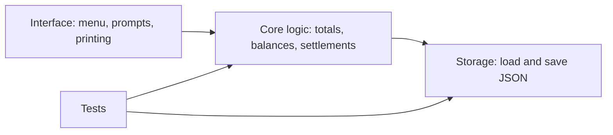

# Planning and structuring a small project

> **Before this lesson:** you should be able to write functions, loops, lists and dictionaries ([User input, while loops and functions](#/lesson/python/py-start-input-functions) and [Decisions and dictionaries](#/lesson/python/py-start-decisions-dicts)), define a small class ([Classes: modelling things with objects](#/lesson/python/py-start-classes)), and read and write files with `assert`-based checks ([Files, errors and tests](#/lesson/python/py-start-files-tests)). `@dataclass` is taught in [Properties, dataclasses, ABCs and composition](#/lesson/python/py-properties-dataclasses), and modules and virtual environments in [Modules, packages and imports](#/lesson/python/py-imports) and [Virtual environments, pip, uv and project layout](#/lesson/python/py-envs). Each of these is re-explained briefly where it is used.

## In plain words

An **exercise** is a small, well-defined task: "write a function that returns the largest number in a list". A **project** is a whole program that solves a real problem for someone, such as a tool that tracks who in a shared house paid for what. Exercises teach you the language. Projects teach you to *program*: to decide what to build, break it into pieces, fit the pieces together and keep the whole thing working while it changes.

An everyday comparison: following one recipe is an exercise. Cooking dinner for eight guests is a project. Nobody hands you a single recipe; you decide on a menu that fits the time you have, work out what to buy, prepare some dishes ahead, and make sure everything arrives at the table at once. Good cooks plan the menu before they pick up a knife. Good programmers plan the program before they type.

Why this matters for a job: real work is projects, not exercises. Employers look at projects you have built, and interviewers often say "walk me through something you made". This lesson gives you a repeatable way to go from a vague idea to a working, well-organised program. The remaining lessons in this module apply the same method to a game, a data visualisation, a client for a web service and a web application.

One running example is used throughout: a small tool for tracking shared household expenses.

## Why projects stall

Most abandoned first projects die of one of four causes:

1. **The idea is too big.** "A budgeting app like the one on my phone" has two hundred features. You need a version with three.
2. **No plan, only typing.** The code grows in one file until changing anything breaks something else.
3. **Everything is built before anything runs.** After a week nothing works, so nothing can be tested, and motivation evaporates.
4. **No safety net.** A change breaks the program and there is no way back to the version that worked.

Each has a cure, and the steps below apply them in order: cut the **scope** (the list of features you commit to building) to a minimum viable product; design the data and the pieces first; build in thin working slices; and protect your work with version control and tests.

## Step 1: write down what it should do

Before any code, write a few sentences in plain language. A useful format is the **user story**, a one-sentence description of a need from the point of view of the person who has it: *as a (kind of user), I want (something) so that (benefit)*. For the expense tracker:

- As a housemate, I want to record an expense with who paid and how much, so that we remember it.
- As a housemate, I want to see how much each person has paid in total.
- As a housemate, I want to know who owes whom, so that we can settle up.
- As a housemate, I want the records kept between runs.

Then sort ruthlessly into **must have**, **nice to have** and **not now**. Categories, charts, currencies, a phone app, e-mail reminders: all "not now". What remains (add an expense, list totals, compute who owes whom, save to a file) is the **minimum viable product**, or **MVP**: the smallest version that is genuinely useful to a real person. Finishing a small thing teaches more than abandoning a large one, and a finished MVP is the best foundation for the next feature.

Also write down what "done" means, in terms you can check: *"Given three people where A paid 30, B paid 0 and C paid 60, the program reports that B owes C 30."* Statements like this are called **acceptance criteria**, and they will turn into your tests.

## Step 2: design the data first

A program is data plus operations on that data. If the data is shaped well, the operations tend to write themselves; if it is shaped badly, every function fights it. So ask first: what are the *things* in this problem, and what do I need to know about each?

- An **expense**: who paid, how much, what for, and when.
- The **household**: the list of people and the list of expenses.

Writing this down is called designing the **data model**. Then choose how to represent each thing with the tools you know. A dictionary per expense, such as `{"payer": "ana", "amount": 30.0}`, is the quickest start. A small class is tidier as soon as there are rules to enforce, such as "an amount must be positive".

```python-run
from dataclasses import dataclass

@dataclass
class Expense:
    payer: str
    amount: float
    note: str = ""

    def __post_init__(self):
        if self.amount <= 0:
            raise ValueError("amount must be positive")
        self.payer = self.payer.strip().lower()

e = Expense(" Dana ", 42.5, "groceries")
print(e)
try:
    Expense("ben", -3)
except ValueError as error:
    print("rejected:", error)
```

**Reading this code line by line**

- `@dataclass` is a decorator that writes the boring parts of a class for you. From the three annotated lines (`payer: str` and so on) it generates an `__init__` method that accepts those three values, and a readable `__repr__` used when the object is printed.
- `note: str = ""` gives `note` a default, so it may be left out.
- `__post_init__` is a method that `@dataclass` calls automatically right after the generated `__init__` has stored the values. It is the place for checks and clean-up. Here it rejects zero or negative amounts by raising a `ValueError`, and it **normalises** the payer's name (puts it into one standard form) by removing surrounding spaces with `strip()` and converting to lower case with `lower()`, so " Dana " and "dana" count as the same person.
- `Expense(" Dana ", 42.5, "groceries")` creates an expense; printing it shows `Expense(payer='dana', amount=42.5, note='groceries')`, with the name cleaned up.
- `Expense("ben", -3)` breaks the rule, so `__post_init__` raises the error, the `except` block catches it, and the program prints `rejected: amount must be positive` instead of crashing.

The benefit: a bad expense can never exist in your program, because the only way to make one is through these checks. Every later function can trust the data it receives.

Decide early what the **saved form** looks like too, meaning how the data is stored in a file between runs. For a small project, a **JSON** file (JavaScript Object Notation, a plain-text format for lists and dictionaries that almost every language can read) holding a list of dictionaries is ideal: you can read and edit it by hand, and loading it takes one line of code.

## Step 3: break the work into small pieces

List the operations the user stories need and give each one a function with a clear input and a clear output. Keep **pure logic** (calculations on data that neither print nor read anything) apart from **input/output**, usually shortened to **I/O** (printing, reading the keyboard, reading and writing files). This separation is the single most valuable structural habit you can learn. Logic that does not print or read can be tested on its own with a line or two, and reused behind any **interface** (the part of a program a person interacts with): a terminal today, a web page tomorrow.



Read the arrows as "uses". The interface uses the core logic, the core logic uses storage, and the tests use the logic and the storage directly, without going through the interface.

For the expense tracker the pieces are:

| Piece | Kind | Signature (first guess) |
|---|---|---|
| total paid per person | logic | `totals(expenses, people) -> dict` |
| balance per person | logic | `balances(expenses, people) -> dict` (positive = is owed money) |
| who pays whom | logic | `settle(balances) -> list of (from, to, amount)` |
| load / save | storage | `load(path) -> list`, `save(path, expenses)` |
| menu loop | interface | `main()` |

A function's **signature** is its name, its parameters and what it returns. Writing a first guess at each signature before writing the bodies turns one big vague problem into several exercise-sized ones. Here is the logic, with its tests alongside:

```python-run
def totals(expenses, people):
    """Return {person: amount paid}, including people who paid nothing."""
    paid = {person: 0.0 for person in people}
    for expense in expenses:
        paid[expense["payer"]] += expense["amount"]
    return paid

def balances(expenses, people):
    """Return {person: balance}. Positive means the others owe this person."""
    paid = totals(expenses, people)
    share = sum(paid.values()) / len(people)
    return {person: round(amount - share, 2) for person, amount in paid.items()}

def settle(balance):
    """Return a list of (debtor, creditor, amount) transfers that clears all balances."""
    debtors = sorted((amount, person) for person, amount in balance.items() if amount < 0)
    creditors = sorted(((amount, person) for person, amount in balance.items() if amount > 0), reverse=True)
    debtors = [[-amount, person] for amount, person in debtors]
    creditors = [[amount, person] for amount, person in creditors]
    transfers = []
    i = j = 0
    while i < len(debtors) and j < len(creditors):
        pay = round(min(debtors[i][0], creditors[j][0]), 2)
        if pay > 0:
            transfers.append((debtors[i][1], creditors[j][1], pay))
        debtors[i][0] -= pay
        creditors[j][0] -= pay
        if debtors[i][0] < 0.005: i += 1
        if creditors[j][0] < 0.005: j += 1
    return transfers

people = ["ana", "ben", "cy"]
expenses = [{"payer": "ana", "amount": 30.0}, {"payer": "cy", "amount": 60.0}]

assert totals(expenses, people) == {"ana": 30.0, "ben": 0.0, "cy": 60.0}
assert balances(expenses, people) == {"ana": 0.0, "ben": -30.0, "cy": 30.0}
assert settle(balances(expenses, people)) == [("ben", "cy", 30.0)]
assert settle({"ana": 0.0, "ben": 0.0}) == []
print("logic verified:", settle(balances(expenses + [{"payer": "ben", "amount": 12.0}], people)))
```

**Reading `totals` and `balances`**

- `totals` starts with a dictionary giving every person 0.0, built with a dictionary comprehension, so that someone who paid nothing still appears. It then adds each expense's amount to the payer's entry.
- `balances` works out the fair share (the total divided by the number of people) and subtracts it from what each person paid. A positive balance means the others owe that person money; a negative balance means that person owes. `round(..., 2)` keeps two decimal places, because money is counted in cents and floating-point arithmetic can leave tiny leftovers such as 0.30000000000000004.

**Reading `settle`**

`settle` decides who should pay whom. It uses a **greedy algorithm**, one that repeatedly makes the choice that looks best right now: match the person who owes the most with the person who is owed the most.

- `debtors` collects the people with negative balances, as `(amount, person)` pairs sorted so the most negative comes first. `creditors` collects the positive balances, largest first (`reverse=True`).
- The two list comprehensions turn the pairs into small two-item lists `[amount, person]`, with the debts made positive. Lists, unlike tuples, can be changed, which the loop needs.
- `i` points at the current debtor and `j` at the current creditor. On each pass, the debtor pays the creditor the smaller of "what I still owe" and "what they are still owed". That amount is recorded as a transfer and subtracted from both.
- When a debtor's remaining debt is below half a cent, they are done and `i` moves on; likewise for the creditor and `j`. The loop ends when either list runs out.

**Reading the tests**

`assert condition` does nothing if the condition is true and stops the program with an `AssertionError` if it is false. Four `assert` lines check the acceptance criterion from Step 1 (ben owes cy 30) and an edge case (when nobody owes anything, there are no transfers). If you change a function and break it, the matching line stops the program and tells you at once.

The last line adds a third expense (ben paid 12). The total is now 102 and the fair share 34, so ana is 4 short, ben is 22 short and cy is owed 26. The output is `logic verified: [('ben', 'cy', 22.0), ('ana', 'cy', 4.0)]`: ben, the bigger debtor, is matched first.

None of these functions prints or asks anything, which is why four `assert` lines are enough to pin down their behaviour.

## Step 4: build in thin, working slices

Do not write all the pieces and then connect them at the end. Build the thinnest possible **end-to-end** version first (one that goes all the way from input to output, however crudely), and keep the program working after every step:

1. **Slice 1**: hard-code two expenses in the source and print the totals. This proves the data shape and one function.
2. **Slice 2**: add balances and settlement, with tests.
3. **Slice 3**: save to and load from JSON.
4. **Slice 4**: a text menu to add expenses.
5. **Slice 5**: polish, such as checking input and nicer output.

After each slice you have something that runs. If you run out of time after slice 3, you still have a useful tool. Working in repeated small rounds like this is called **iterative development**, and it is how professionals work on systems of every size.

Here is a thin interface over the tested logic: a **command-line interface** (CLI), a program you control by typing text commands. On your own computer each command would come from `input()`; the demo feeds it a scripted list of commands instead, so it can run on this page.

```python-run
import json, tempfile
from pathlib import Path

def totals(expenses, people):
    paid = {p: 0.0 for p in people}
    for e in expenses:
        paid[e["payer"]] += e["amount"]
    return paid

def load(path):
    try:
        return json.loads(path.read_text(encoding="utf-8"))
    except (FileNotFoundError, json.JSONDecodeError):
        return []

def save(path, expenses):
    path.write_text(json.dumps(expenses, indent=2), encoding="utf-8")

def handle(command, expenses, people):
    """Carry out one command. Return (message, keep_running)."""
    parts = command.split()
    if not parts:
        return "", True
    if parts[0] == "quit":
        return "bye", False
    if parts[0] == "add" and len(parts) >= 3:
        payer = parts[1].lower()
        if payer not in people:
            return f"unknown person {payer!r}", True
        try:
            amount = float(parts[2])
        except ValueError:
            return f"{parts[2]!r} is not an amount", True
        expenses.append({"payer": payer, "amount": amount, "note": " ".join(parts[3:])})
        return f"recorded {amount:.2f} for {payer}", True
    if parts[0] == "totals":
        return ", ".join(f"{p}: {a:.2f}" for p, a in totals(expenses, people).items()), True
    return "commands: add <who> <amount> [note] | totals | quit", True

def main(commands, path, people):
    expenses = load(path)
    for command in commands:                 # with a real user: while True: command = input("> ")
        message, keep_running = handle(command, expenses, people)
        print(f"> {command}\n  {message}")
        if not keep_running:
            break
    save(path, expenses)

store = Path(tempfile.mkdtemp()) / "expenses.json"
people = ["ana", "ben", "cy"]
main(["add ana 30 bread and cheese", "add dee 5", "add cy sixty", "add cy 60 train", "totals", "quit"], store, people)
main(["totals", "quit"], store, people)       # a second 'run': the data was remembered
```

**Reading this code piece by piece**

- `load(path)` reads the file and converts the JSON text back into a Python list with `json.loads`. If the file does not exist yet (the first run) or contains broken JSON, the `except` clause returns an empty list, so the program starts fresh instead of crashing.
- `save(path, expenses)` converts the list into JSON text with `json.dumps` (`indent=2` makes it readable) and writes it to the file.
- `handle(command, ...)` deals with one command. `command.split()` breaks the text into words: `"add ana 30 bread and cheese"` becomes `["add", "ana", "30", "bread", "and", "cheese"]`. For `add`, it checks the person is known, converts the amount with `float()` (catching the `ValueError` raised for text like `"sixty"`), joins the remaining words into a note, and records the expense. For `totals` it formats the result of the tested `totals` function. Anything else gets a help message.
- `handle` *returns* a message and a "keep running?" flag instead of printing. That keeps it testable, like the logic.
- `main` is the loop: load, handle each command and print the reply, stop on `quit`, save.
- `tempfile.mkdtemp()` makes a fresh temporary folder so the demo does not touch any real file.

The output shows each command and its reply: the expense for ana is recorded, `dee` is rejected as an unknown person, `sixty` is rejected as not an amount, cy's 60 is recorded, and the totals are `ana: 30.00, ben: 0.00, cy: 60.00`. The second call to `main` is a fresh "run" of the program with no commands except `totals`, and it shows the same totals: the data survived in the JSON file.

Because `handle` returns its message, it can be tested like the logic: `assert handle("add ana x", [], ["ana"])[0] == "'x' is not an amount"`.

## Step 5: lay out the files

One file is fine up to a couple of hundred lines. Beyond that, split along the lines you already drew (interface, logic, storage) and add the supporting files every project deserves:

```
house-expenses/
├── README.md              # what it is, how to install and run it, an example
├── pyproject.toml         # project name, Python version, dependencies
├── .gitignore             # files that must not be committed (.venv/, __pycache__/, data/)
├── src/
│   └── house_expenses/
│       ├── __init__.py
│       ├── models.py      # Expense and other data definitions
│       ├── ledger.py      # totals, balances, settle  (pure logic)
│       ├── storage.py     # load, save
│       └── cli.py         # the menu loop; the only place that prints or reads input
└── tests/
    ├── test_ledger.py
    └── test_storage.py
```

A **module** is one `.py` file; a **package** is a folder of modules marked by an `__init__.py` file. A **dependency** is another package your project needs in order to run. `pyproject.toml` is the standard file that records the project's name, the Python version it needs and its dependencies.

Guidelines that keep a layout healthy:

- **One responsibility per module.** If you cannot name a file without "and" or "utils", it is doing too much.
- **Dependencies point one way.** `cli` imports `ledger` and `storage`; `ledger` knows nothing about either. The logic stays reusable, and you avoid **circular imports** (two modules that each import the other, which Python cannot always resolve).
- **Settings in one place.** File locations, limits and other constants live at the top of a module or in a small `settings.py`, never scattered as unexplained "magic numbers" through the code.
- **An entry point.** `cli.py` ends with `if __name__ == "__main__": main()`. Python sets the variable `__name__` to `"__main__"` only in the file you run directly, so this line starts the program when you run the file and does nothing when another file imports it.
- **An isolated environment.** A **virtual environment** is a private folder of installed packages for one project, so projects cannot disturb each other. Create one per project and record its dependencies (see [Virtual environments, pip, uv and project layout](#/lesson/python/py-envs)).

## Step 6: keep a safety net with version control

**Version control** is software that records snapshots of your project over time. **Git** is the version-control system almost everyone uses. With it you can always return to a state that worked, see exactly what changed, and experiment without fear. A few words first:

- A **repository** (repo) is a project folder whose history Git tracks.
- A **commit** is one saved snapshot, with a message describing it.
- **Staging** means choosing which changes go into the next commit.
- A **branch** is a separate line of commits where you can try something without disturbing the main line; **merging** brings a finished branch back in.

The everyday cycle is small:

```bash
git init                         # once: start tracking this folder
git status                       # what has changed since the last snapshot?
git add .                        # stage the changes you want in the next snapshot
git commit -m "Add balance calculation with tests"
git log --oneline                # the history, one line per snapshot
git diff                         # what exactly changed, line by line

git switch -c export-csv         # a branch: a safe side-track for an experiment
git switch main                  # back to the main line
git merge export-csv             # bring the finished experiment in
git restore ledger.py            # throw away uncommitted changes to one file
```

Habits that make it work: commit **small and often**, each time the program works and one idea is complete; write messages that say *what the change achieves* ("Add balance calculation with tests", not "stuff"); and never commit secrets (passwords, keys), the virtual environment or generated files. List those in `.gitignore`, a file of names and patterns Git should ignore. Publishing the repository on a hosting service such as GitHub gives you an off-site backup and something to show employers.

## Step 7: refactor as you go

Your first working version will not be beautiful, and it should not be: you were still learning what the problem is. Once tests pass, improve the structure **without changing behaviour**. That is called **refactoring**. Typical moves:

- a function has grown beyond one screen, or needs "and" to describe it: split it;
- the same few lines appear in three places: extract a function;
- several functions pass the same group of values around: make it a class;
- a name no longer describes its content: rename it;
- an `if` chain keeps growing: replace it with a dictionary that maps each choice to a handler function.

```python-run
# before: one function doing three jobs
def report_v1(expenses):
    total = 0
    for e in expenses:
        total += e["amount"]
    biggest = None
    for e in expenses:
        if biggest is None or e["amount"] > biggest["amount"]:
            biggest = e
    print(f"Total {total:.2f}; biggest: {biggest['note']} ({biggest['amount']:.2f})")

# after: two small pure functions and a thin printing layer
def total_spent(expenses):
    return sum(e["amount"] for e in expenses)

def biggest_expense(expenses):
    return max(expenses, key=lambda e: e["amount"], default=None)

def report(expenses):
    top = biggest_expense(expenses)
    return f"Total {total_spent(expenses):.2f}; biggest: {top['note']} ({top['amount']:.2f})"

data = [{"amount": 30, "note": "bread"}, {"amount": 60, "note": "train"}, {"amount": 12, "note": "soap"}]
report_v1(data)
print(report(data))
assert biggest_expense([]) is None and total_spent([]) == 0
```

**What changed**

- `report_v1` adds up the amounts, finds the biggest expense and prints, all in one function. Nothing in it can be tested without capturing printed text.
- `total_spent` does one job with `sum` over a generator expression.
- `biggest_expense` does one job with `max`. `key=lambda e: e["amount"]` tells `max` to compare expenses by their amount, and `default=None` makes it return `None` for an empty list instead of raising an error. (A `lambda` is a small unnamed function written in one expression.)
- `report` combines them and returns the text; the caller decides whether to print it.

Both versions print `Total 102.00; biggest: train (60.00)`: same behaviour, better structure. The final `assert` checks an edge case the old version would have crashed on (an empty list).

Refactor in tiny steps and run the tests after each one. With tests and commits behind you, refactoring is safe; without them it is gambling.

## Step 8: document the minimum

A short `README.md` file multiplies a project's value, for others and for your future self. (The `.md` means it is written in **Markdown**, a simple text format where `#` makes a heading and `-` a bullet; GitHub displays it on the project's front page.) It needs four things: what the project does, in two sentences; how to install it; how to run it, with one example someone can copy and paste; and how to run the tests.

Inside the code, write a **docstring** (the string on the first line of a module, class or function that describes it) for each module and for each function whose purpose is not clear from its name. Use comments only to explain *why* something is done; the code itself shows *what*.

## When you are stuck

- **Shrink the problem.** Cannot make the whole feature work? Make the smallest part of it work with hard-coded data.
- **Make it visible.** Print the data at each stage, or step through with a debugger. Most bugs are a wrong belief about what a variable holds.
- **Search precisely.** Paste the exact error message, in quotes, plus the library's name.
- **Explain it.** Describe the problem aloud, line by line, to a friend or even to a rubber duck on your desk ("rubber duck debugging"). The act of explaining usually exposes the gap.
- **Stop for the day.** Commit what works, write one sentence about what to try next, and walk away. Problems that resisted for an hour routinely fall in five minutes the next morning.

## A reusable checklist

| Stage | Question to answer | Output |
|---|---|---|
| Idea | Who is it for, and what three things must it do? | user stories, MVP list |
| Data | What are the things, and what do I know about each? | data definitions, saved format |
| Design | Which operations, with what inputs and outputs? | function list, module sketch |
| Slice 1 | What is the thinnest end-to-end version? | something that runs |
| Iterate | What is the next most valuable slice? | a commit per slice, tests growing |
| Refactor | What is awkward now that I understand more? | cleaner code, same behaviour |
| Share | Could a stranger run this? | README, pinned dependencies |

"Pinned" dependencies are recorded with exact version numbers, so that someone installing your project later gets the same versions you tested with.

> [!TIP]
> Time-box your first version. Give yourself one evening for slice 1 and write down, *before starting*, what it will and will not include. A deadline forces the scope decisions that make projects finishable.

> [!INTERVIEW]
> Interviewers often ask you to "walk me through a project you built". A strong answer follows this lesson's arc: the problem and who it was for; the scope decisions (what you left out and why); how you modelled the data; how you structured the code (what was separated from what); how you tested it; one bug or design mistake and what you changed; and what you would do next. Concrete trade-offs impress far more than a feature list.

## Pitfalls recap

- Starting with the full dream instead of an MVP, and never finishing.
- Writing code before deciding what the data looks like, then rewriting every function when the shape changes.
- Mixing printing and input into calculation functions, which makes them impossible to test or reuse.
- Building every piece before anything runs end to end.
- Committing rarely, with messages like "changes", or committing passwords and the virtual environment.
- Refactoring without tests, so you cannot tell whether behaviour changed.

## Summary

Start from user stories and cut them down to an MVP. Design the data before the code. Split the work into small functions, keeping pure logic apart from input/output and storage. Build thin slices that always run, committing each to Git. Organise files by responsibility, with dependencies pointing one way. Refactor under the protection of tests, and write a README. The same method scales from a weekend script to a team product.

## Glossary

- **Project** - a whole program that solves a real problem for someone, as opposed to a single exercise.
- **Scope** - the set of features you commit to building.
- **User story** - a one-sentence need: as a (user), I want (something) so that (benefit).
- **MVP (minimum viable product)** - the smallest version that is genuinely useful.
- **Acceptance criteria** - checkable statements of what "done" means; they become tests.
- **Data model** - the things a program deals with and the facts it records about each.
- **Normalise** - convert data to one standard form, such as lower-case names without extra spaces.
- **JSON** - JavaScript Object Notation, a plain-text format for lists and dictionaries.
- **Pure logic** - code that calculates from its inputs without printing, reading input or touching files.
- **I/O (input/output)** - printing, reading the keyboard, files, network: anything that talks to the outside world.
- **Interface** - the part of a program a person interacts with, such as a menu or a web page.
- **Signature** - a function's name, parameters and return value.
- **Greedy algorithm** - a method that repeatedly makes the choice that looks best at the moment.
- **End-to-end** - going all the way from input to output, however crudely.
- **Iterative development** - building in repeated small rounds, keeping the program working after each.
- **CLI (command-line interface)** - a program controlled by typed text commands.
- **Module / package** - one `.py` file / a folder of modules with an `__init__.py`.
- **Dependency** - another package a project needs in order to run.
- **Entry point** - the place where a program starts; in Python, often `if __name__ == "__main__":`.
- **Virtual environment** - a private set of installed packages for one project.
- **Version control / Git** - software that records snapshots of a project / the most widely used such system.
- **Repository, commit, branch, merge** - a tracked project / one saved snapshot / a separate line of commits / joining a branch back in.
- **Refactor** - improve the structure of code without changing its behaviour.
- **README / docstring** - the front-page description of a project / the description string at the top of a module, class or function.

```quiz
[
  {"q": "What is a minimum viable product (MVP)?", "options": ["The final, complete product", "The smallest version that is genuinely useful, built first", "A design document", "A product with no bugs"], "answer": 1,
   "explain": "Cutting scope to an MVP makes a project finishable and gives a working base for later features."},
  {"q": "Why design the data representation before writing operations?", "options": ["It is required by Python", "Well-shaped data makes the operations simpler, and changing it later forces rewrites everywhere", "Data cannot be changed once created", "To avoid using functions"], "answer": 1,
   "explain": "Every function depends on the shape of the data, so getting it roughly right early saves the most rework."},
  {"q": "Why keep calculation logic separate from input/output code?", "options": ["Printing is slow", "Logic that neither prints nor reads can be tested in isolation and reused behind a different interface", "Python requires it", "It uses less memory"], "answer": 1,
   "explain": "A pure function with inputs and a return value needs only an assert to test, and works equally well in a CLI, a web app or a game."},
  {"q": "What does 'building in thin slices' mean?", "options": ["Writing all modules, then connecting them at the end", "Getting a minimal end-to-end version running first, then adding one small working feature at a time", "Using many small files", "Deleting code regularly"], "answer": 1,
   "explain": "The program works after every step, so problems are found early and progress is always demonstrable."},
  {"q": "Which statement about refactoring is correct?", "options": ["It adds new features", "It changes the structure of code without changing its behaviour, ideally under the protection of tests", "It is only for fixing bugs", "It should be done before the code works"], "answer": 1,
   "explain": "Refactoring improves readability and design; tests confirm that behaviour stayed the same."},
  {"q": "What is a good moment to make a Git commit?", "options": ["Once, when the project is finished", "Each time the program works and one small idea is complete", "Only before deleting files", "Never while tests pass"], "answer": 1,
   "explain": "Small, frequent commits give you many safe points to return to and a readable history."},
  {"q": "Which of these should NOT be committed to version control?", "options": ["README.md", "The tests folder", "The virtual environment folder and files containing passwords or keys", "pyproject.toml"], "answer": 2,
   "explain": "Environments are machine-specific and re-creatable; secrets must never enter a repository's history."},
  {"q": "In a layered layout (interface -> logic -> storage), which module should import which?", "options": ["The logic imports the interface", "The interface imports the logic; the logic does not know about the interface", "Every module imports every other", "Nothing imports anything"], "answer": 1,
   "explain": "One-way dependencies keep the core reusable and prevent circular imports."}
]
```

> **Source:** Matthes, *Python Crash Course* (3rd ed.), Part II introductions (planning each project, refactoring as projects grow) and Appendix D (using Git for version control) — topics only, examples and wording are original; Goodrich, Tamassia & Goldwasser, *Data Structures and Algorithms in Python*, §2.2 (Software Development: design, coding style, testing).
