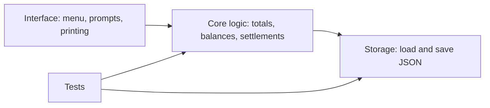

# Planning and structuring a small project

Exercises teach you the language; **projects** teach you to program. A project is different in kind: nobody hands you the function signature, the problem is too big to hold in your head at once, and the code has to survive being changed next week. This lesson gives you a repeatable way to go from a vague idea to a working, well-organised program — the method the remaining lessons in this module apply to a game, a data visualisation, an API client and a web application.

## Why projects stall

Most abandoned first projects die of one of four causes:

1. **The idea is too big.** "A budgeting app like the one on my phone" has two hundred features. You need a version with three.
2. **No plan, only typing.** Code grows in one file until changing anything breaks something else.
3. **Everything is built before anything runs.** After a week nothing works, so nothing can be tested, and motivation evaporates.
4. **No safety net.** A change breaks the program and there is no way back to the version that worked.

Each has a cure: cut scope to a minimum viable product, design the data and the pieces first, build in thin working slices, and use version control and tests.

## Step 1: write down what it should do

Before any code, write a few sentences in plain language. A useful format is the **user story**: *as a (kind of user), I want (something) so that (benefit)*. Suppose the idea is a tool for tracking shared household expenses:

- As a housemate, I want to record an expense with who paid and how much, so that we remember it.
- As a housemate, I want to see how much each person has paid in total.
- As a housemate, I want to know who owes whom, so that we can settle up.
- As a housemate, I want the records kept between runs.

Then sort ruthlessly into **must have**, **nice to have**, and **not now**. Categories, charts, currencies, a phone app, e-mail reminders: all "not now". What remains — add an expense, list totals, compute who owes whom, save to a file — is the **minimum viable product** (MVP): the smallest thing that is genuinely useful. Finishing a small thing teaches more than abandoning a large one, and a finished MVP is the best possible foundation for the next feature.

Also write down what "done" means, in checkable terms: *"Given expenses A paid 30, B paid 0, C paid 60 for three people, the program reports B owes C 30."* Those sentences will become your tests.

## Step 2: design the data first

Programs are data plus operations on it, and if the data is shaped well the operations tend to write themselves. Ask: what are the *things* in this problem, and what do I need to know about each?

- An **expense**: who paid, how much, what for, when.
- The **household**: the list of people, and the list of expenses.

Then choose representations with the tools you know. A dictionary per expense is the quickest start; a small class (or dataclass) is tidier as soon as there are rules to enforce:

```python-run
from dataclasses import dataclass

@dataclass
class Expense:
    payer: str
    amount: float
    note: str = ""

    def __post_init__(self):
        if self.amount <= 0:
            raise ValueError("amount must be positive")
        self.payer = self.payer.strip().lower()

e = Expense(" Dana ", 42.5, "groceries")
print(e)
try:
    Expense("ben", -3)
except ValueError as error:
    print("rejected:", error)
```

Decide early what the **saved form** looks like too — for a small project, a JSON file containing a list of dictionaries is ideal: readable, editable by hand, and one line of code to load.

## Step 3: break the work into small pieces

List the operations the stories require and give each a function with a clear input and output. Keep **pure logic** (calculations on data) apart from **input/output** (printing, reading the keyboard, files). This separation is the single most valuable structural habit: logic that does not print or read can be tested in isolation and reused behind any interface — a terminal today, a web page tomorrow.



For the expense tracker:

| Piece | Kind | Signature (first guess) |
|---|---|---|
| total paid per person | logic | `totals(expenses, people) -> dict` |
| balance per person | logic | `balances(expenses, people) -> dict` (positive = is owed money) |
| who pays whom | logic | `settle(balances) -> list of (from, to, amount)` |
| load / save | storage | `load(path) -> list`, `save(path, expenses)` |
| menu loop | interface | `main()` |

Now each piece is an exercise-sized problem. Here is the logic, with its tests alongside:

```python-run
def totals(expenses, people):
    """Return {person: amount paid}, including people who paid nothing."""
    paid = {person: 0.0 for person in people}
    for expense in expenses:
        paid[expense["payer"]] += expense["amount"]
    return paid

def balances(expenses, people):
    """Return {person: balance}. Positive means the others owe this person."""
    paid = totals(expenses, people)
    share = sum(paid.values()) / len(people)
    return {person: round(amount - share, 2) for person, amount in paid.items()}

def settle(balance):
    """Return a list of (debtor, creditor, amount) transfers that clears all balances."""
    debtors = sorted((amount, person) for person, amount in balance.items() if amount < 0)
    creditors = sorted(((amount, person) for person, amount in balance.items() if amount > 0), reverse=True)
    debtors = [[-amount, person] for amount, person in debtors]
    creditors = [[amount, person] for amount, person in creditors]
    transfers = []
    i = j = 0
    while i < len(debtors) and j < len(creditors):
        pay = round(min(debtors[i][0], creditors[j][0]), 2)
        if pay > 0:
            transfers.append((debtors[i][1], creditors[j][1], pay))
        debtors[i][0] -= pay
        creditors[j][0] -= pay
        if debtors[i][0] < 0.005: i += 1
        if creditors[j][0] < 0.005: j += 1
    return transfers

people = ["ana", "ben", "cy"]
expenses = [{"payer": "ana", "amount": 30.0}, {"payer": "cy", "amount": 60.0}]

assert totals(expenses, people) == {"ana": 30.0, "ben": 0.0, "cy": 60.0}
assert balances(expenses, people) == {"ana": 0.0, "ben": -30.0, "cy": 30.0}
assert settle(balances(expenses, people)) == [("ben", "cy", 30.0)]
assert settle({"ana": 0.0, "ben": 0.0}) == []
print("logic verified:", settle(balances(expenses + [{"payer": "ben", "amount": 12.0}], people)))
```

None of these functions prints or asks anything, so four `assert` lines are enough to pin their behaviour down.

## Step 4: build in thin, working slices

Do not write all the pieces and then connect them. Build the thinnest possible end-to-end version first, and keep the program working after every step:

1. **Slice 1** — hard-code two expenses in the source, print the totals. (Proves the data shape and one function.)
2. **Slice 2** — add balances and settlement, with tests.
3. **Slice 3** — save to and load from JSON.
4. **Slice 4** — a text menu to add expenses.
5. **Slice 5** — polish: input validation, nicer output.

After each slice you have something that runs. If you run out of time after slice 3, you still have a useful tool. This is **iterative development**, and it is how professionals work on systems of any size.

A thin interface over the tested logic, driven here by scripted commands (on your machine, `input()` supplies them):

```python-run
import json, tempfile
from pathlib import Path

def totals(expenses, people):
    paid = {p: 0.0 for p in people}
    for e in expenses:
        paid[e["payer"]] += e["amount"]
    return paid

def load(path):
    try:
        return json.loads(path.read_text(encoding="utf-8"))
    except (FileNotFoundError, json.JSONDecodeError):
        return []

def save(path, expenses):
    path.write_text(json.dumps(expenses, indent=2), encoding="utf-8")

def handle(command, expenses, people):
    """Carry out one command. Return (message, keep_running)."""
    parts = command.split()
    if not parts:
        return "", True
    if parts[0] == "quit":
        return "bye", False
    if parts[0] == "add" and len(parts) >= 3:
        payer = parts[1].lower()
        if payer not in people:
            return f"unknown person {payer!r}", True
        try:
            amount = float(parts[2])
        except ValueError:
            return f"{parts[2]!r} is not an amount", True
        expenses.append({"payer": payer, "amount": amount, "note": " ".join(parts[3:])})
        return f"recorded {amount:.2f} for {payer}", True
    if parts[0] == "totals":
        return ", ".join(f"{p}: {a:.2f}" for p, a in totals(expenses, people).items()), True
    return "commands: add <who> <amount> [note] | totals | quit", True

def main(commands, path, people):
    expenses = load(path)
    for command in commands:                 # with a real user: while True: command = input("> ")
        message, keep_running = handle(command, expenses, people)
        print(f"> {command}\n  {message}")
        if not keep_running:
            break
    save(path, expenses)

store = Path(tempfile.mkdtemp()) / "expenses.json"
people = ["ana", "ben", "cy"]
main(["add ana 30 bread and cheese", "add dee 5", "add cy sixty", "add cy 60 train", "totals", "quit"], store, people)
main(["totals", "quit"], store, people)       # a second 'run': the data was remembered
```

`handle` returns a message instead of printing, so it too can be tested: `assert handle("add ana x", [], ["ana"])[0] == "'x' is not an amount"`.

## Step 5: lay out the files

One file is fine up to a couple of hundred lines. Beyond that, split along the lines you already drew — interface, logic, storage — and add the supporting files every project deserves:

```
house-expenses/
├── README.md              # what it is, how to install and run it, an example
├── pyproject.toml         # project name, Python version, dependencies
├── .gitignore             # files that must not be committed (.venv/, __pycache__/, data/)
├── src/
│   └── house_expenses/
│       ├── __init__.py
│       ├── models.py      # Expense and other data definitions
│       ├── ledger.py      # totals, balances, settle  (pure logic)
│       ├── storage.py     # load, save
│       └── cli.py         # the menu loop; the only place that prints or reads input
└── tests/
    ├── test_ledger.py
    └── test_storage.py
```

Guidelines that keep a layout healthy:

- **One responsibility per module.** If you cannot name a file without "and" or "utils", it is doing too much.
- **Dependencies point one way**: `cli` uses `ledger` and `storage`; `ledger` knows nothing about either. The logic stays reusable.
- **Settings in one place.** File locations, limits and other constants live at the top of a module or in a small `settings.py` — never scattered as "magic numbers" through the code.
- **An entry point**: `cli.py` ends with `if __name__ == "__main__": main()` so the file can be both run and imported.
- **An isolated environment.** Create a virtual environment for the project and record its dependencies (see the lesson *Virtual environments, pip, uv and project layout*).

## Step 6: keep a safety net — version control

**Git** records snapshots of your project so that you can always return to a state that worked, see exactly what changed, and experiment without fear. The everyday cycle is tiny:

```bash
git init                         # once: start tracking this folder
git status                       # what has changed since the last snapshot?
git add .                        # stage the changes you want in the next snapshot
git commit -m "Add balance calculation with tests"
git log --oneline                # the history, one line per snapshot
git diff                         # what exactly changed, line by line

git switch -c export-csv         # a branch: a safe side-track for an experiment
git switch main                  # back to the main line
git merge export-csv             # bring the finished experiment in
git restore ledger.py            # throw away uncommitted changes to one file
```

Habits that make it work: commit **small and often**, each time the program works and one idea is complete; write messages that say *what the change achieves*; never commit secrets, the virtual environment or generated files (list them in `.gitignore`). Publishing the repository on a hosting service such as GitHub gives you an off-site backup and something to show people.

## Step 7: refactor as you go

Your first working version will not be beautiful, and it should not be: you were still learning what the problem is. Once tests pass, improve the structure **without changing behaviour** — that is refactoring. Typical moves:

- a function has grown beyond one screen, or needs "and" to describe → split it;
- the same few lines appear in three places → extract a function;
- several functions pass the same group of values around → make it a class;
- a name no longer describes its content → rename it;
- an `if` chain keeps growing → replace it with a dictionary of handlers.

```python-run
# before: one function doing three jobs
def report_v1(expenses):
    total = 0
    for e in expenses:
        total += e["amount"]
    biggest = None
    for e in expenses:
        if biggest is None or e["amount"] > biggest["amount"]:
            biggest = e
    print(f"Total {total:.2f}; biggest: {biggest['note']} ({biggest['amount']:.2f})")

# after: two small pure functions and a thin printing layer
def total_spent(expenses):
    return sum(e["amount"] for e in expenses)

def biggest_expense(expenses):
    return max(expenses, key=lambda e: e["amount"], default=None)

def report(expenses):
    top = biggest_expense(expenses)
    return f"Total {total_spent(expenses):.2f}; biggest: {top['note']} ({top['amount']:.2f})"

data = [{"amount": 30, "note": "bread"}, {"amount": 60, "note": "train"}, {"amount": 12, "note": "soap"}]
report_v1(data)
print(report(data))
assert biggest_expense([]) is None and total_spent([]) == 0
```

Refactor in tiny steps and run the tests after each one. With tests and commits behind you, refactoring is safe; without them it is gambling.

## Step 8: document the minimum

A short `README.md` multiplies a project's value — for others and for your future self. It needs four things: what the project does (two sentences), how to install it, how to run it (with one copy-pasteable example), and how to run the tests. Inside the code, write a docstring for each module and each non-obvious function, and comments only for the *why*.

## When you are stuck

- **Shrink the problem.** Cannot make the whole feature work? Make the smallest part of it work with hard-coded data.
- **Make it visible.** Print the data at each stage, or step through with a debugger. Most bugs are a wrong belief about what a variable holds.
- **Search precisely.** The exact error message, in quotes, plus the library's name.
- **Explain it.** Describe the problem aloud, line by line, to a friend or a rubber duck. The act of explaining usually exposes the gap.
- **Stop for the day.** Commit what works, write one sentence about what to try next, and walk away. Problems that resisted for an hour routinely fall in five minutes the next morning.

## A reusable checklist

| Stage | Question to answer | Output |
|---|---|---|
| Idea | Who is it for, and what three things must it do? | user stories, MVP list |
| Data | What are the things, and what do I know about each? | data definitions, saved format |
| Design | Which operations, with what inputs and outputs? | function list, module sketch |
| Slice 1 | What is the thinnest end-to-end version? | something that runs |
| Iterate | What is the next most valuable slice? | a commit per slice, tests growing |
| Refactor | What is awkward now that I understand more? | cleaner code, same behaviour |
| Share | Could a stranger run this? | README, pinned dependencies |

> [!TIP]
> Time-box your first version. Give yourself one evening for slice 1 and write down, *before starting*, what it will and will not include. A deadline forces the scope decisions that make projects finishable.

> [!INTERVIEW]
> Interviewers often ask you to "walk me through a project you built". A strong answer follows this lesson's arc: the problem and who it was for; the scope decisions (what you left out and why); how you modelled the data; how you structured the code (what was separated from what); how you tested it; one bug or design mistake and what you changed; and what you would do next. Concrete trade-offs impress far more than a feature list.

## Summary

Start from user stories and cut to an MVP. Design the data before the code. Split the work into small functions, keeping pure logic apart from input/output and storage. Build thin slices that always run, committing each to Git. Organise files by responsibility with dependencies pointing one way. Refactor under the protection of tests, and write a README. The same method scales from a weekend script to a team product.

```quiz
[
  {"q": "What is a minimum viable product (MVP)?", "options": ["The final, complete product", "The smallest version that is genuinely useful, built first", "A design document", "A product with no bugs"], "answer": 1,
   "explain": "Cutting scope to an MVP makes a project finishable and gives a working base for later features."},
  {"q": "Why design the data representation before writing operations?", "options": ["It is required by Python", "Well-shaped data makes the operations simpler, and changing it later forces rewrites everywhere", "Data cannot be changed once created", "To avoid using functions"], "answer": 1,
   "explain": "Every function depends on the shape of the data, so getting it roughly right early saves the most rework."},
  {"q": "Why keep calculation logic separate from input/output code?", "options": ["Printing is slow", "Logic that neither prints nor reads can be tested in isolation and reused behind a different interface", "Python requires it", "It uses less memory"], "answer": 1,
   "explain": "A pure function with inputs and a return value needs only an assert to test, and works equally well in a CLI, a web app or a game."},
  {"q": "What does 'building in thin slices' mean?", "options": ["Writing all modules, then connecting them at the end", "Getting a minimal end-to-end version running first, then adding one small working feature at a time", "Using many small files", "Deleting code regularly"], "answer": 1,
   "explain": "The program works after every step, so problems are found early and progress is always demonstrable."},
  {"q": "Which statement about refactoring is correct?", "options": ["It adds new features", "It changes the structure of code without changing its behaviour, ideally under the protection of tests", "It is only for fixing bugs", "It should be done before the code works"], "answer": 1,
   "explain": "Refactoring improves readability and design; tests confirm that behaviour stayed the same."},
  {"q": "What is a good moment to make a Git commit?", "options": ["Once, when the project is finished", "Each time the program works and one small idea is complete", "Only before deleting files", "Never while tests pass"], "answer": 1,
   "explain": "Small, frequent commits give you many safe points to return to and a readable history."},
  {"q": "Which of these should NOT be committed to version control?", "options": ["README.md", "The tests folder", "The virtual environment folder and files containing passwords or keys", "pyproject.toml"], "answer": 2,
   "explain": "Environments are machine-specific and re-creatable; secrets must never enter a repository's history."},
  {"q": "In a layered layout (interface -> logic -> storage), which module should import which?", "options": ["The logic imports the interface", "The interface imports the logic; the logic does not know about the interface", "Every module imports every other", "Nothing imports anything"], "answer": 1,
   "explain": "One-way dependencies keep the core reusable and prevent circular imports."}
]
```

> **Source:** Matthes, *Python Crash Course* (3rd ed.), Part II introductions (planning each project, refactoring as projects grow) and Appendix D (using Git for version control) — topics only, examples and wording are original; Goodrich, Tamassia & Goldwasser, *Data Structures and Algorithms in Python*, §2.2 (Software Development: design, coding style, testing).
