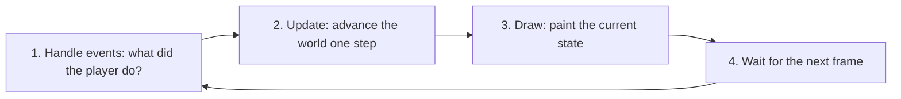

# A game: the loop, state, events and collisions

> **Before this lesson:** read [Planning and structuring a small project](#/lesson/python/py-proj-planning) for the method this lesson applies (thin slices, pure logic apart from input/output). You need loops, functions and lists ([Lists and loops](#/lesson/python/py-start-lists-loops) and [User input, while loops and functions](#/lesson/python/py-start-input-functions)), classes and inheritance ([Classes: modelling things with objects](#/lesson/python/py-start-classes)), and `assert` ([Files, errors and tests](#/lesson/python/py-start-files-tests)). `@dataclass` comes from [Properties, dataclasses, ABCs and composition](#/lesson/python/py-properties-dataclasses) and is re-explained below.

## In plain words

Think of a flip-book: a small pad of paper with a slightly different drawing on each page. Flick through it quickly and the drawings seem to move. A video game works the same way. Many times a second, the program works out where everything is now, draws one complete picture, and shows it. Each picture is called a **frame**. Between frames, the program reads what the player pressed and moves everything a little.

That repeating cycle is the **game loop**, and it is the heart of this lesson. It is not only for games. The same "read input, update the model, draw the result" cycle runs inside simulations, robot controllers, animation tools and every graphical user interface.

Why this matters for a job: games are excellent portfolio projects, because the result is visible and every feature is a small, self-contained challenge. The skills carry over directly. Keeping one clear record of the "state of the world", separating rules from drawing, measuring time and detecting collisions all appear in real systems, and "how would you structure a real-time simulation?" is a common interview warm-up.

We will build *Meteor Dodge*: you steer a lander left and right along the bottom of the screen, dodge falling rocks and catch fuel cells for points. First the whole game runs right here as text; then you will see the same design written with **Pygame**, a popular Python **library** (a package of ready-made code) for 2D games.

## The game loop

A program such as a calculator waits for a request and answers it. A game cannot wait: rocks must keep falling whether or not the player presses anything. So a game runs a loop, many times per second, that never stops to wait:



Each pass through the loop produces one frame. The speed is measured in **frames per second** (FPS). At 60 FPS each pass has about 16 milliseconds (thousandths of a second), which is plenty for a small game. The three working phases have strictly separate jobs:

- **Events**: an **event** is something that happened outside the program, such as a key press, a mouse click or the window's close button. This phase turns events into *intentions* ("move left", "pause").
- **Update**: applies the rules of the game. It moves things, creates new things, detects collisions and changes the score.
- **Draw**: shows what the state now is. Drawing never changes the state.

Keeping the phases separate is what keeps a game **debuggable** (possible to find and fix errors in). When something misbehaves, you know which third of the program to look in.

## State: the model of the world

Everything the game needs to remember from one frame to the next is its **state**: where the lander is, where each rock is, the score, the lives left, whether the game is over. A reliable rule: *if you could save it to a file and later restore the game exactly, it is state*. The pixels on the screen are not state. They are a picture *of* the state, redrawn from scratch every frame.

It also helps to collect the **configuration** (settings that never change during a game, such as the playfield size and the starting number of lives) in one place, so that tuning the game means editing one block:

```python-run
from dataclasses import dataclass, field

@dataclass(frozen=True)
class Settings:
    width: int = 12              # playfield size in cells
    height: int = 8
    lives: int = 3
    rock_points: int = 0
    fuel_points: int = 10

@dataclass
class Faller:
    x: int
    y: int
    kind: str                    # "rock" or "fuel"

@dataclass
class GameState:
    settings: Settings
    lander_x: int
    lives: int
    score: int = 0
    fallers: list = field(default_factory=list)
    frame: int = 0
    over: bool = False

settings = Settings()
state = GameState(settings, lander_x=settings.width // 2, lives=settings.lives)
print(state)
```

**Reading this code line by line**

- `@dataclass` writes a class's `__init__` and `__repr__` methods from the annotated attribute lines, so `Settings()` can be created and printed without hand-written boilerplate. Each attribute here has a default value.
- `frozen=True` makes `Settings` objects read-only: assigning to `settings.width` after creation raises an error. Configuration should not change by accident in the middle of a game.
- `Faller` describes one falling object: its column `x`, its row `y`, and whether it is a rock or fuel.
- `GameState` holds everything that changes. `fallers: list = field(default_factory=list)` gives each new game its *own* empty list. (Writing `= []` is not allowed for a dataclass field, because one list would then be shared by every game; `default_factory=list` calls `list()` afresh for each object.)
- `settings.width // 2` is integer division, 6, so the lander starts in the middle.
- Printing `state` shows every field, including the nested settings. That printout *is* the whole game at this moment.

A game built this way is, at heart, one function applied over and over: *new state = update(old state, input)*.

## Movement, time and coordinates

A **pixel** is one dot of the screen. Screen **coordinates** locate a pixel by two numbers, `x` and `y`. Unlike the graphs in maths lessons, the **origin** (the point `(0, 0)`) is the **top-left corner**: x grows to the right and y grows **downwards**. A rock that falls therefore has an *increasing* y.

Movement means "the position changes by the **velocity** (speed with a direction) every frame". If velocity is measured per frame, the game runs faster on a faster computer, because a faster computer runs more frames per second. The robust approach is to measure the time since the previous frame, called **delta time** or `dt`, and move by `velocity * dt`. Then speed is measured per second, whatever the frame rate:

```python-run
def advance(position, velocity, dt):
    return position + velocity * dt

speed = 120.0                       # pixels per SECOND
for fps in (30, 60, 144):
    dt = 1 / fps
    y = 0.0
    for _ in range(fps):            # simulate one second of frames
        y = advance(y, speed, dt)
    print(f"{fps:>3} frames per second -> moved {y:.1f} px in one second")
```

**Reading this code line by line**

- `advance` returns the new position after one frame: old position plus velocity times the frame's duration.
- The outer loop tries three frame rates. For each, `dt = 1 / fps` is the length of one frame in seconds (1/30, 1/60, 1/144).
- The inner loop runs `fps` frames, which together last exactly one second. `_` is the conventional name for a loop variable you do not use.
- The output shows `moved 120.0 px in one second` for all three rates. At 30 FPS the object takes 30 big steps; at 144 FPS it takes 144 small ones; the distance per second is the same.

## Collisions: do two rectangles overlap?

A **collision** is two game objects touching. Most 2D games treat each object as a rectangle for this purpose, even if its picture is round. A rectangle is described by its left edge `x`, its top edge `y`, its width and its height. Two rectangles overlap unless one of them lies entirely to one side of the other:

```python-run
def rects_overlap(a, b):
    """a and b are (x, y, width, height). Touching edges do not count as overlap."""
    ax, ay, aw, ah = a
    bx, by, bw, bh = b
    return ax < bx + bw and bx < ax + aw and ay < by + bh and by < ay + ah

lander = (40, 90, 20, 10)
tests = {
    "rock directly above, overlapping": (45, 85, 10, 10),
    "rock far to the right":            (200, 90, 10, 10),
    "rock just touching the top edge":  (45, 80, 10, 10),
    "tiny rock fully inside":           (48, 93, 2, 2),
}
for label, rock in tests.items():
    print(f"{label:<34} {rects_overlap(lander, rock)}")
```

**Reading this code line by line**

- `ax, ay, aw, ah = a` unpacks the four numbers of rectangle `a` into separate names; the same for `b`.
- `ax + aw` is the right edge of `a`, and `ay + ah` its bottom edge (remember, y grows downwards).
- The return line has four conditions joined by `and`, so all four must hold: `a`'s left edge is left of `b`'s right edge, `b`'s left edge is left of `a`'s right edge, and the same pair vertically. If any one fails, there is a gap between the rectangles in that direction.
- The lander spans x from 40 to 60 and y from 90 to 100. The first rock (x 45–55, y 85–95) overlaps it: `True`. The second is far to the right: `False`. The third ends at y 90, exactly where the lander begins; because the comparisons use `<`, touching edges do not count: `False`. The tiny rock lies fully inside: `True`.

This test is called **AABB** collision, short for *axis-aligned bounding box*: "axis-aligned" because the rectangles are never rotated, "bounding box" because the rectangle encloses the object. It is what Pygame's `Rect.colliderect` performs.

For circles the test is even shorter: two circles collide when the distance between their centres is less than the sum of their radii. Comparing the *squared* distance with the squared sum avoids computing a square root, which is slower.

## The complete game logic, runnable

Here is all of *Meteor Dodge* without any graphics library: state, input handling, update rules, collision detection and a text **renderer** (the code that draws). Player input comes from a prepared string of key presses. The falling objects appear at "random" positions, but the random-number generator is **seeded**, started from a fixed value, so every run produces the same sequence and the same game.

```python-run
import random
from dataclasses import dataclass, field

WIDTH, HEIGHT = 12, 8

@dataclass
class State:
    lander_x: int = WIDTH // 2
    lives: int = 3
    score: int = 0
    fallers: list = field(default_factory=list)     # each one is [x, y, kind]
    frame: int = 0
    over: bool = False

def handle_input(state, key):
    """EVENTS: turn a key into movement, keeping the lander on the playfield."""
    if key == "a":
        state.lander_x = max(0, state.lander_x - 1)
    elif key == "d":
        state.lander_x = min(WIDTH - 1, state.lander_x + 1)

def update(state, rng):
    """UPDATE: one step of the world."""
    state.frame += 1
    for faller in state.fallers:
        faller[1] += 1                                       # everything falls one row
    survivors = []
    for x, y, kind in state.fallers:
        if y == HEIGHT - 1 and x == state.lander_x:          # collision with the lander
            if kind == "fuel":
                state.score += 10
            else:
                state.lives -= 1
        elif y < HEIGHT:                                     # still on screen
            survivors.append([x, y, kind])
    state.fallers = survivors
    if state.frame % 2 == 0:                                 # spawn something every 2nd frame
        kind = "fuel" if rng.random() < 0.3 else "rock"
        state.fallers.append([rng.randrange(WIDTH), 0, kind])
    if state.lives <= 0:
        state.over = True

def draw(state):
    """DRAW: build a picture of the state. Reads the state, never changes it."""
    grid = [["." for _ in range(WIDTH)] for _ in range(HEIGHT)]
    for x, y, kind in state.fallers:
        grid[y][x] = "*" if kind == "fuel" else "O"
    grid[HEIGHT - 1][state.lander_x] = "A"
    rows = ["".join(row) for row in grid]
    return "\n".join(rows) + f"\nframe {state.frame:>2}  score {state.score:>3}  lives {'#' * state.lives}"

rng = random.Random(5)
state = State()
keys = "..dd.a.aaa..dddd...aa..d"                # the 'player': a = left, d = right, . = nothing
for key in keys:                                  # THE GAME LOOP
    handle_input(state, key)
    update(state, rng)
    if state.frame % 6 == 0 or state.over:        # show every 6th frame to keep the output short
        print(draw(state), "\n")
    if state.over:
        break
print("GAME OVER" if state.over else f"Still flying after {state.frame} frames with {state.score} points.")
```

**Reading the three phases**

- `handle_input` is the events phase. The key `"a"` moves the lander one column left and `"d"` one column right. `max(0, ...)` and `min(WIDTH - 1, ...)` **clamp** the position, keeping it between the first and last column, so the lander cannot leave the playfield. Any other key does nothing.
- `update` is the update phase. It counts the frame, moves every falling object down one row, and then sorts them. An object on the bottom row (`HEIGHT - 1`) in the lander's column has collided: fuel adds 10 points, a rock costs a life. An object still above the bottom (`y < HEIGHT`) survives into a new list. Anything else has fallen off the screen and is dropped. Every second frame (`state.frame % 2 == 0`, where `%` gives the remainder of a division), a new object appears in row 0 at a random column; `rng.random()` gives a number between 0 and 1, so about 30% of new objects are fuel. Finally, the game is over when lives run out.
- `draw` is the draw phase. It builds a grid of `"."` characters, places `"*"` for fuel and `"O"` for rocks, puts the lander `"A"` on the bottom row, and joins the rows into one string with a status line underneath. It reads the state and changes nothing.

**Reading the loop**

- `random.Random(5)` creates a random-number generator seeded with 5. Passing it into `update` as an argument, instead of using the global `random` functions, means a test can supply its own generator.
- `keys` stands in for the player: each character is one frame's input.
- The `for` loop is the game loop: events, then update, then (every sixth frame, to keep the output short) draw. A real game would draw every frame and wait for the next one.

In the output, each picture is one frame: rocks (`O`) and fuel (`*`) drift down the grid while the lander (`A`) moves along the bottom row as the scripted keys dictate. The status line shows the frame number, the score and one `#` per life. With this particular seed and these keys the lander dodges everything, and the last line reports `Still flying after 24 frames with 0 points.` Change the seed or the key string and run it again to see a different game.

The three functions map exactly onto the three phases of the loop. Because `update` takes the state and the random-number generator as arguments, the entire game can be tested without a screen: build a state, call the function, assert on the result.

```python-run
import random
from dataclasses import dataclass, field
WIDTH, HEIGHT = 12, 8
@dataclass
class State:
    lander_x: int = 6
    lives: int = 3
    score: int = 0
    fallers: list = field(default_factory=list)
    frame: int = 0
    over: bool = False

def step_fallers(state):
    """The collision part of update, isolated so it can be tested."""
    survivors = []
    for x, y, kind in state.fallers:
        y += 1
        if y == HEIGHT - 1 and x == state.lander_x:
            if kind == "fuel": state.score += 10
            else: state.lives -= 1
        elif y < HEIGHT:
            survivors.append([x, y, kind])
    state.fallers = survivors

s = State(fallers=[[6, HEIGHT - 2, "fuel"], [6, 0, "rock"], [2, HEIGHT - 1, "rock"]])
step_fallers(s)
assert s.score == 10 and s.lives == 3            # caught the fuel
assert s.fallers == [[6, 1, "rock"]]             # one still falling; one left the screen
s = State(fallers=[[6, HEIGHT - 2, "rock"]])
step_fallers(s)
assert s.lives == 2 and s.fallers == []
print("collision rules verified")
```

**Reading the test**

- `step_fallers` is the falling-and-colliding part of `update`, pulled out into its own function so it can be checked directly.
- The first test state has three objects next to the lander's column 6: fuel one row above the bottom, a rock at the top, and a rock already on the bottom row in column 2.
- After one step, the fuel lands on the lander (score 10, lives unchanged), the top rock moves to row 1, and the rock in column 2 falls off the screen. The two `assert` lines check exactly that.
- The second test drops a rock onto the lander and checks that a life is lost and the rock removed.
- If every assertion holds, the demo prints `collision rules verified`. If you break a rule, for example by changing `+= 10` to `+= 1`, the matching `assert` stops the program and points at the problem.

## The same game with Pygame

Pygame is a library for 2D games: it opens a window, draws shapes and images, reports keyboard and mouse events, plays sounds and keeps time. It needs a real window, so it cannot run inside this page. On your own computer, install it with `python -m pip install pygame` and run the file from a terminal. Read the code with the text version in mind; the structure is identical.

```python
import random
import sys
import pygame

WIDTH, HEIGHT = 480, 640
FPS = 60
SKY = (14, 16, 38)                                   # colours are (red, green, blue), 0-255

class Lander(pygame.sprite.Sprite):
    def __init__(self):
        super().__init__()
        self.image = pygame.Surface((48, 24))        # what to draw: here a plain rectangle
        self.image.fill((240, 240, 255))             # (use pygame.image.load("lander.png") for a picture)
        self.rect = self.image.get_rect(midbottom=(WIDTH // 2, HEIGHT - 10))   # where to draw it
        self.speed = 320                             # pixels per second

    def update(self, dt, keys):
        direction = keys[pygame.K_RIGHT] - keys[pygame.K_LEFT]      # -1, 0 or 1
        self.rect.x += round(direction * self.speed * dt)
        self.rect.clamp_ip(pygame.Rect(0, 0, WIDTH, HEIGHT))        # stay inside the window

class Faller(pygame.sprite.Sprite):
    def __init__(self, kind):
        super().__init__()
        self.kind = kind
        self.image = pygame.Surface((24, 24))
        self.image.fill((120, 220, 140) if kind == "fuel" else (170, 120, 90))
        self.rect = self.image.get_rect(midtop=(random.randrange(12, WIDTH - 12), -24))
        self.y = float(self.rect.y)                  # keep the exact position as a float
        self.speed = random.uniform(140, 260)

    def update(self, dt, keys):
        self.y += self.speed * dt
        self.rect.y = round(self.y)
        if self.rect.top > HEIGHT:
            self.kill()                              # remove this sprite from every group

def main():
    pygame.init()
    screen = pygame.display.set_mode((WIDTH, HEIGHT))
    pygame.display.set_caption("Meteor Dodge")
    clock = pygame.time.Clock()
    font = pygame.font.SysFont(None, 32)

    lander = Lander()
    fallers = pygame.sprite.Group()
    everything = pygame.sprite.Group(lander)
    score, lives, spawn_timer = 0, 3, 0.0

    running = True
    while running:
        dt = clock.tick(FPS) / 1000                  # seconds since the previous frame

        # 1. EVENTS
        for event in pygame.event.get():
            if event.type == pygame.QUIT:            # the window's close button
                running = False
            elif event.type == pygame.KEYDOWN and event.key == pygame.K_ESCAPE:
                running = False
        keys = pygame.key.get_pressed()              # which keys are held down right now

        # 2. UPDATE
        spawn_timer += dt
        if spawn_timer >= 0.5:
            spawn_timer = 0.0
            faller = Faller("fuel" if random.random() < 0.3 else "rock")
            fallers.add(faller)
            everything.add(faller)
        everything.update(dt, keys)                  # calls update() on every sprite

        for hit in pygame.sprite.spritecollide(lander, fallers, dokill=True):
            if hit.kind == "fuel":
                score += 10
            else:
                lives -= 1
        if lives <= 0:
            running = False

        # 3. DRAW
        screen.fill(SKY)                             # wipe the previous frame
        everything.draw(screen)                      # blit each sprite's image at its rect
        hud = font.render(f"Score {score}   Lives {lives}", True, (255, 255, 255))
        screen.blit(hud, (10, 10))
        pygame.display.flip()                        # show the finished frame

    pygame.quit()
    sys.exit()

if __name__ == "__main__":
    main()
```

**Reading the Pygame version section by section**

- **Constants.** The window is 480 by 640 pixels, the target is 60 frames per second, and colours are written as (red, green, blue) triples from 0 to 255.
- **`Lander`** inherits from `pygame.sprite.Sprite` (inheritance means it gets all of `Sprite`'s behaviour and adds its own; `super().__init__()` runs `Sprite`'s setup first). A sprite needs two attributes: `image`, the picture to draw, and `rect`, the rectangle saying where. Here the image is a plain 48 × 24 rectangle filled with a pale colour, and `get_rect(midbottom=...)` positions its bottom centre near the bottom of the window. Its `update` method reads the arrow keys: `keys[pygame.K_RIGHT]` is `True` (counted as 1) while the right arrow is held, so the subtraction gives -1, 0 or 1. It moves by direction × speed × `dt`, and `clamp_ip` ("clamp in place") pushes the rectangle back inside the window if it went out.
- **`Faller`** picks its colour by kind and starts slightly above the top edge, out of sight, at a random x. A `Rect` can only store whole pixels, so the exact position is kept in the float `self.y` and rounded into the rect each frame. `random.uniform(140, 260)` gives each faller a different speed. Once it drops below the window, `self.kill()` removes it from every group it belongs to.
- **Setup in `main`.** `pygame.init()` starts the library; `set_mode` opens the window and returns its drawing surface, `screen`; `Clock` will control the frame rate; `SysFont(None, 32)` loads a default font. Two **groups** are created: `fallers` (for collision tests) and `everything` (for updating and drawing).
- **The loop.** `clock.tick(FPS)` waits long enough to keep to 60 frames per second and returns the milliseconds since the previous frame; dividing by 1000 gives `dt` in seconds.
- **Events.** `pygame.event.get()` returns every event since the last frame. The window's close button produces `QUIT`; pressing Escape produces a `KEYDOWN` event with `event.key == pygame.K_ESCAPE`. Either one ends the loop.
- **Update.** A timer adds up `dt` and, every half second, creates a new faller and adds it to both groups. `everything.update(dt, keys)` calls `update` on every sprite. `spritecollide(lander, fallers, dokill=True)` returns the fallers touching the lander and removes them, and each hit changes the score or the lives.
- **Draw.** `screen.fill(SKY)` paints over the whole previous frame. `everything.draw(screen)` copies each sprite's image to its rect. The **HUD** (heads-up display, the score and lives shown on top of the game) is rendered as an image of text and copied to the top-left corner. `flip()` shows the finished frame.

### The Pygame vocabulary

| Concept | What it is | In the code |
|---|---|---|
| **Surface** | an image you can draw on; the window itself is one | `screen`, each sprite's `image` |
| **Rect** | a rectangle (`x`, `y`, `width`, `height`) with handy attributes like `center`, `top`, `midbottom`, and collision tests | `self.rect`, `rect.clamp_ip(...)` |
| **Event** | something that happened: a key went down, the mouse moved, the window was closed | `pygame.event.get()`, `event.type` |
| **Clock** | limits the frame rate and measures frame time | `clock.tick(FPS)` |
| **Sprite** | an object with an `image` and a `rect`, plus your behaviour in `update()` | `Lander`, `Faller` |
| **Group** | a container of sprites that can update and draw them all, and test collisions | `fallers`, `everything` |
| **blit** | copy one surface onto another at a position | `screen.blit(hud, (10, 10))` |
| **flip** | swap the finished off-screen drawing onto the display | `pygame.display.flip()` |

Two ways of reading the keyboard appear, and they answer different questions. **Events** (`KEYDOWN`, `KEYUP`) tell you about a *change*, that a key was pressed or released at this moment, and suit one-off actions such as firing, jumping or pausing. **`key.get_pressed()`** tells you which keys are *held down right now* and suits continuous movement. Forgetting to process the event queue at all is a classic beginner bug: the window stops responding and the operating system reports the program as frozen.

Drawing uses **double buffering**: everything is painted onto a hidden surface, and `flip()` shows the completed picture in one go, which prevents flicker. That is why every frame begins by filling the whole screen: you repaint the entire scene, 60 times a second, from the state.

### Sprites, groups and collisions

Inheriting from `pygame.sprite.Sprite` gives your objects membership in **groups**. A group will call `update` on every member, draw every member, and drop members that call `kill()`. Groups also power the collision helpers:

| Helper | Answers |
|---|---|
| `rect_a.colliderect(rect_b)` | do these two rectangles overlap? |
| `rect.collidepoint(x, y)` | is this point (a mouse click, say) inside the rectangle? |
| `pygame.sprite.spritecollide(sprite, group, dokill)` | which members of the group touch this sprite? (optionally removing them) |
| `pygame.sprite.groupcollide(g1, g2, kill1, kill2)` | which members of two groups touch each other? — e.g. shots versus rocks |
| `pygame.sprite.spritecollideany(sprite, group)` | does the sprite touch *anything* in the group? (stops at the first hit) |

Under the hood each of these is a loop of rectangle-overlap tests like the one you wrote above. For irregular shapes Pygame offers circle-based and pixel-perfect ("mask") checks, at a higher cost.

One subtlety worth knowing about is **tunnelling**: a fast object can pass *through* a thin one between two frames, because it is on one side in one frame and on the other side in the next, never overlapping in any frame. The cures are limiting speeds, making objects thicker, or moving in several small sub-steps per frame and checking after each.

## Growing the game

Each of these is a small, separate feature, exactly the "thin slices" of the previous lesson:

- **Shooting.** A `Shot` sprite that moves upwards; create one on a `KEYDOWN` event for the space bar, limit how many may exist at once, and use `groupcollide(shots, fallers, True, True)` to destroy rocks.
- **Difficulty.** Shorten the spawn interval or raise fall speeds as the score climbs; keep the numbers in a settings object, and reset them when a new game starts.
- **Game states.** A variable such as `mode` with the values `"title"`, `"playing"`, `"paused"` and `"game_over"`. The loop keeps running in every mode; events and updates behave differently depending on the mode. This design is a **state machine**: a fixed set of modes plus rules saying which event moves you from one mode to another. Every menu screen works this way.
- **A high score that persists.** Load it from a JSON file at start-up and save it when a game ends (the pattern from [Files, errors and tests](#/lesson/python/py-start-files-tests)).
- **Sound and images.** `pygame.mixer.Sound("ping.wav").play()` and `pygame.image.load("rock.png").convert_alpha()`; the second converts the picture into the screen's format, keeping transparency, so it draws quickly.

```python-run
def next_mode(mode, event):
    """A state machine for the screens of a game."""
    table = {
        ("title", "start"): "playing",
        ("playing", "pause"): "paused",
        ("paused", "pause"): "playing",
        ("playing", "died"): "game_over",
        ("game_over", "start"): "title",
    }
    return table.get((mode, event), mode)        # anything else: stay in the same mode

mode = "title"
for event in ["pause", "start", "pause", "pause", "died", "pause", "start"]:
    mode = next_mode(mode, event)
    print(f"{event:<6} -> {mode}")
```

**Reading this code line by line**

- `table` is a dictionary whose keys are `(current mode, event)` pairs and whose values are the next mode. These entries are the **transitions** of the state machine.
- `table.get((mode, event), mode)` looks up the pair; if there is no entry, it returns the current mode, so meaningless events are ignored.
- The loop feeds in a sequence of events. Pressing pause on the title screen does nothing (`pause -> title`); start begins play; pause twice pauses and resumes; dying moves to `game_over`, where pause is ignored; start returns to the title.

A table of *(current mode, event) → next mode* is easier to read, extend and test than a tangle of nested `if` statements.

## Common mistakes

- **Mixing phases**: changing the score inside the drawing code, or drawing inside `update`. Bugs then depend on the order of drawing.
- **Removing from a list while looping over it**, which skips items. Build a new list of survivors (as `update` does above), or use sprite groups, which handle removal safely.
- **Frame-rate-dependent movement**: forgetting `dt`.
- **Truncated positions**: a `Rect` stores whole pixels, so adding `0.4` every frame moves nothing. Keep the true position in a float and copy it into the rect, as `Faller` does.
- **Forgetting to clear the screen**: every moving object leaves a smear behind it.
- **Loading images inside the loop**: the file is read from disk 60 times a second. Load once, before the loop.
- **Upside-down thinking**: y increases downwards.

> [!TIP]
> Develop game rules as plain functions on plain data first, test them with asserts or a text renderer, and only then put graphics on top. Finding a collision bug by reading printed coordinates is far quicker than squinting at a moving window.

> [!INTERVIEW]
> The game loop is a common systems-design warm-up ("how would you structure a real-time simulation?"). Key points: a fixed cycle of input → update → render; a single source of truth for state; time-based movement with delta time (or a fixed timestep for deterministic physics); separating simulation from rendering so the logic is testable; and collision detection by bounding boxes, with spatial partitioning (a grid or quadtree) when there are too many objects to compare every pair.

Two terms from that callout: a **fixed timestep** advances the simulation in equal slices of time (say, exactly 1/120 of a second) however fast frames are drawn, so the same inputs always give the same result. **Spatial partitioning** divides the playing area into regions, such as the squares of a grid or the nested quarters of a *quadtree*, so that each object is only compared with objects in nearby regions instead of with every other object.

## Summary

A game is a loop that handles events, updates state and draws, once per frame. State is the complete, saveable description of the world; drawing only depicts it. Movement is velocity times elapsed time; collision between two rectangles is four comparisons. Pygame supplies the window, events, clock, surfaces, rects, sprites and groups, but the design, and most of the code worth testing, does not depend on it.

## Glossary

- **Frame** - one complete picture of the game; one pass through the game loop.
- **FPS (frames per second)** - how many frames are produced each second.
- **Game loop** - the repeating cycle of handling events, updating state and drawing.
- **Event** - something that happened outside the program, such as a key press or a window closing.
- **State** - everything the game must remember between frames; enough to save and restore the game exactly.
- **Configuration** - settings that do not change during a run, such as the playfield size.
- **Pixel** - one dot on the screen.
- **Origin** - the point (0, 0); on screens, the top-left corner.
- **Velocity** - speed together with a direction.
- **Delta time (`dt`)** - the time elapsed since the previous frame.
- **Clamp** - force a value to stay between a minimum and a maximum.
- **Collision** - two game objects touching or overlapping.
- **AABB** - axis-aligned bounding box; collision testing with unrotated rectangles.
- **Seed** - the starting value of a random-number generator; the same seed gives the same sequence.
- **Renderer** - the code that draws the state.
- **Sprite** - a game object with an image, a rectangle and its own update behaviour.
- **Surface / blit** - an image you can draw on / copying one image onto another.
- **Group** - a Pygame container that updates, draws and collision-tests many sprites at once.
- **Double buffering** - drawing off-screen and showing the finished frame in one step.
- **HUD (heads-up display)** - information such as score and lives drawn over the game.
- **State machine** - a set of modes plus rules for moving between them on events.
- **Tunnelling** - a fast object passing through a thin one between frames without a detected collision.

```quiz
[
  {"q": "What are the three phases of a game loop, in order?", "options": ["Draw, save, quit", "Handle events, update the state, draw", "Update, sleep, exit", "Load, compile, run"], "answer": 1,
   "explain": "Each frame reads input, advances the world one step, and renders the result."},
  {"q": "In screen coordinates, what happens to an object's y value as it falls down the screen?", "options": ["It decreases", "It increases", "It stays the same", "It becomes negative"], "answer": 1,
   "explain": "The origin is the top-left corner and y grows downwards."},
  {"q": "Why multiply velocity by delta time (dt)?", "options": ["To make the game harder", "So objects move at the same real speed regardless of the frame rate", "To save memory", "Because Pygame requires it"], "answer": 1,
   "explain": "Without dt, movement is per frame and a faster computer runs the game faster."},
  {"q": "Two axis-aligned rectangles do NOT overlap when:", "options": ["They have different sizes", "One lies entirely to the left of, right of, above or below the other", "They have the same colour", "Their areas differ"], "answer": 1,
   "explain": "Overlap requires overlap along both axes; a gap along either axis means no collision."},
  {"q": "In Pygame, what is the difference between KEYDOWN events and key.get_pressed()?", "options": ["None", "KEYDOWN reports the moment a key is pressed (good for one-off actions); get_pressed reports which keys are currently held (good for continuous movement)", "get_pressed only works for the mouse", "KEYDOWN is deprecated"], "answer": 1,
   "explain": "Events describe changes; the pressed-keys snapshot describes the current situation."},
  {"q": "What does `pygame.display.flip()` do?", "options": ["Mirrors the image", "Shows the frame that was drawn off-screen, all at once", "Reverses the y axis", "Quits the game"], "answer": 1,
   "explain": "Drawing happens on a hidden buffer; flip presents the completed frame, avoiding flicker."},
  {"q": "Why should drawing code never change the game state?", "options": ["It would be slower", "Mixing the phases makes behaviour depend on drawing order and makes the logic impossible to test without graphics", "Pygame forbids it", "State is read-only"], "answer": 1,
   "explain": "Keeping render pure means the rules live in one place and can be verified with plain function calls."},
  {"q": "A fast bullet passes through a thin wall without a collision being detected. This is called:", "options": ["Clipping", "Tunnelling", "Blitting", "Flipping"], "answer": 1,
   "explain": "Between two frames the bullet jumps from one side to the other without ever overlapping; fix with sub-steps, speed limits or thicker colliders."}
]
```

> **Source:** Matthes, *Python Crash Course* (3rd ed.), ch. 12–14 (a Pygame project: window and game loop, settings, sprites and groups, collisions, scoring) — topics only; the game, code and wording here are original; Pygame documentation (`pygame.sprite`, `pygame.Rect`, `pygame.event`, `pygame.time.Clock`).
