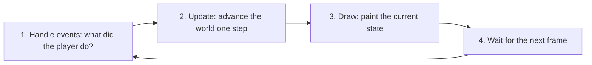

# A game: the loop, state, events and collisions

Games are wonderful programming projects: the result is visible, every feature is a small self-contained challenge, and the architecture you learn — a loop that repeatedly reads input, updates a model of the world, and draws it — is the same one inside simulations, robots, user interfaces and animation tools. This lesson explains that architecture, shows how the **Pygame** library expresses it, and builds a complete arcade game whose logic runs right here as a text simulation.

We will build *Meteor Dodge*: you steer a lander left and right along the bottom of the screen, dodge falling rocks, and catch fuel cells for points.

## The game loop

A program such as a calculator waits for a request and answers it. A game cannot wait: rocks must keep falling whether or not the player presses anything. So a game runs a loop, many times per second, that never blocks:



Each pass through the loop produces one **frame**. At 60 frames per second each pass has about 16 milliseconds, which is plenty for a small game. The three phases have strictly separate jobs:

- **Events** translate key presses and clicks into *intentions* ("move left", "pause").
- **Update** applies the rules: move things, spawn things, detect collisions, change the score.
- **Draw** shows what the state now is. Drawing never changes the state.

Keeping them separate is what keeps a game debuggable. When something misbehaves, you know which third of the program to look in.

## State: the model of the world

Everything the game needs to remember from one frame to the next is its **state**: where the lander is, where each rock is, the score, the lives, whether the game is over. A reliable design rule: *if you could save it to a file and later restore the game exactly, it is state*. Pixels on the screen are not state — they are a picture *of* the state, redrawn from scratch every frame.

Collect unchanging configuration in one place too, so that tuning the game means editing one block:

```python-run
from dataclasses import dataclass, field

@dataclass(frozen=True)
class Settings:
    width: int = 12              # playfield size in cells
    height: int = 8
    lives: int = 3
    rock_points: int = 0
    fuel_points: int = 10

@dataclass
class Faller:
    x: int
    y: int
    kind: str                    # "rock" or "fuel"

@dataclass
class GameState:
    settings: Settings
    lander_x: int
    lives: int
    score: int = 0
    fallers: list = field(default_factory=list)
    frame: int = 0
    over: bool = False

settings = Settings()
state = GameState(settings, lander_x=settings.width // 2, lives=settings.lives)
print(state)
```

A game built this way is, at heart, one function applied over and over: *new state = update(old state, input)*.

## Movement, time and coordinates

Screen coordinates start at the **top-left corner**: x grows to the right and y grows **downwards**. A rock that falls therefore has an *increasing* y.

Movement is "position changes by velocity every frame". If velocity is expressed per frame, the game runs faster on a faster computer. The robust approach is to measure the time since the previous frame — **delta time**, `dt` — and move by `velocity * dt`, so that speed is expressed per second:

```python-run
def advance(position, velocity, dt):
    return position + velocity * dt

speed = 120.0                       # pixels per SECOND
for fps in (30, 60, 144):
    dt = 1 / fps
    y = 0.0
    for _ in range(fps):            # simulate one second of frames
        y = advance(y, speed, dt)
    print(f"{fps:>3} frames per second -> moved {y:.1f} px in one second")
```

Whatever the frame rate, the object covers the same distance per second.

## Collisions: do two rectangles overlap?

Most 2D games treat objects as rectangles for collision purposes. A rectangle is given by its left edge `x`, its top edge `y`, its width and its height. Two rectangles overlap unless one of them lies entirely to one side of the other:

```python-run
def rects_overlap(a, b):
    """a and b are (x, y, width, height). Touching edges do not count as overlap."""
    ax, ay, aw, ah = a
    bx, by, bw, bh = b
    return ax < bx + bw and bx < ax + aw and ay < by + bh and by < ay + ah

lander = (40, 90, 20, 10)
tests = {
    "rock directly above, overlapping": (45, 85, 10, 10),
    "rock far to the right":            (200, 90, 10, 10),
    "rock just touching the top edge":  (45, 80, 10, 10),
    "tiny rock fully inside":           (48, 93, 2, 2),
}
for label, rock in tests.items():
    print(f"{label:<34} {rects_overlap(lander, rock)}")
```

Read the condition as four requirements that must *all* hold: a's left edge is left of b's right edge, b's left is left of a's right, and the same two vertically. If any one fails, there is a gap between the rectangles along that direction. This test is called **AABB** (axis-aligned bounding box) collision, and it is what Pygame's `Rect.colliderect` performs.

For circles the test is even simpler: two circles collide when the distance between their centres is less than the sum of their radii (compare squared distances to avoid a square root).

## The complete game logic, runnable

Here is all of *Meteor Dodge* without any graphics library: state, input handling, update rules, collision detection and a text renderer. Player input comes from a prepared string of key presses, and the "random" spawns are seeded so that every run is the same.

```python-run
import random
from dataclasses import dataclass, field

WIDTH, HEIGHT = 12, 8

@dataclass
class State:
    lander_x: int = WIDTH // 2
    lives: int = 3
    score: int = 0
    fallers: list = field(default_factory=list)     # each one is [x, y, kind]
    frame: int = 0
    over: bool = False

def handle_input(state, key):
    """EVENTS: turn a key into movement, keeping the lander on the playfield."""
    if key == "a":
        state.lander_x = max(0, state.lander_x - 1)
    elif key == "d":
        state.lander_x = min(WIDTH - 1, state.lander_x + 1)

def update(state, rng):
    """UPDATE: one step of the world."""
    state.frame += 1
    for faller in state.fallers:
        faller[1] += 1                                       # everything falls one row
    survivors = []
    for x, y, kind in state.fallers:
        if y == HEIGHT - 1 and x == state.lander_x:          # collision with the lander
            if kind == "fuel":
                state.score += 10
            else:
                state.lives -= 1
        elif y < HEIGHT:                                     # still on screen
            survivors.append([x, y, kind])
    state.fallers = survivors
    if state.frame % 2 == 0:                                 # spawn something every 2nd frame
        kind = "fuel" if rng.random() < 0.3 else "rock"
        state.fallers.append([rng.randrange(WIDTH), 0, kind])
    if state.lives <= 0:
        state.over = True

def draw(state):
    """DRAW: build a picture of the state. Reads the state, never changes it."""
    grid = [["." for _ in range(WIDTH)] for _ in range(HEIGHT)]
    for x, y, kind in state.fallers:
        grid[y][x] = "*" if kind == "fuel" else "O"
    grid[HEIGHT - 1][state.lander_x] = "A"
    rows = ["".join(row) for row in grid]
    return "\n".join(rows) + f"\nframe {state.frame:>2}  score {state.score:>3}  lives {'#' * state.lives}"

rng = random.Random(5)
state = State()
keys = "..dd.a.aaa..dddd...aa..d"                # the 'player': a = left, d = right, . = nothing
for key in keys:                                  # THE GAME LOOP
    handle_input(state, key)
    update(state, rng)
    if state.frame % 6 == 0 or state.over:        # show every 6th frame to keep the output short
        print(draw(state), "\n")
    if state.over:
        break
print("GAME OVER" if state.over else f"Still flying after {state.frame} frames with {state.score} points.")
```

The three functions map exactly onto the three phases of the loop. Because `update` takes the state and a random-number generator as arguments, the entire game can be tested without a screen: build a state, call `update`, assert on the result.

```python-run
import random
from dataclasses import dataclass, field
WIDTH, HEIGHT = 12, 8
@dataclass
class State:
    lander_x: int = 6
    lives: int = 3
    score: int = 0
    fallers: list = field(default_factory=list)
    frame: int = 0
    over: bool = False

def step_fallers(state):
    """The collision part of update, isolated so it can be tested."""
    survivors = []
    for x, y, kind in state.fallers:
        y += 1
        if y == HEIGHT - 1 and x == state.lander_x:
            if kind == "fuel": state.score += 10
            else: state.lives -= 1
        elif y < HEIGHT:
            survivors.append([x, y, kind])
    state.fallers = survivors

s = State(fallers=[[6, HEIGHT - 2, "fuel"], [6, 0, "rock"], [2, HEIGHT - 1, "rock"]])
step_fallers(s)
assert s.score == 10 and s.lives == 3            # caught the fuel
assert s.fallers == [[6, 1, "rock"]]             # one still falling; one left the screen
s = State(fallers=[[6, HEIGHT - 2, "rock"]])
step_fallers(s)
assert s.lives == 2 and s.fallers == []
print("collision rules verified")
```

## The same game with Pygame

Pygame is a library for 2D games: it opens a window, draws shapes and images, reports keyboard and mouse events, plays sounds and keeps time. It needs a real window, so it cannot run inside this page — install it locally with `python -m pip install pygame` and run the file from a terminal. Read the code with the text version in mind; the structure is identical.

```python
import random
import sys
import pygame

WIDTH, HEIGHT = 480, 640
FPS = 60
SKY = (14, 16, 38)                                   # colours are (red, green, blue), 0-255

class Lander(pygame.sprite.Sprite):
    def __init__(self):
        super().__init__()
        self.image = pygame.Surface((48, 24))        # what to draw: here a plain rectangle
        self.image.fill((240, 240, 255))             # (use pygame.image.load("lander.png") for a picture)
        self.rect = self.image.get_rect(midbottom=(WIDTH // 2, HEIGHT - 10))   # where to draw it
        self.speed = 320                             # pixels per second

    def update(self, dt, keys):
        direction = keys[pygame.K_RIGHT] - keys[pygame.K_LEFT]      # -1, 0 or 1
        self.rect.x += round(direction * self.speed * dt)
        self.rect.clamp_ip(pygame.Rect(0, 0, WIDTH, HEIGHT))        # stay inside the window

class Faller(pygame.sprite.Sprite):
    def __init__(self, kind):
        super().__init__()
        self.kind = kind
        self.image = pygame.Surface((24, 24))
        self.image.fill((120, 220, 140) if kind == "fuel" else (170, 120, 90))
        self.rect = self.image.get_rect(midtop=(random.randrange(12, WIDTH - 12), -24))
        self.y = float(self.rect.y)                  # keep the exact position as a float
        self.speed = random.uniform(140, 260)

    def update(self, dt, keys):
        self.y += self.speed * dt
        self.rect.y = round(self.y)
        if self.rect.top > HEIGHT:
            self.kill()                              # remove this sprite from every group

def main():
    pygame.init()
    screen = pygame.display.set_mode((WIDTH, HEIGHT))
    pygame.display.set_caption("Meteor Dodge")
    clock = pygame.time.Clock()
    font = pygame.font.SysFont(None, 32)

    lander = Lander()
    fallers = pygame.sprite.Group()
    everything = pygame.sprite.Group(lander)
    score, lives, spawn_timer = 0, 3, 0.0

    running = True
    while running:
        dt = clock.tick(FPS) / 1000                  # seconds since the previous frame

        # 1. EVENTS
        for event in pygame.event.get():
            if event.type == pygame.QUIT:            # the window's close button
                running = False
            elif event.type == pygame.KEYDOWN and event.key == pygame.K_ESCAPE:
                running = False
        keys = pygame.key.get_pressed()              # which keys are held down right now

        # 2. UPDATE
        spawn_timer += dt
        if spawn_timer >= 0.5:
            spawn_timer = 0.0
            faller = Faller("fuel" if random.random() < 0.3 else "rock")
            fallers.add(faller)
            everything.add(faller)
        everything.update(dt, keys)                  # calls update() on every sprite

        for hit in pygame.sprite.spritecollide(lander, fallers, dokill=True):
            if hit.kind == "fuel":
                score += 10
            else:
                lives -= 1
        if lives <= 0:
            running = False

        # 3. DRAW
        screen.fill(SKY)                             # wipe the previous frame
        everything.draw(screen)                      # blit each sprite's image at its rect
        hud = font.render(f"Score {score}   Lives {lives}", True, (255, 255, 255))
        screen.blit(hud, (10, 10))
        pygame.display.flip()                        # show the finished frame

    pygame.quit()
    sys.exit()

if __name__ == "__main__":
    main()
```

### The Pygame vocabulary

| Concept | What it is | In the code |
|---|---|---|
| **Surface** | an image you can draw on; the window itself is one | `screen`, each sprite's `image` |
| **Rect** | a rectangle (`x`, `y`, `width`, `height`) with handy attributes like `center`, `top`, `midbottom`, and collision tests | `self.rect`, `rect.clamp_ip(...)` |
| **Event** | something that happened: a key went down, the mouse moved, the window was closed | `pygame.event.get()`, `event.type` |
| **Clock** | limits the frame rate and measures frame time | `clock.tick(FPS)` |
| **Sprite** | an object with an `image` and a `rect`, plus your behaviour in `update()` | `Lander`, `Faller` |
| **Group** | a container of sprites that can update and draw them all, and test collisions | `fallers`, `everything` |
| **blit** | copy one surface onto another at a position | `screen.blit(hud, (10, 10))` |
| **flip** | swap the finished off-screen drawing onto the display | `pygame.display.flip()` |

Two ways of reading the keyboard appear, and they answer different questions. **Events** (`KEYDOWN`, `KEYUP`) tell you about a *change* — a key was just pressed — and suit one-off actions such as firing, jumping or pausing. **`key.get_pressed()`** tells you what is *held down right now* and suits continuous movement. Forgetting to process the event queue at all is a classic beginner bug: the window stops responding and the operating system reports the program as frozen.

Drawing uses **double buffering**: everything is painted onto a hidden surface and `flip()` shows the completed picture in one go, which prevents flicker. That is why every frame begins by filling the whole screen — you repaint the entire scene, 60 times a second, from the state.

### Sprites, groups and collisions

Deriving from `pygame.sprite.Sprite` buys you membership in **groups**. A group will call `update` on every member, draw every member, and remove members that call `kill()`. Groups also power the collision helpers:

| Helper | Answers |
|---|---|
| `rect_a.colliderect(rect_b)` | do these two rectangles overlap? |
| `rect.collidepoint(x, y)` | is this point (a mouse click, say) inside the rectangle? |
| `pygame.sprite.spritecollide(sprite, group, dokill)` | which members of the group touch this sprite? (optionally removing them) |
| `pygame.sprite.groupcollide(g1, g2, kill1, kill2)` | which members of two groups touch each other? — e.g. shots versus rocks |
| `pygame.sprite.spritecollideany(sprite, group)` | does the sprite touch *anything* in the group? (stops at the first hit) |

Under the hood each is a loop of rectangle-overlap tests like the one you wrote above. For irregular shapes Pygame offers circle-based and pixel-perfect (mask) checks at a higher cost.

One subtlety worth knowing about is **tunnelling**: a fast object can move *through* a thin one between two frames, because it is on one side in one frame and on the other side in the next, never overlapping. Cures are limiting speeds, making objects thicker, or moving in several small sub-steps per frame.

## Growing the game

Each of these is a small, separate feature — exactly the "thin slices" of the previous lesson:

- **Shooting.** A `Shot` sprite that moves upwards; create one on a `KEYDOWN` event for the space bar, limit how many may exist at once, and use `groupcollide(shots, fallers, True, True)` to destroy rocks.
- **Difficulty.** Shorten the spawn interval or raise fall speeds as the score climbs; keep the numbers in a settings object, and reset them when a new game starts.
- **Game states.** A variable such as `mode` with values `"title"`, `"playing"`, `"paused"`, `"game_over"`. The loop keeps running in every mode; events and updates simply behave differently depending on it. This is a **state machine**, and it is how every menu screen works.
- **A high score that persists.** Load it from a JSON file at start-up and save it when a game ends (the pattern from the *Files, errors and tests* lesson).
- **Sound and images.** `pygame.mixer.Sound("ping.wav").play()` and `pygame.image.load("rock.png").convert_alpha()`.

```python-run
def next_mode(mode, event):
    """A state machine for the screens of a game."""
    table = {
        ("title", "start"): "playing",
        ("playing", "pause"): "paused",
        ("paused", "pause"): "playing",
        ("playing", "died"): "game_over",
        ("game_over", "start"): "title",
    }
    return table.get((mode, event), mode)        # anything else: stay in the same mode

mode = "title"
for event in ["pause", "start", "pause", "pause", "died", "pause", "start"]:
    mode = next_mode(mode, event)
    print(f"{event:<6} -> {mode}")
```

A table of *(current mode, event) → next mode* is easier to read, extend and test than a tangle of nested `if` statements.

## Common mistakes

- **Mixing phases** — changing the score inside the drawing code, or drawing inside `update`. Bugs then depend on the order of drawing.
- **Removing from a list while looping over it**, which skips items. Build a new list of survivors (as `update` does above), or use sprite groups, which handle removal safely.
- **Frame-rate-dependent movement**: forgetting `dt`.
- **Truncated positions**: a `Rect` stores whole pixels, so adding `0.4` every frame moves nothing. Keep the true position in a float and copy it into the rect, as `Faller` does.
- **Forgetting to clear the screen**: every object leaves a smear behind it.
- **Loading images inside the loop**: files are read from disk 60 times a second. Load once, before the loop.
- **Upside-down thinking**: y increases downwards.

> [!TIP]
> Develop game rules as plain functions on plain data first, test them with asserts or a text renderer, and only then put graphics on top. Finding a collision bug by reading printed coordinates is far quicker than squinting at a moving window.

> [!INTERVIEW]
> The game loop is a common systems-design warm-up ("how would you structure a real-time simulation?"). Key points: a fixed cycle of input → update → render; a single source of truth for state; time-based movement with delta time (or a fixed timestep for deterministic physics); separating simulation from rendering so the logic is testable; and collision detection by bounding boxes, with spatial partitioning (a grid or quadtree) when there are too many objects to compare every pair.

## Summary

A game is a loop that handles events, updates state and draws, once per frame. State is the complete, saveable description of the world; drawing only depicts it. Movement is velocity times elapsed time; collisions between rectangles are four comparisons. Pygame supplies the window, events, clock, surfaces, rects, sprites and groups, but the design — and most of the code worth testing — is independent of it.

```quiz
[
  {"q": "What are the three phases of a game loop, in order?", "options": ["Draw, save, quit", "Handle events, update the state, draw", "Update, sleep, exit", "Load, compile, run"], "answer": 1,
   "explain": "Each frame reads input, advances the world one step, and renders the result."},
  {"q": "In screen coordinates, what happens to an object's y value as it falls down the screen?", "options": ["It decreases", "It increases", "It stays the same", "It becomes negative"], "answer": 1,
   "explain": "The origin is the top-left corner and y grows downwards."},
  {"q": "Why multiply velocity by delta time (dt)?", "options": ["To make the game harder", "So objects move at the same real speed regardless of the frame rate", "To save memory", "Because Pygame requires it"], "answer": 1,
   "explain": "Without dt, movement is per frame and a faster computer runs the game faster."},
  {"q": "Two axis-aligned rectangles do NOT overlap when:", "options": ["They have different sizes", "One lies entirely to the left of, right of, above or below the other", "They have the same colour", "Their areas differ"], "answer": 1,
   "explain": "Overlap requires overlap along both axes; a gap along either axis means no collision."},
  {"q": "In Pygame, what is the difference between KEYDOWN events and key.get_pressed()?", "options": ["None", "KEYDOWN reports the moment a key is pressed (good for one-off actions); get_pressed reports which keys are currently held (good for continuous movement)", "get_pressed only works for the mouse", "KEYDOWN is deprecated"], "answer": 1,
   "explain": "Events describe changes; the pressed-keys snapshot describes the current situation."},
  {"q": "What does `pygame.display.flip()` do?", "options": ["Mirrors the image", "Shows the frame that was drawn off-screen, all at once", "Reverses the y axis", "Quits the game"], "answer": 1,
   "explain": "Drawing happens on a hidden buffer; flip presents the completed frame, avoiding flicker."},
  {"q": "Why should drawing code never change the game state?", "options": ["It would be slower", "Mixing the phases makes behaviour depend on drawing order and makes the logic impossible to test without graphics", "Pygame forbids it", "State is read-only"], "answer": 1,
   "explain": "Keeping render pure means the rules live in one place and can be verified with plain function calls."},
  {"q": "A fast bullet passes through a thin wall without a collision being detected. This is called:", "options": ["Clipping", "Tunnelling", "Blitting", "Flipping"], "answer": 1,
   "explain": "Between two frames the bullet jumps from one side to the other without ever overlapping; fix with sub-steps, speed limits or thicker colliders."}
]
```

> **Source:** Matthes, *Python Crash Course* (3rd ed.), ch. 12–14 (a Pygame project: window and game loop, settings, sprites and groups, collisions, scoring) — topics only; the game, code and wording here are original; Pygame documentation (`pygame.sprite`, `pygame.Rect`, `pygame.event`, `pygame.time.Clock`).
