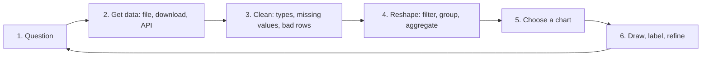

# Data visualisation: from raw files to clear charts

A table of ten thousand numbers tells a human almost nothing; the right picture of those numbers can be understood in two seconds. **Data visualisation** is the craft of turning data into pictures that answer questions — and nine-tenths of the work happens before any chart is drawn: getting the data, cleaning it, and reshaping it into exactly the numbers the chart needs. This lesson walks through that whole pipeline. The wrangling runs live in the page with nothing but the standard library; the chart code for **Matplotlib** and **Plotly** is shown as static blocks for you to run locally, where a window or browser tab can display the result.

Our running example: a small cycling club has logged its members' rides and the weather, and wants to understand its season.

## The pipeline



Start from a **question**, not from a chart type. "How did our weekly distance change over the season?" "Which weekday do we ride most?" "Do we ride less when it rains?" Each question determines which columns you need, how to aggregate them, and which chart fits. And each answer tends to raise the next question — the loop back at the end is real.

## Step 1: load the data

Data usually arrives as **CSV** (comma-separated values: a table as text, one row per line) or **JSON** (nested lists and dictionaries). Python's `csv` module handles the first; `csv.DictReader` turns every row into a dictionary keyed by the header line.

```python-run
import csv, io

RAW = """date,rider,km,minutes,rain_mm
2026-04-04,ana,42.5,118,0
2026-04-04,ben,42.5,121,0
2026-04-11,ana,55.0,150,2.5
2026-04-11,cy,,95,2.5
2026-04-18,ben,38.2,104,0
2026-04-18,cy,38.2,110,0
2026-04-18,ana,61.0,168,0
2026-04-25,ana,47.3,131,11.0
2026-05-02,ben,70.1,190,0
2026-05-02,cy,sixty,185,0
2026-05-02,ana,70.1,186,0
2026-05-09,ben,52.4,140,4.0
"""

rows = list(csv.DictReader(io.StringIO(RAW)))        # with a real file: open(path, newline="", encoding="utf-8")
print(len(rows), "rows; columns:", list(rows[0]))
print(rows[0])
print(rows[3])
```

Look at what came back. Every value is a **string** — `"42.5"`, not `42.5` — and two rows are faulty: one has an empty distance and another says `sixty`. Real data is always like this.

## Step 2: clean it

Cleaning means converting text to proper types and deciding, explicitly, what to do with values that are missing or malformed. The options are to **skip** the row, to **repair** it (if you know the right value), or to **keep it marked as missing**. Whatever you choose, *count* what you dropped: a chart built on silently discarded data is a lie waiting to be discovered.

```python-run
import csv, io
from datetime import date

RAW = """date,rider,km,minutes,rain_mm
2026-04-04,ana,42.5,118,0
2026-04-04,ben,42.5,121,0
2026-04-11,ana,55.0,150,2.5
2026-04-11,cy,,95,2.5
2026-04-18,ben,38.2,104,0
2026-04-18,cy,38.2,110,0
2026-04-18,ana,61.0,168,0
2026-04-25,ana,47.3,131,11.0
2026-05-02,ben,70.1,190,0
2026-05-02,cy,sixty,185,0
2026-05-02,ana,70.1,186,0
2026-05-09,ben,52.4,140,4.0
"""

def clean(raw_rows):
    """Return (good_rows, problems). Good rows have real types."""
    good, problems = [], []
    for line_number, row in enumerate(raw_rows, start=2):       # line 1 is the header
        try:
            good.append({
                "date": date.fromisoformat(row["date"]),
                "rider": row["rider"].strip().lower(),
                "km": float(row["km"]),
                "minutes": int(row["minutes"]),
                "rain_mm": float(row["rain_mm"]),
            })
        except ValueError as error:
            problems.append(f"line {line_number}: {error}")
    return good, problems

rides, problems = clean(csv.DictReader(io.StringIO(RAW)))
print(len(rides), "usable rides;", len(problems), "rejected")
for p in problems:
    print("  ", p)
print(rides[0])
print(rides[0]["date"].strftime("%A"), rides[0]["date"].isocalendar().week)
```

Dates deserve a real type. `date.fromisoformat("2026-04-04")` gives an object that knows its weekday, can be compared and sorted correctly, and can be subtracted from another date; `datetime.strptime(text, "%d/%m/%Y")` parses other layouts using a format code.

## Step 3: reshape — filter, group, aggregate

Charts rarely show raw rows. They show **summaries**: totals per week, averages per rider, counts per category. The universal recipe is *group, then aggregate*: collect the rows that share a key, then reduce each group to one number.

```python-run
from collections import defaultdict
from datetime import date
from statistics import mean

rides = [
    {"date": date(2026, 4, 4), "rider": "ana", "km": 42.5, "minutes": 118, "rain_mm": 0.0},
    {"date": date(2026, 4, 4), "rider": "ben", "km": 42.5, "minutes": 121, "rain_mm": 0.0},
    {"date": date(2026, 4, 11), "rider": "ana", "km": 55.0, "minutes": 150, "rain_mm": 2.5},
    {"date": date(2026, 4, 18), "rider": "ben", "km": 38.2, "minutes": 104, "rain_mm": 0.0},
    {"date": date(2026, 4, 18), "rider": "cy", "km": 38.2, "minutes": 110, "rain_mm": 0.0},
    {"date": date(2026, 4, 18), "rider": "ana", "km": 61.0, "minutes": 168, "rain_mm": 0.0},
    {"date": date(2026, 4, 25), "rider": "ana", "km": 47.3, "minutes": 131, "rain_mm": 11.0},
    {"date": date(2026, 5, 2), "rider": "ben", "km": 70.1, "minutes": 190, "rain_mm": 0.0},
    {"date": date(2026, 5, 2), "rider": "ana", "km": 70.1, "minutes": 186, "rain_mm": 0.0},
    {"date": date(2026, 5, 9), "rider": "ben", "km": 52.4, "minutes": 140, "rain_mm": 4.0},
]

def group_by(rows, key):
    """Return {key value: [rows...]} - the first half of every summary."""
    groups = defaultdict(list)
    for row in rows:
        groups[key(row)].append(row)
    return dict(groups)

by_rider = group_by(rides, lambda r: r["rider"])
for rider, own in sorted(by_rider.items()):
    km = sum(r["km"] for r in own)
    speed = km / (sum(r["minutes"] for r in own) / 60)
    print(f"{rider:<4} rides={len(own)}  total={km:6.1f} km  longest={max(r['km'] for r in own):5.1f}  avg speed={speed:4.1f} km/h")

by_date = group_by(rides, lambda r: r["date"])
km_per_outing = {d: round(sum(r["km"] for r in rs), 1) for d, rs in sorted(by_date.items())}
print(km_per_outing)

dry = [r["km"] for r in rides if r["rain_mm"] == 0]
wet = [r["km"] for r in rides if r["rain_mm"] > 0]
print(f"dry days: {mean(dry):.1f} km per ride ({len(dry)} rides) | wet days: {mean(wet):.1f} km ({len(wet)} rides)")
```

Notice the comment a careful analyst would add to that last line: with four wet rides the difference means very little. Always look at **how many** data points stand behind a summary before drawing conclusions from it.

For large tables you would use the **pandas** library, where the same operations are one-liners (`df.groupby("rider")["km"].sum()`). The ideas — parse, clean, filter, group, aggregate — are identical, and doing them by hand first means you will understand what pandas is doing for you.

## Step 4: choose the chart

The chart type follows from the **kind of question** and the **kinds of variables** involved:

| Question | Variables | Chart |
|---|---|---|
| How does a value change over time? | time + number | **line chart** |
| How do categories compare? | category + number | **bar chart** (horizontal if labels are long) |
| How are two numbers related? | number + number | **scatter plot** |
| How is one number distributed? | one number | **histogram** (or box plot) |
| How does a whole divide into parts? | category + share | stacked bar; a pie only for 2–4 parts |
| How do two categories interact? | category × category + number | grouped bars or a **heat map** |
| Where? | location + number | map |

Rules of thumb that prevent most bad charts:

- **Bars start at zero.** The length of a bar *is* the value; cutting the axis exaggerates differences. Lines and scatter plots may use a narrower range, clearly labelled.
- **Sort bars** by value unless the categories have a natural order (months, age groups).
- **Label everything**: a title that states the point, axis labels with units, a legend only if needed.
- **Few colours, with meaning.** Use colour to distinguish categories or to highlight the one series that matters — not for decoration. Check that it works for colour-blind readers and in greyscale.
- **Remove clutter**: heavy grid lines, 3-D effects, unnecessary decimals.
- **One message per chart.** If you need two messages, make two charts.

## Step 5: a chart in plain text

Before reaching for a plotting library, it is surprisingly useful to draw a quick chart with characters — in a terminal, a log file, or a test. It also shows what a charting library does internally: **scale** each value to the available space, then draw a mark of that size.

```python-run
def bar_chart(data, width=40, mark="#"):
    """data: {label: value}. Return a text bar chart as a string."""
    biggest = max(data.values())
    label_width = max(len(str(label)) for label in data)
    lines = []
    for label, value in data.items():
        length = round(value / biggest * width) if biggest else 0     # the scaling step
        lines.append(f"{str(label):<{label_width}} | {mark * length} {value:g}")
    return "\n".join(lines)

totals = {"ana": 275.9, "ben": 203.2, "cy": 38.2}
print("Distance by rider (km)")
print(bar_chart(dict(sorted(totals.items(), key=lambda kv: -kv[1]))))

def sparkline(values):
    """One character per value: a miniature line chart."""
    blocks = "_.-=+*#@"              # eight 'heights', from lowest to highest
    low, high = min(values), max(values)
    span = (high - low) or 1
    return "".join(blocks[round((v - low) / span * (len(blocks) - 1))] for v in values)

weekly = [85.0, 55.0, 137.4, 47.3, 140.2, 52.4]
print("\nKm per outing:", sparkline(weekly), f"(min {min(weekly)}, max {max(weekly)})")

def histogram(values, bin_size):
    """Count how many values fall into each bin of the given size."""
    counts = {}
    for v in values:
        start = int(v // bin_size) * bin_size
        counts[start] = counts.get(start, 0) + 1
    return {f"{start}-{start + bin_size}": counts[start] for start in sorted(counts)}

distances = [42.5, 42.5, 55.0, 38.2, 38.2, 61.0, 47.3, 70.1, 70.1, 52.4]
print("\nRide lengths (km)")
print(bar_chart(histogram(distances, 10), width=20))
```

A **histogram** groups a numeric variable into equal-width bins and counts the members of each — it shows the *shape* of the data (where values cluster, how spread out they are, whether there are outliers) that an average hides.

## Step 6: Matplotlib

**Matplotlib** is the standard plotting library for Python (`python -m pip install matplotlib`). Its model: a **figure** is the whole image; it contains one or more **axes** — an individual chart with its own x and y axis. The recommended style creates both explicitly and then calls methods on the axes object.

```python
import matplotlib.pyplot as plt
from datetime import date

outings = [date(2026, 4, 4), date(2026, 4, 11), date(2026, 4, 18),
           date(2026, 4, 25), date(2026, 5, 2), date(2026, 5, 9)]
km = [85.0, 55.0, 137.4, 47.3, 140.2, 52.4]
rain = [0, 2.5, 0, 11.0, 0, 4.0]

fig, ax = plt.subplots(figsize=(9, 4.5))             # one figure containing one axes

ax.plot(outings, km, color="tab:blue", linewidth=2, marker="o", label="club distance")
ax.fill_between(outings, km, alpha=0.15)             # light shading under the line

wet = [(d, k) for d, k, r in zip(outings, km, rain) if r > 0]
ax.scatter([d for d, _ in wet], [k for _, k in wet],
           color="tab:red", s=90, zorder=3, label="rainy outing")

ax.set_title("Rainy Saturdays cut the club's distance", fontsize=14)
ax.set_xlabel("")                                    # the dates speak for themselves
ax.set_ylabel("Total distance (km)")
ax.set_ylim(bottom=0)
ax.grid(axis="y", alpha=0.3)
ax.legend()
fig.autofmt_xdate()                                  # slant the date labels so they do not overlap

fig.savefig("club_distance.png", dpi=150, bbox_inches="tight")
plt.show()                                           # open a window with the chart
```

The essential vocabulary:

| Call | Draws / does |
|---|---|
| `ax.plot(x, y)` | a line through the points |
| `ax.scatter(x, y, s=..., c=...)` | individual points; `s` sets size, `c` colour (a list of numbers plus `cmap=` colours by value) |
| `ax.bar(labels, values)` / `ax.barh(...)` | vertical / horizontal bars |
| `ax.hist(values, bins=10)` | a histogram |
| `ax.set_title`, `set_xlabel`, `set_ylabel`, `set_xlim`, `set_ylim` | text and axis ranges |
| `ax.tick_params(labelsize=...)`, `ax.grid(...)`, `ax.legend()` | finishing touches |
| `plt.subplots(nrows, ncols)` | several axes in a grid, e.g. `fig, (left, right) = plt.subplots(1, 2)` |
| `plt.style.use("seaborn-v0_8")` | a ready-made look (`plt.style.available` lists them) |
| `fig.savefig("name.png")` | write an image file (also `.svg`, `.pdf`) |

A second example, a bar chart and a scatter plot side by side:

```python
fig, (left, right) = plt.subplots(1, 2, figsize=(11, 4))

riders = ["ana", "ben", "cy"]
totals = [275.9, 203.2, 38.2]
left.barh(riders[::-1], totals[::-1], color="tab:green")      # reversed so the biggest is on top
left.set_title("Distance by rider")
left.set_xlabel("km")
for value, name in zip(totals, riders):
    left.text(value + 3, name, f"{value:.0f}", va="center")  # write the value next to each bar

ride_km = [42.5, 42.5, 55.0, 38.2, 38.2, 61.0, 47.3, 70.1, 70.1, 52.4]
ride_minutes = [118, 121, 150, 104, 110, 168, 131, 190, 186, 140]
right.scatter(ride_km, ride_minutes, c=ride_km, cmap="viridis", s=60)
right.set_title("Longer rides take proportionally longer")
right.set_xlabel("distance (km)")
right.set_ylabel("time (minutes)")

fig.tight_layout()
plt.show()
```

### Generated data

Charts are also the way to *see* what a simulation or a formula does. A classic experiment is the **random walk**: start at zero and repeatedly take a step in a random direction. The data is produced by your own code, and plotting many walks at once reveals behaviour no single run would show.

```python-run
import random

def random_walk(steps, rng):
    """Return the positions visited by a walker taking +1 / -1 steps."""
    position, path = 0, [0]
    for _ in range(steps):
        position += rng.choice((-1, 1))
        path.append(position)
    return path

rng = random.Random(8)
walks = [random_walk(400, rng) for _ in range(200)]
finals = [walk[-1] for walk in walks]
print("one walk, every 40th position:", walks[0][::40])
print(f"final positions: min {min(finals)}, max {max(finals)}, mean {sum(finals) / len(finals):.2f}")

bins = {}
for f in finals:
    start = (f // 10) * 10
    bins[start] = bins.get(start, 0) + 1
for start in sorted(bins):
    print(f"{start:>4} to {start + 9:>3} | {'#' * bins[start]}")
```

The text histogram already shows the bell shape of the final positions. With Matplotlib you would draw the paths themselves: `for walk in walks: ax.plot(walk, color="steelblue", alpha=0.08)` — transparent lines piling up into a cloud that widens with time.

## Step 7: interactive charts with Plotly

Matplotlib makes static images. **Plotly** (`python -m pip install plotly pandas`) produces interactive charts that open in a browser: hover to read exact values, zoom, pan, toggle series in the legend, and export a self-contained HTML file that anyone can open. Its high-level interface, *Plotly Express*, builds a complete chart from one function call.

```python
import plotly.express as px

riders = ["ana", "ben", "cy"]
totals = [275.9, 203.2, 38.2]
rides_count = [5, 4, 1]

fig = px.bar(
    x=riders, y=totals,
    labels={"x": "Rider", "y": "Distance (km)"},
    title="Season distance by rider",
    hover_data={"rides": rides_count},               # extra information shown on hover
    color=totals, color_continuous_scale="Viridis",
)
fig.update_layout(title_font_size=22, xaxis_title_font_size=16, showlegend=False)
fig.update_traces(marker_line_width=0)
fig.show()                                           # opens in the browser
fig.write_html("season_by_rider.html")               # a shareable, self-contained page
```

Other Plotly Express functions follow the same pattern: `px.line`, `px.scatter`, `px.histogram`, `px.box`, and map charts such as `px.scatter_geo(lat=..., lon=..., size=..., color=...)`, which place a marker at each latitude/longitude pair — the natural display for data sets where every record has a location, such as weather stations or seismic events.

| | Matplotlib | Plotly |
|---|---|---|
| Output | static image (PNG, SVG, PDF) | interactive HTML |
| Best for | reports, papers, precise control over every element | exploration, dashboards, sharing on the web |
| Style | build the chart up call by call | describe the chart; tune it with `update_layout` / `update_traces` |
| Learning curve | more to learn, total flexibility | good defaults immediately |

## Step 8: data from the outside world

Interesting data sets are published by weather services, statistical offices, city governments and research projects, mostly as CSV or JSON downloads. The workflow is always the same: **inspect first, then automate**.

1. Open the file in a text editor (or print the first few lines) to see what is really in it: the header names, the units, the date format, how missing values are written.
2. Print the header with positions so that you can refer to columns reliably.
3. Extract only the columns you need, converting types and handling gaps.

```python-run
import csv, io

download = """STATION,NAME,DATE,TMAX,TMIN,PRCP
X100,"HARBOUR POINT, COASTAL",2026-07-01,24.1,15.0,0.0
X100,"HARBOUR POINT, COASTAL",2026-07-02,26.3,16.2,
X100,"HARBOUR POINT, COASTAL",2026-07-03,,17.0,3.2
X100,"HARBOUR POINT, COASTAL",2026-07-04,22.8,14.4,12.6
"""

reader = csv.reader(io.StringIO(download))
header = next(reader)                                # the first row
for index, column in enumerate(header):
    print(index, column)

dates, highs, lows = [], [], []
for row in csv.DictReader(io.StringIO(download)):
    try:
        high, low = float(row["TMAX"]), float(row["TMIN"])
    except ValueError:
        print(f"missing temperature on {row['DATE']} - skipped")
        continue
    dates.append(row["DATE"]); highs.append(high); lows.append(low)
print(dates, highs, lows)
print("station:", row["NAME"])                       # the quoted comma was handled correctly
```

Two details matter here. The `csv` module coped with a station name that itself contains a comma — which a naive `line.split(",")` would have torn in two. And the gaps were *reported*, not silently ignored. With the three lists in hand, a Matplotlib chart is three lines: plot the highs, plot the lows, and `ax.fill_between(dates, highs, lows, alpha=0.1)` to shade the daily range.

Nested JSON downloads — for example geographic data in the GeoJSON format, where each "feature" has `properties` and a `geometry` with coordinates — are handled the same way: load with `json.loads`, print the top-level keys, then drill down one level at a time until you find the list of records. The next lesson practises exactly that on API responses.

## Common mistakes

- **Plotting strings.** Forgetting to convert numbers read from a file: the "axis" then lists values in file order, like labels. Convert first.
- **Unsorted time data** produces a line that zigzags backwards. Sort by date before plotting.
- **Averaging averages** — the mean of per-rider average speeds is not the club's average speed unless every rider has the same number of rides. Aggregate from the raw rows.
- **Hiding missing data.** Dropping incomplete rows without counting them, or drawing a line straight across a gap as if nothing were missing.
- **Truncated bar axes**, dual y-axes with arbitrary scales, pies with ten slices, rainbow colour maps: all make charts that mislead.
- **Forgetting `plt.show()`** in a script (nothing appears), or calling it before `savefig` (the saved image is blank on some systems — save first).

> [!TIP]
> Write the chart's title as a sentence stating what the reader should conclude — "Rainy Saturdays cut the club's distance" rather than "Distance over time". If you cannot write that sentence, you have not finished analysing the data; if the chart does not obviously support it, change the chart.

> [!INTERVIEW]
> Data questions in interviews usually probe the pipeline rather than the plotting API: how you would validate and clean an unfamiliar file, how you handle missing or malformed values (and why you report them), which aggregation answers the question, and why a given chart type suits the variables. Being able to express "group by key, then aggregate" with a `defaultdict` — and to say what the pandas equivalent is — covers a large share of them.

## Summary

Start from a question. Load data with `csv` or `json`, convert text to real types, and deal with bad values deliberately and visibly. Reshape by filtering, grouping and aggregating until you have the handful of numbers the chart needs. Choose the chart from the type of question — line for change over time, bars for comparing categories, scatter for relationships, histogram for distributions — and label it honestly. Matplotlib builds static figures from figure and axes objects; Plotly builds interactive ones for the browser.

```quiz
[
  {"q": "What type are the values that `csv.DictReader` gives you for a column of numbers?", "options": ["int", "float", "str", "It detects the type automatically"], "answer": 2,
   "explain": "Everything read from a CSV file is text; convert with int() or float() before calculating or plotting."},
  {"q": "Which chart best shows how a quantity changes over time?", "options": ["Pie chart", "Line chart", "Histogram", "Scatter plot of two unrelated variables"], "answer": 1,
   "explain": "A line chart with time on the x axis shows trend and change; make sure the data is sorted by date."},
  {"q": "Which chart shows the distribution of a single numeric variable?", "options": ["Histogram", "Line chart", "Stacked bar", "Map"], "answer": 0,
   "explain": "A histogram bins the values and counts each bin, revealing clusters, spread and outliers."},
  {"q": "Why should the value axis of a bar chart start at zero?", "options": ["Matplotlib requires it", "Bar length encodes the value, so a cut-off axis exaggerates differences", "To save space", "Negative numbers cannot be drawn"], "answer": 1,
   "explain": "Readers compare bar lengths; truncating the axis makes small differences look large."},
  {"q": "In Matplotlib, what is the relationship between a figure and an axes?", "options": ["They are the same thing", "The figure is the whole image; an axes is one chart inside it", "An axes contains several figures", "A figure is a data set"], "answer": 1,
   "explain": "plt.subplots() returns a figure and one or more axes objects; plotting methods are called on the axes."},
  {"q": "What is the 'group, then aggregate' pattern?", "options": ["Sorting rows twice", "Collecting rows that share a key, then reducing each group to a summary value such as a sum or mean", "Joining two files", "Removing duplicates"], "answer": 1,
   "explain": "It is the basis of nearly every summary table: totals per rider, averages per week, counts per category."},
  {"q": "A row of your data file has an empty value where a number should be. What is the best practice?", "options": ["Replace it with 0 without telling anyone", "Decide explicitly (skip, repair or mark as missing) and report how many rows were affected", "Stop using the file", "Draw it at the top of the chart"], "answer": 1,
   "explain": "Silent fixes distort results; an explicit, counted decision keeps the analysis honest."},
  {"q": "What does Plotly offer that a Matplotlib PNG does not?", "options": ["Colours", "Interactivity: hover values, zooming, and a shareable HTML page", "Titles", "Bar charts"], "answer": 1,
   "explain": "Plotly renders charts in the browser, where the reader can explore them."}
]
```

> **Source:** Matthes, *Python Crash Course* (3rd ed.), ch. 15–16 (generating data with Matplotlib and Plotly; downloading and visualising CSV and JSON data) — topics only; the data sets, code and wording here are original; Matplotlib documentation ("Quick start guide"), Plotly Express documentation; Python docs, *Library Reference* `csv`, `datetime`, `statistics`.
