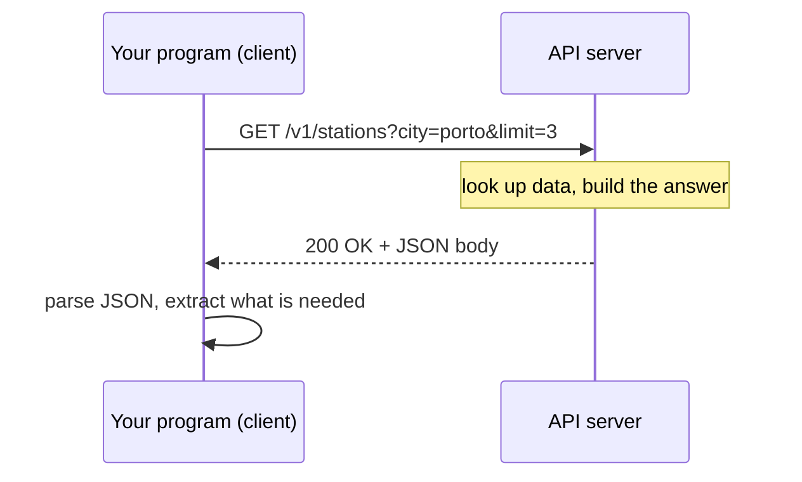
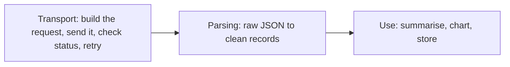

# Working with web APIs

> **Before this lesson:** you need dictionaries, lists and functions ([Decisions and dictionaries](#/lesson/python/py-start-decisions-dicts), [User input, while loops and functions](#/lesson/python/py-start-input-functions)), `try`/`except` ([Files, errors and tests](#/lesson/python/py-start-files-tests), with more depth in [Exceptions](#/lesson/python/py-exceptions)), JSON ([Files, pathlib, JSON and CSV](#/lesson/python/py-files-json-csv)) and a small class ([Classes: modelling things with objects](#/lesson/python/py-start-classes)). The previous project lesson, [Data visualisation](#/lesson/python/py-proj-dataviz), shows what to do with the data once you have it. Every web term is explained from scratch below.

## In plain words

Much of the world's live data (weather, maps, prices, train times, code repositories, your own bank account) is not sitting in a file you download once. It lives on computers elsewhere on the internet, and you get it by asking. A **web API** is the agreed way of asking: an address your program can call with a specific question, which sends back a structured answer that a program can read.

The classic comparison is a restaurant. You do not walk into the kitchen and cook; you read the **menu** (the API's documentation), tell the **waiter** your order in the agreed way (your program sends a request), and the waiter brings back your dish (the response). You never need to know how the kitchen works inside. If you order something that is not on the menu, the waiter tells you so, and that answer is also part of the agreement.

Why this matters for a job: almost every modern program talks to other services. A shop's website calls a payment service, a phone app calls its company's servers, a data pipeline pulls figures from a statistics office. Knowing how to call an API carefully (with timeouts, error handling and respect for the service's limits) is an everyday skill, and interviews regularly ask about HTTP status codes, retries and keeping secret keys safe. It is also the mirror image of building such services yourself, as you would in the FastAPI track.

Network calls cannot be made from inside this page, so the calls themselves are shown as static code using the **requests** library, the most popular Python package for this. Everything that happens *after* the answer arrives (reading it, checking it, summarising it) runs live on realistic sample answers. That split is also how well-designed API code is organised.

## What a web API is

**API** stands for *application programming interface*: an agreed way for one program to use another. A **web API** makes that agreement over **HTTP** (HyperText Transfer Protocol), the same set of rules your web browser uses to fetch pages. A **protocol** is a set of rules for how two programs talk.

The two sides have names. Your program is the **client**: it sends a **request**. The computer that answers is the **server**: it sends back a **response**.



Read the diagram from top to bottom: the client asks for three stations in Porto, the server looks up the data, answers "200 OK" with the data attached, and the client then picks out what it needs.

### Anatomy of a request

A **URL** (Uniform Resource Locator) is a web address. Take this one, for an invented tide-measuring service used throughout the lesson:

```
https://api.tidewatch.example/v1/stations?city=porto&limit=3
```

| Part | Example | Meaning |
|---|---|---|
| scheme | `https` | HTTP over an encrypted connection |
| host | `api.tidewatch.example` | which server to contact |
| path | `/v1/stations` | which **resource** on that server (`v1` is the API version) |
| query string | `?city=porto&limit=3` | parameters refining the request: `key=value` pairs joined by `&` |

A few words from the table: **HTTPS** is HTTP with **encryption**, which scrambles the data in transit so that nobody between you and the server can read or alter it. A **resource** is one kind of thing the API offers, such as stations or readings. Including a version number such as `v1` in the path lets the service change its format later (in a `v2`) without breaking programs written for `v1`.

A specific address an API answers on is called an **endpoint**. Every request also has a **method** saying what you want to do with the resource:

| Method | Purpose | Has a body? |
|---|---|---|
| `GET` | read data | no |
| `POST` | create something / submit data | yes |
| `PUT` / `PATCH` | replace / partly update | yes |
| `DELETE` | remove | usually not |

The **body** is data sent along with a request (or a response), such as the details of a new item to create. A request also carries **headers**: extra labelled pieces of information, such as which format you accept (`Accept`), which program is asking (`User-Agent`), and your credentials (`Authorization`).

### Anatomy of a response

The server answers with a **status code** (a three-digit number summarising the outcome), headers of its own, and usually a body. For APIs, the body is almost always **JSON** (JavaScript Object Notation), text that looks much like Python dictionaries and lists.

| Code | Meaning | What your program should do |
|---|---|---|
| `200 OK`, `201 Created`, `204 No Content` | success | use the result |
| `301` / `302` | moved; follow the new address | (requests follows these automatically) |
| `400 Bad Request`, `422` | your request was malformed or invalid | fix the request; do not retry unchanged |
| `401 Unauthorized` / `403 Forbidden` | missing or insufficient credentials | check the key and its permissions |
| `404 Not Found` | no such resource | check the address; maybe the item really does not exist |
| `429 Too Many Requests` | you hit the rate limit | wait, then retry more slowly |
| `500`–`503` | the server failed or is overloaded | retry later, with increasing pauses |

The first digit tells the story: **2xx** means it worked, **4xx** means the client (you) did something wrong, **5xx** means the server did. A **rate limit**, behind code 429, is a cap on how many requests you may make in a period of time.

## Calling an API with requests

`requests` is the standard choice for HTTP in Python. Install it on your own computer with `python -m pip install requests`. A complete, careful call looks like this:

```python
import requests

url = "https://api.tidewatch.example/v1/stations"
params = {"city": "porto", "limit": 3}                 # becomes ?city=porto&limit=3, properly encoded
headers = {"Accept": "application/json", "User-Agent": "tide-notebook/0.1"}

response = requests.get(url, params=params, headers=headers, timeout=10)

print(response.status_code)                            # e.g. 200
print(response.headers.get("Content-Type"))            # e.g. application/json
response.raise_for_status()                            # raise an exception for 4xx / 5xx answers

data = response.json()                                 # parse the JSON body into dicts and lists
print(type(data), list(data))
```

**Reading this code line by line**

- `url` is the endpoint without its query string. `params` holds the query parameters as a dictionary; `requests` will turn it into `?city=porto&limit=3`.
- `headers` says "I want JSON back" and names the program making the call, which lets the service's operators contact or identify you.
- `requests.get(...)` sends a GET request and waits for the answer, which comes back as a `Response` object. `timeout=10` means "give up if the server has not answered within 10 seconds".
- `response.status_code` is the number, such as 200; `response.headers` is a dictionary-like object of the response headers.
- `raise_for_status()` does nothing for a successful status and raises an exception (`requests.HTTPError`) for any 4xx or 5xx status.
- `response.json()` **parses** the body, meaning it reads the JSON text and builds the matching Python dictionaries and lists.

Four habits are packed into those lines:

1. **Pass parameters as a dictionary** (`params=`), never by gluing strings together. The library encodes spaces, accents and symbols correctly.
2. **Always set a timeout.** `requests` has no timeout by default, so a server that never answers would hang your program for ever.
3. **Check the status.** `raise_for_status()` turns error responses into exceptions so that they cannot be mistaken for data.
4. **Then parse** with `.json()`.

Sending data uses the other methods. `json=` converts a dictionary into a JSON body and sets the right header for you:

```python
new_reading = {"station": "PRT-02", "height_m": 2.41, "taken_at": "2026-07-04T06:00:00Z"}
response = requests.post("https://api.tidewatch.example/v1/readings",
                         json=new_reading, headers=headers, timeout=10)
print(response.status_code)                            # 201 if it was created
```

Here a new tide reading is sent to the `readings` resource with POST. If the server accepts it, it answers `201 Created`. The timestamp `2026-07-04T06:00:00Z` is in the ISO 8601 format: date, a `T`, the time, and `Z` meaning UTC (Coordinated Universal Time, the world reference clock).

What `params=` does can be seen with the standard library alone. (The standard library also offers `urllib.request` for simple calls when you cannot install anything.)

```python-run
from urllib.parse import urlencode, urlsplit, parse_qs

base = "https://api.tidewatch.example/v1/stations"
query = urlencode({"city": "são joão", "limit": 3, "fields": "name,height"})
url = f"{base}?{query}"
print(url)                                    # spaces and accents are percent-encoded

parts = urlsplit(url)
print(parts.scheme, "|", parts.netloc, "|", parts.path)
print(parse_qs(parts.query))                  # and decoded again on the other side
```

**Reading this code line by line**

- `urlencode` turns a dictionary into a query string. URLs may only contain a limited set of characters, so anything else is **percent-encoded**: written as `%` followed by the byte's number in hexadecimal. The space becomes `+`, `ã` becomes `%C3%A3` (its two bytes in the UTF-8 encoding), and the comma becomes `%2C`.
- `urlsplit` takes a URL apart: the scheme `https`, the `netloc` (network location, the host) and the path.
- `parse_qs` decodes the query string back into a dictionary. Each value is a list, because a parameter may legally appear more than once. The name comes back as `são joão`, unchanged by the round trip.

## Exploring a response

An API's documentation tells you what comes back, but you should still **look** before writing code against it. The data in a response body is often called the **payload**. Here is the kind of payload our stations endpoint might return, and a routine you can apply to any unfamiliar one: look at the top-level keys first, then go one level down at a time.

```python-run
import json

body = """
{
  "total_count": 37,
  "next_page": "https://api.tidewatch.example/v1/stations?city=porto&limit=3&page=2",
  "items": [
    {"id": "PRT-01", "name": "Foz Lighthouse", "location": {"lat": 41.149, "lon": -8.675},
     "sensors": ["tide", "wind"], "latest": {"height_m": 2.31, "taken_at": "2026-07-04T06:00:00Z"}, "operator": {"name": "Harbour Authority"}},
    {"id": "PRT-02", "name": "Ribeira Quay", "location": {"lat": 41.140, "lon": -8.612},
     "sensors": ["tide"], "latest": {"height_m": 1.87, "taken_at": "2026-07-04T06:00:00Z"}, "operator": null},
    {"id": "PRT-03", "name": "Afurada Pier", "location": {"lat": 41.143, "lon": -8.647},
     "sensors": [], "latest": null, "operator": {"name": "Rowing Club"}}
  ]
}
"""

data = json.loads(body)                       # what response.json() does for you
print(type(data).__name__, list(data))        # 1. the top-level shape
print(data["total_count"], "stations in total;", len(data["items"]), "on this page")

first = data["items"][0]                      # 2. one record
print(sorted(first))
print(json.dumps(first, indent=2)[:260], "...")   # 3. pretty-print to read the nesting
```

**Reading this code line by line**

- `body` is the JSON text a server might send. Notice `null`, JSON's word for "no value", which becomes `None` in Python.
- `json.loads(body)` parses the text, exactly as `response.json()` would.
- Step 1 prints the type and the top-level keys: a `dict` with `total_count`, `next_page` and `items`. So the answer is a wrapper around a list of records, plus information about further pages.
- `data["total_count"]` says 37 stations exist in total, but `items` holds only 3: this is one page of results.
- Step 2 takes the first record and prints its keys in sorted order: `id`, `latest`, `location`, `name`, `operator`, `sensors`.
- Step 3, `json.dumps(first, indent=2)`, turns the record back into JSON text with two spaces of indentation per level, which makes the nesting easy to read: `location` and `latest` are dictionaries inside the record, `sensors` is a list. The `[:260]` only shortens the printout.

`json.dumps(obj, indent=2)` is the best exploration tool there is, because indentation makes the structure visible. Saving a real response to a file once (`Path("sample.json").write_text(response.text)`) lets you develop the rest of your program **offline** (without a network connection), instead of calling the API on every run. That is polite to the service and much faster for you.

## Extracting what you need, defensively

Real payloads have **optional** fields: keys that are sometimes absent, and values that are sometimes `null`. Station three above has no latest reading; station two has no operator. Code written by looking only at the first record, such as `item["latest"]["height_m"]`, crashes on the third with `TypeError: 'NoneType' object is not subscriptable` ("you tried to use `[...]` on `None`").

The cure is to write one function that converts a raw record into the clean, flat shape *your* program wants, and to make it tolerant of gaps. Writing code that expects things to go wrong like this is called programming **defensively**.

```python-run
import json

items = json.loads("""[
  {"id": "PRT-01", "name": "Foz Lighthouse", "location": {"lat": 41.149, "lon": -8.675},
   "sensors": ["tide", "wind"], "latest": {"height_m": 2.31, "taken_at": "2026-07-04T06:00:00Z"}, "operator": {"name": "Harbour Authority"}},
  {"id": "PRT-02", "name": "Ribeira Quay", "location": {"lat": 41.140, "lon": -8.612},
   "sensors": ["tide"], "latest": {"height_m": 1.87, "taken_at": "2026-07-04T06:00:00Z"}, "operator": null},
  {"id": "PRT-03", "name": "Afurada Pier", "location": {"lat": 41.143, "lon": -8.647},
   "sensors": [], "latest": null},
  {"name": "record without an id"}
]""")

def to_station(raw):
    """Flatten one API record. Return None if the record is unusable."""
    if "id" not in raw or "name" not in raw:
        return None
    latest = raw.get("latest") or {}              # handles both a missing key and null
    operator = raw.get("operator") or {}
    location = raw.get("location") or {}
    return {
        "id": raw["id"],
        "name": raw["name"],
        "height_m": latest.get("height_m"),       # may be None: 'no reading'
        "operator": operator.get("name", "unknown"),
        "lat": location.get("lat"),
        "lon": location.get("lon"),
        "has_wind": "wind" in raw.get("sensors", []),
    }

stations = [s for s in (to_station(raw) for raw in items) if s is not None]
print(f"{len(stations)} usable of {len(items)} records")
for s in stations:
    height = "no reading" if s["height_m"] is None else f"{s['height_m']:.2f} m"
    print(f"{s['id']}  {s['name']:<15} {height:<11} run by {s['operator']}")

with_reading = [s for s in stations if s["height_m"] is not None]
highest = max(with_reading, key=lambda s: s["height_m"])
print("highest tide:", highest["name"], "| average:", round(sum(s["height_m"] for s in with_reading) / len(with_reading), 2))
```

**Reading this code line by line**

- The sample now has four records: a complete one, one with a `null` operator, one with no reading and no `operator` key at all, and one so broken it has no `id`.
- `to_station` first rejects records missing the fields that identify a station, returning `None`.
- `raw.get("latest") or {}` is the key idiom. `dict.get(key)` returns `None` when the key is missing, instead of raising `KeyError`. The value may also *be* `None` (from JSON `null`). In both cases `None` is falsy, so `or {}` replaces it with an empty dictionary, on which a further `.get` is always safe.
- The returned dictionary is flat and predictable: `height_m` is a number or `None`, `operator` is a name or `"unknown"` (the second argument to `get` is the default), and `has_wind` is `True` or `False`. `raw.get("sensors", [])` supplies an empty list if the key is missing.
- The list comprehension runs `to_station` on every record and keeps only the results that are not `None`.
- The output reports `3 usable of 4 records`, then one line per station. Ribeira Quay's operator shows as `unknown` and Afurada Pier shows `no reading`, with no crash.
- The last part keeps only stations with a reading, finds the highest with `max(..., key=...)`, and computes the average: Foz Lighthouse, 2.09.

Everything downstream now works with a predictable shape, and all knowledge about the API's quirks lives in exactly one function. (Pydantic models, introduced in the typing module and used throughout FastAPI, do this checking by declaring the expected shape.)

## Pagination: getting all the pages

APIs rarely return thousands of records in one response. They return one **page** of results plus a way to get the next one: a page number, an **offset** (how many records to skip), or a ready-made `next` link. Splitting results like this is called **pagination**. Your code loops until there is no next page.

```python
def fetch_all(url, params, max_pages=50):
    """Collect the items from every page of a paginated endpoint."""
    items = []
    for _ in range(max_pages):                       # a hard stop, in case 'next' never ends
        response = requests.get(url, params=params, timeout=10)
        response.raise_for_status()
        page = response.json()
        items.extend(page["items"])
        url, params = page.get("next_page"), None    # the next link already contains the parameters
        if not url:
            break
    return items
```

Each pass fetches one page, adds its items to the collection with `extend`, and moves `url` to the `next_page` link. The parameters are set to `None` because the next link already includes them. The loop stops when there is no next link, or after `max_pages` pages as a safety limit in case a buggy service keeps sending links for ever.

The logic can be exercised here by replacing the network with a pretend server, a function that returns pages:

```python-run
def fake_server(page, per_page=4, total=10):
    """Stands in for the API: returns one page of results."""
    start = (page - 1) * per_page
    ids = list(range(start + 1, min(start + per_page, total) + 1))
    return {"items": [{"id": i} for i in ids], "next_page": page + 1 if start + per_page < total else None}

def fetch_all(get_page, max_pages=50):
    items, page = [], 1
    for _ in range(max_pages):
        result = get_page(page)
        items.extend(result["items"])
        page = result["next_page"]
        if page is None:
            break
    return items

everything = fetch_all(fake_server)
print(len(everything), [item["id"] for item in everything])
```

**Reading this code line by line**

- `fake_server(page)` pretends to hold 10 records, 4 per page. Page 1 gives ids 1 to 4, page 2 gives 5 to 8, page 3 gives 9 and 10. `next_page` is the next page number, or `None` after the last page.
- This `fetch_all` receives the page-fetching function as its argument, `get_page`, instead of calling the network itself.
- The output, `10 [1, 2, ..., 10]`, shows that all three pages were collected in order.

Passing the page-fetching function in as an argument is what makes `fetch_all` testable without a network. Supplying a part from outside instead of hard-wiring it is called **dependency injection**, and the testing lessons use the same idea.

## Keys, limits and good manners

**Authentication.** Many APIs need to know who is calling, which is called **authentication**. Usually you register and receive an **API key** or **token**, a long secret string that identifies you, and send it in a header:

```python
import os
import requests

api_key = os.environ["TIDEWATCH_API_KEY"]            # read from the environment, never typed into the code
headers = {"Authorization": f"Bearer {api_key}"}
response = requests.get("https://api.tidewatch.example/v1/me", headers=headers, timeout=10)
```

`os.environ` is a dictionary of **environment variables**, named values that the operating system passes to every program it starts. You set the variable once in your terminal or system settings, and the code reads it without the secret ever appearing in the source. `Bearer` is the standard word in front of a token in the `Authorization` header.

A key is a password. **Never** write it in source code or commit it to Git: automated programs scan public repositories for leaked keys within minutes. Keep it in an environment variable (or in a `.env` file listed in `.gitignore`) and read it at run time.

**Rate limits.** Services cap how many requests you may make per minute or per day, and say so in their documentation and often in response headers. Exceed the cap and you receive `429`. Stay well under it: request only what you need, **cache** results you have already fetched (keep a copy so you do not ask again), and pause between calls when looping.

**Retries with back-off.** Networks fail. A robust client **retries** temporary failures (timeouts, `429`, `5xx`) a few times, waiting longer each time, and gives up on permanent ones (`400`, `401`, `404`) at once, because repeating a wrong request cannot help. Doubling the wait after each failure is called **exponential back-off**; it gives an overloaded server room to recover instead of hammering it.

```python-run
def should_retry(status):
    return status == 429 or 500 <= status < 600

def call_with_retries(send, attempts=4, base_delay=1.0, sleep=lambda seconds: None):
    """send() returns (status, body). Retry temporary failures with exponential back-off."""
    for attempt in range(1, attempts + 1):
        status, body = send()
        if status < 400:
            return body
        if not should_retry(status) or attempt == attempts:
            raise RuntimeError(f"request failed with status {status} after {attempt} attempt(s)")
        delay = base_delay * 2 ** (attempt - 1)              # 1s, 2s, 4s, ...
        print(f"  status {status}; waiting {delay:.0f}s before attempt {attempt + 1}")
        sleep(delay)                                         # time.sleep in real code

answers = iter([(503, None), (429, None), (200, {"ok": True})])
print(call_with_retries(lambda: next(answers)))

try:
    call_with_retries(lambda: (404, None))
except RuntimeError as error:
    print("gave up immediately:", error)
```

**Reading this code line by line**

- `should_retry` says yes for 429 and for any 5xx status (`500 <= status < 600` is a chained comparison).
- `call_with_retries` takes a function `send` that performs one attempt and returns `(status, body)`. It also takes a `sleep` function; the default does nothing, so the demo does not really wait. Real code would pass `time.sleep`. This is dependency injection again: the test controls both the "network" and the "clock".
- In the loop, a status below 400 is success: return the body. A permanent failure, or the last allowed attempt, raises a `RuntimeError`. Otherwise the delay is `base_delay * 2 ** (attempt - 1)`: 1, 2, 4 seconds and so on.
- `answers` is an iterator of scripted results: 503, then 429, then success. `lambda: next(answers)` hands out one per call. The output shows two waits (1 s and 2 s) and then `{'ok': True}`.
- The second call always returns 404, a permanent error, so the function gives up on the first attempt without waiting.

**Handling failure in requests.** The library raises specific exceptions, all descended from `requests.RequestException`, so you can react to each kind of failure differently:

```python
try:
    response = requests.get(url, params=params, timeout=10)
    response.raise_for_status()
    data = response.json()
except requests.Timeout:
    print("The service took too long to answer.")
except requests.ConnectionError:
    print("Could not reach the service - are you online?")
except requests.HTTPError as error:
    print(f"The service refused the request: {error.response.status_code}")
except ValueError:
    print("The answer was not valid JSON.")
```

`Timeout` means no answer arrived in time; `ConnectionError` means the server could not be reached at all; `HTTPError` comes from `raise_for_status()` and carries the response, so you can report its status code; `ValueError` covers a body that is not valid JSON (the JSON decoding error is a subclass of `ValueError`).

When you make many calls to the same host, create a `requests.Session()` and call `session.get(...)`. A session reuses the network connection between calls, which is faster, and remembers headers you set once.

## Structuring an API client

An **API client** is the part of your program that talks to one particular service. Put everything above together and a pattern emerges. Keep three layers apart:



Only the first layer, the **transport**, touches the network, so only it needs the internet to test. The second and third are pure functions over dictionaries, testable with saved sample payloads. Here is a complete miniature. The transport is injected, so the same code runs here against canned data and in production against `requests`:

```python-run
import json

SAMPLE = {
    "/v1/stations": {"items": [
        {"id": "PRT-01", "name": "Foz Lighthouse", "latest": {"height_m": 2.31}},
        {"id": "PRT-02", "name": "Ribeira Quay", "latest": {"height_m": 1.87}},
        {"id": "PRT-03", "name": "Afurada Pier", "latest": None},
    ]},
}

class TideClient:
    """A tiny API client. 'fetch' is any function taking (path, params) and returning parsed JSON."""
    def __init__(self, fetch):
        self.fetch = fetch
        self.cache = {}

    def _get(self, path, **params):
        key = (path, tuple(sorted(params.items())))
        if key not in self.cache:                       # do not ask twice for the same thing
            self.cache[key] = self.fetch(path, params)
        return self.cache[key]

    def heights(self, city):
        """Return {station name: height} for stations that have a reading."""
        payload = self._get("/v1/stations", city=city)
        result = {}
        for item in payload.get("items", []):
            height = (item.get("latest") or {}).get("height_m")
            if height is not None:
                result[item["name"]] = height
        return result

calls = []
def fake_fetch(path, params):
    calls.append((path, params))
    return SAMPLE[path]

client = TideClient(fake_fetch)
print(client.heights("porto"))
print(client.heights("porto"), "| network calls made:", len(calls))

for name, height in sorted(client.heights("porto").items(), key=lambda kv: -kv[1]):
    print(f"{name:<15} {'#' * round(height * 10)} {height}")
```

**Reading this code line by line**

- `SAMPLE` plays the part of the server: a dictionary from path to the payload that path would return.
- `TideClient.__init__` stores the injected `fetch` function and an empty cache.
- `_get(path, **params)` is the transport-plus-cache layer. `**params` collects keyword arguments into a dictionary. The cache key combines the path with the parameters, sorted and turned into a tuple so that the key is **hashable** (usable as a dictionary key). Only on a cache miss does it call `fetch`. The leading underscore marks `_get` as internal to the class.
- `heights(city)` is the parsing layer: it walks the items, uses the safe `or {}` idiom, and returns a clean `{name: height}` dictionary.
- `fake_fetch` records each call in the `calls` list, so we can see how often the "network" was used.
- The first two prints show the same heights, and `network calls made: 1`: the second request was answered from the cache.
- The last loop is the "use" layer: a small text bar chart, highest first.

In real use you would construct the client with a function that calls `requests.get(BASE_URL + path, params=params, timeout=10)`, checks the status and returns `response.json()`. The parsing and summarising code would not change by a single character.

From here, the data-visualisation lesson takes over: the clean dictionaries your client produces are exactly what a Matplotlib or Plotly chart consumes.

## Reading API documentation

Every API is different in detail, and its documentation is the contract. Look for five things: the **base URL** (the common start of every endpoint) and version; how to **authenticate**; the list of **endpoints** with their parameters; an **example response** for each; and the **rate limits**. Many services describe their API in a machine-readable **OpenAPI** document, displayed as an interactive page where you can try calls in the browser. FastAPI generates such a page for your own APIs automatically.

Before writing code, try a `GET` endpoint in your browser's address bar or with **curl**, a command-line tool that sends HTTP requests and prints the response. Seeing the raw response once saves a great deal of guessing.

## Common mistakes

| Symptom | Cause |
|---|---|
| the program hangs indefinitely | no `timeout` |
| `KeyError` / `TypeError: 'NoneType' object is not subscriptable` on some records only | optional or `null` fields; use `.get(...)` and `or {}` |
| `JSONDecodeError` | the body is not JSON — often an HTML error page; check `status_code` and print `response.text[:200]` |
| `401` / `403` | key missing, wrong header name, or expired token |
| `429` after a burst of calls | rate limit; add pauses and caching |
| results look incomplete | you only read the first page |
| odd characters or broken URLs | query string built by hand instead of `params=` |
| a leaked key | it was committed to a repository — revoke it immediately and create a new one |

To **revoke** a key is to cancel it in the service's settings, so that it stops working even if someone else has a copy.

> [!TIP]
> Save one real response from each endpoint you use into a `samples/` folder and write your parsing functions and their tests against those files. You can then work on a train with no connection, your tests run in milliseconds, and when the API changes its format you will know exactly which assumption broke.

> [!INTERVIEW]
> Expect questions such as: What happens when you type a URL (DNS lookup, connection, HTTP request and response)? What do 200, 401, 404, 429 and 500 mean? Difference between GET and POST? Why are timeouts and retries with back-off necessary, and which errors should not be retried? How do you keep API keys out of source control? How would you test code that depends on a third-party API? (Inject the transport and use recorded sample responses.)

For the first question: **DNS** (the Domain Name System) is the internet's directory service. It turns a host name such as `api.tidewatch.example` into the numeric address of the server, after which your computer opens a connection to that address, sends the HTTP request and reads the response.

## Summary

A web API answers HTTP requests (method, URL, parameters, headers) with a status code and usually a JSON body. With `requests`: pass `params=` and `timeout=`, call `raise_for_status()`, then `.json()`. Explore payloads from the top down, convert raw records to clean ones in a single tolerant function, follow pagination to the end, keep keys in the environment, respect rate limits, cache, and retry only temporary failures. Separate transport from parsing so that most of your code can be tested without a network.

## Glossary

- **API (application programming interface)** - an agreed way for one program to use another.
- **Web API** - an API offered over HTTP at web addresses.
- **HTTP / HTTPS** - the protocol of the web / the same protocol over an encrypted connection.
- **Client / server** - the program that asks / the program that answers.
- **Request / response** - the message the client sends / the message the server returns.
- **URL** - Uniform Resource Locator, a web address: scheme, host, path and query string.
- **Endpoint** - one specific address an API answers on.
- **Resource** - one kind of thing an API offers, such as stations.
- **Query string** - the `?key=value&...` part of a URL, carrying parameters.
- **Method** - the action requested: GET, POST, PUT, PATCH, DELETE.
- **Header** - a labelled piece of extra information on a request or response.
- **Body / payload** - the data carried by a request or response.
- **Status code** - the three-digit number summarising a response: 2xx success, 4xx client error, 5xx server error.
- **JSON** - a text format for nested dictionaries and lists; `null` becomes `None`.
- **Parse** - read text in a format and build the matching data structures.
- **Timeout** - the longest time to wait for an answer before giving up.
- **Percent-encoding** - writing characters that are not allowed in URLs as `%` plus their byte values.
- **Defensive programming** - writing code that expects and tolerates missing or bad data.
- **Pagination** - splitting a large result into pages fetched one at a time.
- **Dependency injection** - passing a component, such as the network call, in from outside so it can be replaced in tests.
- **Authentication / API key** - proving who is calling / the secret string used to do so.
- **Environment variable** - a named value the operating system passes to programs.
- **Rate limit** - a cap on requests per period of time.
- **Cache** - a stored copy of a result, reused instead of asking again.
- **Exponential back-off** - waiting twice as long after each failed attempt before retrying.
- **Session** - a `requests` object that reuses connections and shared headers.
- **Transport layer** - the part of a client that sends requests and receives responses.
- **OpenAPI** - a standard machine-readable description of an HTTP API.
- **DNS** - the Domain Name System, which turns host names into server addresses.

```quiz
[
  {"q": "In the URL `https://api.example.com/v1/items?colour=red&limit=5`, what is `?colour=red&limit=5`?", "options": ["The host", "The query string carrying request parameters", "The request body", "A header"], "answer": 1,
   "explain": "Everything after the ? is a set of key=value parameters joined by &."},
  {"q": "What does a 404 status code mean?", "options": ["Success", "The server crashed", "The requested resource was not found", "You are sending requests too fast"], "answer": 2,
   "explain": "4xx codes indicate a problem with the request; 404 means nothing exists at that address."},
  {"q": "Why should every `requests.get(...)` call include a `timeout`?", "options": ["It makes requests faster", "Without it a call can wait for ever if the server never answers", "It is needed for JSON parsing", "It authenticates you"], "answer": 1,
   "explain": "requests has no default timeout; a silent server would hang the program."},
  {"q": "What does `response.raise_for_status()` do?", "options": ["Prints the status", "Raises an exception if the response has a 4xx or 5xx status", "Retries the request", "Converts the body to JSON"], "answer": 1,
   "explain": "It prevents an error response from being treated as valid data further down."},
  {"q": "A record has `\"latest\": null`. Which expression safely yields its height or None?", "options": ["item[\"latest\"][\"height_m\"]", "(item.get(\"latest\") or {}).get(\"height_m\")", "item.latest.height_m", "item[\"height_m\"]"], "answer": 1,
   "explain": "get returns None for a missing key or a null value; `or {}` substitutes an empty dict so the second get is safe."},
  {"q": "Which failures are worth retrying after a pause?", "options": ["400 and 404", "401 and 403", "Timeouts, 429 and 5xx responses", "All of them, indefinitely"], "answer": 2,
   "explain": "Temporary conditions may clear; a malformed or unauthorised request will fail the same way every time."},
  {"q": "Where should an API key be kept?", "options": ["In the source code, for convenience", "In an environment variable or an ignored config file, read at run time", "In the URL of every request, committed to Git", "In a comment"], "answer": 1,
   "explain": "Keys are secrets; anything committed to a repository should be considered public."},
  {"q": "An endpoint returns 30 items and a `next_page` link, but there are 500 items in total. What must your code do?", "options": ["Nothing; 30 is enough", "Loop, requesting each next page until there is none", "Increase the timeout", "Send a DELETE request"], "answer": 1,
   "explain": "Paginated APIs return one page at a time; follow the next link (with a sensible upper bound) to collect everything."}
]
```

> **Source:** Matthes, *Python Crash Course* (3rd ed.), ch. 17 (working with APIs: making calls with requests, processing responses, rate limits) — topics only; the service, payloads, code and wording here are original; Requests documentation ("Quickstart", "Advanced Usage"); MDN Web Docs, "HTTP response status codes"; Python docs, *Library Reference* `json`, `urllib.parse`.
