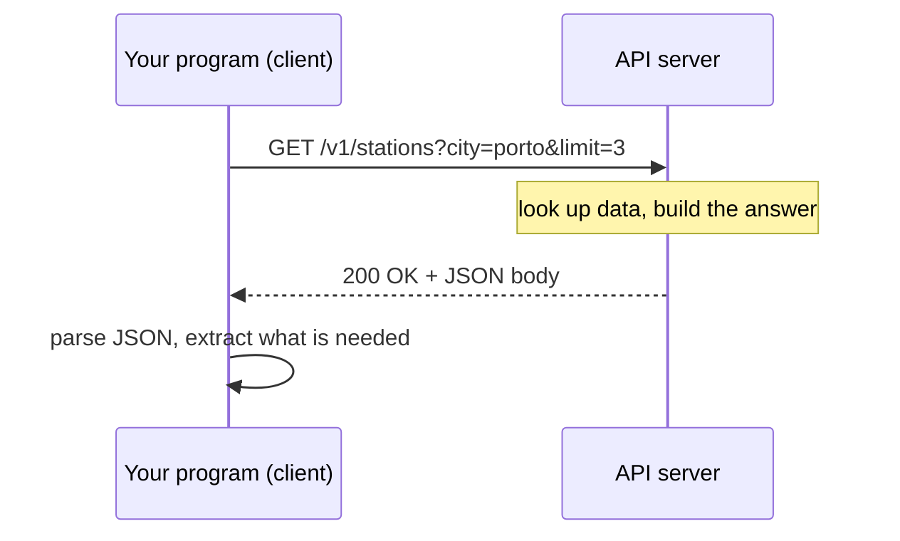
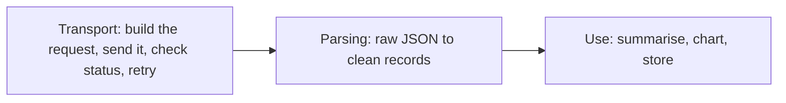

# Working with web APIs

Much of the world's live data — weather, maps, prices, public transport, code repositories, your own bank account — is not in files you download once but behind **web APIs**: addresses a program can call to ask a specific question and receive a structured answer. Learning to use them turns Python into a tool that can talk to almost any service on the internet, and it is the mirror image of what you will do in the FastAPI track, where you *build* such services.

Network calls cannot be made from inside this page, so the calls themselves are shown as static code using the **requests** library, while everything that happens *after* the response arrives — parsing, validating, summarising — runs live on realistic sample payloads. That split is also how well-designed API code is organised.

## What a web API is

**API** stands for *application programming interface*: an agreed way for one program to use another. A **web API** makes that agreement over HTTP, the same protocol your browser speaks. Your program is the **client**; it sends a **request** to a **server**, which sends back a **response**.



### Anatomy of a request

Take this address (an invented service, used throughout the lesson):

```
https://api.tidewatch.example/v1/stations?city=porto&limit=3
```

| Part | Example | Meaning |
|---|---|---|
| scheme | `https` | HTTP over an encrypted connection |
| host | `api.tidewatch.example` | which server to contact |
| path | `/v1/stations` | which **resource** on that server (`v1` is the API version) |
| query string | `?city=porto&limit=3` | parameters refining the request: `key=value` pairs joined by `&` |

A specific address an API answers on is called an **endpoint**. A request also has a **method** saying what you want to do with the resource:

| Method | Purpose | Has a body? |
|---|---|---|
| `GET` | read data | no |
| `POST` | create something / submit data | yes |
| `PUT` / `PATCH` | replace / partly update | yes |
| `DELETE` | remove | usually not |

and **headers**: extra labelled information such as which format you accept, who you are (`User-Agent`), and your credentials (`Authorization`).

### Anatomy of a response

The server answers with a **status code**, headers of its own, and usually a **body** — for APIs, almost always JSON text.

| Code | Meaning | What your program should do |
|---|---|---|
| `200 OK`, `201 Created`, `204 No Content` | success | use the result |
| `301` / `302` | moved; follow the new address | (requests follows these automatically) |
| `400 Bad Request`, `422` | your request was malformed or invalid | fix the request; do not retry unchanged |
| `401 Unauthorized` / `403 Forbidden` | missing or insufficient credentials | check the key and its permissions |
| `404 Not Found` | no such resource | check the address; maybe the item really does not exist |
| `429 Too Many Requests` | you hit the rate limit | wait, then retry more slowly |
| `500`–`503` | the server failed or is overloaded | retry later, with increasing pauses |

The first digit tells the story: **2xx** worked, **4xx** means the client did something wrong, **5xx** means the server did.

## Calling an API with requests

`requests` is the de-facto standard HTTP library for Python (`python -m pip install requests`). A complete, careful call looks like this:

```python
import requests

url = "https://api.tidewatch.example/v1/stations"
params = {"city": "porto", "limit": 3}                 # becomes ?city=porto&limit=3, properly encoded
headers = {"Accept": "application/json", "User-Agent": "tide-notebook/0.1"}

response = requests.get(url, params=params, headers=headers, timeout=10)

print(response.status_code)                            # e.g. 200
print(response.headers.get("Content-Type"))            # e.g. application/json
response.raise_for_status()                            # raise an exception for 4xx / 5xx answers

data = response.json()                                 # parse the JSON body into dicts and lists
print(type(data), list(data))
```

Four habits are packed into those lines:

1. **Pass parameters as a dictionary** (`params=`), never by gluing strings together. The library encodes spaces, accents and symbols correctly.
2. **Always set a timeout.** Without one, a server that never answers will hang your program for ever.
3. **Check the status** — `raise_for_status()` turns error responses into exceptions so that they cannot be mistaken for data.
4. **Then parse** with `.json()`.

Sending data uses the other methods; `json=` converts a dictionary into a JSON body and sets the right header:

```python
new_reading = {"station": "PRT-02", "height_m": 2.41, "taken_at": "2026-07-04T06:00:00Z"}
response = requests.post("https://api.tidewatch.example/v1/readings",
                         json=new_reading, headers=headers, timeout=10)
print(response.status_code)                            # 201 if it was created
```

What `params=` does can be seen with the standard library alone, which also offers `urllib.request` for simple calls when you cannot install anything:

```python-run
from urllib.parse import urlencode, urlsplit, parse_qs

base = "https://api.tidewatch.example/v1/stations"
query = urlencode({"city": "são joão", "limit": 3, "fields": "name,height"})
url = f"{base}?{query}"
print(url)                                    # spaces and accents are percent-encoded

parts = urlsplit(url)
print(parts.scheme, "|", parts.netloc, "|", parts.path)
print(parse_qs(parts.query))                  # and decoded again on the other side
```

## Exploring a response

An API's documentation tells you what comes back, but you should still **look** before writing code against it. Here is the kind of body our stations endpoint might return, and the exploration routine to apply to any unfamiliar payload: top-level keys first, then one level down at a time.

```python-run
import json

body = """
{
  "total_count": 37,
  "next_page": "https://api.tidewatch.example/v1/stations?city=porto&limit=3&page=2",
  "items": [
    {"id": "PRT-01", "name": "Foz Lighthouse", "location": {"lat": 41.149, "lon": -8.675},
     "sensors": ["tide", "wind"], "latest": {"height_m": 2.31, "taken_at": "2026-07-04T06:00:00Z"}, "operator": {"name": "Harbour Authority"}},
    {"id": "PRT-02", "name": "Ribeira Quay", "location": {"lat": 41.140, "lon": -8.612},
     "sensors": ["tide"], "latest": {"height_m": 1.87, "taken_at": "2026-07-04T06:00:00Z"}, "operator": null},
    {"id": "PRT-03", "name": "Afurada Pier", "location": {"lat": 41.143, "lon": -8.647},
     "sensors": [], "latest": null, "operator": {"name": "Rowing Club"}}
  ]
}
"""

data = json.loads(body)                       # what response.json() does for you
print(type(data).__name__, list(data))        # 1. the top-level shape
print(data["total_count"], "stations in total;", len(data["items"]), "on this page")

first = data["items"][0]                      # 2. one record
print(sorted(first))
print(json.dumps(first, indent=2)[:260], "...")   # 3. pretty-print to read the nesting
```

`json.dumps(obj, indent=2)` is the best exploration tool there is: the indentation makes the structure obvious. Saving a real response to a file once (`Path("sample.json").write_text(response.text)`) lets you develop the rest of your program offline, without calling the API on every run — polite to the service and much faster for you.

## Extracting what you need — defensively

Real payloads have **optional** fields: keys that are sometimes absent, and values that are sometimes `null` (which becomes `None` in Python). Station three above has no latest reading; station two has no operator. Code written against the first record alone — `item["latest"]["height_m"]` — crashes on the third with `TypeError: 'NoneType' object is not subscriptable`.

Write one function that converts a raw record into the clean, flat shape *your* program wants, and make it tolerant:

```python-run
import json

items = json.loads("""[
  {"id": "PRT-01", "name": "Foz Lighthouse", "location": {"lat": 41.149, "lon": -8.675},
   "sensors": ["tide", "wind"], "latest": {"height_m": 2.31, "taken_at": "2026-07-04T06:00:00Z"}, "operator": {"name": "Harbour Authority"}},
  {"id": "PRT-02", "name": "Ribeira Quay", "location": {"lat": 41.140, "lon": -8.612},
   "sensors": ["tide"], "latest": {"height_m": 1.87, "taken_at": "2026-07-04T06:00:00Z"}, "operator": null},
  {"id": "PRT-03", "name": "Afurada Pier", "location": {"lat": 41.143, "lon": -8.647},
   "sensors": [], "latest": null},
  {"name": "record without an id"}
]""")

def to_station(raw):
    """Flatten one API record. Return None if the record is unusable."""
    if "id" not in raw or "name" not in raw:
        return None
    latest = raw.get("latest") or {}              # handles both a missing key and null
    operator = raw.get("operator") or {}
    location = raw.get("location") or {}
    return {
        "id": raw["id"],
        "name": raw["name"],
        "height_m": latest.get("height_m"),       # may be None: 'no reading'
        "operator": operator.get("name", "unknown"),
        "lat": location.get("lat"),
        "lon": location.get("lon"),
        "has_wind": "wind" in raw.get("sensors", []),
    }

stations = [s for s in (to_station(raw) for raw in items) if s is not None]
print(f"{len(stations)} usable of {len(items)} records")
for s in stations:
    height = "no reading" if s["height_m"] is None else f"{s['height_m']:.2f} m"
    print(f"{s['id']}  {s['name']:<15} {height:<11} run by {s['operator']}")

with_reading = [s for s in stations if s["height_m"] is not None]
highest = max(with_reading, key=lambda s: s["height_m"])
print("highest tide:", highest["name"], "| average:", round(sum(s["height_m"] for s in with_reading) / len(with_reading), 2))
```

The idiom `raw.get("latest") or {}` deserves a second look: `get` returns `None` both when the key is missing and when its value is `null`, and `or {}` replaces either with an empty dictionary, on which a further `.get` is safe. Everything downstream then works with a predictable shape, and knowledge about the API's quirks lives in exactly one function. (Pydantic models, introduced in the typing module and used throughout FastAPI, do this validation declaratively.)

## Pagination: getting all the pages

APIs rarely return thousands of records in one response. They return a **page**, plus a way to get the next one — a page number, an offset, or a ready-made `next` link. Your code loops until there is no next page.

```python
def fetch_all(url, params, max_pages=50):
    """Collect the items from every page of a paginated endpoint."""
    items = []
    for _ in range(max_pages):                       # a hard stop, in case 'next' never ends
        response = requests.get(url, params=params, timeout=10)
        response.raise_for_status()
        page = response.json()
        items.extend(page["items"])
        url, params = page.get("next_page"), None    # the next link already contains the parameters
        if not url:
            break
    return items
```

The logic can be exercised here by replacing the network with a pretend server — a function that returns pages:

```python-run
def fake_server(page, per_page=4, total=10):
    """Stands in for the API: returns one page of results."""
    start = (page - 1) * per_page
    ids = list(range(start + 1, min(start + per_page, total) + 1))
    return {"items": [{"id": i} for i in ids], "next_page": page + 1 if start + per_page < total else None}

def fetch_all(get_page, max_pages=50):
    items, page = [], 1
    for _ in range(max_pages):
        result = get_page(page)
        items.extend(result["items"])
        page = result["next_page"]
        if page is None:
            break
    return items

everything = fetch_all(fake_server)
print(len(everything), [item["id"] for item in everything])
```

Passing the page-fetching function in as an argument is what makes `fetch_all` testable without a network — the same dependency-injection idea used in the testing lessons.

## Keys, limits and good manners

**Authentication.** Many APIs require an **API key** or token that identifies you, usually sent in a header:

```python
import os
import requests

api_key = os.environ["TIDEWATCH_API_KEY"]            # read from the environment, never typed into the code
headers = {"Authorization": f"Bearer {api_key}"}
response = requests.get("https://api.tidewatch.example/v1/me", headers=headers, timeout=10)
```

A key is a password. **Never** write it in source code or commit it to Git — bots scan public repositories for leaked keys within minutes. Keep it in an environment variable (or a `.env` file listed in `.gitignore`) and read it at run time.

**Rate limits.** Services cap how many requests you may make per minute or per day, and tell you so in the documentation and often in response headers. Exceed the cap and you receive `429`. Stay well under it: request only what you need, **cache** results you have already fetched, and pause between calls when looping.

**Retries with back-off.** Networks fail. A robust client retries *temporary* failures — timeouts, `429`, `5xx` — a few times, waiting longer each time, and gives up on *permanent* ones (`400`, `401`, `404`) at once, because repeating a wrong request cannot help.

```python-run
def should_retry(status):
    return status == 429 or 500 <= status < 600

def call_with_retries(send, attempts=4, base_delay=1.0, sleep=lambda seconds: None):
    """send() returns (status, body). Retry temporary failures with exponential back-off."""
    for attempt in range(1, attempts + 1):
        status, body = send()
        if status < 400:
            return body
        if not should_retry(status) or attempt == attempts:
            raise RuntimeError(f"request failed with status {status} after {attempt} attempt(s)")
        delay = base_delay * 2 ** (attempt - 1)              # 1s, 2s, 4s, ...
        print(f"  status {status}; waiting {delay:.0f}s before attempt {attempt + 1}")
        sleep(delay)                                         # time.sleep in real code

answers = iter([(503, None), (429, None), (200, {"ok": True})])
print(call_with_retries(lambda: next(answers)))

try:
    call_with_retries(lambda: (404, None))
except RuntimeError as error:
    print("gave up immediately:", error)
```

**Handling failure in requests.** The library raises specific exceptions, all descended from `requests.RequestException`:

```python
try:
    response = requests.get(url, params=params, timeout=10)
    response.raise_for_status()
    data = response.json()
except requests.Timeout:
    print("The service took too long to answer.")
except requests.ConnectionError:
    print("Could not reach the service - are you online?")
except requests.HTTPError as error:
    print(f"The service refused the request: {error.response.status_code}")
except ValueError:
    print("The answer was not valid JSON.")
```

When you make many calls to the same host, create a `requests.Session()` and call `session.get(...)`: it reuses the connection (faster) and remembers headers you set once.

## Structuring an API client

Put all of this together and a pattern emerges. Keep three layers apart:



Only the first layer touches the network, so only it needs the internet to test; the second and third are pure functions over dictionaries, testable with saved sample payloads. A complete miniature — the transport is injected, so the same code runs here against canned data and in production against `requests`:

```python-run
import json

SAMPLE = {
    "/v1/stations": {"items": [
        {"id": "PRT-01", "name": "Foz Lighthouse", "latest": {"height_m": 2.31}},
        {"id": "PRT-02", "name": "Ribeira Quay", "latest": {"height_m": 1.87}},
        {"id": "PRT-03", "name": "Afurada Pier", "latest": None},
    ]},
}

class TideClient:
    """A tiny API client. 'fetch' is any function taking (path, params) and returning parsed JSON."""
    def __init__(self, fetch):
        self.fetch = fetch
        self.cache = {}

    def _get(self, path, **params):
        key = (path, tuple(sorted(params.items())))
        if key not in self.cache:                       # do not ask twice for the same thing
            self.cache[key] = self.fetch(path, params)
        return self.cache[key]

    def heights(self, city):
        """Return {station name: height} for stations that have a reading."""
        payload = self._get("/v1/stations", city=city)
        result = {}
        for item in payload.get("items", []):
            height = (item.get("latest") or {}).get("height_m")
            if height is not None:
                result[item["name"]] = height
        return result

calls = []
def fake_fetch(path, params):
    calls.append((path, params))
    return SAMPLE[path]

client = TideClient(fake_fetch)
print(client.heights("porto"))
print(client.heights("porto"), "| network calls made:", len(calls))

for name, height in sorted(client.heights("porto").items(), key=lambda kv: -kv[1]):
    print(f"{name:<15} {'#' * round(height * 10)} {height}")
```

In real use you would construct it with a function that calls `requests.get(BASE_URL + path, params=params, timeout=10)`, checks the status and returns `response.json()`. The parsing and summarising code would not change by a single character.

From here, the data-visualisation lesson takes over: the clean dictionaries your client produces are exactly what a Matplotlib or Plotly chart consumes.

## Reading API documentation

Every API is different in detail, and its documentation is the contract. Look for five things: the **base URL** and version; how to **authenticate**; the list of **endpoints** with their parameters; an **example response** for each; and the **rate limits**. Many services describe their API in a machine-readable *OpenAPI* document rendered as an interactive page where you can try calls in the browser — FastAPI generates such a page for your own APIs automatically.

Before writing code, try a `GET` endpoint in your browser's address bar or with a command-line tool such as `curl`. Seeing the raw response once saves a great deal of guessing.

## Common mistakes

| Symptom | Cause |
|---|---|
| the program hangs indefinitely | no `timeout` |
| `KeyError` / `TypeError: 'NoneType' object is not subscriptable` on some records only | optional or `null` fields; use `.get(...)` and `or {}` |
| `JSONDecodeError` | the body is not JSON — often an HTML error page; check `status_code` and print `response.text[:200]` |
| `401` / `403` | key missing, wrong header name, or expired token |
| `429` after a burst of calls | rate limit; add pauses and caching |
| results look incomplete | you only read the first page |
| odd characters or broken URLs | query string built by hand instead of `params=` |
| a leaked key | it was committed to a repository — revoke it immediately and create a new one |

> [!TIP]
> Save one real response from each endpoint you use into a `samples/` folder and write your parsing functions and their tests against those files. You can then work on a train with no connection, your tests run in milliseconds, and when the API changes its format you will know exactly which assumption broke.

> [!INTERVIEW]
> Expect questions such as: What happens when you type a URL (DNS lookup, connection, HTTP request and response)? What do 200, 401, 404, 429 and 500 mean? Difference between GET and POST? Why are timeouts and retries with back-off necessary, and which errors should not be retried? How do you keep API keys out of source control? How would you test code that depends on a third-party API? (Inject the transport and use recorded sample responses.)

## Summary

A web API answers HTTP requests — method, URL, parameters, headers — with a status code and usually a JSON body. With `requests`: pass `params=` and `timeout=`, call `raise_for_status()`, then `.json()`. Explore payloads top-down, convert raw records to clean ones in a single tolerant function, follow pagination to the end, keep keys in the environment, respect rate limits, cache, and retry only temporary failures. Separate transport from parsing so that most of your code can be tested without a network.

```quiz
[
  {"q": "In the URL `https://api.example.com/v1/items?colour=red&limit=5`, what is `?colour=red&limit=5`?", "options": ["The host", "The query string carrying request parameters", "The request body", "A header"], "answer": 1,
   "explain": "Everything after the ? is a set of key=value parameters joined by &."},
  {"q": "What does a 404 status code mean?", "options": ["Success", "The server crashed", "The requested resource was not found", "You are sending requests too fast"], "answer": 2,
   "explain": "4xx codes indicate a problem with the request; 404 means nothing exists at that address."},
  {"q": "Why should every `requests.get(...)` call include a `timeout`?", "options": ["It makes requests faster", "Without it a call can wait for ever if the server never answers", "It is needed for JSON parsing", "It authenticates you"], "answer": 1,
   "explain": "requests has no default timeout; a silent server would hang the program."},
  {"q": "What does `response.raise_for_status()` do?", "options": ["Prints the status", "Raises an exception if the response has a 4xx or 5xx status", "Retries the request", "Converts the body to JSON"], "answer": 1,
   "explain": "It prevents an error response from being treated as valid data further down."},
  {"q": "A record has `\"latest\": null`. Which expression safely yields its height or None?", "options": ["item[\"latest\"][\"height_m\"]", "(item.get(\"latest\") or {}).get(\"height_m\")", "item.latest.height_m", "item[\"height_m\"]"], "answer": 1,
   "explain": "get returns None for a missing key or a null value; `or {}` substitutes an empty dict so the second get is safe."},
  {"q": "Which failures are worth retrying after a pause?", "options": ["400 and 404", "401 and 403", "Timeouts, 429 and 5xx responses", "All of them, indefinitely"], "answer": 2,
   "explain": "Temporary conditions may clear; a malformed or unauthorised request will fail the same way every time."},
  {"q": "Where should an API key be kept?", "options": ["In the source code, for convenience", "In an environment variable or an ignored config file, read at run time", "In the URL of every request, committed to Git", "In a comment"], "answer": 1,
   "explain": "Keys are secrets; anything committed to a repository should be considered public."},
  {"q": "An endpoint returns 30 items and a `next_page` link, but there are 500 items in total. What must your code do?", "options": ["Nothing; 30 is enough", "Loop, requesting each next page until there is none", "Increase the timeout", "Send a DELETE request"], "answer": 1,
   "explain": "Paginated APIs return one page at a time; follow the next link (with a sensible upper bound) to collect everything."}
]
```

> **Source:** Matthes, *Python Crash Course* (3rd ed.), ch. 17 (working with APIs: making calls with requests, processing responses, rate limits) — topics only; the service, payloads, code and wording here are original; Requests documentation ("Quickstart", "Advanced Usage"); MDN Web Docs, "HTTP response status codes"; Python docs, *Library Reference* `json`, `urllib.parse`.
