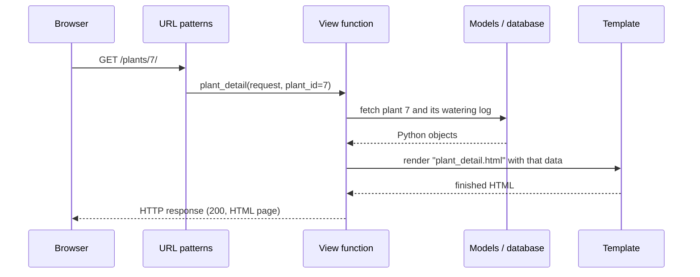

# A web application with Django

> **Before this lesson:** read [Working with web APIs](#/lesson/python/py-proj-apis) first: it explains HTTP, URLs, requests, responses, methods and status codes, which this lesson uses constantly. You also need classes and inheritance ([Classes: modelling things with objects](#/lesson/python/py-start-classes)), decorators ([Decorators and functools](#/lesson/python/py-decorators)), modules and packages ([Modules, packages and imports](#/lesson/python/py-imports)), virtual environments ([Virtual environments, pip, uv and project layout](#/lesson/python/py-envs)) and the project method from [Planning and structuring a small project](#/lesson/python/py-proj-planning). One demo uses a regular expression ([Regular expressions](#/lesson/python/py-regex)); it is explained where it appears.

## In plain words

A **web application** is a program that people use through a web browser: an online shop, a booking system, a social network. Unlike a static website, whose pages are fixed files, a web application builds each page when it is requested, from data it stores, and it lets people sign in, fill in forms and change that data.

Picture the front desk of a large library. A visitor asks for "the record of plant number 7". The receptionist looks at a chart that says which librarian handles which kind of request and passes the request on. That librarian fetches the right records from the archive, fills them into a standard printed form, and hands the completed form back to the visitor. A web application works the same way: the chart is the table of **URL patterns**, the librarian is a **view** function, the archive is the **database**, and the printed form is a **template**.

**Django** is Python's "batteries included" web **framework**. A framework is a large library that provides the skeleton of an application and calls *your* code at the right moments; you fill in the parts that are specific to your site. Django supplies a database layer, an administration site, form handling, user accounts and sensible security defaults in one package, which makes it an excellent way to learn how web applications fit together.

Why this matters for a job: web development is one of the largest areas of software work, and Django is widely used, from small internal tools to large public sites. Everything you learn here about requests, routing, models and templates carries over to other frameworks, including **FastAPI**, which this site covers in its own track and which is compared with Django at the end of the lesson. Interviewers like to ask you to trace a request through an application and to explain security basics such as CSRF and the difference between authentication and authorisation; all of these are covered below.

Django needs a project on disk and a running server, so the Django code here is shown as static blocks to type on your own computer. Two runnable sections model the central mechanisms, URL routing and template rendering, in plain Python, so that you can see what the framework is doing for you.

Our project is *Plant Shelf*: signed-in users keep a list of their house plants and log each watering.

## How a web application works



Every page view follows this path, top to bottom in the diagram:

1. The browser sends an HTTP request, here `GET /plants/7/`.
2. Django matches the request's path against its table of **URL patterns** and calls the corresponding **view**, an ordinary Python function, passing it the request and the plant number 7.
3. The view asks the **models** (Python classes that represent the stored data) for plant 7 and its watering log, and receives Python objects.
4. The view hands that data to a **template**, a page of **HTML** (HyperText Markup Language, the language web pages are written in) with gaps to fill.
5. The template produces the finished HTML, and the view returns it to the browser as the response, with status 200.

Django calls this arrangement **MTV** (model, template, view); elsewhere you will hear **MVC** (model, view, controller). The names differ, but the idea is the same: *data*, *presentation* and *request-handling logic* live in different places.

## Setting up

```bash
mkdir plant_shelf && cd plant_shelf
python -m venv .venv
source .venv/bin/activate              # Windows: .venv\Scripts\activate
python -m pip install django

django-admin startproject config .     # the trailing dot: create the project in this folder
python manage.py migrate               # create the database and Django's built-in tables
python manage.py runserver             # development server at http://127.0.0.1:8000/
```

**Reading these commands line by line**

- `mkdir` makes a folder and `cd` moves into it.
- `python -m venv .venv` creates a virtual environment, a private set of installed packages for this project, and the next line activates it (the command differs on Windows, as the comment shows).
- `pip install django` installs Django into that environment.
- `django-admin startproject config .` creates the project skeleton: a `manage.py` script and a `config` folder of settings. The trailing dot means "here", so no extra folder level is added.
- `python manage.py migrate` creates the database and the tables Django itself needs (for users, sessions and so on). A **database** is a program or file that stores data in **tables**: each table has named **columns**, and each record is a **row**.
- `python manage.py runserver` starts a **development server**, a small web server for your own testing. `127.0.0.1` is a special address meaning "this computer" (also called *localhost*), and `8000` is the **port**, a numbered door on the computer that the server listens at. Open `http://127.0.0.1:8000/` in a browser and you see Django's welcome page.

Django distinguishes a **project** (the whole site: its settings and top-level URL table) from **apps** (self-contained features inside it, each in its own folder). Create an app for the plants and register it:

```bash
python manage.py startapp plants
```

```python
# config/settings.py
INSTALLED_APPS = [
    "plants",                          # our app first
    "accounts",                        # added later in this lesson
    "django.contrib.admin",
    "django.contrib.auth",
    "django.contrib.contenttypes",
    "django.contrib.sessions",
    "django.contrib.messages",
    "django.contrib.staticfiles",
]
```

`INSTALLED_APPS` lists every app the project uses: our own two, then Django's built-in apps for the admin site, user accounts ("auth"), sessions, messages and static files. Listing an app is what makes Django look for its models, templates and admin settings.

The resulting layout:

```
plant_shelf/
├── manage.py                # command-line entry point: runserver, migrate, shell, test ...
├── db.sqlite3               # the development database (a single file)
├── config/
│   ├── settings.py          # configuration for the whole site
│   └── urls.py              # the top-level URL table
└── plants/
    ├── models.py            # data definitions
    ├── views.py             # request handlers
    ├── urls.py              # this app's URL table (you create it)
    ├── forms.py             # forms (you create it)
    ├── admin.py             # what appears in the admin site
    ├── migrations/          # generated database change scripts
    └── templates/plants/    # HTML templates (you create this folder)
```

`db.sqlite3` is a **SQLite** database: a complete database stored in a single file, ideal for development.

## Models: describing the data

A **model** is a class that describes one kind of record. Each attribute is a **field**, which becomes a column in a database table. Databases are normally queried in **SQL** (Structured Query Language). Django's **ORM** (object-relational mapper) translates between the two worlds: you create, query and change records as Python objects, and it writes the SQL for you.

```python
# plants/models.py
from django.conf import settings
from django.db import models

class Plant(models.Model):
    """A plant belonging to one user."""
    owner = models.ForeignKey(settings.AUTH_USER_MODEL, on_delete=models.CASCADE)
    name = models.CharField(max_length=80)
    room = models.CharField(max_length=40, blank=True)
    days_between_water = models.PositiveIntegerField(default=7)
    added = models.DateTimeField(auto_now_add=True)

    class Meta:
        ordering = ["name"]

    def __str__(self):
        return self.name

class Watering(models.Model):
    """One occasion on which a plant was watered."""
    plant = models.ForeignKey(Plant, on_delete=models.CASCADE, related_name="waterings")
    note = models.TextField(blank=True)
    done_at = models.DateTimeField(auto_now_add=True)

    class Meta:
        ordering = ["-done_at"]                    # newest first

    def __str__(self):
        return f"{self.plant.name} on {self.done_at:%d %b}"
```

Points to understand:

- Each model inherits from `models.Model`, which gives it all the database behaviour. Django also adds an automatic `id` field, a unique number for each row.
- `CharField` holds short text (a maximum length is required), `TextField` long text, `PositiveIntegerField` a whole number of zero or more, and `DateTimeField` a moment in time. `blank=True` allows the field to be left empty in forms; `default=7` supplies a starting value; `auto_now_add=True` stamps the creation time automatically.
- A **`ForeignKey`** links a record to one record of another model. This is a **many-to-one relationship**: many waterings belong to one plant, and many plants belong to one user. `settings.AUTH_USER_MODEL` refers to Django's user model. `on_delete=models.CASCADE` means "if the plant is deleted, delete its waterings too".
- `related_name="waterings"` names the reverse direction, so from a plant you can write `plant.waterings.all()` to get all its waterings.
- The inner `class Meta` holds options for the model as a whole; `ordering` sets the default sort order (`"-done_at"`, with a minus sign, means newest first).
- `__str__` controls how a record is displayed, in the admin site and when debugging.

### Migrations

Whenever models change, the database tables must change to match. A **migration** is a small generated Python file describing one such change ("add a column `room` to the plant table"). Django handles it in two explicit steps:

```bash
python manage.py makemigrations plants     # write a migration file describing the change
python manage.py migrate                   # apply pending migrations to the database
```

Migration files are ordinary code, kept in version control, so every copy of the project (yours, a colleague's, the live server's) can bring its database to the same shape. The rhythm *edit models → makemigrations → migrate* soon becomes second nature.

### The admin site and the shell

Django can generate a complete management interface for your data, called the **admin site**. Create an administrator account (a **superuser**, who may do everything) and register the models:

```bash
python manage.py createsuperuser
```

```python
# plants/admin.py
from django.contrib import admin
from .models import Plant, Watering

admin.site.register(Plant)
admin.site.register(Watering)
```

Visit `/admin/`, sign in, and you can add, edit and delete plants through a generated interface. It is invaluable for entering test data, and for the people who will run the site.

The ORM can be explored interactively with `python manage.py shell`, a Python prompt with your project loaded:

```python
>>> from plants.models import Plant
>>> Plant.objects.all()                                  # every plant (a lazy "QuerySet")
>>> Plant.objects.filter(room="kitchen").count()
>>> thirsty = Plant.objects.filter(days_between_water__lte=3).order_by("name")
>>> fern = Plant.objects.get(id=1)                       # exactly one record, or an exception
>>> fern.waterings.all()                                 # follow the relationship backwards
>>> fern.waterings.create(note="half a jug")             # create a linked record
>>> fern.days_between_water = 4; fern.save()             # change and store
```

`Plant.objects` is the model's **manager**, the entry point for queries. A **QuerySet** describes a database query. It is **lazy**: the query only runs when you actually use the results (by looping, printing or counting), so methods such as `filter`, `exclude` and `order_by` can be chained to build up a query first. The double-underscore syntax expresses comparisons: `days_between_water__lte=3` means "less than or equal to 3"; other suffixes include `gte` (greater than or equal) and `icontains` (contains this text, ignoring case). `get` returns exactly one record and raises an exception if there are none or several. After changing an attribute, `save()` writes the change to the database.

## URLs: mapping addresses to code

The project's URL table delegates to each app's own table:

```python
# config/urls.py
from django.contrib import admin
from django.urls import include, path

urlpatterns = [
    path("admin/", admin.site.urls),
    path("accounts/", include("accounts.urls")),
    path("", include("plants.urls")),
]
```

```python
# plants/urls.py
from django.urls import path
from . import views

app_name = "plants"                                      # a namespace for the names below
urlpatterns = [
    path("", views.home, name="home"),
    path("plants/", views.plant_list, name="plant_list"),
    path("plants/new/", views.plant_create, name="plant_create"),
    path("plants/<int:plant_id>/", views.plant_detail, name="plant_detail"),
    path("plants/<int:plant_id>/water/", views.water, name="water"),
]
```

**Reading the URL tables**

- `urlpatterns` is the list Django searches, in order. Each `path(pattern, target)` pairs an address pattern with what should handle it.
- In the project table, addresses starting with `admin/` go to the admin site, `accounts/` to the accounts app's own table, and everything else to the plants app's table. `include` hands the rest of the address to the named table.
- In the app table, each pattern points at a view function in `views.py`.
- `<int:plant_id>` is a **path converter**: it matches a whole number at that position, converts it to an `int`, and passes it to the view as the keyword argument `plant_id`.
- Every pattern has a `name`, and `app_name = "plants"` puts those names in a **namespace**, so the full name is `plants:plant_detail`. The rest of the code refers to URLs *by name*, so changing an address later means editing one line.

What the router does is simple enough to write yourself. This model implements `<int:...>` and `<str:...>` converters and the "first match wins" rule:

```python-run
def match(pattern, path):
    """Return a dict of captured values if path fits pattern, else None."""
    pattern_parts = pattern.strip("/").split("/") if pattern.strip("/") else []
    path_parts = path.strip("/").split("/") if path.strip("/") else []
    if len(pattern_parts) != len(path_parts):
        return None
    captured = {}
    for expected, actual in zip(pattern_parts, path_parts):
        if expected.startswith("<") and expected.endswith(">"):
            kind, _, name = expected[1:-1].rpartition(":")
            if kind == "int":
                if not actual.isdigit():
                    return None
                captured[name] = int(actual)
            else:
                captured[name] = actual
        elif expected != actual:
            return None
    return captured

def resolve(routes, path):
    """routes: list of (pattern, view name). Return (view name, kwargs) of the first match, or None."""
    for pattern, view_name in routes:
        kwargs = match(pattern, path)
        if kwargs is not None:
            return view_name, kwargs
    return None

routes = [
    ("", "home"),
    ("plants/", "plant_list"),
    ("plants/new/", "plant_create"),
    ("plants/<int:plant_id>/", "plant_detail"),
    ("plants/<int:plant_id>/water/", "water"),
    ("rooms/<str:room>/", "room_detail"),
]
for path in ["/", "/plants/", "/plants/new/", "/plants/7/", "/plants/7/water/", "/plants/seven/", "/rooms/kitchen/", "/nope/"]:
    print(f"{path:<20} -> {resolve(routes, path)}")
```

**Reading this code line by line**

- `match` first splits both the pattern and the path into their parts between slashes: `"plants/<int:plant_id>/"` becomes `["plants", "<int:plant_id>"]` and `"/plants/7/"` becomes `["plants", "7"]`. `strip("/")` removes slashes at either end; an empty path gives an empty list. If the numbers of parts differ, they cannot match.
- It then compares the parts in pairs with `zip`. A part written in angle brackets is a converter: `expected[1:-1]` removes the brackets, and `rpartition(":")` splits `"int:plant_id"` into the kind `"int"` and the name `"plant_id"`. An `int` converter accepts only digits (`isdigit()`) and stores the number converted with `int`. Any other kind stores the text as it is.
- A plain part must be exactly equal; otherwise the pattern does not match and `None` is returned.
- If every part fits, `match` returns the dictionary of captured values (empty for patterns without converters).
- `resolve` tries the routes in order and returns the first view name that matches, together with its captured arguments.
- The output shows each path and its result: `/plants/7/` resolves to `plant_detail` with `{'plant_id': 7}` (an integer), `/rooms/kitchen/` captures the text `'kitchen'`, and `/plants/seven/` and `/nope/` match nothing.

Order matters when patterns could overlap. Here `new` is not a number, so the `int` converter rejects it anyway; but if the detail pattern used a `<str:...>` converter, `plants/new/` would have to come first to win. A path that matches nothing, like `/plants/seven/`, gets a "404 Not Found" page from Django.

## Views: handling a request

A view receives an `HttpRequest` object (holding the method, the path, submitted data and the signed-in user), plus any values captured from the URL, and must return an `HttpResponse`. The `render` shortcut fills a template with data, passed as a dictionary called the **context**, and wraps the result in a response.

```python
# plants/views.py
from django.contrib.auth.decorators import login_required
from django.shortcuts import get_object_or_404, redirect, render

from .forms import PlantForm
from .models import Plant

def home(request):
    return render(request, "plants/home.html")

@login_required
def plant_list(request):
    plants = Plant.objects.filter(owner=request.user)          # only this user's plants
    return render(request, "plants/plant_list.html", {"plants": plants})

@login_required
def plant_detail(request, plant_id):
    plant = get_object_or_404(Plant, id=plant_id, owner=request.user)
    context = {"plant": plant, "waterings": plant.waterings.all()[:10]}
    return render(request, "plants/plant_detail.html", context)
```

**Reading this code line by line**

- `home` renders a template with no data.
- `@login_required` is a decorator: before the view runs, it checks whether the visitor is signed in and, if not, redirects them to the login page.
- `plant_list` asks only for plants whose owner is `request.user`, the signed-in user, and passes them to the template under the name `plants`.
- `plant_detail` receives `plant_id` from the URL converter. `get_object_or_404` fetches the one plant matching *both* the id and the owner, or stops with a "404 Not Found" response. `plant.waterings.all()[:10]` gets the ten most recent waterings (newest first, thanks to the model's ordering); slicing a QuerySet becomes a database `LIMIT`, so only ten rows are fetched.

Because the lookup includes `owner=request.user`, somebody else's plant is *not found* for you, exactly as if it did not exist. More on that under security below.

## Templates: producing HTML

A template is an HTML file with placeholders. `{{ ... }}` inserts a value; `` is a **tag** that controls logic: loops, conditions, links and inheritance.

```html
<!-- plants/templates/plants/base.html -->
<!doctype html>
<html lang="en">
<head>
  <meta charset="utf-8">
  <title>Plant Shelf</title>
</head>
<body>
  <nav>
    <a href="">Plant Shelf</a>
    
      <a href="">My plants</a>
      Hello, {{ user.username }}.
      <form action="" method="post"><button>Log out</button></form>
    
      <a href="">Log in</a>
      <a href="">Register</a>
    
  </nav>
  <main></main>
</body>
</html>
```

```html
<!-- plants/templates/plants/plant_list.html -->

My plants


  <h1>My plants</h1>
  <ul>
    
      <li>
        <a href="">{{ plant.name }}</a>
        ({{ plant.room|default:"no room set" }}) - water every {{ plant.days_between_water }} days
      </li>
    
      <li>No plants yet.</li>
    
  </ul>
  <a href="">Add a plant</a>

```

**Reading the templates**

- In HTML, elements are written between tags such as `<nav>...</nav>` (a navigation bar), `<a href="...">` (a link), `<ul>` and `<li>` (a bulleted list and its items), `<h1>` (a main heading) and `<form>` (a form the user can submit).
- `base.html` is the page skeleton. `` shows different links to signed-in visitors and to everyone else. The log-out button is a small form sent with POST (explained in the forms section).
- `` and `` are named holes that other templates fill.
- `plant_list.html` starts with ``: it reuses the whole skeleton and only supplies its own `title` and `content` blocks.
- `` loops over the QuerySet from the view; `` gives the text to show if there are no plants.

Key ideas:

- **Template inheritance.** `base.html` defines the page skeleton with named `block`s; every other template `extends` it and fills in the blocks. Navigation, styling and footers are written once.
- **``** builds an address from the pattern's *name* and arguments, so no paths are hard-coded.
- **Filters** transform a value with a vertical bar: `{{ plant.room|default:"no room set" }}`, `{{ watering.done_at|date:"d M Y" }}`, `{{ note|linebreaks }}`.
- **Automatic escaping.** Values inserted with `{{ }}` have special characters such as `<` converted into harmless codes called **HTML entities** (`&lt;`), so text typed by a user cannot inject a script into your page. Such an injection is called **cross-site scripting** (XSS).

A toy renderer shows the principle of substitution and escaping:

```python-run
import html, re

def render(template, context):
    """Replace {{ name }} and {{ name.key }} with escaped values from the context."""
    def lookup(match):
        value = context
        for part in match.group(1).split("."):
            value = value[part] if isinstance(value, dict) else getattr(value, part)
        return html.escape(str(value))                 # escaping stops injected HTML from running
    return re.sub(r"\{\{\s*([\w.]+)\s*\}\}", lookup, template)

page = "<h1>{{ plant.name }}</h1><p>Lives in the {{ plant.room }}. Note: {{ note }}</p>"
context = {"plant": {"name": "Fern", "room": "kitchen"}, "note": "<script>alert('gotcha')</script>"}
print(render(page, context))
```

**Reading this code line by line**

- `re.sub(pattern, function, text)` finds every match of a **regular expression** (a pattern for text) and replaces it with whatever the function returns. The pattern `\{\{\s*([\w.]+)\s*\}\}` means: two literal braces, optional spaces, a captured group of letters, digits, underscores and dots, optional spaces, two closing braces. So it finds `{{ plant.name }}` and captures `plant.name`.
- `lookup` receives each match. `match.group(1)` is the captured name; it is split on dots and followed step by step: first `context["plant"]`, then that dictionary's `"name"`. (For objects instead of dictionaries it uses `getattr`, as Django does for model attributes.)
- `html.escape(str(value))` converts `<`, `>`, `&` and quotes into entities before inserting the value.
- The `note` contains a script, the kind of thing an attacker might type into a form. In the output it appears as `&lt;script&gt;...`: the browser would show those characters as text instead of running them.

## Forms: accepting data

Reading data from users takes three things: an HTML form to display, **validation** of what comes back (checking that it is complete and sensible), and storage. A **`ModelForm`** builds all three from a model.

```python
# plants/forms.py
from django import forms
from .models import Plant, Watering

class PlantForm(forms.ModelForm):
    class Meta:
        model = Plant
        fields = ["name", "room", "days_between_water"]        # NOT owner: the view sets that
        labels = {"days_between_water": "Water every (days)"}

class WateringForm(forms.ModelForm):
    class Meta:
        model = Watering
        fields = ["note"]
        widgets = {"note": forms.Textarea(attrs={"rows": 3})}
```

`PlantForm` is generated from the `Plant` model, but only for the three listed fields. The owner is deliberately left out: if it were a form field, a user could submit someone else's id. `labels` changes the text shown next to a field, and `widgets` chooses how a field is displayed, here a three-line text box.

One view typically handles both showing the empty form (a `GET` request) and processing the submission (a `POST` request):

```python
# plants/views.py (continued)
@login_required
def plant_create(request):
    if request.method != "POST":
        form = PlantForm()                                # an empty form to display
    else:
        form = PlantForm(data=request.POST)               # a form filled with the submitted data
        if form.is_valid():                               # runs every validation rule
            plant = form.save(commit=False)               # build the object, do not store it yet
            plant.owner = request.user                    # set what the form must not control
            plant.save()
            return redirect("plants:plant_detail", plant_id=plant.id)
    return render(request, "plants/plant_form.html", {"form": form})   # empty, or with error messages
```

```html
<!-- plants/templates/plants/plant_form.html -->


  <h1>Add a plant</h1>
  <form method="post">
    
    {{ form.as_div }}
    <button type="submit">Save</button>
  </form>

```

**Reading the view line by line**

- If the request is not a POST (the visitor has only opened the page), an empty form is created.
- If it is a POST (the visitor pressed Save), the form is filled with the submitted data, `request.POST`.
- `form.is_valid()` runs every check: required fields present, the name no longer than 80 characters, the number of days a non-negative whole number.
- `form.save(commit=False)` builds a `Plant` object from the form without storing it, so the view can set the owner to the signed-in user, and then `save()` stores it.
- `redirect(...)` answers with a redirect response, telling the browser to go to the new plant's detail page.
- If the form was invalid, the code falls through to `render` with the same form, which now carries error messages next to the faulty fields. In the template, `{{ form.as_div }}` writes out every field, label and error.

The pattern is worth memorising: **GET shows the form; POST validates; valid data is saved and the browser is *redirected*; invalid data re-displays the form with errors.** Redirecting after a successful POST (instead of rendering a page directly) means that refreshing the browser does not submit the form a second time; this is called the **Post/Redirect/Get** pattern.

The `` tag inserts a hidden secret value that proves the submission came from your own page. **CSRF** stands for *cross-site request forgery*: a trick in which a malicious website makes your browser send a form to another site where you are signed in, as if you had submitted it. Django rejects POST requests without a valid token, which defeats this attack.

Editing uses the same form: fetch the existing object, then `PlantForm(instance=plant)` to display it and `PlantForm(instance=plant, data=request.POST)` to update it.

## User accounts

Django ships with a complete authentication system: a `User` model, **password hashing** (passwords are stored only as a scrambled one-way fingerprint, never as the password itself), **sessions** (the server remembers that a browser is signed in, using a small token the browser stores in a **cookie**), and ready-made views for logging in and out. A small `accounts` app wires it up and adds registration.

```python
# accounts/urls.py
from django.urls import include, path
from . import views

app_name = "accounts"
urlpatterns = [
    path("", include("django.contrib.auth.urls")),        # provides login/ and logout/ (and password reset)
    path("register/", views.register, name="register"),
]
```

```python
# accounts/views.py
from django.contrib.auth import login
from django.contrib.auth.forms import UserCreationForm
from django.shortcuts import redirect, render

def register(request):
    if request.method != "POST":
        form = UserCreationForm()
    else:
        form = UserCreationForm(data=request.POST)
        if form.is_valid():
            new_user = form.save()                        # stores the user with a hashed password
            login(request, new_user)                      # sign them in straight away
            return redirect("plants:plant_list")
    return render(request, "registration/register.html", {"form": form})
```

The URL table includes Django's ready-made login, logout and password-reset views and adds our own `register` view. That view follows the same GET/POST pattern as `plant_create`, using Django's built-in `UserCreationForm` (username plus password typed twice). After saving the new user, `login(request, new_user)` starts a session so they do not have to sign in again.

The built-in login view expects a template at `registration/login.html` containing a form like the one above, and three settings tell Django where to send people:

```python
# config/settings.py
LOGIN_URL = "accounts:login"                # where @login_required sends anonymous visitors
LOGIN_REDIRECT_URL = "plants:plant_list"    # where to go after a successful login
LOGOUT_REDIRECT_URL = "plants:home"
```

### Protecting pages and protecting data

These are two different jobs, and beginners often do only the first.

1. **Authentication: who are you?** `@login_required` on a view redirects anyone who is not signed in to the login page.
2. **Authorisation: are you allowed to see *this*?** Being signed in must not let you read another user's records by typing a different number in the address bar. Every query must be restricted to the current user (`Plant.objects.filter(owner=request.user)`), and every single-object lookup must check ownership, as `get_object_or_404(Plant, id=plant_id, owner=request.user)` does. The same applies to pages that edit or delete, and to POST requests, not only to pages that display.

```python
@login_required
def water(request, plant_id):
    plant = get_object_or_404(Plant, id=plant_id, owner=request.user)      # ownership check
    if request.method == "POST":
        form = WateringForm(data=request.POST)
        if form.is_valid():
            watering = form.save(commit=False)
            watering.plant = plant
            watering.save()
    return redirect("plants:plant_detail", plant_id=plant.id)
```

The `water` view first fetches the plant *with the ownership check*, so a user cannot log waterings on someone else's plant. On a valid POST it builds the watering, attaches it to that plant and saves it; in every case it redirects back to the plant's page.

Forgetting the ownership check is one of the most common real-world security flaws. It has a name: **insecure direct object reference** (IDOR).

## Styling

Templates produce plain HTML; appearance comes from **CSS** (Cascading Style Sheets, the language for colours, fonts and layout). The quick route to a presentable, mobile-friendly site is a CSS framework such as **Bootstrap**: link its stylesheet in `base.html`, then add its class names to your elements (`class="navbar"`, `class="btn btn-primary"`, `class="container"`). The package `django-bootstrap5` provides template tags that render Django forms with Bootstrap styling in one line. Your own CSS, images and JavaScript are called **static files**; they go in a `static/` folder and are referenced with the `` tag. Because all pages extend `base.html`, restyling the whole site means changing one file.

## Testing

Django includes a **test client** that makes requests to your views without a running server:

```python
# plants/tests.py
from django.contrib.auth import get_user_model
from django.test import TestCase
from django.urls import reverse

from .models import Plant

class PlantPrivacyTests(TestCase):
    def setUp(self):
        User = get_user_model()
        self.ana = User.objects.create_user("ana", password="long-test-pass-1")
        self.ben = User.objects.create_user("ben", password="long-test-pass-2")
        self.fern = Plant.objects.create(owner=self.ana, name="Fern")

    def test_anonymous_visitor_is_sent_to_login(self):
        response = self.client.get(reverse("plants:plant_list"))
        self.assertEqual(response.status_code, 302)

    def test_owner_sees_own_plant(self):
        self.client.login(username="ana", password="long-test-pass-1")
        response = self.client.get(reverse("plants:plant_detail", args=[self.fern.id]))
        self.assertContains(response, "Fern")

    def test_other_user_gets_404(self):
        self.client.login(username="ben", password="long-test-pass-2")
        response = self.client.get(reverse("plants:plant_detail", args=[self.fern.id]))
        self.assertEqual(response.status_code, 404)
```

**Reading the tests**

- `setUp` runs before each test: it creates two users and one plant owned by ana.
- `reverse("plants:plant_list")` is the code version of the `` tag: it turns a URL name into an address.
- The first test visits the plant list without signing in and expects status 302, a redirect (to the login page).
- The second signs in as ana and checks that her plant's page contains the word "Fern".
- The third signs in as ben and requests ana's plant. It must get 404: this is the authorisation check working.

Run them with `python manage.py test`; each test gets a fresh, temporary database. The third test is the one that protects your users.

## Deployment: an overview

**Deployment** means putting your application on a server on the internet so others can use it. `runserver` is a development convenience, not something to expose to the internet. Putting a Django site online involves the same checklist on any hosting platform:

| Concern | Development | Production |
|---|---|---|
| `DEBUG` | `True` (detailed error pages) | **`False`** — debug pages reveal code and settings |
| `SECRET_KEY`, passwords | in `settings.py` | read from **environment variables**, never committed |
| `ALLOWED_HOSTS` | empty | your domain name(s) |
| Database | SQLite file | a server database such as PostgreSQL |
| Application server | `runserver` | a WSGI/ASGI server such as gunicorn or uvicorn |
| Static files | served by Django | collected with `python manage.py collectstatic` and served by the platform, a CDN or WhiteNoise |
| HTTPS | none | required; set the secure-cookie and HTTPS-redirect settings |
| Dependencies | whatever is installed | pinned in `requirements.txt` / a lock file |
| Schema changes | `migrate` by hand | `migrate` as a step of every release |

Some terms from the table: **production** is the live environment real users reach. `SECRET_KEY` is a random value Django uses to sign sessions and tokens. **PostgreSQL** is a widely used database server. **WSGI** and **ASGI** (Web Server Gateway Interface and Asynchronous Server Gateway Interface) are the standard ways a Python web application talks to a production-grade web server such as gunicorn or uvicorn. A **CDN** (content delivery network) is a network of servers around the world that delivers static files quickly; WhiteNoise is a package that lets Django serve them efficiently itself. The **schema** is the structure of the database tables.

The general procedure: put the project in Git; record dependencies; move secrets and environment-specific settings into environment variables; choose a platform (a **platform-as-a-service** that builds and runs your app straight from your repository is the gentlest start; a **container** or a virtual server gives more control); provision a database; push the code; run migrations; create a superuser; then visit the site and read the logs. `python manage.py check --deploy` lists security settings you have missed. Custom error pages (`404.html`, `500.html` in the templates folder) replace the default ones once `DEBUG` is off.

## Django and FastAPI compared

Both are excellent Python web frameworks with different centres of gravity.

| | Django | FastAPI |
|---|---|---|
| Philosophy | full-stack, "batteries included" | small core; you choose the components |
| Typical output | server-rendered HTML pages (and APIs via Django REST Framework or Django Ninja) | JSON APIs consumed by front-ends, mobile apps and other services |
| Data layer | built-in ORM and migrations | bring your own (SQLAlchemy/SQLModel + Alembic, etc.) |
| Validation | forms and model fields | Pydantic models driven by **type hints** |
| Admin, auth, sessions | included | add libraries or write them |
| Concurrency | synchronous by tradition, async supported | **async** from the start |
| API documentation | via add-ons | automatic interactive OpenAPI docs |
| Good fit | content sites, internal tools, classic CRUD applications needing accounts and an admin quickly | high-throughput APIs, microservices, machine-learning model serving |

A few terms: **full-stack** means covering everything from the database to the HTML pages. A **front-end** is the part of an application that runs in the browser or on a phone. **CRUD** stands for create, read, update, delete, the four basic operations on stored data. A **microservice** is a small, separately deployed service that does one job within a larger system.

The same idea in each, to make the correspondence concrete:

```python
# Django: URL pattern + view returning JSON
from django.http import JsonResponse
from django.shortcuts import get_object_or_404

def plant_api(request, plant_id):                  # path("api/plants/<int:plant_id>/", plant_api)
    plant = get_object_or_404(Plant, id=plant_id, owner=request.user)
    return JsonResponse({"id": plant.id, "name": plant.name})
```

```python
# FastAPI: the route, the path parameter's type and the response shape are declared together
from fastapi import FastAPI, HTTPException
from pydantic import BaseModel

app = FastAPI()

class PlantOut(BaseModel):
    id: int
    name: str

@app.get("/api/plants/{plant_id}", response_model=PlantOut)
async def plant_api(plant_id: int):
    plant = await find_plant(plant_id)
    if plant is None:
        raise HTTPException(status_code=404, detail="Plant not found")
    return plant
```

In Django, the address lives in a URL table and the view builds a JSON response by hand. In FastAPI, the decorator `@app.get(...)` declares the address, the type hint `plant_id: int` does the conversion that Django's `<int:...>` converter does, and `response_model=PlantOut` describes the shape of the answer. (`find_plant` stands for your own database lookup.) Routing, path parameters, validation, a 404 for missing records: the concepts are identical, the spelling differs. Having seen them in Django, you will recognise each one immediately in this site's **FastAPI track**, which builds on the typing, Pydantic and asyncio lessons earlier in this Python track.

> [!TIP]
> Build the site in the same thin slices as any other project: one model, one URL, one view, one template — see it work in the browser — then the next. Use the admin site to enter data long before you write your own forms, and add user accounts only after the core pages work.

> [!INTERVIEW]
> Frequent web-framework questions: Trace a request through the application (URL resolution → view → model/ORM → template → response). What is an ORM and what is a migration? Why redirect after a successful POST? What is CSRF and how is it prevented? Difference between authentication and authorisation — and how do you stop user A reading user B's data? What changes between development and production (`DEBUG`, secrets, database, static files, HTTPS)? When would you choose Django and when FastAPI?

## Pitfalls recap

- Changing a model and forgetting `makemigrations` and `migrate`, so the database no longer matches the code.
- Hard-coding addresses in templates instead of using `` with pattern names.
- Rendering a page after a successful POST instead of redirecting, so a refresh submits the form again.
- Putting `owner` in a form's fields, letting users choose whose record they create.
- Using `@login_required` but forgetting to filter queries by owner.
- Deploying with `DEBUG = True` or with the secret key committed to Git.

## Summary

A Django request flows from the URL table to a view, which uses models to reach the database and a template to produce HTML. Models are classes whose fields become columns; migrations keep the database in step with them; the admin site manages data for free. URL patterns capture values with converters and are referred to by name. Views return responses; templates inherit from a base and escape output. ModelForms display, validate and save input using the GET/POST/redirect pattern with CSRF protection. The auth system provides users and login; you must add `@login_required` *and* filter every query by owner. Deployment means turning off debug, moving secrets into the environment, a real database and server, and HTTPS.

## Glossary

- **Web application** - a program used through a browser that builds pages from stored data.
- **Framework** - a large library that provides an application's skeleton and calls your code.
- **HTML** - HyperText Markup Language, the language web pages are written in.
- **Database / table / row / column** - organised data storage / one kind of record / one record / one field of every record.
- **SQL** - Structured Query Language, used to query databases.
- **ORM (object-relational mapper)** - a layer that lets you use database rows as Python objects.
- **Model / field** - a class describing one kind of record / one attribute, stored as a column.
- **Foreign key** - a field linking a record to a record of another model (many-to-one).
- **Migration** - a generated file describing a change to the database structure.
- **Superuser / admin site** - an all-powerful account / Django's generated management interface.
- **QuerySet** - a lazy description of a database query, run when its results are used.
- **URL pattern / path converter** - an address rule mapped to a view / a part like `<int:plant_id>` that captures and converts a value.
- **Namespace** - a prefix such as `plants:` that keeps names from different apps apart.
- **View** - a function that receives a request and returns a response.
- **Context** - the dictionary of data passed to a template.
- **Template / tag / filter** - HTML with placeholders / `` logic / a `|` transformation of a value.
- **Template inheritance** - a template extending a base page and filling its blocks.
- **Escaping / HTML entity** - converting special characters so they display instead of running / a code such as `&lt;` for `<`.
- **XSS (cross-site scripting)** - injecting a script into someone else's page through unescaped input.
- **Validation** - checking submitted data is complete and sensible before using it.
- **Post/Redirect/Get** - after a successful POST, redirect so a refresh does not resubmit.
- **CSRF (cross-site request forgery)** - tricking a browser into submitting a form to a site where the user is signed in.
- **Password hashing** - storing a one-way fingerprint of a password instead of the password itself.
- **Session / cookie** - the server's memory that a browser is signed in / the small token the browser stores for it.
- **Authentication / authorisation** - establishing who someone is / deciding what they may access.
- **IDOR (insecure direct object reference)** - reading others' records by changing an id, because ownership was not checked.
- **CSS / static files** - the styling language / CSS, images and JavaScript served unchanged.
- **Test client** - Django's tool for sending requests to views in tests without a server.
- **Deployment / production** - putting an application online / the live environment real users reach.
- **WSGI / ASGI** - standard interfaces between Python web applications and production web servers.
- **CRUD** - create, read, update, delete.

```quiz
[
  {"q": "In Django, which component decides which view handles `/plants/7/`?", "options": ["The template", "The URL patterns (URLconf)", "The model", "The admin site"], "answer": 1, "explain": "The request path is matched against the URL patterns in order; the first match names the view and supplies captured arguments."},
  {"q": "What does `path(\"plants/<int:plant_id>/\", views.plant_detail)` pass to the view for `/plants/7/`?", "options": ["Nothing", "plant_id=7 as an integer", "The string \"plants/7/\"", "plant_id=\"<int>\""], "answer": 1, "explain": "The int converter matches digits, converts them, and passes the value as a keyword argument."},
  {"q": "After changing a model, which two commands update the database?", "options": ["runserver then shell", "makemigrations then migrate", "startapp then startproject", "collectstatic then check"], "answer": 1, "explain": "makemigrations writes a migration file describing the change; migrate applies it."},
  {"q": "What does a ForeignKey from Watering to Plant express?", "options": ["Each plant has exactly one watering", "Many waterings can belong to one plant", "Plants and waterings are unrelated", "A watering is a kind of plant"], "answer": 1, "explain": "A foreign key is a many-to-one link; the reverse side (plant.waterings) gives all related records."},
  {"q": "Why should a view redirect after successfully processing a POST form?", "options": ["Redirects are faster", "So that refreshing the page does not submit the form again", "Django requires it for GET requests", "To hide the URL"], "answer": 1, "explain": "This is the Post/Redirect/Get pattern; the browser's last request becomes a harmless GET."},
  {"q": "What is `` for?", "options": ["Styling the form", "Proving that a POST came from your own site's form, blocking cross-site request forgery", "Logging the user in", "Translating the page"], "answer": 1, "explain": "Django rejects POST requests that lack the valid hidden token."},
  {"q": "A view has `@login_required` and fetches `Plant.objects.get(id=plant_id)`. What is wrong?", "options": ["Nothing", "Any signed-in user can read any plant by changing the id; the query must also filter by owner", "get() cannot be used in views", "login_required only works on forms"], "answer": 1, "explain": "Authentication is not authorisation. Restrict every lookup to the current user's own records."},
  {"q": "Which statement best contrasts Django and FastAPI?", "options": ["Django is for games, FastAPI for data science", "Django is a full-stack framework with ORM, admin and auth built in; FastAPI is a lean, async, type-hint-driven framework aimed at JSON APIs", "FastAPI cannot return JSON", "Django cannot use databases"], "answer": 1, "explain": "Both route requests to Python functions; they differ in how much is included and in their typical use."}
]
```

> **Source:** Matthes, *Python Crash Course* (3rd ed.), ch. 18–20 (a Django project: models, admin, URLs, views and templates; user accounts and data ownership; styling and deploying) — topics only; the application, code and wording here are original; Django documentation ("Writing your first Django app", "Models", "Working with forms", "User authentication", "Deployment checklist"); FastAPI documentation ("Tutorial — User Guide").
