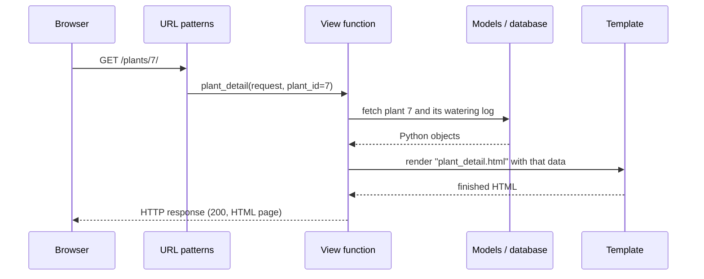

# A web application with Django

The previous lesson consumed other people's web services. Now we build one: a site with pages, a database, forms and user accounts. **Django** is Python's "batteries included" web framework — it supplies the database layer, the admin interface, form handling, authentication and security defaults in one coherent package, which is why it is such a good vehicle for learning how web applications fit together. Everything you learn here about requests, routing, models and templates carries over directly to other frameworks, including **FastAPI**, which this site covers in its own track and which is compared with Django at the end of the lesson.

Django needs a project on disk and a running server, so the code here is shown as static blocks to type on your own machine. Two runnable sections model the central mechanisms — URL routing and template rendering — in plain Python so that you can see what the framework is doing for you.

Our project is *Plant Shelf*: signed-in users keep a list of their house plants and log each watering.

## How a web application works



Every page view follows this path. The browser sends an HTTP request. The framework matches its path against a table of **URL patterns** and calls the corresponding **view** — a Python function. The view asks the **models** for data, hands the data to a **template**, and returns the resulting HTML. Django calls this arrangement MTV (model, template, view); elsewhere you will hear MVC. The names differ; the separation is the same: *data*, *presentation* and *request-handling logic* live in different places.

## Setting up

```bash
mkdir plant_shelf && cd plant_shelf
python -m venv .venv
source .venv/bin/activate              # Windows: .venv\Scripts\activate
python -m pip install django

django-admin startproject config .     # the trailing dot: create the project in this folder
python manage.py migrate               # create the database and Django's built-in tables
python manage.py runserver             # development server at http://127.0.0.1:8000/
```

Django distinguishes a **project** (the whole site: settings and top-level URL table) from **apps** (self-contained features inside it). Create an app for the plants and register it:

```bash
python manage.py startapp plants
```

```python
# config/settings.py
INSTALLED_APPS = [
    "plants",                          # our app first
    "accounts",                        # added later in this lesson
    "django.contrib.admin",
    "django.contrib.auth",
    "django.contrib.contenttypes",
    "django.contrib.sessions",
    "django.contrib.messages",
    "django.contrib.staticfiles",
]
```

The resulting layout:

```
plant_shelf/
├── manage.py                # command-line entry point: runserver, migrate, shell, test ...
├── db.sqlite3               # the development database (a single file)
├── config/
│   ├── settings.py          # configuration for the whole site
│   └── urls.py              # the top-level URL table
└── plants/
    ├── models.py            # data definitions
    ├── views.py             # request handlers
    ├── urls.py              # this app's URL table (you create it)
    ├── forms.py             # forms (you create it)
    ├── admin.py             # what appears in the admin site
    ├── migrations/          # generated database change scripts
    └── templates/plants/    # HTML templates (you create this folder)
```

## Models: describing the data

A **model** is a class that describes one kind of record. Each attribute is a **field**, which becomes a column in a database table. Django's object-relational mapper (ORM) then lets you create, query and change records as Python objects, generating the SQL for you.

```python
# plants/models.py
from django.conf import settings
from django.db import models

class Plant(models.Model):
    """A plant belonging to one user."""
    owner = models.ForeignKey(settings.AUTH_USER_MODEL, on_delete=models.CASCADE)
    name = models.CharField(max_length=80)
    room = models.CharField(max_length=40, blank=True)
    days_between_water = models.PositiveIntegerField(default=7)
    added = models.DateTimeField(auto_now_add=True)

    class Meta:
        ordering = ["name"]

    def __str__(self):
        return self.name

class Watering(models.Model):
    """One occasion on which a plant was watered."""
    plant = models.ForeignKey(Plant, on_delete=models.CASCADE, related_name="waterings")
    note = models.TextField(blank=True)
    done_at = models.DateTimeField(auto_now_add=True)

    class Meta:
        ordering = ["-done_at"]                    # newest first

    def __str__(self):
        return f"{self.plant.name} on {self.done_at:%d %b}"
```

Points to understand:

- `CharField` holds short text (a maximum length is required), `TextField` long text, `PositiveIntegerField` a whole number, `DateTimeField` a moment in time; `auto_now_add=True` stamps the creation time automatically.
- A **`ForeignKey`** links a record to one record of another model — a many-to-one relationship: many waterings belong to one plant, many plants to one user. `on_delete=models.CASCADE` means "if the plant is deleted, delete its waterings too".
- `related_name="waterings"` gives the reverse direction a name: `plant.waterings.all()`.
- `__str__` controls how a record is displayed, in the admin site and when debugging.

### Migrations

Whenever models change, the database must change to match. Django does this in two explicit steps:

```bash
python manage.py makemigrations plants     # write a migration file describing the change
python manage.py migrate                   # apply pending migrations to the database
```

Migration files are ordinary code, kept in version control, so every copy of the project can bring its database to the same shape. The rhythm *edit models → makemigrations → migrate* becomes second nature.

### The admin site and the shell

Django can generate a complete management interface for your data. Create an administrator and register the models:

```bash
python manage.py createsuperuser
```

```python
# plants/admin.py
from django.contrib import admin
from .models import Plant, Watering

admin.site.register(Plant)
admin.site.register(Watering)
```

Visit `/admin/`, sign in, and you can add, edit and delete plants through a generated interface — invaluable for entering test data and for the people who will run the site.

The ORM can be explored interactively with `python manage.py shell`:

```python
>>> from plants.models import Plant
>>> Plant.objects.all()                                  # every plant (a lazy "QuerySet")
>>> Plant.objects.filter(room="kitchen").count()
>>> thirsty = Plant.objects.filter(days_between_water__lte=3).order_by("name")
>>> fern = Plant.objects.get(id=1)                       # exactly one record, or an exception
>>> fern.waterings.all()                                 # follow the relationship backwards
>>> fern.waterings.create(note="half a jug")             # create a linked record
>>> fern.days_between_water = 4; fern.save()             # change and store
```

A **QuerySet** describes a database query; it is only executed when you actually use the results, and methods such as `filter`, `exclude` and `order_by` can be chained. The double-underscore syntax (`days_between_water__lte=3`) expresses comparisons: `lte` is "less than or equal", `icontains` is a case-insensitive text search, and so on.

## URLs: mapping addresses to code

The project's URL table delegates to each app's own table:

```python
# config/urls.py
from django.contrib import admin
from django.urls import include, path

urlpatterns = [
    path("admin/", admin.site.urls),
    path("accounts/", include("accounts.urls")),
    path("", include("plants.urls")),
]
```

```python
# plants/urls.py
from django.urls import path
from . import views

app_name = "plants"                                      # a namespace for the names below
urlpatterns = [
    path("", views.home, name="home"),
    path("plants/", views.plant_list, name="plant_list"),
    path("plants/new/", views.plant_create, name="plant_create"),
    path("plants/<int:plant_id>/", views.plant_detail, name="plant_detail"),
    path("plants/<int:plant_id>/water/", views.water, name="water"),
]
```

`<int:plant_id>` is a **path converter**: it matches a whole number at that position, converts it to an `int`, and passes it to the view as the argument `plant_id`. Every pattern has a `name`, and the rest of the code refers to URLs *by name* — so changing an address later means editing one line.

What the router does is simple enough to write yourself. This model implements `<int:...>` and `<str:...>` converters and "first match wins":

```python-run
def match(pattern, path):
    """Return a dict of captured values if path fits pattern, else None."""
    pattern_parts = pattern.strip("/").split("/") if pattern.strip("/") else []
    path_parts = path.strip("/").split("/") if path.strip("/") else []
    if len(pattern_parts) != len(path_parts):
        return None
    captured = {}
    for expected, actual in zip(pattern_parts, path_parts):
        if expected.startswith("<") and expected.endswith(">"):
            kind, _, name = expected[1:-1].rpartition(":")
            if kind == "int":
                if not actual.isdigit():
                    return None
                captured[name] = int(actual)
            else:
                captured[name] = actual
        elif expected != actual:
            return None
    return captured

def resolve(routes, path):
    """routes: list of (pattern, view name). Return (view name, kwargs) of the first match, or None."""
    for pattern, view_name in routes:
        kwargs = match(pattern, path)
        if kwargs is not None:
            return view_name, kwargs
    return None

routes = [
    ("", "home"),
    ("plants/", "plant_list"),
    ("plants/new/", "plant_create"),
    ("plants/<int:plant_id>/", "plant_detail"),
    ("plants/<int:plant_id>/water/", "water"),
    ("rooms/<str:room>/", "room_detail"),
]
for path in ["/", "/plants/", "/plants/new/", "/plants/7/", "/plants/7/water/", "/plants/seven/", "/rooms/kitchen/", "/nope/"]:
    print(f"{path:<20} -> {resolve(routes, path)}")
```

Note why `plants/new/` is listed before `plants/<int:plant_id>/` in spirit: order matters when patterns could overlap. Here `new` is not a number, so the int converter rejects it anyway — but with a `<str:...>` converter the earlier pattern would win. `/plants/seven/` matches nothing, and Django would answer with a 404 page.

## Views: handling a request

A view receives an `HttpRequest` (plus any values captured from the URL) and must return an `HttpResponse`. The `render` shortcut fills a template with data — the **context** dictionary — and wraps the result in a response.

```python
# plants/views.py
from django.contrib.auth.decorators import login_required
from django.shortcuts import get_object_or_404, redirect, render

from .forms import PlantForm
from .models import Plant

def home(request):
    return render(request, "plants/home.html")

@login_required
def plant_list(request):
    plants = Plant.objects.filter(owner=request.user)          # only this user's plants
    return render(request, "plants/plant_list.html", {"plants": plants})

@login_required
def plant_detail(request, plant_id):
    plant = get_object_or_404(Plant, id=plant_id, owner=request.user)
    context = {"plant": plant, "waterings": plant.waterings.all()[:10]}
    return render(request, "plants/plant_detail.html", context)
```

`get_object_or_404` fetches one record or answers "404 Not Found" — and because the lookup includes `owner=request.user`, somebody else's plant is simply *not found*. More on that under security below.

## Templates: producing HTML

A template is an HTML file with placeholders. `{{ ... }}` inserts a value; `` is a tag that controls logic — loops, conditions, links, inheritance.

```html
<!-- plants/templates/plants/base.html -->
<!doctype html>
<html lang="en">
<head>
  <meta charset="utf-8">
  <title>Plant Shelf</title>
</head>
<body>
  <nav>
    <a href="">Plant Shelf</a>
    
      <a href="">My plants</a>
      Hello, {{ user.username }}.
      <form action="" method="post"><button>Log out</button></form>
    
      <a href="">Log in</a>
      <a href="">Register</a>
    
  </nav>
  <main></main>
</body>
</html>
```

```html
<!-- plants/templates/plants/plant_list.html -->

My plants


  <h1>My plants</h1>
  <ul>
    
      <li>
        <a href="">{{ plant.name }}</a>
        ({{ plant.room|default:"no room set" }}) - water every {{ plant.days_between_water }} days
      </li>
    
      <li>No plants yet.</li>
    
  </ul>
  <a href="">Add a plant</a>

```

Key ideas:

- **Template inheritance.** `base.html` defines the page skeleton with named `block`s; every other template `extends` it and fills in the blocks. Navigation, styling and footers are written once.
- **``** builds an address from the pattern's *name* and arguments — no hard-coded paths.
- **Filters** transform a value: `{{ plant.room|default:"no room set" }}`, `{{ watering.done_at|date:"d M Y" }}`, `{{ note|linebreaks }}`.
- **Automatic escaping.** Values inserted with `{{ }}` have characters such as `<` converted to harmless entities, so text typed by a user cannot inject scripts into your page.

A toy renderer shows the principle of substitution and escaping:

```python-run
import html, re

def render(template, context):
    """Replace {{ name }} and {{ name.key }} with escaped values from the context."""
    def lookup(match):
        value = context
        for part in match.group(1).split("."):
            value = value[part] if isinstance(value, dict) else getattr(value, part)
        return html.escape(str(value))                 # escaping stops injected HTML from running
    return re.sub(r"\{\{\s*([\w.]+)\s*\}\}", lookup, template)

page = "<h1>{{ plant.name }}</h1><p>Lives in the {{ plant.room }}. Note: {{ note }}</p>"
context = {"plant": {"name": "Fern", "room": "kitchen"}, "note": "<script>alert('gotcha')</script>"}
print(render(page, context))
```

## Forms: accepting data

Reading data from users takes three things: an HTML form, validation of what comes back, and storage. A **`ModelForm`** builds all three from a model.

```python
# plants/forms.py
from django import forms
from .models import Plant, Watering

class PlantForm(forms.ModelForm):
    class Meta:
        model = Plant
        fields = ["name", "room", "days_between_water"]        # NOT owner: the view sets that
        labels = {"days_between_water": "Water every (days)"}

class WateringForm(forms.ModelForm):
    class Meta:
        model = Watering
        fields = ["note"]
        widgets = {"note": forms.Textarea(attrs={"rows": 3})}
```

One view typically handles both showing the empty form (a `GET` request) and processing the submission (a `POST` request):

```python
# plants/views.py (continued)
@login_required
def plant_create(request):
    if request.method != "POST":
        form = PlantForm()                                # an empty form to display
    else:
        form = PlantForm(data=request.POST)               # a form filled with the submitted data
        if form.is_valid():                               # runs every validation rule
            plant = form.save(commit=False)               # build the object, do not store it yet
            plant.owner = request.user                    # set what the form must not control
            plant.save()
            return redirect("plants:plant_detail", plant_id=plant.id)
    return render(request, "plants/plant_form.html", {"form": form})   # empty, or with error messages
```

```html
<!-- plants/templates/plants/plant_form.html -->


  <h1>Add a plant</h1>
  <form method="post">
    
    {{ form.as_div }}
    <button type="submit">Save</button>
  </form>

```

The pattern is worth memorising: **GET shows the form; POST validates; valid data is saved and the browser is *redirected*; invalid data re-displays the form with errors.** Redirecting after a successful POST (rather than rendering a page directly) means that refreshing the browser does not submit the form a second time. The `` tag inserts a hidden secret that proves the submission came from your own page — Django rejects POSTs without it, defeating a class of attack called cross-site request forgery.

Editing uses the same form: fetch the existing object, then `PlantForm(instance=plant)` to display it and `PlantForm(instance=plant, data=request.POST)` to update it.

## User accounts

Django ships with a complete authentication system: a `User` model, password hashing, sessions, and ready-made views for logging in and out. A small `accounts` app wires it up and adds registration.

```python
# accounts/urls.py
from django.urls import include, path
from . import views

app_name = "accounts"
urlpatterns = [
    path("", include("django.contrib.auth.urls")),        # provides login/ and logout/ (and password reset)
    path("register/", views.register, name="register"),
]
```

```python
# accounts/views.py
from django.contrib.auth import login
from django.contrib.auth.forms import UserCreationForm
from django.shortcuts import redirect, render

def register(request):
    if request.method != "POST":
        form = UserCreationForm()
    else:
        form = UserCreationForm(data=request.POST)
        if form.is_valid():
            new_user = form.save()                        # stores the user with a hashed password
            login(request, new_user)                      # sign them in straight away
            return redirect("plants:plant_list")
    return render(request, "registration/register.html", {"form": form})
```

The built-in login view expects a template at `registration/login.html` containing a form like the one above, and two settings tell Django where to send people:

```python
# config/settings.py
LOGIN_URL = "accounts:login"                # where @login_required sends anonymous visitors
LOGIN_REDIRECT_URL = "plants:plant_list"    # where to go after a successful login
LOGOUT_REDIRECT_URL = "plants:home"
```

### Protecting pages and protecting data

These are two different jobs, and beginners often do only the first.

1. **Authentication — who are you?** `@login_required` on a view redirects anyone who is not signed in to the login page.
2. **Authorisation — are you allowed to see *this*?** Being signed in must not let you read another user's records by typing a different number in the address bar. Every query must be restricted to the current user — `Plant.objects.filter(owner=request.user)` — and every single-object lookup must check ownership, as `get_object_or_404(Plant, id=plant_id, owner=request.user)` does. The same applies to pages that edit or delete, and to POST requests, not just to pages that display.

```python
@login_required
def water(request, plant_id):
    plant = get_object_or_404(Plant, id=plant_id, owner=request.user)      # ownership check
    if request.method == "POST":
        form = WateringForm(data=request.POST)
        if form.is_valid():
            watering = form.save(commit=False)
            watering.plant = plant
            watering.save()
    return redirect("plants:plant_detail", plant_id=plant.id)
```

Forgetting the ownership check is one of the most common real-world security flaws (it has a name: *insecure direct object reference*).

## Styling

Templates produce plain HTML; appearance comes from CSS. The quick route to a presentable, mobile-friendly site is a CSS framework such as **Bootstrap**: link its stylesheet in `base.html`, then add its class names to your elements (`class="navbar"`, `class="btn btn-primary"`, `class="container"`). The package `django-bootstrap5` provides template tags that render Django forms with Bootstrap styling in one line. Your own CSS, images and JavaScript go in a `static/` folder and are referenced with the `` tag. Because all pages extend `base.html`, restyling the whole site means changing one file.

## Testing

Django includes a test client that makes requests to your views without a running server:

```python
# plants/tests.py
from django.contrib.auth import get_user_model
from django.test import TestCase
from django.urls import reverse

from .models import Plant

class PlantPrivacyTests(TestCase):
    def setUp(self):
        User = get_user_model()
        self.ana = User.objects.create_user("ana", password="long-test-pass-1")
        self.ben = User.objects.create_user("ben", password="long-test-pass-2")
        self.fern = Plant.objects.create(owner=self.ana, name="Fern")

    def test_anonymous_visitor_is_sent_to_login(self):
        response = self.client.get(reverse("plants:plant_list"))
        self.assertEqual(response.status_code, 302)

    def test_owner_sees_own_plant(self):
        self.client.login(username="ana", password="long-test-pass-1")
        response = self.client.get(reverse("plants:plant_detail", args=[self.fern.id]))
        self.assertContains(response, "Fern")

    def test_other_user_gets_404(self):
        self.client.login(username="ben", password="long-test-pass-2")
        response = self.client.get(reverse("plants:plant_detail", args=[self.fern.id]))
        self.assertEqual(response.status_code, 404)
```

Run them with `python manage.py test`; each test gets a fresh, temporary database. The third test is the one that protects your users.

## Deployment: an overview

`runserver` is a development convenience, not something to expose to the internet. Putting a Django site online involves the same checklist on any hosting platform:

| Concern | Development | Production |
|---|---|---|
| `DEBUG` | `True` (detailed error pages) | **`False`** — debug pages reveal code and settings |
| `SECRET_KEY`, passwords | in `settings.py` | read from **environment variables**, never committed |
| `ALLOWED_HOSTS` | empty | your domain name(s) |
| Database | SQLite file | a server database such as PostgreSQL |
| Application server | `runserver` | a WSGI/ASGI server such as gunicorn or uvicorn |
| Static files | served by Django | collected with `python manage.py collectstatic` and served by the platform, a CDN or WhiteNoise |
| HTTPS | none | required; set the secure-cookie and HTTPS-redirect settings |
| Dependencies | whatever is installed | pinned in `requirements.txt` / a lock file |
| Schema changes | `migrate` by hand | `migrate` as a step of every release |

The general procedure: put the project in Git; record dependencies; move secrets and environment-specific settings into environment variables; choose a platform (a platform-as-a-service that builds from your repository is the gentlest start; a container or a virtual server gives more control); provision a database; push the code; run migrations; create a superuser; then visit the site and read the logs. `python manage.py check --deploy` lists security settings you have missed. Custom error pages (`404.html`, `500.html` in the templates folder) replace the default ones once `DEBUG` is off.

## Django and FastAPI compared

Both are excellent Python web frameworks with different centres of gravity.

| | Django | FastAPI |
|---|---|---|
| Philosophy | full-stack, "batteries included" | small core; you choose the components |
| Typical output | server-rendered HTML pages (and APIs via Django REST Framework or Django Ninja) | JSON APIs consumed by front-ends, mobile apps and other services |
| Data layer | built-in ORM and migrations | bring your own (SQLAlchemy/SQLModel + Alembic, etc.) |
| Validation | forms and model fields | Pydantic models driven by **type hints** |
| Admin, auth, sessions | included | add libraries or write them |
| Concurrency | synchronous by tradition, async supported | **async** from the start |
| API documentation | via add-ons | automatic interactive OpenAPI docs |
| Good fit | content sites, internal tools, classic CRUD applications needing accounts and an admin quickly | high-throughput APIs, microservices, machine-learning model serving |

The same idea in each, to make the correspondence concrete:

```python
# Django: URL pattern + view returning JSON
from django.http import JsonResponse
from django.shortcuts import get_object_or_404

def plant_api(request, plant_id):                  # path("api/plants/<int:plant_id>/", plant_api)
    plant = get_object_or_404(Plant, id=plant_id, owner=request.user)
    return JsonResponse({"id": plant.id, "name": plant.name})
```

```python
# FastAPI: the route, the path parameter's type and the response shape are declared together
from fastapi import FastAPI, HTTPException
from pydantic import BaseModel

app = FastAPI()

class PlantOut(BaseModel):
    id: int
    name: str

@app.get("/api/plants/{plant_id}", response_model=PlantOut)
async def plant_api(plant_id: int):
    plant = await find_plant(plant_id)
    if plant is None:
        raise HTTPException(status_code=404, detail="Plant not found")
    return plant
```

Routing, path parameters, validation, a 404 for missing records: the concepts are identical, the spelling differs. Having seen them in Django, you will recognise each one immediately in this site's **FastAPI track**, which builds on the typing, Pydantic and asyncio lessons earlier in this Python track.

> [!TIP]
> Build the site in the same thin slices as any other project: one model, one URL, one view, one template — see it work in the browser — then the next. Use the admin site to enter data long before you write your own forms, and add user accounts only after the core pages work.

> [!INTERVIEW]
> Frequent web-framework questions: Trace a request through the application (URL resolution → view → model/ORM → template → response). What is an ORM and what is a migration? Why redirect after a successful POST? What is CSRF and how is it prevented? Difference between authentication and authorisation — and how do you stop user A reading user B's data? What changes between development and production (`DEBUG`, secrets, database, static files, HTTPS)? When would you choose Django and when FastAPI?

## Summary

A Django request flows from the URL table to a view, which uses models to reach the database and a template to produce HTML. Models are classes whose fields become columns; migrations keep the database in step with them; the admin site manages data for free. URL patterns capture values with converters and are referred to by name. Views return responses; templates inherit from a base and escape output. ModelForms display, validate and save input using the GET/POST/redirect pattern with CSRF protection. The auth system provides users and login; you must add `@login_required` *and* filter every query by owner. Deployment means turning off debug, externalising secrets, a real database and server, and HTTPS.

```quiz
[
  {"q": "In Django, which component decides which view handles `/plants/7/`?", "options": ["The template", "The URL patterns (URLconf)", "The model", "The admin site"], "answer": 1, "explain": "The request path is matched against the URL patterns in order; the first match names the view and supplies captured arguments."},
  {"q": "What does `path(\"plants/<int:plant_id>/\", views.plant_detail)` pass to the view for `/plants/7/`?", "options": ["Nothing", "plant_id=7 as an integer", "The string \"plants/7/\"", "plant_id=\"<int>\""], "answer": 1, "explain": "The int converter matches digits, converts them, and passes the value as a keyword argument."},
  {"q": "After changing a model, which two commands update the database?", "options": ["runserver then shell", "makemigrations then migrate", "startapp then startproject", "collectstatic then check"], "answer": 1, "explain": "makemigrations writes a migration file describing the change; migrate applies it."},
  {"q": "What does a ForeignKey from Watering to Plant express?", "options": ["Each plant has exactly one watering", "Many waterings can belong to one plant", "Plants and waterings are unrelated", "A watering is a kind of plant"], "answer": 1, "explain": "A foreign key is a many-to-one link; the reverse side (plant.waterings) gives all related records."},
  {"q": "Why should a view redirect after successfully processing a POST form?", "options": ["Redirects are faster", "So that refreshing the page does not submit the form again", "Django requires it for GET requests", "To hide the URL"], "answer": 1, "explain": "This is the Post/Redirect/Get pattern; the browser's last request becomes a harmless GET."},
  {"q": "What is `` for?", "options": ["Styling the form", "Proving that a POST came from your own site's form, blocking cross-site request forgery", "Logging the user in", "Translating the page"], "answer": 1, "explain": "Django rejects POST requests that lack the valid hidden token."},
  {"q": "A view has `@login_required` and fetches `Plant.objects.get(id=plant_id)`. What is wrong?", "options": ["Nothing", "Any signed-in user can read any plant by changing the id; the query must also filter by owner", "get() cannot be used in views", "login_required only works on forms"], "answer": 1, "explain": "Authentication is not authorisation. Restrict every lookup to the current user's own records."},
  {"q": "Which statement best contrasts Django and FastAPI?", "options": ["Django is for games, FastAPI for data science", "Django is a full-stack framework with ORM, admin and auth built in; FastAPI is a lean, async, type-hint-driven framework aimed at JSON APIs", "FastAPI cannot return JSON", "Django cannot use databases"], "answer": 1, "explain": "Both route requests to Python functions; they differ in how much is included and in their typical use."}
]
```

> **Source:** Matthes, *Python Crash Course* (3rd ed.), ch. 18–20 (a Django project: models, admin, URLs, views and templates; user accounts and data ownership; styling and deploying) — topics only; the application, code and wording here are original; Django documentation ("Writing your first Django app", "Models", "Working with forms", "User authentication", "Deployment checklist"); FastAPI documentation ("Tutorial — User Guide").
