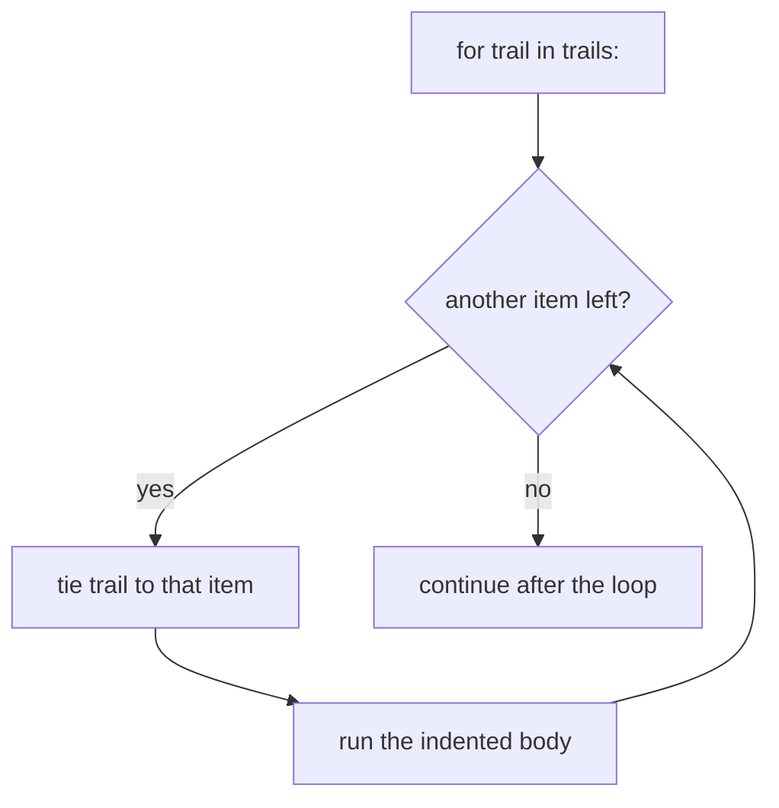

# Lists and loops: working with many values

> **Before this lesson:** you should know how to run Python code, create variables with `=`, work with strings and numbers, use f-strings and read a simple error message. All of that is in [First steps: running Python, values, names and text](#/lesson/python/py-start-first-steps).

## In plain words

One variable holds one value. Real programs deal with collections: all the trails in a park, every reading from a thermometer, each line of a file. This lesson introduces the **list**, Python's general-purpose container for an ordered collection, and the **for loop**, which lets you write an instruction once and have it carried out for every item.

Think of a shopping list on paper. It has an order (first item, second item, and so on), you can add to it, cross things off and rearrange it, and when you are in the shop you go down it doing the same thing for every line: find it, put it in the basket. A Python list is that piece of paper, and a `for` loop is walking down it.

Together, lists and loops are the first real leap in what your programs can do: ten items or ten million, the code is the same length. Why this matters for a job: nearly every program handles collections of things (customers, orders, measurements, files), and almost every coding-interview question starts with "given a list of...". Indexing, slicing, sorting and looping are the tools you will reach for in all of them.

## Making a list

A list is written with square brackets, items separated by commas:

```python-run
trails = ["Ridge Walk", "Fern Gully", "Heron Loop", "Summit Stairs"]
lengths_km = [4.5, 2.0, 7.25, 3.1]
mixed = ["map", 3, 2.5, True]      # allowed, though lists usually hold one kind of thing
nothing_yet = []                   # an empty list, ready to be filled

print(trails)
print(len(trails), len(nothing_yet))
```

Give a list a plural name (`trails`, `lengths_km`); it makes the loops you write later read naturally. `len(...)` tells you how many items a list has.

## Getting one item: positions start at zero

Each item has a position, called its **index**. Write the index in square brackets after the list's name. The first item is at index **0**, the second at 1, and so on. This zero-based counting trips up everybody at first; a helpful way to think of it is that the index says *how far the item is from the start*.

```python-run
trails = ["Ridge Walk", "Fern Gully", "Heron Loop", "Summit Stairs"]
print(trails[0])        # first
print(trails[1])        # second
print(trails[3])        # fourth, which here is the last
print(trails[-1])       # -1 always means the last item
print(trails[-2])       # second from the end
print(f"We start on the {trails[0].upper()} at dawn.")
```

An item taken out of a list is an ordinary value: the last line calls a string method on it and drops it into an f-string. Negative indexes count backwards from the end, which saves you from working out the length.

Ask for a position that does not exist and Python stops with an `IndexError`:

```python-run
trails = ["Ridge Walk", "Fern Gully", "Heron Loop"]
try:
    print(trails[3])
except IndexError as error:
    print("IndexError:", error)
print("valid indexes run from 0 to", len(trails) - 1)
```

A list of three items has indexes 0, 1 and 2. Being off by one like this is the most common list mistake there is. When it happens, print the list and its `len` — the list is often shorter than you assumed, or empty.

## Changing a list

Lists are **mutable**: you can alter them after creating them. (Strings are not; string methods always gave you a new string.)

```python-run
packing = ["boots", "water", "hat"]

packing[0] = "sandals"            # replace the item at a position
packing.append("sunscreen")       # add to the end
packing.insert(1, "map")          # put a new item at index 1; later items shift right
print(packing)

del packing[0]                    # delete by position
print(packing)

last = packing.pop()              # remove the LAST item and hand it back
print("took out:", last, "| left:", packing)

first = packing.pop(0)            # pop can also take a position
print("took out:", first, "| left:", packing)

packing.remove("hat")             # delete by value (the first match only)
print(packing)
```

Which removal tool should you use?

| You know... | and you... | Use |
|---|---|---|
| the position | do not need the item afterwards | `del items[i]` |
| the position | want to use the removed item | `items.pop(i)` (or `items.pop()` for the last) |
| the value | — | `items.remove(value)` |

`remove` deletes only the first matching item, and raises a `ValueError` if there is no match. The most typical way to build a list is to start empty and `append` as information arrives — you will do it in almost every program.

## Putting a list in order

```python-run
peaks = ["Mossback", "eagle tooth", "Cinder Hill", "Aldercrest"]

print(sorted(peaks))                 # a sorted COPY; the original is untouched
print(peaks)

peaks.sort()                         # sorts the list itself, permanently
print(peaks)
peaks.sort(reverse=True)             # Z to A
print(peaks)

peaks.reverse()                      # flip the current order (not a sort)
print(peaks)

heights = [1320, 980, 2105, 1760]
print(sorted(heights), max(heights), min(heights), sum(heights))
```

Two things to notice. First, `sorted(x)` gives you a new list and leaves `x` alone, while `x.sort()` rearranges `x` itself and gives back nothing. A frequent slip is writing `x = x.sort()`, which leaves `x` holding the special "no value" marker `None`. Second, capital letters sort before lowercase ones, so `"eagle tooth"` lands at the end; when text has mixed case, sort with `key=str.lower` to compare as if everything were lowercase: `sorted(peaks, key=str.lower)`.

## Doing something with every item: the for loop

Suppose you want to print a line for each trail. Writing one `print` per item is tedious and breaks as soon as the list changes. A **for loop** says: *for each item in this list, do the following*.

```python-run
trails = ["Ridge Walk", "Fern Gully", "Heron Loop"]

for trail in trails:
    print(f"{trail} is open today.")
    print(f"  ({len(trail)} characters on the signpost)")

print("That is every trail.")
```

How Python carries this out:

1. It takes the first item of `trails` and ties the name `trail` to it.
2. It runs every **indented** line beneath the `for` line. Those lines form the *body* of the loop.
3. It goes back, ties `trail` to the next item, and runs the body again.
4. When no items remain, it continues with the first line that is *not* indented.



The name after `for` is yours to choose. The singular of the list's name (`trail` for `trails`, `reading` for `readings`) keeps the code readable.

### Indentation is part of the grammar

In Python the spaces at the start of a line carry meaning: they show which lines belong to the loop. The convention is four spaces per level (editors insert them when you press Tab). Getting this wrong produces a small family of mistakes that every learner meets:

```python-run
trails = ["Ridge Walk", "Fern Gully"]

# 1. Meant to be inside the loop, but not indented: runs once, after the loop,
#    using whatever the loop variable was left on (the last item).
for trail in trails:
    print(f"Checking {trail}...")
print(f"{trail} has been checked.")        # only printed for the last trail!

# 2. Meant to run once at the end, but indented: runs every time round.
for trail in trails:
    print(f"Sweeping {trail}")
    print("All trails swept.")             # printed twice - a logic error, not a crash
```

Neither of those causes an error message. Python cannot know what you intended, so the program runs and quietly does the wrong thing: a **logic error**. If output appears too few or too many times, check the indentation first.

Two related mistakes *do* produce messages, because the result is not valid Python at all:

```python-run
broken = {
    "body not indented": "for n in [1, 2]:\nprint(n)",
    "indent for no reason": "total = 0\n    print(total)",
    "colon forgotten": "for n in [1, 2]\n    print(n)",
}
for label, code in broken.items():
    try:
        compile(code, "example", "exec")
    except SyntaxError as error:
        print(f"{label:<22} -> {type(error).__name__}: {error.msg}")
```

Each broken example is stored as text, and `compile(code, "example", "exec")` asks Python to check its grammar without running it; the `except` block prints the message Python would show. The colon at the end of the `for` line tells Python "a block follows". Forgetting it is so common that the error message now says exactly what is missing.

## Lists of numbers and `range`

The built-in `range` produces a run of whole numbers, which is handy both for repeating something a set number of times and for building numeric lists:

```python-run
for number in range(1, 5):
    print(number, end=" ")       # end=" " keeps the output on one line
print()

print(list(range(5)))            # one argument: start at 0
print(list(range(1, 11)))        # start, stop (the stop value is NOT included)
print(list(range(0, 50, 10)))    # start, stop, step
print(list(range(10, 0, -2)))    # a negative step counts down

for _ in range(3):               # repeat 3 times; _ is a customary name for "not used"
    print("Ring the bell!")
```

`range(1, 5)` yields 1, 2, 3, 4 — it stops *before* 5. This matches zero-based indexing: `range(len(items))` gives exactly the valid indexes of `items`. `range` does not store its numbers; it hands them out one at a time, so wrap it in `list(...)` when you want to see or keep them.

A very common pattern: start with an empty list (or a zero total), loop, and build up the answer.

```python-run
squares = []
for n in range(1, 8):
    squares.append(n ** 2)
print(squares)

total = 0
for value in squares:
    total += value               # short for: total = total + value
print("sum by hand:", total, "| built-in sum:", sum(squares))
print("smallest:", min(squares), "| largest:", max(squares), "| average:", sum(squares) / len(squares))
```

### A shorter spelling: list comprehensions

Building a list from a loop is so frequent that Python offers a one-line form. Read it as "the list of *this expression* for *each item* in *that source*":

```python-run
squares = [n ** 2 for n in range(1, 8)]
print(squares)

names = ["ridge walk", "fern gully", "heron loop"]
shouted = [name.upper() for name in names]
long_ones = [name for name in names if len(name) > 9]     # an optional filter at the end
print(shouted)
print(long_ones)
```

It does exactly what the three-line version does. Use whichever you find clearer; when you are learning, writing the full loop first and then compressing it is a good exercise.

## Part of a list: slices

To take several neighbouring items at once, give a start and a stop index separated by a colon. As with `range`, the stop position is not included.

```python-run
stops = ["Depot", "Mill Lane", "Old Bridge", "Market", "Harbour", "Lighthouse"]

print(stops[1:4])      # indexes 1, 2, 3
print(stops[:3])       # from the beginning
print(stops[3:])       # to the end
print(stops[-2:])      # the last two
print(stops[::2])      # every second stop

for stop in stops[:3]:
    print("Morning bus calls at", stop)
```

Unlike a single out-of-range index, a slice that reaches too far is quietly trimmed rather than causing an error.

### Copying a list — a trap worth knowing now

Assigning a list to a second name does **not** make a second list. Both names end up tied to the same list, so a change made through one name is visible through the other:

```python-run
my_route = ["Depot", "Market", "Harbour"]
your_route = my_route              # NOT a copy: a second tag on the same list
your_route.append("Lighthouse")
print(my_route)                    # mine changed too!

my_route = ["Depot", "Market", "Harbour"]
your_route = my_route[:]           # a slice of everything IS a new list
your_route.append("Lighthouse")
print(my_route)
print(your_route)
```

`my_route[:]` — a slice from start to end — builds a separate list with the same items; `my_route.copy()` and `list(my_route)` do the same. Remember this the first time two lists in your program seem to be mysteriously linked.

## Lists that must not change: tuples

A **tuple** is like a list that is fixed once made: you cannot replace, add or remove its items. It is written with round brackets.

```python-run
map_size = (640, 480)
print(map_size[0], map_size[1])

for side in map_size:
    print(side)

try:
    map_size[0] = 800
except TypeError as error:
    print("TypeError:", error)

map_size = (800, 600)        # the NAME can be tied to a new tuple, though
print(map_size)

just_one = (7,)              # a one-item tuple needs a trailing comma
width, height = map_size     # "unpacking": one name per item
print(just_one, width, height)
```

Use a tuple for a small group of values that belong together and should stay as they are throughout the program — a coordinate, a screen size, a date as (year, month, day). The fixedness is a feature: it protects the values from accidental change and signals your intent to readers.

## A note on style

Python programmers share a style guide known as **PEP 8** (PEP stands for Python Enhancement Proposal, a numbered design document; number 8 is the style guide), so that everyone's code looks familiar. The parts that matter from day one:

- Indent with four spaces per level; never mix tabs and spaces.
- Keep lines reasonably short (the guide suggests about 79 characters; many teams allow up to 100).
- Separate the logical sections of a program with single blank lines.
- Put one space around `=` and operators, and after commas: `total = price * 2`, `[1, 2, 3]`.

Code is read far more often than it is written. Tidy layout is not decoration; it is how you make mistakes visible.

## Worked example: a trail report

```python-run
trail_names = ["Ridge Walk", "Fern Gully", "Heron Loop", "Summit Stairs", "Boardwalk"]
trail_km = [4.5, 2.0, 7.25, 3.1, 1.2]

print("TRAIL REPORT")
print("-" * 32)
for position in range(len(trail_names)):
    name = trail_names[position]
    km = trail_km[position]
    bar = "#" * round(km)                       # a tiny text chart
    print(f"{position + 1}. {name:<14} {km:>5.2f} km  {bar}")
print("-" * 32)

longest = max(trail_km)
where = trail_km.index(longest)                 # index() finds the position of a value
short_walks = [trail_names[i] for i in range(len(trail_km)) if trail_km[i] < 3]

print(f"Total distance: {sum(trail_km):.1f} km over {len(trail_km)} trails")
print(f"Average length: {sum(trail_km) / len(trail_km):.2f} km")
print(f"Longest: {trail_names[where]} ({longest} km)")
print(f"Easy strolls: {', '.join(short_walks)}")
print(f"In alphabetical order: {sorted(trail_names)}")
```

Two lists are kept "in step" here — item *i* of one belongs with item *i* of the other — and `range(len(...))` supplies the shared index. (`{name:<14}` pads text to 14 characters; `{km:>5.2f}` right-aligns a number with two decimals; `", ".join(list)` glues strings together with a separator.) Parallel lists work, but they are fragile: sort one and the pairing is destroyed. The next lesson introduces dictionaries, which keep related facts together properly.

Things to try: add a sixth trail to both lists; print only trails longer than the average; show the trails from longest to shortest (hint: you will need the pairing — one approach is a list of small `(km, name)` tuples, which `sorted` orders by the first element).

> [!TIP]
> When a loop misbehaves, put a `print` as the very first line of its body showing the loop variable — `print("now handling:", trail)`. Seeing each step scroll past tells you immediately whether the loop runs the number of times you expect and with the values you expect.

## Practise

1. Make a list of five foods. Print the first, the last and the middle one; then replace the middle one and print the list.
2. Start with an empty list, append the numbers 10, 20, 30 using a loop over `range`, and print their sum.
3. Print the multiplication table of 7 (from 7 × 1 to 7 × 12), one line per row.
4. Build a list of the cubes of 1 to 10 twice: with a loop and `append`, then with a comprehension. Check that the two lists are equal with `==`.
5. Given `visitors = [120, 85, 143, 97, 160, 110, 76]` (one number per weekday), print the three busiest days' numbers, highest first, without changing `visitors`.
6. Cause an `IndexError` on purpose, read the message, and fix it using a negative index.

## Summary

- A list holds an ordered collection: `[a, b, c]`. Indexes start at 0; negative indexes count from the end; a bad index raises `IndexError`.
- Lists can be changed: assign to a position, `append`, `insert`, `del`, `pop`, `remove`.
- `sorted(x)` returns a sorted copy; `x.sort()` and `x.reverse()` change `x` itself. `len`, `min`, `max`, `sum` summarise.
- `for item in items:` runs the indented body once per item. Indentation decides what is inside the loop; a missing colon or indent is a syntax error, a misplaced indent is a silent logic error.
- `range(start, stop, step)` generates whole numbers up to but not including `stop`.
- A list comprehension builds a list in one line; a slice `items[a:b]` takes a portion; `items[:]` makes a copy, whereas plain assignment only adds a second name.
- Tuples `(a, b)` are fixed collections for values that belong together.

## Glossary

- **List** - an ordered, changeable collection written in square brackets: `[a, b, c]`.
- **Item (element)** - one value stored in a list.
- **Index** - an item's position, counted from 0; negative indexes count from the end.
- **IndexError** - the error raised when you ask for a position that does not exist.
- **Mutable / immutable** - can be changed after creation (lists) / cannot be changed (strings, tuples).
- **Method** - an action belonging to a value, such as `append`, `pop` or `sort`.
- **`None`** - Python's special "no value" marker, returned by methods such as `sort()`.
- **For loop** - `for item in items:`, which runs its body once for each item.
- **Loop body** - the indented lines that belong to a loop.
- **Indentation** - the spaces at the start of a line, which show which block it belongs to.
- **Logic error** - a mistake that produces wrong results without any error message.
- **`range`** - a built-in that produces whole numbers from a start up to, but not including, a stop.
- **List comprehension** - a one-line way to build a list: `[expression for item in source if condition]`.
- **Slice** - part of a list taken with `items[start:stop]`; the stop position is not included.
- **Copy** - a separate list with the same items, made with `items[:]`, `items.copy()` or `list(items)`.
- **Tuple** - a fixed collection written in round brackets: `(a, b)`.
- **Unpacking** - giving each item of a tuple or list its own name: `width, height = size`.
- **PEP 8** - Python's official style guide.

```quiz
[
  {"q": "For `colours = [\"red\", \"green\", \"blue\"]`, what is `colours[1]`?", "options": ["red", "green", "blue", "An IndexError"], "answer": 1,
   "explain": "Indexes start at 0, so index 1 is the second item."},
  {"q": "Which expression always gives the last item of a non-empty list `items`?", "options": ["items[len(items)]", "items[-1]", "items[last]", "items[0]"], "answer": 1,
   "explain": "-1 counts from the end. items[len(items)] is one past the end and raises IndexError."},
  {"q": "What does `list(range(2, 8, 2))` produce?", "options": ["[2, 4, 6, 8]", "[2, 4, 6]", "[2, 3, 4, 5, 6, 7]", "[2, 8, 2]"], "answer": 1,
   "explain": "range starts at 2, steps by 2, and stops before 8."},
  {"q": "After `a = [1, 2]`, `b = a`, `b.append(3)`, what is `a`?", "options": ["[1, 2]", "[1, 2, 3]", "[3]", "An error"], "answer": 1,
   "explain": "b = a makes a second name for the same list. Use a[:] or a.copy() for an independent copy."},
  {"q": "What is the difference between `sorted(x)` and `x.sort()`?", "options": ["None", "sorted(x) returns a new sorted list and leaves x unchanged; x.sort() reorders x itself and returns nothing useful", "x.sort() is for numbers only", "sorted(x) reverses the list"], "answer": 1,
   "explain": "Writing x = x.sort() is a classic mistake: it leaves x as None."},
  {"q": "A `print` meant to run once after a loop prints on every pass instead. What is the most likely cause?", "options": ["A missing colon", "The line is indented, so it is part of the loop body", "The list is empty", "print is misspelled"], "answer": 1,
   "explain": "Indentation decides membership of the loop. Too much indentation is a logic error that produces no message."},
  {"q": "Which method removes and gives back the last item of a list?", "options": ["remove()", "del", "pop()", "append()"], "answer": 2,
   "explain": "pop() removes the last item (or the one at a given index) and returns it; remove(value) deletes by value; del deletes by position without returning."},
  {"q": "What happens when you run `point = (3, 4)` followed by `point[0] = 9`?", "options": ["point becomes (9, 4)", "A TypeError, because tuples cannot be changed", "point becomes [9, 4]", "Nothing"], "answer": 1,
   "explain": "Tuples are immutable. You may tie the name to a whole new tuple, but not alter an existing one."}
]
```

> **Source:** Matthes, *Python Crash Course* (3rd ed.), ch. 3–4 (introducing lists; working with lists) — topics only, examples and wording are original; Python docs, *Tutorial* §3.1.3 "Lists", §4.2–4.3 "for Statements / The range() Function", §5.1 "More on Lists"; PEP 8.
