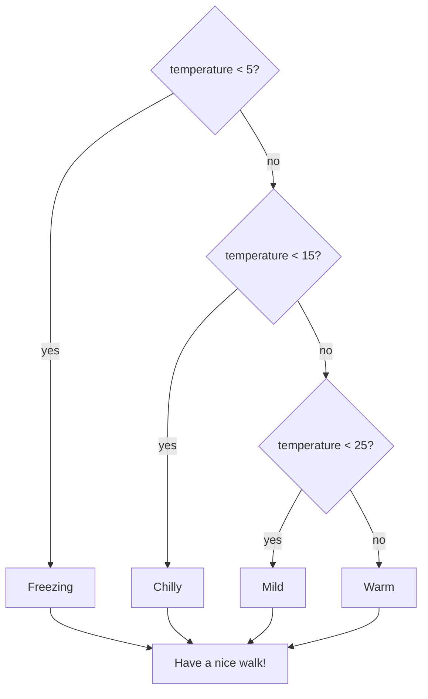

# Decisions and dictionaries

So far your programs have done the same thing every time they run. Two ideas change that. With **`if` statements** a program can examine a situation and choose what to do — charge a different price, skip a bad value, show a warning. With **dictionaries** it can store facts under meaningful labels and look them up instantly, the way you find a word in a real dictionary. By the end of this lesson you will combine both with the lists and loops you already know to model small pieces of the real world.

## Questions with yes/no answers

An `if` statement is built around a **condition**: an expression that Python evaluates to either `True` or `False`. Those two values have their own type, called **Boolean** (`bool`).

```python-run
temperature = 17

print(temperature == 17)     # equal to?           (two equals signs!)
print(temperature != 20)     # not equal to?
print(temperature > 20, temperature < 20)
print(temperature >= 17, temperature <= 16)
print(type(temperature > 20))
```

The single most common beginner slip is here: one `=` *assigns* a value to a name, while two `==` *asks whether* two values are equal. `temperature = 17` is an instruction; `temperature == 17` is a question.

Comparing text works too, and it is exact — capital letters and stray spaces count:

```python-run
answer = "Yes "
print(answer == "yes")                       # False: different case, and a trailing space
print(answer.strip().lower() == "yes")       # True: tidy first, then compare
print(answer)                                # the original is unchanged
```

Tidying with `strip()` and `lower()` before comparing is the standard way to be forgiving about how people type.

### Combining and membership

```python-run
age = 15
has_ticket = True

print(age >= 12 and age < 18)        # and: both sides must be true
print(age < 12 or age >= 65)         # or: at least one side must be true
print(not has_ticket)                # not: flips True/False
print(12 <= age < 18)                # a neat shorthand for a range check

closed_days = ["monday", "tuesday"]
today = "sunday"
print(today in closed_days)          # is the value somewhere in the list?
print(today not in closed_days)
print("day" in today)                # 'in' also looks for text inside text
```

Use parentheses when you mix `and` and `or` — `(a and b) or c` — so that neither you nor the reader has to remember which is applied first (it is `and`).

## Choosing what to do: if, elif, else

```python-run
temperature = 17

if temperature < 5:
    print("Freezing: wear a coat and gloves.")
elif temperature < 15:
    print("Chilly: a jacket will do.")
elif temperature < 25:
    print("Mild: a sweater is plenty.")
else:
    print("Warm: short sleeves.")

print("Have a nice walk!")
```

Python checks the conditions from the top. The **first** one that is true wins: its indented block runs, and all the remaining branches are skipped. `else` has no condition; it catches everything that got past the tests above. As with loops, the colon and the indentation are compulsory.



Because of "first true wins", the order of the tests matters. Each `elif` can rely on the earlier tests having failed: by the time Python asks `temperature < 15`, it already knows the temperature is not below 5. Reorder the tests carelessly and a broad condition will swallow cases meant for a narrower one. Change `temperature` to 3, 12, 30 and –40, and predict the output each time.

The shapes you can build:

| Shape | Use when |
|---|---|
| `if` alone | something should happen only in one situation; otherwise nothing |
| `if` / `else` | exactly one of two things must happen |
| `if` / `elif` / ... / `else` | exactly one of several things must happen |
| several separate `if`s | the questions are independent and more than one may apply |

That last row deserves an example, because confusing it with an `elif` chain is a classic bug:

```python-run
extras = ["lemon", "honey"]

# Independent questions: every matching one must act.
if "lemon" in extras:
    print("Adding a slice of lemon.")
if "honey" in extras:
    print("Stirring in honey.")
if "milk" in extras:
    print("Pouring milk.")

# The same thing as an elif chain would stop after the first match:
if "lemon" in extras:
    print("(chain) lemon only - honey is never reached!")
elif "honey" in extras:
    print("(chain) honey")
```

## if statements inside loops

Lists, loops and conditions combine naturally: go through every item, and treat some of them specially.

```python-run
orders = ["mint tea", "espresso", "oat latte", "chai", "espresso"]
sold_out = ["chai"]

for drink in orders:
    if drink in sold_out:
        print(f"Sorry, we have run out of {drink}.")
    elif drink == "espresso":
        print("One espresso - grinding beans...")
    else:
        print(f"Preparing your {drink}.")

espressos = 0
for drink in orders:
    if drink == "espresso":
        espressos += 1
print(f"{espressos} espressos ordered out of {len(orders)} drinks.")
```

### Is the list empty?

A list used directly as a condition counts as true when it has at least one item and false when it is empty. That gives a tidy way to handle "nothing to do":

```python-run
queue = []
if queue:
    for person in queue:
        print("Serving", person)
else:
    print("Nobody is waiting. Time to wipe the counter.")
```

The same rule applies to strings (empty text is false) and numbers (zero is false). It is a convenient shorthand, as long as you remember that `0` and `""` count as false too.

## Dictionaries: looking things up by label

With a list you fetch items by position. Often what you really want is to fetch by *name*: the price **of mint tea**, the capital **of Peru**, the phone number **of Dana**. A **dictionary** stores **key–value pairs**: each key is a label, and it leads to its value.

```python-run
prices = {"mint tea": 2.8, "espresso": 2.2, "oat latte": 3.6}

print(prices["espresso"])                 # look up the value stored under a key
print(f"A latte costs {prices['oat latte']:.2f}")
print(len(prices), "items on the menu")
```

Curly braces surround the dictionary; inside, each pair is written `key: value`, and pairs are separated by commas. You look a value up with square brackets, just like indexing a list — except that what goes inside the brackets is the key rather than a position. (Inside the f-string the key uses single quotes because the string itself uses double quotes.)

### Adding, changing and removing

```python-run
plant = {}                                 # start empty and fill in facts as you learn them
plant["name"] = "fern"
plant["height_cm"] = 30
plant["indoors"] = True
print(plant)

plant["height_cm"] = plant["height_cm"] + 4     # change a value: it grew
plant["room"] = "kitchen"                       # a new key simply adds a pair
del plant["indoors"]                            # remove a pair
print(plant)
```

Assigning to a key that already exists replaces its value; assigning to a new key adds a pair. Each key appears once only.

A longer dictionary is usually written with one pair per line, which is easier to read and to edit:

```python
opening_hours = {
    "monday": "closed",
    "tuesday": "9-17",
    "wednesday": "9-17",
    "saturday": "10-14",
}
```

### When the key might not be there

Asking for a missing key with square brackets stops the program with a `KeyError`. Two polite alternatives exist: test with `in` first, or use the `get` method, which hands back a fallback value instead of failing.

```python-run
prices = {"mint tea": 2.8, "espresso": 2.2}

try:
    print(prices["cocoa"])
except KeyError as error:
    print("KeyError:", error)

print("cocoa" in prices)                     # is this KEY present?
print(prices.get("cocoa"))                   # None: the special 'no value' marker
print(prices.get("cocoa", "not on the menu"))
print(prices.get("espresso", "not on the menu"))
```

Rule of thumb: use `prices[key]` when the key *must* exist (a missing one is a bug you want to hear about), and `prices.get(key, default)` when absence is an ordinary situation.

### Going through a dictionary

```python-run
prices = {"mint tea": 2.8, "espresso": 2.2, "oat latte": 3.6, "chai": 3.0}

for drink, price in prices.items():          # each pair: key and value together
    print(f"{drink:<10} {price:>5.2f}")

for drink in prices:                         # looping over a dictionary gives its keys
    print(drink.upper(), end="  ")
print()

for drink in sorted(prices):                 # keys in alphabetical order
    print(drink, end="  ")
print()

print(list(prices.values()))                 # just the values
print("cheapest:", min(prices.values()), "| total:", sum(prices.values()))
```

`items()` hands you each pair, and the `for` line unpacks it into two names of your choosing. A dictionary remembers the order in which you inserted its pairs; wrap it in `sorted(...)` when you want a different order.

Sometimes you want each distinct value once, ignoring repeats. A **set** is a collection that cannot contain duplicates:

```python-run
favourite = {"ana": "chai", "ben": "espresso", "cy": "chai", "dee": "mint tea", "eli": "espresso"}
print(set(favourite.values()))               # each drink once (order is not guaranteed)
print(len(set(favourite.values())), "different drinks were named")
```

### Counting with a dictionary

One pattern you will write again and again: count how often each thing occurs. The keys are the things; the values are the tallies.

```python-run
orders = ["chai", "espresso", "chai", "mint tea", "chai", "espresso"]

tally = {}
for drink in orders:
    if drink in tally:
        tally[drink] += 1          # seen before: one more
    else:
        tally[drink] = 1           # first time: start at one
print(tally)

tally = {}
for drink in orders:
    tally[drink] = tally.get(drink, 0) + 1     # the same idea in one line
print(tally)

for drink, count in tally.items():
    print(f"{drink:<9} {'*' * count}")
```

## Nesting: structures inside structures

Real information has layers. Lists and dictionaries can hold each other to any depth, and three combinations cover most needs.

**A list of dictionaries** — many things of the same kind, each described by the same set of facts:

```python-run
plants = [
    {"name": "fern", "room": "kitchen", "days_between_water": 3},
    {"name": "cactus", "room": "study", "days_between_water": 21},
    {"name": "basil", "room": "kitchen", "days_between_water": 2},
]

for plant in plants:
    print(f"{plant['name'].title():<7} lives in the {plant['room']}; water every {plant['days_between_water']} days")

kitchen = [p["name"] for p in plants if p["room"] == "kitchen"]
print("Kitchen plants:", kitchen)
print("First plant's room:", plants[0]["room"])       # index first, then key
```

**A list inside a dictionary** — one key that naturally has several values:

```python-run
toppings = {
    "porridge": ["honey", "walnuts"],
    "toast": ["butter"],
    "yoghurt": ["berries", "seeds", "mint"],
}
for dish, extras in toppings.items():
    if len(extras) == 1:
        print(f"{dish}: just {extras[0]}")
    else:
        print(f"{dish}: " + ", ".join(extras))
toppings["toast"].append("jam")              # reach in and change the inner list
print(toppings["toast"])
```

**A dictionary inside a dictionary** — look something up by label, and get a labelled record back:

```python-run
members = {
    "dwhit": {"name": "Dana Whitfield", "joined": 2021, "borrowed": 14},
    "mokon": {"name": "Marta Okonkwo", "joined": 2023, "borrowed": 3},
}
for username, info in members.items():
    print(f"{username}: {info['name']} joined in {info['joined']} and has borrowed {info['borrowed']} books")
print(members["mokon"]["name"])              # outer key, then inner key
```

To read a nested expression such as `plants[0]["room"]`, go left to right: `plants` is a list; `[0]` takes its first item, a dictionary; `["room"]` looks up a key in that dictionary. If a nested structure confuses you, print the pieces one step at a time — `print(plants)`, then `print(plants[0])`, then `print(plants[0]["room"])`.

Keep nesting shallow. Beyond two or three levels the code becomes hard to follow, and a class (later in this module) usually expresses the idea better.

## Common mistakes and how to recognise them

| What you see | What happened |
|---|---|
| `SyntaxError` on an `if` line | missing colon, or `=` used where `==` was meant |
| the `else` branch always (or never) runs | comparing text of different case, or with hidden spaces; or comparing `"5"` (text) with `5` (number) — they are never equal |
| only the first matching branch acts | an `elif` chain where independent `if`s were needed |
| `KeyError: 'nmae'` | misspelled key, or the key really is absent — print the dictionary to check; use `get` if absence is normal |
| `TypeError: list indices must be integers` | you used a key on a list (nested data: index the list first, then the dictionary) |
| a later branch is never reached | an earlier, broader condition catches those cases first |

```python-run
stock = "5"                      # text, perhaps typed by a user
print(stock == 5)                # False, silently!
print(int(stock) == 5)           # convert, then compare
```

## Worked example: a library desk

```python-run
catalogue = {
    "The Salt Road": {"copies": 2, "shelf": "A3"},
    "Night Gardens": {"copies": 0, "shelf": "B1"},
    "A Field Guide to Clouds": {"copies": 1, "shelf": "C7"},
}
requests = ["Night Gardens", "the salt road", "Maps of Nowhere", "A Field Guide to Clouds", "The Salt Road", "The Salt Road"]

lent = []
waiting = {}

for wanted in requests:
    title = None
    for known in catalogue:                      # match titles regardless of capital letters
        if known.lower() == wanted.strip().lower():
            title = known
    if title is None:
        print(f"'{wanted}': not in our catalogue.")
    elif catalogue[title]["copies"] > 0:
        catalogue[title]["copies"] -= 1
        lent.append(title)
        print(f"'{title}': here you go - shelf {catalogue[title]['shelf']}.")
    else:
        waiting[title] = waiting.get(title, 0) + 1
        print(f"'{title}': all copies are out. You are number {waiting[title]} on the list.")

print()
print("Lent today:", lent)
print("Waiting lists:", waiting)
for title, info in catalogue.items():
    status = "available" if info["copies"] else "ALL OUT"       # a one-line if/else that produces a value
    print(f"{title:<26} {info['copies']} left  ({status})")
```

Everything from this lesson is here: a dictionary of dictionaries, a loop with a three-way decision, membership tests, forgiving text comparison, counting with `get`, and a list built with `append`. `None` — Python's "nothing here" value — marks a title we failed to find, and it is checked with `is None`.

Extend it: let a returned book increase `copies`; refuse to lend more than two books in total; print the shelf codes of every available book in alphabetical order.

> [!TIP]
> Before writing an `if` chain, say the rule aloud as a list of cases — "under 5 is freezing, otherwise under 15 is chilly, otherwise..." — and then test your code with one value from **each** case plus the values exactly **on the boundaries** (5, 15, 25). Boundary values are where `<` versus `<=` mistakes hide.

## Practise

1. Store a number. Print whether it is positive, negative or zero, and — separately — whether it is even or odd.
2. Given a list of usernames, print a special greeting for `"admin"` and a normal one for everyone else; print "No users yet" if the list is empty.
3. Make a dictionary of five rivers and the countries they run through. Print a sentence for each; then print just the countries, each once.
4. Count how many times each letter appears in the word `"bookkeeper"`, using a dictionary, and print the letters in alphabetical order with their counts.
5. Build a list of three dictionaries describing pets (name, kind, age). Print the name of the oldest pet.
6. Turn marks into grades: 90 and above is "A", 75–89 "B", 60–74 "C", anything lower "try again". Check the boundaries.

## Summary

- Conditions are expressions that are `True` or `False`: `==`, `!=`, `<`, `>`, `<=`, `>=`, `in`, `not in`, combined with `and`, `or`, `not`. `=` assigns; `==` compares.
- `if` / `elif` / `else` runs the block of the first true condition only; separate `if`s are for independent questions. An empty list, empty string and zero count as false.
- A dictionary maps keys to values: `d[key]` looks up (missing key → `KeyError`), `d.get(key, default)` looks up safely, `d[key] = value` adds or changes, `del d[key]` removes.
- Loop with `for key, value in d.items()`; use `sorted(d)` for ordered keys and `set(...)` for distinct values.
- Nest lists and dictionaries to model layered information, and read nested lookups left to right.

```quiz
[
  {"q": "What is the difference between `=` and `==`?", "options": ["They are interchangeable", "`=` assigns a value to a name; `==` tests whether two values are equal", "`==` assigns; `=` compares", "`==` is only for numbers"], "answer": 1,
   "explain": "Using = inside an if condition is a syntax error; using == when you meant to assign silently does nothing useful."},
  {"q": "With `n = 12`, which branch runs? `if n > 5: A` / `elif n > 10: B` / `else: C`", "options": ["A", "B", "A and B", "C"], "answer": 0,
   "explain": "The first true condition wins and the rest are skipped. To reach B, test the narrower condition (n > 10) first."},
  {"q": "What does `\"Tea\" == \"tea\"` evaluate to?", "options": ["True", "False", "An error", "None"], "answer": 1,
   "explain": "String comparison is case-sensitive. Convert both sides with .lower() to ignore case."},
  {"q": "For `d = {\"a\": 1}`, what does `d.get(\"b\", 0)` return?", "options": ["KeyError", "None", "0", "\"b\""], "answer": 2,
   "explain": "get returns the fallback value when the key is absent; d[\"b\"] would raise KeyError."},
  {"q": "Which loop header gives you both keys and values of a dictionary `d`?", "options": ["for k, v in d:", "for k, v in d.items():", "for k in d.values():", "for d in k, v:"], "answer": 1,
   "explain": "items() yields key-value pairs, which the for line unpacks into two names."},
  {"q": "Given `pets = [{\"name\": \"Mo\", \"age\": 3}]`, how do you get the age?", "options": ["pets[\"age\"]", "pets[0][\"age\"]", "pets.age", "pets[\"age\"][0]"], "answer": 1,
   "explain": "pets is a list, so index it first (0), then look up the key in the dictionary you get."},
  {"q": "How does Python treat an empty list used as a condition, as in `if items:`?", "options": ["As True", "As False", "As an error", "It depends on the list's name"], "answer": 1,
   "explain": "Empty containers, empty strings, zero and None count as false; anything else counts as true."},
  {"q": "You must apply EVERY rule that matches (several can match at once). Which structure fits?", "options": ["One if / elif / else chain", "Several separate if statements", "A single else", "A dictionary"], "answer": 1,
   "explain": "An elif chain stops at the first match; independent if statements are each checked."}
]
```

> **Source:** Matthes, *Python Crash Course* (3rd ed.), ch. 5–6 (if statements; dictionaries) — topics only, examples and wording are original; Python docs, *Tutorial* §4.1 "if Statements", §5.5 "Dictionaries", §5.7 "More on Conditions".
