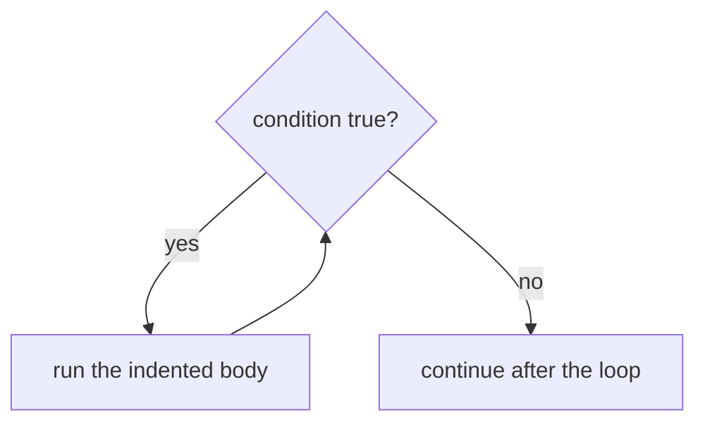

# User input, while loops and functions

Three tools in this lesson turn scripts into programs people can actually use. **`input`** lets a program ask its user a question. A **`while` loop** keeps going for as long as a condition holds — until the user quits, until a queue is empty, until a guess is right. And **functions** let you give a name to a piece of work, so you can use it again and again without repeating yourself, and think about a big program one small part at a time.

## Asking the user: `input`

`input` shows a prompt, waits for the person to type something and press Enter, and hands back what they typed:

```python
name = input("What is your name? ")
print(f"Nice to meet you, {name.strip().title()}!")
```

Two facts govern everything you do with it:

1. The program **pauses** at `input` until the user responds.
2. The result is **always a string**, even if the user types digits. To calculate with it you must convert it using `int()` or `float()`.

```python
age_text = input("How old are you? ")
age = int(age_text)                 # "34" -> 34
if age >= 18:
    print("You may vote.")
```

Pages like this one cannot always pause for typing, so the runnable examples below use a stand-in called `ask` that returns prepared answers in turn. In your own editor, replace `ask(...)` with `input(...)` and the programs become interactive.

```python-run
prepared = iter(["  dana ", "34", "172.5"])       # the answers our pretend user will give

def ask(prompt):
    reply = next(prepared)
    print(prompt + reply)                         # show the question and the 'typed' answer
    return reply

name = ask("Your name? ").strip().title()
age = int(ask("Your age? "))
height = float(ask("Your height in cm? "))

print(f"{name} will be {age + 1} next birthday and is {height / 100:.2f} m tall.")
print(type(age), type(height))
```

Longer prompts can be built up in a variable first — `prompt = "Tell us your seat number.\nIt is printed on your ticket: "` — and passed to `input(prompt)`. End a prompt with a space so the answer does not stick to the question.

The remainder operator `%` from the first lesson is a natural partner for numeric input: `number % 2 == 0` tests for an even number, and `total % group_size` tells you how many are left over after sharing out.

If the user types something that is not a number, `int()` raises a `ValueError`. For now, assume cooperative users; the last lesson of this module shows how to handle that gracefully.

## Repeating while a condition holds

A `for` loop runs once per item of a collection. A **`while` loop** has no collection: it tests a condition, runs its body if the condition is true, and then tests again — over and over, until the condition becomes false.

```python-run
countdown = 5
while countdown > 0:
    print(countdown, end=" ")
    countdown -= 1                 # without this line the condition would stay true for ever
print("Lift-off!")
```



Something inside the body must eventually make the condition false. If nothing does, you have an **infinite loop**: the program never finishes. Everybody writes one sooner or later. In a terminal, press Ctrl+C to interrupt it; then look for the line that was supposed to change the condition.

Use `for` when you know what you are stepping through (a list, a range, the lines of a file). Use `while` when you cannot know in advance how many rounds there will be.

### Letting the user decide when to stop

```python-run
prepared = iter(["bread", "olives", "  ", "cheese", "done", "ignored"])
def ask(prompt):
    reply = next(prepared); print(prompt + reply); return reply

basket = []
item = ""
while item != "done":
    item = ask("Add an item (or 'done'): ").strip().lower()
    if item != "done" and item != "":
        basket.append(item)
print("Your basket:", basket)
```

The loop variable is given a starting value (`""`) so that the first test has something to compare. The special word `done` is a **sentinel**: a value that means "stop" rather than being real data.

### A flag

When several different events can end a loop, comparing against each in the `while` line gets clumsy. Use a **flag** instead: one variable that says whether the program should carry on. Any part of the loop can switch it off.

```python-run
prepared = iter(["status", "sell 3", "sell 9", "status", "quit"])
def ask(prompt):
    reply = next(prepared); print(prompt + reply); return reply

stock = 10
running = True                           # the flag
while running:
    command = ask("> ")
    if command == "quit":
        running = False
    elif command == "status":
        print(f"  {stock} loaves left")
    elif command.startswith("sell "):
        amount = int(command.removeprefix("sell "))
        if amount > stock:
            print("  not enough stock - closing early")
            running = False
        else:
            stock -= amount
    else:
        print("  unknown command")
print("Shop closed with", stock, "loaves.")
```

### `break` and `continue`

Two statements change the flow from inside any loop (`for` loops too):

- `break` leaves the loop immediately, skipping whatever remains of the body.
- `continue` abandons the current round and jumps back to the test for the next one.

```python-run
prepared = iter(["7", "abc", "-2", "12", "stop", "99"])
def ask(prompt):
    reply = next(prepared); print(prompt + reply); return reply

total = 0
while True:                               # 'loop until told otherwise'
    text = ask("Number to add (or 'stop'): ")
    if text == "stop":
        break                             # leave the loop altogether
    if not text.lstrip("-").isdigit():
        print("  that is not a whole number - skipped")
        continue                          # straight back to the top
    total += int(text)
print("Total:", total)
```

`while True:` with a `break` inside is a common, perfectly respectable idiom: the exit condition sits exactly where the decision is made. Just make sure every path can reach a `break`.

### while loops with lists and dictionaries

A `for` loop should not be used to go through a list you are adding to or removing from at the same time — it loses track of its position. A `while` loop that asks "is anything left?" handles this well.

```python-run
unchecked = ["ana", "ben", "cy"]
checked = []
while unchecked:                          # a non-empty list counts as true
    person = unchecked.pop()              # take one from the end
    print("Checking the ticket of", person.title())
    checked.append(person)
print("Still to check:", unchecked, "| done:", checked)

votes = ["tea", "coffee", "tea", "water", "tea"]
while "tea" in votes:                     # remove EVERY occurrence (remove() takes one at a time)
    votes.remove("tea")
print(votes)

prepared = iter(["ana", "walking", "y", "ben", "kayaking", "n"])
def ask(prompt):
    reply = next(prepared); print(prompt + reply); return reply

hobbies = {}
more = True
while more:                               # fill a dictionary from answers
    who = ask("Name: ")
    hobbies[who] = ask("Favourite pastime: ")
    more = ask("Another person? (y/n) ") == "y"
print(hobbies)
```

## Functions: naming a piece of work

You have been *calling* functions since the first line of this module — `print`, `len`, `sorted`. Now you will *define* your own. A function is a named block of code that runs only when called.

```python-run
def greet(name):
    """Print a friendly greeting for one person."""
    tidy = name.strip().title()
    print(f"Good morning, {tidy}!")

greet("dana")
greet("  MARTA okonkwo")
```

Anatomy:

- `def` begins the definition, followed by the function's name, parentheses, and a colon.
- `name` inside the parentheses is a **parameter**: a placeholder for information the function needs.
- The indented lines are the body. The first, in triple quotes, is a **docstring** — a description that tools and `help(greet)` display.
- `greet("dana")` is a **call**. The value handed over, `"dana"`, is an **argument**; inside the function, the parameter `name` is tied to it for the duration of the call.

Defining a function runs nothing. The body executes each time the function is called, and a function must be defined before the line that calls it.

### Giving back a result: `return`

Most functions do not print; they compute something and **return** it to the caller, who decides what to do with it — print it, store it, use it in a calculation.

```python-run
def area_of_room(length, width):
    """Return the floor area in square metres."""
    return length * width

kitchen = area_of_room(4, 3.5)
hall = area_of_room(2, 6)
print(kitchen, hall, kitchen + hall)
print(f"Paint needed: {area_of_room(5, 4) / 10:.1f} litres")
```

`return` ends the function at once and sends the value back; the call expression then *becomes* that value. Printing and returning are different things, and mixing them up is the classic early confusion:

```python-run
def double_and_print(n):
    print(n * 2)              # shows it on screen, gives nothing back

def double(n):
    return n * 2              # gives it back, shows nothing

a = double_and_print(5)       # prints 10 ...
print("a is", a)              # ... but a is None: the function returned nothing
b = double(5)
print("b is", b, "and can be used:", b + 1)
```

A function without a `return` (or that reaches its end without one) hands back `None`. If you ever see `None` where you expected a value, look for a missing `return`.

### Matching arguments to parameters

```python-run
def describe_trip(destination, days, transport="train"):
    return f"{days} days in {destination.title()}, travelling by {transport}"

print(describe_trip("lisbon", 4))                         # by position; transport uses its default
print(describe_trip("oslo", 2, "ferry"))                  # by position, default replaced
print(describe_trip(days=7, destination="kyoto"))         # by name: order no longer matters
print(describe_trip("porto", days=3, transport="bike"))   # positional first, then named
```

- **Positional arguments** are matched in order: first argument to first parameter, and so on. Getting the order wrong gives silly results, not an error.
- **Keyword arguments** name the parameter (`days=7`), so order stops mattering and the call explains itself.
- A **default value** (`transport="train"`) makes an argument optional. Parameters with defaults must come after those without.

Calling with too few or too many arguments is an error whose message tells you precisely what is wrong:

```python-run
def describe_trip(destination, days, transport="train"):
    return f"{days} days in {destination}"

for attempt in ("describe_trip('rome')", "describe_trip('rome', 3, 'bus', 'extra')", "describe_trip('rome', nights=3)"):
    try:
        eval(attempt)
    except TypeError as error:
        print(attempt, "->", error)
```

### Optional information and returning collections

A default of `None` (or an empty string) lets you make a piece of information truly optional, and a function can return any kind of value — a string, a list, a dictionary:

```python-run
def make_contact(first, last, phone=None):
    """Build a dictionary describing a person."""
    contact = {"name": f"{first} {last}".title()}
    if phone:                                   # only add the key if a phone was given
        contact["phone"] = phone
    return contact

print(make_contact("dana", "whitfield"))
print(make_contact("marta", "okonkwo", phone="555-0142"))

def split_bill(total, people):
    share = round(total / people, 2)
    return share, round(total - share * people, 2)     # two values come back as a tuple

each, leftover = split_bill(100, 3)
print(each, leftover)
```

### Passing a list — and what happens to it

When you pass a list to a function, the function works with the *same* list, not a copy. Changes it makes are visible to the caller afterwards.

```python-run
def serve_all(waiting, served):
    """Move every order from waiting to served, announcing each."""
    while waiting:
        order = waiting.pop(0)
        print("Serving", order)
        served.append(order)

queue = ["soup", "salad", "pie"]
done = []
serve_all(queue, done)
print("queue:", queue, "| done:", done)       # the caller's lists were changed

queue = ["soup", "salad", "pie"]
done = []
serve_all(queue[:], done)                     # pass a copy: the original survives
print("queue:", queue, "| done:", done)
```

Sometimes changing the caller's list is exactly what you want; sometimes it is a nasty surprise. Passing a copy (`queue[:]`) protects the original. Best of all is to say in the docstring whether a function changes what it is given.

### Any number of arguments

A parameter written with one star collects all the extra positional arguments into a tuple; one written with two stars collects extra keyword arguments into a dictionary.

```python-run
def make_sandwich(bread, *fillings):
    print(f"On {bread}:", ", ".join(fillings) if fillings else "nothing at all")

make_sandwich("rye")
make_sandwich("sourdough", "cheese", "tomato", "basil")

def build_profile(username, **details):
    details["username"] = username
    return details

print(build_profile("mokon", city="Lagos", plays="cello", since=2019))
```

You will often see these written as `*args` and `**kwargs` — those names are only a convention.

### Why bother with functions?

- **No repetition.** Fix or improve the code in one place and every caller benefits.
- **Names for ideas.** `average(scores)` reads better than four lines of arithmetic, and the main program becomes a readable outline.
- **Testable pieces.** A function that takes inputs and returns a result can be checked on its own.
- **One job each.** If you need the word "and" to describe what a function does, consider splitting it.

Style: name functions with lowercase words and underscores, starting with a verb (`calculate_total`, `find_longest`); write a docstring; and in a default or keyword argument put no spaces around the `=` (`transport="train"`).

### Keeping functions in their own file

As programs grow, you move functions into a separate file — a **module** — and **import** them where needed. If `kitchen_tools.py` contains `make_sandwich` and `split_bill`, another file in the same folder can use them in any of these ways:

```python
import kitchen_tools                       # then: kitchen_tools.split_bill(60, 4)
from kitchen_tools import split_bill       # then: split_bill(60, 4)
from kitchen_tools import split_bill as share     # give it a shorter or clearer name
import kitchen_tools as kt                 # then: kt.split_bill(60, 4)
```

Python's own toolbox, the **standard library**, is imported the same way:

```python-run
import random
from math import sqrt, pi
import statistics as stats

random.seed(4)                             # fixed seed: the same 'random' results every run
print(random.randint(1, 6), random.choice(["heads", "tails"]))
print(sqrt(144), round(pi, 3), stats.mean([3, 5, 10]))
```

Avoid `from module import *`, which pours every name from the module into your program and makes it impossible to see where anything came from.

## Common mistakes

| Symptom | Cause |
|---|---|
| `TypeError: can only concatenate str...` or `'<' not supported between 'str' and 'int'` after `input` | forgot to convert the typed text with `int()` / `float()` |
| the program hangs | infinite `while` loop: nothing in the body changes the condition |
| a result is `None` | the function prints instead of returning, or has no `return` on some path |
| `NameError` for a variable created inside a function | names made inside a function exist only there; return the value instead |
| a function "does nothing" | it was defined but never called — or called without parentheses (`greet` instead of `greet()`) |
| the caller's list changed unexpectedly | the function modified the list it was given; pass a copy |

Variables created inside a function are **local**: they vanish when the function returns, and the rest of the program cannot see them.

```python-run
def add_tax(price):
    with_tax = price * 1.2
    return with_tax

print(add_tax(50))
try:
    print(with_tax)
except NameError as error:
    print("NameError:", error)
```

## Worked example: a number-guessing game

```python-run
import random

def get_hint(secret, guess):
    """Return a hint comparing the guess with the secret number."""
    if guess < secret:
        return "too low"
    if guess > secret:
        return "too high"
    return "correct"

def play(secret, guesses, max_tries=6):
    """Play one game with a prepared list of guesses. Return the number of tries used, or None."""
    tries = 0
    for guess in guesses:
        tries += 1
        hint = get_hint(secret, guess)
        print(f"  guess {tries}: {guess} is {hint}")
        if hint == "correct":
            return tries
        if tries == max_tries:
            break
    return None

random.seed(11)
secret = random.randint(1, 50)
result = play(secret, [25, 37, 31, 28, 29, 30])       # halve the remaining range each time
if result:
    print(f"Found {secret} in {result} tries.")
else:
    print(f"Out of tries. It was {secret}.")
```

The game logic lives in two small functions; the part that talks to the "user" is separate. To make it interactive on your own machine, replace the prepared list with a `while` loop that calls `int(input("Your guess: "))`. Because `get_hint` only takes values and returns a value, you can check it in isolation — `get_hint(10, 3)` must be `"too low"` — which is exactly the habit the testing section of this module builds on.

> [!TIP]
> When a function misbehaves, call it directly with simple, known inputs and print what comes back: `print(get_hint(10, 3))`. Testing one function at a time is far easier than staring at the output of the whole program.

## Practise

1. Write `to_fahrenheit(celsius)` that returns the converted temperature, and print a table for –10 to 40 in steps of 10.
2. Write `longest(words)` that returns the longest string in a list (the first one if there is a tie).
3. Using a `while` loop, find the smallest power of 2 greater than 1000.
4. Write `count_down(start)` that returns a list such as `[5, 4, 3, 2, 1]` — once with `while`, once with `range`.
5. Write `describe_pet(name, kind="cat")` and call it by position, by keyword, and with the default.
6. Write `average(*numbers)` that works for any quantity of arguments and returns `None` when given none.

## Summary

- `input(prompt)` pauses and returns the typed text as a string; convert with `int()` or `float()` to calculate.
- `while condition:` repeats until the condition is false. Stop with a sentinel value, a flag, or `break`; skip a round with `continue`. Something in the body must change the condition.
- Use `while` to process a list you are emptying, to remove every occurrence of a value, or to collect input.
- `def name(parameters):` defines a function; `return` sends a result back (no `return` means `None`).
- Arguments can be positional or keyword; parameters may have defaults; `*args` and `**kwargs` collect extras.
- A function receives the caller's actual list — pass a copy if it must not change.
- Keep functions in modules and bring them in with `import`.

```quiz
[
  {"q": "What type of value does `input()` return when the user types 42?", "options": ["int", "float", "str", "It depends on what is typed"], "answer": 2,
   "explain": "input always returns a string. Use int(...) or float(...) to convert before doing arithmetic."},
  {"q": "What is wrong with this loop? `n = 1` / `while n < 10:` / `    print(n)`", "options": ["Nothing", "n never changes, so the condition stays true and the loop never ends", "while cannot use <", "print is not allowed in loops"], "answer": 1,
   "explain": "Something in the body must eventually make the condition false, e.g. n += 1."},
  {"q": "What does `break` do inside a loop?", "options": ["Skips to the next round", "Ends the loop immediately", "Ends the whole program", "Pauses for input"], "answer": 1,
   "explain": "break leaves the innermost loop at once; continue is the one that jumps to the next round."},
  {"q": "A function has no return statement. What does calling it give back?", "options": ["0", "An empty string", "None", "An error"], "answer": 2,
   "explain": "Functions that finish without returning a value return None."},
  {"q": "Given `def box(width, height=2):`, which call is NOT valid?", "options": ["box(5)", "box(5, 3)", "box(height=4, width=1)", "box(height=4)"], "answer": 3,
   "explain": "width has no default, so it must be supplied. The other calls give it by position or by keyword."},
  {"q": "What is the difference between a parameter and an argument?", "options": ["They are the same", "A parameter is the name in the definition; an argument is the value supplied in a call", "Arguments are always numbers", "Parameters are only used with return"], "answer": 1,
   "explain": "def greet(name): has the parameter name; greet('dana') passes the argument 'dana'."},
  {"q": "A function appends to a list it receives as a parameter. After the call, the caller's list:", "options": ["Is unchanged, because functions work on copies", "Contains the appended item, because the function received the same list", "Is empty", "Becomes a tuple"], "answer": 1,
   "explain": "Lists are passed by reference to the same object. Pass a copy (items[:]) to protect the original."},
  {"q": "Inside `def f(*things):`, what is `things`?", "options": ["A list of keyword arguments", "A tuple holding all the extra positional arguments", "A dictionary", "A single value"], "answer": 1,
   "explain": "One star collects positional arguments into a tuple; two stars collect keyword arguments into a dictionary."}
]
```

> **Source:** Matthes, *Python Crash Course* (3rd ed.), ch. 7–8 (user input and while loops; functions) — topics only, examples and wording are original; Python docs, *Tutorial* §4.4–4.9 (break/continue, defining functions, more on defining functions) and ch. 6 "Modules".
