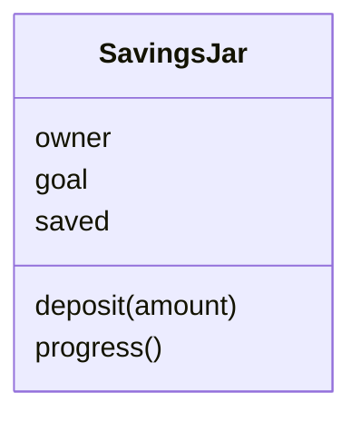

# Classes: modelling things with objects

> **Before this lesson:** you need dictionaries from [Decisions and dictionaries](#/lesson/python/py-start-decisions-dicts), and functions (defining them, parameters, `return`, default values) and `import` from [User input, while loops and functions](#/lesson/python/py-start-input-functions). Lists and loops come from [Lists and loops](#/lesson/python/py-start-lists-loops).

## In plain words

Dictionaries let you describe a thing ("this plant is a fern, 30 cm tall, in the kitchen"), and functions let you describe actions ("water a plant"). A **class** joins the two: it is a blueprint for objects that carry their own data *and* know how to do things with it. Once you have written the blueprint, you can stamp out as many objects as you need, each with its own data.

Think of a cake tin, or an architect's plan for a house. The plan is not a house; it describes what every house built from it will have (a front door, three windows, a roof) and what you can do with it (open the door, turn on the heating). Builders can put up a whole street of houses from one plan, and each house then has its own paint colour and its own people living in it. The class is the plan; each **object** is one house.

This way of organising programs is called **object-oriented programming**, and you have been using its results all along: every string, list and dictionary is an object made from a class. Why this matters for a job: most large programs, and nearly every library you will use, are built from classes, so reading and writing them is an everyday skill. Interviews ask you to design small classes ("model a parking lot", "write a bank account class") and to explain inheritance versus composition, both covered here.

This lesson builds classes slowly, from a single-method example to a small system of cooperating objects. The later *Object-Oriented Python* module returns to the same ideas in depth.

## Why not only dictionaries and functions?

Here is a bank-like "savings jar" done with the tools you already have:

```python-run
def make_jar(owner, goal):
    return {"owner": owner, "goal": goal, "saved": 0}

def deposit(jar, amount):
    jar["saved"] += amount

def progress(jar):
    return round(100 * jar["saved"] / jar["goal"])

jar = make_jar("Dana", 200)
deposit(jar, 50)
print(jar, progress(jar), "%")
jar["savd"] = 999          # a typo quietly creates a NEW key; nothing complains
print(jar)
```

It works, but the data and the functions that belong with it are only loosely associated, nothing stops code elsewhere from putting nonsense into the dictionary, and a misspelled key silently creates rubbish. A class gives the same idea a proper home.

## Your first class

```python-run
class SavingsJar:
    """A jar in which someone saves towards a goal."""

    def __init__(self, owner, goal):
        """Set up a new, empty jar."""
        self.owner = owner
        self.goal = goal
        self.saved = 0

    def deposit(self, amount):
        """Put money into the jar."""
        self.saved += amount

    def progress(self):
        """Return how far along we are, as a whole percentage."""
        return round(100 * self.saved / self.goal)

jar = SavingsJar("Dana", 200)        # make an object ("instance") from the blueprint
jar.deposit(50)
jar.deposit(25)
print(jar.owner, jar.saved, jar.progress())
```

Piece by piece:

- `class SavingsJar:` begins the blueprint. Class names are written in **CapWords** style — each word capitalised, no underscores — which distinguishes them from functions and variables.
- A function written inside a class is called a **method**.
- `__init__` (two underscores on each side) is a special method that Python runs **automatically** whenever a new object is created. Its job is to give the new object its starting data.
- `self` is the object being worked on. Every method receives it as the first parameter; Python passes it for you. When you write `jar.deposit(50)`, Python calls `deposit` with `self` tied to `jar` and `amount` tied to `50`.
- A variable attached to `self` with a dot — `self.saved` — is an **attribute**: a piece of data that belongs to that one object and lives as long as the object does. A plain variable inside a method (without `self.`) is an ordinary local variable and disappears when the method returns.
- `SavingsJar("Dana", 200)` **instantiates** the class: it creates a new object, runs `__init__` on it with the arguments you supplied, and hands the object back.
- Outside the class, you reach attributes and methods through the object with a dot: `jar.saved`, `jar.progress()`.



### Many objects from one blueprint

Each object has its own, separate attributes. Changing one never affects another:

```python-run
class SavingsJar:
    def __init__(self, owner, goal):
        self.owner = owner
        self.goal = goal
        self.saved = 0
    def deposit(self, amount):
        self.saved += amount
    def progress(self):
        return round(100 * self.saved / self.goal)

holiday = SavingsJar("Dana", 800)
bike = SavingsJar("Marta", 350)
holiday.deposit(200)
bike.deposit(70); bike.deposit(105)

for jar in (holiday, bike):
    print(f"{jar.owner}: {jar.saved} of {jar.goal} ({jar.progress()}%)")
print(type(bike), isinstance(bike, SavingsJar))
```

Objects are ordinary values: you can put them in lists, pass them to functions, and store them in dictionaries.

## Working with attributes

### Default values

An attribute does not have to come from a parameter. `self.saved = 0` above gave every new jar the same starting value. Any attribute the object will ever need should be created in `__init__`, so that readers can see the complete list in one place and no method ever finds an attribute missing.

### Three ways to change an attribute

```python-run
class Thermostat:
    """A wall thermostat with a target temperature."""
    def __init__(self, room):
        self.room = room
        self.target = 19.0
        self.changes = 0

    def set_target(self, degrees):
        """Set a new target, within safe limits."""
        if 5 <= degrees <= 30:
            self.target = degrees
            self.changes += 1
        else:
            print(f"  refused: {degrees} is outside 5-30")

    def nudge(self, step):
        """Raise or lower the target by a small step."""
        self.set_target(self.target + step)        # one method may call another through self

t = Thermostat("hall")
t.target = 21.5              # 1. directly, from outside
t.set_target(23)             # 2. through a method that checks the value
t.nudge(-1.5)                # 3. through a method that adjusts it
t.set_target(80)
print(t.room, t.target, t.changes)
```

Direct assignment is simple but unguarded: nothing would stop `t.target = 500`. A method can enforce rules ("between 5 and 30") and keep related data in step (the change counter). As a class grows, prefer methods for anything that has rules attached.

### Describing an object: `__repr__`

Printing an object of your own class shows something unhelpful like `<__main__.Thermostat object at 0x7f...>`. Give the class a `__repr__` method and Python will use its result whenever the object is displayed:

```python-run
class Thermostat:
    def __init__(self, room, target=19.0):
        self.room = room
        self.target = target
    def __repr__(self):
        return f"Thermostat(room={self.room!r}, target={self.target})"

print(Thermostat("hall"))
print([Thermostat("attic", 16), Thermostat("study", 21)])
```

Methods whose names begin and end with double underscores are hooks that Python calls at particular moments: `__init__` at creation, `__repr__` when a text form is needed. You never call them by those names yourself.

## Inheritance: a specialised version of a class

Suppose you need a second kind of jar that also earns interest. Copying the whole class and adding a method would duplicate code. Instead, declare that the new class **inherits** from the existing one: it starts with everything the original has, and you write only what is different.

```python-run
class SavingsJar:
    def __init__(self, owner, goal):
        self.owner = owner
        self.goal = goal
        self.saved = 0
    def deposit(self, amount):
        self.saved += amount
    def progress(self):
        return round(100 * self.saved / self.goal)
    def summary(self):
        return f"{self.owner} has {self.saved:.2f} of {self.goal}"

class InterestJar(SavingsJar):                 # the parent class goes in the parentheses
    """A jar that pays interest."""

    def __init__(self, owner, goal, rate):
        super().__init__(owner, goal)          # let the parent set up its attributes first
        self.rate = rate                       # then add what is new

    def add_interest(self):                    # a brand-new method
        self.saved += self.saved * self.rate

    def summary(self):                         # replaces ("overrides") the parent's version
        return super().summary() + f" (earning {self.rate:.0%})"

plain = SavingsJar("Dana", 500)
fancy = InterestJar("Marta", 1000, 0.05)
for jar in (plain, fancy):
    jar.deposit(400)                           # inherited: works for both
fancy.add_interest()
print(plain.summary())
print(fancy.summary())
print(isinstance(fancy, SavingsJar), isinstance(plain, InterestJar))
```

Vocabulary: `SavingsJar` is the **parent** (or *superclass*); `InterestJar` is the **child** (or *subclass*). Three things can happen in a child class:

1. **Inherit** — methods it does not mention (`deposit`, `progress`) work exactly as in the parent.
2. **Extend** — it adds new attributes (`rate`) and new methods (`add_interest`).
3. **Override** — it defines a method with the same name as one in the parent (`summary`); objects of the child class use the child's version.

`super()` means "the parent's version of". `super().__init__(owner, goal)` runs the parent's set-up code so that you do not have to repeat it — forgetting this line is the most common inheritance mistake, and it leaves the object without the parent's attributes. Use inheritance when the child really **is a** special kind of the parent: an interest jar *is a* savings jar.

## Objects inside objects

Often the relationship is not "is a" but "**has a**": a bicycle *has* a lock; a library member *has* a list of loans. Then one object stores another object as one of its attributes. This is called **composition**, and it keeps each class small and focused.

```python-run
class Battery:
    """The battery of an e-bike."""
    def __init__(self, capacity_wh=400):
        self.capacity_wh = capacity_wh
        self.charge = 1.0                       # 1.0 means full

    def drain(self, km):
        self.charge = max(0.0, self.charge - km * 8 / self.capacity_wh)

    def range_km(self):
        return round(self.charge * self.capacity_wh / 8)

class EBike:
    def __init__(self, model, capacity_wh=400):
        self.model = model
        self.odometer = 0
        self.battery = Battery(capacity_wh)     # an EBike HAS a Battery

    def ride(self, km):
        self.odometer += km
        self.battery.drain(km)

    def __repr__(self):
        return f"EBike({self.model!r}, {self.odometer} km ridden, {self.battery.range_km()} km of range left)"

bike = EBike("Heron 3", capacity_wh=500)
bike.ride(20)
print(bike)
print(bike.battery.charge, bike.battery.range_km())      # reach through one object to another
```

Everything about batteries lives in `Battery`. If batteries later become more complicated, `EBike` does not need to change — and other things with batteries can reuse the class. When you find a class collecting many attributes and methods that all concern one sub-topic, that is the signal to split that sub-topic into its own class.

## Classes in their own files

As with functions, classes are kept in modules and imported. A file `transport.py` holding `Battery` and `EBike` can be used from another file like this:

```python
from transport import EBike                # one class
from transport import EBike, Battery       # several
import transport                           # the whole module: transport.EBike("Heron 3")
from transport import EBike as Bike        # under another name
```

A sensible habit: one module per group of closely related classes, named in lowercase (`transport.py`), with the main program in a separate file that imports what it needs. The main file then reads like a summary of *what* the program does, and the modules hold the *how*.

## Using classes other people wrote

The standard library is full of ready-made classes. You use them exactly like your own: create an object, call its methods.

```python-run
from datetime import date, timedelta
from pathlib import Path
from collections import Counter

launch = date(2026, 3, 14)
print(launch.year, launch.strftime("%A %d %B"), launch + timedelta(days=30))

report = Path("reports") / "march" / "summary.txt"
print(report.name, report.suffix, report.parent)

letters = Counter("bookkeeper")
print(letters.most_common(2))
```

`date`, `Path` and `Counter` are classes; `launch`, `report` and `letters` are objects. Knowing how classes work means you can read any library's documentation: it will list what to pass when creating an object, which attributes it has, and which methods you can call.

## Common mistakes

```python-run
class Kettle:
    def __init__(self, litres):
        self.litres = litres
    def pour(self, amount):
        self.litres -= amount
        return self.litres

attempts = {
    "argument missing":        "Kettle()",
    "class called like a function, lowercase": "kettle(1.5)",
    "method called on the class, not an object": "Kettle.pour()",
    "attribute misspelled":    "Kettle(1.5).liters",
}
for label, code in attempts.items():
    try:
        eval(code)
    except Exception as error:
        print(f"{label}\n    {type(error).__name__}: {error}")
```

As in earlier lessons, each mistake is stored as text and run with `eval`, and the `except` block prints the error so the next one can run. Match each printed message against the table below.

| Message | Likely cause |
|---|---|
| `TypeError: __init__() missing 1 required positional argument` | you created the object without all the values `__init__` needs |
| `TypeError: pour() takes 1 positional argument but 2 were given` | `self` was left out of the method's definition — Python passed the object, and there was no parameter to receive it |
| `TypeError: ... missing ... required positional arguments: 'self' ...` | the method was called on the class (`Kettle.pour(...)`) instead of on an object |
| `AttributeError: 'Kettle' object has no attribute 'liters'` | a misspelled attribute, or one never created in `__init__` — or the child class forgot `super().__init__(...)` |
| `NameError: name 'litres' is not defined` inside a method | you wrote `litres` instead of `self.litres` |
| `__init__` seems never to run | it is misspelled — it needs two underscores on each side |

Unlike a dictionary, an object *does* complain when you read an attribute that does not exist, which catches typos early. (Assigning to a new attribute name is still allowed, so spell carefully.)

## Worked example: a plant-care system

```python-run
class Plant:
    """One house plant and its watering needs."""

    def __init__(self, name, room, days_between_water):
        self.name = name
        self.room = room
        self.days_between_water = days_between_water
        self.days_since_water = 0

    def pass_day(self):
        self.days_since_water += 1

    def needs_water(self):
        return self.days_since_water >= self.days_between_water

    def water(self):
        self.days_since_water = 0

    def __repr__(self):
        return f"Plant({self.name!r}, {self.days_since_water}d since water)"


class Succulent(Plant):
    """A plant that tolerates drought and must not be over-watered."""

    def __init__(self, name, room):
        super().__init__(name, room, days_between_water=21)

    def water(self):
        if self.needs_water():
            super().water()
        else:
            print(f"    (skipping {self.name}: too soon)")


class Home:
    """A home HAS plants."""

    def __init__(self):
        self.plants = []

    def add(self, plant):
        self.plants.append(plant)

    def pass_days(self, days):
        for _ in range(days):
            for plant in self.plants:
                plant.pass_day()

    def thirsty(self):
        return [plant for plant in self.plants if plant.needs_water()]

    def water_room(self, room):
        for plant in self.plants:
            if plant.room == room:
                plant.water()


home = Home()
home.add(Plant("fern", "kitchen", 3))
home.add(Plant("basil", "kitchen", 2))
home.add(Succulent("jade", "study"))
home.add(Plant("ivy", "study", 5))

home.pass_days(4)
print("Thirsty after 4 days:", [p.name for p in home.thirsty()])
home.water_room("kitchen")
home.water_room("study")                 # the succulent declines
print("Thirsty after watering:", [p.name for p in home.thirsty()])
home.pass_days(20)
print("Three weeks later:", home.thirsty())
```

Three small classes, each responsible for one idea: a `Plant` knows about its own thirst; a `Succulent` is a plant with a different rule (inheritance, with one overridden method); a `Home` holds plants and coordinates them (composition). Notice that `Home.water_room` calls `plant.water()` on every plant alike, and each object does the right thing for its own kind — the calling code does not need an `if` to tell the kinds apart.

Extend it: add a `height_cm` attribute and a `grow()` method; make `Home` report which room has the most thirsty plants; add a `Herb` subclass that needs water every day in summer.

> [!TIP]
> Before writing a class, describe the thing in two short lists on paper: what it **knows** (those become attributes, set up in `__init__`) and what it can **do** (those become methods). If the "knows" list splits naturally into two topics, you probably have two classes.

## Practise

1. Write a `Counter` class of your own (call it `Tally`) with `add()`, `reset()` and a `count` attribute. Make three tallies and show that they are independent.
2. Write `Rectangle(width, height)` with `area()`, `perimeter()` and `__repr__`. Then write `Square(side)` that inherits from it.
3. Write `Playlist(name)` that holds song titles in a list attribute, with `add(title)`, `remove(title)` (which prints a message if the title is absent) and `count()`.
4. Give `Playlist` a `longest_title()` method that returns the longest title or `None` for an empty playlist.
5. Write `Stopwatch` with `start(at)`, `stop(at)` and `elapsed()`, where the times are plain numbers of seconds. What should `elapsed()` return if the watch was never stopped?

## Summary

- A class is a blueprint; an object (instance) is one thing built from it. `ClassName(arguments)` creates an object and runs `__init__`.
- `self` is the object a method is working on; `self.name` is an attribute that belongs to that object. Create all attributes in `__init__`.
- Change attributes directly, or better, through methods that can apply rules. `__repr__` controls how an object is displayed.
- Inheritance (`class Child(Parent):`) models "is a": the child inherits everything, can add to it, and can override methods; `super()` reaches the parent's version.
- Composition models "has a": an object stores other objects as attributes.
- Keep classes in modules and import them; library classes work the same way as your own.

## Glossary

- **Class** - a blueprint describing what data its objects hold and what they can do.
- **Object (instance)** - one thing built from a class, with its own data.
- **Instantiate** - create an object from a class by calling it: `SavingsJar("Dana", 200)`.
- **Object-oriented programming** - organising a program around objects that combine data and behaviour.
- **Method** - a function defined inside a class.
- **`__init__`** - the special method Python runs automatically to set up each new object.
- **`self`** - the particular object a method is working on; always the first parameter.
- **Attribute** - a piece of data attached to an object, such as `self.saved`.
- **CapWords** - the naming style for classes: each word capitalised, no underscores.
- **`__repr__`** - the special method that gives an object's text form for printing.
- **Inheritance** - defining a class as a specialised version of another ("is a").
- **Parent (superclass) / child (subclass)** - the class inherited from / the class that inherits.
- **Override** - define a method in a child class with the same name as one in the parent, replacing it.
- **`super()`** - a way to reach the parent class's version of a method.
- **Composition** - one object holding another as an attribute ("has a").
- **`isinstance`** - a built-in that asks whether an object was made from a class (or one of its children).
- **AttributeError** - the error raised when you read an attribute an object does not have.

```quiz
[
  {"q": "When does Python run a class's `__init__` method?", "options": ["When the class is defined", "Automatically, each time a new object is created from the class", "Only when you call obj.__init__() yourself", "When the program ends"], "answer": 1,
   "explain": "Writing ClassName(...) creates the object and immediately calls __init__ on it with the arguments given."},
  {"q": "What is `self` inside a method?", "options": ["The class", "The particular object the method was called on", "A reserved word that must not be used", "The parent class"], "answer": 1,
   "explain": "Python passes the object automatically as the first argument, so jar.deposit(5) runs deposit with self tied to jar."},
  {"q": "Inside a method, what is the difference between `total = 5` and `self.total = 5`?", "options": ["None", "The first makes a local variable that vanishes when the method ends; the second stores an attribute on the object", "The second is a syntax error", "The first is shared by all objects"], "answer": 1,
   "explain": "Only names attached to self persist with the object."},
  {"q": "In `class Tandem(Bicycle):`, what is Bicycle?", "options": ["An attribute", "The parent class that Tandem inherits from", "An argument to __init__", "A module"], "answer": 1,
   "explain": "The class in parentheses is the parent; Tandem starts with all of Bicycle's attributes and methods."},
  {"q": "Why call `super().__init__(...)` in a child class's `__init__`?", "options": ["It is decoration", "So the parent's set-up code runs and the object gets the parent's attributes", "To delete the parent", "To make the class faster"], "answer": 1,
   "explain": "Without it, attributes created in the parent's __init__ never exist on the new object."},
  {"q": "A child class defines a method with the same name as one in its parent. For objects of the child class:", "options": ["Both run", "The child's version is used (it overrides the parent's)", "The parent's version is used", "It is an error"], "answer": 1,
   "explain": "Overriding replaces the inherited behaviour; super().method() can still reach the parent's version."},
  {"q": "A Car object stores an Engine object in `self.engine`. This is an example of:", "options": ["Inheritance", "Composition ('has a')", "Overriding", "Importing"], "answer": 1,
   "explain": "A car has an engine; it is not a kind of engine. Storing one object inside another is composition."},
  {"q": "`TypeError: brew() takes 0 positional arguments but 1 was given` on `kettle.brew()` most likely means:", "options": ["brew needs more arguments", "The method was defined without the self parameter", "kettle is not an object", "Python is out of memory"], "answer": 1,
   "explain": "Python passes the object as the first argument; if the definition has no self, there is nowhere to put it."}
]
```

> **Source:** Matthes, *Python Crash Course* (3rd ed.), ch. 9 (classes: creating and using a class, working with instances, inheritance, importing classes) — topics only, examples and wording are original; Python docs, *Tutorial* ch. 9 "Classes".
