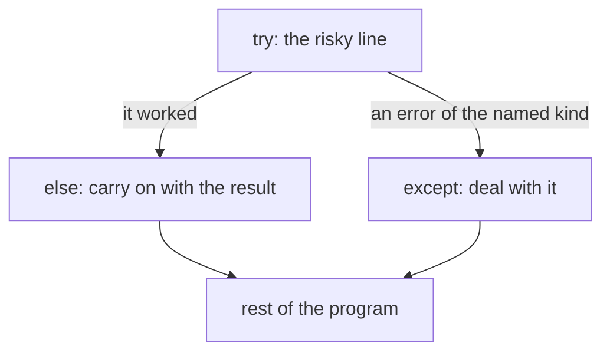

# Files, errors and tests: programs you can rely on

> **Before this lesson:** you need functions with parameters and `return` ([User input, while loops and functions](#/lesson/python/py-start-input-functions)), dictionaries ([Decisions and dictionaries](#/lesson/python/py-start-decisions-dicts)) and basic classes with `__init__` and methods ([Classes: modelling things with objects](#/lesson/python/py-start-classes)). Reading a traceback comes from [First steps](#/lesson/python/py-start-first-steps).

## In plain words

A program that forgets everything when it ends, falls over at the first unexpected input, and has only ever been checked by eye is a toy. This last lesson of the on-ramp covers the three skills that turn it into something dependable: **reading and writing files** so that data outlives the program, **handling errors** so that a missing file or a mistyped number does not end in a crash, and **writing tests** so that you know, rather than hope, that your code works, today and after every future change.

An everyday comparison: a careful cook keeps a notebook of recipes so nothing is forgotten between days (files), has a plan for when an ingredient is missing instead of abandoning the meal (error handling), and tastes each dish before it leaves the kitchen (testing). None of these makes the cooking itself different; all of them make the results reliable.

Why this matters for a job: real programs live on data stored in files and databases, they must cope with bad input without crashing, and professional teams will not accept code without tests. "How would you test this function?" and "what happens if the file is missing?" are standard interview follow-ups, and writing a test first when you fix a bug is a habit employers look for.

## Reading a file

Programs find files through **paths**: a path is the address of a file, made of the folders that lead to it and the file's own name. Python's `pathlib` module provides a `Path` class that represents a location on disk and knows how to read from it.

```python
from pathlib import Path

path = Path("trail_notes.txt")
contents = path.read_text(encoding="utf-8")
print(contents)
```

`read_text` returns the whole file as one string. A bare file name is looked for in the folder the program is run from — the usual reason for a "file not found" surprise is that the terminal is in a different folder from the one you think. Passing `encoding="utf-8"` says how the bytes on disk translate into characters (UTF-8 is the standard encoding that can represent every character in every language); stating it explicitly means accented letters and symbols come out the same on every computer.

So that the examples can run in this page, each one first creates its file in a temporary folder. `tempfile.mkdtemp()` makes a fresh, empty folder and returns its location, so the demos never touch a real file:

```python-run
from pathlib import Path
import tempfile

folder = Path(tempfile.mkdtemp())
path = folder / "trail_notes.txt"            # the / operator joins path pieces
path.write_text("Ridge Walk: muddy after rain\nFern Gully: bridge repaired\n\nHeron Loop: nesting season, keep dogs on leads\n", encoding="utf-8")

contents = path.read_text(encoding="utf-8")
print(contents)
print("characters:", len(contents))
print(path.name, path.suffix, path.exists())
```

### Line by line

Most text files are best handled one line at a time. `splitlines()` cuts the big string at each line break and gives you a list:

```python-run
from pathlib import Path
import tempfile

path = Path(tempfile.mkdtemp()) / "trail_notes.txt"
path.write_text("Ridge Walk: muddy after rain\nFern Gully: bridge repaired\n\nHeron Loop: nesting season\n", encoding="utf-8")

lines = path.read_text(encoding="utf-8").splitlines()
print(lines)

notes = {}
for number, line in enumerate(lines, start=1):       # enumerate supplies a running count
    if not line.strip():
        continue                                     # skip blank lines
    trail, note = line.split(": ", 1)                # cut at the first ": " only
    notes[trail] = note
    print(f"line {number}: {trail!r} -> {note!r}")
print(notes)
```

Three things are worth remembering about data that comes from files:

- Everything is **text**. A line containing `42` is the string `"42"`; convert it with `int()` or `float()` before doing arithmetic.
- Lines often carry invisible whitespace. `strip()` is your friend.
- Real files contain surprises — blank lines, missing fields, a stray header. Decide what to do with them instead of assuming they will not occur.

### Paths on different systems

Windows separates folders with backslashes and macOS/Linux with forward slashes. Build paths with `Path` and the `/` operator — `Path("data") / "2026" / "march.txt"` — and the right separator is used automatically. A **relative** path starts from the current folder; an **absolute** path spells out the full location from the top of the disk (`Path.home()` gives your home folder, `Path.cwd()` the current one).

## Writing a file

```python-run
from pathlib import Path
import tempfile

path = Path(tempfile.mkdtemp()) / "shopping.txt"

path.write_text("oats\nlentils\n", encoding="utf-8")           # creates the file (or REPLACES it)
print(repr(path.read_text(encoding="utf-8")))

items = ["tea", "lemons", "candles"]
text = ""
for item in items:
    text += item + "\n"                                         # you add the line breaks yourself
path.write_text(text, encoding="utf-8")                         # the earlier contents are gone
print(repr(path.read_text(encoding="utf-8")))

with path.open("a", encoding="utf-8") as file:                  # "a" = append: add to the end
    file.write("matches\n")
print(path.read_text(encoding="utf-8").splitlines())
```

Be careful: `write_text` **replaces** whatever the file held before, without asking. It also writes exactly the string you give it — no line breaks are added — and only strings: turn numbers into text first with `str()` or an f-string. To add to an existing file, open it in append mode as in the last step; the `with` line makes sure the file is properly closed afterwards, whatever happens inside the block.

## When things go wrong: exceptions

When Python cannot carry out an instruction — divide by zero, open a file that is not there, convert `"abc"` to a number — it creates an **exception** object describing the problem. If your program does nothing about it, the program stops and prints a traceback. If you have written code to deal with it, the program carries on. You deal with exceptions using a `try` / `except` block:

```python-run
def share_out(total, people):
    try:
        each = total / people
    except ZeroDivisionError:
        print("  Cannot share between zero people.")
        return None
    else:
        print(f"  Each person gets {each:.2f}")
        return each

share_out(90, 4)
share_out(90, 0)
print("The program is still running.")
```

How to read it:

- **`try`** — "attempt this". Put here only the line or two that might fail.
- **`except SomeError`** — "if that particular kind of problem occurred, do this instead". Execution jumps here the moment the error happens; the rest of the `try` block is skipped.
- **`else`** — "if nothing went wrong, continue with this". It holds the code that depends on the `try` having succeeded.



Name the specific kind of error you expect. The name is the first word on the last line of the traceback you would otherwise have seen — which is why reading tracebacks carefully pays off.

| Exception | Raised when |
|---|---|
| `ZeroDivisionError` | dividing by zero |
| `ValueError` | a value has the right type but unusable content: `int("seven")` |
| `TypeError` | an operation is applied to the wrong kind of value: `"a" + 1` |
| `FileNotFoundError` | a file or folder does not exist |
| `KeyError` / `IndexError` | a dictionary key or list position does not exist |

### Bad input

Anything that comes from outside the program — a person, a file, the network — can be wrong. Guard the conversion:

```python-run
def to_number(text):
    """Convert typed text to a float, or return None if it is not a number."""
    try:
        return float(text.strip().replace(",", "."))
    except ValueError:
        return None

for typed in ["12", " 3,5 ", "seven", "", "1e3"]:
    value = to_number(typed)
    if value is None:
        print(f"{typed!r:<9} is not a number - please try again")
    else:
        print(f"{typed!r:<9} -> {value}")
```

In an interactive program you would wrap this in a `while` loop that keeps asking until the answer is usable.

### Missing files

```python-run
from pathlib import Path
import tempfile

folder = Path(tempfile.mkdtemp())
(folder / "monday.txt").write_text("walked the dog\nbaked bread\n", encoding="utf-8")

def count_lines(path):
    try:
        text = path.read_text(encoding="utf-8")
    except FileNotFoundError:
        print(f"  (no diary for {path.stem})")
        return 0
    else:
        return len(text.splitlines())

total = 0
for day in ["monday", "tuesday", "wednesday"]:
    total += count_lines(folder / f"{day}.txt")
print("entries found:", total)
```

One missing file no longer stops the whole run. Whether to tell the user (as here), or to stay silent, is a judgement call: report problems the user can act on; quietly skip what is truly optional. To skip silently you write `pass` — the "do nothing" statement — in the `except` block. Use it sparingly: an error swallowed in silence is very hard to track down later. And never write a bare `except:` that catches *everything*; it will also hide your own typos.

## Remembering data between runs: JSON

To save a list or a dictionary, you need to turn it into text and back. **JSON** (JavaScript Object Notation) is a simple, universal text format for exactly that; nearly every programming language can read it. Python's `json` module converts in both directions:

```python-run
from pathlib import Path
import json, tempfile

path = Path(tempfile.mkdtemp()) / "garden.json"

garden = {"owner": "Dana", "beds": 3, "plants": ["kale", "beans", "chard"], "organic": True}

path.write_text(json.dumps(garden, indent=2), encoding="utf-8")     # dumps: Python data -> JSON text
print(path.read_text(encoding="utf-8"))

loaded = json.loads(path.read_text(encoding="utf-8"))               # loads: JSON text -> Python data
print(loaded["plants"][0], loaded["beds"] + 1, loaded == garden)
```

Lists, dictionaries, strings, numbers, `True`/`False` and `None` all survive the round trip. Combine this with exception handling and you get the standard "load what was saved, or start fresh" pattern:

```python-run
from pathlib import Path
import json, tempfile

SAVE_FILE = Path(tempfile.mkdtemp()) / "high_score.json"

def load_score():
    """Return the saved best score, or 0 if nothing usable has been saved."""
    try:
        return json.loads(SAVE_FILE.read_text(encoding="utf-8"))["best"]
    except FileNotFoundError:
        return 0                                    # first run: nothing saved yet
    except (json.JSONDecodeError, KeyError):
        print("  (save file was damaged - starting again)")
        return 0

def save_score(score):
    SAVE_FILE.write_text(json.dumps({"best": score}), encoding="utf-8")

def record(score):
    """Record a finished game; return True if it is a new best."""
    if score > load_score():
        save_score(score)
        return True
    return False

print(load_score())                 # 0 - there is no file yet
print(record(120), record(90), record(150))
print(load_score())
SAVE_FILE.write_text("not json at all", encoding="utf-8")
print(load_score())
```

Notice how the work is divided: one function loads, one saves, one decides. Splitting a growing block of code into small functions that each do one clear job — without changing what the program does — is called **refactoring**. It makes code easier to read, to change, and above all to test.

## Testing: knowing that it works

Until now you have checked your code by running it and looking at the output. That stops scaling almost immediately: programs change, and every change can break something that used to work. A **test** is a small piece of code that calls your code with known inputs and checks that the result is what it should be. Run all the tests, and in a second you know whether everything still behaves.

The checking is done with `assert`: "I claim this is true". If the claim holds, nothing happens; if it does not, Python raises an `AssertionError`.

```python-run
def format_name(first, last, middle=""):
    """Return a neatly capitalised full name."""
    if middle:
        full = f"{first} {middle} {last}"
    else:
        full = f"{first} {last}"
    return full.title()

assert format_name("dana", "whitfield") == "Dana Whitfield"
assert format_name("marta", "okonkwo", "ada") == "Marta Ada Okonkwo"
print("both claims hold")

try:
    assert format_name("li", "wei") == "LI WEI", "expected capitals"
except AssertionError as error:
    print("AssertionError:", error)
```

### Tests with pytest

Scattering asserts around a program is awkward. The standard tool is **pytest**. You install it once into your project (`python -m pip install pytest`, or `uv add --dev pytest`), put tests in a separate file whose name starts with `test_`, and write each test as a function whose name starts with `test_`:

```python
# names.py
def format_name(first, last, middle=""):
    ...
```

```python
# test_names.py
from names import format_name

def test_first_and_last():
    assert format_name("dana", "whitfield") == "Dana Whitfield"

def test_with_middle_name():
    assert format_name("marta", "okonkwo", "ada") == "Marta Ada Okonkwo"
```

Then run the command `pytest` in the project folder. It finds the test files by their names, runs every test function, and reports:

```
test_names.py ..                                    [100%]
2 passed in 0.01s
```

One dot per passing test. When a test fails, pytest shows the assert line and the actual values on both sides, so you can see at a glance what the function returned and what you expected:

```
    def test_with_middle_name():
>       assert format_name("marta", "okonkwo", "ada") == "Marta Ada Okonkwo"
E       AssertionError: assert 'Marta Okonkwo' == 'Marta Ada Okonkwo'
```

A failing test means either the code or the test is wrong. Do not "fix" it by loosening the test without thinking: first decide which of the two describes the behaviour you actually want.

pytest's core is simple enough to imitate in a few lines, which lets us run a test suite right here:

```python-run
def apply_discount(price, percent):
    """Return price reduced by percent, rounded to 2 decimals."""
    if not 0 <= percent <= 100:
        raise ValueError("percent must be between 0 and 100")    # raise: signal an error yourself
    return round(price * (100 - percent) / 100, 2)

def test_ordinary_discount():
    assert apply_discount(80, 25) == 60

def test_no_discount():
    assert apply_discount(19.99, 0) == 19.99

def test_everything_off():
    assert apply_discount(50, 100) == 0

def test_rounding():
    assert apply_discount(9.99, 15) == 8.49

def test_rejects_silly_percent():
    try:
        apply_discount(50, 150)
    except ValueError:
        return                                  # exactly what should happen
    assert False, "expected a ValueError"

passed = 0
for name, func in list(globals().items()):
    if name.startswith("test_") and callable(func):
        try:
            func()
            passed += 1
            print("PASS", name)
        except AssertionError as error:
            print("FAIL", name, "-", error)
print(passed, "passed")
```

How the imitation works: `globals()` returns a dictionary of every name defined at the top level of the program, so the loop can find each function whose name starts with `test_` and call it. A test that finishes counts as a pass; one that raises `AssertionError` is reported as a failure. Note also `raise ValueError(...)` inside `apply_discount`: `raise` lets your own code signal an error, exactly as Python's built-in functions do. (With real pytest the last test is written more neatly as `with pytest.raises(ValueError): apply_discount(50, 150)`.)

### What should you test?

Pick a few inputs that represent typical use, then go looking for trouble at the edges:

- the ordinary case;
- the **boundaries** — zero, one, the largest allowed value, exactly on a limit;
- the **empty** case — an empty string, an empty list;
- inputs that should be **rejected**.

Give each test a long, descriptive name. When it fails six months from now, the name is the first thing you will read.

### Testing a class, and sharing set-up with a fixture

Testing a class means creating an object, calling its methods, and asserting on the results. Several tests usually need the same starting object; rather than building it in every test, pytest lets you write a **fixture** — a function that prepares something tests need. A test asks for a fixture by naming it as a parameter, and pytest supplies it. (`@pytest.fixture` is a **decorator**, a line starting with `@` placed above a function to give it extra behaviour; here it marks the function as a fixture.)

```python
# test_basket.py
import pytest
from shop import Basket

@pytest.fixture
def basket():
    """A basket with two items already in it."""
    b = Basket()
    b.add("tea", 3.50)
    b.add("lemons", 1.20)
    return b

def test_total(basket):
    assert basket.total() == 4.70

def test_remove(basket):
    basket.remove("tea")
    assert basket.total() == 1.20

def test_removing_unknown_item_changes_nothing(basket):
    basket.remove("caviar")
    assert basket.count() == 2
```

Each test receives its own freshly made basket, so tests cannot interfere with one another. The same idea, runnable here without pytest:

```python-run
class Basket:
    def __init__(self):
        self.items = {}
    def add(self, name, price):
        self.items[name] = price
    def remove(self, name):
        self.items.pop(name, None)
    def count(self):
        return len(self.items)
    def total(self):
        return round(sum(self.items.values()), 2)

def fresh_basket():                       # plays the role of the fixture
    b = Basket()
    b.add("tea", 3.50)
    b.add("lemons", 1.20)
    return b

def test_total(basket):
    assert basket.total() == 4.70
def test_remove(basket):
    basket.remove("tea")
    assert basket.total() == 1.20
def test_removing_unknown_item_changes_nothing(basket):
    basket.remove("caviar")
    assert basket.count() == 2

for test in (test_total, test_remove, test_removing_unknown_item_changes_nothing):
    test(fresh_basket())                  # a new basket for every test
    print("PASS", test.__name__)
```

The *Testing with pytest* lesson later in this track goes further: testing many inputs with one test, temporary files, and replacing slow or unreliable parts with stand-ins.

## Worked example: a reading log

```python-run
from pathlib import Path
import json, tempfile

LOG = Path(tempfile.mkdtemp()) / "reading_log.json"

def load_log(path):
    """Return the list of saved entries (empty if there is no usable file)."""
    try:
        return json.loads(path.read_text(encoding="utf-8"))
    except (FileNotFoundError, json.JSONDecodeError):
        return []

def add_entry(entries, title, pages_text):
    """Return a new list with one more entry. Raises ValueError for bad input."""
    title = title.strip()
    if not title:
        raise ValueError("a title is required")
    pages = int(pages_text)                       # may raise ValueError by itself
    if pages <= 0:
        raise ValueError("pages must be positive")
    return entries + [{"title": title.title(), "pages": pages}]

def summary(entries):
    if not entries:
        return "Nothing read yet."
    total = sum(entry["pages"] for entry in entries)
    return f"{len(entries)} books, {total} pages, {total / len(entries):.0f} per book"

# --- tests first ---
assert load_log(Path("no/such/file.json")) == []
assert add_entry([], " the salt road ", "310") == [{"title": "The Salt Road", "pages": 310}]
assert summary([]) == "Nothing read yet."
assert summary([{"title": "A", "pages": 100}, {"title": "B", "pages": 300}]) == "2 books, 400 pages, 200 per book"
print("tests passed")

# --- then the program ---
entries = load_log(LOG)
for title, pages in [("night gardens", "280"), ("", "120"), ("maps of nowhere", "lots"), ("a field guide to clouds", "190")]:
    try:
        entries = add_entry(entries, title, pages)
    except ValueError as error:
        print(f"  skipped {title!r}: {error}")
LOG.write_text(json.dumps(entries, indent=2), encoding="utf-8")
print(summary(load_log(LOG)))
```

Files, JSON, exceptions (both handled and raised), small single-purpose functions, and tests that pin down their behaviour before the program proper runs. This is the shape of dependable software in miniature.

> [!TIP]
> When you fix a bug, first write a test that fails because of it, then fix the code until the test passes. The bug is now proven fixed, and it can never quietly come back.

## Practise

1. Write a few lines of text to a file, read them back, and print them in reverse order with line numbers.
2. Write `safe_int(text, fallback)` that returns `int(text)` or the fallback when the text is not a whole number. Write five asserts for it, including an empty string and `" 12 "`.
3. Store a dictionary of three friends' birthdays as JSON, load it in a "second run", add one, and save again.
4. Write `word_count(path)` that returns the number of words in a file, or 0 if the file does not exist.
5. Write tests for a `Stopwatch` or `Playlist` class from the previous lesson, using a helper that builds a fresh object for each test.

## Summary

- `Path(...).read_text(encoding="utf-8")` reads a file into a string; `splitlines()` gives lines. `write_text` replaces the contents; append mode adds. File data is always text — convert and `strip` it.
- `try` / `except SpecificError` / `else` lets a program respond to problems (`ValueError`, `FileNotFoundError`, `ZeroDivisionError`, ...) instead of crashing. Catch specific errors, and stay silent only on purpose.
- `json.dumps` / `json.loads` turn lists and dictionaries into text and back, so data can outlive the program.
- Refactor into small functions with one job each.
- A test calls code with known input and asserts on the result. With pytest: files and functions named `test_...`, plain `assert`, fixtures for shared set-up. Test typical cases, boundaries, empty inputs and invalid inputs.

## Glossary

- **Path** - the address of a file or folder; in Python, a `Path` object from `pathlib`.
- **Relative / absolute path** - a location starting from the current folder / the full location from the top of the disk.
- **Encoding (UTF-8)** - the rule for turning characters into bytes on disk; UTF-8 is the universal standard.
- **`read_text` / `write_text`** - read a whole file into a string / replace a file's contents with a string.
- **Append mode** - opening a file with `"a"` so that writing adds to the end.
- **`with` block** - a block that guarantees a file is closed afterwards, whatever happens inside.
- **Exception** - an object Python creates when an instruction cannot be carried out.
- **`try` / `except` / `else`** - attempt risky code / handle a named kind of error / run only if nothing went wrong.
- **`raise`** - signal an error from your own code.
- **`pass`** - the statement that does nothing; used where Python requires a block.
- **JSON** - JavaScript Object Notation, a text format for lists and dictionaries; `json.dumps` writes it, `json.loads` reads it.
- **Refactoring** - restructuring code into clearer pieces without changing what it does.
- **Test** - code that calls your code with known input and checks the result.
- **`assert`** - a statement that raises `AssertionError` if its condition is false.
- **pytest** - the standard Python testing tool; it runs every `test_` function in every `test_` file.
- **Fixture** - in pytest, a function that prepares something tests need, supplied fresh to each test.
- **Decorator** - a line starting with `@` above a function that gives it extra behaviour.
- **Boundary / edge case** - an input at the limit of what is allowed, such as zero or an empty list.

```quiz
[
  {"q": "What does `Path(\"notes.txt\").write_text(\"hello\")` do if notes.txt already contains text?", "options": ["Adds 'hello' at the end", "Replaces the entire contents with 'hello'", "Raises an error", "Creates notes(1).txt"], "answer": 1,
   "explain": "write_text overwrites. Open the file in append mode ('a') to add to the end."},
  {"q": "A file contains the line `25`. After reading it, what must you do before adding 5 to it?", "options": ["Nothing", "Convert it with int() (and strip any whitespace), because file contents are text", "Use json", "Rename the file"], "answer": 1,
   "explain": "Everything read from a text file is a string."},
  {"q": "In a try / except / else block, when does the else part run?", "options": ["Always", "Only if the try block raised an error", "Only if the try block finished without an error", "Never"], "answer": 2,
   "explain": "else holds the code that should run only when the risky part succeeded."},
  {"q": "Which exception does `int(\"twelve\")` raise?", "options": ["TypeError", "ValueError", "NameError", "FileNotFoundError"], "answer": 1,
   "explain": "The type (a string) is acceptable to int(); its content is not, hence ValueError."},
  {"q": "Why is a bare `except:` (catching everything) a bad habit?", "options": ["It is slower", "It hides unexpected problems, including your own typos, making bugs hard to find", "Python forbids it", "It only works for files"], "answer": 1,
   "explain": "Catch the specific errors you expect and know how to handle; let the rest surface."},
  {"q": "What do `json.dumps` and `json.loads` do?", "options": ["Delete and restore files", "Convert Python data to JSON text, and JSON text back to Python data", "Compress data", "Download data"], "answer": 1,
   "explain": "dumps = dump to string, loads = load from string. Combined with write_text/read_text they save and restore data."},
  {"q": "How does pytest find your tests?", "options": ["You list them in a settings file", "It collects functions named test_... in files named test_...", "It runs every function in the project", "By reading comments"], "answer": 1,
   "explain": "Naming is the mechanism: test_*.py files and test_* functions are collected automatically."},
  {"q": "What is a pytest fixture for?", "options": ["Fixing failed tests automatically", "Preparing something (an object, some data) that several tests need, supplied fresh to each test", "Skipping slow tests", "Measuring speed"], "answer": 1,
   "explain": "A test requests a fixture by naming it as a parameter; each test gets its own copy, keeping tests independent."}
]
```

> **Source:** Matthes, *Python Crash Course* (3rd ed.), ch. 10–11 (files and exceptions; testing your code) — topics only, examples and wording are original; Python docs, *Tutorial* ch. 7–8 "Input and Output" and "Errors and Exceptions", *Library Reference* `pathlib`, `json`; pytest documentation "Get Started".
