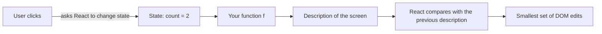
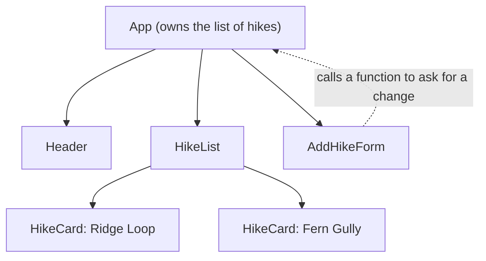

# Why React, and a first project with Vite

> **Before this lesson:** you should be able to read basic HTML (tags such as `<button>` and `<ul>`) and basic JavaScript (variables, functions, arrays, objects). If those are new, work through the [HTML & CSS track](#/track/html-css) and the first modules of the [JavaScript track](#/track/javascript) first. No React knowledge is assumed.

## In plain words

A web page is a tree of boxes: a heading, a list, a button. The browser keeps that tree in memory and calls it the **DOM** (Document Object Model: the browser's live, in-memory copy of the page, which JavaScript can read and change).

Changing the DOM by hand is like updating a paper seating chart for a wedding every time a guest cancels: you rub out a name here, shift three people there, and hope you did not forget the table by the window. It works for ten guests. It falls apart for three hundred.

**React** is a JavaScript library (a bundle of ready-made code you call from your own code) that takes over that job. You write a function that says "given this guest list, here is what the chart should look like". When the guest list changes, React re-runs your function, compares the new chart with the old one, and makes only the necessary edits to the real page. You describe *what* the screen should show; React works out *how* to get there.

Why it matters for a job: React is one of the most requested front-end skills in job adverts, and its ideas (components, state, one-way data flow) transfer to React Native, Next.js, and to competing tools such as Vue and Svelte.

## The problem React solves

Here is a tiny page written without any library: a counter of hikes you have completed.

```html-run
<button id="add">I finished a hike</button>
<p id="summary">You have finished 0 hikes.</p>
<p id="badge"></p>
<script>
  let count = 0;                                   // the data
  document.getElementById("add").addEventListener("click", () => {
    count = count + 1;                             // 1. change the data
    document.getElementById("summary").textContent =
      "You have finished " + count + " hike" + (count === 1 ? "" : "s") + ".";   // 2. patch the page
    if (count >= 3) document.getElementById("badge").textContent = "Badge: Trail regular";  // 3. patch another place
  });
</script>
```

Read the click handler line by line:

1. `count = count + 1` changes a JavaScript variable. The page does not know about this variable.
2. The next statement finds the paragraph and rewrites its text by hand.
3. The last statement finds a second element and updates it too.

Every place on the page that shows something derived from `count` needs its own hand-written update. This style is called **imperative** programming: you give step-by-step commands ("find this element, set its text"). Forget one command and the page shows stale information. In a real application with dozens of values and hundreds of elements, the number of "if this changed, also update that" rules grows faster than anyone can keep track of.

React replaces those scattered commands with a single rule:

$$\text{UI} = f(\text{state})$$

Here **state** means the data that can change while the page is open (the count, the text in a search box, the list of hikes downloaded from a server), **UI** (user interface) means what the person sees, and $f$ is a function you write. This style is called **declarative**: you declare the result you want for any given state, and something else carries out the steps.



## The same counter, the React way

This is real React code. It cannot run inside this lesson page (it needs a build step, explained below), so read it as a preview; every piece gets its own lesson later.

```jsx
import { useState } from "react";

function HikeCounter() {
  const [count, setCount] = useState(0);

  return (
    <div>
      <button onClick={() => setCount(count + 1)}>I finished a hike</button>
      <p>You have finished {count} hike{count === 1 ? "" : "s"}.</p>
      {count >= 3 && <p>Badge: Trail regular</p>}
    </div>
  );
}
```

Line by line:

- `import { useState } from "react";` pulls one function, `useState`, out of the React library so this file can use it.
- `function HikeCounter() { ... }` is an ordinary JavaScript function. Because it returns a description of some UI, React calls it a **component**: a reusable, named piece of the screen. Component names start with a capital letter.
- `const [count, setCount] = useState(0);` asks React to remember a value for this component. It hands back two things: the current value (`count`, starting at `0`) and a function for requesting a change (`setCount`).
- `return ( ... )` gives back what looks like HTML. It is **JSX**, a syntax that lets you write the description of the screen in a tag-like form inside JavaScript. The next lesson covers it in detail.
- `onClick={() => setCount(count + 1)}` says: when the button is clicked, ask React to store `count + 1`.
- `{count}` inserts the current value into the text. Curly braces mean "this part is JavaScript".
- `{count >= 3 && <p>...</p>}` shows the badge only when the condition is true.

Notice what is missing: there is no `getElementById` and no "now go update the paragraph". The function describes the whole fragment of the screen for *any* count. When `setCount` is called, React runs `HikeCounter` again with the new count and updates the page to match.

## Try the idea live

The page below implements the same idea with twelve lines of plain JavaScript standing in for React, so that it can run right here. The function `view` plays the role of your component, and `setState` plays the role of React.

```html-run
<div id="root"></div>
<script>
  // ----- a miniature "React": keep state, re-run the view function when it changes -----
  let state = { count: 0 };
  function setState(change) {
    state = { ...state, ...change };     // make a NEW state object
    draw();                              // then re-describe the whole screen
  }
  function draw() {
    document.getElementById("root").innerHTML = view(state);
  }

  // ----- your part: UI = f(state) -----
  function view(s) {
    return `
      <button onclick="setState({ count: state.count + 1 })">I finished a hike</button>
      <p>You have finished ${s.count} hike${s.count === 1 ? "" : "s"}.</p>
      ${s.count >= 3 ? "<p>Badge: Trail regular</p>" : ""}
    `;
  }
  draw();
</script>
```

Click the button a few times, then edit `view` (for example change the badge threshold to 5) and press Run. You changed one description and every part of the screen stayed consistent.

This miniature version throws away and rebuilds all the HTML on every change, which would be slow and would wipe out things like the text cursor in an input box. Real React is smarter: it keeps a lightweight copy of the previous description, compares the two, and touches only the DOM nodes that differ. That comparison is covered in [The virtual DOM and reconciliation](#/lesson/react/virtual-dom).

## Three ideas to hold on to

**1. Components.** You build a screen out of small functions and combine them like building blocks. A `HikeCard` can be used inside a `HikeList`, which sits inside an `App`.

**2. One-way data flow.** Data travels down the tree from parent to child. Requests to change data travel up through functions. You always know where a value came from.



**3. State drives everything.** When something on screen is wrong, you ask "which state is wrong?" rather than "which of forty update commands did I forget?".

> [!INTERVIEW]
> "What is React and why would you use it?" A solid answer: *React is a library for building user interfaces from components. You describe the UI as a function of state; when state changes React re-renders the affected components and efficiently updates the DOM. The benefits are predictability (one-way data flow), reuse (components) and a huge ecosystem.* Mention that it is a library focused on the view, not a full framework: routing and data fetching come from other packages or from a framework built on React such as Next.js.

## Why a build tool is needed

Browsers do not understand JSX, and real projects are split over many files that import each other. A **build tool** is a program on your computer that turns your source files into plain JavaScript the browser can load. It also runs a **development server**: a small local web server that shows your app and refreshes it the moment you save a file.

**Vite** (French for "fast", pronounced "veet") is the build tool the React community most often recommends today for applications that run entirely in the browser. Older tutorials use Create React App, which is no longer maintained; treat it as history.

To use Vite you need **Node.js**, a program that runs JavaScript outside the browser, and **npm** (Node Package Manager), which comes with Node and downloads libraries for you. Check both in a terminal:

```bash
node --version    # prints something like v22.x; Vite needs a recent version (20 or newer)
npm --version
```

If either command is not found, install the LTS ("long-term support", meaning the stable line) release from nodejs.org.

## Creating the project

Run these commands one at a time:

```bash
npm create vite@latest trail-log -- --template react
cd trail-log
npm install
npm run dev
```

What each line does:

- `npm create vite@latest trail-log -- --template react` downloads Vite's project generator and creates a folder named `trail-log` from the React template. (Use `--template react-ts` when you want TypeScript; see [TypeScript with React](#/lesson/react/typescript).)
- `cd trail-log` moves the terminal into the new folder.
- `npm install` reads the list of libraries the project depends on and downloads them into a folder called `node_modules`.
- `npm run dev` starts the development server. It prints a local address, by default `http://localhost:5173`. Open it in a browser and you will see the starter page.

Leave that terminal running. Edit a file, save, and the browser updates without a manual reload. This is called **hot module replacement** (HMR): the server swaps the changed file into the running page and keeps your state where it can.

## A tour of the generated files

```text
trail-log/
  index.html          the single HTML page; contains <div id="root"></div>
  package.json        project name, scripts (dev, build, preview) and dependencies
  vite.config.js      Vite settings; the React plugin is switched on here
  node_modules/       downloaded libraries (never edit, never commit)
  public/             files copied as-is (favicon, robots.txt)
  src/
    main.jsx          the entry point: connects React to the page
    App.jsx           the first component; start editing here
    App.css, index.css   styles
```

The whole application lives inside one HTML file. This is why React apps of this kind are called **single-page applications** (SPAs): the browser loads one page and JavaScript swaps the content, instead of the server sending a new HTML document for every click.

Open `src/main.jsx`:

```jsx
import { StrictMode } from "react";
import { createRoot } from "react-dom/client";
import App from "./App.jsx";
import "./index.css";

createRoot(document.getElementById("root")).render(
  <StrictMode>
    <App />
  </StrictMode>
);
```

- The first two imports bring in pieces of two packages. `react` contains the core ideas (components, state). `react-dom` knows how to put them into a browser page. They are separate because the same core also drives phone apps through React Native.
- `import App from "./App.jsx";` loads your first component from the neighbouring file.
- `import "./index.css";` tells Vite to include that stylesheet.
- `document.getElementById("root")` finds the empty `<div id="root">` in `index.html`.
- `createRoot(...)` tells React "you are in charge of everything inside this element".
- `.render(<App />)` asks React to display the `App` component there.
- `<StrictMode>` is a development helper. It shows nothing on screen. It deliberately runs some of your code twice while you develop, to expose mistakes early. It has no effect on the version you ship to users. You will meet its consequences in [useEffect and its dependency rules](#/lesson/react/useeffect).

Now replace the contents of `src/App.jsx` with your own component:

```jsx
function App() {
  const appName = "Trail Log";
  return (
    <main>
      <h1>{appName}</h1>
      <p>Hikes will appear here.</p>
    </main>
  );
}

export default App;
```

- `const appName = "Trail Log";` is a normal variable.
- `<h1>{appName}</h1>` puts its value inside the heading.
- `export default App;` makes the component available to other files, which is what allows `main.jsx` to import it.

Save the file and the browser shows the heading at once.

## Shipping it

Two more scripts exist in `package.json`:

```bash
npm run build      # writes an optimised copy of the app into the dist/ folder
npm run preview    # serves dist/ locally so you can check the production version
```

The `dist` folder contains plain HTML, CSS and JavaScript files. Any static web host can serve them. [Hosting, app structure, and Firebase vs a custom backend](#/lesson/react/hosting-structure) deploys that folder to Firebase Hosting.

## What "rendering" means

You will read the word **render** constantly. In React it means: *React calls your component function to get a fresh description of the UI*. It does not mean "the browser paints pixels" and it does not mean "the DOM was changed". A component can render and produce exactly the same description as before, in which case React changes nothing on the page. Keeping those two things apart (calling your function versus editing the DOM) removes a great deal of confusion later.

The simulation below counts both, for five changes of state where one change does not alter the output.

```js-run
// A component that shows only whether the count is even or odd.
function Parity(count) {
  return count % 2 === 0 ? "even" : "odd";
}

let previous = null;
let renders = 0;
let domEdits = 0;

for (const count of [0, 2, 4, 5, 7]) {
  const description = Parity(count);   // "render": call the function
  renders++;
  if (description !== previous) {      // compare with last time
    domEdits++;                        // only now touch the (pretend) page
    previous = description;
  }
  console.log(`count=${count} -> "${description}"`);
}
console.log("renders:", renders, " DOM edits:", domEdits);
```

Five renders, two DOM edits. Calling a small function is cheap. Editing the DOM is the expensive part, and React keeps that to a minimum.

## Pitfalls

> [!WARNING]
> **Opening `index.html` by double-clicking it.** A Vite project must be viewed through the development server address (`http://localhost:5173`). Opened straight from the disk, the browser cannot load the JSX files and shows a blank page.

- **Editing files in `node_modules` or `dist`.** Both are generated. Your changes vanish on the next install or build.
- **Lower-case component names.** `<app />` is treated as an unknown HTML tag. Components must start with a capital letter.
- **Following Create React App tutorials.** Commands such as `npx create-react-app` and files such as `react-scripts` belong to a retired tool. The React code in those tutorials is often still fine; the setup is not.
- **Expecting React to include everything.** Routing, data fetching and form libraries are separate choices. This track covers the common ones.
- **Seeing "rendered twice" logs in development.** That is `StrictMode` doing its job, not a bug in your code.

> [!TIP]
> Install the **React Developer Tools** browser extension now. It adds a "Components" tab to the browser's developer tools where you can click any component and see its current props and state.

## Cheat sheet

| Thing | What it is | Command or place |
|---|---|---|
| React | Library for describing UI as a function of state | `import ... from "react"` |
| react-dom | Connects React to the browser page | `createRoot(el).render(<App />)` |
| Vite | Build tool and development server | `npm create vite@latest name -- --template react` |
| Dev server | Local preview with instant updates | `npm run dev` (port 5173) |
| Production build | Optimised static files | `npm run build` → `dist/` |
| Entry point | First file that runs | `src/main.jsx` |
| Root element | Where React attaches | `<div id="root">` in `index.html` |
| StrictMode | Development-only checks | wraps `<App />` in `main.jsx` |

## Summary

- Hand-written DOM updates do not scale: every piece of data needs commands for every place it appears.
- React flips the approach. You write components, functions that return a description of the UI for the current state, and React keeps the page in sync.
- "Render" means React calls your component. DOM changes happen afterwards and only where the description changed.
- Vite creates the project, serves it during development with instant updates, and builds static files for production.
- `main.jsx` attaches React to `<div id="root">`; `App.jsx` is the top of your component tree.

## Glossary

- **DOM**: the browser's in-memory tree of the page that scripts can read and modify.
- **Library**: reusable code you call; React is one.
- **Component**: a function that returns a description of part of the screen.
- **State**: data that changes over time and that the screen depends on.
- **Declarative / imperative**: describing the desired result versus listing the steps to reach it.
- **JSX**: tag-like syntax for writing UI descriptions inside JavaScript.
- **Render**: React calling a component to get its current description.
- **Build tool**: a program that converts source files into browser-ready files (here, Vite).
- **npm**: the tool that downloads JavaScript libraries.
- **SPA**: single-page application; one HTML page whose content is swapped by JavaScript.
- **HMR**: hot module replacement; changed code is swapped into the running page.

## Check yourself

```quiz
[
  {"q": "In the formula UI = f(state), what do you write as a React developer?",
   "options": ["The function f: components that turn state into a description of the screen", "The DOM edits needed after every change", "The browser's painting code", "Only the state; React invents the UI"],
   "answer": 0,
   "explain": "You write components. React calls them and performs the DOM edits itself."},
  {"q": "What does it mean when a component 'renders'?",
   "options": ["The browser repaints the whole window", "React calls the component function to get a fresh description of the UI", "The DOM is always rebuilt from scratch", "The server sends new HTML"],
   "answer": 1,
   "explain": "Rendering is calling your function. Whether the DOM changes afterwards depends on whether the description differs from last time."},
  {"q": "A component renders 5 times, and its output is 'even', 'even', 'even', 'odd', 'odd'. How many times does React need to edit the DOM for it (counting the first appearance)?",
   "options": ["5", "1", "2", "0"],
   "answer": 2,
   "explain": "Once to show 'even' the first time, once when it becomes 'odd'. Identical descriptions cause no edits."},
  {"q": "Which command starts the Vite development server?",
   "options": ["npm run build", "npm start react", "npm run dev", "node index.html"],
   "answer": 2,
   "explain": "npm run dev starts the local server, by default at http://localhost:5173. npm run build creates the production files instead."},
  {"q": "Why are react and react-dom separate packages?",
   "options": ["For historical reasons only; they do the same thing", "react holds the core component model; react-dom is the part that knows about browser pages, and other renderers such as React Native reuse the core", "react-dom is the TypeScript version", "react-dom is only needed for tests"],
   "answer": 1,
   "explain": "The core is independent of where the UI ends up. react-dom targets the browser DOM."},
  {"q": "You see each console.log inside a component printed twice during development. What is the most likely cause?",
   "options": ["A bug in Vite", "StrictMode intentionally double-invoking the component to surface mistakes", "The browser loaded the page twice", "React always renders twice in production too"],
   "answer": 1,
   "explain": "StrictMode re-runs certain code in development only. Production builds do not do this."},
  {"q": "Where does a Vite React app get attached to the page?",
   "options": ["Every HTML file gets its own React copy", "At document.body automatically", "In the element passed to createRoot, usually the div with id root in index.html", "Inside node_modules"],
   "answer": 2,
   "explain": "main.jsx calls createRoot(document.getElementById('root')).render(<App />)."}
]
```

> **Source:** Wieruch, *The Road to React*, "Fundamentals of React": Hello React, Requirements, Setting up a React Project (the book's tooling section predates Vite's current template; commands here follow the current docs). Documentation: https://react.dev/learn, https://react.dev/learn/build-a-react-app-from-scratch, https://vite.dev/guide/
