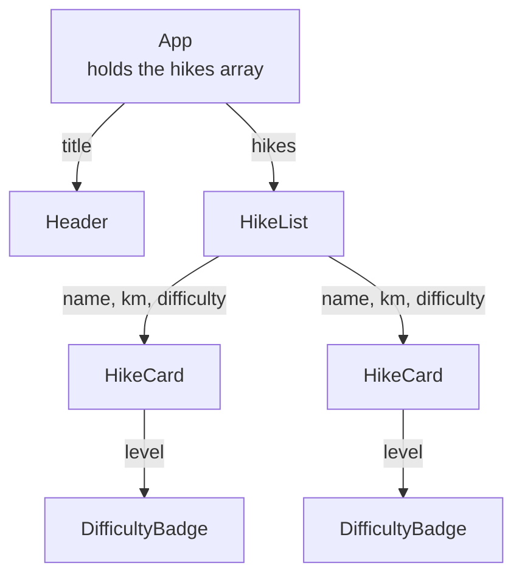

# JSX, components and props

> **Before this lesson:** read [Why React, and a first project with Vite](#/lesson/react/why-react-vite). You need JavaScript functions, objects and arrow functions (`(x) => x * 2`); see [Functions and scope](#/lesson/javascript/functions-scope) in the JavaScript track.

## In plain words

Think of a kitchen that sells sandwiches. There is a recipe card titled "Sandwich". The card has blanks: *bread*, *filling*, *toasted?*. Each order fills in the blanks differently, and the same card produces a hundred different sandwiches.

In React:

- the recipe card is a **component** (a function that describes a piece of the screen),
- the blanks are **props** (short for "properties": the inputs a component receives from whoever uses it),
- the shorthand the card is written in is **JSX** (a tag-like way of writing "make this element with these inputs" inside JavaScript).

Nearly every hour of React work is spent writing components, passing props, and reading JSX, so these three ideas pay for themselves quickly on the job.

## JSX is function calls in disguise

Start with the smallest possible example:

```jsx
const title = <h1 className="page-title">Trail Log</h1>;
```

That is not a string and it is not HTML. The build tool rewrites it into a function call before the browser ever sees it. Conceptually:

```javascript
const title = createElement("h1", { className: "page-title" }, "Trail Log");
```

and that call returns a plain JavaScript object, roughly:

```javascript
{ type: "h1", props: { className: "page-title", children: "Trail Log" } }
```

This object is called a **React element**: a small, cheap description of what should be on screen. It is not a DOM node. Creating a million of them does nothing to the page until React is asked to display them. (Modern build tools call a helper named `jsx` from `react/jsx-runtime` instead of `createElement`; the result is the same kind of object, and it is why you no longer need `import React` at the top of every file.)

You can prove to yourself that JSX is only a notation by writing the function yourself:

```js-run
// A home-made createElement. Problem "createElement: build a virtual DOM tree" asks you to write the full version.
function h(type, props, ...children) {
  return { type, props: { ...props, children } };
}

// <ul className="hikes"><li>Ridge Loop</li><li>Fern Gully</li></ul>
const list = h("ul", { className: "hikes" },
  h("li", null, "Ridge Loop"),
  h("li", null, "Fern Gully"));

console.log(JSON.stringify(list, null, 2));
```

The output is a tree of objects: a `ul` whose `children` are two `li` objects, each with a text child. That tree is what people mean by the **virtual DOM**: a description of the page held in ordinary JavaScript memory.

## The rules of JSX

JSX looks like HTML but follows JavaScript's rules. There are five differences that trip up newcomers.

**1. Curly braces switch to JavaScript.** Anything inside `{ }` is an *expression*, meaning a piece of code that produces a value.

```jsx
const hike = { name: "Ridge Loop", km: 7.5 };

const line = <p>{hike.name} is {hike.km * 1000} metres long.</p>;
```

- `{hike.name}` inserts the string `Ridge Loop`.
- `{hike.km * 1000}` runs the multiplication and inserts `7500`.

Statements such as `if` or `for` do not produce a value, so they cannot go inside braces. You use the conditional operator `a ? b : c` or prepare a variable above the `return` instead ([Composition, children and conditional rendering](#/lesson/react/composition-conditional) covers this).

**2. Some attribute names differ.** JSX attributes become keys of a JavaScript object, so they follow JavaScript naming: `className` instead of `class`, `htmlFor` instead of `for`, and camelCase for multi-word names (`tabIndex`, `onClick`, `maxLength`). The exceptions are `aria-*` and `data-*`, which keep their dashes.

**3. Attribute values are strings or braces.** `title="Hello"` passes a string. `width={320}` passes a number. `disabled={isSaving}` passes whatever the variable holds.

**4. Every tag must be closed.** `` and `<br>` are written `` and `<br />`.

**5. One parent.** A JSX expression must have a single outermost element, because a function call returns one value. When you do not want an extra `<div>` in the page, wrap siblings in a **fragment**, written `<>...</>`, which groups elements without adding anything to the DOM:

```jsx
const header = (
  <>
    <h1>Trail Log</h1>
    <p>Your hikes this year</p>
  </>
);
```

One more piece of syntax: inline styles take an object, not a string. `style={{ color: "green", fontSize: 14 }}` has two pairs of braces: the outer pair means "JavaScript here", the inner pair is an object literal.

> [!NOTE]
> React escapes text you put in braces. If `hike.name` contains `<script>`, the user sees those characters as text; nothing is executed. This protects you from a whole category of attack (cross-site scripting) by default.

## Components: functions that return elements

A component is a function whose name starts with a capital letter and which returns JSX.

```jsx
function HikeCard() {
  return (
    <article className="card">
      <h2>Ridge Loop</h2>
      <p>7.5 km, moderate</p>
    </article>
  );
}

function App() {
  return (
    <main>
      <h1>Trail Log</h1>
      <HikeCard />
      <HikeCard />
    </main>
  );
}
```

- `function HikeCard() { ... }` defines the recipe once.
- Inside `App`, `<HikeCard />` *uses* the recipe. You never call `HikeCard()` yourself. You hand React the element `<HikeCard />`, and React calls the function when it needs to.
- The capital letter is how JSX tells the difference: `<article>` (lower case) becomes `createElement("article", ...)` with a string, meaning "built-in HTML tag"; `<HikeCard />` becomes `createElement(HikeCard, ...)` with the function itself.
- Two `<HikeCard />` elements produce two independent copies on screen. Each copy is called an **instance**.

The component above always shows the same hike. To make it reusable it needs blanks to fill in.

## Props: a component's inputs

```jsx
function HikeCard(props) {
  return (
    <article className="card">
      <h2>{props.name}</h2>
      <p>{props.km} km, {props.difficulty}</p>
    </article>
  );
}

function App() {
  return (
    <main>
      <HikeCard name="Ridge Loop" km={7.5} difficulty="moderate" />
      <HikeCard name="Fern Gully" km={3} difficulty="easy" />
    </main>
  );
}
```

- In `App`, the attributes on `<HikeCard ... />` are collected into one object: `{ name: "Ridge Loop", km: 7.5, difficulty: "moderate" }`.
- React calls `HikeCard` with that object as its single argument, here named `props`.
- Inside, `props.name` reads one field.

Most code unpacks the object right in the parameter list using **destructuring** (JavaScript syntax that pulls named fields out of an object into variables):

```jsx
function HikeCard({ name, km, difficulty = "unrated" }) {
  return (
    <article className="card">
      <h2>{name}</h2>
      <p>{km} km, {difficulty}</p>
    </article>
  );
}
```

- `{ name, km, difficulty = "unrated" }` creates three variables from the props object.
- `= "unrated"` is a **default value**, used when the parent does not pass `difficulty` (or passes `undefined`).

Props can carry any JavaScript value: strings, numbers, booleans, arrays, objects and functions.

```jsx
<HikeCard
  name="Ridge Loop"
  km={7.5}
  tags={["views", "steep"]}
  isFavourite
  onSelect={() => console.log("picked Ridge Loop")}
/>
```

- `isFavourite` with no value is shorthand for `isFavourite={true}`.
- `onSelect` passes a function. That is how a child reports back to its parent: the parent hands down a function, and the child calls it. The next lesson uses this for events.

When you already hold an object with the right keys, the **spread** syntax passes all of them at once: `<HikeCard {...hike} />` is the same as writing `name={hike.name} km={hike.km} ...`. Use it sparingly, because it hides which props a component really receives.

### The special prop `children`

Whatever you put *between* a component's opening and closing tags arrives as a prop named `children`:

```jsx
function Panel({ title, children }) {
  return (
    <section className="panel">
      <h2>{title}</h2>
      {children}
    </section>
  );
}

<Panel title="This week">
  <HikeCard name="Fern Gully" km={3} />
  <p>One more to reach your goal.</p>
</Panel>
```

`Panel` does not need to know what it wraps. That makes it a reusable frame, a pattern explored further in [Composition, children and conditional rendering](#/lesson/react/composition-conditional).

## Props are read-only

A component must never change its own props.

```jsx
function HikeCard(props) {
  props.km = props.km * 2;   // wrong: never assign to props
  return <p>{props.km} km</p>;
}
```

The props object belongs to the parent. React relies on a simple contract: **the same props (and state) must produce the same output**, with no hidden changes on the side. A function that keeps that contract is called **pure**. Purity is what lets React call your component whenever it likes, skip it when nothing changed, and, in development, call it twice to check that you kept your word.

If a component needs a value that changes over time, that value is *state*, the subject of [State with useState](#/lesson/react/usestate). If it needs a value computed from props, compute it in a new variable:

```jsx
function HikeCard({ km }) {
  const miles = (km * 0.621).toFixed(1);   // derived value, props untouched
  return <p>{km} km ({miles} mi)</p>;
}
```

## The component tree and data flow

Components nest, forming a tree. Data moves in one direction: from a component to the components it renders, through props.



A child cannot reach up and read its parent's variables, and siblings cannot see each other. When two components need the same data, the data lives in their closest common parent and is passed down to both. This restriction is deliberate: to find out why a card shows the wrong distance, you follow one path upward.

## Run it: components and props without a build step

The page below contains a 25-line stand-in for React (`h` builds element objects, `toDom` turns them into real DOM nodes and calls component functions along the way). The part under "your components" is written exactly as the JSX above would compile.

```html-run
<div id="root"></div>
<style>
  .card { border: 1px solid #bbb; border-radius: 8px; padding: 8px 12px; margin: 8px 0; font-family: sans-serif; }
  .badge { font-size: 12px; padding: 2px 8px; border-radius: 10px; background: #e3f4e8; }
  .badge.hard { background: #fbe1dd; }
</style>
<script>
  // ---------- tiny stand-in for React ----------
  function h(type, props, ...children) {
    return { type, props: props || {}, children: children.flat() };
  }
  function toDom(node) {
    if (node === null || node === undefined || typeof node === "boolean") return document.createTextNode("");
    if (typeof node !== "object") return document.createTextNode(String(node));
    if (typeof node.type === "function") {                       // a component: call it with its props
      return toDom(node.type({ ...node.props, children: node.children }));
    }
    const el = document.createElement(node.type);                // a built-in tag
    for (const [name, value] of Object.entries(node.props)) {
      if (name === "className") el.className = value;
      else el.setAttribute(name, value);
    }
    node.children.forEach((child) => el.appendChild(toDom(child)));
    return el;
  }

  // ---------- your components ----------
  function DifficultyBadge({ level = "unrated" }) {
    return h("span", { className: level === "hard" ? "badge hard" : "badge" }, level);
  }
  function HikeCard({ name, km, difficulty }) {
    const miles = (km * 0.621).toFixed(1);
    return h("article", { className: "card" },
      h("h3", null, name),
      h("p", null, km, " km (", miles, " mi) "),
      h(DifficultyBadge, { level: difficulty }));
  }
  function Panel({ title, children }) {
    return h("section", null, h("h2", null, title), children);
  }
  function App() {
    return h(Panel, { title: "This week" },
      h(HikeCard, { name: "Ridge Loop", km: 7.5, difficulty: "hard" }),
      h(HikeCard, { name: "Fern Gully", km: 3, difficulty: "easy" }),
      h(HikeCard, { name: "Mystery Trail", km: 5 }));
  }

  document.getElementById("root").appendChild(toDom(h(App)));
</script>
```

Things to try: add a fourth `HikeCard`; remove `difficulty` from one and watch the default value appear; change `Panel` so the title comes after the children. Notice that `h(HikeCard, {...})` passes the *function* as the type, the same thing the capital letter does in JSX.

## Pitfalls

> [!WARNING]
> **Calling a component like a function.** Writing `{HikeCard({ name: "x" })}` instead of `<HikeCard name="x" />` seems to work for trivial cases, but React then does not know a component exists there, and anything that depends on that knowledge (state, effects, error reporting) breaks in confusing ways. Always use the tag form.

- **`class` instead of `className`.** React prints a console warning and the style may not apply.
- **Returning two siblings without a wrapper.** The build fails with a message about adjacent JSX elements. Wrap them in `<>...</>`.
- **Passing a string where a number was meant.** `km="7.5"` is a string; `km={7.5}` is a number. `"7.5" * 2` happens to work in JavaScript, but `"7.5" + 1` gives `"7.51"`.
- **Defining a component inside another component.** Each render then creates a brand-new function, React treats it as a different component type, and it throws away and rebuilds that part of the page (losing any state) every time. Define components at the top level of the file.
- **Rendering an object.** `{hike}` where `hike` is an object raises "Objects are not valid as a React child". Render its fields: `{hike.name}`.
- **Mutating props.** Assigning to `props.something`, or pushing into an array received as a prop, changes data owned by the parent behind React's back.

> [!TIP]
> When a component grows past a screenful, look for a part with a clear name ("the badge", "the stats row") and extract it into its own component. Good components are small enough to describe in one sentence.

> [!INTERVIEW]
> "What is the difference between an element and a component?" *A component is a function (the recipe). An element is the plain object returned by JSX that says "render this component, or this tag, with these props" (one order). React calls components to turn elements into more elements until only built-in tags remain.*

## Cheat sheet

| You want | Write |
|---|---|
| Insert a value | `<p>{value}</p>` |
| CSS class | `className="card"` |
| Label for an input | `htmlFor="email"` |
| Inline style | `style={{ color: "green", marginTop: 8 }}` |
| Group without a wrapper element | `<>...</>` |
| Define a component | `function Name(props) { return <.../>; }` |
| Use a component | `<Name prop="text" other={expression} />` |
| Read props | `function Name({ a, b = "default" }) {}` |
| Nested content | `{children}` inside the component |
| Boolean prop set to true | `<Name active />` |
| Pass all fields of an object | `<Name {...object} />` |
| Comment inside JSX | `{/* note */}` |

## Summary

- JSX is notation for function calls that return element objects; the build tool translates it.
- Braces `{ }` embed JavaScript expressions; attribute names follow JavaScript (`className`, `onClick`).
- A component is a capitalised function returning JSX. You use it as a tag and React calls it.
- Props are the inputs, gathered into one object. They can hold any value, including functions and nested JSX (`children`).
- Props are read-only and components must be pure: same inputs, same output.
- Data flows down the tree through props, one direction only.

## Glossary

- **JSX**: tag-like syntax compiled into element-creating function calls.
- **React element**: a plain object describing one node of the UI (`type` + `props`).
- **Virtual DOM**: the tree of element objects describing the whole UI.
- **Component**: a function that returns elements.
- **Instance**: one on-screen use of a component.
- **Props**: the read-only inputs a parent passes to a component.
- **children**: the prop holding whatever was nested between a component's tags.
- **Fragment**: `<>...</>`, a wrapper that adds no DOM node.
- **Destructuring**: unpacking object fields into variables.
- **Pure function**: a function whose output depends only on its inputs and which changes nothing outside itself.
- **Expression**: code that produces a value.

## Check yourself

```quiz
[
  {"q": "What does <h1 className=\"t\">Hi</h1> become after the build step?",
   "options": ["A string of HTML", "A real DOM node", "A function call that returns a plain object describing an h1", "A CSS rule"],
   "answer": 2,
   "explain": "JSX compiles to an element-creating call; the result is an object like { type: 'h1', props: { className: 't', children: 'Hi' } }."},
  {"q": "Why must component names start with a capital letter?",
   "options": ["It is only a style convention", "JSX treats lower-case tags as built-in HTML elements (strings) and capitalised tags as references to your function", "Lower-case names are reserved words", "Capital letters make rendering faster"],
   "answer": 1,
   "explain": "<card /> would look for an HTML tag named card. <Card /> passes the Card function as the element type."},
  {"q": "function Price({ amount, currency = \"EUR\" }) { return <b>{amount} {currency}</b>; }  What does <Price amount={5} /> render?",
   "options": ["5 undefined", "5 EUR", "An error", "amount currency"],
   "answer": 1,
   "explain": "currency was not passed, so the default value in the destructuring pattern is used."},
  {"q": "Which line breaks React's rules?",
   "options": ["const miles = props.km * 0.621;", "props.km = props.km * 2;", "return <p>{props.km}</p>;", "const { km } = props;"],
   "answer": 1,
   "explain": "Props are read-only. Assigning to a prop mutates data owned by the parent and makes the component impure."},
  {"q": "function Box({ children }) { return <div className=\"box\">{children}</div>; }  What is children for <Box><p>A</p><p>B</p></Box>?",
   "options": ["The string AB", "undefined, because no prop named children was written", "The two p elements nested between the tags", "The Box function itself"],
   "answer": 2,
   "explain": "Content between the opening and closing tags is delivered as the children prop."},
  {"q": "What is wrong with: return <h1>Title</h1><p>Text</p>; ?",
   "options": ["Nothing", "h1 cannot be followed by p", "A component must return a single root; wrap the two in a fragment or an element", "Text must be in braces"],
   "answer": 2,
   "explain": "Two adjacent elements would be two return values. Use <>...</> to group them."},
  {"q": "How does data normally travel between React components?",
   "options": ["Any component can read any other component's variables", "Down from parent to child through props; children ask for changes by calling functions they were given", "Up from child to parent through props", "Through global variables only"],
   "answer": 1,
   "explain": "One-way data flow: props go down, callbacks are the route back up."},
  {"q": "A page contains <Tag text=\"a\" /> <Tag text=\"b\" /> <Tag text=\"c\" />. How many times does React call the Tag function on the first render (outside StrictMode)?",
   "options": ["1", "3", "0", "6"],
   "answer": 1,
   "explain": "Each element is its own instance, so the function runs once per instance: three times."}
]
```

> **Source:** Wieruch, *The Road to React*, "Fundamentals of React": Meet the React Component, React JSX, Meet another React Component, React Component Instantiation, React Props, Props Handling, React Fragments. Documentation: https://react.dev/learn/writing-markup-with-jsx, https://react.dev/learn/passing-props-to-a-component, https://react.dev/learn/keeping-components-pure
