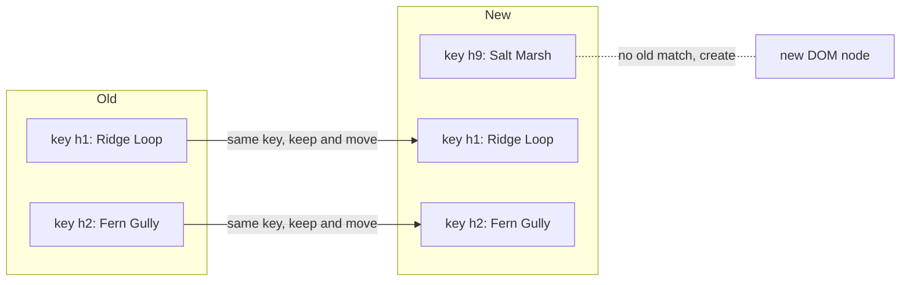

# Lists, keys and events

> **Before this lesson:** you need [JSX, components and props](#/lesson/react/jsx-components-props) and the array method `map` (it builds a new array by transforming each item; see [Higher-order functions](#/lesson/javascript/higher-order-functions)).

## In plain words

A teacher takes attendance. If the register says "third seat from the door", the record goes wrong the moment two pupils swap seats. If it says "Amara Okafor", it stays right wherever she sits.

React has the same problem when it draws a list. Between one render and the next it must work out which row is which. A **key** is the name tag you give each row so React can follow it when the list is reordered, filtered or extended.

The second half of the lesson is about **events**: things the user does (a click, a key press, a form submission). You respond by handing React a function to call, known as an **event handler**.

Lists and events appear on practically every screen, and "why do lists need keys?" is one of the most common React interview questions.

## Rendering a list

Start with the simplest case, an array of strings:

```jsx
function TrailNames() {
  const names = ["Ridge Loop", "Fern Gully", "Salt Marsh"];
  return (
    <ul>
      {names.map((name) => <li key={name}>{name}</li>)}
    </ul>
  );
}
```

- `names.map(...)` runs the arrow function once per string and collects the results into a new array. The result here is an array of three `<li>` elements.
- JSX accepts an array of elements inside braces and renders them one after another.
- `key={name}` labels each element. (Why it is needed comes next.)

Real data is usually an array of objects, each with an identifier:

```jsx
const hikes = [
  { id: "h1", name: "Ridge Loop", km: 7.5 },
  { id: "h2", name: "Fern Gully", km: 3 },
  { id: "h3", name: "Salt Marsh", km: 11 },
];

function HikeList({ hikes }) {
  return (
    <ul>
      {hikes.map((hike) => (
        <li key={hike.id}>
          {hike.name}: {hike.km} km
        </li>
      ))}
    </ul>
  );
}
```

- `hikes.map((hike) => ( ... ))` turns each object into an `<li>`.
- The parentheses after `=>` let the JSX span several lines.
- `key={hike.id}` uses the stable identifier that came with the data.

To show only some items, chain `filter` (which keeps the items for which the function returns true) before `map`: `hikes.filter((h) => h.km > 5).map(...)`. Neither method changes the original array, which fits React's rule that rendering must not modify data.

## Why keys exist

When the list changes, React holds two descriptions: the list of elements from the previous render and the list from this one. It has to decide which old row corresponds to which new row, so that it can keep the DOM nodes (and everything attached to them, such as typed text, focus and component state) for rows that are still present.

Without keys React can only match **by position**: first old row with first new row, second with second, and so on. Watch what that does when a row is inserted at the top.

```js-run
// Each row "remembers" a note the user typed into it. Matching decides which row keeps which note.
function reconcile(oldRows, newItems, keyOf) {
  return newItems.map((item, index) => {
    const match = keyOf
      ? oldRows.find((row) => keyOf(row.item) === keyOf(item))   // match by key
      : oldRows[index];                                          // match by position
    return { item, note: match ? match.note : "" };
  });
}

const before = [
  { item: { id: "h1", name: "Ridge Loop" }, note: "bring poles" },
  { item: { id: "h2", name: "Fern Gully" }, note: "" },
];
const newItems = [{ id: "h9", name: "NEW: Salt Marsh" }, { id: "h1", name: "Ridge Loop" }, { id: "h2", name: "Fern Gully" }];

const show = (rows) => rows.map((r) => `${r.item.name} [note: ${r.note || "-"}]`).join("\n");
console.log("By position:\n" + show(reconcile(before, newItems, null)));
console.log("\nBy key:\n" + show(reconcile(before, newItems, (item) => item.id)));
```

Matching by position hands the note "bring poles" to the newly inserted Salt Marsh row, because that row now sits where Ridge Loop used to be. Matching by key follows Ridge Loop to its new place. In a real page the "note" is anything the browser or React stores per row: the text in an input, a ticked checkbox, scroll position, an animation in progress.



### Rules for good keys

1. **Unique among siblings.** Two rows in the same list must not share a key. Keys in different lists are unrelated.
2. **Stable.** The same item must have the same key on every render. Never generate keys while rendering (`key={Math.random()}`): every row would look new every time, and React would destroy and rebuild the whole list, losing focus and state.
3. **From the data.** Use a database id or another real identifier. When you create items in the browser, give each one an id at creation time (for example `crypto.randomUUID()`), store it with the item, and reuse it.

**What about the array index?** `key={index}` is the same as having no key at all: it matches by position. It is acceptable only when the list never reorders, never has items inserted or removed anywhere but the end, and the rows hold no state. If any of those can change, use real ids.

Two details that surprise people: the key goes on the outermost element returned inside `map` (if you render `<HikeRow />`, put the key on `<HikeRow>`, not on an element inside it), and `key` is not delivered to the component as a prop. If the component needs the id, pass it separately: `<HikeRow key={hike.id} id={hike.id} />`.

> [!INTERVIEW]
> "Why does React need keys?" *Keys give list items a stable identity so React can match old and new children when the list changes. With correct keys React moves and reuses the existing DOM nodes and component state. With index keys or none, it matches by position, which causes wrong state on the wrong row after inserts, deletes or reorders, plus unnecessary DOM work.* Follow-up, "when is an index fine?": static lists that never reorder and hold no per-row state.

## Responding to events

To react to a click, pass a function to the `onClick` prop of a built-in element:

```jsx
function LikeButton() {
  function handleClick() {
    console.log("Thanks for the like");
  }
  return <button onClick={handleClick}>Like</button>;
}
```

- `function handleClick() { ... }` is a function defined inside the component. By convention handlers are named `handle` + the event.
- `onClick={handleClick}` hands the function itself to React. React stores it and calls it later, when a click happens.

The single most common beginner mistake is adding parentheses:

```jsx
<button onClick={handleClick()}>Like</button>   // wrong: calls it during render
<button onClick={handleClick}>Like</button>     // right: passes the function
```

With parentheses, JavaScript runs `handleClick` immediately while building the JSX and passes whatever it *returns* (here `undefined`) as the handler. The message logs on every render and nothing happens on click.

When the handler needs an argument, wrap the call in an arrow function, which creates a new function that will make the call later:

```jsx
function HikeList({ hikes }) {
  function handleRemove(id) {
    console.log("remove", id);
  }
  return (
    <ul>
      {hikes.map((hike) => (
        <li key={hike.id}>
          {hike.name}
          <button onClick={() => handleRemove(hike.id)}>Remove</button>
        </li>
      ))}
    </ul>
  );
}
```

`() => handleRemove(hike.id)` is a function that takes no arguments and, when React calls it, calls `handleRemove` with this row's id. A handler written directly in the JSX like this is called an **inline handler**.

### The event object

React calls every handler with one argument, an **event object** describing what happened:

```jsx
function SearchBox() {
  function handleChange(event) {
    console.log("typed:", event.target.value);
  }
  function handleSubmit(event) {
    event.preventDefault();
    console.log("searching");
  }
  return (
    <form onSubmit={handleSubmit}>
      <input onChange={handleChange} />
      <button type="submit">Search</button>
    </form>
  );
}
```

- `event.target` is the DOM element where the event happened; for an input, `event.target.value` is its current text.
- `event.preventDefault()` cancels the browser's built-in reaction. For a form, the built-in reaction is to reload the page, which would wipe out a single-page app, so nearly every `onSubmit` handler starts with this call.
- In React, `onChange` on a text input fires on every keystroke (unlike the plain HTML `change` event, which waits until the field loses focus).

The object React passes is a thin wrapper around the browser's own event, called a **synthetic event**. It behaves the same in every browser and exposes the original as `event.nativeEvent`.

### Passing handlers down: how children talk to parents

Data flows down through props. Requests flow up through **callback props**: the parent passes a function, and the child calls it.

```jsx
function HikeRow({ hike, onRemove }) {
  return (
    <li>
      {hike.name}
      <button onClick={() => onRemove(hike.id)}>Remove</button>
    </li>
  );
}

function App() {
  function handleRemove(id) {
    console.log("App was asked to remove", id);
  }
  return (
    <ul>
      {hikes.map((hike) => <HikeRow key={hike.id} hike={hike} onRemove={handleRemove} />)}
    </ul>
  );
}
```

- `App` owns the data and decides what "remove" means.
- `HikeRow` knows only that there is a function called `onRemove` to call with an id. It could be reused on a different screen where removing does something else.
- Naming convention: props that receive handlers start with `on` (`onRemove`), and the functions passed in start with `handle` (`handleRemove`).

### Bubbling and capturing

When you click a button inside a list item inside a list, the click first travels down from the top of the page to the button (the **capture** phase), then back up through each ancestor (the **bubble** phase). `onClick` handlers run during bubbling, innermost first. A handler can call `event.stopPropagation()` to stop the journey there.

React does not attach a listener to every button. It attaches one listener per event type at the root of your app and works out, from `event.target`, which of your handlers to call and in what order. This technique is called **event delegation**. For you it means thousands of rows with handlers cost almost nothing to set up. The problem *Event delegation: capture and bubble* has you implement the dispatch order yourself.

## Run it: a keyed list with events

This page uses the miniature React from the previous lesson, extended so that props starting with `on` become event listeners, and with a `setState` that re-renders. Each row has a text box so you can see identity at work.

```html-run
<div id="root"></div>
<style>li { margin: 6px 0; font-family: sans-serif; } input { width: 110px; } button { margin-left: 6px; }</style>
<script>
  // ---------- tiny stand-in for React ----------
  function h(type, props, ...children) { return { type, props: props || {}, children: children.flat() }; }
  function toDom(node) {
    if (node === null || node === undefined || typeof node === "boolean") return document.createTextNode("");
    if (typeof node !== "object") return document.createTextNode(String(node));
    if (typeof node.type === "function") return toDom(node.type({ ...node.props, children: node.children }));
    const el = document.createElement(node.type);
    for (const [name, value] of Object.entries(node.props)) {
      if (name.startsWith("on")) el.addEventListener(name.slice(2).toLowerCase(), value);   // onClick -> "click"
      else if (name !== "key") el.setAttribute(name, value);
    }
    node.children.forEach((child) => el.appendChild(toDom(child)));
    return el;
  }
  let state = { hikes: [{ id: "h1", name: "Ridge Loop" }, { id: "h2", name: "Fern Gully" }], nextId: 3, log: "" };
  function setState(change) { state = { ...state, ...change }; draw(); }
  function draw() { document.getElementById("root").replaceChildren(toDom(h(App))); }

  // ---------- your components ----------
  function HikeRow({ hike, onRemove }) {
    return h("li", null, hike.name, " ",
      h("input", { placeholder: "note for " + hike.id }),
      h("button", { onClick: () => onRemove(hike.id) }, "Remove"));
  }
  function App() {
    function handleAddTop() {
      const hike = { id: "h" + state.nextId, name: "Trail " + state.nextId };
      setState({ hikes: [hike, ...state.hikes], nextId: state.nextId + 1, log: "added " + hike.id });
    }
    function handleRemove(id) {
      setState({ hikes: state.hikes.filter((hike) => hike.id !== id), log: "removed " + id });
    }
    return h("div", null,
      h("button", { onClick: handleAddTop }, "Add a hike at the top"),
      h("ul", { onClick: (event) => console.log("the click bubbled up to <ul> from", event.target.tagName) },
        state.hikes.map((hike) => h(HikeRow, { key: hike.id, hike, onRemove: handleRemove }))),
      h("p", null, "Last action: ", state.log || "none"));
  }
  draw();
</script>
```

Click **Remove** and look at the console: the button's handler runs, and then the `<ul>` handler logs that the click bubbled up to it. Now type a note into a row and click **Add a hike at the top**: the note disappears. This toy rebuilds every DOM node on each render, so nothing survives. Real React, given the `key` on each row, would keep both existing rows (and their typed notes) and insert one new node. That difference is exactly what keys buy you.

## Pitfalls

> [!WARNING]
> **`key={Math.random()}` or `key={crypto.randomUUID()}` inside `map`.** A fresh key on every render tells React that every row is brand new. It destroys and recreates all of them: inputs lose focus mid-typing, animations restart, and performance collapses on long lists.

- **Forgetting the key.** React logs *"Each child in a list should have a unique key prop"*. It then falls back to positions, with the problems shown above.
- **Index keys on a list that changes.** Deleting row 2 makes old row 3 "become" row 2 and inherit its state.
- **Key on the wrong element.** The key belongs on the element returned directly from `map`, not on something inside the row component.
- **Calling the handler in JSX** (`onClick={save()}`), covered above.
- **Lower-case event names.** `onclick` is HTML. React props are camelCase: `onClick`, `onChange`, `onKeyDown`, `onSubmit`.
- **Forgetting `event.preventDefault()` in `onSubmit`.** The page reloads and your state is gone.
- **Changing data inside the handler by mutation.** `hikes.push(x)` alters the existing array; React will not notice. The next lesson shows the correct way with state.

> [!TIP]
> Attach handlers to elements that are meant to be interactive: `<button>`, `<a>`, form controls. A clickable `<div>` cannot be reached with the keyboard and is invisible to screen readers unless you add a lot of extra attributes.

## Cheat sheet

| Task | Code |
|---|---|
| Render an array | `{items.map((item) => <Row key={item.id} item={item} />)}` |
| Filter then render | `{items.filter(keep).map(...)}` |
| Good key | a unique, stable id from the data |
| Bad key | `Math.random()`, an index for a changing list |
| Click handler | `<button onClick={handleClick}>` |
| Handler with an argument | `onClick={() => handleRemove(id)}` |
| Read input text | `onChange={(e) => e.target.value}` |
| Stop a form reloading the page | `event.preventDefault()` |
| Stop bubbling | `event.stopPropagation()` |
| Child notifies parent | parent passes `onSomething={handleSomething}`; child calls `onSomething(data)` |

## Summary

- Lists are rendered by mapping data to elements; filter and sort with non-mutating array methods first.
- Keys give each sibling a stable identity so React can match rows across renders and keep their DOM nodes and state.
- Use ids from the data. Index keys behave like no keys. Random keys rebuild everything.
- Event handlers are functions passed as props (`onClick={fn}`), not calls.
- Handlers receive a synthetic event; `preventDefault` cancels the browser default and `stopPropagation` stops bubbling.
- Children communicate upward by calling callback props supplied by the parent.

## Glossary

- **Key**: a special prop that identifies an element among its siblings across renders.
- **Event**: something that happened in the page, usually caused by the user.
- **Event handler**: a function you supply to be called when an event happens.
- **Inline handler**: a handler written as an arrow function directly in JSX.
- **Callback prop**: a function passed to a child so the child can notify the parent.
- **Synthetic event**: React's cross-browser wrapper around the native event object.
- **Bubbling / capturing**: the upward and downward journeys of an event through the element tree.
- **Event delegation**: handling events for many elements with one listener on a common ancestor.
- **Reconciliation**: React's process of matching the new description to the old one to decide what to change.

## Check yourself

```quiz
[
  {"q": "What is the purpose of the key prop?",
   "options": ["It sets the HTML id attribute", "It lets React match each list item with its counterpart from the previous render", "It sorts the list", "It is required for CSS to work"],
   "answer": 1,
   "explain": "Keys are identity for reconciliation. They are not rendered into the DOM and are not sorting hints."},
  {"q": "A list uses key={index}. The user types into the input of row 0, then a new item is inserted at the top. Where does the typed text appear?",
   "options": ["It stays with the original item, now in row 1", "It appears in row 0, which now shows the new item", "It is copied to every row", "React throws an error"],
   "answer": 1,
   "explain": "Index keys match by position. The node at position 0 is kept, with its text, but now displays the new item's data."},
  {"q": "What happens with <button onClick={save()}>Save</button>?",
   "options": ["save runs once per click", "save runs during every render and its return value is used as the handler", "Nothing ever runs", "It is identical to onClick={save}"],
   "answer": 1,
   "explain": "The parentheses call the function immediately. Pass the function itself, or wrap the call in an arrow function."},
  {"q": "Why do onSubmit handlers usually start with event.preventDefault()?",
   "options": ["To stop the event bubbling", "To stop the browser's default form submission, which reloads the page", "To validate the fields", "It is required by React for every event"],
   "answer": 1,
   "explain": "The default action of a form submit is a full page navigation, which would reset a single-page app."},
  {"q": "A button with onClick sits inside a div with onClick. The user clicks the button and neither handler stops propagation. In which order do the handlers run?",
   "options": ["div, then button", "button, then div", "Only the button's", "Only the div's"],
   "answer": 1,
   "explain": "onClick handlers run in the bubble phase, from the target outward."},
  {"q": "How does a child component tell its parent that something happened?",
   "options": ["By assigning to props", "By calling a function the parent passed to it as a prop", "By editing the parent's variables", "By dispatching to the DOM directly"],
   "answer": 1,
   "explain": "Callback props are the upward channel in one-way data flow."},
  {"q": "items.map((item) => <Row key={Math.random()} item={item} />). The parent re-renders 3 times with the same 4 items. How many Row instances are created in total?",
   "options": ["4", "12", "3", "1"],
   "answer": 1,
   "explain": "Random keys never match, so every render destroys the 4 existing rows and creates 4 new ones: 3 renders x 4 rows."},
  {"q": "Where must the key be placed when you render <HikeRow /> inside map?",
   "options": ["On the li inside HikeRow", "On the HikeRow element returned from map", "On the ul", "Anywhere inside the row"],
   "answer": 1,
   "explain": "React reads keys from the elements in the array itself, which is what map returns."}
]
```

> **Source:** Wieruch, *The Road to React*, "Fundamentals of React": Lists in React, Handler Function in JSX, Callback Handlers in JSX, Inline Handler in JSX. Documentation: https://react.dev/learn/rendering-lists, https://react.dev/learn/responding-to-events
