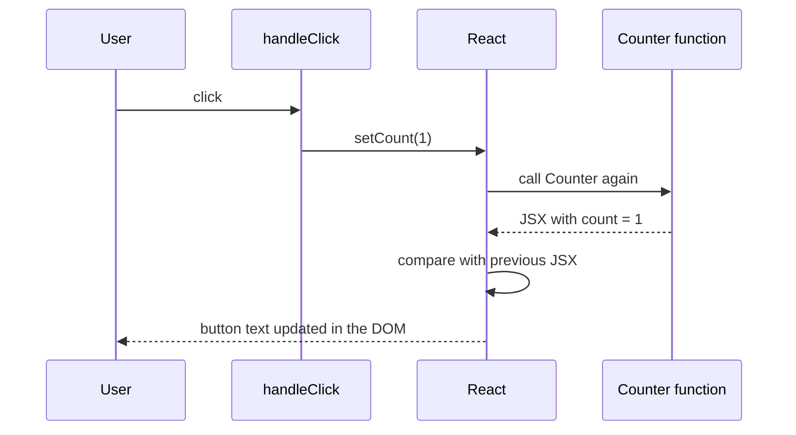

# State with useState

> **Before this lesson:** you need components, props and event handlers from [JSX, components and props](#/lesson/react/jsx-components-props) and [Lists, keys and events](#/lesson/react/lists-keys-events). Helpful JavaScript: array destructuring (`const [a, b] = pair`) and the spread syntax (`{ ...obj }`, `[...arr]`), both in [Destructuring, spread, rest and JSON](#/lesson/javascript/destructuring-json).

## In plain words

A scoreboard at a football match has two parts: the number in the operator's notebook and the big digits the crowd sees. When a goal is scored, the operator does not climb up and repaint a digit by hand. They enter the new score, and the board redraws itself from that number.

**State** is the notebook: data a component remembers between renders and that can change while the page is open. `useState` is how a component gets a notebook page from React. When you write a new value into it through the proper channel, React redraws the component.

Props come from outside and the component cannot change them. State lives inside and the component controls it. Almost every interactive feature you will build (a toggle, a text field, a shopping cart) is state plus a description of the screen for that state.

## Why an ordinary variable is not enough

```jsx
function Counter() {
  let count = 0;

  function handleClick() {
    count = count + 1;
    console.log(count);
  }

  return <button onClick={handleClick}>Finished hikes: {count}</button>;
}
```

Clicking logs 1, 2, 3, yet the button keeps showing 0. Two things are missing:

1. **Nothing tells React to render again.** Changing a local variable is invisible to React.
2. **Local variables do not survive a render.** Even if React did call `Counter` again, the first line would set `count` back to `0`.

`useState` supplies both: a value that persists between renders, and a function that updates it *and* schedules a new render.

## useState, step by step

```jsx
import { useState } from "react";

function Counter() {
  const [count, setCount] = useState(0);

  function handleClick() {
    setCount(count + 1);
  }

  return <button onClick={handleClick}>Finished hikes: {count}</button>;
}
```

- `import { useState } from "react";` brings in the function. Functions whose names start with `use` are called **Hooks**: special functions that let a component "hook into" React features such as memory.
- `useState(0)` asks React for a piece of state and gives `0` as the **initial value**, used only on the component's first render.
- It returns an array of exactly two items. `const [count, setCount] = ...` unpacks them: the current value and the **setter function**. The names are your choice; the convention is `thing` and `setThing`.
- `setCount(count + 1)` does not change `count`. It sends React a request: "next time you render this component, the value should be this". React then renders again.
- On that next render, `useState(0)` ignores the `0` and returns the stored value, now `1`.



A component can use as many state variables as it needs, and each instance of a component has its own separate state: two `<Counter />` elements count independently.

## State is a snapshot

This is the idea that most often confuses newcomers, so take it slowly. Within one render, a state variable is a constant. Calling the setter does not change it for the code that is currently running.

```jsx
function Counter() {
  const [count, setCount] = useState(0);

  function handleClick() {
    setCount(count + 1);
    console.log(count);   // still the old value
  }
  // ...
}
```

On the first render `count` is `0`. The handler created during that render closes over that `0`. (A **closure** is a function together with the variables that were in scope when it was created.) `setCount(0 + 1)` files a request, and the `console.log` on the next line still prints `0`, because this render's `count` never changes. The *next* render gets a new `count` of `1` and a new `handleClick` that sees `1`.

A direct consequence:

```jsx
function handleTripleClick() {
  setCount(count + 1);
  setCount(count + 1);
  setCount(count + 1);
}
```

If `count` is `0`, all three lines say `setCount(1)`. The result is `1`, not `3`.

### Updater functions

When the next value depends on the previous one, pass a function instead of a value:

```jsx
function handleTripleClick() {
  setCount((c) => c + 1);
  setCount((c) => c + 1);
  setCount((c) => c + 1);
}
```

`(c) => c + 1` is an **updater function**. React places each one in a queue and, when it processes the queue, calls them in order, feeding each the result of the one before: `0 → 1 → 2 → 3`. Use this form whenever you write "new = something computed from old", and always when several updates may happen before a render.

### Batching

React waits until your event handler has finished before it renders. All the setter calls made during the handler are processed together and cause **one** render. This is called **batching**. It keeps the screen from flashing half-finished states and avoids wasted work. (Since React 18 batching also applies to updates made inside timeouts, promises and native event listeners.)

The simulation below models the queue. The problem *Batching and the update queue* asks you to write it yourself.

```js-run
function runHandler(current, calls) {
  let pending = current;                 // what the queue has worked out so far
  for (const call of calls) {
    pending = typeof call === "function" ? call(pending) : call;   // updater: use pending; value: replace
  }
  return pending;
}

const count = 0;   // the snapshot this handler sees

console.log("three plain values :", runHandler(count, [count + 1, count + 1, count + 1]));
console.log("three updaters     :", runHandler(count, [(c) => c + 1, (c) => c + 1, (c) => c + 1]));
console.log("value then updater :", runHandler(count, [count + 5, (c) => c + 1]));
console.log("updater then value :", runHandler(count, [(c) => c + 1, count + 5]));
```

Output: `1`, `3`, `6`, `5`. A plain value replaces whatever was pending; an updater builds on it.

## Objects and arrays in state: replace, never mutate

React decides whether state changed by asking "is this the same object as before?" (it compares with `Object.is`, which for objects means "the same place in memory"). If you modify an object in place and pass the same object back, React concludes nothing changed and skips the render.

To **mutate** means to change an existing object or array in place. State must be treated as **immutable**: never changed in place, only replaced by a new copy that includes the change.

```jsx
const [hike, setHike] = useState({ name: "Ridge Loop", km: 7.5, done: false });

function markDoneWrong() {
  hike.done = true;       // mutation: same object
  setHike(hike);          // React sees the same reference and may skip rendering
}

function markDone() {
  setHike({ ...hike, done: true });   // new object: copy every field, then override one
}
```

`{ ...hike, done: true }` creates a fresh object, copies all fields of `hike` into it, then sets `done`. For nested data, copy every level on the way down to the change:

```jsx
setProfile({
  ...profile,
  address: { ...profile.address, city: "Bergen" },
});
```

Arrays follow the same rule. Use methods that return a new array and avoid the ones that modify in place.

| Goal | Avoid (mutates) | Use (returns a new array) |
|---|---|---|
| Add | `push`, `unshift` | `[...list, item]`, `[item, ...list]` |
| Remove | `splice`, `pop` | `list.filter((x) => x.id !== id)` |
| Change one | `list[i] = x` | `list.map((x) => x.id === id ? { ...x, done: true } : x)` |
| Sort / reverse | `sort`, `reverse` | `[...list].sort(...)`, or `list.toSorted(...)` |

```jsx
const [hikes, setHikes] = useState([]);

function addHike(name) {
  setHikes([...hikes, { id: crypto.randomUUID(), name, done: false }]);
}
function toggleHike(id) {
  setHikes(hikes.map((h) => (h.id === id ? { ...h, done: !h.done } : h)));
}
function removeHike(id) {
  setHikes(hikes.filter((h) => h.id !== id));
}
```

- `addHike` builds a new array containing the old items plus a new object, whose id is created once, here, and stored.
- `toggleHike` maps to a new array; the matching hike is replaced by a copy with `done` flipped, and all others are passed through unchanged.
- `removeHike` keeps every hike except the one with the given id.

The problems *Immutable nested update: setIn* and *Immutable list operations* drill these recipes, with tests that detect mutation.

## Do not store what you can compute

A frequent mistake is keeping two pieces of state that say the same thing.

```jsx
const [hikes, setHikes] = useState([]);
const [doneCount, setDoneCount] = useState(0);   // redundant
```

Every handler now has to update both and keep them consistent. Instead, calculate during render:

```jsx
const [hikes, setHikes] = useState([]);

const doneCount = hikes.filter((h) => h.done).length;
const totalKm = hikes.reduce((sum, h) => sum + h.km, 0);
```

These are **derived values**. They are recomputed on every render and can never disagree with `hikes`. A good test: *if I can work it out from props or other state, it is not state.* The problem *Derived state: compute, don't store* practises this.

Two related tips:

- **Lazy initial state.** `useState(expensive())` runs `expensive()` on every render and throws the result away after the first. Pass a function instead and React calls it once: `useState(() => expensive())`.
- **Resetting state with a key.** A component's state is tied to its position in the tree. Giving it a different `key` makes React treat it as a new instance with fresh state: `<ProfileForm key={userId} />` starts clean whenever `userId` changes.

## Rules of Hooks

React identifies each piece of state by the *order* of Hook calls within a component (first `useState`, second `useState`, and so on). Two rules keep that order stable:

1. Call Hooks only at the **top level** of a component (or of a custom Hook), never inside `if`, loops, nested functions or after an early `return`.
2. Call Hooks only from React components or custom Hooks, not from ordinary functions.

```jsx
function Bad({ showExtra }) {
  if (showExtra) {
    const [extra, setExtra] = useState("");   // wrong: sometimes called, sometimes not
  }
  const [name, setName] = useState("");
  // ...
}
```

When `showExtra` flips, "the first Hook" switches from `extra` to `name` and the stored values get mixed up. The linter plugin `eslint-plugin-react-hooks`, included in the Vite template, reports these mistakes as you type.

## Run it: a real useState in thirty lines

This page implements `useState` the way React does in spirit: an array of slots and a cursor that advances with each call. The component code at the bottom reads like real React with `h(...)` in place of JSX.

```html-run
<div id="root"></div>
<style>button { margin: 4px; padding: 6px 10px; } li { cursor: pointer; font-family: sans-serif; } .done { text-decoration: line-through; color: #888; }</style>
<script>
  // ---------- tiny stand-in for React ----------
  function h(type, props, ...children) { return { type, props: props || {}, children: children.flat() }; }
  function toDom(node) {
    if (node === null || node === undefined || typeof node === "boolean") return document.createTextNode("");
    if (typeof node !== "object") return document.createTextNode(String(node));
    if (typeof node.type === "function") return toDom(node.type({ ...node.props, children: node.children }));
    const el = document.createElement(node.type);
    for (const [name, value] of Object.entries(node.props)) {
      if (name.startsWith("on")) el.addEventListener(name.slice(2).toLowerCase(), value);
      else if (name === "className") el.className = value;
      else if (name !== "key") el.setAttribute(name, value);
    }
    node.children.forEach((child) => el.appendChild(toDom(child)));
    return el;
  }
  const slots = [];          // one entry per useState call, in call order
  let cursor = 0;
  let renders = 0;
  let scheduled = false;
  function useState(initial) {
    const i = cursor++;                                  // "I am Hook number i"
    if (!(i in slots)) slots[i] = initial;               // first render only
    const set = (next) => {
      const value = typeof next === "function" ? next(slots[i]) : next;
      if (Object.is(value, slots[i])) return;            // same value: nothing to do
      slots[i] = value;
      if (!scheduled) { scheduled = true; queueMicrotask(render); }   // batch: one render per handler
    };
    return [slots[i], set];
  }
  function render() {
    scheduled = false; cursor = 0; renders++;
    document.getElementById("root").replaceChildren(toDom(h(App)));
  }

  // ---------- your component ----------
  function App() {
    const [count, setCount] = useState(0);
    const [hikes, setHikes] = useState([{ id: 1, name: "Ridge Loop", done: false }, { id: 2, name: "Fern Gully", done: true }]);
    const doneCount = hikes.filter((hike) => hike.done).length;      // derived, not stored

    const toggle = (id) => setHikes(hikes.map((hike) => (hike.id === id ? { ...hike, done: !hike.done } : hike)));
    return h("div", null,
      h("p", null, "count = ", count, "   (renders so far: ", renders, ")"),
      h("button", { onClick: () => { setCount(count + 1); setCount(count + 1); setCount(count + 1); } }, "+1 three times, plain values"),
      h("button", { onClick: () => { setCount((c) => c + 1); setCount((c) => c + 1); setCount((c) => c + 1); } }, "+1 three times, updaters"),
      h("button", { onClick: () => setCount(count) }, "set to the same value"),
      h("ul", null, hikes.map((hike) =>
        h("li", { key: hike.id, className: hike.done ? "done" : "", onClick: () => toggle(hike.id) }, hike.name))),
      h("p", null, doneCount, " of ", hikes.length, " done (click a hike to toggle)"));
  }
  render();
</script>
```

Experiments:

- The first button adds 1 per click; the second adds 3. Both cause exactly one render per click (watch the render counter).
- The third button causes no render at all: the value is identical, so React bails out.
- In `toggle`, replace the `map` with a mutation (`hikes.find((x) => x.id === id).done = true; setHikes(hikes);`). Clicking stops working, because the array passed to the setter is the same object as before.

## Pitfalls

> [!WARNING]
> **Reading state right after setting it.** `setName("Ann"); console.log(name);` prints the old name. The variable belongs to the current render. If you need the new value in the same handler, keep it in a local variable: `const next = ...; setName(next); use(next);`.

- **Mutating state** (`list.push`, `obj.field = ...`, `list.sort()`): the screen does not update, or updates later for an unrelated reason, which makes the bug hard to trace.
- **Using the plain form when the update depends on the previous value**, especially in code that runs later (timers, promises). Use an updater function.
- **Mirroring props in state:** `const [name, setName] = useState(props.name)` copies the prop once and never follows later changes. Use the prop directly, or name it `initialName` to make the intent clear.
- **Redundant or contradictory state**, such as `isEmpty` next to the list it describes.
- **Hooks inside conditions or loops.** Breaks the call order.
- **Calling a setter during render** (not inside a handler): `setCount(1)` in the component body triggers a render, which calls it again, forever. React stops with "Too many re-renders".

> [!TIP]
> Group state that always changes together (an `{ x, y }` position) into one object, and keep unrelated values in separate `useState` calls. If a group of values has complicated transitions, reach for `useReducer`, covered in [useReducer and impossible states](#/lesson/react/usereducer).

> [!INTERVIEW]
> "Is `setState` asynchronous?" A precise answer: *the setter itself runs synchronously and enqueues an update. React processes the queue and re-renders after the current event handler finishes, batching all updates into one render. The state variable in the current closure never changes; the new value appears in the next render.* Then show the three-increments example and the updater fix.

## Cheat sheet

| Need | Code |
|---|---|
| Declare state | `const [value, setValue] = useState(initial)` |
| Expensive initial value | `useState(() => compute())` |
| Set a new value | `setValue(next)` |
| Based on previous | `setValue((prev) => prev + 1)` |
| Update an object field | `setObj({ ...obj, field: x })` |
| Update nested | `setObj({ ...obj, inner: { ...obj.inner, field: x } })` |
| Add to array | `setList([...list, item])` |
| Remove from array | `setList(list.filter((x) => x.id !== id))` |
| Change one item | `setList(list.map((x) => x.id === id ? { ...x, ...patch } : x))` |
| Derived value | compute in the component body, no state |
| Reset a component's state | give it a different `key` |

## Summary

- State is per-instance memory that survives renders; changing it through the setter schedules a re-render.
- Within one render state is a fixed snapshot. Setters queue a value for the *next* render.
- Updates made during one event handler are batched into a single render.
- Use updater functions when the new value depends on the old one.
- Treat objects and arrays as immutable: create copies with spread, `map` and `filter`.
- Do not store what can be derived from props or other state.
- Hooks must be called at the top level, in the same order, on every render.

## Glossary

- **State**: data a component remembers between renders and may change.
- **Hook**: a function starting with `use` that gives a component access to a React feature.
- **Setter function**: the function returned by `useState` that requests a new value and a re-render.
- **Snapshot**: the fixed values of props and state that one particular render sees.
- **Closure**: a function bundled with the variables that existed where it was created.
- **Updater function**: a function passed to a setter that computes the next state from the pending one.
- **Batching**: grouping several state updates into one render.
- **Mutate / immutable**: to change in place / never changed in place.
- **Derived value**: a value computed from existing props or state during render.
- **Bail out**: React skipping a render because the new state is identical to the old.

## Check yourself

```quiz
[
  {"q": "Why does changing a local variable (let count = 0; count++) not update the screen?",
   "options": ["Local variables are read-only", "React is not told to re-render, and the variable is reset to its initial value on each call of the component", "The browser blocks it", "It does update, but slowly"],
   "answer": 1,
   "explain": "State needs persistence between renders and a way to trigger a render. useState provides both."},
  {"q": "count is 0. A handler runs setCount(count + 1); setCount(count + 1); setCount(count + 1);  What is count on the next render?",
   "options": ["3", "1", "0", "2"],
   "answer": 1,
   "explain": "count is the snapshot value 0 in all three lines, so each call requests 1."},
  {"q": "Same handler, but each line is setCount(c => c + 1). What is count on the next render, and how many renders did the handler cause?",
   "options": ["3, after three renders", "3, after one render", "1, after one render", "1, after three renders"],
   "answer": 1,
   "explain": "Updater functions chain through the queue (0, 1, 2, 3) and batching produces a single render."},
  {"q": "const [list, setList] = useState([1, 2]);  A handler runs list.push(3); setList(list);  What does React do?",
   "options": ["Renders with [1, 2, 3]", "Throws an error", "Sees the same array reference and may skip the render, so the screen can stay stale", "Clears the list"],
   "answer": 2,
   "explain": "push mutates the existing array. React compares references, finds no change and bails out. Use setList([...list, 3])."},
  {"q": "Which of these should NOT be stored in state?",
   "options": ["The text currently typed into a search box", "The list of hikes loaded from the server", "The number of completed hikes, when the hikes list is already in state", "Whether a dialog is open"],
   "answer": 2,
   "explain": "The count can be derived from the list on every render. Storing it invites inconsistency."},
  {"q": "Why must Hooks not be called inside an if statement?",
   "options": ["It is slower", "React matches each Hook to its stored state by call order, and a conditional call changes the order between renders", "JavaScript forbids it", "The linter is being overly strict; it works fine"],
   "answer": 1,
   "explain": "Hook number 2 on one render must be Hook number 2 on every render, or state gets attached to the wrong variable."},
  {"q": "A component shows {count}. Its handler calls setCount(5) while count is already 5. How many times does the component re-render because of that call?",
   "options": ["0", "1", "2", "5"],
   "answer": 0,
   "explain": "React compares the new state with the old using Object.is. Equal values cause a bail-out."},
  {"q": "function handle() { setName('Ann'); alert(name); }  name was 'Bob'. What does the alert show?",
   "options": ["Ann", "Bob", "undefined", "An empty string"],
   "answer": 1,
   "explain": "name is this render's snapshot. The new value exists only in the next render."}
]
```

> **Source:** Wieruch, *The Road to React*, "Fundamentals of React": React State, Callback Handlers in JSX. Documentation: https://react.dev/learn/state-a-components-memory, https://react.dev/learn/state-as-a-snapshot, https://react.dev/learn/queueing-a-series-of-state-updates, https://react.dev/learn/updating-objects-in-state, https://react.dev/learn/choosing-the-state-structure
