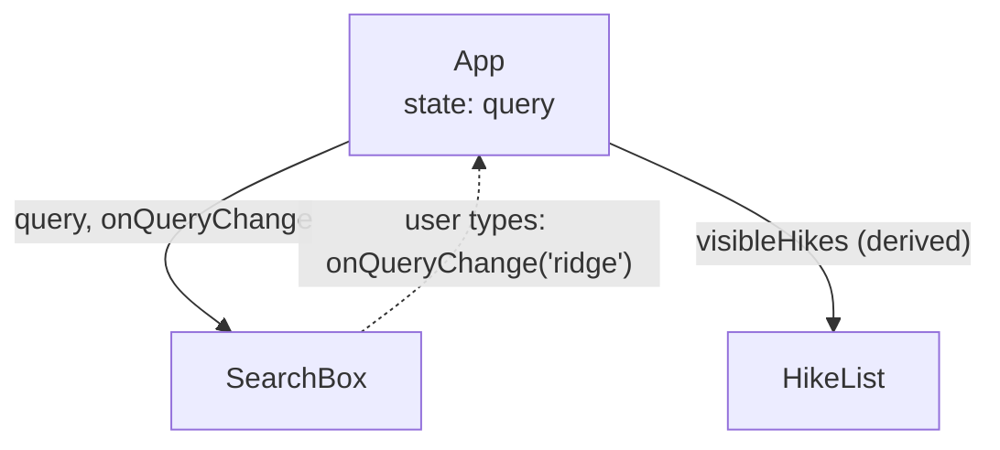
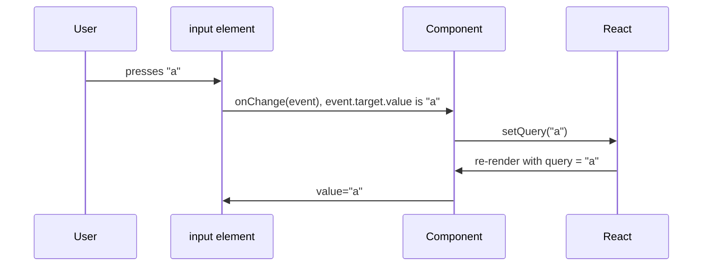

# Lifting state and controlled components

> **Before this lesson:** you need [State with useState](#/lesson/react/usestate) (snapshots, setters, immutable updates) and callback props from [Lists, keys and events](#/lesson/react/lists-keys-events).

## In plain words

Two friends are planning a hike and each keeps their own copy of the packing list. One crosses off "water bottle"; the other's copy still shows it. The fix is not to phone each other after every change. The fix is to put **one** list on the fridge and have both look at it.

In React, when two components need the same changing data, you move that data up to the closest component that contains them both and pass it down. This is called **lifting state up**. The shared component becomes the **single source of truth**: the one place where the value officially lives.

The same idea applies to form fields. A text box in a browser keeps its own text internally. A **controlled component** is a form field whose value is held in React state instead, so that React, not the browser, is the fridge door.

Deciding where state lives is the main design decision in React work, and it is what interviewers probe when they ask you to build a small feature live.

## The problem: two components, one piece of data

A search box and a list. Typing in the box should filter the list.

```jsx
function SearchBox() {
  const [query, setQuery] = useState("");
  return <input value={query} onChange={(e) => setQuery(e.target.value)} />;
}

function HikeList({ hikes }) {
  // needs `query` to filter... but cannot see it
  return <ul>{hikes.map((h) => <li key={h.id}>{h.name}</li>)}</ul>;
}

function App() {
  return (
    <>
      <SearchBox />
      <HikeList hikes={allHikes} />
    </>
  );
}
```

`query` is locked inside `SearchBox`. Remember the rule of one-way data flow: a component can pass data only **down** to its children. `SearchBox` and `HikeList` are siblings, so neither can hand anything to the other.

## The fix: lift the state to the common parent

Three steps.

**1. Remove the state from the child and receive it as props.**

```jsx
function SearchBox({ query, onQueryChange }) {
  return (
    <label>
      Search:{" "}
      <input value={query} onChange={(e) => onQueryChange(e.target.value)} />
    </label>
  );
}
```

- `SearchBox` no longer calls `useState`. It shows whatever `query` it is given.
- When the user types, it calls `onQueryChange` with the new text. It does not know or care what happens next.
- `{" "}` inserts a space; JSX removes whitespace at line ends.

**2. Put the state in the closest common parent.**

```jsx
function App() {
  const [query, setQuery] = useState("");

  const visibleHikes = allHikes.filter((hike) =>
    hike.name.toLowerCase().includes(query.trim().toLowerCase())
  );

  return (
    <>
      <SearchBox query={query} onQueryChange={setQuery} />
      <HikeList hikes={visibleHikes} />
    </>
  );
}
```

- `App` contains both children, so it is the lowest place that can serve both.
- `visibleHikes` is derived during render from `allHikes` and `query`. It is not state.
- `onQueryChange={setQuery}` passes the setter itself as the callback.

**3. Pass the data down.** `HikeList` receives the filtered array and stays unaware that searching exists.



The full loop for one keystroke: the user types `r` → the input fires `onChange` → `SearchBox` calls `onQueryChange("r")` → that is `setQuery("r")` in `App` → React renders `App` → `SearchBox` receives `query="r"` and `HikeList` receives the filtered list → both update. Data went down, the event went up, and there is exactly one copy of `query`.

### How far up?

Lift state only as far as necessary. The guideline, often called **state colocation**, is: *keep state as close as possible to where it is used.*

- Used by one component → keep it there.
- Used by a component and its siblings → their common parent.
- Used all over the app (signed-in user, theme) → near the top, perhaps with context ([Context and global state](#/lesson/react/context-global-state)).

Lifting too high has a cost: every state change re-renders the component that owns it and, by default, everything below. If `query` lived at the very top of a large app, each keystroke would re-render the whole tree. It also makes components harder to reuse and the top component a dumping ground.

When state sits several levels above where it is needed, intermediate components must pass props through without using them. This is called **prop drilling**. A little of it is normal and explicit. A lot of it is a signal to restructure with composition ([next lesson](#/lesson/react/composition-conditional)) or context.

## Controlled components

Look again at the input:

```jsx
<input value={query} onChange={(e) => onQueryChange(e.target.value)} />
```

A plain HTML input stores its text inside the DOM. With the `value` prop, React takes over: the input shows what React state says and nothing else. That is a **controlled component**.

The cycle on every keystroke:



Because every character passes through your code, you get capabilities for free:

- **Transform input as it is typed:** `setCode(e.target.value.toUpperCase())`.
- **Reject input:** ignore the change when it does not match (`if (/^\d*$/.test(v)) setAge(v)` accepts digits only).
- **Validate live** and show errors next to the field.
- **Enable or disable buttons** based on current values.
- **Reset or pre-fill** the form by setting state.

If you set `value` without `onChange`, the field becomes read-only: the user types, React immediately re-applies the unchanged state, and nothing appears. React logs a warning in that case.

### Every kind of field

```jsx
function HikeForm() {
  const [name, setName] = useState("");
  const [difficulty, setDifficulty] = useState("easy");
  const [notes, setNotes] = useState("");
  const [done, setDone] = useState(false);

  return (
    <form>
      <input value={name} onChange={(e) => setName(e.target.value)} />

      <select value={difficulty} onChange={(e) => setDifficulty(e.target.value)}>
        <option value="easy">Easy</option>
        <option value="hard">Hard</option>
      </select>

      <textarea value={notes} onChange={(e) => setNotes(e.target.value)} />

      <input type="checkbox" checked={done} onChange={(e) => setDone(e.target.checked)} />
    </form>
  );
}
```

- Text inputs, `<select>` and `<textarea>` all use `value` and `e.target.value`. (In HTML, a textarea's text goes between its tags and a select marks an option as `selected`; React unifies them.)
- A checkbox uses `checked` and `e.target.checked`, a boolean.
- Radio buttons use `checked={choice === "a"}` on each button and set `choice` in `onChange`.

With many fields, one state object and one handler keep things compact:

```jsx
const [form, setForm] = useState({ name: "", km: "", difficulty: "easy" });

function handleChange(event) {
  const { name, value } = event.target;
  setForm((previous) => ({ ...previous, [name]: value }));
}

<input name="name" value={form.name} onChange={handleChange} />
<input name="km" value={form.km} onChange={handleChange} />
```

- `const { name, value } = event.target;` reads the field's `name` attribute and its current text.
- `[name]: value` is a **computed property name**: the key is whatever string `name` holds.
- `{ ...previous, [name]: value }` copies the old form and overrides one field.

Note that `<input>` values are always strings. `km` above is `"7.5"`, not `7.5`. Convert with `Number(form.km)` when you use it, and keep the string in state so the user can type intermediate text such as `7.`.

### Uncontrolled components

The alternative is to let the DOM keep the value and read it only when needed. That is an **uncontrolled component**.

```jsx
function QuickAdd({ onAdd }) {
  function handleSubmit(event) {
    event.preventDefault();
    const data = new FormData(event.target);
    onAdd(data.get("name"));
    event.target.reset();
  }
  return (
    <form onSubmit={handleSubmit}>
      <input name="name" defaultValue="" />
      <button type="submit">Add</button>
    </form>
  );
}
```

- `defaultValue` sets the starting text once and then leaves the field alone.
- `new FormData(event.target)` collects the values of all named fields in the form at the moment of submission; `data.get("name")` reads one.
- `event.target.reset()` clears the form through the browser.

| | Controlled | Uncontrolled |
|---|---|---|
| Value lives in | React state | The DOM |
| Props | `value` + `onChange` | `defaultValue` (and maybe a ref) |
| Re-render per keystroke | Yes | No |
| Live validation, formatting, dependent fields | Natural | Awkward |
| Code needed | More | Less |
| Good for | Search boxes, complex forms | Submit-and-forget forms, file inputs (always uncontrolled) |

Neither is wrong. Choose controlled when anything on screen depends on the value while the user types. [Forms](#/lesson/react/forms) goes deeper into validation and submission.

> [!INTERVIEW]
> "Controlled vs uncontrolled components?" *Controlled: React state is the source of truth; the field gets `value` and reports edits through `onChange`. Uncontrolled: the DOM holds the value; you give `defaultValue` and read it on submit with a ref or `FormData`. Controlled gives instant validation and formatting at the cost of a render per keystroke; uncontrolled is less code and suits submit-only forms and file inputs.* A common follow-up is the warning "a component is changing an uncontrolled input to be controlled", caused by a `value` that starts as `undefined` and later becomes a string. Initialise with `""`.

## The pattern generalises

"Value down, change request up" is not limited to inputs. Any component can be designed as controlled by its parent:

```jsx
function Accordion({ openId, onOpenChange, sections }) {
  return sections.map((section) => (
    <section key={section.id}>
      <button onClick={() => onOpenChange(section.id)}>{section.title}</button>
      {openId === section.id && <p>{section.body}</p>}
    </section>
  ));
}
```

The parent holds `openId`, so only one section can be open at a time and the parent can open a section from elsewhere (for example from a link). Had each section kept its own `isOpen` state, coordinating them would need exactly the kind of manual synchronising React is designed to avoid.

## Run it: lifted state and controlled inputs

This page uses the miniature React with one addition: inputs receive their `value` as a property, and focus is restored after each render (real React never loses it because it does not rebuild the input).

```html-run
<div id="root"></div>
<style>body { font-family: sans-serif; } input, select { margin: 4px; padding: 4px; } .warn { color: #b3261e; }</style>
<script>
  // ---------- tiny stand-in for React ----------
  function h(type, props, ...children) { return { type, props: props || {}, children: children.flat() }; }
  function toDom(node) {
    if (node === null || node === undefined || typeof node === "boolean") return document.createTextNode("");
    if (typeof node !== "object") return document.createTextNode(String(node));
    if (typeof node.type === "function") return toDom(node.type({ ...node.props, children: node.children }));
    const el = document.createElement(node.type);
    for (const [name, value] of Object.entries(node.props)) {
      if (name === "onChange") el.addEventListener("input", value);          // React's onChange fires per keystroke
      else if (name.startsWith("on")) el.addEventListener(name.slice(2).toLowerCase(), value);
      else if (name === "value" || name === "checked") el[name] = value;     // controlled: state decides
      else if (name === "className") el.className = value;
      else if (name !== "key") el.setAttribute(name, value);
    }
    node.children.forEach((child) => el.appendChild(toDom(child)));
    return el;
  }
  const slots = []; let cursor = 0;
  function useState(initial) {
    const i = cursor++;
    if (!(i in slots)) slots[i] = initial;
    return [slots[i], (next) => { slots[i] = typeof next === "function" ? next(slots[i]) : next; render(); }];
  }
  function render() {
    const active = document.activeElement, id = active && active.id, caret = active && active.selectionStart;
    cursor = 0;
    document.getElementById("root").replaceChildren(toDom(h(App)));
    const again = id && document.getElementById(id);
    if (again) { again.focus(); try { again.setSelectionRange(caret, caret); } catch (e) {} }
  }

  // ---------- your components ----------
  const allHikes = [{ id: 1, name: "Ridge Loop", km: 7.5 }, { id: 2, name: "Fern Gully", km: 3 }, { id: 3, name: "Salt Marsh", km: 11 }, { id: 4, name: "Rim Trail", km: 5 }];

  function SearchBox({ query, onQueryChange }) {
    return h("label", null, "Search: ",
      h("input", { id: "q", value: query, onChange: (e) => onQueryChange(e.target.value) }));
  }
  function MaxDistance({ max, onMaxChange }) {
    // controlled input that REJECTS anything except digits
    return h("label", null, " Max km: ",
      h("input", { id: "max", value: max, size: 4, onChange: (e) => { if (/^\d*$/.test(e.target.value)) onMaxChange(e.target.value); else render(); } }));
  }
  function HikeList({ hikes }) {
    if (hikes.length === 0) return h("p", { className: "warn" }, "No hikes match.");
    return h("ul", null, hikes.map((hike) => h("li", { key: hike.id }, hike.name, " (", hike.km, " km)")));
  }
  function App() {
    const [query, setQuery] = useState("");      // lifted: both children need it
    const [max, setMax] = useState("");
    const visible = allHikes
      .filter((hike) => hike.name.toLowerCase().includes(query.trim().toLowerCase()))
      .filter((hike) => max === "" || hike.km <= Number(max));
    return h("div", null,
      h(SearchBox, { query, onQueryChange: setQuery }),
      h(MaxDistance, { max, onMaxChange: setMax }),
      h("button", { onClick: () => { setQuery(""); setMax(""); } }, "Reset"),
      h("p", null, "Showing ", visible.length, " of ", allHikes.length),
      h(HikeList, { hikes: visible }));
  }
  render();
</script>
```

Try typing letters into "Max km": they never appear, because the handler refuses to store them and the input shows state. Press **Reset**: both fields clear, because clearing state clears the fields. Then move `const [query, setQuery] = useState("")` into `SearchBox` and see how `HikeList` loses access to it.

## Pitfalls

> [!WARNING]
> **Copying a prop into state to "have it locally".** `const [q, setQ] = useState(props.query)` creates a second source of truth that stops following the parent after the first render. Either the parent owns the value (use the prop) or the child does (no prop).

- **`value` without `onChange`:** a frozen field and a console warning. For a deliberately read-only field add `readOnly`.
- **`value={undefined}` at first, a string later:** React warns about switching from uncontrolled to controlled. Start with `""`.
- **Using `defaultValue` and expecting it to follow state.** It is read once.
- **Treating input values as numbers.** `e.target.value` is a string, even for `type="number"`.
- **Lifting everything to the top "to be safe".** Causes wide re-renders and long prop chains. Lift on demand.
- **Two children each keeping a copy and syncing through effects.** Lift instead; syncing code is where bugs breed.

> [!TIP]
> When unsure where state belongs, list every component that reads or changes the value, find their closest shared ancestor, and put it there. If that turns out to be only one component, the state is already in the right place.

## Cheat sheet

| Situation | Do this |
|---|---|
| Siblings need the same value | Move state to their common parent; pass value down and a setter callback down |
| Child needs to change parent data | Parent passes `onX`; child calls it |
| Text input | `value={text}` + `onChange={(e) => setText(e.target.value)}` |
| Checkbox | `checked={flag}` + `onChange={(e) => setFlag(e.target.checked)}` |
| Select | `value={choice}` on `<select>` + `onChange` |
| Many fields | one object in state, `name` attributes, `[name]: value` |
| Submit-only form | uncontrolled: `defaultValue`, `new FormData(form)` |
| Initial value only | `defaultValue` / `defaultChecked` |
| Clear a controlled form | set the state back to its initial values |

## Summary

- Shared data belongs in the closest common parent: lift state up, pass it down, pass change callbacks down too.
- Keep state as low as it can be while still serving everyone who needs it (colocation).
- A controlled field shows React state through `value`/`checked` and reports edits through `onChange`; every keystroke goes through your code.
- An uncontrolled field keeps its own value in the DOM; read it on submit.
- One source of truth per value. Never keep two copies in sync by hand.

## Glossary

- **Lifting state up**: moving state from a child to a shared ancestor so several components can use it.
- **Single source of truth**: the one authoritative place where a value is stored.
- **State colocation**: keeping state as near as possible to the components that use it.
- **Prop drilling**: passing props through components that do not use them, only to reach a deeper one.
- **Controlled component**: a form element whose value is driven by React state.
- **Uncontrolled component**: a form element that stores its own value in the DOM.
- **`defaultValue`**: the prop giving an uncontrolled field its initial value.
- **`FormData`**: a browser object that collects the named values of a form.
- **Computed property name**: `{ [expr]: value }`, an object key taken from an expression.

## Check yourself

```quiz
[
  {"q": "SearchBox and ResultList are siblings and both need the search text. Where should that state live?",
   "options": ["In SearchBox, since it has the input", "In ResultList, since it filters", "In their closest common parent, passed down to both", "In a global variable"],
   "answer": 2,
   "explain": "Siblings cannot pass data to each other. The closest common ancestor owns it and hands it down."},
  {"q": "<input value={name} /> with no onChange. The user types 'x'. What do they see?",
   "options": ["x appears", "Nothing changes; the field keeps showing the state value, and React warns in the console", "The page reloads", "The state is updated automatically"],
   "answer": 1,
   "explain": "A controlled input displays state. Without a handler that updates state, typing has no visible effect."},
  {"q": "What does e.target.value contain for <input type=\"number\"> after the user types 42?",
   "options": ["The number 42", "The string \"42\"", "undefined", "An array of digits"],
   "answer": 1,
   "explain": "Input values are always strings. Convert with Number(...) when you need arithmetic."},
  {"q": "Which describes an uncontrolled input?",
   "options": ["value and onChange are both set", "It uses defaultValue and the DOM keeps the current text", "It cannot be edited", "It is rendered outside React"],
   "answer": 1,
   "explain": "Uncontrolled means the DOM is the source of truth; you read the value when you need it."},
  {"q": "App holds query in state and renders <SearchBox query={query} onQueryChange={setQuery} /> and <List />. The user types one character. Which components render again by default?",
   "options": ["Only SearchBox", "Only App", "App, SearchBox and List", "None; inputs update themselves"],
   "answer": 2,
   "explain": "The state lives in App, so App re-renders, and by default so do all components it renders."},
  {"q": "const [value, setValue] = useState(props.initial). The parent later passes a different initial. What does value become?",
   "options": ["The new prop value", "It stays as it was; the initial value is only used on the first render", "undefined", "Both, alternately"],
   "answer": 1,
   "explain": "useState reads its argument once. Mirroring props in state creates a stale copy."},
  {"q": "What is prop drilling?",
   "options": ["Passing a prop through several layers of components that do not use it themselves", "Mutating props inside a child", "Using too many props on one element", "Validating prop types"],
   "answer": 0,
   "explain": "It happens when state lives far above its consumers. Composition or context can shorten the chain."},
  {"q": "A handler does: if (/^[0-9]*$/.test(e.target.value)) setPin(e.target.value);  The field is controlled by pin, currently '12'. The user presses the letter a. What is shown?",
   "options": ["12a", "12", "a", "An error"],
   "answer": 1,
   "explain": "The handler refuses to update state, and the controlled input keeps displaying the state value '12'."}
]
```

> **Source:** Wieruch, *The Road to React*, "Fundamentals of React": Lifting State in React, React Controlled Components, Props Handling. Documentation: https://react.dev/learn/sharing-state-between-components, https://react.dev/reference/react-dom/components/input, https://react.dev/learn/choosing-the-state-structure
