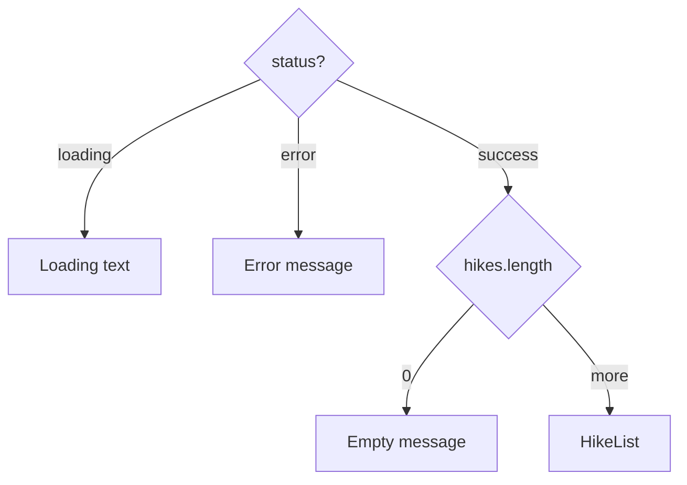

# Composition, children and conditional rendering

> **Before this lesson:** you need props and `children` from [JSX, components and props](#/lesson/react/jsx-components-props), and lifted state from [Lifting state and controlled components](#/lesson/react/lifting-controlled). From JavaScript: truthy and falsy values and the operators `&&`, `||`, `??` and `? :` (see [Type coercion and equality](#/lesson/javascript/coercion-equality)).

## In plain words

A picture frame does not care what picture you put in it. The frame supplies the border and the hook; you supply the photo. One frame design serves a thousand photos.

**Composition** means building components the same way: a component provides the surrounding structure (a card, a dialog, a page layout) and leaves a hole that the *user* of the component fills with whatever content they like. The hole is the `children` prop.

**Conditional rendering** is the other everyday tool: showing different things depending on the situation. A signed-in user sees "Sign out", a visitor sees "Sign in"; a list shows "Loading…", an error, an empty message, or the rows.

Together these two ideas account for most of what makes a codebase pleasant or painful to change, and "how would you make this component reusable?" is a favourite interview prompt.

## Conditional rendering, from the simplest form up

JSX is JavaScript, so you choose what to render with ordinary JavaScript. There are four common forms.

### 1. `if` with an early return

```jsx
function HikeStatus({ hike }) {
  if (hike.done) {
    return <p>Completed on {hike.date}</p>;
  }
  return <p>Not done yet</p>;
}
```

- The `if` statement sits above the JSX, in the plain JavaScript part of the function.
- The first `return` ends the function when the hike is done; otherwise execution continues to the second.

Use this form when whole branches differ, or to get special cases out of the way first.

### 2. The conditional (ternary) operator

`condition ? a : b` is an *expression* (it produces a value), so it can live inside braces:

```jsx
function HikeRow({ hike }) {
  return (
    <li>
      {hike.name} {hike.done ? <span>Done</span> : <button>Mark done</button>}
    </li>
  );
}
```

Read it as "if `hike.done` then the span, otherwise the button". Use it for either/or choices inside larger markup.

### 3. Logical AND: `&&`

When there is no "otherwise", `&&` is shorter:

```jsx
<li>
  {hike.name}
  {hike.isFavourite && <span> ★</span>}
</li>
```

In JavaScript, `a && b` evaluates to `a` when `a` is falsy and to `b` otherwise. React renders nothing for `false`, `null`, `undefined` and `true`, so a false condition leaves no trace.

> [!WARNING]
> **The zero trap.** `{hikes.length && <List />}` renders the number `0` on screen when the list is empty, because `0 && anything` evaluates to `0`, and React *does* render numbers. Always make the left side a real boolean: `{hikes.length > 0 && <List />}`. The same applies to `NaN` and empty strings in React Native.

### 4. A variable prepared above the JSX

When there are more than two outcomes, nested ternaries become unreadable. Assign JSX to a variable instead (JSX elements are values):

```jsx
function HikePanel({ status, hikes, error }) {
  let content;
  if (status === "loading") {
    content = <p>Loading hikes…</p>;
  } else if (status === "error") {
    content = <p role="alert">Could not load: {error}</p>;
  } else if (hikes.length === 0) {
    content = <p>No hikes yet. Add your first one.</p>;
  } else {
    content = <HikeList hikes={hikes} />;
  }

  return (
    <section>
      <h2>Your hikes</h2>
      {content}
    </section>
  );
}
```

- `let content;` declares a variable with no value yet.
- Each branch stores a different element in it.
- `{content}` drops the chosen element into the layout, so the heading is written once.

A component may also return `null` to render nothing at all. That is useful for a component that decides for itself whether to appear, such as a banner that hides when there is no message.



### Hiding versus removing

`{isOpen && <Details />}` removes the component from the tree when `isOpen` is false. React destroys its state and DOM nodes; reopening starts fresh. If you need to keep the state (a half-filled form inside a collapsible section, say), keep the component mounted and hide it with CSS or the `hidden` attribute:

```jsx
<div hidden={!isOpen}>
  <Details />
</div>
```

A related surprise: React ties state to the *position* of a component in the tree. In `{isAnn ? <Chat person="Ann" /> : <Chat person="Bo" />}` both branches put a `Chat` in the same position, so React keeps one instance and its state (including a half-typed message) when you switch. To force a fresh instance, give them different keys: `<Chat key={person} person={person} />`.

## Composition with `children`

Suppose three screens need a titled box. Without composition you might add a prop for every variation:

```jsx
<Card title="Stats" text="12 hikes" showButton buttonLabel="More" onButtonClick={...} imageUrl={...} />
```

Each new need means a new prop and a new `if` inside `Card`. With composition, `Card` handles only the frame:

```jsx
function Card({ title, children }) {
  return (
    <section className="card">
      <h2>{title}</h2>
      <div className="card-body">{children}</div>
    </section>
  );
}
```

- `children` receives whatever JSX the caller nests inside `<Card>...</Card>`.
- `Card` places it inside its body and has no opinion about what it is.

```jsx
<Card title="Stats">
  <p>12 hikes, 86 km</p>
</Card>

<Card title="Next up">
  <HikeRow hike={nextHike} />
  <button onClick={startHike}>Start</button>
</Card>
```

The same `Card` now covers cases its author never thought of.

### Several holes: elements as props

`children` is one hole. For more, pass JSX through ordinary props, sometimes called **slots**:

```jsx
function PageLayout({ header, sidebar, children }) {
  return (
    <div className="layout">
      <header>{header}</header>
      <aside>{sidebar}</aside>
      <main>{children}</main>
    </div>
  );
}

<PageLayout header={<TopBar user={user} />} sidebar={<FilterPanel filters={filters} />}>
  <HikeList hikes={hikes} />
</PageLayout>
```

- `header={<TopBar user={user} />}` passes an element as a prop value. Nothing unusual: elements are objects.
- `PageLayout` positions the three pieces and knows nothing about users, filters or hikes.

### Composition cures prop drilling

In the previous lesson, prop drilling meant passing a prop through layers that do not use it. Look at who needs `user` here:

```jsx
// Drilling: Layout and TopBar only forward `user`
<Layout user={user} />            // Layout renders <TopBar user={user} />
                                  // TopBar renders <Avatar user={user} />

// Composition: App creates the Avatar itself and hands it down as content
<Layout topBar={<TopBar><Avatar user={user} /></TopBar>} />
```

In the second version `App`, which owns `user`, creates `<Avatar user={user} />` directly. `Layout` and `TopBar` receive finished elements and never mention `user`. Before reaching for context or a state library, check whether restructuring with `children` removes the drilling.

There is a performance bonus too. When a wrapper component re-renders because of *its own* state, the `children` it received from its parent are the same element objects as before, so React can skip re-rendering them:

```jsx
function ScrollTracker({ children }) {
  const [y, setY] = useState(0);            // changes often
  return <div onScroll={(e) => setY(e.target.scrollTop)}>{children}</div>;
}

<ScrollTracker>
  <ExpensiveHikeMap />     {/* created by the parent, not re-rendered when y changes */}
</ScrollTracker>
```

### Specialisation and render props

A specific component can be a generic one with some props filled in:

```jsx
function DangerButton(props) {
  return <Button variant="danger" {...props} />;
}
```

`{...props}` forwards everything the caller passed, so `DangerButton` accepts `onClick`, `disabled`, `children` and so on without listing them.

Sometimes the wrapper has *data* the content needs. Then the hole can be a function: the caller passes a function, and the component calls it with the data. This is the **render prop** pattern.

```jsx
function HikeList({ hikes, renderItem }) {
  return <ul>{hikes.map((hike) => <li key={hike.id}>{renderItem(hike)}</li>)}</ul>;
}

<HikeList hikes={hikes} renderItem={(hike) => <strong>{hike.name}</strong>} />
```

`HikeList` owns the looping and the keys; the caller decides how one item looks. Since custom Hooks arrived ([Custom hooks and useRef](#/lesson/react/custom-hooks-refs)), render props are needed less often, but you will meet them in libraries.

React has no inheritance between components (`class Fancy extends Basic` is not how reuse is done). Composition, props and Hooks cover every case that inheritance would.

## Run it: frames, slots and four UI states

```html-run
<div id="root"></div>
<style>
  body { font-family: sans-serif; }
  .card { border: 1px solid #bbb; border-radius: 8px; padding: 8px 12px; margin: 8px 0; }
  .card h3 { margin: 0 0 6px; } .footer { border-top: 1px dashed #ccc; margin-top: 6px; padding-top: 6px; }
  button { margin-right: 6px; } .error { color: #b3261e; }
</style>
<script>
  // ---------- tiny stand-in for React ----------
  function h(type, props, ...children) { return { type, props: props || {}, children: children.flat() }; }
  function toDom(node) {
    if (node === null || node === undefined || typeof node === "boolean") return document.createTextNode("");
    if (typeof node !== "object") return document.createTextNode(String(node));     // numbers DO render
    if (typeof node.type === "function") return toDom(node.type({ ...node.props, children: node.children }));
    const el = document.createElement(node.type);
    for (const [name, value] of Object.entries(node.props)) {
      if (name.startsWith("on")) el.addEventListener(name.slice(2).toLowerCase(), value);
      else if (name === "className") el.className = value;
      else if (name !== "key") el.setAttribute(name, value);
    }
    node.children.forEach((child) => el.appendChild(toDom(child)));
    return el;
  }
  const slots = []; let cursor = 0;
  function useState(initial) {
    const i = cursor++;
    if (!(i in slots)) slots[i] = initial;
    return [slots[i], (next) => { slots[i] = next; render(); }];
  }
  function render() { cursor = 0; document.getElementById("root").replaceChildren(toDom(h(App))); }

  // ---------- your components ----------
  function Card({ title, footer, children }) {                 // a frame with two holes
    return h("section", { className: "card" },
      h("h3", null, title),
      children,
      footer ? h("div", { className: "footer" }, footer) : null);
  }
  function HikePanel({ status, hikes }) {
    let content;                                                // choose with plain JavaScript
    if (status === "loading") content = h("p", null, "Loading hikes…");
    else if (status === "error") content = h("p", { className: "error" }, "Could not load hikes.");
    else if (hikes.length === 0) content = h("p", null, "No hikes yet.");
    else content = h("ul", null, hikes.map((hike) => h("li", { key: hike }, hike)));
    return h(Card, { title: "Your hikes", footer: status === "success" && hikes.length > 0 ? hikes.length + " total" : null }, content);
  }
  function App() {
    const [status, setStatus] = useState("loading");
    const [hikes, setHikes] = useState([]);
    return h("div", null,
      h("button", { onClick: () => setStatus("loading") }, "loading"),
      h("button", { onClick: () => setStatus("error") }, "error"),
      h("button", { onClick: () => { setHikes([]); setStatus("success"); } }, "success, empty"),
      h("button", { onClick: () => { setHikes(["Ridge Loop", "Fern Gully"]); setStatus("success"); } }, "success, 2 hikes"),
      h(HikePanel, { status, hikes }),
      h(Card, { title: "The zero trap" },
        h("p", null, "hikes.length && 'list' renders: [", hikes.length && "list", "]"),
        h("p", null, "hikes.length > 0 && 'list' renders: [", hikes.length > 0 && "list", "]")));
  }
  render();
</script>
```

Click through the four buttons and watch the same `Card` frame show four different bodies. With an empty list, the "zero trap" card displays a stray `0` in the first line and nothing in the second. Then give the second `Card` a `footer` and see the slot appear.

## Pitfalls

- **`{count && <X />}` with a number.** Renders `0`. Compare explicitly (`count > 0`) or convert (`!!count`).
- **Deeply nested ternaries.** `a ? b : c ? d : e ? f : g` is technically valid and nobody can read it. Use a variable or extract a component.
- **Expecting state to survive `&&`.** Removing a component from the tree discards its state. Hide with CSS if it must persist.
- **Expecting state to reset when props change.** Same component type in the same position keeps its state. Use a `key` to reset.
- **A prop for every variation** (`showIcon`, `iconLeft`, `iconColor`, …). When a component has many boolean props, replace them with `children` or slots.
- **Defining components inside components to "access variables".** The inner component is re-created each render and loses state. Pass the values as props instead.
- **Putting `if` inside JSX braces.** Statements are not allowed there; use an expression or move the logic above the `return`.

> [!TIP]
> When deciding between a prop and `children`: if the caller is choosing *data* (a title string, a count), use a prop. If the caller is choosing *what to display* (markup, other components), use `children` or an element prop.

> [!INTERVIEW]
> "How do you avoid prop drilling?" Give three levels: *first, component composition (pass elements as `children` so intermediate components do not need the data); second, lift state only as high as needed and colocate it; third, context for truly cross-cutting values such as the current user or theme.* Mentioning composition before context shows you know context is not the default tool.

## Cheat sheet

| Goal | Pattern |
|---|---|
| Either A or B | `{cond ? <A /> : <B />}` |
| Show only if true | `{cond && <A />}` with a real boolean `cond` |
| Fallback for missing text | `{name ?? "Anonymous"}` |
| Many outcomes | `let content; if (...) content = ...;` then `{content}` |
| Render nothing | `return null;` |
| Keep state while hidden | `<div hidden={!open}>...</div>` |
| Reset state on change | `<Form key={id} />` |
| One content hole | `function Frame({ children })` |
| Several holes | element props: `<Layout header={<H />} sidebar={<S />}>` |
| Specialised version | `<Button variant="danger" {...props} />` |
| Caller renders each item | `renderItem={(item) => <X item={item} />}` |

## Summary

- Conditional rendering is ordinary JavaScript: `if`, `? :`, `&&`, or a variable holding JSX.
- `false`, `null`, `undefined` and `true` render nothing; `0` and `""` are values, and `0` is visible.
- Removing a component destroys its state; position plus type plus key define identity.
- Composition means a component provides structure and receives content through `children` or element props.
- Composition reduces props, removes much prop drilling, and can avoid needless re-renders.
- Prefer composition over configuration flags; React has no component inheritance.

## Glossary

- **Conditional rendering**: choosing which elements to return based on props or state.
- **Ternary operator**: `condition ? valueIfTrue : valueIfFalse`.
- **Truthy / falsy**: values treated as true or false in a condition; falsy values are `false`, `0`, `""`, `null`, `undefined`, `NaN`.
- **Early return**: leaving a function before its end for a special case.
- **Composition**: building components by combining and nesting other components.
- **Slot**: a prop whose value is JSX to be placed somewhere in a layout.
- **Render prop**: a prop whose value is a function returning JSX, called by the component with data.
- **Mount / unmount**: a component being added to / removed from the tree.
- **Specialisation**: a component that renders a more general one with some props preset.

## Check yourself

```quiz
[
  {"q": "items is an empty array. What does {items.length && <List />} put on the screen?",
   "options": ["Nothing", "The number 0", "The List component", "The word false"],
   "answer": 1,
   "explain": "0 && x evaluates to 0, and React renders numbers. Use items.length > 0 && ..."},
  {"q": "Which values does React render as nothing?",
   "options": ["false, null, undefined and true", "0 and the empty string only", "Any falsy value", "Only null"],
   "answer": 0,
   "explain": "Booleans, null and undefined produce no output. 0 is rendered as the text 0."},
  {"q": "function Frame({ children }) { return <div className=\"frame\">{children}</div>; }  What does <Frame><b>Hi</b> there</Frame> render inside the div?",
   "options": ["Nothing; children must be passed explicitly", "The b element followed by the text ' there'", "Only the text", "The Frame component again"],
   "answer": 1,
   "explain": "Everything nested between the tags arrives as children, in order."},
  {"q": "{isOpen && <Notes />} where Notes keeps a draft in its own state. The user types a draft, isOpen becomes false, then true. What does Notes show?",
   "options": ["The saved draft", "An empty draft, because unmounting destroyed the state", "An error", "It depends on the browser"],
   "answer": 1,
   "explain": "When the element leaves the tree, React discards its state. Remounting starts from the initial value."},
  {"q": "{tab === 'a' ? <Editor file=\"a.txt\" /> : <Editor file=\"b.txt\" />}. Editor keeps unsaved text in state. The user types in tab a, then switches to tab b. What happens to the typed text?",
   "options": ["It is discarded", "It is still shown, because the same component type stays at the same position", "It moves to a hidden tab", "React throws"],
   "answer": 1,
   "explain": "Same type, same position means the same instance. Add key={file} to give each tab its own state."},
  {"q": "Why can composition reduce prop drilling?",
   "options": ["It stores props globally", "The component that owns the data creates the element that needs it and passes that element down as children, so intermediates never touch the data", "It makes props optional", "It converts props into state"],
   "answer": 1,
   "explain": "Intermediate layout components receive ready-made elements instead of forwarding raw data."},
  {"q": "Which is NOT allowed inside JSX braces?",
   "options": ["a ? b : c", "list.map(fn)", "if (a) { b }", "a && b"],
   "answer": 2,
   "explain": "Braces take expressions. if is a statement; use it above the return or use a ternary."},
  {"q": "A Wrapper component has its own counter state and renders {children}. Its parent passed <Chart /> as children. Wrapper's counter changes. By default, does Chart re-render?",
   "options": ["Yes, always", "No: the children element was created by the parent and is the same object as last time, so React can skip it", "Only in development", "Only if Chart has state"],
   "answer": 1,
   "explain": "Wrapper re-renders, but the children prop holds the very same element as before, which lets React reuse the previous result for that subtree."}
]
```

> **Source:** Wieruch, *The Road to React*, "Fundamentals of React": React Conditional Rendering, React Component Composition, Reusable React Component, React Fragments. Documentation: https://react.dev/learn/conditional-rendering, https://react.dev/learn/passing-props-to-a-component#passing-jsx-as-children, https://react.dev/learn/preserving-and-resetting-state
