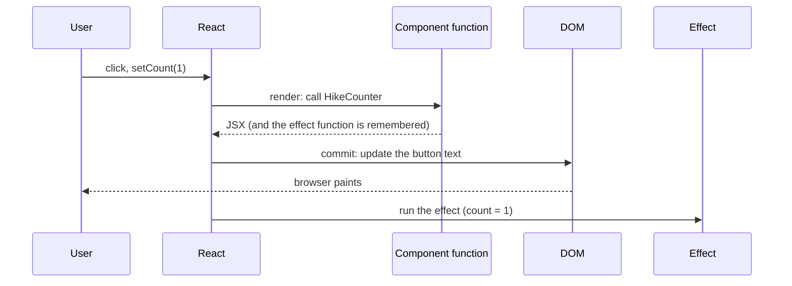

# useEffect and its dependency rules

> **Before this lesson:** you need [State with useState](#/lesson/react/usestate), especially "state is a snapshot" and closures. From JavaScript: `setTimeout`/`setInterval` (run a function later / repeatedly) and promises; see [Callbacks and promises](#/lesson/javascript/callbacks-promises) in the JavaScript track.

## In plain words

A thermostat has a dial (the temperature you want) and a boiler somewhere in the basement. The dial is part of the thermostat. The boiler is an outside system. Whenever the dial changes, something has to go and adjust the boiler so that the two agree. And if the thermostat is ripped off the wall, somebody should switch the boiler off.

A React component's props and state are the dial. Things outside React (a timer, a network connection, the browser tab's title, a chat server, a map widget) are the boiler. `useEffect` is how you say: "after you have drawn the screen, make this outside thing match my current props and state, and here is how to undo it".

The word for this is **synchronisation**: keeping two separate things in agreement. Effects are where most real React bugs live (infinite loops, stale data, leaked timers), so they are also a core interview topic.

## What is a side effect?

Rendering must be **pure**: given the same props and state, a component returns the same JSX and changes nothing else. A **side effect** is anything a function does besides computing its return value: changing the document title, starting a timer, sending a request, writing to storage, subscribing to a data stream.

Side effects belong in one of two places:

1. **Event handlers**, when the effect is caused by a specific user action ("the user clicked Buy, so send the order").
2. **Effects**, when the effect is needed *because the component is on screen with certain data* ("while this chat room is displayed, be connected to it").

Getting this distinction right removes about half of all `useEffect` problems. Ask "what caused this code to run: a click, or the fact that something is displayed?".

## The simplest effect

```jsx
import { useEffect, useState } from "react";

function HikeCounter() {
  const [count, setCount] = useState(0);

  useEffect(() => {
    document.title = `${count} hikes done`;
  });

  return <button onClick={() => setCount(count + 1)}>Finished: {count}</button>;
}
```

- `useEffect(() => { ... })` hands React a function. React does **not** run it during rendering. It saves it and runs it after the screen has been updated.
- `document.title = ...` changes the text of the browser tab, which lives outside React's tree.
- With no second argument, the effect runs after **every** render of this component.

The timeline for one click:



Render first, DOM update second, effects last. That ordering means an effect can safely read the DOM, and a slow effect does not delay what the user sees.

## The dependency array

Running after every render is rarely what you want. The second argument to `useEffect` is the **dependency array**: the list of values the effect uses from the component.

```jsx
useEffect(() => {
  document.title = `${count} hikes done`;
}, [count]);
```

After each render, React compares every item in the array with its value from the previous render (using `Object.is`, the same identity comparison as for state). If all are equal, React skips the effect. If any differ, or it is the first render, React runs it.

| Second argument | The effect runs |
|---|---|
| omitted | after every render |
| `[a, b]` | after the first render, and after any render in which `a` or `b` changed |
| `[]` | after the first render only |

`[]` is not a magic "run once" switch. It is the honest statement "this effect uses nothing that can change". If that statement is false, you have a bug, as shown below.

### The rule: list everything the effect reads

Every **reactive value** used inside the effect must appear in the array. Reactive values are those that can differ between renders: props, state, and anything computed from them in the component body (including functions defined there).

```jsx
function RoomTitle({ roomName }) {
  const [unread, setUnread] = useState(0);

  useEffect(() => {
    document.title = `${roomName} (${unread})`;
  }, [roomName, unread]);
  // ...
}
```

Both `roomName` and `unread` are read, so both are listed. You do not get to choose the dependencies; the code inside the effect decides them. The lint rule `react-hooks/exhaustive-deps` (enabled in the Vite template) checks this for you. Treat its warnings as errors.

What happens if you leave one out?

```jsx
useEffect(() => {
  const id = setInterval(() => {
    setCount(count + 1);       // reads count
  }, 1000);
  return () => clearInterval(id);
}, []);                        // but claims to depend on nothing
```

The effect runs once, after the first render, when `count` was `0`. The interval callback is a closure over that render's `count`. Every second it computes `0 + 1` and sets the state to `1`. The counter goes to 1 and stays there. This is a **stale closure**: a function still holding values from an old render.

Two correct fixes:

```jsx
// Fix A: stop reading count. The updater function receives the latest value from React.
useEffect(() => {
  const id = setInterval(() => setCount((c) => c + 1), 1000);
  return () => clearInterval(id);
}, []);

// Fix B: declare the dependency. The interval is torn down and restarted when count changes.
useEffect(() => {
  const id = setInterval(() => setCount(count + 1), 1000);
  return () => clearInterval(id);
}, [count]);
```

Fix A is better here: the effect truly depends on nothing, so the empty array is now honest. In general, if you want fewer dependencies, change the code so it *needs* fewer; never delete entries from the array to silence the linter.

## Cleanup

Many effects start something that must later be stopped. An effect may return a function, the **cleanup function**. React calls it:

- before running the same effect again (because a dependency changed), and
- when the component is removed from the screen (unmounted).

```jsx
function ChatRoom({ roomId }) {
  useEffect(() => {
    const connection = createConnection(roomId);
    connection.connect();
    return () => {
      connection.disconnect();
    };
  }, [roomId]);

  return <h2>Room: {roomId}</h2>;
}
```

- `createConnection(roomId)` and `connect()` set up the outside system for the current room.
- `return () => { connection.disconnect(); }` tells React how to undo exactly that setup.
- `[roomId]`: the effect reads `roomId`, so it is listed.

When `roomId` changes from `"general"` to `"trails"`, React runs the old cleanup (disconnect from general, using the old render's `connection`), then the new effect (connect to trails). When the component unmounts, React runs the last cleanup. Setup and cleanup always come in matched pairs, so there is never more than one live connection.

Common pairs: `addEventListener` / `removeEventListener`, `setInterval` / `clearInterval`, `subscribe` / `unsubscribe`, starting a request / aborting it.

The simulation below plays through three renders so that you can see the order. The problems *Should the effect run again?* and *A tiny hooks runtime* ask you to build this machinery.

```js-run
// A tiny model of how React handles one effect across renders.
let previousDeps = null;
let cleanup = null;

function commit(render, deps, effect) {
  const changed = previousDeps === null || deps.some((d, i) => !Object.is(d, previousDeps[i]));
  console.log(`render ${render}: deps ${JSON.stringify(deps)} -> ${changed ? "run effect" : "skip effect"}`);
  if (changed) {
    if (cleanup) cleanup();          // undo the previous run first
    cleanup = effect();              // then run, and remember how to undo
  }
  previousDeps = deps;
}

function chatEffect(roomId) {
  return () => {
    console.log(`   connect to "${roomId}"`);
    return () => console.log(`   disconnect from "${roomId}"`);
  };
}

commit(1, ["general"], chatEffect("general"));   // mount
commit(2, ["general"], chatEffect("general"));   // unrelated re-render (for example a counter changed)
commit(3, ["trails"], chatEffect("trails"));     // the prop changed
console.log("unmount:");
cleanup();
```

Render 2 is skipped because the dependency is identical. Render 3 disconnects from `general` *before* connecting to `trails`. The cleanup logs the old room name because it is a closure from the old render.

### Why does my effect run twice in development?

With `<StrictMode>`, React in development mounts every component, immediately runs its cleanups, and runs its effects again. The purpose is to check that your cleanup truly undoes your setup. If "connect, disconnect, connect" misbehaves, your effect is missing or has a broken cleanup, and users would hit the same bug when navigating away and back. The fix is always to write the cleanup, never to block the second run with a flag. Production builds run effects once.

## Objects and functions as dependencies

Dependencies are compared by identity. An object, array or function created during render is a *new* one on every render, even if its contents are the same.

```jsx
function Results({ query }) {
  const options = { query, limit: 20 };     // new object on every render

  useEffect(() => {
    search(options);
  }, [options]);                            // "changed" every time: effect runs after every render
}
```

Fixes, in order of preference:

1. **Create the object inside the effect** and depend on the primitive values: move `const options = ...` into the effect and list `[query]`.
2. **Move it outside the component** if it uses no props or state. Then it is not reactive and is not a dependency at all.
3. **Stabilise it** with `useMemo` (for objects) or `useCallback` (for functions), covered in [memo, useMemo and useCallback](#/lesson/react/memoization).

Some values never need listing because React guarantees they are stable: the setter from `useState`, the `dispatch` function from `useReducer`, and ref objects from `useRef`.

## You might not need an effect

The most valuable effect skill is recognising when not to write one. Effects are for synchronising with *outside* systems. Two frequent misuses:

**Computing data from props or state.**

```jsx
// Unnecessary: an extra state variable and an extra render
const [visible, setVisible] = useState([]);
useEffect(() => {
  setVisible(hikes.filter((h) => h.done));
}, [hikes]);

// Better: calculate during render
const visible = hikes.filter((h) => h.done);
```

The effect version renders once with stale `visible`, then sets state and renders again. The direct version is always correct and half the work.

**Reacting to a user action.**

```jsx
// Unnecessary: an effect watching state to do what the click should do
useEffect(() => {
  if (submitted) sendOrder(cart);
}, [submitted]);

// Better: do it where the user did it
function handleBuy() {
  sendOrder(cart);
}
```

A rule of thumb: if you find yourself calling a setter inside an effect in response to other state, look for a way to derive the value or to move the logic into the event handler that changed the state.

Legitimate uses: subscriptions (timers, WebSocket messages, browser events such as `resize` or `online`), synchronising non-React widgets (maps, charts, video players), setting `document.title`, analytics "page viewed" events, and fetching data when a component is displayed ([Fetching data: loading, errors and races](#/lesson/react/data-fetching)).

`useLayoutEffect` has the same signature but runs *before* the browser paints. Use it only when you must measure layout and adjust it without a visible flicker (positioning a tooltip, for example).

## Run it: effects, dependencies and cleanup, live

The miniature React below adds a `useEffect` that follows the real rules: effects run after the DOM update, only when dependencies changed, and the previous cleanup runs first. A log on the page records each step.

```html-run
<div id="root"></div>
<pre id="log" style="background:#f4f4f4;padding:8px;max-height:150px;overflow:auto"></pre>
<script>
  // ---------- tiny stand-in for React ----------
  function h(type, props, ...children) { return { type, props: props || {}, children: children.flat() }; }
  function toDom(node) {
    if (node === null || node === undefined || typeof node === "boolean") return document.createTextNode("");
    if (typeof node !== "object") return document.createTextNode(String(node));
    if (typeof node.type === "function") return toDom(node.type({ ...node.props, children: node.children }));
    const el = document.createElement(node.type);
    for (const [name, value] of Object.entries(node.props)) {
      if (name.startsWith("on")) el.addEventListener(name.slice(2).toLowerCase(), value);
      else el.setAttribute(name, value);
    }
    node.children.forEach((child) => el.appendChild(toDom(child)));
    return el;
  }
  const slots = []; let cursor = 0; let toRun = [];
  function useState(initial) {
    const i = cursor++;
    if (!(i in slots)) slots[i] = initial;
    return [slots[i], (next) => { slots[i] = typeof next === "function" ? next(slots[i]) : next; render(); }];
  }
  function useEffect(effect, deps) {
    const i = cursor++;
    const slot = slots[i] || (slots[i] = { deps: null, cleanup: null, first: true });
    const changed = slot.first || !deps || deps.some((d, j) => !Object.is(d, slot.deps[j]));
    if (changed) toRun.push({ slot, effect });
    slot.first = false; slot.deps = deps;
  }
  function render() {
    cursor = 0; toRun = [];
    document.getElementById("root").replaceChildren(toDom(h(App)));   // 1. render + update the DOM
    const pending = toRun;
    pending.forEach(({ slot }) => { if (slot.cleanup) slot.cleanup(); slot.cleanup = null; });   // 2. old cleanups
    pending.forEach(({ slot, effect }) => { slot.cleanup = effect() || null; });                 // 3. new effects
  }
  const log = (line) => { const el = document.getElementById("log"); el.textContent += line + "\n"; el.scrollTop = el.scrollHeight; };

  // ---------- your component ----------
  function App() {
    const [seconds, setSeconds] = useState(0);
    const [stepSize, setStepSize] = useState(1);
    const [clicks, setClicks] = useState(0);

    useEffect(() => {
      log(`effect: start timer with step ${stepSize}`);
      const id = setInterval(() => setSeconds((s) => s + stepSize), 1000);
      return () => { log(`cleanup: stop timer with step ${stepSize}`); clearInterval(id); };
    }, [stepSize]);                         // restart the timer only when stepSize changes

    return h("div", null,
      h("p", null, "Elapsed: ", seconds),
      h("button", { onClick: () => setStepSize(stepSize === 1 ? 5 : 1) }, "Step size: ", stepSize, " (click to change)"),
      h("button", { onClick: () => setClicks(clicks + 1) }, "Unrelated state: ", clicks));
  }
  render();
</script>
```

Observe: the timer ticks and re-renders the component every second, yet the log stays quiet, because `stepSize` did not change. Click "Unrelated state": still nothing. Click "Step size": one cleanup line, then one effect line. Now change the dependency array to `[]` and repeat: the display says step 5 but the timer still adds 1 (a stale closure). Finally remove the array altogether: the timer is torn down and rebuilt on every render.

## Pitfalls

> [!WARNING]
> **Infinite loop.** An effect that sets state, with that state (or a new object each render) in its dependencies: effect runs → state changes → render → effect runs → … The browser tab freezes or React reports "Maximum update depth exceeded". Check whether the value can be derived instead, or whether a dependency is an unstable object.

- **Lying to the dependency array** (leaving out a value that is read). Produces stale closures that show old data.
- **Disabling the lint rule** to "run once". Restructure the effect instead.
- **No cleanup** for timers, listeners or subscriptions: they pile up, fire after unmount and leak memory.
- **Making the effect function `async`.** An async function returns a promise, and React expects either nothing or a cleanup function. Define an async function inside and call it.
- **Object or function dependencies created during render.** The effect runs every time.
- **Using an effect for derived data or for event logic.** Extra renders and tangled flow.
- **Assuming effects run before paint.** They run after; use `useLayoutEffect` for measurements that must not flicker.

> [!TIP]
> Write each effect as a pair: "how do I start synchronising?" and "how do I stop?". If you cannot name the outside system being synchronised, you probably do not need an effect.

> [!INTERVIEW]
> "Explain the `useEffect` dependency array." *It lists the reactive values the effect reads. React runs the effect after the first commit and after any commit where a dependency changed by `Object.is` comparison, running the previous cleanup first. No array means every render; an empty array means only on mount. Omitting a used value causes stale closures; unstable objects cause extra runs.* Then describe the interval example and both fixes.

## Cheat sheet

| Need | Code |
|---|---|
| After every render | `useEffect(() => {...})` |
| On mount only | `useEffect(() => {...}, [])` (must use no reactive values) |
| When `x` changes | `useEffect(() => {...}, [x])` |
| Stop / undo | `return () => {...}` inside the effect |
| Timer | `const id = setInterval(fn, ms); return () => clearInterval(id);` |
| DOM event | `window.addEventListener("resize", fn); return () => window.removeEventListener("resize", fn);` |
| Async work | define `async function run() {}` inside, call `run()` |
| Avoid a state dependency | use the updater form `setX((x) => ...)` |
| Derived data | compute during render, no effect |
| Response to a click | put it in the handler, no effect |

## Summary

- Effects synchronise a component with systems outside React, after the screen is updated.
- The dependency array lists every reactive value the effect reads; React re-runs the effect when one of them changes.
- Return a cleanup function to undo the setup; it runs before the next run and on unmount.
- A missing dependency gives a stale closure; an unstable one gives needless or endless re-runs.
- Development double-invocation is a test of your cleanup.
- Many effects are unnecessary: derive values during render and handle user actions in handlers.

## Glossary

- **Side effect**: any action besides returning a value, such as changing something outside the function.
- **Effect**: a function passed to `useEffect`, run by React after rendering is committed to the screen.
- **Synchronisation**: keeping an outside system in agreement with current props and state.
- **Dependency array**: the list of reactive values an effect uses.
- **Reactive value**: a prop, state, or anything derived from them inside the component.
- **Cleanup function**: the function an effect returns to undo its work.
- **Stale closure**: a function that still sees variables from an earlier render.
- **Mount / unmount**: appearing on / being removed from the screen.
- **Subscription**: an arrangement to be notified repeatedly (timer, listener, socket).
- **Strict Mode**: a development wrapper that re-runs effects once to expose missing cleanups.

## Check yourself

```quiz
[
  {"q": "When does the function passed to useEffect run?",
   "options": ["During rendering, before the JSX is returned", "After React has updated the DOM for that render", "Only when the component unmounts", "Before the component function is called"],
   "answer": 1,
   "explain": "Effects are deferred until after the commit, so rendering stays pure and the DOM is ready."},
  {"q": "useEffect(() => { console.log('run'); }, [a, b]);  The component renders 5 times; a changes on the 3rd render only. How many times is 'run' logged (outside Strict Mode)?",
   "options": ["5", "1", "2", "3"],
   "answer": 2,
   "explain": "Once after the first render, and once after the third when a changed. b never changed."},
  {"q": "An effect with [] starts setInterval(() => setCount(count + 1), 1000) and count starts at 0. What does the screen show after 5 seconds?",
   "options": ["5", "1", "0", "It grows without limit"],
   "answer": 1,
   "explain": "The callback closes over count = 0 from the first render, so it keeps setting the state to 1."},
  {"q": "roomId changes from 'a' to 'b'. In what order does React act?",
   "options": ["Run the new effect for b, then the cleanup for a", "Run the cleanup for a, then the effect for b", "Only the effect for b; cleanup happens on unmount only", "Nothing, effects run once"],
   "answer": 1,
   "explain": "The previous run is cleaned up before the next run starts."},
  {"q": "const options = { limit: 20 }; is declared inside the component and listed as a dependency. How often does the effect run?",
   "options": ["Once", "After every render, because a new object is created each time", "Never", "Only when limit changes"],
   "answer": 1,
   "explain": "Dependencies are compared by identity. A fresh object is never identical to the previous one."},
  {"q": "Which of these is a good use of useEffect?",
   "options": ["Filtering a list that is already in state", "Sending an order when the Buy button is clicked", "Subscribing to window resize events while a component is shown", "Computing a full name from first and last name"],
   "answer": 2,
   "explain": "A subscription synchronises with an external system. The others are derived data or event logic."},
  {"q": "In development with StrictMode, a component mounts with an effect that logs 'connect' and a cleanup that logs 'disconnect'. What is logged?",
   "options": ["connect", "connect, connect", "connect, disconnect, connect", "disconnect, connect"],
   "answer": 2,
   "explain": "Strict Mode runs setup, cleanup, setup once to verify the cleanup undoes the setup."},
  {"q": "Why should the effect callback itself not be an async function?",
   "options": ["Async functions are not allowed in React", "It would return a promise, but React expects undefined or a cleanup function", "It would block rendering", "Promises cannot be used with state"],
   "answer": 1,
   "explain": "Declare an async function inside the effect and call it, keeping the outer function synchronous."}
]
```

> **Source:** Wieruch, *The Road to React*, "Fundamentals of React": React Side-Effects, React Asynchronous Data. Documentation: https://react.dev/learn/synchronizing-with-effects, https://react.dev/learn/lifecycle-of-reactive-effects, https://react.dev/learn/you-might-not-need-an-effect, https://react.dev/learn/removing-effect-dependencies
