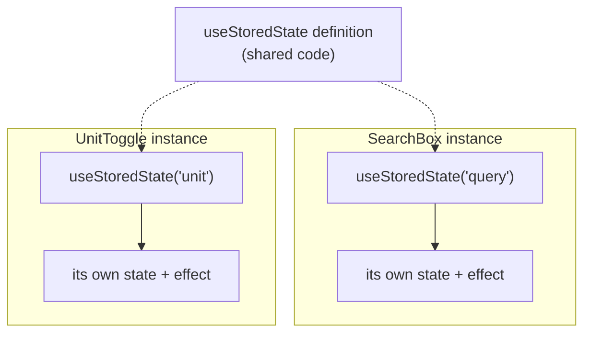

# Custom hooks and useRef

> **Before this lesson:** you need [State with useState](#/lesson/react/usestate) and [useEffect and its dependency rules](#/lesson/react/useeffect), including cleanup functions and the Rules of Hooks.

## In plain words

Two everyday pictures for two tools.

**Custom hooks.** A cook who makes the same sauce for five dishes writes the sauce recipe once on its own card and refers to it from each dish. A **custom hook** is that card: a function of your own, whose name starts with `use`, that bundles a piece of stateful logic (state plus effects) so that several components can use it without copying the code.

**Refs.** Next to the stove hangs a sticky note with the oven timer's ticket number. Nobody looks at it while plating; changing it does not change any dish. It is there so that the cook can find the timer later and cancel it. A **ref** is that sticky note: a small box, owned by one component instance, that holds a value across renders, and changing it does *not* cause a re-render. Its most common use is holding a handle to a real DOM element so that you can focus it, scroll to it or measure it.

Custom hooks are how real React codebases stay readable, and "state or ref?" is a standard interview question.

## Part 1: custom hooks

### The duplication problem

Two components both want to remember something in the browser's `localStorage` (a small key–value store that the browser keeps for each website, surviving page reloads).

```jsx
function SearchBox() {
  const [query, setQuery] = useState(() => localStorage.getItem("query") ?? "");
  useEffect(() => {
    localStorage.setItem("query", query);
  }, [query]);
  // ...
}

function UnitToggle() {
  const [unit, setUnit] = useState(() => localStorage.getItem("unit") ?? "km");
  useEffect(() => {
    localStorage.setItem("unit", unit);
  }, [unit]);
  // ...
}
```

In each component:

- `useState(() => ...)` uses a lazy initialiser to read the saved value once, on the first render. `??` supplies a fallback when nothing is stored (`getItem` returns `null`).
- The effect writes the value back whenever it changes. Storage is outside React, so an effect is the right tool.

The two blocks are the same apart from the key and the fallback. Copying them a third time is how inconsistencies begin.

### Extracting a hook

Move the shared lines into a function. Because it calls Hooks, its name must start with `use`:

```jsx
import { useEffect, useState } from "react";

function useStoredState(key, initialValue) {
  const [value, setValue] = useState(() => localStorage.getItem(key) ?? initialValue);

  useEffect(() => {
    localStorage.setItem(key, value);
  }, [key, value]);

  return [value, setValue];
}
```

- The parameters `key` and `initialValue` are the parts that differed.
- Inside, it is ordinary Hook code. The effect now reads `key` as well as `value`, so both are dependencies.
- `return [value, setValue];` returns the same pair shape as `useState`, so it feels familiar to callers. A hook may return anything: a single value, an array, an object, or nothing.

Using it:

```jsx
function SearchBox() {
  const [query, setQuery] = useStoredState("query", "");
  return <input value={query} onChange={(e) => setQuery(e.target.value)} />;
}

function UnitToggle() {
  const [unit, setUnit] = useStoredState("unit", "km");
  return <button onClick={() => setUnit(unit === "km" ? "mi" : "km")}>{unit}</button>;
}
```

Each component is now one line of logic, and it reads as *what* it wants ("a stored state"), not *how* storage works.

### Three facts about custom hooks

**1. They share logic, not state.** Every call to a hook gets its own independent state. `SearchBox` and `UnitToggle` do not share a value; if two components both call `useStoredState("query", "")`, each has its own `useState` inside (they would both write to the same storage key, but neither is told when the other changes). To share *state* you lift it up or use context.

**2. They are ordinary functions that follow the Rules of Hooks.** Call them at the top level of a component or of another hook, never conditionally. The `use` prefix is what lets the linter check this, and what tells a reader "this function may hold state and effects".

**3. They re-run on every render** with the component, and receive the latest props and state as arguments. That is how a hook reacts to changes: pass it the new value.



### More hooks worth knowing how to write

A hook that subscribes to a browser event, with cleanup:

```jsx
function useOnlineStatus() {
  const [isOnline, setIsOnline] = useState(navigator.onLine);

  useEffect(() => {
    const goOnline = () => setIsOnline(true);
    const goOffline = () => setIsOnline(false);
    window.addEventListener("online", goOnline);
    window.addEventListener("offline", goOffline);
    return () => {
      window.removeEventListener("online", goOnline);
      window.removeEventListener("offline", goOffline);
    };
  }, []);

  return isOnline;
}
```

- `navigator.onLine` is the browser's current guess at connectivity; it seeds the state.
- The effect registers two listeners and returns a cleanup that removes exactly those two.
- The empty array is honest: the effect reads no props or state.
- A component writes `const isOnline = useOnlineStatus();` and can show a banner when it is false.

A hook that delays a fast-changing value (**debouncing**: waiting until changes stop for a while before acting):

```jsx
function useDebouncedValue(value, delayMs) {
  const [debounced, setDebounced] = useState(value);

  useEffect(() => {
    const id = setTimeout(() => setDebounced(value), delayMs);
    return () => clearTimeout(id);
  }, [value, delayMs]);

  return debounced;
}
```

Each time `value` changes, the cleanup cancels the previous timer and a new one starts. Only when `value` stays the same for `delayMs` does `debounced` catch up. [Interview builds](#/lesson/react/interview-builds) uses this for a search box.

When should you extract a hook? When the same Hook calls appear in two places, or when a component's logic becomes hard to follow and a well-named hook would make it read like a sentence. Do not wrap a single `useState` in a hook for its own sake.

## Part 2: useRef

### A box that survives renders

```jsx
import { useRef } from "react";

const box = useRef(0);
```

`useRef(initial)` returns an object `{ current: initial }`. React gives you the **same object** on every render. You may read and write `box.current` freely, and writing to it does not schedule a render.

| | State (`useState`) | Ref (`useRef`) |
|---|---|---|
| Survives re-renders | yes | yes |
| Changing it re-renders | yes | no |
| How to change | setter function | assign `ref.current = x` |
| Value during one render | fixed snapshot | mutable, always the latest |
| Use it for | anything shown on screen | things the screen does not depend on |

The rule: **if the value is used to compute the JSX, it is state. If it is only needed by event handlers or effects, a ref will do.**

### Use 1: remembering something that is not displayed

A stopwatch needs the interval's id so that a different handler can stop it. The id never appears on screen.

```jsx
function Stopwatch() {
  const [seconds, setSeconds] = useState(0);
  const intervalRef = useRef(null);

  function start() {
    if (intervalRef.current !== null) return;
    intervalRef.current = setInterval(() => setSeconds((s) => s + 1), 1000);
  }

  function stop() {
    clearInterval(intervalRef.current);
    intervalRef.current = null;
  }

  return (
    <>
      <p>{seconds}s</p>
      <button onClick={start}>Start</button>
      <button onClick={stop}>Stop</button>
    </>
  );
}
```

- `seconds` is shown, so it is state.
- `intervalRef.current` stores the id returned by `setInterval`. `start` writes it; `stop`, which runs in a later render, reads the same box.
- The guard in `start` prevents a second interval if Start is clicked twice.

A plain `let intervalId` in the component body would be reset on every render, and a module-level variable would be shared by every stopwatch on the page. A ref is per instance and persistent.

### Use 2: reaching a DOM element

Sometimes you must call a method on a real element: focus an input, scroll a row into view, play a video, measure a size. Pass a ref to the element's `ref` attribute and React puts the DOM node into `ref.current` once the element is on the page.

```jsx
function AddHikeForm({ onAdd }) {
  const [name, setName] = useState("");
  const inputRef = useRef(null);

  function handleSubmit(event) {
    event.preventDefault();
    onAdd(name);
    setName("");
    inputRef.current.focus();
  }

  return (
    <form onSubmit={handleSubmit}>
      <input ref={inputRef} value={name} onChange={(e) => setName(e.target.value)} />
      <button type="submit">Add</button>
    </form>
  );
}
```

- `useRef(null)` starts empty, because during the first render the `<input>` does not exist yet.
- `ref={inputRef}` asks React to store the element in the box after it creates it, and to set it back to `null` when the element is removed.
- `inputRef.current.focus()` calls the browser's own method, putting the cursor back in the field after a submission.

This is called **imperative** code: a direct command to the DOM instead of a description. Keep it for things JSX cannot express (focus, scrolling, text selection, media playback, measuring). Do not use refs to change what the element displays (`ref.current.textContent = ...`): React does not know about such edits and may overwrite them.

To focus on mount, use an effect, because the node exists only after the commit:

```jsx
useEffect(() => {
  inputRef.current.focus();
}, []);
```

In React 19 a function component receives `ref` as a normal prop, so your own `<TextField ref={inputRef} />` can pass it straight to its inner `<input ref={ref} />`. In React 18 and earlier the same thing required wrapping the component in `forwardRef`; you will still see that in existing code.

### Use 3: the latest value for a long-lived callback

A subscription set up once can read fresh data through a ref without being torn down and rebuilt:

```jsx
function useInterval(callback, delayMs) {
  const latest = useRef(callback);

  useEffect(() => {
    latest.current = callback;
  });

  useEffect(() => {
    const id = setInterval(() => latest.current(), delayMs);
    return () => clearInterval(id);
  }, [delayMs]);
}
```

- The first effect runs after every render and stores the newest `callback` in the box.
- The second sets up the interval once per `delayMs`. Each tick calls whatever function is in the box at that moment, so it always sees current props and state.

This combines both halves of the lesson: a custom hook that uses a ref.

> [!WARNING]
> **Do not read or write `ref.current` during rendering** (in the component body, outside handlers and effects). Rendering must be pure, and a ref is mutable shared memory: output that depends on it becomes unpredictable, and React may render more than once. The one accepted exception is lazy initialisation: `if (ref.current === null) ref.current = createThing();`.

## Run it: a hook and a ref working together

The simulation models a component instance with hook slots, then shows the difference between a ref and state, and that two components using the same custom hook do not share state.

```js-run
// A minimal hooks runtime for ONE component instance.
function createInstance(component) {
  const slots = []; let cursor = 0; let renders = 0; let dirty = false;
  const api = {
    useState(initial) {
      const i = cursor++;
      if (!(i in slots)) slots[i] = initial;
      return [slots[i], (next) => { slots[i] = typeof next === "function" ? next(slots[i]) : next; dirty = true; }];
    },
    useRef(initial) {
      const i = cursor++;
      if (!(i in slots)) slots[i] = { current: initial };   // the SAME object every render
      return slots[i];
    },
  };
  let output;
  const render = () => { cursor = 0; dirty = false; renders++; output = component(api); };
  render();
  return { get output() { return output; }, get renders() { return renders; }, flush() { if (dirty) render(); } };
}

// A custom hook: it calls other hooks, so each caller gets its own slots.
function useCounter(api, step) {
  const [count, setCount] = api.useState(0);
  return [count, () => setCount((c) => c + step)];
}

function Clicker(api) {
  const [count, increment] = useCounter(api, 1);     // shown on screen: state
  const clicksRef = api.useRef(0);                   // not shown: ref
  return {
    text: `count is ${count}`,
    clickVisible() { increment(); },
    clickSilent() { clicksRef.current += 1; return clicksRef.current; },
  };
}

const a = createInstance(Clicker);
const b = createInstance(Clicker);

a.output.clickVisible(); a.flush();
a.output.clickVisible(); a.flush();
console.log("A:", a.output.text, "| renders:", a.renders);
console.log("B:", b.output.text, "| renders:", b.renders, "(same hook, separate state)");

console.log("silent clicks on A:", a.output.clickSilent(), a.output.clickSilent(), a.output.clickSilent());
a.flush();
console.log("A after 3 ref writes | renders:", a.renders, "(unchanged: refs do not re-render)");
```

Read the output: A rendered three times (the first render plus two state changes) and B once; B's count is untouched because each instance has its own slots. Three writes to the ref changed the stored number to 3 and caused no render at all.

And the DOM use of refs, live. Here plain JavaScript variables stand in for `useRef`, since the point is what you do with the element.

```html-run
<form id="form">
  <input id="name" placeholder="Hike name" />
  <button>Add</button>
</form>
<ul id="list" style="max-height:90px;overflow:auto;border:1px solid #ccc;padding-left:24px"></ul>
<script>
  const inputRef = { current: document.getElementById("name") };   // what React fills in for ref={inputRef}
  const lastItemRef = { current: null };

  document.getElementById("form").addEventListener("submit", (event) => {
    event.preventDefault();
    const text = inputRef.current.value.trim();
    if (text === "") return;
    const li = document.createElement("li");
    li.textContent = text;
    document.getElementById("list").appendChild(li);
    lastItemRef.current = li;

    inputRef.current.value = "";
    inputRef.current.focus();                                   // imperative: focus
    lastItemRef.current.scrollIntoView({ block: "nearest" });   // imperative: scroll
  });
  inputRef.current.focus();
</script>
```

Add six or more hikes. After each one the cursor returns to the input and the list scrolls to the newest item: two behaviours that cannot be written as JSX and are the proper job of a ref.

## Pitfalls

- **Expecting a hook to share state between components.** It shares code. Each call is independent.
- **A function named `useSomething` that calls no Hooks,** or a function that calls Hooks but is not named `use...`. The first misleads readers; the second escapes the linter.
- **Calling a custom hook conditionally.** Same rule as any Hook.
- **Returning a new object from a hook on every render and using it as an effect dependency.** The effect re-runs every time. Return primitives or memoised values where callers are likely to depend on them.
- **Storing display data in a ref.** The screen will not update when it changes.
- **Reading `ref.current` during render,** for example `<p>{countRef.current}</p>`. Shows stale values.
- **Using `ref.current` before the element exists.** It is `null` during the first render; use it in handlers and effects.
- **Changing content through a ref** instead of through state.

> [!TIP]
> Name hooks after what they give the caller, not how they work: `useOnlineStatus`, `useStoredState`, `useWindowSize`. If you cannot name it clearly, the logic may not be one coherent thing yet.

> [!INTERVIEW]
> "`useRef` vs `useState`?" *Both persist across renders. Setting state triggers a re-render and the value is a snapshot per render; mutating a ref does not re-render and the value is always the latest. Use state for anything rendered, refs for DOM handles and for values needed only by handlers and effects, such as timer ids or the previous value.* "What is a custom hook?" *A function starting with `use` that composes other Hooks to reuse stateful logic; each call has isolated state.*

## Cheat sheet

| Need | Tool |
|---|---|
| Reuse state + effect logic | `function useThing(args) { ...hooks...; return value; }` |
| Persist a value in storage | `useStoredState(key, initial)` (above) |
| Delay a rapidly changing value | `useDebouncedValue(value, ms)` |
| Subscribe to a browser event | effect with `addEventListener` + cleanup, wrapped in a hook |
| Keep a value without re-rendering | `const r = useRef(initial); r.current = x;` |
| Timer id | `idRef.current = setInterval(...)` |
| DOM element | `const el = useRef(null); <input ref={el} />; el.current.focus()` |
| Focus on mount | `useEffect(() => { el.current.focus(); }, [])` |
| Pass a ref to your own component (React 19) | accept `ref` as a prop and forward it to the inner element |
| Latest callback in a long-lived effect | store it in a ref each render |

## Summary

- A custom hook is a `use…` function that combines Hooks; it removes duplication and names a behaviour.
- Hooks share logic, never state: each call has its own state and effects.
- `useRef` returns a persistent `{ current }` box; changing it does not render.
- Use state for what is displayed, refs for DOM handles and behind-the-scenes values.
- Touch `ref.current` in handlers and effects, not during render.
- Use DOM refs for focus, scroll, selection, media and measuring, and leave content to JSX.

## Glossary

- **Custom hook**: your own function, named `use…`, built from other Hooks.
- **Stateful logic**: behaviour that needs memory (state) and/or effects.
- **`localStorage`**: browser storage of string key–value pairs per site, kept across reloads.
- **Lazy initialiser**: a function passed to `useState` so the initial value is computed once.
- **Debounce**: postpone an action until input has paused for a set time.
- **Ref**: an object `{ current }` that persists across renders without causing them.
- **DOM ref**: a ref attached to an element with the `ref` attribute.
- **Imperative code**: direct commands ("focus this") as opposed to descriptions.
- **`forwardRef`**: the pre-React-19 helper for letting a component accept a `ref`.

## Check yourself

```quiz
[
  {"q": "Two components each call useStoredState('unit', 'km'). One calls setUnit('mi'). What happens to the other component's unit value?",
   "options": ["It becomes 'mi' at once, hooks share state", "Nothing: each call has its own state, so it keeps its value until it is re-created", "Both reset to 'km'", "React throws an error about duplicate keys"],
   "answer": 1,
   "explain": "Custom hooks share logic, not state. Each call owns a separate useState."},
  {"q": "Why must a custom hook's name start with use?",
   "options": ["JavaScript requires it", "So React and the linter can recognise it as a Hook and apply the Rules of Hooks, and readers know it may hold state", "It makes the function faster", "Only for hooks that return arrays"],
   "answer": 1,
   "explain": "The prefix is the convention tooling relies on to check call order and placement."},
  {"q": "const r = useRef(0); a click handler runs r.current = r.current + 1 three times. How many re-renders does that cause?",
   "options": ["3", "1", "0", "It depends on batching"],
   "answer": 2,
   "explain": "Mutating a ref never schedules a render."},
  {"q": "A component renders <p>{clicks.current}</p> where clicks is a ref incremented in a click handler, and nothing else changes state. After 5 clicks, what is on screen?",
   "options": ["5", "0", "1", "undefined"],
   "answer": 1,
   "explain": "No render happens, so the paragraph still shows the value from the first render. Displayed values must be state."},
  {"q": "What is in inputRef.current during the component's very first render, given const inputRef = useRef(null) and <input ref={inputRef} />?",
   "options": ["The input element", "null, because the element is attached after the render is committed", "undefined", "A string"],
   "answer": 1,
   "explain": "React assigns DOM refs during the commit. Use them in effects and handlers."},
  {"q": "Which is the best use of a DOM ref?",
   "options": ["Changing the text of a paragraph", "Hiding an element by setting style.display", "Focusing an input after a form is submitted", "Adding list items"],
   "answer": 2,
   "explain": "Focus is an imperative browser action with no JSX equivalent. Content and visibility belong to state and JSX."},
  {"q": "A stopwatch stores its setInterval id. Which storage is appropriate?",
   "options": ["useState, so the id is displayed", "A let variable in the component body", "useRef, because the id is needed by handlers but never rendered", "A global variable"],
   "answer": 2,
   "explain": "A body variable resets each render; a global is shared across instances; state would cause pointless renders."},
  {"q": "useDebouncedValue(text, 300): the user types 'a', 'ab', 'abc' 100 ms apart and then stops. How many times does the debounced value change?",
   "options": ["3", "1", "0", "2"],
   "answer": 1,
   "explain": "Each new value cancels the previous timer through the cleanup. Only the last timer completes, 300 ms after 'abc'."}
]
```

> **Source:** Wieruch, *The Road to React*, "Fundamentals of React": React Custom Hooks (Advanced), Imperative React. Documentation: https://react.dev/learn/reusing-logic-with-custom-hooks, https://react.dev/learn/referencing-values-with-refs, https://react.dev/learn/manipulating-the-dom-with-refs
