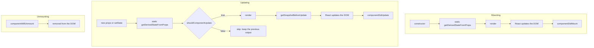

# Class components: reading and migrating legacy React

> **Before this lesson:** you need [State with useState](#/lesson/react/usestate), [useEffect and its dependency rules](#/lesson/react/useeffect) (dependencies and cleanup) and [Custom hooks and useRef](#/lesson/react/custom-hooks-refs). From JavaScript, it helps to have met classes and the keyword `this` in [Prototypes, classes and encapsulation](#/lesson/javascript/prototypes-classes); the essentials are repeated below.

## In plain words

Picture an old car with a manual gearbox and a thick owner's handbook. Everything works, and plenty of them are still on the road, but you drive it differently: you think about *when* to change gear ("on start-up", "after every change of speed", "before switching off") rather than describing where you want to go. A modern automatic does the same job with fewer levers.

A **class component** is that older car. It is a React component written with JavaScript's `class` syntax instead of as a plain function. It keeps its memory in one object called `this.state`, changes it with a method called `this.setState`, and reacts to the moments of its life through specially named methods such as `componentDidMount` ("I have appeared on the page") and `componentWillUnmount` ("I am about to disappear"). These are called **lifecycle methods**.

Function components with Hooks replaced classes for new code from 2019 onwards, but you still need to read classes for three reasons:

1. **Legacy code.** Many working applications were written before Hooks. Maintaining or migrating them is a common first task in a new job.
2. **Error boundaries.** Catching rendering errors still requires a class; there is no Hook for it.
3. **Interviews.** "Map these lifecycle methods to Hooks" and "why does `this` get lost in an event handler?" are classic questions.

This lesson teaches classes from zero, maps every piece to the Hook you already know, and finishes with a worked migration.

## A short history

React components have taken three shapes:

| Era | How a component was written | Status today |
|---|---|---|
| 2013 to about 2017 | `React.createClass({ ... })`, an object of methods | Removed from React; lives on only in an add-on package |
| 2015 to 2019 | `class Hike extends React.Component { ... }` | Still fully supported, not recommended for new code |
| 2019 onwards | `function Hike(props) { ... }` with Hooks | The standard way |

Before Hooks arrived (announced late in 2018, released in React 16.8 in early 2019), a function component could only take props and return JSX. People called them "stateless functional components". As soon as a component needed state or a side effect, you had to rewrite it as a class. Hooks gave functions the same powers, and because functions are shorter and let you package logic in custom hooks, the community moved to them. Classes were never removed: React 19 still runs them, and a single app can mix both kinds freely.

## JavaScript classes in five minutes

A **class** is a blueprint for creating objects that share the same methods. Here is everything a class component uses, in one example:

```javascript
class Animal {
  legs = 4;                          // a class field: set on every new object

  constructor(name) {                // runs once when you write new Animal(...)
    this.name = name;                // `this` is the new object being built
  }

  describe() {                       // a method, shared by every Animal
    return `${this.name} has ${this.legs} legs`;
  }

  static kingdom() {                 // a static method: called on the class itself
    return "Animalia";
  }
}

class Bird extends Animal {          // Bird inherits everything from Animal
  constructor(name) {
    super(name);                     // call Animal's constructor first
    this.legs = 2;
  }
}

const tweety = new Bird("Tweety");
tweety.describe();                   // "Tweety has 2 legs"
Animal.kingdom();                    // "Animalia"
```

- **`constructor`** is the setup function. `new Bird("Tweety")` creates an empty object, runs the constructor with `this` pointing at it, and hands it back. The object is called an **instance** of the class.
- **`this`** inside a method means "the object the method was called on". In `tweety.describe()`, `this` is `tweety`.
- **`extends`** makes one class inherit from another (**inheritance**: the child gets the parent's methods without copying them).
- **`super(...)`** calls the parent's constructor. In a child class you must call it before touching `this`, otherwise JavaScript throws an error.
- A **class field** (`legs = 4;`) is a property written directly in the class body. It is set on each new instance, right after `super()` returns.
- **`static`** puts a method on the class itself, not on instances. React uses two static methods, as you will see.

A class component is a class that extends `React.Component` (often imported as `Component`). By inheriting from it, your class receives `this.props`, `this.state`, `this.setState` and the machinery React needs.

## Your first class component

The same small component, twice:

```jsx
// Function component
function TrailBadge({ name, km }) {
  return <span className="badge">{name} ({km} km)</span>;
}

// Class component
import { Component } from "react";

class TrailBadge extends Component {
  render() {
    const { name, km } = this.props;
    return <span className="badge">{name} ({km} km)</span>;
  }
}
```

Line by line, the class version:

- `class TrailBadge extends Component` declares a component class. Component names start with a capital letter, as with functions.
- `render()` is the one **required** method. React calls it whenever it needs this component's UI, and it returns JSX, exactly like the body of a function component. It must be **pure**: no fetching, no timers, no changing state, only computing JSX from props and state.
- `this.props` holds the props the parent passed: `<TrailBadge name="Ridge Loop" km={7} />` gives `this.props.name === "Ridge Loop"`. Destructuring them at the top of `render` keeps the JSX readable.

The user of the component cannot tell the difference: `<TrailBadge name="Ridge Loop" km={7} />` works with either version. React creates **one instance per place** the component appears on screen, keeps that instance alive while the component stays on the page, and calls `render()` on it again for every update. That long-lived object is why a class can store things on `this` between renders.

Props are read-only in both styles. Never assign to `this.props.name`.

## State: `this.state` and `setState`

### Initial state

A class keeps all of its state in one object, `this.state`. You set the starting value either in the constructor or with a class field:

```jsx
// Style 1: constructor
class LikeButton extends Component {
  constructor(props) {
    super(props);                          // required before using `this`
    this.state = { likes: 0, liked: false };
  }
  render() { /* ... */ }
}

// Style 2: class field (shorter, same result)
class LikeButton extends Component {
  state = { likes: 0, liked: false };
  render() { /* ... */ }
}
```

In the constructor style, `super(props)` passes the props up to `Component` so that `this.props` is ready inside the constructor. The constructor is the **only** place where you assign `this.state` directly. Do not call `setState` there and do not start side effects (fetches, timers) there; those belong in `componentDidMount`.

Compare with Hooks: one `useState` call per piece of state (`const [likes, setLikes] = useState(0)`), versus one shared object in a class.

### Updating with `setState`

```jsx
class LikeButton extends Component {
  state = { likes: 0, liked: false };

  handleClick = () => {
    this.setState({ likes: this.state.likes + 1, liked: true });
  };

  render() {
    return (
      <button onClick={this.handleClick}>
        {this.state.liked ? "Liked" : "Like"} ({this.state.likes})
      </button>
    );
  }
}
```

`this.setState(partialObject)` asks React to change some state keys and re-render. Four rules govern it.

**1. It merges shallowly.** You pass only the keys you want to change; React copies them over the current state and keeps the rest. `this.setState({ liked: true })` leaves `likes` alone. This is different from a `useState` setter, which replaces the value entirely. The merge is **shallow**, meaning one level deep only: if `state.filter` is an object `{ region: "north", minKm: 5 }`, then `setState({ filter: { minKm: 8 } })` replaces the whole `filter` object and `region` is gone. To change one nested key, copy the old object yourself: `setState((s) => ({ filter: { ...s.filter, minKm: 8 } }))`.

**2. It is batched, so `this.state` does not change straight away.** Calling `setState` puts an update in a queue. React applies all queued updates from the same event together and renders once (**batching**: grouping several updates into one render). Inside the handler, `this.state` still holds the old values. Since React 18, this batching happens everywhere, including inside timers and promise callbacks; before React 18 it happened only inside React event handlers, so older code sometimes relies on `setState` taking effect immediately in a `setTimeout`.

**3. When the new value depends on the old one, pass a function.** Because of batching, this adds 1, not 3:

```jsx
this.setState({ likes: this.state.likes + 1 });
this.setState({ likes: this.state.likes + 1 });
this.setState({ likes: this.state.likes + 1 });   // all three read the same old value
```

The **functional updater** form receives the latest pending state and the props, and returns the partial update:

```jsx
this.setState((state, props) => ({ likes: state.likes + 1 }));   // safe to repeat
```

It is the same idea as `setCount((c) => c + 1)` with Hooks. `setState` also accepts a second argument, a callback that runs after the update has been applied and the screen updated: `this.setState({ liked: true }, () => console.log(this.state.liked))`. In new code, `componentDidUpdate` is usually the clearer place for that kind of follow-up.

**4. Never mutate `this.state`.** Writing `this.state.likes = 5` or `this.state.tags.push("steep")` changes the object without telling React, so nothing re-renders, and the next `setState` may overwrite your change. Worse, optimisations that compare old and new state (see `PureComponent` below) see the *same* object and conclude nothing changed. Always build new objects and arrays and hand them to `setState`.

One more difference from Hooks: a `useState` setter skips the render when you set the same value (it compares with `Object.is`). A class does not: `this.setState({ likes: this.state.likes })` re-renders anyway, unless `shouldComponentUpdate` stops it.

## Run it: `this`, batching and shallow merging

This script runs in plain JavaScript. Part 1 shows how a method loses `this` and two fixes. Part 2 builds a miniature `setState` with React's rules (queue, functional updaters, shallow merge, one render per event) and a miniature `PureComponent`.

```js-run
// ---------- Part 1: how `this` gets lost ----------
class PlainCounter {
  constructor() { this.count = 0; }
  increment() { this.count += 1; return this.count; }
}
const plain = new PlainCounter();
console.log("plain.increment():", plain.increment());
const handler = plain.increment;        // what onClick={this.increment} hands to React
try {
  handler();                            // called with nothing in front of the dot
} catch (error) {
  console.log("handler():", error.constructor.name, "-", error.message);
}

class BoundCounter {
  constructor() { this.count = 0; this.increment = this.increment.bind(this); }
  increment() { this.count += 1; return this.count; }
}
class FieldCounter {
  count = 0;
  increment = () => { this.count += 1; return this.count; };
}
const bound = new BoundCounter().increment;
const field = new FieldCounter().increment;
console.log("bind in constructor:", bound(), bound());
console.log("arrow class field:  ", field(), field());

// ---------- Part 2: a miniature setState ----------
class Component {
  constructor(props) { this.props = props; this.state = {}; this.queue = []; this.renders = 0; }
  setState(update, callback) { this.queue.push({ update, callback }); }   // queued, not applied
}
function shallowEqual(a, b) {
  const ka = Object.keys(a), kb = Object.keys(b);
  return ka.length === kb.length && ka.every((k) => Object.is(a[k], b[k]));
}
class PureComponent extends Component {
  shouldComponentUpdate(nextProps, nextState) {
    return !shallowEqual(this.props, nextProps) || !shallowEqual(this.state, nextState);
  }
}
// What React does when an event handler finishes: apply the whole batch, render once.
function endOfEvent(inst) {
  const prevState = inst.state;
  let next = prevState;
  for (const { update } of inst.queue) {
    const partial = typeof update === "function" ? update(next, inst.props) : update;
    next = { ...next, ...partial };                    // shallow merge, one level deep
  }
  const callbacks = inst.queue.map((q) => q.callback).filter(Boolean);
  inst.queue = [];
  const shouldRender = inst.shouldComponentUpdate ? inst.shouldComponentUpdate(inst.props, next) : true;
  inst.state = next;                                   // stored even when the render is skipped
  if (shouldRender) {
    inst.renders += 1;
    console.log("   render #" + inst.renders + ":", inst.render());
    if (inst.componentDidUpdate) inst.componentDidUpdate(inst.props, prevState);
  } else {
    console.log("   shouldComponentUpdate returned false: no render");
  }
  callbacks.forEach((cb) => cb());
}

class HikeCard extends Component {
  constructor(props) {
    super(props);
    this.state = { likes: 0, filter: { region: "north", minKm: 5 } };
  }
  componentDidUpdate(prevProps, prevState) {
    if (prevState.likes !== this.state.likes) console.log("   componentDidUpdate: likes", prevState.likes, "->", this.state.likes);
  }
  render() { return `${this.props.name}: ${this.state.likes} likes, filter ${JSON.stringify(this.state.filter)}`; }
}
const card = new HikeCard({ name: "Ridge Loop" });   // inside a handler, `this` would be card

console.log("\n1) three object updates that read this.state:");
card.setState({ likes: card.state.likes + 1 });
card.setState({ likes: card.state.likes + 1 });
card.setState({ likes: card.state.likes + 1 });
console.log("   this.state.likes inside the handler is still", card.state.likes);
endOfEvent(card);

console.log("\n2) three functional updaters:");
for (let i = 0; i < 3; i++) card.setState((state) => ({ likes: state.likes + 1 }));
endOfEvent(card);

console.log("\n3) shallow merge: other keys survive, nested objects are replaced:");
card.setState((state) => ({ filter: { ...state.filter, minKm: 8 } }));
endOfEvent(card);
card.setState({ filter: { minKm: 12 } }, () => console.log("   callback after update: region is", card.state.filter.region));
endOfEvent(card);

console.log("\n4) setting the same value still renders a plain class:");
card.setState({ likes: card.state.likes });
endOfEvent(card);

console.log("\n5) mutation versus PureComponent:");
class TagList extends PureComponent {
  constructor(props) { super(props); this.state = { tags: ["shady"] }; }
  render() { return "tags: " + this.state.tags.join(", "); }
}
const tags = new TagList({});
tags.state.tags.push("steep");                       // mutation: still the same array
tags.setState({ tags: tags.state.tags });
endOfEvent(tags);
tags.setState((state) => ({ tags: [...state.tags, "muddy"] }));   // a new array
endOfEvent(tags);
```

What to notice in the output:

- **Part 1.** Calling `handler()` throws a `TypeError` because `this` is `undefined`. Both fixes keep `this` attached, so the counts go 1, 2.
- **Step 1.** `this.state.likes` is still 0 inside the handler, and three object updates produce 1, with a single render.
- **Step 2.** Functional updaters chain on the pending value and reach 4.
- **Step 3.** The first update kept `region` because it copied the old filter; the second dropped it, and the callback confirms `region` is `undefined`.
- **Step 4.** A plain class renders even though nothing changed.
- **Step 5.** After the mutation, the shallow comparison sees the same array and skips the render, so "steep" is invisible. Only the update with a new array renders, and then both tags appear at once.

## Event handlers and the lost `this`

### Why it happens

In JavaScript, `this` is decided by **how a function is called**, not where it was written. `card.like()` sets `this` to `card`. But when you write `onClick={this.handleClick}`, you hand React the function alone, detached from the object. Later React calls it as a plain function, `handleClick(event)`, with nothing in front of the dot. Class bodies always run in **strict mode** (a stricter set of JavaScript rules), where a plain call leaves `this` as `undefined`. The first `this.setState(...)` inside then crashes with "Cannot read properties of undefined".

This bites almost every newcomer to classes, and it is a favourite interview question.

### Three fixes

```jsx
class Trail extends Component {
  constructor(props) {
    super(props);
    this.state = { open: false };
    this.toggle = this.toggle.bind(this);          // Fix 1: bind once in the constructor
  }
  toggle() {
    this.setState((s) => ({ open: !s.open }));
  }

  close = () => {                                  // Fix 2: arrow function in a class field
    this.setState({ open: false });
  };

  render() {
    return (
      <>
        <button onClick={this.toggle}>Toggle</button>
        <button onClick={this.close}>Close</button>
        <button onClick={() => this.toggle()}>Toggle again</button>  {/* Fix 3 */}
      </>
    );
  }
}
```

| Fix | How it works | Trade-off |
|---|---|---|
| `this.x = this.x.bind(this)` in the constructor | `bind` creates a new function with `this` locked to the instance; it replaces the method on that instance | Verbose: one line per handler, easy to forget |
| `x = () => { ... }` class field | Arrow functions have no `this` of their own; they use the `this` of the place they were written, which for a class field is the instance | The common modern choice; the function lives on each instance instead of being shared |
| `onClick={() => this.x()}` in `render` | The arrow calls `this.x()` with the object in front of the dot | Creates a new function every render, which can defeat `PureComponent` children that compare props |

Function components have no `this`, so this whole category of bug disappears when you migrate.

## The lifecycle

A component's life has three phases: **mounting** (created and inserted into the page), **updating** (re-rendered because props or state changed) and **unmounting** (removed from the page). React calls specific methods at specific points:



The methods before "React updates the DOM" run in the **render phase**, where React is only computing; they must be pure, because React may call them more than once. The methods after it run in the **commit phase**, once the real page has changed; side effects belong there.

### Mounting

- **`constructor(props)`**: set initial state, bind handlers, create refs with `React.createRef()`. Nothing else.
- **`render()`**: return JSX.
- **`componentDidMount()`**: the component is now on the page. Start fetches, timers and subscriptions here, or measure and focus DOM nodes. Its Hook equivalent is an effect with an empty dependency array.

### Updating

- **`componentDidUpdate(prevProps, prevState, snapshot)`**: runs after every re-render (not after the first). It receives the *previous* props and state, so you can compare and act only on a real change:

```jsx
componentDidUpdate(prevProps) {
  if (prevProps.trailId !== this.props.trailId) {
    this.loadTrail(this.props.trailId);
  }
}
```

That `if` is essential. Without it, a `setState` inside `componentDidUpdate` triggers another update, which calls `componentDidUpdate` again: an infinite loop. The comparison is exactly the job a Hook's **dependency array** does for you automatically.

### Unmounting

- **`componentWillUnmount()`**: runs immediately before removal. Undo whatever `componentDidMount` started: clear timers, remove event listeners, cancel subscriptions. Its Hook equivalent is the cleanup function an effect returns.

### `shouldComponentUpdate` and `PureComponent`

`shouldComponentUpdate(nextProps, nextState)` runs before a re-render. Return `false` and React skips `render` and keeps the previous output for this component and everything inside it. It is purely a performance tool:

```jsx
shouldComponentUpdate(nextProps, nextState) {
  return nextProps.km !== this.props.km || nextState.open !== this.state.open;
}
```

Hand-written versions are fragile: add a prop later, forget to compare it, and the component silently stops updating. So React offers **`PureComponent`**, a base class whose built-in `shouldComponentUpdate` does a **shallow comparison** of every prop and every state key (each compared with `Object.is`, one level deep). `class TrailRow extends PureComponent` is the class-world equivalent of wrapping a function component in `memo` ([memo, useMemo and useCallback](#/lesson/react/memoization)). It is also why mutation is so harmful in classes, as step 5 of the demo showed. Note that `forceUpdate()`, an escape hatch that re-renders without a state change, skips `shouldComponentUpdate` entirely.

### `getDerivedStateFromProps` (rare)

`static getDerivedStateFromProps(props, state)` runs before **every** render, on mount and on every update. It returns an object to merge into state, or `null` for no change. Being `static`, it has no access to `this`; it can only look at its arguments. It exists for the uncommon case where state must follow a prop, such as clearing a draft when a different trail is selected:

```jsx
class TrailNotes extends Component {
  state = { prevTrailId: this.props.trailId, draft: "" };

  static getDerivedStateFromProps(props, state) {
    if (props.trailId !== state.prevTrailId) {
      return { prevTrailId: props.trailId, draft: "" };   // a new trail: reset
    }
    return null;
  }
  // ...
}
```

You must store the previous prop in state yourself, because the method receives no `prevProps`. Most uses are better solved another way: compute the value during render, or give the component a `key` so React creates a fresh instance (`<TrailNotes key={trailId} trailId={trailId} />`). The same advice applies with Hooks.

### `getSnapshotBeforeUpdate` (rarer)

`getSnapshotBeforeUpdate(prevProps, prevState)` runs after `render` but immediately before React changes the DOM, so it can read the page **as it was** (for example a scroll position). Whatever it returns arrives as the third argument of `componentDidUpdate`. The classic use is keeping a list visually still when older entries are added at the top:

```jsx
class TrailLog extends Component {
  listRef = React.createRef();

  getSnapshotBeforeUpdate(prevProps) {
    if (prevProps.entries.length < this.props.entries.length) {
      const list = this.listRef.current;
      return list.scrollHeight - list.scrollTop;   // distance from the bottom, before
    }
    return null;
  }

  componentDidUpdate(prevProps, prevState, distanceFromBottom) {
    if (distanceFromBottom !== null) {
      const list = this.listRef.current;
      list.scrollTop = list.scrollHeight - distanceFromBottom;   // restore it, after
    }
  }

  render() {
    return <ul ref={this.listRef}>{/* entries */}</ul>;
  }
}
```

There is no Hook equivalent yet; the React documentation calls the use case very uncommon. `useLayoutEffect` (an effect that runs after the DOM changes but before the browser paints) covers most related needs.

### Old names you may meet

Very old code uses `componentWillMount`, `componentWillReceiveProps` and `componentWillUpdate`. They were renamed with an `UNSAFE_` prefix (for example `UNSAFE_componentWillReceiveProps`) because they ran in the render phase yet invited side effects, which broke under React's newer rendering. When migrating, replace them: `componentWillReceiveProps` logic usually becomes `componentDidUpdate` with a `prevProps` check, or `getDerivedStateFromProps`.

> [!NOTE]
> In development, React's **Strict Mode** deliberately calls the constructor, `render`, `shouldComponentUpdate` and `getDerivedStateFromProps` twice, and mounts each component, unmounts it and mounts it again (`componentDidMount`, `componentWillUnmount`, `componentDidMount`). It is the class version of the double effect run you met with `useEffect`, and it exposes the same bug: a `componentWillUnmount` that does not fully undo `componentDidMount`.

## Run it: a live lifecycle

Below, a tiny stand-in for React runs real class components in the page. The log shows each lifecycle call. Try: watch the stopwatch tick, press "Change label prop" (an update with new props), unmount and remount the stopwatch (the timer is cleared and restarted), and push the buggy counter to 3 to see an error boundary catch the crash while the rest of the page keeps working.

```html-run
<div id="root"></div>
<pre id="log" style="height:150px;overflow:auto;background:#f4f4f4;padding:6px;font-size:12px"></pre>
<style>button { margin: 4px; padding: 6px 10px; } p { font-family: sans-serif; } .oops { color: #b00020; }</style>
<script>
  // ---------- tiny stand-in for React, class edition ----------
  let pending = [], scheduled = false, seen = [], toMount = [], toUpdate = [];
  const instances = new Map();
  const logEl = document.getElementById("log");
  function log(msg) { logEl.textContent += msg + "\n"; logEl.scrollTop = logEl.scrollHeight; }

  class Component {
    constructor(props) { this.props = props; this.state = {}; }
    setState(update) {                                         // queue, then one batched render
      pending.push([this, update]);
      if (!scheduled) { scheduled = true; queueMicrotask(flush); }
    }
  }
  function h(type, props, ...children) { return { type, props: { ...(props || {}), children: children.flat() } }; }

  function flush() {
    scheduled = false;
    const batch = pending; pending = [];
    for (const [inst, update] of batch) {
      const base = inst._next || inst.state;
      const partial = typeof update === "function" ? update(base, inst.props) : update;
      inst._next = { ...base, ...partial };                    // shallow merge
    }
    render();
  }

  function toDom(node, path) {
    if (node === null || node === undefined || typeof node === "boolean") return document.createTextNode("");
    if (typeof node !== "object") return document.createTextNode(String(node));
    const { type, props } = node;
    if (typeof type === "function" && type.prototype instanceof Component) return classToDom(type, props, path + "/" + type.name);
    if (typeof type === "function") return toDom(type(props), path + "/" + type.name);
    const el = document.createElement(type);
    for (const [name, value] of Object.entries(props)) {
      if (name === "children") continue;
      if (name.startsWith("on")) el.addEventListener(name.slice(2).toLowerCase(), value);
      else if (name === "className") el.className = value;
      else el.setAttribute(name, value);
    }
    props.children.forEach((child, i) => el.appendChild(toDom(child, path + "/" + type + i)));
    return el;
  }

  function classToDom(Type, props, key) {
    let inst = instances.get(key);
    const isNew = !inst;
    if (isNew) { inst = new Type(props); instances.set(key, inst); }
    const prevProps = inst.props, prevState = inst.state;
    inst.props = props;
    inst.state = inst._next || inst.state;
    inst._next = null;
    seen.push(key);
    const mark = [seen.length, toMount.length, toUpdate.length];
    const tree = inst.render();
    let dom;
    try {
      dom = toDom(tree, key);
    } catch (error) {                                          // a child threw while rendering
      if (!Type.getDerivedStateFromError) throw error;         // not a boundary: pass it upwards
      seen.length = mark[0]; toMount.length = mark[1]; toUpdate.length = mark[2];
      inst.state = { ...inst.state, ...Type.getDerivedStateFromError(error) };
      if (inst.componentDidCatch) inst.componentDidCatch(error, { componentStack: "below " + Type.name });
      dom = toDom(inst.render(), key);
    }
    if (isNew) toMount.push(inst); else toUpdate.push([inst, prevProps, prevState]);
    return dom;
  }

  function render() {
    seen = []; toMount = []; toUpdate = [];
    const dom = toDom(h(App, null), "");
    document.getElementById("root").replaceChildren(dom);     // the commit
    for (const [key, inst] of instances) {
      if (!seen.includes(key)) {
        if (inst._mounted && inst.componentWillUnmount) inst.componentWillUnmount();
        instances.delete(key);
      }
    }
    toMount.forEach((inst) => { inst._mounted = true; if (inst.componentDidMount) inst.componentDidMount(); });
    toUpdate.forEach(([inst, pp, ps]) => { if (inst.componentDidUpdate) inst.componentDidUpdate(pp, ps); });
  }

  // ---------- your class components ----------
  class Stopwatch extends Component {
    constructor(props) {
      super(props);
      this.state = { seconds: 0 };
      log(`Stopwatch "${props.label}": constructor`);
    }
    componentDidMount() {
      log(`Stopwatch "${this.props.label}": componentDidMount, timer started`);
      this.timerId = setInterval(() => this.setState((s) => ({ seconds: s.seconds + 1 })), 1000);
    }
    componentDidUpdate(prevProps) {
      if (prevProps.label !== this.props.label) {
        log(`Stopwatch: componentDidUpdate, label "${prevProps.label}" -> "${this.props.label}"`);
      }
    }
    componentWillUnmount() {
      clearInterval(this.timerId);
      log(`Stopwatch "${this.props.label}": componentWillUnmount, timer cleared`);
    }
    render() { return h("p", null, `${this.props.label}: ${this.state.seconds}s`); }
  }

  class BuggyCounter extends Component {
    state = { count: 0 };
    increment = () => this.setState((s) => ({ count: s.count + 1 }));   // arrow field keeps `this`
    componentDidMount() { log("BuggyCounter: componentDidMount"); }
    componentWillUnmount() { log("BuggyCounter: componentWillUnmount"); }
    render() {
      if (this.state.count === 3) throw new Error("count reached 3");
      return h("p", null, "Buggy count: ", this.state.count, " ", h("button", { onClick: this.increment }, "+1 (crashes at 3)"));
    }
  }

  class ErrorBoundary extends Component {
    state = { error: null };
    static getDerivedStateFromError(error) { return { error }; }
    componentDidCatch(error) { log(`ErrorBoundary: componentDidCatch "${error.message}"`); }
    reset = () => this.setState({ error: null });
    render() {
      if (this.state.error) return h("p", { className: "oops" }, "This part crashed. ", h("button", { onClick: this.reset }, "Try again"));
      return h("div", null, this.props.children);
    }
  }

  class App extends Component {
    constructor(props) {
      super(props);
      this.state = { showWatch: true, label: "Ridge Loop" };
      this.toggleWatch = this.toggleWatch.bind(this);         // bind in the constructor
    }
    toggleWatch() { this.setState((s) => ({ showWatch: !s.showWatch })); }
    rename = () => this.setState((s) => ({ label: s.label === "Ridge Loop" ? "Fern Gully" : "Ridge Loop" }));
    render() {
      return h("div", null,
        h("button", { onClick: this.toggleWatch }, this.state.showWatch ? "Unmount stopwatch" : "Mount stopwatch"),
        h("button", { onClick: this.rename }, "Change label prop"),
        this.state.showWatch ? h(Stopwatch, { label: this.state.label }) : null,
        h(ErrorBoundary, null, h(BuggyCounter, null)));
    }
  }
  render();
</script>
```

Things to check in the log: `componentDidMount` appears once per mount, not once per tick. Changing the label logs `componentDidUpdate` with the old and new value, because the method compares `prevProps`. Unmounting logs the cleanup, and the ticking stops (no more renders from a dead timer). When the buggy counter reaches 3, the boundary logs `componentDidCatch`, the buggy counter is unmounted, and the stopwatch carries on. "Try again" mounts a brand-new counter starting from 0.

## Mapping classes to Hooks

| Class | Hook world |
|---|---|
| `this.state = { a, b }` and `this.setState({ a })` | `const [a, setA] = useState(...)` per value, or `useReducer` for related values |
| `this.setState((s, p) => ...)` | `setA((a) => ...)` |
| `componentDidMount` | `useEffect(() => { ... }, [])` |
| `componentDidUpdate` comparing `prevProps.x` | `useEffect(() => { ... }, [x])` |
| `componentWillUnmount` | the cleanup function returned from `useEffect` |
| Mount + update + unmount of one subscription | **one** `useEffect` with dependencies and cleanup |
| `shouldComponentUpdate` / `PureComponent` | `memo(Component)`; `useMemo` / `useCallback` for values passed down |
| Instance fields such as `this.timerId` | `useRef` |
| `React.createRef()` in the constructor | `useRef(null)` |
| `static getDerivedStateFromProps` | compute during render, use a `key`, or store the previous prop in state |
| `getSnapshotBeforeUpdate` | no equivalent yet (rarely needed) |
| `componentDidCatch` / `getDerivedStateFromError` | no equivalent: keep a class boundary |
| `static contextType` / `<Context.Consumer>` | `useContext(Context)` |
| `static defaultProps` | default values in the parameter: `function Trail({ km = 5 })` |
| Methods bound to `this` | plain functions declared inside the component |

### From moments to synchronisation

The biggest change is a change of mindset. A class splits one concern across three methods by **time**:

```jsx
class TrailChat extends Component {
  componentDidMount() {
    this.connection = connect(this.props.trailId);
  }
  componentDidUpdate(prevProps) {
    if (prevProps.trailId !== this.props.trailId) {   // forget this and you stay on the old trail
      this.connection.disconnect();
      this.connection = connect(this.props.trailId);
    }
  }
  componentWillUnmount() {
    this.connection.disconnect();
  }
  render() { /* ... */ }
}
```

The Hook version groups it by **concern**: "stay connected to the current trail".

```jsx
function TrailChat({ trailId }) {
  useEffect(() => {
    const connection = connect(trailId);
    return () => connection.disconnect();
  }, [trailId]);
  // ...
}
```

One effect replaces three methods. React connects on mount, disconnects and reconnects whenever `trailId` changes, and disconnects on unmount. The most common class bug, forgetting the `componentDidUpdate` branch so the component keeps showing the first trail forever, cannot be written this way, and the linter checks that `trailId` is listed. Do not translate `useEffect(..., [])` to "this is componentDidMount" in your head; think "this effect depends on nothing, so it never needs to re-synchronise".

### `this.props` is always the latest

A subtle behaviour difference. React updates `this.props` on the same instance whenever the parent re-renders, so a delayed callback in a class reads whatever the props are **at the moment it runs**:

```jsx
class FollowButton extends Component {
  handleClick = () => {
    setTimeout(() => alert("Now following " + this.props.hiker), 3000);
  };
  render() { return <button onClick={this.handleClick}>Follow</button>; }
}
```

Click "Follow" while viewing Ana, switch to Ben within three seconds, and the alert says Ben. The function version closes over the props **of the render in which the click happened**, so it says Ana, which is what the user meant:

```jsx
function FollowButton({ hiker }) {
  const handleClick = () => {
    setTimeout(() => alert("Now following " + hiker), 3000);
  };
  return <button onClick={handleClick}>Follow</button>;
}
```

Neither is "wrong" in every situation: when a function component genuinely needs the latest value inside a long-lived callback, it reaches for a ref, as in the `useInterval` hook from [Custom hooks and useRef](#/lesson/react/custom-hooks-refs). Interviewers like this example because it shows you understand closures and snapshots.

## Error boundaries: the one job that still needs a class

When a component throws while rendering, React cannot know what the screen should show, so without help it removes the whole app. An **error boundary** is a component that catches such errors in the components below it and shows a **fallback** (replacement UI) instead. It relies on two class-only methods:

- **`static getDerivedStateFromError(error)`** runs in the render phase when a descendant throws. It returns a state update (usually "remember the error") so the next render shows the fallback. It must be pure.
- **`componentDidCatch(error, info)`** runs in the commit phase. It is the place for side effects such as reporting to a logging service. `info.componentStack` describes which components were involved.

```jsx
class SectionBoundary extends Component {
  state = { error: null };

  static getDerivedStateFromError(error) {
    return { error };
  }

  componentDidCatch(error, info) {
    reportError(error, info.componentStack);   // your logging service
  }

  reset = () => this.setState({ error: null });

  render() {
    if (this.state.error) {
      return (
        <div role="alert">
          <p>{this.props.label} could not be shown.</p>
          <button onClick={this.reset}>Try again</button>
        </div>
      );
    }
    return this.props.children;
  }
}

// Usage: a crash in the map does not take down the trail list
<SectionBoundary label="The map"><TrailMap /></SectionBoundary>
<SectionBoundary label="The trail list"><TrailList /></SectionBoundary>
```

What a boundary does **not** catch: errors in event handlers (use an ordinary `try`/`catch` there), in asynchronous code such as `setTimeout` or promise callbacks, during server rendering, and errors thrown by the boundary itself (only those of its children). There is no Hook for either method, so even all-Hooks codebases keep one small class, or install the `react-error-boundary` package, whose `<ErrorBoundary>` component is that class written for you. [Suspense, error boundaries and server components](#/lesson/react/suspense-boundaries-rsc) shows how boundaries combine with Suspense.

## Reading and migrating a legacy class component

### How to read one

When you open an unfamiliar class component, read it in this order:

1. **`render`** first: what does it show, and which `this.props` and `this.state` keys does it use?
2. **The initial state** (constructor or `state = ...` field): the full list of things it remembers.
3. **`componentDidMount` / `componentDidUpdate` / `componentWillUnmount` together**: pair up each thing that is started, updated and stopped. Each pair is one future `useEffect`.
4. **Instance fields** (`this.timerId`, `this.inputRef`): values kept between renders without being displayed. Future refs.
5. **Handlers**: what each one changes with `setState`.

### A worked migration

```jsx
class TrailWeather extends Component {
  state = { weather: null, error: null };
  headingRef = React.createRef();

  componentDidMount() {
    this.headingRef.current.focus();
    this.load();
    window.addEventListener("online", this.load);
  }

  componentDidUpdate(prevProps) {
    if (prevProps.trailId !== this.props.trailId) this.load();
  }

  componentWillUnmount() {
    window.removeEventListener("online", this.load);
    this.unmounted = true;
  }

  load = () => {
    fetchWeather(this.props.trailId)
      .then((weather) => { if (!this.unmounted) this.setState({ weather, error: null }); })
      .catch((error) => { if (!this.unmounted) this.setState({ error }); });
  };

  render() {
    const { weather, error } = this.state;
    return (
      <section>
        <h2 tabIndex={-1} ref={this.headingRef}>Weather</h2>
        {error ? <p>Could not load the forecast.</p> : <p>{weather ? weather.summary : "Loading..."}</p>}
      </section>
    );
  }
}
```

Reading it with the checklist: two state keys; one DOM ref; three concerns spread across the lifecycle (focus the heading once; load the forecast for the current trail; reload when the browser comes back online). It also hides a bug: if `trailId` changes twice quickly, a slow response for the old trail can arrive last and overwrite the new one (a **race condition**, covered in [Fetching data: loading, errors and races](#/lesson/react/data-fetching)).

```jsx
function TrailWeather({ trailId }) {
  const [weather, setWeather] = useState(null);
  const [error, setError] = useState(null);
  const headingRef = useRef(null);

  useEffect(() => {
    headingRef.current.focus();                     // concern 1: once, on mount
  }, []);

  useEffect(() => {                                 // concerns 2 and 3: the current trail
    let ignore = false;
    function load() {
      fetchWeather(trailId)
        .then((data) => { if (!ignore) { setWeather(data); setError(null); } })
        .catch((err) => { if (!ignore) setError(err); });
    }
    load();
    window.addEventListener("online", load);
    return () => {
      ignore = true;
      window.removeEventListener("online", load);
    };
  }, [trailId]);

  return (
    <section>
      <h2 tabIndex={-1} ref={headingRef}>Weather</h2>
      {error ? <p>Could not load the forecast.</p> : <p>{weather ? weather.summary : "Loading..."}</p>}
    </section>
  );
}
```

What changed and why:

- Each state key became its own `useState`. The `{ weather, error: null }` merge became two setter calls, which React batches into one render.
- `createRef` became `useRef(null)`; the JSX is unchanged.
- `this.unmounted` disappeared. The per-effect `ignore` flag is set by the cleanup both on unmount **and** when `trailId` changes, so a stale response is ignored too. The migration fixed the race for free.
- `componentDidMount` + `componentDidUpdate` + `componentWillUnmount` for loading became one effect keyed on `trailId`.
- `this.load` no longer needs to be an arrow field; it is a plain function inside the effect, so `this` never appears.

### A safe migration routine

- Migrate **leaf components** (those with no children of their own) first; classes and functions can render each other, so you can go one file at a time.
- Make sure tests cover the behaviour before you start, and run them after. A migration should change no behaviour (apart from fixing bugs like the race above, which deserves its own note in the review).
- Translate `shouldComponentUpdate` with care. `memo(Component, arePropsEqual)` takes a comparison that returns `true` to **skip** rendering, the opposite of `shouldComponentUpdate`, which returns `true` to render. Often you can drop the optimisation entirely and measure first.
- Leave error boundaries as classes.

## Pitfalls

- **Passing an unbound method** (`onClick={this.handleClick}` where `handleClick` is a normal method). `this` is `undefined` when it runs. Bind it or make it an arrow field.
- **Reading `this.state` right after `setState`.** It has not changed yet. Use the functional updater, the `setState` callback or `componentDidUpdate`.
- **Expecting a deep merge.** `setState({ filter: { minKm: 8 } })` replaces the whole `filter` object.
- **Mutating state**, then calling `setState` with the same object. `PureComponent` children never update.
- **`setState` in `componentDidUpdate` without a comparison**: an infinite render loop.
- **Starting subscriptions in the constructor** or forgetting to undo them in `componentWillUnmount`: leaks, warnings and duplicated work under Strict Mode.
- **Handling `componentDidMount` but not the prop change in `componentDidUpdate`**: the component stays stuck on its first props.
- **Copying props into state** in the constructor (`this.state = { km: props.km }`) and expecting it to follow later prop changes. The constructor runs once. Read the prop directly, or use a `key` to reset.
- **Assuming an error boundary catches everything.** Event handlers and async code need their own `try`/`catch`.

## Interview questions

> [!INTERVIEW]
> **"Map the lifecycle methods to Hooks."** *State becomes `useState`; `componentDidMount`, `componentDidUpdate` and `componentWillUnmount` together become `useEffect` with a dependency array and a cleanup; `shouldComponentUpdate`/`PureComponent` become `memo`; instance fields and `createRef` become `useRef`; `contextType` becomes `useContext`. Error boundaries and `getSnapshotBeforeUpdate` have no Hook equivalent. I would add that effects are organised by concern, not by moment, so one effect often replaces code from three methods.*

> [!INTERVIEW]
> **"Why do we bind event handlers in class components?"** *Because `this` depends on how a function is called. Passing `this.handleClick` detaches it from the instance; React later calls it as a plain function, and in strict-mode class code `this` is `undefined`. Binding in the constructor or defining the handler as an arrow class field keeps `this` pointing at the instance.*

> [!INTERVIEW]
> **"Is `setState` synchronous?"** *No. It queues an update; React batches the updates from one event and renders once, so `this.state` is unchanged right after the call. Use the functional form when the new state depends on the old, and the callback argument or `componentDidUpdate` to act after the update. Since React 18 batching also applies in timeouts and promises.*

> [!INTERVIEW]
> **"`Component` versus `PureComponent`?"** *`PureComponent` implements `shouldComponentUpdate` with a shallow comparison of props and state, skipping renders when nothing changed at the top level. It only works if you never mutate, and inline objects or arrow functions in the parent's render defeat it because they are new every time.*

> [!INTERVIEW]
> **"Why did React move to Hooks?"** *Classes scattered one concern across several lifecycle methods and mixed unrelated concerns in the same method; sharing stateful logic needed wrapper patterns (higher-order components and render props) that nested deeply; and `this` confused people and tools. Hooks group logic by concern, let custom hooks share it, and remove `this`.*

> [!INTERVIEW]
> **"Can you build an error boundary with Hooks?"** *Not with React's own API: `getDerivedStateFromError` and `componentDidCatch` exist only on classes. You write one small class or use `react-error-boundary`, and the rest of the app stays function components.*

## Cheat sheet

| Need | Class syntax |
|---|---|
| Component skeleton | `class X extends Component { render() { return <div />; } }` |
| Read props | `this.props.name` |
| Initial state | `state = { a: 1 }` or `this.state = {...}` in the constructor after `super(props)` |
| Update state | `this.setState({ a: 2 })` (shallow merge, batched) |
| Update from old state | `this.setState((s, p) => ({ a: s.a + 1 }))` |
| Act after the update | `this.setState(update, () => ...)` or `componentDidUpdate` |
| Handler that keeps `this` | `handle = () => { ... }` or `this.handle = this.handle.bind(this)` |
| Run after first render | `componentDidMount()` |
| React to a prop change | `componentDidUpdate(prevProps) { if (prevProps.x !== this.props.x) ... }` |
| Clean up | `componentWillUnmount()` |
| Skip unnecessary renders | `extends PureComponent` or `shouldComponentUpdate` |
| DOM ref | `ref = React.createRef()`, then `ref={this.ref}`, `this.ref.current` |
| Catch render errors | `static getDerivedStateFromError` + `componentDidCatch` |

## Summary

- A class component extends `Component`, returns JSX from a pure `render()` method and reads props from `this.props`.
- State lives in one object, `this.state`, changed only through `setState`, which merges shallowly, batches updates and does not change `this.state` immediately. Use the functional updater when new state depends on old.
- Methods passed as event handlers lose `this`; bind them in the constructor or write them as arrow class fields.
- Lifecycle methods mark moments: `componentDidMount`, `componentDidUpdate(prevProps, prevState)`, `componentWillUnmount`; plus `shouldComponentUpdate`/`PureComponent` for performance and the rare `getDerivedStateFromProps` and `getSnapshotBeforeUpdate`.
- Hooks replace them by concern: `useState`, `useEffect` with dependencies and cleanup, `memo`, `useRef`, `useContext`.
- Error boundaries still need a class (or `react-error-boundary`).
- Migrate leaf-first, behind tests, grouping each started-updated-stopped trio into one effect.

## Glossary

- **Class component**: a React component written as a JavaScript class that extends `Component` and has a `render` method.
- **Class**: a blueprint for objects that share methods; `new` creates an **instance** from it.
- **`this`**: inside a method, the object the method was called on; decided by how the function is called.
- **Constructor**: the method that runs once when an instance is created.
- **`super`**: a call to the parent class's constructor (or methods); required before using `this` in a child constructor.
- **Class field**: a property declared in the class body, set on every instance.
- **Static method**: a method on the class itself, with no access to an instance's `this`.
- **Strict mode**: a stricter set of JavaScript rules, always on inside classes; a plain function call gets `this === undefined`.
- **`bind`**: creates a copy of a function with `this` fixed to a given object.
- **`setState`**: the class method that queues a state update and a re-render.
- **Shallow merge**: copying only top-level keys of the update over the old state; nested objects are replaced, not combined.
- **Functional updater**: a function passed to `setState` that computes the update from the latest state and props.
- **Batching**: React grouping several state updates into one render.
- **Lifecycle method**: a specially named class method React calls at a moment of a component's life.
- **Mounting / updating / unmounting**: being added to the page / re-rendered / removed.
- **Render phase / commit phase**: React computing the new UI (must be pure) / React applying it to the page (side effects allowed).
- **`PureComponent`**: a base class that skips re-rendering when props and state are shallowly equal.
- **Shallow comparison**: comparing each top-level key with `Object.is`, without looking inside nested objects.
- **Snapshot**: the value `getSnapshotBeforeUpdate` reads from the DOM before an update and passes to `componentDidUpdate`.
- **Error boundary**: a class component that catches rendering errors below it and shows a fallback.
- **Fallback**: the replacement UI shown when something fails or is not ready.
- **Race condition**: a bug where the result depends on which of two asynchronous operations finishes first.
- **Leaf component**: a component that renders no components of its own.

## Check yourself

```quiz
[
  {"q": "A class handler runs this.setState({ n: this.state.n + 1 }) three times. this.state.n started at 0. What is n after the render?",
   "options": ["3", "1", "0", "It throws an error"],
   "answer": 1,
   "explain": "setState is batched, and all three calls read the same old this.state.n of 0, so each asks for 1. Use this.setState((s) => ({ n: s.n + 1 })) to reach 3."},
  {"q": "State is { likes: 4, filter: { region: 'north', minKm: 5 } }. After this.setState({ filter: { minKm: 8 } }), what is the state?",
   "options": ["{ likes: 4, filter: { region: 'north', minKm: 8 } }", "{ filter: { minKm: 8 } }", "{ likes: 4, filter: { minKm: 8 } }", "Unchanged, because nested updates are ignored"],
   "answer": 2,
   "explain": "The merge is shallow: likes survives because it is a top-level key you did not mention, but the filter object is replaced as a whole, so region is lost."},
  {"q": "A class component passes onClick={this.save}, where save() { this.setState({ saved: true }); } is a normal method with no binding. What happens on click?",
   "options": ["It works normally", "A TypeError, because this is undefined when React calls the detached function", "The click is ignored silently", "React binds it automatically"],
   "answer": 1,
   "explain": "this depends on how the function is called. React calls the detached function on its own, and class code is strict mode, so this is undefined. Bind it in the constructor or write save as an arrow class field."},
  {"q": "Which single Hook call best replaces subscribing in componentDidMount, re-subscribing in componentDidUpdate when props.trailId changes, and unsubscribing in componentWillUnmount?",
   "options": ["useEffect(() => { subscribe(trailId); }, [])", "useEffect(() => { const s = subscribe(trailId); return () => s.unsubscribe(); }, [trailId])", "useMemo(() => subscribe(trailId), [trailId])", "useRef(subscribe(trailId))"],
   "answer": 1,
   "explain": "One effect with trailId as a dependency and a cleanup does all three jobs: it runs on mount, cleans up and re-runs when trailId changes, and cleans up on unmount."},
  {"q": "A component extends PureComponent. Its parent does this.state.tags.push('new') and then this.setState({ tags: this.state.tags }), passing tags as a prop. Does the child re-render?",
   "options": ["Yes, because setState was called", "No, because the tags array is the same reference, so the shallow comparison sees no change", "Yes, PureComponent always compares deeply", "Only in development"],
   "answer": 1,
   "explain": "PureComponent compares props and state with Object.is, one level deep. A mutated array is still the same object, so the child skips its render. Create a new array instead."},
  {"q": "Which of these does an error boundary catch?",
   "options": ["An error thrown inside an onClick handler of a child", "An error thrown in a setTimeout callback", "An error thrown while a child component renders", "An error thrown by the boundary's own render method"],
   "answer": 2,
   "explain": "Boundaries catch errors during rendering (and lifecycle methods) of the components below them. Event handlers and async callbacks need try/catch, and a boundary cannot catch its own errors."},
  {"q": "In componentDidUpdate(prevProps), code calls this.setState({ loaded: true }) with no condition. What is the result?",
   "options": ["One extra render, then it stops", "An infinite loop of updates, because each setState causes another componentDidUpdate", "Nothing, setState is ignored in componentDidUpdate", "A compile error"],
   "answer": 1,
   "explain": "A class re-renders on every setState, even with the same values, and each update calls componentDidUpdate again. Guard it with a comparison against prevProps or prevState."},
  {"q": "A FollowButton class shows this.props.hiker in an alert 3 seconds after a click. The user clicks while viewing Ana, then switches to Ben within 3 seconds. What does the alert say, and what would the function-component version say?",
   "options": ["Class: Ana, function: Ben", "Class: Ben, function: Ana", "Both say Ana", "Both say Ben"],
   "answer": 1,
   "explain": "React updates this.props on the same instance, so the class reads the latest props when the timeout fires. A function component's callback closes over the props of the render in which the click happened."},
  {"q": "Which lifecycle method has no Hook equivalent and is used to read the DOM, such as a scroll position, right before React updates it?",
   "options": ["componentDidMount", "getSnapshotBeforeUpdate", "shouldComponentUpdate", "componentWillUnmount"],
   "answer": 1,
   "explain": "getSnapshotBeforeUpdate runs after render and before the DOM changes; its return value is passed to componentDidUpdate as the third argument. React has no Hook for it yet."},
  {"q": "You translate shouldComponentUpdate(next) { return next.km !== this.props.km; } into memo(Trail, arePropsEqual). What should arePropsEqual(prev, next) return?",
   "options": ["prev.km !== next.km", "prev.km === next.km", "true always", "false always"],
   "answer": 1,
   "explain": "The logic is inverted: shouldComponentUpdate returns true to render, while memo's comparison returns true to skip rendering because the props count as equal."}
]
```

> **Source:** Wieruch, *The Road to React*, "React's Legacy": React Class Components, React Class Components: State, Imperative React (createRef). Lifecycle details, error boundaries and migration guidance follow the current documentation, since the book's legacy section covers only the basics. Documentation: https://react.dev/reference/react/Component, https://react.dev/reference/react/PureComponent, https://react.dev/reference/react/Component#catching-rendering-errors-with-an-error-boundary, https://react.dev/learn/synchronizing-with-effects
