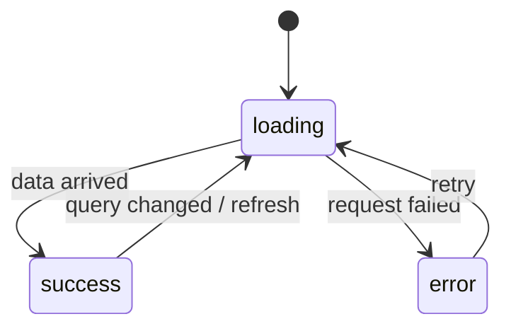
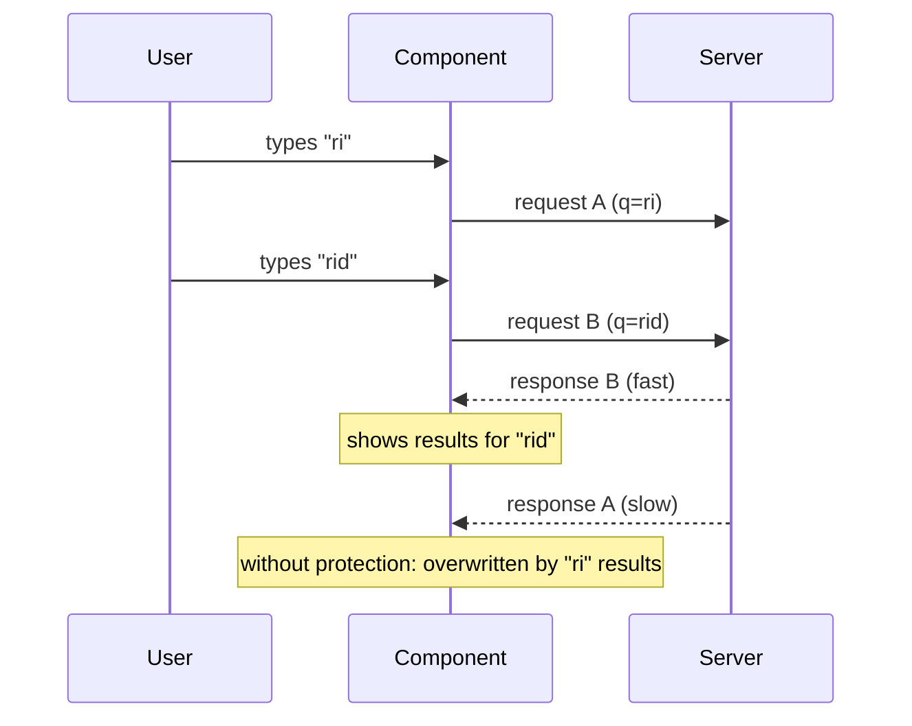

# Fetching data: loading, errors and races

> **Before this lesson:** you need [useEffect and its dependency rules](#/lesson/react/useeffect) (dependencies and cleanup) and conditional rendering from [Composition, children and conditional rendering](#/lesson/react/composition-conditional). From JavaScript: promises and `async`/`await` ([Async functions and generators](#/lesson/javascript/async-await-generators)) and `fetch` ([HTTP, fetch, forms and client-side storage](#/lesson/javascript/http-fetch-forms)).

## In plain words

You order a coffee at a busy counter. Between ordering and drinking there is a wait. Three things can happen: you are still waiting, the coffee arrives, or the barista says the machine is broken. A good café tells you which one it is: a buzzer for waiting, the cup for success, an apology for failure.

Now imagine you change your mind and order tea a second later. If the coffee arrives *after* the tea, you must not drink the coffee thinking it is your current order.

Loading data from a server is the same. A **request** is a message your page sends to a server asking for data, and the **response** is the answer, which arrives some unknown time later, or never. A professional interface always shows which of the three situations it is in, and never displays an answer to a question the user is no longer asking. The second problem is called a **race condition**: a bug caused by events finishing in an unexpected order.

Nearly every real application does this on nearly every screen, and "fetch and display a list" is the most common live-coding interview task.

## The pieces

- An **API** (application programming interface) here means a set of web addresses that return data instead of pages. Each address is an **endpoint**.
- The data usually arrives as **JSON** (JavaScript Object Notation): text that looks like JavaScript objects and arrays.
- `fetch(url)` is the browser function that sends a request. It returns a **promise**: an object representing a result that will exist later.
- `await` pauses an `async` function until a promise finishes, then gives you its result (or throws its error).

```javascript
const response = await fetch("https://api.example.com/hikes?q=ridge");
if (!response.ok) throw new Error("HTTP " + response.status);
const hikes = await response.json();
```

- Line 1 sends the request and waits for the response headers.
- Line 2 matters more than it looks. `fetch` only rejects when the network itself fails. A "404 Not Found" or "500 Server Error" reply still counts as a completed fetch. `response.ok` is `true` only for status codes 200–299, so you must check it and throw yourself.
- Line 3 reads the body and parses the JSON text into JavaScript values. That is also asynchronous, hence the second `await`.

## Step 1: fetch when the component appears

Fetching is a side effect that should happen *because the component is on screen*, so it goes in an effect.

```jsx
function HikeList() {
  const [hikes, setHikes] = useState([]);

  useEffect(() => {
    async function load() {
      const response = await fetch("/api/hikes");
      const data = await response.json();
      setHikes(data);
    }
    load();
  }, []);

  return <ul>{hikes.map((h) => <li key={h.id}>{h.name}</li>)}</ul>;
}
```

- `useState([])` starts with an empty list, so the first render has something to map over.
- The effect callback itself is not `async` (an async function returns a promise, and React expects a cleanup function or nothing). Instead it defines an inner `async function load()` and calls it.
- `setHikes(data)` stores the result, which triggers a second render showing the rows.
- `[]`: the effect uses no props or state, so it runs once after mount.

This works on a fast connection with a healthy server. It gives the user no clue while waiting, and silently shows an empty list forever if anything fails.

## Step 2: loading and error states

Track which of the situations you are in. The clearest way is one `status` value:

```jsx
function HikeList() {
  const [status, setStatus] = useState("loading");   // "loading" | "success" | "error"
  const [hikes, setHikes] = useState([]);
  const [error, setError] = useState(null);

  useEffect(() => {
    async function load() {
      try {
        const response = await fetch("/api/hikes");
        if (!response.ok) throw new Error(`Server replied ${response.status}`);
        setHikes(await response.json());
        setStatus("success");
      } catch (err) {
        setError(err.message);
        setStatus("error");
      }
    }
    load();
  }, []);

  if (status === "loading") return <p>Loading hikes…</p>;
  if (status === "error") return <p role="alert">Something went wrong: {error}</p>;
  if (hikes.length === 0) return <p>No hikes yet.</p>;
  return <ul>{hikes.map((h) => <li key={h.id}>{h.name}</li>)}</ul>;
}
```

- `try { ... } catch (err) { ... }` runs the first block and, if anything inside throws (network failure, our own `throw`, invalid JSON), jumps to the second.
- The four `return` lines cover the four things a user can see: waiting, failure, nothing to show, data. Forgetting the "empty" case is a common oversight.
- `role="alert"` makes screen readers announce the error.

Why one `status` string and not `isLoading` and `isError` booleans? Two booleans allow four combinations, including "loading and error at once", which should never exist. One string can only hold one value at a time. [useReducer and impossible states](#/lesson/react/usereducer) develops that idea fully.



## Step 3: refetch when an input changes, without races

Now the list depends on a search term passed as a prop.

```jsx
useEffect(() => {
  async function load() {
    setStatus("loading");
    const response = await fetch(`/api/hikes?q=${encodeURIComponent(query)}`);
    setHikes(await response.json());
    setStatus("success");
  }
  load();
}, [query]);
```

- `query` is read inside, so it is a dependency; the effect re-runs for each new query.
- `encodeURIComponent(query)` makes the text safe to place in a web address (spaces and symbols are converted).

There is a hidden bug. The user types `ri`, then `rid`. Two requests are in flight. Nothing guarantees that the answers return in the order the questions were asked. If the answer for `ri` is slow and arrives last, it overwrites the results for `rid`: the box says "rid" and the list shows matches for "ri".



The cure is the effect's cleanup function. When `query` changes, React runs the cleanup of the previous effect *before* starting the next one. Use that moment to mark the old request as no longer wanted.

**Option A: an ignore flag.**

```jsx
useEffect(() => {
  let ignore = false;

  async function load() {
    setStatus("loading");
    try {
      const response = await fetch(`/api/hikes?q=${encodeURIComponent(query)}`);
      if (!response.ok) throw new Error(`Server replied ${response.status}`);
      const data = await response.json();
      if (!ignore) {
        setHikes(data);
        setStatus("success");
      }
    } catch (err) {
      if (!ignore) {
        setError(err.message);
        setStatus("error");
      }
    }
  }
  load();

  return () => {
    ignore = true;
  };
}, [query]);
```

- `let ignore = false;` belongs to *this run* of the effect. Each run has its own variable.
- The cleanup sets this run's `ignore` to `true`.
- When a response finally arrives, the code checks its own flag. An outdated run finds `true` and does nothing.

**Option B: abort the request.** An `AbortController` is a browser object that can cancel a fetch in progress, saving bandwidth as well.

```jsx
useEffect(() => {
  const controller = new AbortController();

  async function load() {
    setStatus("loading");
    try {
      const response = await fetch(`/api/hikes?q=${encodeURIComponent(query)}`, { signal: controller.signal });
      if (!response.ok) throw new Error(`Server replied ${response.status}`);
      setHikes(await response.json());
      setStatus("success");
    } catch (err) {
      if (err.name === "AbortError") return;
      setError(err.message);
      setStatus("error");
    }
  }
  load();

  return () => controller.abort();
}, [query]);
```

- `{ signal: controller.signal }` links the request to the controller.
- `controller.abort()` in the cleanup cancels it. The pending `await fetch` then throws an error named `AbortError`, which the `catch` recognises and ignores.

Either option also protects against setting state after the component has been removed, and makes the Strict Mode double run harmless (the first run is ignored or aborted).

> [!INTERVIEW]
> "How do you avoid race conditions when fetching in `useEffect`?" *Each effect run gets its own cancellation: a boolean flag set in the cleanup, or an `AbortController` aborted in the cleanup. When a dependency changes, React cleans up the old effect first, so a late response from the old request is discarded.* A second common question, "why does my effect fetch twice in development?": Strict Mode mounts, unmounts and remounts to test cleanup; with correct cleanup the duplicate is harmless and it does not happen in production.

## Step 4: refetching on demand and keeping old data visible

Two refinements users notice.

**A retry or refresh button.** Effects re-run when a dependency changes, so add a piece of state whose only job is to change:

```jsx
const [attempt, setAttempt] = useState(0);

useEffect(() => {
  // ...the same loading code...
}, [query, attempt]);

<button onClick={() => setAttempt((n) => n + 1)}>Try again</button>
```

**Do not blank the screen while refreshing.** If you return "Loading…" whenever `status === "loading"`, the list disappears and reappears on every keystroke. Keep the previous `hikes` in state and show them, dimmed, while the new request runs; only show the bare loading message when there is nothing to show yet:

```jsx
const isFirstLoad = status === "loading" && hikes.length === 0;
if (isFirstLoad) return <p>Loading hikes…</p>;

return (
  <div style={{ opacity: status === "loading" ? 0.5 : 1 }}>
    <HikeRows hikes={hikes} />
  </div>
);
```

## Wrapping it in a custom hook

All of this is reusable logic, so it belongs in a hook ([Custom hooks and useRef](#/lesson/react/custom-hooks-refs)):

```jsx
function useFetch(url) {
  const [state, setState] = useState({ status: "loading", data: null, error: null });

  useEffect(() => {
    const controller = new AbortController();
    setState((s) => ({ ...s, status: "loading", error: null }));

    fetch(url, { signal: controller.signal })
      .then((response) => {
        if (!response.ok) throw new Error(`Server replied ${response.status}`);
        return response.json();
      })
      .then((data) => setState({ status: "success", data, error: null }))
      .catch((err) => {
        if (err.name !== "AbortError") setState((s) => ({ ...s, status: "error", error: err.message }));
      });

    return () => controller.abort();
  }, [url]);

  return state;
}

function HikeList({ query }) {
  const { status, data, error } = useFetch(`/api/hikes?q=${encodeURIComponent(query)}`);
  // render the four cases
}
```

- The three values live in one state object, so they always change together.
- `setState((s) => ({ ...s, status: "loading", error: null }))` keeps the old `data` while reloading.
- `.then(...)` is the promise form of `await`: "when this finishes, run that". `.catch(...)` handles a failure anywhere in the chain.
- The component shrinks to one line of data logic.

## What effects do not give you

Hand-written fetching in effects teaches the mechanics, and it is fine for small apps and interviews. It leaves real gaps:

- **No caching.** Leave the screen and return, and everything is fetched again.
- **No deduplication.** Two components asking for the same data send two requests.
- **Waterfalls.** A child can only start fetching after its parent has rendered it, so nested data loads one layer at a time.
- **No background refresh, retries or pagination helpers.**
- **No server rendering** of the data.

Production projects therefore usually use a data library such as TanStack Query (`useQuery({ queryKey: ["hikes", query], queryFn })`) or SWR, or a framework's own loading mechanism (React Router loaders, Next.js server components). They give you `data`, `error` and a status with caching and race handling built in. React itself now offers the `use` Hook with Suspense for reading a promise during render; see [Suspense, error boundaries and server components](#/lesson/react/suspense-boundaries-rsc). Knowing what this lesson covers is what lets you understand what those tools do for you.

For changing data on the server (create, update, delete), send the request from an **event handler**, not an effect, because a user action caused it:

```jsx
async function handleAdd(name) {
  const response = await fetch("/api/hikes", {
    method: "POST",
    headers: { "Content-Type": "application/json" },
    body: JSON.stringify({ name }),
  });
  if (!response.ok) throw new Error("Could not save");
  const saved = await response.json();
  setHikes((list) => [...list, saved]);
}
```

`method: "POST"` asks the server to create something; `headers` says the body is JSON; `JSON.stringify` turns the object into text.

## Run it: a fake API, slow answers and a race

There is no network inside this page, so `fakeApi` imitates a server: it answers after a delay, short queries are *slower* (to provoke the race), and the query `fail` produces an error.

```html-run
<label>Search hikes: <input id="q" placeholder="try r, then ri quickly; or 'fail'" size="34" /></label>
<label><input type="checkbox" id="protect" checked /> ignore outdated responses</label>
<p id="status"></p>
<ul id="list"></ul>
<pre id="log" style="background:#f4f4f4;padding:6px;max-height:110px;overflow:auto"></pre>
<script>
  const HIKES = ["Ridge Loop", "Rim Trail", "River Bend", "Fern Gully", "Salt Marsh", "Raven Peak"];
  function fakeApi(query) {                                   // pretend server
    const delay = query.length <= 1 ? 1500 : 300;             // short queries answer slowly
    return new Promise((resolve, reject) => setTimeout(() => {
      if (query === "fail") reject(new Error("Server replied 500"));
      else resolve(HIKES.filter((name) => name.toLowerCase().includes(query.toLowerCase())));
    }, delay));
  }

  let state = { status: "idle", hikes: [], error: null };
  function setState(change) { state = { ...state, ...change }; draw(); }
  function draw() {
    const { status, hikes, error } = state;
    document.getElementById("status").textContent =
      status === "loading" ? "Loading…" : status === "error" ? "Something went wrong: " + error
      : status === "success" && hikes.length === 0 ? "No hikes match." : "";
    const list = document.getElementById("list");
    list.style.opacity = status === "loading" ? 0.4 : 1;      // keep old results visible while loading
    list.innerHTML = status === "error" ? "" : hikes.map((name) => "<li>" + name + "</li>").join("");
  }
  const log = (line) => { const el = document.getElementById("log"); el.textContent += line + "\n"; el.scrollTop = el.scrollHeight; };

  let cleanup = null;                                         // what React would call before the next effect
  function runEffect(query) {
    if (cleanup) cleanup();
    let ignore = false;
    const protect = document.getElementById("protect").checked;
    setState({ status: "loading", error: null });
    log(`request  q="${query}"`);
    fakeApi(query).then(
      (hikes) => {
        if (ignore && protect) return log(`response q="${query}" IGNORED (outdated)`);
        log(`response q="${query}" applied`);
        setState({ status: "success", hikes });
      },
      (err) => { if (!(ignore && protect)) setState({ status: "error", error: err.message }); });
    cleanup = () => { ignore = true; };
  }

  document.getElementById("q").addEventListener("input", (event) => runEffect(event.target.value));
  runEffect("");
</script>
```

Experiments:

1. Clear the box, type `r`, then quickly `ri`. With the checkbox ticked, the log shows the slow `r` response being ignored, and the list stays correct.
2. Untick the checkbox and repeat. The fast `ri` results appear, and a second later the outdated `r` results replace them while the box still says `ri`: the race condition.
3. Type `fail` to see the error state, and `zzz` to see the empty state.

## Pitfalls

> [!WARNING]
> **Assuming `fetch` throws on HTTP errors.** It does not. A 404 or 500 resolves normally with `response.ok === false`. Without the check you will try to render an error page as if it were your data.

- **No loading or error UI.** Users stare at an empty screen and cannot tell waiting from broken.
- **No cleanup** (flag or abort): race conditions when inputs change quickly.
- **`async` directly on the effect callback.**
- **Missing dependency** (the URL or query), so new inputs do not refetch.
- **Fetching in an effect what a user action caused.** Send it from the handler.
- **Forgetting the empty state.** "No results" is different from "loading".
- **Building URLs by string concatenation without `encodeURIComponent`.** A query containing `&` or `#` breaks the address.
- **Putting secrets (API keys) in front-end code.** Everything shipped to the browser can be read by anyone.

> [!TIP]
> Open the browser developer tools' Network tab and use its throttling menu to simulate a slow connection. Loading states and races that are invisible on your fast machine become obvious.

## Cheat sheet

| Concern | Technique |
|---|---|
| Fetch on mount | effect with `[]`, inner async function |
| Refetch when input changes | put the input in the dependency array |
| Waiting indicator | `status === "loading"` branch |
| Failure message | `try/catch`, check `response.ok`, `status === "error"` branch |
| Nothing to show | explicit empty-state branch |
| Outdated responses | `let ignore = false` + cleanup sets it, or `AbortController` |
| Retry / refresh | a counter state in the dependencies |
| No flicker on refresh | keep previous data, dim it while loading |
| Reuse | `useFetch(url)` custom hook |
| Create / update / delete | `fetch` with `method` and `body` inside an event handler |
| Production apps | TanStack Query, SWR, or framework loaders |

## Summary

- A fetch is a side effect tied to "this component is displayed", so it lives in an effect whose dependencies are the inputs of the request.
- Every request has at least three states (loading, success, error) plus the empty result; render all of them.
- `fetch` does not reject on HTTP error codes; check `response.ok`.
- Responses can return out of order; use the effect cleanup to ignore or abort outdated requests.
- Send mutations from event handlers.
- Extract the pattern into a hook, and in larger apps prefer a data-fetching library that adds caching and deduplication.

## Glossary

- **Request / response**: the message sent to a server and its reply.
- **API / endpoint**: a set of data-returning web addresses / one such address.
- **JSON**: a text format for structured data.
- **Promise**: an object standing for a future result.
- **`async` / `await`**: syntax for writing promise-based code that reads top to bottom.
- **HTTP status code**: the number in a response saying how it went (200 OK, 404 not found, 500 server error).
- **Race condition**: a bug where the outcome depends on which asynchronous operation finishes first.
- **AbortController**: a browser object that cancels an in-flight fetch.
- **Mutation**: a request that changes data on the server.
- **Cache**: stored results reused to avoid repeating a request.
- **Waterfall**: requests that can only start after earlier ones finish, loading in sequence.

## Check yourself

```quiz
[
  {"q": "The server answers a fetch with status 404. What happens at `const response = await fetch(url)`?",
   "options": ["It throws an error", "It resolves normally; response.ok is false", "It returns null", "It retries automatically"],
   "answer": 1,
   "explain": "fetch rejects only on network-level failures. HTTP error statuses must be detected with response.ok or response.status."},
  {"q": "Why is the effect written as useEffect(() => { async function load() {...} load(); }, []) instead of useEffect(async () => {...}, [])?",
   "options": ["Arrow functions cannot be async", "An async callback returns a promise, but React expects a cleanup function or nothing", "It is faster", "await is not allowed in effects"],
   "answer": 1,
   "explain": "The return value of the effect callback is treated as the cleanup. A promise is not a function."},
  {"q": "The user types 'ri' then 'rid'. Request A (ri) takes 2 s, request B (rid) takes 0.2 s. With no cleanup, what is displayed after 3 s?",
   "options": ["Results for rid", "Results for ri, although the box says rid", "Nothing", "Both lists merged"],
   "answer": 1,
   "explain": "The slower, older response arrives last and overwrites the newer one. This is the race condition."},
  {"q": "In the ignore-flag pattern, where is ignore set to true?",
   "options": ["At the top of the effect", "In the catch block", "In the cleanup function returned by the effect", "In the render body"],
   "answer": 2,
   "explain": "React runs the cleanup when dependencies change or on unmount, which is exactly when that request's result stops being relevant."},
  {"q": "Why prefer one status value ('loading' | 'success' | 'error') over isLoading and isError booleans?",
   "options": ["Strings use less memory", "Booleans allow contradictory combinations such as loading and error together", "React requires strings", "It avoids re-renders"],
   "answer": 1,
   "explain": "A single field can hold exactly one situation, so impossible combinations cannot be represented."},
  {"q": "A HikeList component fetches in an effect with [] and has correct cleanup. Under StrictMode in development, how many requests are sent on mount, and how many results are applied?",
   "options": ["1 sent, 1 applied", "2 sent, 2 applied", "2 sent, 1 applied (the first is ignored or aborted)", "0 sent"],
   "answer": 2,
   "explain": "Strict Mode runs setup, cleanup, setup. The first run's result is discarded by the cleanup."},
  {"q": "Where should the request that saves a new hike (POST) be sent from?",
   "options": ["An effect that watches the form state", "The submit event handler", "The component body during render", "A ref"],
   "answer": 1,
   "explain": "A specific user action caused it, so it belongs in the handler for that action."},
  {"q": "Which is NOT something a library such as TanStack Query adds over hand-written effects?",
   "options": ["Caching between screens", "Deduplicating identical requests", "Removing the need for a server", "Background refetching and retries"],
   "answer": 2,
   "explain": "Data libraries manage client-side fetching and caching. They still talk to your server."}
]
```

> **Source:** Wieruch, *The Road to React*, "Fundamentals of React": React Asynchronous Data, Data Fetching with React, Data Re-Fetching in React, Explicit Data Fetching with React, Async/Await in React. Documentation: https://react.dev/learn/synchronizing-with-effects#fetching-data, https://react.dev/learn/you-might-not-need-an-effect#fetching-data, https://developer.mozilla.org/en-US/docs/Web/API/AbortController
