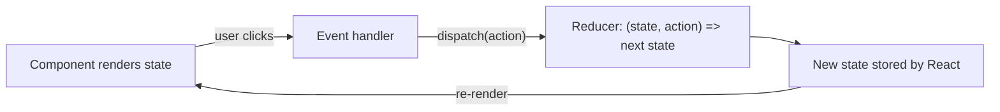
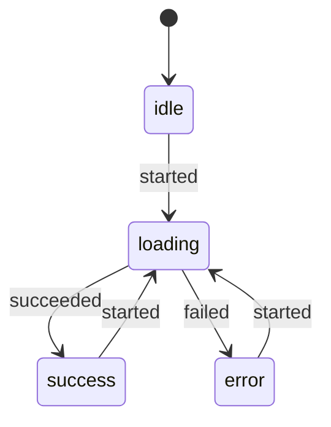

# useReducer and impossible states

> **Before this lesson:** you need [State with useState](#/lesson/react/usestate) (immutable updates) and [Fetching data: loading, errors and races](#/lesson/react/data-fetching) (the loading/success/error situations). From JavaScript: the `switch` statement and object spread.

## In plain words

A vending machine does not let you reach inside and rearrange things. You press a button ("B4") or insert a coin, and the machine, following fixed rules, decides what happens next. You can list every button, and for each one you can say exactly what the machine does in each situation.

`useReducer` organises a component's state like that machine. Instead of scattering `setThis(...)` and `setThat(...)` calls through many handlers, you:

1. describe *what happened* as a small object called an **action** (the button press), and
2. write one function, the **reducer**, containing all the rules for how state changes in response.

The second half of the lesson is about a design skill: shaping your state so that nonsense situations ("loading *and* failed", "submitted *and* still editing") cannot be represented at all. These are called **impossible states**. Preventing them removes entire classes of bugs, and interviewers love to see it.

## When useState starts to hurt

Here is a component that loads hikes, with three separate state variables:

```jsx
const [hikes, setHikes] = useState([]);
const [isLoading, setIsLoading] = useState(false);
const [error, setError] = useState(null);

async function load() {
  setIsLoading(true);
  try {
    const data = await fetchHikes();
    setHikes(data);
    setIsLoading(false);
  } catch (err) {
    setError(err.message);
    // forgot setIsLoading(false)
  }
}
```

Three problems hide here.

- **Related values are updated separately.** Every path must remember to touch all of them. The `catch` branch forgot one: after a failure the screen shows an error *and* a spinner forever.
- **The rules are spread out.** To learn how `isLoading` can change you must read every handler.
- **Contradictions are possible.** Nothing stops `isLoading: true` with `error: "..."`. The types permit four combinations of the two flags, while the real world has only three or four meaningful situations.

## A reducer, step by step

A **reducer** is a function that takes the current state and an action and returns the next state:

$$(\text{state}, \text{action}) \rightarrow \text{next state}$$

Start with the smallest example, a counter with three buttons.

```jsx
function counterReducer(state, action) {
  switch (action.type) {
    case "incremented":
      return { count: state.count + 1 };
    case "decremented":
      return { count: state.count - 1 };
    case "reset":
      return { count: 0 };
    default:
      throw new Error("Unknown action: " + action.type);
  }
}
```

- `state` is the current state object, here `{ count: number }`.
- `action` is a plain object. By convention it has a `type` string naming what happened, plus any extra data.
- `switch (action.type)` picks the branch for that kind of event. Each `case` returns a **new** state object.
- The `default` branch throws, so a misspelt action type is caught immediately instead of being ignored.

The reducer must be **pure**: it only computes and returns. No requests, no timers, no changing its arguments. Because it is a plain function with no React inside, you can test it by calling it:

```js-run
function counterReducer(state, action) {
  switch (action.type) {
    case "incremented": return { count: state.count + 1 };
    case "decremented": return { count: state.count - 1 };
    case "reset":       return { count: 0 };
    default: throw new Error("Unknown action: " + action.type);
  }
}

let state = { count: 0 };
for (const action of [{ type: "incremented" }, { type: "incremented" }, { type: "decremented" }, { type: "reset" }, { type: "incremented" }]) {
  state = counterReducer(state, action);
  console.log(action.type.padEnd(12), "->", JSON.stringify(state));
}

// "reduce" is where the name comes from: fold a list of actions into one state.
const final = [{ type: "incremented" }, { type: "incremented" }].reduce(counterReducer, { count: 10 });
console.log("folded:", JSON.stringify(final));
```

Now connect it to a component:

```jsx
import { useReducer } from "react";

function Counter() {
  const [state, dispatch] = useReducer(counterReducer, { count: 0 });

  return (
    <>
      <p>{state.count}</p>
      <button onClick={() => dispatch({ type: "incremented" })}>+</button>
      <button onClick={() => dispatch({ type: "decremented" })}>-</button>
      <button onClick={() => dispatch({ type: "reset" })}>Reset</button>
    </>
  );
}
```

- `useReducer(counterReducer, { count: 0 })` takes the reducer and the initial state.
- It returns the current `state` and a function called `dispatch`.
- `dispatch({ type: "incremented" })` sends an action. React calls your reducer with the current state and that action, stores the result, and re-renders, with the same batching and the same "identical state means no render" rule as `useState`.



The component now says *what happened* ("incremented"); the reducer decides *what that means*. Name actions after events in the past tense (`"hikeAdded"`, `"loadFailed"`), not after setters (`"setHikes"`): it keeps the reducer in charge of the logic.

## A realistic reducer: a list with several operations

```jsx
function hikesReducer(hikes, action) {
  switch (action.type) {
    case "added":
      return [...hikes, { id: action.id, name: action.name, done: false }];
    case "toggled":
      return hikes.map((h) => (h.id === action.id ? { ...h, done: !h.done } : h));
    case "renamed":
      return hikes.map((h) => (h.id === action.id ? { ...h, name: action.name } : h));
    case "removed":
      return hikes.filter((h) => h.id !== action.id);
    default:
      throw new Error("Unknown action: " + action.type);
  }
}
```

- Here the state is the array itself.
- Each case uses a non-mutating recipe from the `useState` lesson: spread to add, `map` to change one, `filter` to remove.
- The extra fields on the action (`id`, `name`) carry the data the rule needs. This extra data is often called the **payload**.

In the component, handlers become one-liners:

```jsx
const [hikes, dispatch] = useReducer(hikesReducer, []);

function handleAdd(name) {
  dispatch({ type: "added", id: crypto.randomUUID(), name });
}
```

The id is generated in the handler, not in the reducer, because generating a random value is not pure: the same inputs would give different outputs. The problem *A pure reducer for a todo list* has you write a reducer like this, with tests for every action.

## Impossible states

Go back to data loading. List the situations that truly exist:

| Situation | What the user sees |
|---|---|
| idle | nothing requested yet |
| loading | a spinner |
| success | the data |
| error | an error message |

Four situations. Two booleans and a nullable error can express many more than four combinations, and the extra ones are all bugs waiting to be displayed. The fix is to make the *shape* of the state match the list:

```jsx
const initialState = { status: "idle", data: null, error: null };

function fetchReducer(state, action) {
  switch (action.type) {
    case "started":
      return { status: "loading", data: state.data, error: null };
    case "succeeded":
      return { status: "success", data: action.data, error: null };
    case "failed":
      return { status: "error", data: state.data, error: action.error };
    default:
      throw new Error("Unknown action: " + action.type);
  }
}
```

- `status` is a single field holding one of four strings, so the component can never be "loading and error" at once.
- Every transition sets **all** related fields in one place. It is impossible to forget to turn the spinner off, because turning it off is part of what `"failed"` means.
- `"started"` keeps the previous `data`, so a refresh can show old results until new ones arrive.

This is a **state machine**: a finite list of states plus rules saying which event moves you from which state to which.



You can make the machine stricter by letting the reducer ignore events that make no sense in the current state:

```jsx
case "succeeded":
  if (state.status !== "loading") return state;
  return { status: "success", data: action.data, error: null };
```

Returning the same `state` object means "nothing changed", and React skips the render. The problem *Loading, error and stale responses in one reducer* adds a request id so that late answers to old requests are ignored too.

The effect then only reports events:

```jsx
useEffect(() => {
  let ignore = false;
  dispatch({ type: "started" });
  fetchHikes(query)
    .then((data) => { if (!ignore) dispatch({ type: "succeeded", data }); })
    .catch((err) => { if (!ignore) dispatch({ type: "failed", error: err.message }); });
  return () => { ignore = true; };
}, [query]);
```

`dispatch` is guaranteed stable by React, so it never needs to be in a dependency array.

### More ways to rule out bad states

The same thinking applies beyond fetching:

- **Replace boolean pairs with one status.** `isOpen` + `isClosing` + `isClosed` → `phase: "open" | "closing" | "closed"`.
- **Store an id, not a copy.** Keep `selectedId` and look the item up in the list, so the selection can never show outdated data for an item that was edited.
- **Do not store what you can derive.** `isEmpty`, `total`, `isValid` are computed from other state.
- **Put data where it is valid.** If an error message only exists in the error state, a TypeScript union such as `{ status: "error"; error: string } | { status: "success"; data: Hike[] }` makes reading `error` in the wrong state a compile-time mistake ([TypeScript with React](#/lesson/react/typescript)).

## useState or useReducer?

| | `useState` | `useReducer` |
|---|---|---|
| Amount of code | less | more (reducer + actions) |
| Best for | independent, simple values | several values that change together; many kinds of update |
| Where update logic lives | in each handler | in one function |
| Testing | through the component | call the reducer directly |
| Debugging | find which setter ran | log every action in one place |
| Passing to children | several setters | one stable `dispatch` |

Neither is more powerful; anything written with one can be written with the other. A practical rule: start with `useState`. Move to `useReducer` when you notice a handler calling three setters, when the next state depends on several pieces of current state, or when a bug came from forgetting to update one of a group. Many components use both: a reducer for the complicated part and `useState` for an unrelated toggle.

> [!INTERVIEW]
> "When would you use `useReducer` over `useState`?" *When state transitions are complex or related values must change together: the reducer centralises the logic, makes transitions explicit and testable as a pure function, and `dispatch` has a stable identity for passing down. For independent simple values `useState` is less ceremony.* Then mention modelling a status field to avoid impossible states.

## Run it: one reducer driving a screen

The page below has a reducer for a small "load, add, remove" screen. An action log shows every event with the state it produced, which is the kind of visibility a reducer gives you.

```html-run
<div id="root"></div>
<pre id="log" style="background:#f4f4f4;padding:6px;max-height:130px;overflow:auto;font-size:12px"></pre>
<style>body { font-family: sans-serif; } button { margin: 3px; } .error { color: #b3261e; }</style>
<script>
  // ---------- the reducer: every rule in one pure function ----------
  const initialState = { status: "idle", hikes: [], error: null };
  function reducer(state, action) {
    switch (action.type) {
      case "started":   return { ...state, status: "loading", error: null };
      case "succeeded": return state.status !== "loading" ? state : { status: "success", hikes: action.hikes, error: null };
      case "failed":    return state.status !== "loading" ? state : { ...state, status: "error", error: action.error };
      case "added":     return state.status !== "success" ? state : { ...state, hikes: [...state.hikes, { id: action.id, name: action.name }] };
      case "removed":   return { ...state, hikes: state.hikes.filter((hike) => hike.id !== action.id) };
      default: throw new Error("Unknown action: " + action.type);
    }
  }

  // ---------- a miniature useReducer ----------
  let state = initialState;
  function dispatch(action) {
    const next = reducer(state, action);
    const el = document.getElementById("log");
    el.textContent += `${action.type.padEnd(10)} -> ${next === state ? "(ignored, same state)" : JSON.stringify(next)}\n`;
    el.scrollTop = el.scrollHeight;
    if (next !== state) { state = next; draw(); }           // identical state: no re-render
  }

  // ---------- the view: UI = f(state) ----------
  let nextId = 3;
  function draw() {
    const { status, hikes, error } = state;
    const body =
      status === "idle" ? "<p>Nothing loaded yet.</p>" :
      status === "loading" ? "<p>Loading…</p>" :
      status === "error" ? `<p class="error">Failed: ${error}</p>` :
      hikes.length === 0 ? "<p>No hikes.</p>" :
      "<ul>" + hikes.map((hike) => `<li>${hike.name} <button onclick="dispatch({ type: 'removed', id: ${hike.id} })">x</button></li>`).join("") + "</ul>";
    document.getElementById("root").innerHTML = `
      <button onclick="load(true)">Load (works)</button>
      <button onclick="load(false)">Load (fails)</button>
      <button onclick="dispatch({ type: 'added', id: nextId, name: 'Trail ' + nextId++ })">Add a hike</button>
      <button onclick="dispatch({ type: 'succeeded', hikes: [] })">Send a stray 'succeeded'</button>
      ${body}`;
  }
  function load(ok) {                                       // the "effect": it only reports events
    dispatch({ type: "started" });
    setTimeout(() => ok
      ? dispatch({ type: "succeeded", hikes: [{ id: 1, name: "Ridge Loop" }, { id: 2, name: "Fern Gully" }] })
      : dispatch({ type: "failed", error: "Server replied 500" }), 800);
  }
  draw();
</script>
```

Things to notice. "Add a hike" before loading is ignored: the reducer refuses `added` unless the status is `success`. The stray `succeeded` button is also ignored unless a load is in progress. After a failed load the spinner is gone, because `failed` sets the whole state at once. Try adding a `"cleared"` action that empties the list, and a button for it.

## Pitfalls

> [!WARNING]
> **Mutating state inside the reducer.** `state.hikes.push(x); return state;` returns the same object, so React sees no change and does not re-render, and you have altered an object that earlier renders still reference. Always return new objects and arrays for what changed.

- **Side effects in the reducer** (fetching, `localStorage`, `Math.random()`, `Date.now()`). Reducers must be pure; Strict Mode calls them twice in development to catch this. Do such work in the handler or effect and put the result in the action.
- **A missing `default` case** that returns `undefined`: the state vanishes on a typo.
- **Setter-style actions** (`{ type: "setLoading", value: true }`). This is `useState` with extra steps; the logic is still in the component.
- **One giant reducer for unrelated things.** Split by concern; several reducers or a mix with `useState` is fine.
- **Reading `state` right after `dispatch`.** Like a setter, `dispatch` schedules a change; the variable in the current render is a snapshot.
- **Boolean explosion** (`isLoading`, `isError`, `isSuccess`, `isEmpty`). Replace with one status and derived values.

> [!TIP]
> Design state by first listing the situations the user can be in, then the events that move between them. Write the reducer from that list. If you cannot say which situation a combination of fields represents, the shape allows an impossible state.

## Cheat sheet

| Piece | Form |
|---|---|
| Reducer | `function reducer(state, action) { switch (action.type) { ... } }` |
| Hook | `const [state, dispatch] = useReducer(reducer, initialState)` |
| Lazy initial state | `useReducer(reducer, arg, init)` where `init(arg)` returns the state |
| Send an event | `dispatch({ type: "hikeAdded", name })` |
| Ignore an event | `return state;` (same object, no re-render) |
| Unknown action | `default: throw new Error(...)` |
| Status field | `status: "idle" \| "loading" \| "success" \| "error"` |
| Derived flags | `const isLoading = state.status === "loading"` |
| Test | `expect(reducer(before, action)).toEqual(after)` |

## Summary

- A reducer is a pure function `(state, action) => nextState`; `useReducer` wires it to a component and gives you `dispatch`.
- Components describe events; the reducer owns the rules, in one testable place.
- Reducers must not mutate and must not perform side effects.
- Model related state as a status with explicit transitions (a state machine) so contradictory combinations cannot occur.
- Prefer one status over several booleans, ids over copies, and derived values over stored ones.
- Use `useState` for simple independent values and `useReducer` when updates are many or interdependent.

## Glossary

- **Reducer**: a pure function that computes the next state from the current state and an action.
- **Action**: a plain object describing an event, with a `type` and optional data.
- **Payload**: the data carried by an action besides its type.
- **`dispatch`**: the function that sends an action to the reducer.
- **Pure function**: no side effects, same output for the same input.
- **Impossible state**: a combination of state values that should never occur but that the state's shape allows.
- **State machine**: a finite set of states with defined transitions between them.
- **Transition**: a change from one state to another caused by an event.
- **Status field**: a single value naming which state the component is in.

## Check yourself

```quiz
[
  {"q": "What is the signature of a reducer?",
   "options": ["(action) => state", "(state, action) => next state", "(state) => void", "(props, state) => JSX"],
   "answer": 1,
   "explain": "It receives the current state and an action and returns the state that should follow."},
  {"q": "A reducer handles 'removed' with: state.items.splice(i, 1); return state;  What happens on screen?",
   "options": ["The item disappears as expected", "Probably nothing: the same state object is returned, so React detects no change", "React throws immediately", "All items disappear"],
   "answer": 1,
   "explain": "Mutating and returning the same reference looks like 'no change' to React. Return a new object with a filtered array."},
  {"q": "State is { isLoading, isError } as two booleans. How many combinations can be represented, and how many are meaningful?",
   "options": ["2 and 2", "4 representable, of which 'loading and error together' is meaningless", "3 and 3", "Infinite"],
   "answer": 1,
   "explain": "Two booleans give four combinations. A single status field removes the contradictory one."},
  {"q": "Which belongs inside a reducer?",
   "options": ["await fetch(url)", "localStorage.setItem(...)", "return { ...state, count: state.count + 1 }", "crypto.randomUUID()"],
   "answer": 2,
   "explain": "Reducers only compute the next state. Requests, storage and random values are side effects or impure."},
  {"q": "The reducer returns the exact same state object for an action. How many re-renders does that dispatch cause?",
   "options": ["1", "0", "2", "It depends on the action type"],
   "answer": 1,
   "explain": "React compares the returned state with the current one by identity and bails out when they are the same."},
  {"q": "Starting from { count: 0 }, one click handler runs dispatch({type:'incremented'}) three times in a row. What is count afterwards and how many renders occurred?",
   "options": ["1 and 1", "3 and 3", "3 and 1", "1 and 3"],
   "answer": 2,
   "explain": "Each dispatch is applied to the result of the previous one, like updater functions, and the three are batched into one render."},
  {"q": "Why is `status: 'loading' | 'success' | 'error'` safer than three booleans?",
   "options": ["It uses less memory", "Only one value can be held at a time, so contradictory combinations cannot exist", "Strings render faster", "Booleans cannot be stored in state"],
   "answer": 1,
   "explain": "The shape of the data enforces mutual exclusion that booleans would leave to programmer discipline."},
  {"q": "Which is the better action design?",
   "options": ["{ type: 'setIsLoading', value: false } followed by { type: 'setError', value: msg }", "{ type: 'loadFailed', error: msg }", "{ loading: false, error: msg }", "A function that mutates state"],
   "answer": 1,
   "explain": "An event-style action lets the reducer update every related field together. Setter-style actions keep the logic scattered in the component."}
]
```

> **Source:** Wieruch, *The Road to React*, "Fundamentals of React": React Advanced State, React Impossible States. Documentation: https://react.dev/learn/extracting-state-logic-into-a-reducer, https://react.dev/reference/react/useReducer, https://react.dev/learn/choosing-the-state-structure
