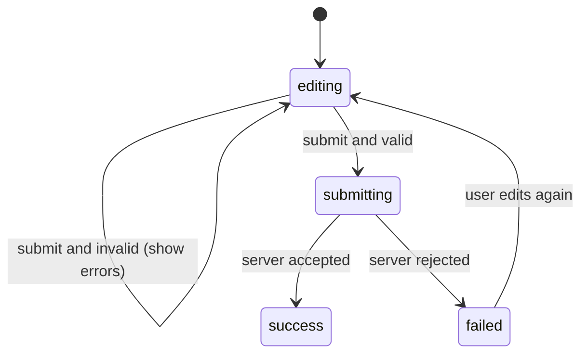

# Forms

> **Before this lesson:** you need controlled and uncontrolled inputs from [Lifting state and controlled components](#/lesson/react/lifting-controlled), event handlers from [Lists, keys and events](#/lesson/react/lists-keys-events), and the status idea from [useReducer and impossible states](#/lesson/react/usereducer).

## In plain words

Think of the paper form you fill in at a doctor's reception. You write in the boxes, the receptionist glances over it ("you missed your date of birth"), then takes it away to enter into the computer. While they are typing you cannot change it. In the end they say "all done" or "the system rejected your insurance number".

A web **form** is the same sequence: collect values, check them (**validation**), send them (**submission**), wait, and report the outcome. Each step has a state the screen must show. A form that lets you click "Pay" twice, shows no reason for a rejection, or shouts "invalid email" before you have typed a letter is a form that loses customers.

Forms are where an application takes in data, so every job involves them, and they exercise most of what you have learned: state, events, derived values and status modelling.

## The simplest form that works

Use a real `<form>` element with a submit button. That gives you, for free, submission by pressing Enter in a field, and correct behaviour for keyboards and screen readers.

```jsx
function NewsletterForm() {
  const [email, setEmail] = useState("");

  function handleSubmit(event) {
    event.preventDefault();
    console.log("subscribe", email);
  }

  return (
    <form onSubmit={handleSubmit}>
      <label htmlFor="email">Email</label>
      <input id="email" type="email" value={email} onChange={(e) => setEmail(e.target.value)} />
      <button type="submit">Subscribe</button>
    </form>
  );
}
```

- `onSubmit` is on the `<form>`, not `onClick` on the button. It fires for a button click *and* for Enter.
- `event.preventDefault()` stops the browser's default behaviour of navigating to a new page.
- `<label htmlFor="email">` is tied to the input whose `id` is `email`. Clicking the label focuses the field, and assistive technology reads the label aloud. Every field needs one.
- `type="submit"` marks the button that submits. Give other buttons inside a form `type="button"`, or they will submit too.
- The input is controlled: `value` shows state, `onChange` updates it.

## Validation: derive, do not store

**Validation** means checking that the values are acceptable. Errors are a function of the current values, so compute them during render instead of keeping them in state:

```jsx
function validate(values) {
  const errors = {};
  if (values.email.trim() === "") {
    errors.email = "Email is required";
  } else if (!/^[^\s@]+@[^\s@]+\.[^\s@]+$/.test(values.email)) {
    errors.email = "That does not look like an email address";
  }
  if (values.password.length < 8) {
    errors.password = "Use at least 8 characters";
  }
  return errors;
}
```

- `validate` is a plain function: values in, an object of messages out. An empty object means valid.
- The regular expression reads "some characters that are not spaces or @, then @, then more such characters, a dot, and more". It is a sanity check, not proof that the address exists.
- Because it is pure, it is trivial to test, and the errors can never be out of date.

In the component:

```jsx
const [values, setValues] = useState({ email: "", password: "" });
const errors = validate(values);
const isValid = Object.keys(errors).length === 0;
```

### When to show an error

Showing every error on first paint greets the user with a wall of red. Showing nothing until submission hides problems for too long. The usual compromise: show a field's error after the user has **left** that field (the `blur` event, which fires when a field loses focus) or after they have tried to submit.

```jsx
const [touched, setTouched] = useState({});
const [submitted, setSubmitted] = useState(false);

function showError(field) {
  return (touched[field] || submitted) && errors[field];
}

<input
  id="email"
  name="email"
  value={values.email}
  onChange={handleChange}
  onBlur={() => setTouched((t) => ({ ...t, email: true }))}
  aria-invalid={showError("email") ? "true" : undefined}
  aria-describedby="email-error"
/>
{showError("email") && <p id="email-error" role="alert">{errors.email}</p>}
```

- `touched` records which fields the user has visited. It *is* state: it cannot be worked out from the values.
- `onBlur` marks the field as touched.
- `showError` combines the derived errors with the two flags.
- `aria-invalid` and `aria-describedby` are accessibility attributes: they tell a screen reader that the field is in error and which element explains why. `role="alert"` makes the message be announced when it appears.

The browser also has **built-in validation**: attributes such as `required`, `type="email"`, `minLength={8}` and `pattern` make the browser block submission and show its own bubble. They are quick and worth using for simple forms; add `noValidate` to the `<form>` when you want to show your own messages instead.

> [!WARNING]
> Validation in the browser is for the user's convenience only. Anyone can send a request to your server without using your form. The server (or your database's security rules, see [Security rules](#/lesson/react/security-rules)) must validate everything again.

## Submission is a state machine

After the user presses the button there is a period of waiting, then success or failure. That is the same status pattern as data fetching:



```jsx
function SignUpForm({ onSignUp }) {
  const [values, setValues] = useState({ email: "", password: "" });
  const [touched, setTouched] = useState({});
  const [status, setStatus] = useState("editing");   // editing | submitting | success | failed
  const [formError, setFormError] = useState(null);
  const [submitCount, setSubmitCount] = useState(0);

  const errors = validate(values);
  const isSubmitting = status === "submitting";

  function handleChange(event) {
    const { name, value } = event.target;
    setValues((v) => ({ ...v, [name]: value }));
    if (status === "failed") {
      setStatus("editing");
      setFormError(null);
    }
  }

  async function handleSubmit(event) {
    event.preventDefault();
    setSubmitCount((n) => n + 1);
    if (Object.keys(errors).length > 0) return;

    setStatus("submitting");
    setFormError(null);
    try {
      await onSignUp(values);
      setStatus("success");
    } catch (err) {
      setStatus("failed");
      setFormError(err.message);
    }
  }

  if (status === "success") return <p>Welcome! Check your inbox.</p>;

  return (
    <form onSubmit={handleSubmit} noValidate>
      {/* fields as shown above, each with disabled={isSubmitting} */}
      {formError && <p role="alert">{formError}</p>}
      <button type="submit" disabled={isSubmitting}>
        {isSubmitting ? "Creating account…" : "Create account"}
      </button>
    </form>
  );
}
```

Walk through `handleSubmit`:

- `setSubmitCount((n) => n + 1)` records the attempt, so `showError` can reveal all errors (`submitCount > 0`).
- If validation fails, return early. The errors appear and nothing is sent.
- `setStatus("submitting")` disables the button and fields, which prevents a double submission.
- `await onSignUp(values)` waits for the server call supplied by the parent.
- On success the form is replaced by a confirmation. On failure, `formError` holds a message that applies to the whole form ("this email is already registered"), distinct from per-field errors.
- In `handleChange`, editing after a failure clears the form-level error, since it referred to the old values.

The problem *Form validation state machine* asks you to implement exactly these transitions as a pure function.

## Less state: reading the form on submit

When nothing on screen depends on the values while typing, you can skip controlled inputs and read everything at submission with `FormData`:

```jsx
function handleSubmit(event) {
  event.preventDefault();
  const data = Object.fromEntries(new FormData(event.currentTarget));
  // data is { name: "...", difficulty: "...", ... } keyed by each field's name attribute
}
```

- `event.currentTarget` is the form element the handler is attached to.
- `new FormData(form)` gathers every field that has a `name`.
- `Object.fromEntries` turns the pairs into a plain object. All values are strings.

This means no re-render per keystroke and very little code. You can mix approaches: uncontrolled for most fields, controlled for the one that drives a live preview.

## Forms in React 19: actions

React 19 adds first-class support for the submit–wait–result cycle. You pass a function to the form's `action` prop, and React calls it with the `FormData`, tracks whether it is pending, and resets uncontrolled fields after success.

```jsx
import { useActionState } from "react";

async function subscribe(previousState, formData) {
  const email = formData.get("email");
  if (!email.includes("@")) return { error: "Please enter a valid email" };
  await saveSubscriber(email);
  return { error: null, done: true };
}

function NewsletterForm() {
  const [state, formAction, isPending] = useActionState(subscribe, { error: null });

  return (
    <form action={formAction}>
      <input name="email" type="email" />
      <button disabled={isPending}>{isPending ? "Saving…" : "Subscribe"}</button>
      {state.error && <p role="alert">{state.error}</p>}
      {state.done && <p>Subscribed!</p>}
    </form>
  );
}
```

- `subscribe` is the **action**: an async function receiving the previous result and the form's data, returning the new result.
- `useActionState(subscribe, initialState)` returns the latest result (`state`), a wrapped action to give to the form, and `isPending`.
- No `preventDefault`, no status state, no `try/catch` scaffolding. The pattern from the previous section is built in.
- A related Hook, `useFormStatus`, lets a button deep inside the form read the pending flag without props, and `useOptimistic` shows a predicted result while the action runs ([Sorting, searching, pagination and optimistic updates](#/lesson/react/sort-search-paginate)).

You will meet both styles in real code: hand-managed status in older or library-free code, actions in newer code and in frameworks.

## Form libraries

Large forms (dozens of fields, dynamic rows, cross-field rules, schemas shared with the server) are tedious by hand. Teams commonly use **React Hook Form** (uncontrolled inputs under the hood, minimal re-renders) with a schema validator such as **Zod** (you describe the shape of valid data once and get validation plus TypeScript types). Reach for them when hand-written code becomes repetitive, not before you understand what they automate.

## Run it: validation timing and submission states

This page implements the hand-managed version in plain JavaScript with the same state shape (`values`, `touched`, `status`, `formError`, `submitCount`) and derived errors. The fake server rejects any email containing "taken".

```html-run
<form id="form" novalidate>
  <p><label for="email">Email</label><br /><input id="email" name="email" autocomplete="off" /> <span class="err" id="email-error"></span></p>
  <p><label for="password">Password</label><br /><input id="password" name="password" type="password" /> <span class="err" id="password-error"></span></p>
  <p class="err" id="form-error" role="alert"></p>
  <button id="submit" type="submit">Create account</button>
  <span id="status-label"></span>
</form>
<p id="done" hidden>Welcome! Your account was created.</p>
<style>body { font-family: sans-serif; } .err { color: #b3261e; font-size: 13px; } input[aria-invalid="true"] { outline: 2px solid #b3261e; }</style>
<script>
  let state = { values: { email: "", password: "" }, touched: {}, status: "editing", formError: null, submitCount: 0 };

  function validate(values) {                                  // derived, never stored
    const errors = {};
    if (values.email.trim() === "") errors.email = "Email is required";
    else if (!/^[^\s@]+@[^\s@]+\.[^\s@]+$/.test(values.email)) errors.email = "That does not look like an email";
    if (values.password.length < 8) errors.password = "Use at least 8 characters";
    return errors;
  }
  function fakeSignUp(values) {                                // pretend server
    return new Promise((resolve, reject) => setTimeout(() =>
      values.email.includes("taken") ? reject(new Error("That email is already registered")) : resolve(), 1200));
  }

  function setState(change) { state = { ...state, ...change }; draw(); }
  function draw() {
    const errors = validate(state.values);
    const submitting = state.status === "submitting";
    for (const field of ["email", "password"]) {
      const visible = (state.touched[field] || state.submitCount > 0) && errors[field];
      document.getElementById(field + "-error").textContent = visible || "";
      const input = document.getElementById(field);
      input.setAttribute("aria-invalid", visible ? "true" : "false");
      input.disabled = submitting;
    }
    document.getElementById("form-error").textContent = state.formError || "";
    document.getElementById("submit").disabled = submitting;
    document.getElementById("submit").textContent = submitting ? "Creating account…" : "Create account";
    document.getElementById("status-label").textContent = " status: " + state.status;
    document.getElementById("form").hidden = state.status === "success";
    document.getElementById("done").hidden = state.status !== "success";
  }

  const form = document.getElementById("form");
  form.addEventListener("input", (event) => {
    const change = { values: { ...state.values, [event.target.name]: event.target.value } };
    if (state.status === "failed") { change.status = "editing"; change.formError = null; }
    setState(change);
  });
  form.addEventListener("focusout", (event) => {               // "blur" that bubbles
    if (event.target.name) setState({ touched: { ...state.touched, [event.target.name]: true } });
  });
  form.addEventListener("submit", async (event) => {
    event.preventDefault();
    if (state.status === "submitting") return;
    const valid = Object.keys(validate(state.values)).length === 0;
    setState({ submitCount: state.submitCount + 1 });
    if (!valid) return;
    setState({ status: "submitting", formError: null });
    try { await fakeSignUp(state.values); setState({ status: "success" }); }
    catch (err) { setState({ status: "failed", formError: err.message }); document.getElementById("email").focus(); }
  });
  draw();
</script>
```

Try these in order: click into the email field and out again (its error appears, the password error does not yet); press the button with both empty (all errors appear); enter `taken@example.com` and a long password (the button is disabled while waiting, then a form-level error is shown); change the email (the form-level error clears) and submit again.

## Pitfalls

- **`onClick` on the button instead of `onSubmit` on the form.** Enter no longer submits, and the browser may still navigate.
- **Forgetting `event.preventDefault()`** (when not using `action`): the page reloads.
- **Buttons without `type`.** Inside a form the default is `submit`; a "Cancel" button will submit the form. Write `type="button"`.
- **Storing errors in state** and forgetting to update them: stale messages next to corrected fields.
- **Showing all errors immediately,** or only after submit.
- **Not disabling during submission:** duplicate orders, duplicate accounts.
- **Inputs without labels,** or placeholders used as labels. Placeholders vanish when typing begins and are not reliably announced.
- **Treating field values as numbers.** They are strings; convert at the edge.
- **Trusting client-side validation for security.**
- **`value={undefined}`** for a field not yet loaded: React warns about switching between uncontrolled and controlled. Use `""`.

> [!TIP]
> After a failed submission, move focus to the first invalid field or to the error summary. Keyboard and screen-reader users otherwise have no idea that anything happened.

> [!INTERVIEW]
> "How would you build a form with validation in React?" Outline: *a real `<form>` with `onSubmit`; controlled fields in one state object; a pure `validate(values)` whose result is derived each render; `touched` and a submit counter to decide when errors are visible; a status (`editing | submitting | success | failed`) to disable the button and show results; accessible labels and `aria-invalid`; server-side validation as the real gate.* Mention React 19's `useActionState` and libraries (React Hook Form + Zod) as the scalable options.

## Cheat sheet

| Need | Technique |
|---|---|
| Submit with button and Enter | `<form onSubmit={handleSubmit}>` + `<button type="submit">` |
| Stop page reload | `event.preventDefault()` |
| Many controlled fields | one state object, `name` attribute, `[name]: value` |
| Errors | `const errors = validate(values)` during render |
| Error timing | `touched[field] \|\| submitCount > 0` |
| Mark visited | `onBlur` |
| Prevent double submit | `status === "submitting"` → `disabled` |
| Server rejection | form-level `formError` |
| Read all fields at once | `Object.fromEntries(new FormData(event.currentTarget))` |
| Browser validation | `required`, `type="email"`, `minLength`, `pattern` |
| React 19 | `<form action={fn}>`, `useActionState`, `useFormStatus` |
| Accessibility | `<label htmlFor>`, `aria-invalid`, `aria-describedby`, `role="alert"` |

## Summary

- Build forms from a real `<form>`, labels and a submit button; handle `onSubmit`.
- Validation errors are derived from values by a pure function; what you store is which fields were touched and whether a submit was attempted.
- Submission is a small state machine: editing, submitting, success, failed. Disable inputs while submitting and show a form-level error on rejection.
- Uncontrolled forms with `FormData` need less code when no live feedback is required.
- React 19 form actions and `useActionState` build the pending/result cycle into React.
- Client-side validation helps users; only server-side validation protects data.

## Glossary

- **Form**: a group of input controls submitted together.
- **Validation**: checking values against rules before accepting them.
- **Submission**: sending the collected values to be processed.
- **Blur**: the event fired when a field loses focus.
- **Touched**: a field the user has focused and then left.
- **Field-level / form-level error**: a message about one input / about the whole submission.
- **`FormData`**: a browser object holding a form's named values.
- **Action (React 19)**: a function given to a form's `action` prop that React runs on submit and tracks.
- **Pending**: the period while an asynchronous submission is in progress.
- **ARIA attributes**: HTML attributes (`aria-…`) that describe state to assistive technology.
- **Schema validator**: a library that checks data against a declared shape (for example Zod).

## Check yourself

```quiz
[
  {"q": "Why attach the handler to the form's onSubmit instead of the button's onClick?",
   "options": ["onClick does not work inside forms", "onSubmit also fires when the user presses Enter in a field, and it is the event that represents submission", "onSubmit is faster", "Buttons cannot have handlers"],
   "answer": 1,
   "explain": "Submission can be triggered several ways. The form's submit event covers all of them."},
  {"q": "Where should validation errors live in a hand-written React form?",
   "options": ["In a separate useState that every handler updates", "Derived from the current values during render by a pure function", "In a ref", "In localStorage"],
   "answer": 1,
   "explain": "Errors are fully determined by the values, so computing them avoids stale or forgotten updates."},
  {"q": "A form shows a field's error when (touched[field] || submitCount > 0) && errors[field]. The page has just loaded and both fields are empty and invalid. How many error messages are visible?",
   "options": ["2", "1", "0", "It depends on the browser"],
   "answer": 2,
   "explain": "Nothing has been touched and no submit was attempted, so no error is shown yet."},
  {"q": "Inside a <form>, what does <button>Cancel</button> do when clicked?",
   "options": ["Nothing", "Submits the form, because the default type is submit", "Resets the form", "Closes the page"],
   "answer": 1,
   "explain": "Give non-submitting buttons type=\"button\"."},
  {"q": "What is the main reason to disable the submit button while status is 'submitting'?",
   "options": ["It looks nicer", "To stop the same data being sent twice", "React requires it", "To clear the fields"],
   "answer": 1,
   "explain": "An impatient double click would otherwise create two orders or two accounts."},
  {"q": "The user submits valid data, the server rejects it, and the form shows 'Email already registered'. The user then edits the email. What should happen to that message?",
   "options": ["It stays until the next successful submit", "It is cleared, because it described the previous values", "The form resets completely", "The page reloads"],
   "answer": 1,
   "explain": "A form-level error from the server refers to what was sent. Once the values change it no longer applies."},
  {"q": "What does Object.fromEntries(new FormData(form)) give you?",
   "options": ["The form's HTML", "An object mapping each field's name attribute to its current value, as strings", "An array of input elements", "A promise"],
   "answer": 1,
   "explain": "FormData collects named fields; fromEntries converts the pairs to a plain object."},
  {"q": "Why is client-side validation not sufficient for security?",
   "options": ["Browsers ignore it", "Requests can be sent to the server without going through your form at all", "It is too slow", "It only works in Chrome"],
   "answer": 1,
   "explain": "The client is under the user's control. The server must enforce every rule itself."}
]
```

> **Source:** Wieruch, *The Road to React*, "Fundamentals of React": Forms in React, React Controlled Components, Explicit Data Fetching with React. Documentation: https://react.dev/reference/react-dom/components/form, https://react.dev/reference/react/useActionState, https://react.dev/reference/react-dom/components/input
