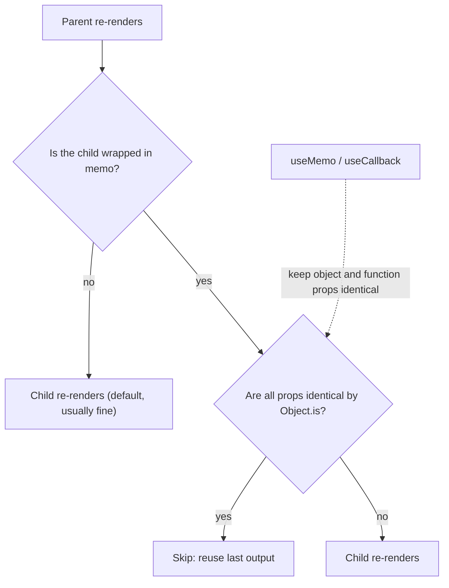

# memo, useMemo and useCallback

> **Before this lesson:** you need [State with useState](#/lesson/react/usestate) (identity comparison of objects), [useEffect and its dependency rules](#/lesson/react/useeffect) (dependency arrays) and [Composition, children and conditional rendering](#/lesson/react/composition-conditional).

## In plain words

A baker gets the same order every morning from the café next door: forty croissants. A sensible baker does not re-read the recipe and recalculate quantities each day. They keep yesterday's prep sheet and reuse it, and only redo the sums when the order changes.

Keeping the result of a piece of work and reusing it when the inputs are the same is called **memoisation** (from "memo", a note to yourself). React offers three tools for it:

- `memo` lets a **component** skip re-rendering when its props are the same as last time.
- `useMemo` remembers a **calculated value** between renders.
- `useCallback` remembers a **function** between renders.

There is a catch the baker knows too: checking whether the order changed takes a moment, and keeping notes takes shelf space. If the work is tiny, the check costs more than it saves. The most valuable skill in this lesson is knowing when *not* to memoise, and interviewers ask about exactly that.

## First, when does React re-render?

A component function is called again in three cases:

1. its own state changed,
2. a context it reads changed ([Context and global state](#/lesson/react/context-global-state)),
3. **its parent re-rendered.**

The third surprises people. By default, when a parent renders, React renders *all* its children, whether or not their props changed.

```jsx
function App() {
  const [query, setQuery] = useState("");
  return (
    <>
      <input value={query} onChange={(e) => setQuery(e.target.value)} />
      <HikeMap hikes={allHikes} />
    </>
  );
}
```

Each keystroke changes `query`, so `App` renders, so `HikeMap` renders, although `allHikes` is the same array.

Is that a problem? Usually no. Rendering means calling a function and comparing its output with the previous output; if the output is the same, React does not touch the DOM. For most components this takes a fraction of a millisecond. It becomes a problem only when a component is slow to render (a chart with thousands of points, a long list) *and* it re-renders often.

> [!TIP]
> Measure before optimising. The React Developer Tools **Profiler** tab records which components rendered and for how long; see [Project structure and performance profiling](#/lesson/react/structure-profiling). Optimising something that takes 0.2 ms adds complexity and saves nothing a user can perceive.

## Fix it without memoisation first

Two structural changes often remove the problem entirely.

**Move state down.** If only the input needs `query`, put the state in a small component that contains only the input. `App` then never re-renders on typing.

```jsx
function SearchBox() {
  const [query, setQuery] = useState("");
  return <input value={query} onChange={(e) => setQuery(e.target.value)} />;
}

function App() {
  return (
    <>
      <SearchBox />
      <HikeMap hikes={allHikes} />
    </>
  );
}
```

**Pass children through.** If a wrapper has fast-changing state, let its parent create the expensive element and pass it as `children`. The wrapper re-renders, and the `children` element is the same object as before, so React skips it.

Reach for the tools below when the structure cannot be changed.

## `memo`: skip a component when props are unchanged

```jsx
import { memo } from "react";

const HikeMap = memo(function HikeMap({ hikes }) {
  // slow drawing code
  return <canvas />;
});
```

- `memo(Component)` returns a new component that behaves the same but remembers its last props and output.
- When the parent re-renders, React compares each new prop with the previous one using `Object.is` (a **shallow comparison**: one level, by identity).
- If every prop is identical, React reuses the previous output and does not call the function.

Now typing in the search box no longer re-renders `HikeMap`, because `allHikes` is the same array every time.

`memo` does not stop re-renders caused by the component's *own* state or context. It only guards against the parent.

### How `memo` breaks: new references

The comparison is by identity. Objects, arrays and functions created during render are new on every render:

```jsx
function App() {
  const [query, setQuery] = useState("");

  const style = { height: 300 };                          // new object each render
  const handleSelect = (id) => console.log("picked", id);  // new function each render

  return (
    <>
      <input value={query} onChange={(e) => setQuery(e.target.value)} />
      <HikeMap hikes={allHikes} style={style} onSelect={handleSelect} />
    </>
  );
}
```

`style` and `handleSelect` look unchanged to you. To `Object.is` they are different objects each time, so the memoised `HikeMap` renders on every keystroke and `memo` achieved nothing except the cost of comparing. This is where the two Hooks come in.

```js-run
// Why "same contents" is not "same object".
const a = { height: 300 };
const b = { height: 300 };
console.log("Object.is(a, b):", Object.is(a, b));          // false: two objects
console.log("Object.is(a, a):", Object.is(a, a));          // true: one object

const f = () => 1;
const g = () => 1;
console.log("two identical arrows:", Object.is(f, g));     // false

function shallowEqual(p, q) {
  const keys = Object.keys(p);
  return keys.length === Object.keys(q).length && keys.every((k) => Object.is(p[k], q[k]));
}
const list = [1, 2, 3];
console.log("props with the same array:", shallowEqual({ hikes: list, n: 1 }, { hikes: list, n: 1 }));        // true
console.log("props with a fresh array :", shallowEqual({ hikes: [1, 2, 3], n: 1 }, { hikes: [1, 2, 3], n: 1 })); // false
```

## `useMemo`: remember a value

```jsx
import { useMemo } from "react";

function HikeStats({ hikes, unit }) {
  const stats = useMemo(() => computeStats(hikes), [hikes]);
  return <p>Total: {format(stats.total, unit)}</p>;
}
```

- `useMemo(calculate, dependencies)` calls `calculate` on the first render and stores the result.
- On later renders it compares the dependencies with last time, exactly like `useEffect`. If none changed, it returns the stored result without calling `calculate`.
- Here a change of `unit` re-renders the component and `computeStats` is skipped, because `hikes` is the same array.

It has two uses:

1. **Skipping an expensive calculation.** "Expensive" means measurably slow: sorting or filtering thousands of items, heavy parsing. Arithmetic, a `filter` over fifty items, or building a string are not expensive.
2. **Keeping a reference stable** so that a memoised child or an effect dependency does not see a "new" object each render:

```jsx
const style = useMemo(() => ({ height: 300 }), []);
const visible = useMemo(() => hikes.filter((h) => h.km <= maxKm), [hikes, maxKm]);
```

`useMemo` is an optimisation, not a guarantee: React may discard a cached value (for example to free memory), so your code must still be correct if the calculation runs again. Never put side effects in it.

## `useCallback`: remember a function

```jsx
import { useCallback } from "react";

function App() {
  const [query, setQuery] = useState("");
  const [selectedId, setSelectedId] = useState(null);

  const handleSelect = useCallback((id) => {
    setSelectedId(id);
  }, []);

  return (
    <>
      <input value={query} onChange={(e) => setQuery(e.target.value)} />
      <HikeMap hikes={allHikes} onSelect={handleSelect} />
    </>
  );
}
```

- `useCallback(fn, dependencies)` returns the *same function object* on every render until a dependency changes.
- It is shorthand for `useMemo(() => fn, dependencies)`.
- `[]` is honest here: the function uses only `setSelectedId`, which React guarantees is stable.
- With a stable `onSelect`, the memoised `HikeMap` skips re-rendering while the user types.

If the function reads state or props, they are dependencies, and the function is recreated when they change. To keep it stable more often, read less: the updater form (`setItems((list) => [...list, x])`) removes the need to depend on `items`.

`useCallback` on its own does nothing useful. A function is cheap to create; wrapping it only pays off when something *compares* it: a `memo` child receiving it as a prop, or a dependency array of an effect or another memo.



## When not to memoise

Every `memo`, `useMemo` and `useCallback` has costs: the comparison on each render, the memory for the cached value, and, most of all, extra code and dependency arrays that can be wrong. A wrong dependency array on `useMemo` gives stale values, the same bug as a stale effect.

| Situation | Memoise? |
|---|---|
| Cheap component, re-renders occasionally | No |
| Calculation over a handful of items | No |
| `useCallback` for a handler passed to a plain `<button>` | No: built-in elements are not memoised, nothing compares it |
| `memo` on a component whose props are new objects each time | Pointless until the props are stabilised |
| Slow component whose parent re-renders often with the same props | Yes: `memo`, plus stable props |
| Measurably slow calculation with rarely changing inputs | Yes: `useMemo` |
| Object or function used as an effect dependency | Prefer moving it inside the effect; otherwise `useMemo`/`useCallback` |
| Value provided through context | Usually yes ([Context and global state](#/lesson/react/context-global-state)) |

A sensible order of work: (1) notice a real slowness, (2) profile to find the component, (3) try moving state down or passing children, (4) memoise that component and stabilise its props, (5) profile again to confirm.

### The React Compiler

The React team ships an optional build-time tool, the **React Compiler**, which analyses your components and inserts this memoisation automatically. With it enabled you mostly stop writing `useMemo`, `useCallback` and `memo` by hand. It only works if your components follow the rules (pure rendering, no mutation of props or state), which is one more reason those rules matter. Hand-written memoisation remains in a great deal of existing code and in interview questions, so you need to understand it either way.

> [!INTERVIEW]
> "`useMemo` vs `useCallback` vs `React.memo`?" *`React.memo` wraps a component and skips its render when props are shallowly equal. `useMemo` caches a computed value between renders; `useCallback` caches a function, equivalent to `useMemo(() => fn, deps)`. The Hooks matter mostly for referential stability, so memoised children and dependency arrays see the same object. All three are optimisations with a cost; I measure first and prefer structural fixes such as moving state down.* A good follow-up remark: wrapping a handler in `useCallback` without a memoised consumer does nothing.

## Run it: count the renders

The page keeps render counters for a child component in three configurations so that you can see when `memo` works and when a fresh reference defeats it.

```html-run
<div id="root"></div>
<style>body { font-family: sans-serif; } td, th { border: 1px solid #ccc; padding: 4px 10px; } button, input { margin: 4px; }</style>
<script>
  // ---------- a miniature memo: skip when props are shallowly equal ----------
  function memo(component) {
    let previousProps = null, previousOutput = null;
    return (props) => {
      const keys = Object.keys(props);
      const same = previousProps !== null && keys.length === Object.keys(previousProps).length &&
        keys.every((k) => Object.is(props[k], previousProps[k]));
      if (same) return previousOutput;                    // skip
      previousProps = props;
      return (previousOutput = component(props));
    };
  }
  // ---------- a miniature useCallback / useMemo for one slot each ----------
  function makeMemoSlot() {
    let deps = null, value;
    return (create, nextDeps) => {
      if (deps === null || nextDeps.some((d, i) => !Object.is(d, deps[i]))) { value = create(); deps = nextDeps; }
      return value;
    };
  }

  const counts = { plain: 0, memoFresh: 0, memoStable: 0 };
  const makeChild = (name) => (props) => { counts[name]++; return `${props.hikes.length} hikes`; };
  const Plain = makeChild("plain");
  const MemoFresh = memo(makeChild("memoFresh"));
  const MemoStable = memo(makeChild("memoStable"));
  const useCallbackSlot = makeMemoSlot();

  const allHikes = ["Ridge Loop", "Fern Gully", "Salt Marsh"];   // same array object every render
  let query = "";

  function App() {                                              // the parent "render"
    const freshHandler = (id) => console.log(id);               // new function each render
    const stableHandler = useCallbackSlot(() => (id) => console.log(id), []);   // same function each render

    Plain({ hikes: allHikes, onSelect: freshHandler });
    MemoFresh({ hikes: allHikes, onSelect: freshHandler });
    MemoStable({ hikes: allHikes, onSelect: stableHandler });
  }

  function draw() {
    App();
    document.getElementById("root").innerHTML = `
      <label>Type to re-render the parent: <input id="q" value="${query}" /></label>
      <table>
        <tr><th>Child</th><th>Times rendered</th></tr>
        <tr><td>no memo</td><td>${counts.plain}</td></tr>
        <tr><td>memo + new function prop each render</td><td>${counts.memoFresh}</td></tr>
        <tr><td>memo + useCallback function prop</td><td>${counts.memoStable}</td></tr>
      </table>`;
    const input = document.getElementById("q");
    input.focus(); input.setSelectionRange(query.length, query.length);
    input.addEventListener("input", (event) => { query = event.target.value; draw(); });
  }
  draw();
</script>
```

Type a few characters. The first two rows climb together: `memo` with a fresh function prop is no better than no `memo`. The third row stays at 1. Now change `[]` in `useCallbackSlot` to `[query]` and type again: the "stable" handler is recreated on every keystroke, and the third row climbs too. The problems *Shallow equal vs deep equal* and *memo: skip renders with shallow props* have you write these comparisons yourself.

## Pitfalls

> [!WARNING]
> **Memoising everything "to be safe".** It makes components harder to read, adds dependency arrays that can go stale, and can make the app slower through comparison overhead. Default to no memoisation.

- **`memo` with unstable props.** Inline objects (`style={{...}}`), arrays (`items={[...]}`), functions (`onClick={() => ...}`) and JSX children are new each render.
- **Wrong or missing dependencies** in `useMemo`/`useCallback`: stale values and handlers that see old state. Follow the linter.
- **Using `useMemo` for correctness** ("it must only run once"). React may recompute. Use an effect or a ref for run-once work.
- **Side effects inside `useMemo`.** It runs during render and must be pure.
- **Expecting `memo` to stop re-renders from own state or context.**
- **Fixing a slow list with `memo` when the real issue is size.** Thousands of rows need *virtualisation* (rendering only the visible rows) with a library such as TanStack Virtual.
- **Passing a custom comparison to `memo`** that ignores a prop (for example a handler): the child keeps an outdated function. Rarely worth it.

## Cheat sheet

| Tool | What it remembers | Recomputed when | Typical use |
|---|---|---|---|
| `memo(Component)` | the component's last output | a prop is not `Object.is`-equal | slow child, often re-rendered parent |
| `useMemo(() => value, deps)` | a value | a dependency changes | slow calculation; stable object/array |
| `useCallback(fn, deps)` | a function | a dependency changes | handler passed to a `memo` child; effect dependency |
| Move state down | (nothing) | | shrink what re-renders |
| `children` pass-through | (nothing) | | wrapper with fast state |
| React Compiler | automatic | automatic | replaces most manual memoisation |

## Summary

- A component re-renders when its state or context changes, or when its parent renders. Re-rendering is usually cheap.
- Measure first; then try structural fixes (move state down, pass children).
- `memo` skips a component whose props are shallowly equal to last time.
- Objects and functions created during render defeat `memo`; `useMemo` and `useCallback` keep them referentially stable.
- `useMemo` also avoids repeating slow calculations.
- Memoisation has a cost and can hide stale-dependency bugs; use it where a measurement shows a benefit.

## Glossary

- **Memoisation**: storing the result of work to reuse it when the inputs repeat.
- **Re-render**: React calling a component function again.
- **Shallow comparison**: comparing two objects one level deep, each value by identity.
- **Referential equality / stability**: two variables pointing to the very same object / a value keeping the same identity across renders.
- **`Object.is`**: JavaScript's identity comparison used by React.
- **Cache**: the stored result kept for reuse.
- **Profiler**: a tool that records render timings.
- **Virtualisation**: rendering only the rows of a long list that are currently visible.
- **React Compiler**: a build-time tool that adds memoisation automatically.

## Check yourself

```quiz
[
  {"q": "A parent re-renders. Its child is a normal component whose props did not change. By default, does the child's function run again?",
   "options": ["No, React compares props automatically", "Yes, children re-render with their parent unless memoised", "Only in development", "Only if it has state"],
   "answer": 1,
   "explain": "Default behaviour is to render the whole subtree. memo opts a component into prop comparison."},
  {"q": "const Row = memo(RowImpl); the parent renders <Row item={item} onPick={() => pick(item.id)} /> ten times with the same item object. How many times does RowImpl run?",
   "options": ["1", "10", "2", "0"],
   "answer": 1,
   "explain": "The arrow function is a new object on every render, so the shallow comparison fails each time."},
  {"q": "Same as above, but onPick is created with useCallback and unchanging dependencies. How many times does RowImpl run?",
   "options": ["10", "1", "5", "0"],
   "answer": 1,
   "explain": "Both props are now identical between renders, so memo skips after the first render."},
  {"q": "useCallback(fn, deps) is equivalent to which expression?",
   "options": ["useMemo(fn, deps)", "useMemo(() => fn, deps)", "useEffect(fn, deps)", "memo(fn)"],
   "answer": 1,
   "explain": "useMemo caches the result of calling its function; to cache a function you return it from that function."},
  {"q": "Which use of useMemo is justified?",
   "options": ["const total = useMemo(() => a + b, [a, b])", "const sorted = useMemo(() => sortTenThousandRows(rows), [rows]), after profiling showed the sort is slow", "const name = useMemo(() => first + ' ' + last, [first, last])", "Wrapping every variable to be safe"],
   "answer": 1,
   "explain": "Memoise measurably expensive work. Additions and string joins cost less than the dependency comparison."},
  {"q": "A handler is wrapped in useCallback and passed to a plain <button onClick={handler}>. What performance benefit does this give?",
   "options": ["The button re-renders less", "None by itself: nothing compares the function's identity", "It prevents the parent from re-rendering", "It makes clicks faster"],
   "answer": 1,
   "explain": "Stable identity only matters to a consumer that checks it, such as a memo component or a dependency array."},
  {"q": "What is usually the first thing to try when typing in an input makes an unrelated heavy component re-render?",
   "options": ["Wrap everything in useMemo", "Move the input's state into a smaller component so the heavy one is no longer below the changing state", "Use a ref for the input", "Disable Strict Mode"],
   "answer": 1,
   "explain": "Restructuring so the state change does not reach the heavy component removes the problem without memoisation."},
  {"q": "A memo component has its own useState. Its setter is called with a new value while the parent does not render. Does it re-render?",
   "options": ["No, memo blocks it", "Yes, memo only skips re-renders triggered by the parent when props are equal", "Only if props changed too", "Only once per second"],
   "answer": 1,
   "explain": "Own state and context changes always re-render the component."}
]
```

> **Source:** Wieruch, *The Road to React*, "Fundamentals of React": Memoized Handler in React (Advanced); "React Maintenance": Performance in React (Advanced). Documentation: https://react.dev/reference/react/memo, https://react.dev/reference/react/useMemo, https://react.dev/reference/react/useCallback, https://react.dev/learn/react-compiler
