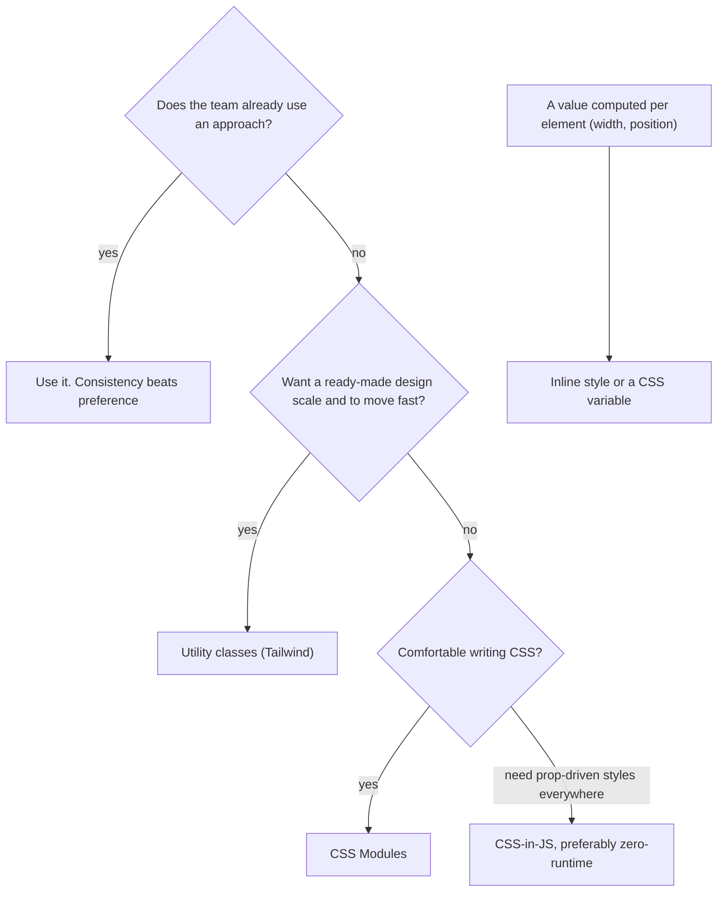

# Styling approaches

> **Before this lesson:** you need [JSX, components and props](#/lesson/react/jsx-components-props) and basic CSS: selectors, classes, the cascade and specificity. The [HTML & CSS track](#/track/html-css) teaches those from zero.

## In plain words

Picture a shared wardrobe in a house of ten people. If everyone labels their clothes "shirt" and "jacket", people end up wearing each other's things. You can solve it in several ways: agree on name tags ("Ana-shirt"), give each person their own locked cupboard, sew each person's name into the garment itself, or issue everyone the same small set of standard pieces to combine.

CSS has the same shared-wardrobe problem. **CSS** (Cascading Style Sheets) is the language that controls how elements look. By default every rule is **global**: a rule for `.card` written for one component applies to every element with that class anywhere on the page. In a large application two people will, sooner or later, pick the same class name.

React does not prescribe a styling method. The main approaches are four answers to that one problem, and job adverts will name whichever one a team picked. You should be able to read all of them and argue the trade-offs.

## Approach 0: inline styles

The `style` prop takes a JavaScript object:

```jsx
function DistanceBar({ km, maxKm }) {
  return (
    <div style={{ background: "#eee", borderRadius: 4 }}>
      <div style={{ width: `${(km / maxKm) * 100}%`, height: 8, background: "seagreen" }} />
    </div>
  );
}
```

- The outer braces mean "JavaScript", the inner ones are the object.
- Property names are camelCase (`borderRadius`, not `border-radius`).
- A bare number means pixels for most properties (`height: 8` is `8px`).
- The inner bar's `width` is computed from props, which is the legitimate use: values that are truly dynamic.

Inline styles cannot express hover or focus states, media queries (rules that depend on screen size) or animations, they are repeated on every element, and they override almost everything, which makes later changes awkward. Use them for computed values and little else.

## Approach 1: plain CSS files and `className`

```css
/* HikeCard.css */
.hike-card { border: 1px solid #ccc; border-radius: 8px; padding: 12px; }
.hike-card--done { opacity: 0.6; }
.hike-card__title { margin: 0; font-size: 1.1rem; }
```

```jsx
import "./HikeCard.css";

function HikeCard({ hike }) {
  return (
    <article className={hike.done ? "hike-card hike-card--done" : "hike-card"}>
      <h3 className="hike-card__title">{hike.name}</h3>
    </article>
  );
}
```

- `import "./HikeCard.css";` tells Vite to include the file in the page. It does **not** restrict the rules to this component: they are still global.
- `className` is a string, so conditional styling is string building.
- The naming scheme `block__element--modifier` (known as **BEM**) is a convention for making class names unique by hand.

Conditional classes get noisy quickly. A common pattern builds the string from an array, and many projects use the tiny `clsx` library for the same thing:

```jsx
const classes = ["hike-card", hike.done && "hike-card--done", isSelected && "hike-card--selected"]
  .filter(Boolean)
  .join(" ");

// with clsx: clsx("hike-card", { "hike-card--done": hike.done, "hike-card--selected": isSelected })
```

`.filter(Boolean)` drops the `false` entries left by the `&&` expressions; `.join(" ")` glues the rest together with spaces.

**Strengths:** nothing new to learn, full CSS power, fastest at run time. **Weakness:** global names; avoiding collisions depends on discipline.

## Approach 2: CSS Modules

A **CSS Module** is a normal CSS file whose class names the build tool makes unique automatically. In Vite, name the file `*.module.css`.

```css
/* HikeCard.module.css */
.card { border: 1px solid #ccc; border-radius: 8px; padding: 12px; }
.done { opacity: 0.6; }
.title { margin: 0; font-size: 1.1rem; }
```

```jsx
import styles from "./HikeCard.module.css";

function HikeCard({ hike }) {
  return (
    <article className={`${styles.card} ${hike.done ? styles.done : ""}`}>
      <h3 className={styles.title}>{hike.name}</h3>
    </article>
  );
}
```

- `import styles from ...` gives you an object. `styles.card` is a string such as `"_card_1x9fk_1"`: your name plus a generated suffix.
- In the built page the rule is `._card_1x9fk_1 { ... }`. Another component can have its own `.card` without any clash.
- You keep writing ordinary CSS, including `:hover` and media queries.

This is called **scoping**: limiting where a style applies. CSS Modules scope by renaming at build time, with no cost in the browser. They are a solid default for a project without a design system.

## Approach 3: CSS-in-JS

**CSS-in-JS** libraries let you write styles inside your JavaScript files and attach them to components. The best-known is styled-components (Emotion is similar):

```jsx
import styled from "styled-components";

const Card = styled.article`
  border: 1px solid #ccc;
  border-radius: 8px;
  padding: 12px;
  opacity: ${(props) => (props.$done ? 0.6 : 1)};

  &:hover {
    border-color: seagreen;
  }
`;

function HikeCard({ hike }) {
  return (
    <Card $done={hike.done}>
      <h3>{hike.name}</h3>
    </Card>
  );
}
```

- `` styled.article`...` `` is a **tagged template literal**: a function (`styled.article`) called with the text between the backticks. It returns a React component that renders an `<article>` with a generated unique class.
- `${(props) => ...}` is a function evaluated with the component's props, so styles can depend on them directly.
- `$done` starts with a dollar sign so the library knows not to forward it to the DOM as an attribute.
- `&:hover` means "this element, when hovered".

**Strengths:** styles live next to the component, are scoped automatically, and can use props and a shared **theme** object. **Weaknesses:** the classic libraries generate CSS while the app runs, which costs time on every render and adds to the download size, and they need extra setup for server rendering and do not work inside React Server Components. For those reasons much of the ecosystem has moved towards approaches that produce CSS at build time (CSS Modules, utility classes, or "zero-runtime" CSS-in-JS such as vanilla-extract).

## Approach 4: utility classes (Tailwind CSS)

A **utility class** does one small thing: `p-3` sets padding, `rounded-lg` rounds corners, `text-sm` sets a font size. You style by combining them in `className`.

```jsx
function HikeCard({ hike }) {
  return (
    <article className={`rounded-lg border border-gray-300 p-3 hover:border-green-600 ${hike.done ? "opacity-60" : ""}`}>
      <h3 className="m-0 text-lg font-semibold">{hike.name}</h3>
    </article>
  );
}
```

- Each word is a class from a fixed vocabulary. `hover:border-green-600` applies on hover; `md:p-6` would apply from medium screens upward.
- A build step scans your files and generates CSS only for the classes you used.
- There are no class names to invent and no separate file, so there is nothing to collide.

**Strengths:** fast to write once learned, consistent spacing and colours from a shared scale, small CSS output, no naming. **Weaknesses:** long `className` strings, a vocabulary to memorise, and repeated combinations that you remove by extracting *components* (a `<Button>`), not by copying class lists.

## Comparing the approaches

| | Scoped? | Dynamic values | Run-time cost | Pseudo-classes, media queries | Learning curve |
|---|---|---|---|---|---|
| Inline `style` | per element | easy | none | no | none |
| Plain CSS | no (global) | via classes or CSS variables | none | yes | none |
| CSS Modules | yes (build time) | via classes or CSS variables | none | yes | low |
| CSS-in-JS (runtime) | yes | via props | some | yes | medium |
| Utility classes | not needed | via class switching | none | yes (prefixes) | medium |



### A technique that works with all of them: CSS variables

A **CSS custom property** (often called a CSS variable) is a named value defined in CSS and read with `var(--name)`. It bridges React state and stylesheets cleanly:

```jsx
<div className="distance-bar" style={{ "--fill": `${percent}%` }} />
```

```css
.distance-bar::before { content: ""; display: block; height: 8px; width: var(--fill); background: seagreen; }
```

React sets one variable; the stylesheet decides how to use it. Theming works the same way: define `--bg` and `--text` on the root element, override them under `[data-theme="dark"]`, and switch themes by changing one attribute from React.

## Component libraries

Many teams do not style from scratch. A **component library** provides ready-made buttons, dialogs and menus. Two families exist: fully styled kits (MUI, Chakra UI, Mantine) and "headless" libraries (Radix UI, React Aria) that supply behaviour and accessibility with no styles, which you then style with any approach above. shadcn/ui is a popular collection of copy-into-your-project components built from Radix and Tailwind.

## SVG icons

**SVG** (Scalable Vector Graphics) is an image format written as markup, so it can sit directly in JSX and be styled:

```jsx
function CheckIcon({ size = 16 }) {
  return (
    <svg width={size} height={size} viewBox="0 0 24 24" fill="none" stroke="currentColor" strokeWidth="2" aria-hidden="true">
      <path d="M5 13l4 4L19 7" />
    </svg>
  );
}
```

- Attributes are camelCase in JSX (`strokeWidth`, `viewBox`).
- `stroke="currentColor"` makes the icon take the surrounding text colour, so it follows your styles.
- `aria-hidden="true"` hides a decorative icon from screen readers; an icon that is the only content of a button needs a label on the button (`aria-label="Mark done"`).

## Run it: global collisions and scoped names

Real CSS works in this live page, so you can watch the global-scope problem and the fix. The script imitates what a CSS Modules build does: it renames classes with a unique suffix per "file".

```html-run
<style>
  body { font-family: sans-serif; }
  /* --- "HikeCard.css", written by one developer --- */
  .card { border: 2px solid seagreen; border-radius: 8px; padding: 8px; margin: 6px 0; }
  .title { margin: 0; color: seagreen; }
  /* --- "PriceCard.css", written by another developer, later in the bundle --- */
  .card { border: 2px dashed crimson; background: #fff3f3; }
  .title { text-transform: uppercase; }
</style>

<h4>Global CSS: both components use .card and .title</h4>
<div class="card"><p class="title">Ridge Loop (hike card)</p></div>
<div class="card"><p class="title">Season pass (price card)</p></div>

<h4>Scoped, the way CSS Modules do it</h4>
<div id="scoped"></div>
<label><input type="checkbox" id="done" /> mark the hike as done (conditional class)</label>

<script>
  // What the build tool does: rename every class with a per-file suffix and hand you a lookup object.
  function cssModule(fileId, rules) {
    const styles = {};
    let css = "";
    for (const [name, body] of Object.entries(rules)) {
      styles[name] = `_${name}_${fileId}`;                 // e.g. "_card_h1k3"
      css += `.${styles[name]} { ${body} }\n`;
    }
    document.head.appendChild(Object.assign(document.createElement("style"), { textContent: css }));
    return styles;
  }
  const hikeStyles = cssModule("h1k3", {
    card: "border: 2px solid seagreen; border-radius: 8px; padding: 8px; margin: 6px 0;",
    title: "margin: 0; color: seagreen;",
    done: "opacity: 0.45; text-decoration: line-through;",
  });
  const priceStyles = cssModule("pr1c", {
    card: "border: 2px dashed crimson; background: #fff3f3; padding: 8px; margin: 6px 0;",
    title: "margin: 0; text-transform: uppercase;",
  });

  function draw(done) {
    const cardClass = [hikeStyles.card, done && hikeStyles.done].filter(Boolean).join(" ");   // conditional classes
    document.getElementById("scoped").innerHTML = `
      <div class="${cardClass}"><p class="${hikeStyles.title}">Ridge Loop (class: ${cardClass})</p></div>
      <div class="${priceStyles.card}"><p class="${priceStyles.title}">Season pass (class: ${priceStyles.card})</p></div>`;
  }
  document.getElementById("done").addEventListener("change", (event) => draw(event.target.checked));
  draw(false);
</script>
```

In the first pair, both cards have a dashed crimson border and upper-case green titles: the second developer's rules leaked onto the hike card and the first developer's colour leaked onto the price card. In the second pair each card looks as intended, because the generated names differ. Tick the checkbox to see a conditional class being added by the array-filter-join pattern.

## Pitfalls

> [!WARNING]
> **Assuming `import "./X.css"` scopes the styles to component X.** It does not. Only files named `*.module.css` (or a CSS-in-JS or utility approach) give scoping.

- **`class` instead of `className`,** and `style="color: red"` as a string instead of an object.
- **`className={isDone && "done"}`** produces `className={false}`, which React omits, so it happens to work; inside a template string it prints the word `false`. Use a ternary with `""` or `filter(Boolean)`.
- **Inline styles for everything.** No hover, no media queries, and they win over stylesheet rules.
- **Building utility class names dynamically** (`` `text-${color}-600` ``). The build step looks for complete class names in your source and will not generate these. Map values to full class names instead.
- **Defining a styled component inside a component function.** A new component is created on every render, remounting the element each time. Define them at module level.
- **Mixing three approaches in one codebase.** Pick one primary approach and keep exceptions rare.
- **Hard-coding colours everywhere.** Use variables or theme tokens so that a redesign or dark mode is one change.

> [!TIP]
> Whatever tool you use, the unit of reuse in React is the component. If you repeat the same six classes or the same CSS block in three places, create a `<Card>` or `<Button>` component and style it once.

> [!INTERVIEW]
> "How do you style React applications?" Name the options and a trade-off for each: *global CSS (simple, collisions), CSS Modules (scoped at build time, plain CSS), CSS-in-JS (colocated and prop-driven, with run-time cost and limits in server components), utility-first CSS such as Tailwind (fast and consistent, verbose markup).* Then say which you would pick for a given team and why. A balanced comparison is the answer they want.

## Cheat sheet

| Task | Code |
|---|---|
| Class | `className="card"` |
| Conditional class | `` className={`card ${done ? "card--done" : ""}`} `` |
| Several conditions | `[a, cond && b].filter(Boolean).join(" ")` or `clsx(...)` |
| Inline dynamic value | `style={{ width: pct + "%" }}` |
| CSS variable from React | `style={{ "--fill": value }}` + `var(--fill)` in CSS |
| CSS Module | `import styles from "./X.module.css"` → `className={styles.card}` |
| styled-components | ``const Box = styled.div`padding: 8px;` `` |
| Tailwind | `className="p-3 rounded-lg hover:bg-gray-100"` |
| Icon follows text colour | `stroke="currentColor"` / `fill="currentColor"` |
| Dark mode | CSS variables switched by a `data-theme` attribute |

## Summary

- CSS is global by default; the styling approaches differ mainly in how they prevent name collisions.
- Plain CSS with `className` is the baseline; CSS Modules add automatic scoping with zero run-time cost.
- CSS-in-JS colocates styles and uses props, at a run-time cost for the classic libraries.
- Utility classes compose a fixed vocabulary directly in JSX and need no names.
- Inline styles and CSS variables are for truly dynamic values.
- Consistency within a codebase matters more than which approach is chosen.

## Glossary

- **CSS**: the language describing how HTML elements look.
- **Global scope**: a style rule applying everywhere on the page.
- **Scoping**: restricting a style to one component.
- **Specificity**: the rule deciding which of several matching CSS rules wins.
- **BEM**: a hand-written naming convention (`block__element--modifier`).
- **CSS Module**: a CSS file whose class names are made unique at build time.
- **CSS-in-JS**: writing styles in JavaScript, attached to components by a library.
- **Tagged template literal**: a function called with a backtick string, as in `` styled.div`...` ``.
- **Utility class**: a class that sets one style property.
- **CSS custom property**: a variable defined in CSS (`--name`) and read with `var(--name)`.
- **Component library**: a package of ready-made UI components.
- **SVG**: a markup-based vector image format.

## Check yourself

```quiz
[
  {"q": "Two components each import their own CSS file, and both files define .title. What happens?",
   "options": ["Each rule applies only to its own component", "Both rules apply to every element with class title on the page, and the later rule wins conflicts", "The build fails", "The second file is ignored"],
   "answer": 1,
   "explain": "Plain CSS imports are global. Importing from a component file does not scope the rules."},
  {"q": "With import styles from './Card.module.css', what is styles.card?",
   "options": ["A CSS rule object", "A generated unique class name string", "A React component", "undefined until render"],
   "answer": 1,
   "explain": "The build renames .card to something unique and exports the mapping, so className={styles.card} applies that rule only."},
  {"q": "Which of these cannot be done with the inline style prop?",
   "options": ["A width computed from props", "A :hover state", "A background colour", "A font size"],
   "answer": 1,
   "explain": "Inline styles apply to the element itself and cannot express pseudo-classes or media queries."},
  {"q": "What does this render: <p style={{ fontSize: 14, marginTop: 8 }}>Hi</p>?",
   "options": ["An error, numbers need units", "A paragraph with font-size 14px and margin-top 8px", "A paragraph with no styles", "font-size: 14em"],
   "answer": 1,
   "explain": "React appends px to bare numbers for most properties, and camelCase names map to the dashed CSS names."},
  {"q": "What is a commonly cited drawback of runtime CSS-in-JS libraries?",
   "options": ["They cannot scope styles", "They generate styles while the app runs, adding work and bundle size, and they do not work in Server Components", "They do not support hover", "They require class components"],
   "answer": 1,
   "explain": "Scoping and dynamic styles are their strengths; the cost is paid at run time."},
  {"q": "className={[\"card\", done && \"card--done\", false && \"x\"].filter(Boolean).join(\" \")} with done = true gives which string?",
   "options": ["card card--done false", "card card--done", "card", "card,card--done"],
   "answer": 1,
   "explain": "filter(Boolean) removes the false entries and join puts single spaces between the rest."},
  {"q": "Why is `text-${color}-600` a problem with Tailwind?",
   "options": ["Template strings are not allowed in className", "The build scans source code for complete class names and will not find or generate a name assembled at run time", "Tailwind has no colours", "It is slower"],
   "answer": 1,
   "explain": "Write full class names and choose between them, for example with an object lookup."},
  {"q": "A team has an existing codebase using CSS Modules throughout. You prefer Tailwind. What is the reasonable choice for a new component?",
   "options": ["Tailwind, to show the better way", "CSS Modules, because consistency in a codebase outweighs personal preference", "Inline styles", "A third approach to stay neutral"],
   "answer": 1,
   "explain": "Mixed approaches raise the cost of every future change. Propose a migration separately if you believe in it."}
]
```

> **Source:** Wieruch, *The Road to React*, "Styling in React": CSS in React, CSS Modules in React, Styled Components in React, SVGs in React. Documentation: https://react.dev/learn#adding-styles, https://vite.dev/guide/features#css-modules, https://tailwindcss.com/docs, https://styled-components.com/docs
