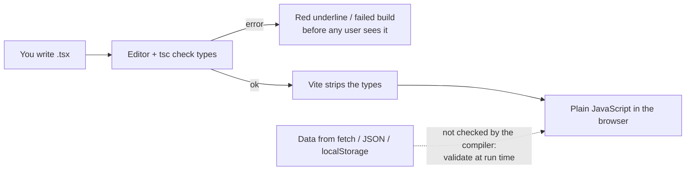

# TypeScript with React

> **Before this lesson:** you need props, state, events, refs and reducers from the earlier lessons of this track, up to [useReducer and impossible states](#/lesson/react/usereducer). No TypeScript experience is assumed, although [TypeScript basics: types, interfaces, generics, narrowing](#/lesson/javascript/typescript-basics) in the JavaScript track makes a good companion.

## In plain words

Flat-pack furniture comes with pegs and holes of particular shapes. A round peg will not go into a square hole, and you discover that while assembling, not three weeks later when the shelf collapses.

**TypeScript** adds shaped holes to JavaScript. You declare what kind of value each variable, function parameter and component prop accepts (a **type**: a description of the allowed values), and a program called the **compiler** checks every use *before the code runs*. Pass a number where a string is expected, forget a required prop, misspell a field name: your editor underlines it at once.

The types are removed when the code is built. Browsers receive ordinary JavaScript, so TypeScript costs nothing at run time. Most professional React codebases use it, and many job adverts list it next to React.

## What problem does it solve?

In JavaScript this component looks fine:

```jsx
function HikeCard({ hike, onSelect }) {
  return <li onClick={() => onSelect(hike.id)}>{hike.name.toUpperCase()}</li>;
}

<HikeCard hikes={someHike} />
```

There are two mistakes at the call site: the prop is spelt `hikes` instead of `hike`, and `onSelect` is missing. JavaScript says nothing until a user loads the page (`Cannot read properties of undefined`) and later clicks (`onSelect is not a function`). With types, both are reported while you type, with the exact location.

The second benefit is as large: the editor knows what every value is, so it can autocomplete field names, show a component's props when you hover over it, and rename a field safely across hundreds of files.

## Setting up

Create a project with the TypeScript template:

```bash
npm create vite@latest trail-log -- --template react-ts
```

Files containing JSX use the extension `.tsx`; other TypeScript files use `.ts`. One important detail about Vite: it removes the types to produce JavaScript quickly but does **not** check them. Checking is done by your editor and by running the compiler, `tsc`. The template's build script runs `tsc -b` before bundling, so a type error fails the build. Keep `"strict": true` in `tsconfig.json`; it switches on the checks that catch real bugs, especially around `null` and `undefined`.

## The handful of TypeScript you need first

```tsx
let km: number = 7.5;                        // a number
let name: string = "Ridge Loop";             // a string
let done: boolean = false;                   // true or false
let tags: string[] = ["views", "steep"];     // an array of strings
let difficulty: "easy" | "moderate" | "hard" = "easy";   // one of exactly three strings

type Hike = {
  id: string;
  name: string;
  km: number;
  difficulty: "easy" | "moderate" | "hard";
  notes?: string;                            // optional: may be missing
};
```

- `: number` after a name is a **type annotation**.
- `"easy" | "moderate" | "hard"` is a **union type**: the value must be one of the listed alternatives. Unions of string literals replace loose strings for things like statuses.
- `type Hike = { ... }` gives a name to an object shape. (`interface Hike { ... }` does almost the same for objects; teams pick one style.)
- `notes?: string` marks a property as optional. Its type becomes `string | undefined`, and TypeScript forces you to handle the missing case before using it.

You rarely annotate local variables, because TypeScript **infers** types: `const total = 3 * 2.5` is known to be a number without your saying so. You annotate the *boundaries*: props, function parameters, and data arriving from outside.

## Typing props

```tsx
type HikeCardProps = {
  hike: Hike;
  isSelected?: boolean;
  onSelect: (id: string) => void;
  children?: React.ReactNode;
};

function HikeCard({ hike, isSelected = false, onSelect, children }: HikeCardProps) {
  return (
    <li className={isSelected ? "selected" : ""} onClick={() => onSelect(hike.id)}>
      {hike.name} ({hike.km} km)
      {children}
    </li>
  );
}
```

- `HikeCardProps` describes the props object. `{ ... }: HikeCardProps` annotates the destructured parameter.
- `isSelected?: boolean` is optional, with a default value in the destructuring.
- `onSelect: (id: string) => void` is a **function type**: it takes a string and returns nothing useful (`void`).
- `React.ReactNode` means "anything React can render": elements, strings, numbers, arrays of those, `null`. It is the type for `children`.

Now the faulty call from earlier is caught:

```tsx
<HikeCard hikes={someHike} />
// Error: Property 'hikes' does not exist... Did you mean 'hike'?
// Error: Property 'onSelect' is missing...
```

You do not annotate the return type; TypeScript infers that the component returns JSX. You may see `const HikeCard: React.FC<HikeCardProps> = ...` in older code. It works, but annotating the props parameter directly, as above, is the current common style.

To accept every attribute of a built-in element plus your own, extend the element's prop type:

```tsx
type ButtonProps = React.ComponentPropsWithoutRef<"button"> & { variant?: "primary" | "danger" };

function Button({ variant = "primary", className = "", ...rest }: ButtonProps) {
  return <button className={`btn btn-${variant} ${className}`} {...rest} />;
}
```

`React.ComponentPropsWithoutRef<"button">` is every prop a `<button>` accepts (`onClick`, `disabled`, `type`, …). `&` combines two object types. `...rest` collects the remaining props and forwards them.

## Typing state

```tsx
const [count, setCount] = useState(0);                  // inferred: number
const [query, setQuery] = useState("");                 // inferred: string

const [hikes, setHikes] = useState<Hike[]>([]);         // [] alone would be inferred as never[]
const [selected, setSelected] = useState<Hike | null>(null);
```

- For simple initial values inference is enough.
- `useState<Hike[]>([])` passes a **type argument** in angle brackets. An empty array gives TypeScript nothing to infer from, so you say what it will hold.
- `Hike | null` states that there may be no selection. TypeScript then refuses `selected.name` until you have checked for `null`:

```tsx
if (selected === null) return <p>Pick a hike.</p>;
return <p>{selected.name}</p>;   // here TypeScript knows selected is a Hike
```

That refinement of a type by a check is called **narrowing**. An equivalent shortcut for "use if present" is optional chaining: `selected?.name`.

## Typing events and refs

Inline handlers need no annotation, because TypeScript knows what `onChange` on an `<input>` supplies:

```tsx
<input onChange={(e) => setQuery(e.target.value)} />
```

A separately declared handler needs the event type spelled out:

```tsx
function handleChange(event: React.ChangeEvent<HTMLInputElement>) {
  setQuery(event.target.value);
}

function handleSubmit(event: React.FormEvent<HTMLFormElement>) {
  event.preventDefault();
}

function handleClick(event: React.MouseEvent<HTMLButtonElement>) {}
```

The pattern is `React.<Kind>Event<Element>`. You do not need to memorise them: write the handler inline, hover over the parameter in your editor, and copy the type it shows.

Refs take the element type and start as `null`:

```tsx
const inputRef = useRef<HTMLInputElement>(null);

function focusInput() {
  inputRef.current?.focus();
}
```

`inputRef.current` has type `HTMLInputElement | null`, because the element does not exist before mounting. `?.` calls `focus` only when it is not `null`.

## Typing a reducer: impossible states, enforced

This is where TypeScript and the previous lessons meet. Describe each state and each action as a member of a union with a shared tag field. That is a **discriminated union**.

```tsx
type FetchState =
  | { status: "idle" }
  | { status: "loading" }
  | { status: "success"; hikes: Hike[] }
  | { status: "error"; message: string };

type FetchAction =
  | { type: "started" }
  | { type: "succeeded"; hikes: Hike[] }
  | { type: "failed"; message: string };

function fetchReducer(state: FetchState, action: FetchAction): FetchState {
  switch (action.type) {
    case "started":
      return { status: "loading" };
    case "succeeded":
      return { status: "success", hikes: action.hikes };
    case "failed":
      return { status: "error", message: action.message };
  }
}
```

- `FetchState` has four alternatives. `hikes` exists *only* in the success alternative and `message` *only* in the error one. "Loading with an error message" is not a value of this type at all.
- Inside `case "succeeded":` TypeScript has narrowed `action` to the alternative that has `hikes`, so `action.hikes` is allowed there and nowhere else.
- `dispatch({ type: "suceeded" })` (misspelt) or `dispatch({ type: "succeeded" })` (missing `hikes`) is a compile error.

The same narrowing protects rendering:

```tsx
function HikePanel({ state }: { state: FetchState }) {
  switch (state.status) {
    case "idle":
      return null;
    case "loading":
      return <p>Loading…</p>;
    case "error":
      return <p role="alert">{state.message}</p>;
    case "success":
      return <HikeList hikes={state.hikes} />;
    default: {
      const unreachable: never = state;
      return unreachable;
    }
  }
}
```

The `default` branch is an **exhaustiveness check**. `never` is the type with no values. If every alternative has been handled, `state` is `never` there and the assignment is fine. If someone later adds a fifth status and forgets this component, `state` is no longer `never`, and the build fails pointing at this line.



## Generics: components and hooks that work for any type

A **generic** is a type with a placeholder that is filled in at each use. `useState<Hike[]>` is a generic in action. You can write your own:

```tsx
type ListProps<T> = {
  items: T[];
  getKey: (item: T) => string;
  renderItem: (item: T) => React.ReactNode;
};

function List<T>({ items, getKey, renderItem }: ListProps<T>) {
  return <ul>{items.map((item) => <li key={getKey(item)}>{renderItem(item)}</li>)}</ul>;
}

<List items={hikes} getKey={(h) => h.id} renderItem={(h) => h.name} />
```

- `<T>` declares the placeholder. `items: T[]` and `(item: T) => ...` use it.
- At the call site TypeScript sees that `hikes` is `Hike[]`, concludes `T` is `Hike`, and therefore knows `h` is a `Hike` inside both arrow functions, with autocomplete for `h.id` and `h.name`.

Custom hooks are typed the same way:

```tsx
function useStoredState<T>(key: string, initial: T): [T, (value: T) => void] { /* ... */ }
```

The return type `[T, (value: T) => void]` is a **tuple**: an array with a fixed length and a known type at each position.

## The boundary: types do not validate data

Types exist only at compile time. This line compiles and proves nothing:

```tsx
const hikes: Hike[] = await response.json();
```

`response.json()` returns `any` ("unchecked, anything goes"), and assigning it to `Hike[]` is a promise *you* are making. If the server sends something else, the mistake appears far from here as `undefined` on screen. At real boundaries (network responses, `localStorage`, URL parameters, form input) validate at run time. Schema libraries such as Zod do this and give you the type for free:

```tsx
const HikeSchema = z.object({ id: z.string(), name: z.string(), km: z.number() });
type Hike = z.infer<typeof HikeSchema>;

const hikes = z.array(HikeSchema).parse(await response.json());   // throws if the shape is wrong
```

## Run it: what the checker would have caught

TypeScript cannot run in this page, so the simulation below does at run time, with a tiny shape checker, what the compiler does before your code ever runs. It checks three "call sites" against a prop description and then shows discriminated-union handling in plain JavaScript.

```js-run
// A very small stand-in for the type checker: compare props against a description.
const HikeCardProps = {
  hike: { required: true, check: (v) => v && typeof v.name === "string" && typeof v.km === "number", expects: "Hike" },
  isSelected: { required: false, check: (v) => typeof v === "boolean", expects: "boolean" },
  onSelect: { required: true, check: (v) => typeof v === "function", expects: "(id: string) => void" },
};

function checkProps(description, props) {
  const problems = [];
  for (const [name, rule] of Object.entries(description)) {
    if (!(name in props)) { if (rule.required) problems.push(`Property '${name}' is missing`); }
    else if (!rule.check(props[name])) problems.push(`'${name}' is not assignable to type ${rule.expects}`);
  }
  for (const name of Object.keys(props)) {
    if (!(name in description)) problems.push(`Property '${name}' does not exist on type HikeCardProps`);
  }
  return problems.length ? problems : ["ok"];
}

const ridge = { id: "h1", name: "Ridge Loop", km: 7.5 };
console.log("1.", checkProps(HikeCardProps, { hike: ridge, onSelect: () => {} }));
console.log("2.", checkProps(HikeCardProps, { hikes: ridge }));
console.log("3.", checkProps(HikeCardProps, { hike: { name: "x", km: "7.5" }, onSelect: () => {}, isSelected: "yes" }));

// Discriminated union: the tag decides which other fields exist.
function describe(state) {
  switch (state.status) {
    case "idle": return "nothing yet";
    case "loading": return "spinner";
    case "error": return "alert: " + state.message;
    case "success": return state.hikes.length + " hikes";
    default: throw new Error("Unhandled status: " + JSON.stringify(state));   // the compiler's `never` check, at run time
  }
}
console.log(describe({ status: "success", hikes: [ridge] }));
console.log(describe({ status: "error", message: "Server replied 500" }));
try { describe({ status: "refreshing" }); } catch (e) { console.log(e.message); }
```

Call 2 reports both mistakes from the start of the lesson; call 3 shows a wrong value type. The crucial difference: this simulation finds problems only when the line executes, perhaps in front of a user. The real compiler finds them for every call site in the project, without running anything.

## Pitfalls

> [!WARNING]
> **`any` switches the checker off.** A value typed `any` can be used in any way without complaint, and it spreads to everything it touches. Prefer `unknown` for values you have not checked yet: it forces you to narrow before use.

- **Believing a type annotation validates data.** `as Hike` and `: Hike` on fetched data are unchecked claims.
- **Type assertions (`value as Something`) to silence errors.** They override the compiler. Narrow with a real check instead.
- **The non-null assertion `!`** (`ref.current!.focus()`): tells the compiler "trust me, not null". When you are wrong it crashes at run time. Prefer `?.` or an `if`.
- **`useState([])` or `useState(null)` without a type argument.** Inferred as `never[]` or `null`, and nothing can be stored later.
- **Loose strings for a fixed set of options.** `status: string` accepts typos; use a union.
- **Expecting Vite's dev server to report type errors.** It does not check types; rely on the editor and `tsc`.
- **Over-annotating.** Let inference work for locals and return values; annotate props, parameters and external data.
- **`React.FC` implying `children`.** Since React 18 it does not add `children`; declare `children?: React.ReactNode` yourself.

> [!TIP]
> When a type error message is long, read the last line first. TypeScript prints the chain from the outer type down to the specific mismatch, and the final line names the actual property that is wrong.

> [!INTERVIEW]
> "Why use TypeScript with React?" *It catches wrong, missing and misspelt props, null access and unhandled cases at compile time; it documents component contracts; and it powers autocomplete and safe refactoring. Discriminated unions let me model UI state so that impossible states do not type-check.* Follow-up, "`type` or `interface`?": both describe object shapes; interfaces can be extended and merged, type aliases can also express unions and tuples; consistency matters more than the choice.

## Cheat sheet

| Need | TypeScript |
|---|---|
| Props | `type Props = { title: string; count?: number }` then `function C({ title, count = 0 }: Props)` |
| Children | `children?: React.ReactNode` |
| Callback prop | `onSelect: (id: string) => void` |
| All props of an element | `React.ComponentPropsWithoutRef<"button">` |
| State with empty start | `useState<Hike[]>([])`, `useState<Hike \| null>(null)` |
| Change event | `React.ChangeEvent<HTMLInputElement>` |
| Submit event | `React.FormEvent<HTMLFormElement>` |
| DOM ref | `useRef<HTMLDivElement>(null)` then `ref.current?.method()` |
| Fixed set of strings | `type Status = "idle" \| "loading" \| "success" \| "error"` |
| State machine | discriminated union + `switch` + `never` check |
| Reusable over types | `function List<T>(props: ListProps<T>)` |
| Unchecked input | `unknown` + narrowing, or a schema (`z.infer`) |

## Summary

- TypeScript checks how values are used before the code runs and is erased at build time.
- In React you mostly type props, state that starts empty, separately declared event handlers, refs and reducers.
- Union types express "one of these"; discriminated unions make impossible states unrepresentable, and a `never` check enforces handling every case.
- Generics let components and hooks stay type-safe for any data type.
- Types are not run-time validation: check data at the application's boundaries.
- Avoid `any`, unnecessary assertions and `!`.

## Glossary

- **Type**: a description of the set of values something may hold.
- **Compiler (`tsc`)**: the program that checks types and can output JavaScript.
- **Type annotation**: `: Type` written after a name.
- **Inference**: the compiler working out a type without an annotation.
- **Union type**: `A | B`, a value that is one of several types.
- **Optional property**: `name?: T`, possibly absent.
- **Narrowing**: refining a type through a run-time check such as `if (x !== null)`.
- **Discriminated union**: a union whose members share a literal tag field used to tell them apart.
- **`never`**: the type with no values, used for exhaustiveness checks.
- **Generic**: a type or function with a type placeholder (`<T>`).
- **Tuple**: a fixed-length array type with a type per position.
- **`any` / `unknown`**: unchecked "anything" / "anything, but must be narrowed before use".
- **Type assertion**: `value as T`, telling the compiler to treat a value as a type.

## Check yourself

```quiz
[
  {"q": "What happens to TypeScript types when the app is built for the browser?",
   "options": ["They are checked again on every render", "They are removed; the browser runs plain JavaScript", "They are converted to PropTypes", "They slow the app down slightly"],
   "answer": 1,
   "explain": "Types are compile-time only. There is no run-time cost and no run-time checking."},
  {"q": "type Props = { title: string; subtitle?: string }. Which call is a type error?",
   "options": ["<Header title=\"Hi\" />", "<Header title=\"Hi\" subtitle=\"There\" />", "<Header subtitle=\"There\" />", "None of them"],
   "answer": 2,
   "explain": "title is required. subtitle is optional because of the question mark."},
  {"q": "Why write useState<Hike[]>([]) instead of useState([])?",
   "options": ["It is faster", "An empty array gives the compiler nothing to infer the element type from, so it would be never[]", "Arrays cannot be state otherwise", "To make the array read-only"],
   "answer": 1,
   "explain": "The type argument tells TypeScript what the array will contain later."},
  {"q": "const [sel, setSel] = useState<Hike | null>(null); return <p>{sel.name}</p>;  What does the compiler say?",
   "options": ["Nothing, it compiles", "Error: sel is possibly null", "Error: name does not exist on Hike", "Warning only at run time"],
   "answer": 1,
   "explain": "With strict checks you must narrow (if (sel === null) ...) or use sel?.name before reading a property."},
  {"q": "Given the discriminated union FetchState from the lesson, where can state.message be read without an error?",
   "options": ["Anywhere", "Only after checking state.status === 'error'", "Only in the reducer", "Nowhere"],
   "answer": 1,
   "explain": "message exists only on the error member. Checking the tag narrows the type to that member."},
  {"q": "What is the purpose of `const unreachable: never = state;` in a switch default branch?",
   "options": ["To throw at run time", "To make the build fail if a new union member is added and not handled", "To reset the state", "To satisfy React"],
   "answer": 1,
   "explain": "If all cases are handled, state has type never there. An unhandled member is not assignable to never, producing a compile error."},
  {"q": "const data: Hike[] = await response.json();  What does this guarantee about the server's response?",
   "options": ["That it is an array of Hike objects", "Nothing: json() returns any, and the annotation is an unchecked claim", "That it is at least an array", "That missing fields get default values"],
   "answer": 1,
   "explain": "Types do not exist at run time. Validate external data with real checks or a schema library."},
  {"q": "In <List items={hikes} renderItem={(h) => h.name} /> with List<T>, how does TypeScript know h is a Hike?",
   "options": ["You must annotate h", "It infers T from the type of items (Hike[]) and applies it to renderItem's parameter", "It guesses from the variable name", "It does not; h is any"],
   "answer": 1,
   "explain": "Generic inference flows from one prop to the others that share the same type parameter."}
]
```

> **Source:** Wieruch, *The Road to React*, "React Maintenance": TypeScript in React. Documentation: https://react.dev/learn/typescript, https://www.typescriptlang.org/docs/handbook/2/narrowing.html, https://vite.dev/guide/features#typescript
