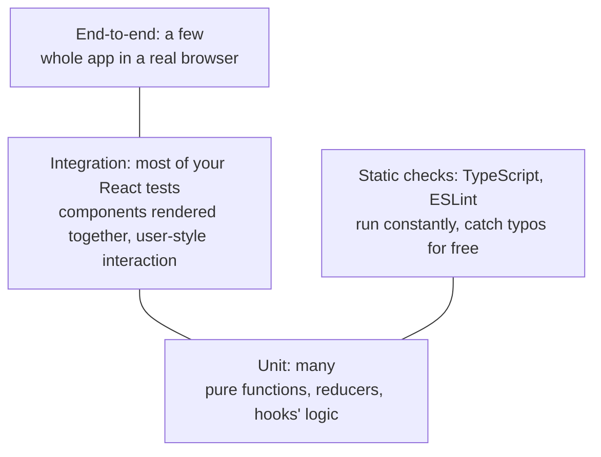

# Testing with Vitest and React Testing Library

> **Before this lesson:** you need components, state, forms and data fetching from this track (up to [Forms](#/lesson/react/forms)) and `async`/`await`. General testing ideas are introduced in [Bugs, strict mode, testing and debugging](#/lesson/javascript/bugs-strict-testing) in the JavaScript track; none are assumed here.

## In plain words

Before an aeroplane leaves the gate, the crew runs a checklist: flaps move, lights work, doors are locked. Nobody expects a failure, and that is the point. The checklist is fast, it is the same every time, and it catches the one day something is wrong before anyone is in the air.

An **automated test** is a checklist item written as code: a small program that uses a piece of your application and checks that the result is what you expect. A computer can run hundreds of them in seconds, on every change. Without tests, each change to a growing application is a gamble that something three screens away still works.

Two tools dominate React projects built with Vite:

- **Vitest** is the **test runner**: it finds your test files, runs them and reports passes and failures.
- **React Testing Library** (RTL) renders components in a simulated browser and lets a test find things on the screen and interact with them the way a person would.

Being able to write tests is expected in most front-end jobs, and "how would you test this component?" is a routine interview question.

## Kinds of tests

- A **unit test** checks one small piece in isolation, typically a pure function such as a reducer or a validator. Fast and precise.
- An **integration test** checks several pieces working together: a form component with its inputs, validation and submit handler. In React this is where most of the value is.
- An **end-to-end (E2E) test** drives the whole application in a real browser against a real or realistic back end, with a tool such as Playwright or Cypress. Slowest, most realistic; keep a few for critical journeys (sign in, checkout).



## Setup

```bash
npm install -D vitest jsdom @testing-library/react @testing-library/user-event @testing-library/jest-dom
```

- `-D` records these as development-only dependencies.
- `jsdom` is a simulated browser DOM written in JavaScript, so tests can run in Node without opening a browser window.
- `@testing-library/user-event` simulates realistic typing and clicking.
- `@testing-library/jest-dom` adds readable checks such as `toBeInTheDocument()`.

Tell Vite's config about the test environment:

```javascript
// vite.config.js
import { defineConfig } from "vite";
import react from "@vitejs/plugin-react";

export default defineConfig({
  plugins: [react()],
  test: {
    environment: "jsdom",
    globals: true,
    setupFiles: "./src/setupTests.js",
  },
});
```

```javascript
// src/setupTests.js
import "@testing-library/jest-dom/vitest";
```

- `environment: "jsdom"` gives every test a fake `document`.
- `globals: true` makes `describe`, `it`, `expect` and `vi` available without importing them.
- `setupFiles` runs once before each test file; here it registers the extra matchers.

Add `"test": "vitest"` to the scripts in `package.json`. `npm test` then starts Vitest in **watch mode**: it re-runs the affected tests each time you save.

## A first unit test

Test files sit next to the code they test and end in `.test.js` (or `.test.jsx`, `.test.tsx`).

```javascript
// hikesReducer.test.js
import { describe, it, expect } from "vitest";
import { hikesReducer } from "./hikesReducer";

describe("hikesReducer", () => {
  it("adds a hike that is not done", () => {
    const next = hikesReducer([], { type: "added", id: "h1", name: "Ridge Loop" });
    expect(next).toEqual([{ id: "h1", name: "Ridge Loop", done: false }]);
  });

  it("does not mutate the previous state", () => {
    const before = [{ id: "h1", name: "Ridge Loop", done: false }];
    const after = hikesReducer(before, { type: "toggled", id: "h1" });
    expect(before[0].done).toBe(false);
    expect(after).not.toBe(before);
  });
});
```

- `describe("name", fn)` groups related tests under a heading in the report.
- `it("does something", fn)` defines one test. (`test` is an alias.) The description should read as a sentence about behaviour.
- `expect(value)` starts an **assertion**: a statement that must hold, or the test fails.
- `.toEqual(x)` compares structure recursively (deep equality): right for objects and arrays.
- `.toBe(x)` compares identity (`Object.is`): right for primitives and for "is this the very same object?".
- `.not` inverts any matcher.

Most tests follow three steps, often called **arrange, act, assert**: set up the inputs, perform the action, check the outcome. Pure functions are the easiest thing in the world to test, which is one more reason to keep logic in reducers and helper functions.

## Testing a component like a user

React Testing Library's guiding idea: *test what the user can see and do, not how the component is built*. A user does not know about state variables or CSS class names. They see a button labelled "Add" and a text field labelled "Hike name".

The component:

```jsx
export function AddHike({ onAdd }) {
  const [name, setName] = useState("");

  function handleSubmit(event) {
    event.preventDefault();
    if (name.trim() === "") return;
    onAdd(name.trim());
    setName("");
  }

  return (
    <form onSubmit={handleSubmit}>
      <label htmlFor="hike-name">Hike name</label>
      <input id="hike-name" value={name} onChange={(e) => setName(e.target.value)} />
      <button type="submit">Add</button>
    </form>
  );
}
```

The test:

```jsx
// AddHike.test.jsx
import { render, screen } from "@testing-library/react";
import userEvent from "@testing-library/user-event";
import { AddHike } from "./AddHike";

it("calls onAdd with the trimmed name and clears the field", async () => {
  const user = userEvent.setup();
  const onAdd = vi.fn();
  render(<AddHike onAdd={onAdd} />);

  const input = screen.getByLabelText("Hike name");
  await user.type(input, "  Fern Gully ");
  await user.click(screen.getByRole("button", { name: "Add" }));

  expect(onAdd).toHaveBeenCalledTimes(1);
  expect(onAdd).toHaveBeenCalledWith("Fern Gully");
  expect(input).toHaveValue("");
});
```

Line by line:

- `userEvent.setup()` creates a simulated user.
- `vi.fn()` creates a **mock function**: a stand-in that records how it was called. `vi` is Vitest's helper object.
- `render(<AddHike onAdd={onAdd} />)` renders the component into the simulated document.
- `screen.getByLabelText("Hike name")` finds the form control associated with that label. If the label were missing or not connected to the input, the test would fail, and so would a screen-reader user. Good queries double as accessibility checks.
- `await user.type(...)` types character by character, firing the same events a browser would. User actions are asynchronous, so they are awaited.
- `screen.getByRole("button", { name: "Add" })` finds a button whose accessible name is "Add". A **role** is the kind of element as assistive technology sees it: `button`, `textbox`, `heading`, `link`, `checkbox`, `list`, `alert`, …
- The three `expect` lines check what a user-visible outcome would be: the callback received clean data once, and the field is empty.

Notice what the test does **not** mention: `useState`, the name of the state variable, the handler's name. You can rewrite the component with `useReducer` or a form library and the test still passes. A test that breaks only when behaviour changes is the goal.

### Choosing a query

| Query (in order of preference) | Finds by | Example |
|---|---|---|
| `getByRole` | role and accessible name | `getByRole("heading", { name: "Your hikes" })` |
| `getByLabelText` | a form field's label | `getByLabelText("Email")` |
| `getByPlaceholderText` | placeholder | fallback for unlabelled inputs |
| `getByText` | visible text | `getByText("No hikes yet.")` |
| `getByAltText` | image alt text | `getByAltText("Trail map")` |
| `getByTestId` | a `data-testid` attribute | last resort |

Each exists in three variants, and choosing correctly matters:

| Variant | Not found | Use for |
|---|---|---|
| `getBy…` | throws an error | things that should be there now |
| `queryBy…` | returns `null` | asserting something is **absent**: `expect(screen.queryByRole("alert")).not.toBeInTheDocument()` |
| `findBy…` | returns a promise; retries for about a second | things that appear **later**, after async work |

There are also `getAllBy…` versions that return arrays.

## Testing asynchronous components

A component that loads data shows "Loading…" first and the list later. The test needs a fake server response and must wait for the update.

```jsx
// HikeList.test.jsx
import { render, screen } from "@testing-library/react";
import { HikeList } from "./HikeList";

afterEach(() => {
  vi.restoreAllMocks();
});

it("shows hikes after loading", async () => {
  vi.spyOn(globalThis, "fetch").mockResolvedValue({
    ok: true,
    json: async () => [{ id: "h1", name: "Ridge Loop" }],
  });

  render(<HikeList />);

  expect(screen.getByText("Loading hikes…")).toBeInTheDocument();
  expect(await screen.findByText("Ridge Loop")).toBeInTheDocument();
  expect(screen.queryByText("Loading hikes…")).not.toBeInTheDocument();
});

it("shows an error when the server fails", async () => {
  vi.spyOn(globalThis, "fetch").mockResolvedValue({ ok: false, status: 500 });

  render(<HikeList />);

  expect(await screen.findByRole("alert")).toHaveTextContent("Server replied 500");
});
```

- `vi.spyOn(globalThis, "fetch")` replaces the global `fetch` with a mock for this test. `.mockResolvedValue(x)` makes it return a promise that resolves to `x`. This is **mocking**: substituting a controllable fake for a real dependency.
- The fake response has only what the component uses: `ok` and `json()`.
- The first assertion checks the loading state synchronously.
- `await screen.findByText("Ridge Loop")` keeps looking until the text appears or a timeout passes. Never use fixed sleeps in tests.
- `queryByText` then confirms the loading message is gone.
- `afterEach(() => vi.restoreAllMocks())` puts the real `fetch` back after every test, so tests cannot affect each other.

For applications with many requests, **Mock Service Worker** (MSW) is a better tool than stubbing `fetch` by hand: it intercepts requests at the network level and lets you define fake endpoints once for all tests.

Vitest can also control time for debounced or delayed code: `vi.useFakeTimers()` replaces the clock, `vi.advanceTimersByTime(300)` jumps ahead, and `vi.useRealTimers()` restores it.

## What to test, and what not to

Test:

- pure logic thoroughly (reducers, validators, formatters, selectors),
- each component's main behaviours through the screen: what is shown for each state (loading, empty, error, data), and what happens on the key interactions,
- bugs you have fixed, so they cannot quietly return (a **regression test**).

Avoid:

- **testing implementation details**: asserting on state values, on which internal function was called, or on CSS class names,
- testing the library ("does `useState` work?"),
- large **snapshot tests** (saving the whole rendered HTML and comparing it next time). They fail on every harmless markup change, and people learn to approve the differences without reading them,
- chasing 100% **coverage** (the percentage of lines executed by tests). Coverage shows what is untested; a high number does not show that the assertions are meaningful.

> [!INTERVIEW]
> "How do you test React components?" *With React Testing Library and a runner such as Vitest: render the component, find elements the way a user would (by role and label), interact with `userEvent`, and assert on what appears on screen and on calls to callbacks. Mock the network boundary, not internal functions. Unit-test pure logic separately, and keep a few end-to-end tests for critical flows.* If asked "`getBy` vs `queryBy` vs `findBy`", give the table above.

## Run it: a test runner in thirty lines

Vitest cannot run inside this page, but the ideas are small enough to build. Below is a tiny `describe` / `it` / `expect`, used to test a reducer. One test fails on purpose so that you can see a failure report.

```js-run
// ---------- a miniature test runner ----------
const results = [];
function describe(name, body) { console.log(name); body(); }
function it(name, body) {
  try { body(); console.log("  ✓ " + name); results.push(true); }
  catch (error) { console.log("  ✗ " + name + "\n      " + error.message); results.push(false); }
}
function expect(received) {
  const fail = (message) => { throw new Error(message); };
  return {
    toBe(expected) { if (!Object.is(received, expected)) fail(`expected ${JSON.stringify(received)} to be ${JSON.stringify(expected)}`); },
    toEqual(expected) { if (JSON.stringify(received) !== JSON.stringify(expected)) fail(`expected ${JSON.stringify(received)} to equal ${JSON.stringify(expected)}`); },
    get not() { return { toBe(expected) { if (Object.is(received, expected)) fail("expected a different value"); } }; },
  };
}

// ---------- the code under test ----------
function hikesReducer(hikes, action) {
  switch (action.type) {
    case "added": return [...hikes, { id: action.id, name: action.name, done: false }];
    case "toggled": return hikes.map((h) => (h.id === action.id ? { ...h, done: !h.done } : h));
    case "removed": return hikes.filter((h) => h.id !== action.id);
    default: return hikes;
  }
}

// ---------- the tests ----------
describe("hikesReducer", () => {
  it("adds a hike that is not done", () => {
    expect(hikesReducer([], { type: "added", id: "h1", name: "Ridge Loop" })).toEqual([{ id: "h1", name: "Ridge Loop", done: false }]);
  });
  it("toggles without mutating the previous state", () => {
    const before = [{ id: "h1", name: "Ridge Loop", done: false }];
    const after = hikesReducer(before, { type: "toggled", id: "h1" });
    expect(before[0].done).toBe(false);
    expect(after[0].done).toBe(true);
    expect(after).not.toBe(before);
  });
  it("removes by id", () => {
    expect(hikesReducer([{ id: "h1" }, { id: "h2" }], { type: "removed", id: "h1" })).toEqual([{ id: "h2" }]);
  });
  it("(deliberately wrong) expects two objects with equal content to be identical", () => {
    expect({ km: 3 }).toBe({ km: 3 });
  });
});
console.log(`\n${results.filter(Boolean).length} passed, ${results.filter((r) => !r).length} failed`);
```

The last test shows the difference between `toBe` (identity) and `toEqual` (structure). Change it to `toEqual` and run again.

And here is the Testing Library idea, finding by role and name and interacting like a user, running against a real DOM in the page:

```html-run
<div id="app"></div>
<pre id="report" style="background:#f4f4f4;padding:8px"></pre>
<script>
  // ---------- the "component" ----------
  function mountAddHike(container, onAdd) {
    container.innerHTML = `<form><label for="hike-name">Hike name</label> <input id="hike-name" /> <button type="submit">Add</button></form>`;
    const input = container.querySelector("input");
    container.querySelector("form").addEventListener("submit", (event) => {
      event.preventDefault();
      if (input.value.trim() === "") return;
      onAdd(input.value.trim());
      input.value = "";
    });
  }

  // ---------- miniature Testing Library queries ----------
  const screen = {
    getByLabelText(text) {
      const label = [...document.querySelectorAll("label")].find((l) => l.textContent === text);
      const field = label && document.getElementById(label.htmlFor);
      if (!field) throw new Error(`Unable to find a form control labelled "${text}"`);
      return field;
    },
    getByRole(role, { name }) {
      const found = [...document.querySelectorAll(role)].find((el) => el.textContent.trim() === name);
      if (!found) throw new Error(`Unable to find role "${role}" with name "${name}"`);
      return found;
    },
  };
  const user = {
    type(el, text) { for (const ch of text) { el.value += ch; el.dispatchEvent(new Event("input", { bubbles: true })); } },
    click(el) { el.click(); },
  };
  function mockFn() { const fn = (...args) => { fn.calls.push(args); }; fn.calls = []; return fn; }

  // ---------- the test ----------
  const lines = [];
  try {
    const onAdd = mockFn();
    mountAddHike(document.getElementById("app"), onAdd);
    const input = screen.getByLabelText("Hike name");
    user.type(input, "  Fern Gully ");
    user.click(screen.getByRole("button", { name: "Add" }));

    if (onAdd.calls.length !== 1) throw new Error("expected onAdd to be called once, got " + onAdd.calls.length);
    if (onAdd.calls[0][0] !== "Fern Gully") throw new Error("expected 'Fern Gully', got " + JSON.stringify(onAdd.calls[0][0]));
    if (input.value !== "") throw new Error("expected the field to be cleared");
    lines.push("✓ calls onAdd with the trimmed name and clears the field");
  } catch (error) { lines.push("✗ " + error.message); }
  document.getElementById("report").textContent = lines.join("\n");
</script>
```

Break the component in different ways and run again: remove `.trim()` from the `onAdd` call, delete the `for="hike-name"` attribute, rename the button to "Save". Each produces a failure message that says, in user terms, what is wrong.

## Pitfalls

> [!WARNING]
> **Using `getBy…` to check that something is not there.** `getBy` throws when nothing matches, so the test fails with a confusing error before reaching your assertion. Use `queryBy…` with `.not.toBeInTheDocument()`.

- **Not awaiting `user.click` / `user.type` or `findBy…`.** The assertions run before the UI has updated; you get false failures or, worse, false passes.
- **Asserting on async results with `getBy`.** Use `findBy` (or `waitFor`) for anything that appears after a promise or timer.
- **Selecting by class name or `container.querySelector`.** Ties the test to markup that users never see.
- **`fireEvent` where `userEvent` fits.** `fireEvent.change` dispatches a single synthetic event; `userEvent` performs the full sequence (focus, key down, input, key up), which catches more real bugs.
- **Mocking too much.** If you mock the component's own children or hooks, the test verifies your mocks. Mock at the boundary: network, time, storage.
- **Leaking state between tests** (un-restored mocks, shared variables). Each test must pass alone and in any order.
- **Testing only the happy path.** Add the error, empty and invalid-input cases.
- **"act" warnings ignored.** A warning that an update was "not wrapped in act(...)" means state changed after your test stopped waiting. Await the thing that causes it.

> [!TIP]
> When a query fails, call `screen.debug()` to print the current HTML, or use `screen.logTestingPlaygroundURL()` to get a suggestion for the best query. The error output of `getByRole` also lists every role it could see.

## Cheat sheet

| Task | Code |
|---|---|
| Group / define | `describe("x", () => { it("does y", () => {...}) })` |
| Deep vs identity equality | `expect(a).toEqual(b)` / `expect(a).toBe(b)` |
| Render | `render(<Component prop={value} />)` |
| Find now | `screen.getByRole("button", { name: /add/i })` |
| Assert absent | `expect(screen.queryByText("x")).not.toBeInTheDocument()` |
| Wait for it | `await screen.findByText("x")` |
| Type / click | `const user = userEvent.setup(); await user.type(el, "abc"); await user.click(el)` |
| Mock function | `const fn = vi.fn(); expect(fn).toHaveBeenCalledWith("x")` |
| Mock fetch | `vi.spyOn(globalThis, "fetch").mockResolvedValue({ ok: true, json: async () => data })` |
| Clean up mocks | `afterEach(() => vi.restoreAllMocks())` |
| Fake time | `vi.useFakeTimers(); vi.advanceTimersByTime(300)` |
| Run once / watch | `npx vitest run` / `npx vitest` |

## Summary

- Automated tests are repeatable checks that let you change code with confidence.
- Vitest runs tests; React Testing Library renders components and queries the result the way a user perceives it.
- Unit-test pure logic; integration-test components through roles, labels and visible text; keep a few end-to-end tests.
- `getBy` for present now, `queryBy` for absent, `findBy` for appears later.
- Simulate users with `userEvent`, and mock only at the boundaries (network, time).
- Test behaviour, not implementation details, so refactoring does not break tests.

## Glossary

- **Automated test**: code that exercises other code and checks the outcome.
- **Test runner**: the program that discovers, runs and reports tests (Vitest).
- **Assertion**: a check that must hold, written with `expect`.
- **Matcher**: the method after `expect(...)`, such as `toBe` or `toEqual`.
- **Unit / integration / end-to-end test**: testing one piece / several pieces together / the entire app in a browser.
- **jsdom**: a simulated browser DOM for running tests in Node.
- **Query**: a Testing Library function that finds elements (`getByRole`, …).
- **Role / accessible name**: the kind of an element and its label as assistive technology sees them.
- **Mock**: a controllable fake standing in for a real dependency.
- **Regression test**: a test added after a bug fix to stop the bug returning.
- **Snapshot test**: a test comparing rendered output with a stored copy.
- **Coverage**: the share of code executed by the test suite.
- **Watch mode**: re-running tests automatically when files change.

## Check yourself

```quiz
[
  {"q": "expect({ a: 1 }).toBe({ a: 1 }) — does this assertion pass?",
   "options": ["Yes, the contents are equal", "No: toBe checks identity and these are two different objects; use toEqual", "Only in watch mode", "It throws a syntax error"],
   "answer": 1,
   "explain": "toBe uses Object.is. toEqual compares structure recursively."},
  {"q": "Which query should you use to assert that an error message is NOT on screen?",
   "options": ["getByRole('alert')", "findByRole('alert')", "queryByRole('alert')", "getAllByRole('alert')"],
   "answer": 2,
   "explain": "queryBy returns null when nothing matches, which you can assert on. getBy would throw."},
  {"q": "A list appears after a fetch resolves. Which line correctly waits for it?",
   "options": ["screen.getByText('Ridge Loop')", "await screen.findByText('Ridge Loop')", "screen.queryByText('Ridge Loop')", "setTimeout(() => screen.getByText('Ridge Loop'), 1000)"],
   "answer": 1,
   "explain": "findBy returns a promise that retries until the element appears or a timeout passes."},
  {"q": "Why does React Testing Library encourage getByRole and getByLabelText over selecting by CSS class?",
   "options": ["They are faster", "They reflect how users and assistive technology find elements, so tests survive refactoring and check accessibility", "Classes are not supported in jsdom", "Roles are required by Vitest"],
   "answer": 1,
   "explain": "Class names are implementation details. Roles and labels are part of the user-facing contract."},
  {"q": "What does vi.fn() create?",
   "options": ["A real network request", "A mock function that records its calls so you can assert on them", "A fake timer", "A component"],
   "answer": 1,
   "explain": "Mock functions let you check that a callback prop was called, how often and with what."},
  {"q": "A test renders a component with a counter starting at 0, clicks the + button twice with awaited user.click, then checks the screen. Which assertion is the most robust?",
   "options": ["expect(component.state.count).toBe(2)", "expect(screen.getByText('Count: 2')).toBeInTheDocument()", "expect(setCount).toHaveBeenCalledTimes(2)", "expect(container.querySelector('.count').className).toBe('count')"],
   "answer": 1,
   "explain": "Assert on what the user sees. State and internal function calls are implementation details."},
  {"q": "What is the main weakness of large snapshot tests?",
   "options": ["They cannot run in jsdom", "They fail on any markup change, relevant or not, and reviewers tend to approve the updates without reading them", "They are slow to write", "They require a real browser"],
   "answer": 1,
   "explain": "A test that fails for harmless changes trains people to ignore it."},
  {"q": "Where is the best place to mock when testing a component that fetches data?",
   "options": ["Mock the component's useState", "Mock the child components", "Mock the network boundary (fetch or the server via MSW)", "Mock React itself"],
   "answer": 2,
   "explain": "Faking the outer boundary keeps all of your own code under test."}
]
```

> **Source:** Wieruch, *The Road to React*, "React Maintenance": Testing in React (the book's examples use an earlier runner; the commands here follow current Vitest and Testing Library docs). Documentation: https://vitest.dev/guide/, https://testing-library.com/docs/react-testing-library/intro/, https://testing-library.com/docs/queries/about
